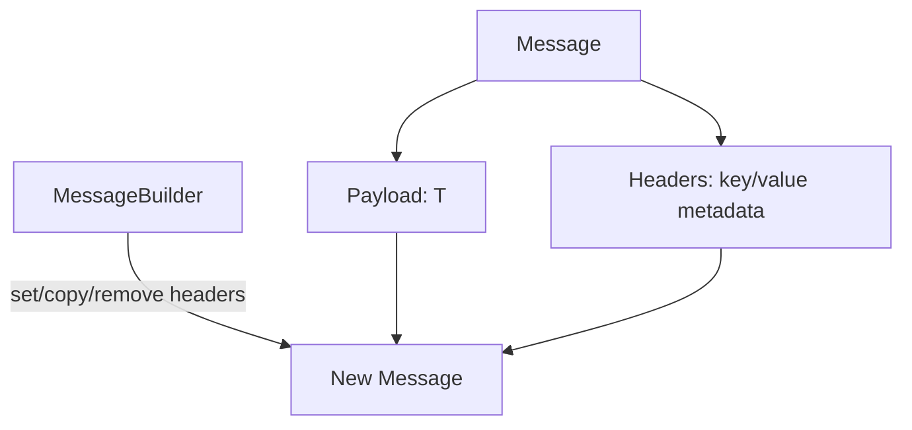

# Creating and Copying Messages with MessageBuilder

## 1. Messages in Spring Messaging

Spring Cloud Stream transfers data between application functions and brokers as messages. In Spring Messaging, a message consists of two parts:

- **Payload:** the primary data, such as an `OrderCreated` object, a string, or a byte array.
- **Headers:** metadata describing the message, such as content type, correlation ID, event ID, business key, or routing information.

The `Message<T>` type represents a payload of type `T` along with a set of headers. `MessageBuilder<T>` provides an API to create a new message or build one based on an existing message. You can set, copy, add, and remove headers before calling `build()`.



A message is a data wrapper used within the application. When sent over Kafka, RabbitMQ, or Pulsar, the binder and message converter translate the message into a format suitable for the broker. Spring's internal headers are not necessarily transmitted verbatim over the network; only metadata supported by the binder or mapped to the broker protocol can appear on the receiving side.

## 2. Creating a New Message with MessageBuilder

The most basic way is to use `MessageBuilder.withPayload(payload)` to start creating a message. Then, add the required headers and call `build()`:

```java
import org.springframework.messaging.Message;
import org.springframework.messaging.support.MessageBuilder;
import org.springframework.messaging.MessageHeaders;
import org.springframework.util.MimeTypeUtils;

record OrderCreated(String orderId, long totalCents) {}

Message<OrderCreated> message = MessageBuilder
    .withPayload(new OrderCreated("ORD-1001", 259900L))
    .setHeader("eventId", "evt-8f21")
    .setHeader("eventType", "OrderCreated")
    .setHeader("aggregateId", "ORD-1001")
    .setHeader(MessageHeaders.CONTENT_TYPE, MimeTypeUtils.APPLICATION_JSON)
    .build();
```

In this example:

- `withPayload` sets the payload of the message.
- `setHeader` adds metadata as key/value pairs.
- `MessageHeaders.CONTENT_TYPE` is the standard Spring Messaging content type header.
- `build()` finalizes the message and returns `Message<OrderCreated>`.

`MessageBuilder` allows setting many types of header values, but for messages sent across a broker, prefer simple data types that can be converted or serialized reliably, such as strings, numbers, booleans, and types supported by the binder. Avoid putting arbitrary Java objects, internal channels, or in-process resource references into headers of messages that need to travel over the network.

### Creating a Message with a String or Byte Array Payload

A payload does not have to be a record or DTO. You can create a message with a string:

```java
Message<String> notification = MessageBuilder
    .withPayload("Order ORD-1001 has been confirmed")
    .setHeader("eventType", "OrderConfirmed")
    .setHeader(MessageHeaders.CONTENT_TYPE, MimeTypeUtils.TEXT_PLAIN)
    .build();
```

Or use `byte[]` when the application already has encoded data:

```java
import org.springframework.http.MediaType;

byte[] documentBytes = loadDocument();

Message<byte[]> documentMessage = MessageBuilder
    .withPayload(documentBytes)
    .setHeader("documentId", "DOC-77")
    .setHeader(MessageHeaders.CONTENT_TYPE, MediaType.APPLICATION_OCTET_STREAM)
    .build();
```

The content type describes the data format so converters and receivers know how to handle it. Setting a JSON header does not automatically turn a Java object into JSON; serialization is still performed by the configured message converter or encoding mechanism.

## 3. Copying an Existing Message

When a consumer receives a `Message<T>`, it sometimes needs to add metadata while preserving the original payload and existing headers. `MessageBuilder.fromMessage(existingMessage)` creates a builder from that message:

```java
import org.springframework.messaging.Message;
import org.springframework.messaging.support.MessageBuilder;

Message<OrderCreated> auditedMessage = MessageBuilder
    .fromMessage(message)
    .setHeader("auditState", "checked")
    .setHeader("processedBy", "order-audit")
    .build();
```

The builder retains the payload and copies copyable headers from the original message, then allows adding or modifying headers before building. The original message is not mutated. The result is a new message with the same payload type.

This is the right choice when you only need to add metadata and keep the payload unchanged. If you need to change the payload type or content, create a builder with `withPayload(newPayload)` and copy the required headers.

## 4. Replacing the Payload While Preserving Needed Metadata

A `Function` often receives a message, transforms the payload, and emits a new message. For example, converting `OrderCreated` into `OrderAccepted` while keeping the event ID and correlation ID:

```java
import java.util.function.Function;
import org.springframework.context.annotation.Bean;
import org.springframework.context.annotation.Configuration;
import org.springframework.messaging.Message;
import org.springframework.messaging.MessageHeaders;
import org.springframework.messaging.support.MessageBuilder;
import org.springframework.util.MimeTypeUtils;

record OrderCreated(String orderId, long totalCents) {}
record OrderAccepted(String orderId, long totalCents, String status) {}

@Configuration
class OrderFunctions {

    static final String EVENT_ID = "eventId";
    static final String CORRELATION_ID = "correlationId";

    @Bean
    Function<Message<OrderCreated>, Message<OrderAccepted>> acceptOrder() {
        return input -> {
            OrderCreated order = input.getPayload();
            OrderAccepted accepted = new OrderAccepted(
                order.orderId(), order.totalCents(), "ACCEPTED"
            );

            var builder = MessageBuilder.withPayload(accepted)
                .setHeader(MessageHeaders.CONTENT_TYPE, MimeTypeUtils.APPLICATION_JSON)
                .setHeader("eventType", "OrderAccepted");

            Object eventId = input.getHeaders().get(EVENT_ID);
            if (eventId != null) {
                builder.setHeader(EVENT_ID, eventId);
            }

            Object correlationId = input.getHeaders().get(CORRELATION_ID);
            if (correlationId != null) {
                builder.setHeader(CORRELATION_ID, correlationId);
            }

            return builder.build();
        };
    }
}
```

This example explicitly selects which headers to preserve rather than copying everything. `eventId` helps identify the event; `correlationId` connects processing steps of the same request or workflow. The `eventType` header is updated to match the output event type, and the content type is set appropriately for the new payload.

In real applications, clearly distinguish which headers carry meaning across the entire flow and which apply only to a single hop. If you change the payload while keeping an outdated schema or event type header, consumers may misinterpret the data.

## 5. Common Header Operations

`MessageBuilder` provides several methods to manipulate headers:

| Method | Purpose | Behavior to Remember |
|---|---|---|
| `setHeader(name, value)` | Adds or replaces a header value | Overwrites an existing value with the same name; a `null` value removes the header |
| `setHeaderIfAbsent(name, value)` | Sets only if the header does not exist | Preserves any existing value |
| `copyHeaders(map)` | Copies key/value pairs from a map | Copied headers may overwrite existing values |
| `copyHeadersIfAbsent(map)` | Copies missing headers | Does not overwrite existing headers |
| `removeHeader(name)` | Removes a header | Useful for stripping metadata that is no longer relevant |
| `removeHeaders(patterns...)` | Removes headers matching name patterns | Use carefully so essential metadata is not deleted |
| `build()` | Creates the finalized message | Completes the message construction process |

### Setting a Header Only If Absent

When a processing layer wants to provide default values while respecting values sent by the producer, use `setHeaderIfAbsent`:

```java
Message<OrderCreated> enriched = MessageBuilder
    .fromMessage(message)
    .setHeaderIfAbsent("sourceSystem", "order-service")
    .setHeaderIfAbsent("schemaVersion", 1)
    .build();
```

If the message already has `sourceSystem`, the existing value is preserved. If not, the builder adds the default value.

### Copying Headers from a Map

`copyHeaders` is useful when a component has already prepared metadata in a map:

```java
import java.util.Map;

Map<String, Object> traceHeaders = Map.of(
    "correlationId", "corr-2026-001",
    "sourceSystem", "checkout"
);

Message<OrderCreated> traced = MessageBuilder
    .withPayload(new OrderCreated("ORD-1002", 149000L))
    .copyHeaders(traceHeaders)
    .build();
```

If you want to keep values already set on the builder, use `copyHeadersIfAbsent` instead of `copyHeaders`:

```java
Message<OrderCreated> prioritized = MessageBuilder
    .withPayload(new OrderCreated("ORD-1003", 99000L))
    .setHeader("sourceSystem", "trusted-gateway")
    .copyHeadersIfAbsent(traceHeaders)
    .build();
```

In this case, `sourceSystem` remains `trusted-gateway` because the header was set before copying.

### Removing Headers

When passing a message across a different boundary, you may need to strip temporary metadata:

```java
Message<OrderCreated> cleanMessage = MessageBuilder
    .fromMessage(message)
    .removeHeader("temporaryDebugInfo")
    .removeHeader("internalRoutingHint")
    .build();
```

Only remove a header once you understand where it is used. A header might be relied upon by a binder, converter, interceptor, or downstream handler for routing, acknowledgement, or tracing.

## 6. Copy All Headers or Keep Only Selected Ones?

`copyHeaders(existingMessage.getHeaders())` is convenient when forwarding a message and wanting to retain most metadata. However, copying all headers can carry along information that only has meaning within the internal scope of an application or binder.

For example, headers may contain:

- Internal routing information or channel names.
- Delivery tags, acknowledgement handles, or client resource references.
- Kafka-, RabbitMQ-, or Pulsar-specific headers.
- Authentication data or sensitive information.
- The content type or event type of the old payload.

These headers may be invalid at the new destination, non-serializable, or leak unintended information. When transforming payloads or sending messages to a different broker or destination, use an allow-list: copy only the business headers that need to be preserved.

```java
Message<OrderAccepted> output = MessageBuilder
    .withPayload(acceptedOrder)
    .setHeader("eventId", input.getHeaders().get("eventId"))
    .setHeader("correlationId", input.getHeaders().get("correlationId"))
    .setHeader("aggregateId", acceptedOrder.orderId())
    .setHeader("eventType", "OrderAccepted")
    .setHeader(MessageHeaders.CONTENT_TYPE, MimeTypeUtils.APPLICATION_JSON)
    .build();
```

In this example, the new payload receives metadata appropriate for the output event. Unnecessary transport headers from the input message are not copied.

## 7. System Headers and Business Headers

Not all headers are freely set by the application. Spring Messaging manages certain system headers such as ID and timestamp. These headers may be generated automatically when a message is constructed; they have their own protection rules and should not be used to store business IDs.

You should distinguish between:

| Header Group | Examples | Usage |
|---|---|---|
| Spring system headers | `id`, `timestamp`, `contentType` | Follow Spring Messaging and converter conventions |
| Business headers | `eventId`, `aggregateId`, `schemaVersion` | Defined by the application and agreed upon between producer and consumer |
| Tracing headers | `correlationId`, `traceId` | Track a workflow across multiple components |
| Binder/broker headers | Kafka-, RabbitMQ-, or Pulsar-specific headers | Use only according to the corresponding binder and broker contract |

Do not overwrite framework-managed IDs or timestamps. If you need a stable event identifier across redeliveries, create a business header such as `eventId`. The internal ID of a new `Message` instance is not necessarily the business event ID.

## 8. How Do Headers Affect Conversion and Routing?

### Content Type

The `contentType` header along with binding configuration helps Spring Cloud Stream and message converters determine how to convert the payload. For example, a Java payload can be serialized to JSON when sent if a matching converter is configured. When the consumer receives data, the content type helps select how to decode and convert it into the function's input type.

Setting a content type does not replace the serialization step. Whether the payload is `byte[]`, a string, or an object, the converter handles it according to its type and configuration. Check both the message header and the binding's `content-type` when investigating conversion errors.

### Partition Key and Routing Metadata

An application can set a business header such as `aggregateId` or `partitionKey`, then configure the producer to use that header as the partition key. For example:

```yaml
spring:
  cloud:
    stream:
      bindings:
        publishOrder-out-0:
          destination: orders.events
          producer:
            partition-key-expression: headers['aggregateId']
            partition-count: 6
```

The message-producing function can attach `aggregateId`:

```java
Message<OrderCreated> outgoing = MessageBuilder
    .withPayload(orderCreated)
    .setHeader("aggregateId", orderCreated.orderId())
    .build();
```

With appropriate configuration, the producer binder can use the header value as the partition key. How the expression is evaluated and how the key is mapped depend on the binder, version, and partitioning configuration. The header must be present before the message passes through the producer binding.

### Correlation and Tracing

`correlationId` is business or integration metadata that links messages belonging to the same workflow. `traceId` may be managed by tracing and instrumentation systems. When forwarding messages, follow the tracing rules of your application and libraries; do not manually generate or overwrite trace headers if the tracing system already manages them.

## 9. Message Immutability and Limitations of Copying

After `build()`, the message and its header set are designed to follow an immutable model. To change headers, create a new builder from the current message and build a new message. Do not modify the header map of an already created message directly.

However, message immutability does not automatically make the payload or objects stored in headers immutable. If the payload is a mutable object, multiple messages may reference the same object. Modifying the object after building can cause observed data to change unexpectedly. Similarly, a header holding a mutable collection or object can be modified if other code retains a reference to it.

When a stable data snapshot is needed, use immutable records/DTOs or create appropriate copies of the payload and header values. For messages sent over a broker, prefer data that serializes cleanly and does not depend on the sender process's state.

## 10. Integration Examples in Supplier, Function, and Consumer

### Supplier Creating Messages

A Supplier can emit messages with payload and metadata:

```java
import java.util.UUID;
import java.util.function.Supplier;
import org.springframework.context.annotation.Bean;
import org.springframework.context.annotation.Configuration;
import org.springframework.messaging.Message;
import org.springframework.messaging.support.MessageBuilder;

record StockSnapshot(String sku, int available) {}

@Configuration
class StockFunctions {

    @Bean
    Supplier<Message<StockSnapshot>> stockSnapshot() {
        return () -> MessageBuilder
            .withPayload(new StockSnapshot("SKU-100", 42))
            .setHeader("eventId", UUID.randomUUID().toString())
            .setHeader("eventType", "StockSnapshot")
            .build();
    }
}
```

Each time the supplier is invoked, the example generates a new event ID for the new snapshot. For polling suppliers, ensure each emission reflects fresh data or implement deduplication if the same state is read repeatedly.

### Function Transforming Messages

A Function can accept and return `Message` to control headers:

```java
import java.util.function.Function;
import org.springframework.context.annotation.Bean;
import org.springframework.messaging.Message;
import org.springframework.messaging.support.MessageBuilder;

@Bean
Function<Message<StockSnapshot>, Message<StockSnapshot>> enrichStock() {
    return input -> MessageBuilder
        .fromMessage(input)
        .setHeader("processedBy", "inventory-projection")
        .setHeaderIfAbsent("schemaVersion", 1)
        .build();
}
```

This example keeps the payload and adds processing metadata. If a Function changes the payload structure, create a builder with the new payload and keep only headers that remain meaningful.

### Consumer Reading Payload and Headers

A Consumer can accept `Message<T>` to access both payload and metadata:

```java
import java.util.function.Consumer;
import org.springframework.context.annotation.Bean;
import org.springframework.messaging.Message;

@Bean
Consumer<Message<StockSnapshot>> recordStock() {
    return message -> {
        StockSnapshot snapshot = message.getPayload();
        String eventId = (String) message.getHeaders().get("eventId");
        String eventType = (String) message.getHeaders().get("eventType");

        // Check eventId to support idempotency before writing data.
        saveSnapshot(snapshot, eventId, eventType);
    };
}
```

Consumers should only rely on headers defined in the agreed contract. If an optional header may be absent, check for `null` and validate its data type before using it.

## 11. Testing Messages and Headers

When testing functions that create or transform messages, verify both the payload and key headers:

1. Is the payload of the expected type and value?
2. Are the event ID and correlation ID preserved or generated according to the rules?
3. Does the content type match the output payload?
4. Which old headers are kept, modified, or removed?
5. Are unnecessary binder/broker headers accidentally forwarded?
6. Can the message be serialized and deserialized according to the consumer's contract?

Simple test example:

```java
import static org.assertj.core.api.Assertions.assertThat;
import org.junit.jupiter.api.Test;
import org.springframework.messaging.Message;
import org.springframework.messaging.support.MessageBuilder;

record OrderCreated(String orderId, long totalCents) {}

class MessageBuilderTest {

    @Test
    void copiesBusinessHeadersWhenCreatingANewPayload() {
        Message<OrderCreated> input = MessageBuilder
            .withPayload(new OrderCreated("ORD-2001", 120000L))
            .setHeader("eventId", "evt-2001")
            .setHeader("correlationId", "corr-2001")
            .build();

        Message<String> output = MessageBuilder
            .withPayload("ORD-2001 accepted")
            .setHeader("eventId", input.getHeaders().get("eventId"))
            .setHeader("correlationId", input.getHeaders().get("correlationId"))
            .setHeader("eventType", "OrderAccepted")
            .build();

        assertThat(output.getPayload()).isEqualTo("ORD-2001 accepted");
        assertThat(output.getHeaders().get("eventId")).isEqualTo("evt-2001");
        assertThat(output.getHeaders().get("correlationId")).isEqualTo("corr-2001");
        assertThat(output.getHeaders().get("eventType")).isEqualTo("OrderAccepted");
    }
}
```

This is a message-level test inside the application. Integration tests with Kafka, RabbitMQ, or Pulsar are still needed to verify which headers are actually propagated by the binder across the broker, how data types are serialized, and what metadata the consumer receives.

## 12. Common Mistakes and How to Handle Them

### Header Does Not Appear at the Consumer

The header may have been ignored by the converter or binder, not mapped to a transport header, or not serializable. Check the header data type, binder configuration, message converter, and broker limits. Do not assume all internal Spring headers travel across the network.

### New Header Overwrites Old Value

`copyHeaders` can overwrite headers that were already set. If you want to retain existing values, use `copyHeadersIfAbsent` or set the header after the copy call. The order of method calls on the builder determines the final value.

### Stale Metadata Retained When Payload Changes

When using `fromMessage` or copying all headers, old content type, event type, or schema metadata may no longer be accurate. Update or remove related headers whenever changing the payload.

### Unable to Overwrite System Headers

Some Spring-managed headers, such as ID or timestamp, may be protected or auto-generated. Use dedicated business headers like `eventId` instead of trying to overwrite system headers.

### Message Mutated After Build

A message may be immutable at its outer wrapper, but a mutable payload or header value can still be altered through another reference. Use immutable objects or create copies when a stable data snapshot is required.

## 13. Guidelines for Using MessageBuilder

- Use `withPayload` when creating a message with a new payload.
- Use `fromMessage` when keeping the payload and starting from the current message's metadata.
- Use `copyHeaders` when intentionally copying and accepting overwrites; use `copyHeadersIfAbsent` when only filling in missing headers.
- Use `removeHeader` to strip metadata that is no longer valid.
- Maintain event ID, correlation ID, aggregate key, and schema version under a clear contract.
- Update content type and event type when the payload changes.
- Forward only needed headers; avoid blindly copying internal or sensitive metadata.
- Do not confuse setting a content type with serializing the payload.
- Test payload, headers, and conversion behavior through a real broker.

`MessageBuilder` helps construct cleanly structured messages in Spring Cloud Stream functions. When payloads and headers are managed intentionally, services can exchange traceable events, support correlation and partitioning, and avoid carrying incorrect or unsafe metadata across broker boundaries.
