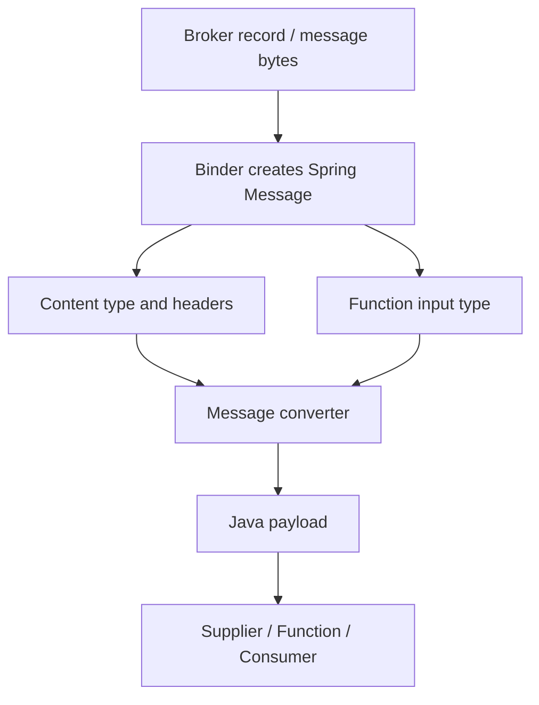

# Type Inference Limitations with Object, Collections, and Generic Types

## 1. Why Spring Cloud Stream Sometimes Cannot Know the Target Data Type

When a message arrives from Kafka, RabbitMQ, or Pulsar, the broker typically stores only the payload as bytes along with some metadata. Spring Cloud Stream uses content type, message converters, and the function's input type to convert the payload into a Java object. Conversion works well when the application declares a concrete target type, but may lack enough information when the target type is `Object`, a raw collection, or an unresolved generic type.

For example, a JSON object might represent an order:

```json
{
  "orderId": "ORD-1001",
  "totalCents": 259900
}
```

If the function declares its input as `OrderCreated`, the converter can instantiate an object of the right type. If the input is merely `Object`, the JSON data does not tell the application whether to instantiate `OrderCreated`, `PaymentRequest`, or another type with the same structure. The converter usually falls back to a generic representation such as `Map`.

The same issue arises with `List`, `Map`, or `Envelope<T>`: the collection type name indicates the outer structure, but does not necessarily specify the element type or type parameter `T`.

## 2. Information Sources Used in Conversion

In Spring Cloud Stream's processing flow, conversion typically relies on three groups of information:

1. **Content type:** describes the payload format, such as `application/json`, `text/plain`, or `application/octet-stream`.
2. **Function target type:** the input parameter type such as `OrderCreated`, `List<OrderCreated>`, `Message<OrderCreated>`, or `Object`.
3. **Message converter:** the component that knows how to convert the input format to the target Java type.



Content type and Java type answer two different questions. `application/json` states that the data is JSON; it does not determine which Java class the JSON object should become. The target type supplies that information if it is specific enough.

If the content type is missing or mismatched, the converter may choose a different handling path or fail to convert. If the content type is right but the target type is too generic, the result may still be a `Map`, `List`, or primitive wrapper instead of the desired DTO.

## 3. When the Input Is Object

### Object does not indicate a concrete type

Consider two function signatures:

```java
@Bean
Consumer<OrderCreated> typedConsumer() {
    return order -> process(order.orderId(), order.totalCents());
}

@Bean
Consumer<Object> genericConsumer() {
    return payload -> processUnknown(payload);
}
```

In `typedConsumer`, the function signature tells the converter the target type is `OrderCreated`. With `genericConsumer`, the target type is just `Object`. The converter does not have enough information to infer a domain class from JSON field names.

With Jackson and untyped JSON, objects are usually decoded as `Map` (typically `LinkedHashMap`), arrays as `List` (typically `ArrayList`), strings as `String`, and numbers and booleans as corresponding primitive wrapper types. Details depend on the converter and active configuration.

Consequently, the following code can throw a `ClassCastException`:

```java
Consumer<Object> consumer = payload -> {
    OrderCreated order = (OrderCreated) payload;
    process(order.orderId(), order.totalCents());
};
```

The actual payload may be a `LinkedHashMap`, not `OrderCreated`. Having `orderId` and `totalCents` fields in JSON does not automatically turn the object into a DTO.

### When is Object still appropriate?

`Object` is useful when an application genuinely needs to accept multiple payload types and route or convert them afterward. For example, a gateway receiving multiple event types from a shared destination. However, a contract is needed to distinguish message types, such as an `eventType` field, `schemaVersion`, or a centrally managed schema.

Do not use `Object` just to make code shorter. If a binding only receives a single event type, declaring a concrete DTO helps converters, the compiler, and readers understand the data contract clearly.

## 4. Raw Collections and Parameterized Collections

### Raw collections lose element information

These two signatures are not equivalent in type information:

```java
Consumer<List> rawListConsumer = items -> {
    Object first = items.get(0);
    processUnknown(first);
};

Consumer<List<OrderCreated>> orderListConsumer = orders -> {
    OrderCreated first = orders.get(0);
    process(first.orderId(), first.totalCents());
};
```

A raw `List` does not say what type its elements are. When decoding a JSON array, a converter can usually only construct a collection holding generic values like `Map`, `String`, or numbers. With `List<OrderCreated>`, the function signature preserves type parameter information in the class/method generic metadata so the framework has a chance to convert each element into `OrderCreated`.

Example of a function bean explicitly declaring the element type:

```java
import java.util.List;
import java.util.function.Consumer;
import org.springframework.context.annotation.Bean;
import org.springframework.context.annotation.Configuration;

record OrderCreated(String orderId, long totalCents) {}

@Configuration
class BatchOrderFunctions {

    @Bean
    Consumer<List<OrderCreated>> receiveOrders() {
        return orders -> orders.forEach(order ->
            process(order.orderId(), order.totalCents())
        );
    }
}
```

With a JSON array containing multiple order objects, the target type `List<OrderCreated>` tells the converter the desired element type. The outcome also depends on whether the message converter supports converting collections and that generic type.

### Nested collections

Generic type information becomes even more important with nested structures:

```java
Map<String, List<OrderCreated>> ordersByRegion;
```

The target type describes the key, the inner collection, and the element type. If only `Map` or `Map<String, List>` is declared, the converter does not know to instantiate `OrderCreated` at the inner level. The payload may become nested maps/lists with generic elements.

Declare full types at the message-receiving boundary. For complex data structures, an explicit DTO is often easier to maintain than deeply nested collections:

```java
record RegionOrders(String region, List<OrderCreated> orders) {}
```

## 5. Generic Types and Java Type Erasure

Java implements generics using type erasure. At runtime, a `List<OrderCreated>` instance does not carry a runtime attribute stating that all its elements are `OrderCreated`; its runtime class is still `ArrayList` or another `List` implementation.

However, the compiler generally preserves generic declaration information in class or method metadata. Frameworks can read signatures such as `Consumer<List<OrderCreated>>` via reflection and use that information when selecting the target type. Therefore, distinguish between:

- **Concretely parameterized generic type:** `List<OrderCreated>` retains element type information in the signature for the framework to use.
- **Raw type:** `List` has no type parameter and therefore does not indicate the element type.
- **Unresolved generic type:** `List<T>` only states that elements have type `T`, but if `T` is not bound to a concrete class in the runtime context, the framework cannot guess it automatically.

### Example of an unresolved type T

```java
class GenericOrderConsumer<T> {

    void accept(List<T> items) {
        // T cannot be resolved here without concrete type information.
    }
}
```

If a bean is created from a generic class where `T` remains a type variable, the framework may only see an unresolved type. Certain inheritance hierarchies or concrete bean declarations allow Spring to resolve generics through class metadata; however, do not assume every `T` can be inferred from JSON data.

If a fixed type is needed for a binding, declare the bean with a concrete type:

```java
@Bean
Consumer<List<OrderCreated>> receiveOrders() {
    return orders -> orders.forEach(this::processOrder);
}
```

If you need to reuse generic logic, extract the pure Java processing into a generic service while keeping concrete signatures on the function beans at the broker boundary. This gives Spring Cloud Stream stable type information.

## 6. Wrappers and Generic DTOs

A wrapper such as `Envelope<T>` helps standardize metadata and payloads:

```java
record Envelope<T>(
    String eventId,
    int schemaVersion,
    T data
) {}

record OrderCreated(String orderId, long totalCents) {}
```

The concrete type `Envelope<OrderCreated>` specifies that `data` must be `OrderCreated`. Conversely, `Envelope<?>`, `Envelope<Object>`, or `Envelope<T>` with an unresolved `T` may cause the converter to produce generic data for the `data` section.

When declaring a function, keep type parameters concrete:

```java
@Bean
Consumer<Envelope<OrderCreated>> receiveOrderEnvelope() {
    return envelope -> process(
        envelope.data().orderId(),
        envelope.data().totalCents()
    );
}
```

For wrappers containing collections, declare them completely:

```java
import java.util.List;
import java.util.function.Consumer;
import org.springframework.context.annotation.Bean;
import org.springframework.context.annotation.Configuration;

@Configuration
class OrderBatchFunctions {

    @Bean
    Consumer<Envelope<List<OrderCreated>>> receiveOrderBatch() {
        return envelope -> envelope.data().forEach(this::processOrder);
    }

    private void processOrder(OrderCreated order) {
        // Process each order in the batch.
    }
}
```

This provides crucial information for the converter to decode the wrapper, collection, and each element. If the target type is shortened to `Envelope` or `Envelope<Object>`, inner data may become generic `Map` or `List` instances.

## 7. Explicit Conversion When Target Types Are Not Specific Enough

There are situations where an application needs to receive flexible data. In those cases, convert explicitly once the event type and target type have been determined.

### Using ObjectMapper.convertValue for Map or Object

If the converter has already turned a JSON object into a `Map`, you can convert the map to a DTO using Jackson's `ObjectMapper`:

```java
import com.fasterxml.jackson.databind.ObjectMapper;
import org.springframework.stereotype.Component;

@Component
class OrderPayloadMapper {

    private final ObjectMapper objectMapper;

    OrderPayloadMapper(ObjectMapper objectMapper) {
        this.objectMapper = objectMapper;
    }

    OrderCreated toOrderCreated(Object payload) {
        return objectMapper.convertValue(payload, OrderCreated.class);
    }
}
```

`convertValue` is suitable when the payload is already an in-memory object like `Map`. If the payload is JSON bytes or a string, you can use `readValue` to decode directly.

### Using TypeReference for generic collections

When converting JSON into `List<OrderCreated>`, `OrderCreated[].class` or `List.class` is not enough to represent the generic element type. Jackson provides `TypeReference` to preserve type information:

```java
import com.fasterxml.jackson.core.type.TypeReference;
import com.fasterxml.jackson.databind.ObjectMapper;
import java.util.List;

class OrderBatchDecoder {

    private static final TypeReference<List<OrderCreated>> ORDER_LIST =
        new TypeReference<>() {};

    private final ObjectMapper objectMapper;

    OrderBatchDecoder(ObjectMapper objectMapper) {
        this.objectMapper = objectMapper;
    }

    List<OrderCreated> decode(Object payload) {
        return objectMapper.convertValue(payload, ORDER_LIST);
    }
}
```

If the input is JSON bytes:

```java
List<OrderCreated> orders = objectMapper.readValue(jsonBytes, ORDER_LIST);
```

`TypeReference` captures the generic type at the concrete declaration site. It cannot magically recover a `T` that was left blank or unresolved elsewhere.

### Receiving byte[] and decoding based on application decisions

For multi-event gateways, you can receive payloads as bytes so the application can select the schema itself:

```java
import java.io.IOException;
import java.util.function.Consumer;
import com.fasterxml.jackson.databind.ObjectMapper;
import org.springframework.context.annotation.Bean;
import org.springframework.context.annotation.Configuration;
import org.springframework.messaging.Message;

@Configuration
class RawEventFunctions {

    @Bean
    Consumer<Message<byte[]>> routeRawEvents(ObjectMapper objectMapper) {
        return message -> {
            String eventType = message.getHeaders().get("eventType", String.class);
            byte[] body = message.getPayload();

            if ("OrderCreated".equals(eventType)) {
                try {
                    OrderCreated event = objectMapper.readValue(body, OrderCreated.class);
                    handleOrderCreated(event);
                } catch (IOException ex) {
                    throw new IllegalArgumentException("Invalid OrderCreated payload", ex);
                }
            } else {
                throw new IllegalArgumentException("Unsupported event type: " + eventType);
            }
        };
    }

    private void handleOrderCreated(OrderCreated event) {
        // Forward the decoded event to the next business step.
    }
}
```

This is a deliberate approach for polymorphic payloads. Validate `eventType`, check content type, and restrict the list of allowed types. In production applications, you can pair this with retry policies or route invalid messages to a DLQ per binder configuration.

## 8. Handling Multiple Event Types on the Same Destination

A single destination may carry multiple event types. Do not infer Java classes solely from field names or attempt sequential trial casts. Design an explicit discriminator:

```json
{
  "eventType": "OrderCreated",
  "schemaVersion": 2,
  "data": {
    "orderId": "ORD-1001",
    "totalCents": 259900
  }
}
```

The application can decode the envelope first, read `eventType` and `schemaVersion`, and then select a DTO registered in an explicit registry. The registry should contain only classes allowed by the application:

```java
Map<String, Class<?>> eventTypes = Map.of(
    "OrderCreated", OrderCreated.class,
    "PaymentCompleted", PaymentCompleted.class
);
```

After looking up a valid type, you can call `ObjectMapper.convertValue` with that type. Do not enable Jackson default typing indiscriminately on untrusted data, because class info inside payloads can lead to instantiating unintended types. Use discriminators, allow-lists, and application-managed schema versions.

For large systems or multiple independent producers/consumers, consider a schema registry and schema-driven formats like Avro or Protobuf. A schema registry helps manage versions and compatibility rules; it still requires configuring corresponding serializers/deserializers and contracts across parties.

## 9. Configuring Content Type and Converters

Content type must reflect the actual payload format. For example:

```yaml
spring:
  cloud:
    function:
      definition: receiveOrders
    stream:
      bindings:
        receiveOrders-in-0:
          destination: orders.batch
          group: order-importer
          content-type: application/json
```

If the destination carries a JSON array, the function should declare an input type with concrete generics:

```java
@Bean
Consumer<List<OrderCreated>> receiveOrders() {
    return orders -> orders.forEach(this::processOrder);
}
```

Do not expect `content-type: application/json` to turn every object into the desired DTO type. The converter must be able to handle the target type, and the target type must carry sufficient information. If using a custom message converter, check precedence order and supported MIME types so another converter does not handle the message first.

When raw data is needed, use `byte[]` and decode at the application layer. This gives greater control, though the application assumes responsibility for validating content type, schema, encoding, and parse errors.

## 10. Common Type Inference Errors

| Symptom | Possible cause | Resolution |
|---|---|---|
| `ClassCastException` when casting `Object` to DTO | JSON was decoded as `Map` or generic type | Declare concrete DTO or convert explicitly |
| Elements of `List` are `LinkedHashMap` | Binding declared raw `List` or `List<Object>` | Use `List<OrderCreated>` or `TypeReference<List<OrderCreated>>` |
| `data` field in wrapper is a `Map` | Used `Envelope`, `Envelope<Object>`, or unresolved type variable | Use `Envelope<OrderCreated>` or decode explicitly |
| Conversion/JSON parse error | Wrong content type, invalid JSON, or converter does not support type | Check payload, content type, converter, and schema |
| Converted successfully but wrong event type | Destination carries multiple schemas without clear discriminator | Use event type, schema version, and allow-list registry |
| Metadata lost after conversion | Only forwarding payload or header unsupported by binder | Identify headers to preserve and check binder mapping |

Do not solve every error by changing the parameter to `Object`. Doing so usually delays the failure from conversion time to business processing time, where errors are harder to diagnose.

## 11. Testing Target Types and Real Data

Conversion tests should cover varied cases:

1. JSON object into a concrete DTO such as `OrderCreated`.
2. JSON object into `Object` and verifying the generic data structure returned by the converter.
3. JSON array into `List<OrderCreated>` and checking the type of each element.
4. JSON array into raw `List` to observe element type limitations.
5. Generic wrappers such as `Envelope<OrderCreated>` and `Envelope<List<OrderCreated>>`.
6. Unresolved generic types such as `Envelope<T>` in a generic bean.
7. Missing, wrong, or unsupported content types in custom converters.
8. Event types outside the allow-list and unsupported schema versions.

Example test using Jackson:

```java
import static org.assertj.core.api.Assertions.assertThat;
import com.fasterxml.jackson.core.type.TypeReference;
import com.fasterxml.jackson.databind.ObjectMapper;
import java.util.List;
import org.junit.jupiter.api.Test;

record OrderCreated(String orderId, long totalCents) {}

class OrderConversionTest {

    private final ObjectMapper mapper = new ObjectMapper();

    @Test
    void convertsArrayToTypedOrderList() throws Exception {
        String json = """
            [
              {"orderId":"ORD-1","totalCents":1000},
              {"orderId":"ORD-2","totalCents":2000}
            ]
            """;

        List<OrderCreated> orders = mapper.readValue(
            json,
            new TypeReference<List<OrderCreated>>() {}
        );

        assertThat(orders).hasSize(2);
        assertThat(orders.get(0).orderId()).isEqualTo("ORD-1");
    }
}
```

This test verifies Jackson's decoding capability for a concrete generic type. To test Spring Cloud Stream end-to-end, also test the bindings and converters configured in the application. The Test Binder is helpful for testing function flows in a lightweight environment; differences in header serialization, broker records, and custom converters should be integration-tested with the corresponding binder/broker.

## 12. Rules for Choosing Types at the Message Boundary

- Prefer concrete DTOs when a binding has a fixed data contract.
- Use `List<T>` or `Map<K, V>` with concrete type parameters; avoid raw collections.
- Do not expect the framework to infer `T` when a type variable is unresolved.
- For polymorphic payloads, use a discriminator and an allowed-type registry.
- For dynamic JSON data, consider `JsonNode` or `Map<String, Object>` and convert explicitly after determining the schema.
- Use `TypeReference` or equivalent type APIs when converting generic collections manually.
- Verify that content type, converter, and target type are mutually compatible.
- Test valid cases, missing metadata, mismatched schemas, and unsupported types.

Spring Cloud Stream can leverage generic type information stored by Java in function signatures, but it cannot guess a business type the application has not declared. `Object`, raw collections, and unresolved type variables all reduce the information available to converters. Designing clear function signatures, using schemas/discriminators when multiple event types exist, and performing explicit conversion at flexible boundaries help catch type errors early and keep data processing consistent.
