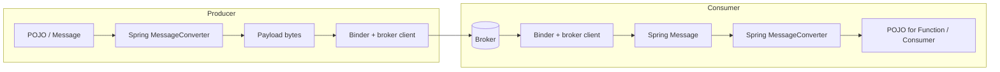

# Distinguishing Framework Conversion from Broker Client Serialization

## Objectives

In Spring Cloud Stream, applications typically work with Java objects such as `OrderCreated`, while brokers transmit and store data in byte formats accompanied by metadata. To bridge these two worlds, the system needs to convert payloads. Conversion can be performed by Spring Cloud Stream's message conversion mechanism or handled by the client and binder serializers/deserializers.

The two mechanisms are related but not synonymous. **Framework message conversion** converts payloads between data types in the Spring Messaging model based on content type and the function's target type. **Broker client serialization** turns keys/values or message bodies into the wire format used by the client/broker; the receiving side uses a corresponding deserializer or schema to restore the data.

This lesson helps identify which mechanism is active, how to configure content types, when native encoding/decoding is needed, and how to test data compatibility when deploying with Kafka, RabbitMQ, or Pulsar.

After this lesson, you will be able to:

- Distinguish message conversion, serialization, and deserialization.
- Describe the conversion flow on producers and consumers in Spring Cloud Stream.
- Use content type and payload types to select framework converters.
- Recognize when a binder uses the broker client's native serialization.
- Configure Kafka Serializer/Deserializer when choosing native encoding/decoding.
- Avoid overlapping converter configurations and test data formats at the proper layer.

## 1. Three Concepts to Distinguish

### Message conversion

Message conversion is the process of converting a payload from one type to another within the Spring Messaging model. For example, a POJO payload can be converted into JSON bytes when sending; when receiving, JSON bytes can be converted into a POJO matching the function's parameter type.

This mechanism operates on Spring `Message<?>`, payloads, headers, and content types. Converters can rely on `application/json`, `text/plain`, or other MIME types to decide how to convert.

### Serialization and deserialization

Serialization turns data into a byte representation for transmission or storage. Deserialization performs the reverse. Broker clients typically provide serializers for keys/values or message bodies, such as Kafka `Serializer` and `Deserializer`, RabbitMQ client/binder message converters, or Pulsar `Schema`.

Serialization may use JSON, Avro, Protobuf, String, byte arrays, or other formats. Brokers usually do not need to know the application's Java classes; they store and transmit bytes and metadata according to the protocol.

### Wire format

Wire format is the actual data representation sent over the network or stored in the broker. Two services may share the same understanding of a business event yet still be incompatible if their wire formats differ, such as one sending JSON while the other decodes as Avro.

| Concept | Where does it operate? | Typical inputs/outputs | Key question |
|---|---|---|---|
| Message conversion | Spring Messaging / Spring Cloud Stream | POJO, String, byte[], Spring Message | Which Java payload does the function receive or return? |
| Serialization | Client/binder before sending | Object/key/value → byte[] or native message | In what format is data written to the broker? |
| Deserialization | Client/binder when receiving | byte[] or native message → Object | To what type is data on the broker restored? |
| Wire format | Transmission and storage boundary | JSON, Avro, Protobuf, binary | Do producer and consumer share the same data contract? |

In some paths, the framework's converter produces a byte payload and the binder hands those bytes to the client. In the native path, the binder/client may use its own serializer to encode objects. Therefore, do not assume every application runs both mechanisms in the exact same fixed chain; identify the mode of each specific binding.

## 2. Spring Cloud Stream's Default Conversion Flow

In framework message conversion mode, the application can work with POJOs without manually calling Jackson or manipulating byte arrays.

DTO example:

```java
public record OrderCreated(
        String eventId,
        String orderId,
        BigDecimal total
) {}
```

A function receiving and returning payloads directly:

```java
@Bean
Function<OrderCreated, OrderAccepted> acceptOrder(OrderService service) {
    return event -> service.accept(event);
}
```

On the sending side, Spring Cloud Stream uses the content type and an appropriate converter to transform the payload into its wire representation. The binder accepts the message and sends it to the broker using its client. On the receiving side, the binder constructs a Spring Message from the received data; the framework converts the payload to the type requested by the function before invoking it.



This is the high-level model. Some binders may perform additional conversion or custom header mapping; when native encoding/decoding is enabled, client serializers/deserializers handle payload conversion instead of the framework's default converter path.

### Declaring content type

Content type describes the payload format so the framework can select a converter. Example:

```yaml
spring:
  cloud:
    function:
      definition: acceptOrder
    stream:
      bindings:
        acceptOrder-in-0:
          destination: orders.created
          group: order-service
          content-type: application/json
        acceptOrder-out-0:
          destination: orders.accepted
          content-type: application/json
```

With this configuration, the application declares JSON as the payload format on the bindings. The function still receives `OrderCreated` and returns `OrderAccepted`; the framework handles conversion at the message boundary.

Content type can be supplied by binding configuration or message metadata depending on the path and version. If producer and consumer do not agree on content type, or if the content type header is missing/wrong, the framework may choose an inappropriate converter or fail to convert the payload.

## 3. Broker Client Native Serialization Flow

Some binders allow bypassing default message conversion to use the broker client's native serialization/deserialization mechanism. With the Kafka binder, commonly used properties are:

- `useNativeEncoding` on producer bindings: uses a Kafka serializer to encode outbound data.
- `useNativeDecoding` on consumer bindings: uses a Kafka deserializer to restore inbound data.

Example Kafka native encoding/decoding configuration:

```yaml
spring:
  cloud:
    stream:
      bindings:
        orderCreated-out-0:
          destination: orders.created
          producer:
            use-native-encoding: true
        orderCreated-in-0:
          destination: orders.created
          group: order-service
          consumer:
            use-native-decoding: true

      kafka:
        bindings:
          orderCreated-out-0:
            producer:
              configuration:
                key.serializer: org.apache.kafka.common.serialization.StringSerializer
                value.serializer: org.springframework.kafka.support.serializer.JsonSerializer
          orderCreated-in-0:
            consumer:
              configuration:
                key.deserializer: org.apache.kafka.common.serialization.StringDeserializer
                value.deserializer: org.springframework.kafka.support.serializer.JsonDeserializer
                spring.json.value.default.type: com.example.events.OrderCreated
                spring.json.trusted.packages: com.example.events
```

The class names and properties in the example are Kafka client / Spring Kafka settings; verify dependency versions and your application's type mapping policy. Do not broaden trusted packages indiscriminately in systems receiving untrusted data.

When native encoding/decoding is enabled, the native serializer/deserializer is responsible for producing and reading the wire format. Do not expect the default Spring `MessageConverter` to convert POJOs on that same binding as in standard mode. Producers and consumers must use compatible serializers/deserializers; if one side uses a JSON serializer while the other uses an Avro deserializer, messages will not be decoded properly.

It is not required to enable native encoding and native decoding for all bindings. You can use framework conversion for one stream and native serialization for another, provided each binding's configuration is clear.

## 4. Content Type Is Not a Serializer

Two concepts are frequently confused:

- `content-type: application/json` is metadata describing the payload format in the Spring Cloud Stream model and helps the framework choose a converter.
- `value.serializer` is a Kafka client setting that determines how record values are encoded into bytes when using Kafka native serialization.

Setting content type to JSON does not automatically configure every Kafka client serializer. Conversely, choosing `JsonSerializer` in the Kafka client does not mean every Spring `MessageConverter` participates in conversion.

For instance, the following scenarios can occur:

| Configuration | Primary mechanism | Consequence |
|---|---|---|
| JSON content type, native encoding/decoding disabled | Framework MessageConverter | Framework converts POJOs and JSON payloads per binding |
| Kafka native encoding/decoding enabled, Kafka JsonSerializer/JsonDeserializer | Kafka client serializer/deserializer | Client handles JSON bytes and type restoration |
| Native encoding enabled but incompatible serializer | Kafka client serializer | Send failure or wire format mismatches consumer |
| Consumer receives bytes but content type/target type mismatches | Framework converter or deserializer depending on mode | Conversion error may occur before function executes |

A message may carry a `contentType` header, but do not assume that header replaces client serializer configuration. Verify which conversion path the binding is actually using.

## 5. Key and Value Can Be Serialized Separately

In Kafka, a record has a key and a value. Spring Cloud Stream functions normally work with the payload corresponding to the value; the key can be set via headers or the binder's partitioning mechanism. Serializers for key and value can differ, such as String for key and JSON for value.

```yaml
spring:
  cloud:
    stream:
      bindings:
        orderCreated-out-0:
          destination: orders.created
          producer:
            use-native-encoding: true
      kafka:
        bindings:
          orderCreated-out-0:
            producer:
              configuration:
                key.serializer: org.apache.kafka.common.serialization.StringSerializer
                value.serializer: org.springframework.kafka.support.serializer.JsonSerializer
```

When keys are used to partition by order ID, specify the key at the producer/binding using a binder-supported mechanism. A stable key ensures records with the same key are routed to the same partition, thereby supporting per-key ordering. The key is not part of the payload body, and the key serializer does not replace the value serializer.

RabbitMQ does not use Kafka-style key/value pairs. Routing keys and exchanges control routing; message bodies are converted by the AMQP/binder mechanism. Pulsar has its own message keys and schemas; keys and payloads likewise serve separate roles. Do not copy Kafka serializer settings directly to RabbitMQ or Pulsar.

## 6. Role of Each Binder

### Kafka binder

The Kafka client has serializer/deserializer interfaces for keys and values. When using native encoding/decoding, serializer/deserializer configurations and target types must stay synchronized between producer and consumer. For JSON, you can use Spring Kafka's serializer/deserializer; for Avro or Protobuf, you typically need schemas and matching serializers, often combined with a schema registry.

When using framework conversion, Spring Cloud Stream handles payload conversion based on content type and function type. The Kafka binder/client still transports bytes and record metadata, but the application should not configure a conflicting native `JsonSerializer` for the same payload.

### RabbitMQ binder

RabbitMQ uses AMQP message bodies, properties, and headers. Body conversion may involve Spring AMQP `MessageConverter` and Rabbit binder configuration. For instance, a JSON converter can turn a Java object into a JSON body and restore the payload on receipt.

Distinguish Spring Cloud Stream converters from converters at the Spring AMQP/Rabbit client layer. They may participate at different boundaries depending on binder mode. When customizing converters or enabling native decoding/encoding per binder capabilities, verify which converter is actually invoked and which content types/headers are transmitted.

### Pulsar binder

Pulsar has a Schema mechanism to describe and encode payloads, such as schemas for String, bytes, JSON, Avro, or Protobuf depending on the client and binder. When using native schemas, producers and consumers must be compatible on schemas and schema evolution strategies. The binder can provide integration with Pulsar schemas; exact capabilities depend on version and configuration.

Do not assume Pulsar Schema, Kafka Serdes, and Spring MessageConverter are the same abstraction. Each has its own APIs, metadata, and compatibility rules.

| Binder | Common native mechanism | What must stay synchronized |
|---|---|---|
| Kafka | Kafka Serializer/Deserializer for key/value | Serializer, deserializer, target type, schema/type mapping |
| RabbitMQ | AMQP body/properties and Spring AMQP MessageConverter | Converters on both sides, content type, header mapping |
| Pulsar | Pulsar Schema and client codec | Schema type, schema compatibility, payload type |

## 7. When Should You Use Framework Conversion?

Framework conversion is usually a convenient choice when:

- The application processes simple POJOs and wants to keep `Supplier`/`Function`/`Consumer` signatures clean.
- Bindings use common formats such as JSON or text.
- You want to configure content type at the binding level.
- You want to minimize direct coupling to Kafka Serdes, AMQP converters, or Pulsar Schema in business code.
- A specialized client-managed wire format is not required.

Example of a consumer receiving a POJO:

```java
@Bean
Consumer<OrderCreated> orderCreated(OrderService service) {
    return service::handle;
}
```

Framework conversion lets the adapter receive the payload in the right type. Business logic does not need to invoke Jackson or decode bytes manually.

## 8. When Should You Use Native Serialization?

Native serialization is appropriate when:

- Specific Kafka Serdes or Pulsar Schemas are required.
- The system has Avro/Protobuf contracts or a schema registry.
- Exact control over how keys/values are encoded is needed.
- Integrating with external producers/consumers not using Spring Cloud Stream that must adhere to the same wire format.
- Leveraging the broker client's native schema or serialization capabilities.

In return, native configuration couples the application more tightly to binder/client capabilities. Keep that dependency in the adapter/configuration layer rather than letting domain services depend on Kafka `Serializer` or Pulsar `Schema` APIs.

Do not choose native serialization merely assuming it is always faster. Performance also depends on payloads, converters, serializers, message sizes, compression, network, and broker. Measure under realistic conditions.

## 9. Common Errors

| Symptom | Possible cause | How to investigate |
|---|---|---|
| Consumer does not receive POJO | Wrong content type or converter does not support the type | Check content type, function parameter type, and conversion logs |
| Deserialization error before function runs | Native deserializer incompatible with bytes or target type | Check producer serializer, consumer deserializer, and type mapping |
| JSON wrapped as a string or double-converted | Both converter and serializer process inconsistently | Check whether the binding enables native encoding/decoding |
| App works locally but another consumer cannot read it | Sides use different wire formats or schemas | Inspect actual bytes, schema version, and serializers |
| Kafka key is corrupted while value is fine | Key serializer/deserializer mismatch | Inspect key configuration separately from value |
| RabbitMQ receives body but lacks expected type | AMQP converter or content type incompatible | Check message properties and converters on both sides |
| Pulsar rejects schema or cannot read message | Schema type/compatibility mismatch | Check registered schema and client/binder configuration |
| DTO change breaks older consumers | Incompatible schema evolution | Design compatibility rules and run cross-version producer/consumer tests |

Do not handle every deserialization error with infinite retries. If the wire format or schema is incompatible, retrying will not make the message valid; isolate the message, observe the error, and handle it through an appropriate schema/DLQ workflow.

## 10. Testing at the Right Layer

A unit test of a use case does not prove the wire format. Split testing across layers:

### Unit tests for application logic

Test use cases with plain POJOs/commands. There is no need to construct byte arrays or start a broker if the logic is unrelated to serialization.

### Tests for framework MessageConverter

Verify conversion between POJOs and messages according to content type. You can use the appropriate Spring Messaging converter or Test Binder to confirm the function receives the expected payload type. Test missing content types, wrong content types, and invalid payloads as well.

### Tests for native serializer/deserializer

If using Kafka native encoding/decoding, test the serializer and deserializer with the same configuration set. For JSON, verify bytes are produced and restored to the expected type; for Avro/Protobuf, check schemas and versions. For Pulsar, test schema compatibility; for RabbitMQ, test AMQP converters and message properties.

### Integration tests with a broker

Use Testcontainers or a test broker environment to verify:

- The producer sends a wire format the target consumer can decode.
- Headers/content types are mapped properly.
- Keys/values or routing/schemas work as expected.
- Old and new messages are compatible under schema evolution policies.
- Conversion/deserialization errors are observed and routed properly.
- Native and framework conversion are not both accidentally enabled in conflicting ways.

The Test Binder is useful for framework behavior, but it does not replace testing native serializers/deserializers or real broker schemas.

## 11. Process for Choosing and Configuring a Conversion Mechanism

When creating a new binding, follow this sequence:

1. Determine the payload types the function receives/returns.
2. Determine the wire format producers and consumers must exchange: JSON, Avro, Protobuf, text, or binary.
3. Choose where conversion belongs: Spring `MessageConverter` or binder-native serializer/schema.
4. If using framework conversion, declare the appropriate content type and verify the converter supports the target type.
5. If using native serialization, configure the matching serializer/deserializer on the right binder and enable native encoding/decoding when required by the binder.
6. Verify keys and values separately if the broker distinguishes them.
7. Write conversion tests and integration tests against the target broker.
8. When changing schemas or DTO versions, verify backward/forward compatibility with running producers and consumers.

Document the wire format, schema version, content type, and serializer mechanism in event contract documentation. This helps operations teams investigate failed messages and helps other services integrate without guessing from Java source code.

## Conclusion

Spring Cloud Stream message conversion transforms payloads within the Spring Messaging model based on content type and function target types. Broker client serialization/deserialization produces and reads the wire format according to the protocol or schema used by the broker. Both mechanisms can cooperate in a stream, though native mode can replace the default conversion path on the corresponding binding.

When developing with Kafka, RabbitMQ, or Pulsar, explicitly choose where encoding and decoding responsibility resides, synchronize wire formats between producers and consumers, and test against the actual binder. Content type does not replace a serializer, and native serializers do not guarantee Spring `MessageConverter` was invoked.
