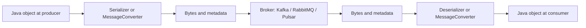

# Synchronizing Serializers and Deserializers Between Producer and Consumer

In an event-driven system, producers and consumers typically run in separate processes. A producer may construct a Java object such as `OrderCreated`, while the broker transmits and stores data as bytes and metadata. The consumer must interpret those exact bytes back into a data type the application understands. If the producer's serializer and the consumer's deserializer are out of sync, messages may become unreadable, be converted incorrectly, or fail only in production.

With Spring Cloud Stream, binders connect `Supplier`, `Function`, and `Consumer` functions to Kafka, RabbitMQ, or Pulsar. Spring Cloud Stream can convert payloads via message converters before the binder sends a message; alternatively, the application can instruct the binder to use the broker's native serializer/deserializer. These two mechanisms have distinct responsibilities. Choose one clear mechanism per binding and ensure both ends use the same wire format, schema, and metadata conventions.

## 1. Data Flow from Producer to Consumer

A message passes through these main steps:



For example, the producer creates `OrderCreated`, serializes it into JSON, and sends it. The consumer receives the JSON and deserializes it into `OrderCreated`. Both sides must agree on at least the following elements:

- Wire byte format: JSON, Avro, Protobuf, String, byte array, or custom format.
- Schema and schema version: field names, data types, required fields, default values, and compatibility rules.
- Content type or schema metadata: how the consumer identifies the format to read.
- Key and header handling: key serializer/deserializer, broker metadata, and header mapping.
- Error rules: what happens when payloads are malformed, schemas are incompatible, or required fields are missing.

Simply having the same Java class name in both applications is not enough to guarantee compatibility. The two classes may have different packages, versions, or serialization behavior. Conversely, two applications written in different languages can still exchange messages if they adhere to a wire contract independent of Java classes.

## 2. Two Conversion Mechanisms in Spring Cloud Stream

### Spring Cloud Stream-managed message conversion

In normal mode, application functions work with Java payloads. Spring Cloud Stream uses `content-type` and message converters to convert payloads when sending or receiving. Example:

```java
@Bean
Function<OrderCreated, OrderAccepted> acceptOrder() {
    return order -> new OrderAccepted(order.orderId(), order.total());
}
```

For JSON, binding configuration can set the content type:

```yaml
spring:
  cloud:
    function:
      definition: acceptOrder
    stream:
      bindings:
        acceptOrder-in-0:
          destination: orders.created
          group: order-processor
          content-type: application/json
        acceptOrder-out-0:
          destination: orders.accepted
          content-type: application/json
```

The producer sends a payload of type `OrderCreated`; the message converter converts it to JSON format. The consumer declares a matching input type and content type to receive the object back. In this mode, the application does not need to manually configure Kafka's `JsonSerializer` or `JsonDeserializer` just to turn DTOs into JSON; the binder and framework handle conversion via message conversion.

`content-type` is metadata describing the content format, not a serializer class name. If a producer emits JSON while the consumer interprets the payload as `text/plain` or another binary format, conversion may fail. Agree on content types across both bindings and verify actual message metadata as well.

### Native encoding and native decoding

When native encoding/decoding is enabled, the binder uses the broker's or client's serializer/deserializer to process payloads. Spring Cloud Stream does not execute the same message conversion step at that boundary. The two core properties commonly used are:

- `producer.use-native-encoding: true`: the output binding uses the binder/client native serializer.
- `consumer.use-native-decoding: true`: the input binding uses the binder/client native deserializer.

Example showing where both properties are configured:

```yaml
spring:
  cloud:
    stream:
      bindings:
        publishOrder-out-0:
          destination: orders.created
          producer:
            use-native-encoding: true
        receiveOrder-in-0:
          destination: orders.created
          group: order-processor
          consumer:
            use-native-decoding: true
```

The YAML snippet above only enables native mode; it does not yet specify concrete serializers/deserializers. Binder extension properties must be configured according to the broker and version in use. Producers and consumers must agree on both data format and schema. Enabling native encoding on the producer while the consumer still uses message converters assuming JSON can cause decoding errors, and vice versa.

Do not mix the two models accidentally. Document explicitly which bindings use message conversion and which use native serialization. If one side uses native mode while the other uses a converter, deploy that setup only after verifying the exact byte format and corresponding conversion behavior.

## 3. Distinguishing Serializer, Deserializer, and Message Converter

| Component | Role | Scope |
|---|---|---|
| Message converter | Converts Spring `Message<?>` payloads between Java types and message formats | Spring Messaging/Spring Cloud Stream layer |
| Serializer | Converts objects or keys into bytes/metadata for the producer to send | Producer side of client/binder |
| Deserializer | Converts bytes/metadata into objects or keys for the consumer to read | Consumer side of client/binder |
| Schema/Schema registry | Describes data structure and, if present, stores/validates schema versions | Data contract between systems |

Some binders integrate closely with message converters; some binders allow configuring native serializers/deserializers. Extension property names and locations differ. Do not take Kafka binder property names and apply them directly to the Rabbit binder or Pulsar binder.

In addition to values, producers and consumers must synchronize key types. For example, Kafka might use `StringSerializer` for keys while the consumer configures `LongDeserializer`; records may send successfully yet the consumer cannot read the keys. With RabbitMQ, a routing key is part of AMQP routing, not equivalent to a Kafka record key. With Pulsar, message keys have their own mechanism and must be configured per client/binder schema/key policy.

## 4. Synchronizing Serializers and Deserializers with Kafka

Kafka stores records as key bytes, value bytes, and headers. Producers need serializers for key and value; consumers need matching deserializers. If using Spring Cloud Stream message conversion, the binder handles conversion according to `content-type`. If using native encoding/decoding, configure the Kafka binder so the client serializes/deserializes directly.

Illustrative native JSON example for the Kafka binder:

```yaml
spring:
  cloud:
    stream:
      bindings:
        publishOrder-out-0:
          destination: orders.created
          producer:
            use-native-encoding: true
        receiveOrder-in-0:
          destination: orders.created
          group: order-processor
          consumer:
            use-native-decoding: true
      kafka:
        bindings:
          publishOrder-out-0:
            producer:
              configuration:
                key.serializer: org.apache.kafka.common.serialization.StringSerializer
                value.serializer: org.springframework.kafka.support.serializer.JsonSerializer
          receiveOrder-in-0:
            consumer:
              configuration:
                key.deserializer: org.apache.kafka.common.serialization.StringDeserializer
                value.deserializer: org.springframework.kafka.support.serializer.JsonDeserializer
                spring.json.value.default.type: com.example.events.OrderCreated
                spring.json.trusted.packages: com.example.events
                spring.json.use.type.headers: false
```

This is an example based on Kafka binder and Spring Kafka configuration; verify exact property names and behavior against your specific version. The producer uses `StringSerializer` for keys and `JsonSerializer` for values. The consumer uses `StringDeserializer` for keys and `JsonDeserializer` for values, with default target type `OrderCreated`. Disabling reliance on type headers in the example allows the consumer to use its configured target type instead of requiring the producer's package/class names to match identically.

`spring.json.trusted.packages` should be restricted to packages containing types allowed for deserialization. Avoid wildcard trusting all packages for messages coming from untrusted brokers or producers. If using type headers, configure controlled type mapping and agree on aliases between producer and consumer; never treat class names sent by a producer as a trusted source.

With Kafka, verify separately:

- `key.serializer` matches `key.deserializer` in wire format.
- `value.serializer` matches `value.deserializer`.
- Target type and schema match the actual payload.
- Header type info, if used, is configured consistently and securely.
- `content-type` does not conflict with enabled native mode.
- Binder settings are placed properly under `spring.cloud.stream.kafka.bindings.<bindingName>`.

Not every system needs `JsonSerializer`/`JsonDeserializer`. If you want a contract independent of Java classes, you can use Avro, Protobuf, or a corresponding schema-based serializer. In that case, consumers need compatible schemas and proper schema lookup according to your organization's setup.

## 5. Synchronizing Message Conversion with RabbitMQ

RabbitMQ uses AMQP message properties, bodies, and headers. The Spring Cloud Stream Rabbit binder integrates with Spring's message conversion mechanism; at the application level, content type and message converters determine how payloads are represented. When using JSON, producers and consumers must agree on body format, content type, and DTO mapping rules.

Example of bindings using JSON via message conversion:

```yaml
spring:
  cloud:
    function:
      definition: processOrder
    stream:
      bindings:
        processOrder-in-0:
          destination: orders.created
          group: order-processor
          content-type: application/json
        processOrder-out-0:
          destination: orders.accepted
          content-type: application/json
```

In this model, configure a message converter compatible with your Spring AMQP and Rabbit binder versions if customization is required. Check `contentType` in AMQP message properties, the actual body type, and how the consumer converts JSON into a DTO. Specific converter names can change across Spring AMQP generations; do not copy legacy converter settings without checking versions.

RabbitMQ does not use Kafka-style `key.serializer`/`value.serializer` pairs. Properties like exchange, routing key, queue, delivery mode, and acknowledgement belong to the AMQP/binder mechanism. If using custom converters or specialized payload types, ensure both producer and consumer understand the body format. A JSON message sent successfully can still fail conversion on the consumer if content type or converter does not match.

## 6. Synchronizing Schemas with Pulsar

Pulsar supports schemas at the topic and client levels, with types such as bytes, string, JSON, Avro, or Protobuf depending on client/binder version. A schema defines how payloads are encoded/decoded and can help the broker enforce compatibility when producers send messages. When using the Pulsar binder, choose the schema type and Java type according to the guide for your exact version.

Example of a JSON data contract:

```java
public record OrderCreated(String orderId, long total) {}
```

Producer and consumer share an understanding of the `OrderCreated` schema, or compatible schema versions. If the producer uses an Avro schema while the consumer tries to read JSON, they cannot decode the data merely because field names match. Schema type, schema definition, and serialized data must align.

With Pulsar, verify:

- The schema type registered/declared by the producer and the schema expected by the consumer.
- Schema validation/compatibility settings on the topic or namespace.
- Java types and serializers/deserializers supported by the binder/client version in use.
- How incompatible new schemas are handled against already registered schemas.
- Behavior when using `BYTES` or no schema, because in that case the application must manage the wire contract itself.

Do not assume every Pulsar binder version uses identical schema property names. Check the reference documentation for the binder and client managed in your dependency BOM before configuring.

## 7. Designing Schemas for Co-Evolution of Producers and Consumers

Synchronizing serializers/deserializers is not just choosing JSON or Avro on both sides. Both parties must agree on how schemas evolve while application versions may be deployed at different times.

Common principles:

- Add new fields as optional or with appropriate defaults so older consumers can ignore them.
- Avoid changing the data type of an active field, such as `long` to string, without a compatible migration plan.
- Avoid renaming or deleting required fields while older consumer versions are still running.
- Use enums with rules for handling unknown values; older consumers should not assume a permanently fixed set of values.
- Manage schema versions or schema IDs under an explicit convention.
- Test compatibility in both backward and forward directions according to actual deployment patterns.

Example initial JSON schema:

```json
{
  "type": "object",
  "required": ["orderId", "total"],
  "properties": {
    "orderId": { "type": "string" },
    "total": { "type": "integer" }
  }
}
```

A potentially compatible change is adding an optional or defaulted `currency` field. Older consumers typically ignore unknown fields; newer consumers must handle older messages that lack `currency`. Removing `orderId` or changing `total` to a different structure can break running consumers.

If using a schema registry, producers should validate schemas before publishing; CI should verify compatibility policies. A schema registry does not fix malformed messages automatically and does not replace serializer/deserializer testing. If not using a registry, still record schema versions and compatibility conventions in event API contracts.

## 8. Avoiding Reliance on Java Native Serialization

Java native serialization ties data to Java class structures and JVM deserialization mechanisms. It makes contracts hard to share with services written in other languages, breaks easily on class changes, and introduces security risks when deserializing untrusted data.

For cross-service event systems, prefer schema-backed, multi-language formats such as JSON, Avro, or Protobuf. Use dedicated event DTOs rather than emitting ORM entities or internal objects with rich object graphs directly. Stable DTOs prevent database model changes from unintentionally altering the wire format.

If you must use a custom binary format, document the schema, version, byte order, encoding, and compatibility rules. Never use Java class names as the sole contract between services.

## 9. Handling Serialization and Deserialization Errors

Errors can occur at multiple stages:

| Stage | Example error | Resolution |
|---|---|---|
| Producer serialization | Payload type unsupported by serializer, missing required field | Validate DTO/schema before sending; record publish error |
| Broker receives message | Message exceeds limits or invalid metadata | Check size limits, protocol, and broker configuration |
| Consumer deserialization | Wrong byte format, incompatible schema, invalid JSON syntax | Classify conversion error; route failed message to appropriate handling flow |
| Consumer processes DTO | Deserialization succeeded but business data is invalid | Perform business validation and apply retry/DLQ by error type |

Not every deserialization error reaches the function's own error handler. Some failures occur before the framework invokes the consumer function; retry, seek, reject, or dead-letter behavior depends on the binder and client. Inspect binder logs, root exceptions, and exact behavior with the broker.

Avoid infinite retries on messages with permanently invalid schemas. Retries only help if the failure is transient, such as a schema registry temporarily unreachable. Un-deserializable messages should be retained with necessary metadata for investigation and replay after fixing, following the binder's DLQ/parking-lot policy.

## 10. End-to-End Producer–Consumer Verification Workflow

When adding an event or changing a serializer, follow this sequence:

1. **Define the wire contract.** Choose payload format, schema, keys, content type, and required headers.
2. **Choose the conversion mechanism.** Use Spring Cloud Stream message conversion or native serializer/deserializer; document the choice per binding.
3. **Configure the producer.** Verify payload type, serializer, key serializer, schema version, and metadata emission.
4. **Configure the consumer.** Verify deserializer, key deserializer, target DTO type, schema version, and trust policies.
5. **Compare both sides.** Verify serializer and deserializer share the same wire format, encoding, schema, and key/header conventions.
6. **Test real messages.** Publish a sample message, read it back with an independent consumer or tool, and verify payload/metadata.
7. **Test errors and compatibility.** Send malformed payloads and old/new schemas, and verify errors are classified, retried, or sent to DLQ as designed.
8. **Deploy in order.** For schema changes, deploy consumers capable of reading both old and new data before producers start emitting the new schema if backward compatibility is required.

Example of application-level JSON logic testing:

```java
@Test
void producerAndConsumerUseTheSameOrderContract() throws Exception {
    ObjectMapper mapper = new ObjectMapper();
    OrderCreated event = new OrderCreated("ORD-42", 125_000);

    byte[] bytes = mapper.writeValueAsBytes(event);
    OrderCreated decoded = mapper.readValue(bytes, OrderCreated.class);

    assertEquals(event.orderId(), decoded.orderId());
    assertEquals(event.total(), decoded.total());
}
```

This test only verifies round-trip behavior of `ObjectMapper` and the DTO. It does not prove that the application's Kafka serializer, Rabbit message converter, or Pulsar schema is configured properly. Add integration tests with the exact binder and broker in use, covering keys, content types, headers, and schema errors.

## 11. Pre-Release Checklist

- [ ] Producer and consumer agree on wire format and schema version.
- [ ] Identified whether each binding uses Spring message conversion or native encoding/decoding.
- [ ] Key serializer and key deserializer are compatible.
- [ ] Value serializer and value deserializer are compatible.
- [ ] Content type or schema type accurately reflects the byte format.
- [ ] With Kafka JSON deserializer, target type and trusted packages are strictly scoped.
- [ ] With RabbitMQ, message converter and AMQP content type are aligned.
- [ ] With Pulsar, schema type and compatibility policy are aligned.
- [ ] Java native serialization is not used as an inter-service contract where avoidable.
- [ ] Round-trip, old/new schemas, malformed messages, and DLQ are tested against a real binder/broker.
- [ ] Logs do not expose sensitive payloads or metadata when conversion errors occur.

When producer and consumer adhere to a shared wire contract, messages can traverse the broker without depending on how each application organizes its internal classes. Spring Cloud Stream lets you choose between message conversion and native serialization as needed; what matters is keeping both ends synchronized, managing schemas deliberately, and testing with the actual binder before deployment.
