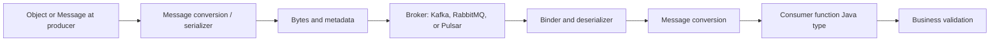

# Identifying contentType Errors, Malformed Data, and Data Type Errors

When a message travels through Spring Cloud Stream, data must be converted properly on both the sending and receiving sides. A producer may construct a Java object, the framework or serializer converts that object into bytes, the broker stores and forwards the bytes, and then the consumer decodes them into the Java type expected by a `Supplier`, `Function`, or `Consumer`. An error at any step can prevent the consumer from receiving the message or cause it to receive data with the wrong meaning.

To diagnose accurately, distinguish three frequently confused error categories: `contentType` failing to describe the actual format, payload invalid under the declared format, and syntactically valid payload that cannot be mapped to the target data type. Even after conversion succeeds, the application must still enforce business rules such as required fields, positive quantities, or valid statuses.

## 1. Data Path Through Spring Cloud Stream

A typical message flow has the following steps:



Depending on the binder and native encoding/decoding configuration, serialization and deserialization may be performed by Spring Cloud Stream or by the broker client. Therefore, errors do not necessarily originate inside the consumer function body. A deserializer error can happen before the framework calls the function; a converter error can happen when the framework converts the payload to the Java parameter; business errors only surface after a Java object exists.

Components to identify during investigation:

- **Binding:** the input/output name used by the application, such as `processOrder-in-0`.
- **Destination:** the topic, queue, or logical destination to which the binding connects.
- **Content type:** the media type configured on the binding or carried in a message header.
- **Serializer/deserializer:** the component turning objects into bytes and restoring objects from bytes.
- **Converter:** the component converting payloads between message representations and the Java types required by the function.
- **Schema and business rules:** the data contract and conditions verified by the application after conversion.

If you look only at the final exception without identifying which step threw it, you may fix the wrong configuration or retry a message that can never be processed.

## 2. Distinguishing Error Categories

| Error category | Example | Common symptom | Where to inspect |
|---|---|---|---|
| Wrong `contentType` | Bytes are JSON but header states `text/plain` | Consumer picks wrong converter or receives unexpected type | Binding config, message headers, and broker metadata |
| Malformed payload | Header states `application/json` but bytes are truncated or invalid JSON syntax | Parse/deserialization error | Actual bytes, producer serializer, and transmission path |
| Data type mismatch | Valid JSON, but `quantity` is a string that cannot parse to an integer | Field mapping or Java type error | DTO, schema, converter, and producer version |
| Missing or extra fields | Consumer requires a mandatory field not sent by producer | Conversion may succeed with missing data or fail under strict mapping settings | Schema and compatibility rules |
| Business rule violation | `quantity` is 0 or `orderId` is blank | Object is constructed successfully, but validation fails | Validator and business contract |
| Incompatible native serializer | Producer and consumer use different serializers/schemas | Error occurs in client/binder before function executes | Serializer/deserializer config, schema registry if present |

For example, the following three payloads do not share the same error category:

```text
Payload A: {"orderId":"ord-1","quantity":2
            -> JSON is missing a closing brace; malformed format.

Payload B: {"orderId":"ord-1","quantity":"two"}
            -> Valid JSON; quantity may fail to map to int.

Payload C: {"orderId":"ord-1","quantity":0}
            -> Valid JSON and data types; may violate a business rule.
```

Do not treat all three cases as the same broker connection failure or identical retryable error.

## 3. Checking `contentType`

`contentType` specifies how to interpret message contents. In Spring Cloud Stream, a default per binding can be declared in `application.yml`:

```yaml
spring:
  cloud:
    function:
      definition: processOrder
    stream:
      bindings:
        processOrder-in-0:
          destination: orders
          group: inventory-service
          content-type: application/json
```

A producer can set content type on the message when needed:

```java
Message<OrderCreated> message = MessageBuilder
        .withPayload(event)
        .setHeader(MessageHeaders.CONTENT_TYPE, MimeTypeUtils.APPLICATION_JSON)
        .build();
```

A binding can also be configured with its own content type. Avoid letting binding configuration and per-message headers conflict with the actual byte format. When investigating, check both the active profile-resolved configuration and headers observed at the consumer, rather than looking at only a single source YAML file.

### 3.1. Signs of content type mismatch

- Producer sends a JSON object, yet consumer unexpectedly receives `String` or `byte[]`.
- Converter reports no converter found matching the payload type and content type.
- Consumer tries to parse plain text as JSON or vice versa.
- On the same destination, producers emit different formats without a clear convention.

Check in order:

1. Confirm the actual payload format before sending: JSON, text, bytes, Avro, or Protobuf.
2. Check `content-type` in binding configuration and message headers if the producer sets headers manually.
3. Check the Java type declared by the consumer, such as `Consumer<OrderCreated>` vs. `Consumer<String>`.
4. Confirm the corresponding converter or serializer is configured and present in the application.
5. If native encoding/decoding is enabled, check the binder's serializer/deserializer; content type does not replace native configuration.

### 3.2. Native encoding and framework conversion

When using Spring Cloud Stream's conversion mechanism, the framework can convert payloads between bytes and Java types based on content type and available converters. When native encoding/decoding is enabled, the binder/client may handle serialization or deserialization. These two paths have different configurations and failure points.

Do not enable native decoding solely to mask a converter error without verifying what format the producer actually sends on the wire. Also prevent the producer from serializing a payload twice, such as converting an object into a JSON string and then serializing that string into another JSON string. Clearly agree on which side serializes, which side deserializes, and test against the running binder configuration.

## 4. Identifying Malformed Data

Malformed data is data that violates the syntax of the declared format. For JSON, common errors include missing braces, trailing commas, unquoted field names, or truncated values.

Malformed JSON example:

```json
{"eventId":"evt-10","orderId":"ord-10","quantity":2
```

Valid JSON example:

```json
{
  "eventId": "evt-10",
  "orderId": "ord-10",
  "quantity": 2
}
```

When encountering parse errors, inspect the actual bytes emitted by the producer, producer-side serializer logs, and data stored in the broker if tooling is available. Do not rely on a JSON snippet copied from logs that may have been escaped or truncated to conclude the original message was bad. Logs must bound size and mask sensitive information.

Common clues in exceptions can include `JsonParseException`, `JsonMappingException`, `MessageConversionException`, or exceptions from client serializers/deserializers. Exception names depend on library and version; read the root `cause` and stack trace to identify which layer failed. Do not draw conclusions from the outermost exception name alone.

## 5. Identifying Data Type and Schema Errors

JSON can be syntactically valid yet incompatible with the consumer DTO. For example, the producer sends:

```json
{
  "eventId": "evt-10",
  "orderId": "ord-10",
  "quantity": "two"
}
```

While the consumer declares:

```java
public record OrderCreated(
        String eventId,
        String orderId,
        int quantity) {}
```

The string value `"two"` cannot map to `int` under normal rules. Other scenarios include numbers overflowing the target type, misformatted dates/times, unknown enum values, nested fields with wrong types, or object structures diverging from the schema.

### 5.1. Checking the DTO contract

Compare the payload against the DTO and published schema:

- Are field names exact and do they respect mapper case-sensitivity settings?
- Do numeric types fit the value range? Use `long` or `BigDecimal` when the domain requires it.
- Are dates/times standardized clearly, such as ISO-8601 UTC, and converted to the appropriate type?
- Can enums handle new values emitted by producers?
- Do new fields have sensible defaults when older consumers receive messages?
- Are required fields validated after deserialization?

Do not automatically coerce every invalid value to `null`, `0`, or a default enum without a business rule. Silent coercion can let malformed messages pass the converter and corrupt database state.

### 5.2. Distinguishing conversion errors from validation errors

Data conversion answers the question: "Can the bytes or payload be turned into a Java object of the target type?" Validation answers the question: "Is the constructed object valid for the business domain?"

For example, `quantity: "two"` is a type conversion error. `quantity: 0` may convert cleanly yet violate order placement rules. Separating these two steps keeps logs, metrics, and error-handling policies accurate.

```java
public record OrderCreated(String eventId, String orderId, int quantity) {}

@Component
public class OrderValidator {
    public void validate(OrderCreated event) {
        if (event.eventId() == null || event.eventId().isBlank()) {
            throw new InvalidOrderException("eventId is required");
        }
        if (event.orderId() == null || event.orderId().isBlank()) {
            throw new InvalidOrderException("orderId is required");
        }
        if (event.quantity() <= 0) {
            throw new InvalidOrderException("quantity must be positive");
        }
    }
}

@Bean
Consumer<OrderCreated> processOrder(OrderValidator validator, OrderService service) {
    return event -> {
        validator.validate(event);
        service.process(event);
    };
}
```

Here, `InvalidOrderException` represents an application-defined business exception. How the framework/binder turns exceptions into error messages, retries, or DLQ entries depends on the binder and configuration. Classify exceptions clearly in the error-handling layer.

## 6. Step-by-Step Diagnosis

When a consumer fails to process a message, investigate in this sequence to isolate the cause:

1. **Identify binding and destination.** Record the binding name, destination, consumer group/subscription, active profile, and binder.
2. **Inspect the producer.** Verify pre-serialization payload type, active serializer, content type, and schema version.
3. **Inspect outbound metadata.** Record content type, event ID, correlation ID, and payload size; do not log secret data.
4. **Pinpoint the failure site.** Check whether the function was invoked or the error occurred earlier in the broker client/deserializer/converter.
5. **Read the root cause.** Inspect the `cause` chain, converter/serializer class name, and data field named in the exception.
6. **Compare payload with schema.** Focus on wrong field types, missing fields, new enum values, date/time formats, and out-of-range values.
7. **Reproduce with a sanitized sample message.** Use the same content type and the same DTO/converter version.
8. **Verify the fix with tests.** Confirm valid messages succeed and invalid messages are classified without infinite retries.

The following table helps choose the first inspection point:

| Symptom | First suspect | Verification step |
|---|---|---|
| Function is never called and consumer logs report deserialization failure | Native deserializer or binder | Check client/binder logs and native configuration |
| Function is never called, logs show converter error | `contentType` or converter | Check content type and target Java type |
| Function is called, but data is wrong or missing | DTO/schema or validation | Inspect deserialized payload and business rules |
| Only certain producers fail on the same destination | Producer uses a different schema/content type | Compare metadata and producer versions |
| Errors appear after deploying a new version | Schema or converter change | Compare before/after contracts and verify backward compatibility |

## 7. Handling Failed Messages: Retries, Error Channels, and DLQ

Not every error should be retried. Retrying is helpful when the root cause may resolve itself transiently, such as a database timeout, temporary dependency outage, or network glitch. Invalid JSON syntax, unconvertible field types, or business rule violations are usually deterministic errors; re-sending the exact same bytes repeatedly will not make the data valid.

| Error type | Typically appropriate action |
|---|---|
| Network error or transient dependency failure | Bounded retry with backoff |
| Broker temporarily unavailable | Let binder/client recover connection per config and monitor status |
| Invalid JSON syntax or unmappable types | Isolate message, record cause, and route to DLQ/error flow per config |
| Incompatible schema | Isolate, fix producer/schema or deploy compatible consumer before replaying |
| Business rule violation | Reject or route to business exception handling; do not retry infinitely |

Spring Cloud Stream supports error handling via Spring Integration's error-handling mechanisms and binder-specific features. Kafka, Rabbit, and Pulsar binders differ in retry/DLQ mechanisms, support levels, and configuration properties; some behaviors rely on broker policies. Property names, DLQ trigger conditions, offset/acknowledgement handling, and republished message contents must be checked against the exact binder and version in use. Do not copy Kafka DLQ settings verbatim to RabbitMQ or Pulsar.

A consumer policy can cap retry attempts:

```yaml
spring:
  cloud:
    stream:
      bindings:
        processOrder-in-0:
          consumer:
            maxAttempts: 3
            backOffInitialInterval: 1000
            backOffMaxInterval: 10000
            backOffMultiplier: 2.0
```

This is an example of a binding retry policy using common consumer properties. Actual behavior and exception classification capabilities must be verified against your application's Spring Cloud Stream/binder version. DLQ configuration must be added separately per binder.

### 7.1. DLQ operational workflow

A DLQ only isolates unprocessable messages. Operations teams still need to:

- Alert when DLQ message counts rise or when the first message arrives.
- Record event ID, destination, timestamp, error cause, and consumer version.
- Restrict access because payloads may contain sensitive data.
- Determine how to fix the data or schema before replaying.
- Ensure replays do not cause duplicate business side effects by using stable idempotency keys.
- Monitor backlog count and dwell time in the DLQ.

Never replay an entire DLQ immediately after a code fix without verifying the root cause and consumer idempotency. If a message failed due to bad source data, repair or discard it via a business workflow before replaying.

## 8. Testing Conversion Errors

Tests should cover both valid and malformed payloads at each layer. The Test Binder can test binding flows within application scope, but does not replace testing serializers/deserializers and header mapping against a real broker.

Example testing a validator after conversion has produced the object:

```java
@Test
void rejectsNonPositiveQuantity() {
    OrderCreated event = new OrderCreated("evt-1", "ord-1", 0);

    assertThatThrownBy(() -> validator.validate(event))
            .isInstanceOf(InvalidOrderException.class);
}
```

For converters/serializers, add test cases for:

- Valid JSON with all fields and correct types.
- Malformed JSON syntax or truncated bytes.
- Valid JSON containing a wrong field type, such as a number sent as text.
- Missing fields, `null`s, new enum values, or out-of-bounds numbers.
- Content type mismatching the payload.
- Producer and consumer using two schema versions requiring compatibility checks.
- Native encoding/decoding enabled and disabled for each supported configuration.
- Failed messages entering the expected error flow/DLQ while valid messages continue processing.

During integration tests, use the broker matching the deployment environment. Verify failed messages are not silently dropped, do not cause infinite retry loops, and retain sufficient metadata for investigation. For messages replayed from a DLQ, verify the consumer does not apply business side effects twice.

## 9. Responsible Logging and Observability

Useful logs should provide diagnostic context without exposing entire payloads. Fields worth recording include:

- Binding, destination, and consumer group/subscription.
- Event ID and correlation ID.
- Content type and schema version.
- Exception name, root cause, and failing data field if identifiable.
- Retry count, DLQ status, and broker offset/partition or corresponding delivery metadata if available.

Avoid logging tokens, passwords, personal data, or full payloads. If failed payloads must be retained for investigation, use an access-controlled store with retention limits and appropriate masking. Metrics should separate conversion errors, validation errors, dependency failures, and DLQ counts so teams know whether to fix the producer, schema, or infrastructure.

## 10. Pre-Deployment Checklist

- [ ] Producer and consumer agree on `contentType` and actual wire byte format.
- [ ] Explicitly determined whether the framework or native serializer/deserializer owns conversion.
- [ ] DTOs and schemas have compatibility rules for adding, modifying, or removing fields.
- [ ] Syntax errors, data type errors, and validation errors are distinguished.
- [ ] Exceptions are classified by retryability; deterministic data errors are not retried infinitely.
- [ ] DLQ/error flow is configured and tested for the exact binder/version.
- [ ] Logs and metrics include event ID, binding, content type, and error cause without exposing sensitive data.
- [ ] Tests cover malformed payloads, wrong types, missing fields, and incompatible schemas.
- [ ] DLQ repair and replay workflows preserve idempotency.

Effective data conversion error diagnosis begins by identifying which step failed: serializer, broker client, binder, converter, or business validation. Once `contentType` errors, format errors, and data type errors are properly separated, teams can choose whether to fix the producer/schema, adjust converters, or isolate messages. Combining bounded retries, a disciplined DLQ workflow, and testing against real brokers makes Spring Cloud Stream flows easier to operate when multiple service versions exchange events simultaneously.
