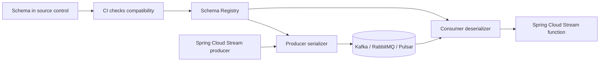

# Role of Schema Registry and Choosing an Integration Mechanism

In event-processing systems, producers and consumers are often developed and deployed at different times. A producer may add new fields, alter payload structures, or release a new application version while older consumers are still running. If the two sides do not agree on the data structure, messages may fail to decode or consumers may misinterpret business semantics.

A **Schema Registry** helps centrally manage message schemas, associate schemas with versions or identifiers, enforce compatibility rules, and help producers/consumers use the right data structure. When integrating with Spring Cloud Stream, choose the mechanism that fits the binder and broker: Spring's message converter, a registry-integrated serializer/deserializer, Pulsar's built-in schema support, or an external registry for RabbitMQ.

## 1. A Schema as a Data Contract

A schema describes the structure and rules of payloads exchanged between applications. Depending on the format, a schema can declare:

- The record or message name and data fields.
- The data type of each field, such as string, number, boolean, array, or nested object.
- Required fields, optional fields, and default values.
- Representation rules for enums, timestamps, decimals, or binary data.
- Version metadata and compatibility rules when the structure changes.

For example, the `OrderCreated` event can be described with JSON Schema:

```json
{
  "$schema": "https://json-schema.org/draft/2020-12/schema",
  "$id": "https://schemas.example.com/orders/order-created.json",
  "title": "OrderCreated",
  "type": "object",
  "required": ["eventId", "orderId", "occurredAt"],
  "properties": {
    "eventId": { "type": "string" },
    "orderId": { "type": "string" },
    "occurredAt": { "type": "string", "format": "date-time" },
    "customerId": { "type": ["string", "null"] },
    "source": { "type": "string", "default": "order-service" }
  },
  "additionalProperties": false
}
```

This schema specifies the required fields and valid data types. The producer must generate payloads conforming to the schema; the consumer must understand the same contract or a compatible version. A schema does not replace business rules: JSON Schema can verify that `orderId` is a string, but it cannot verify on its own that the order exists in the system.

Common schema formats:

| Format | Characteristics | Use Cases |
|---|---|---|
| JSON Schema | Describes JSON structure, types, constraints, and required fields. | Polyglot integrations, human-readable JSON payloads. |
| Avro | Defines records and data types; often used with schema ID/registry in Kafka ecosystems. | Data streams with evolving schemas requiring compact representation. |
| Protobuf | Defines messages and field numbers in `.proto` files; supports code generation. | Multi-language systems needing stable binary contracts. |
| JSON without a schema registry | Structure managed via code, documentation, or custom validation. | Small systems or simple integrations, though versioning discipline is still needed. |

## 2. What Problems Does a Schema Registry Solve?

A Schema Registry is a service that manages schemas and their versions. Depending on the product, a registry can provide APIs to register schemas, look up schemas by ID or subject, check compatibility prior to registration, and manage access control.

A registry typically addresses four needs:

1. **Centralized contract storage:** producers and consumers reference the same definition instead of maintaining out-of-sync copies.
2. **Version management:** each schema change can be stored as a new version that can be traced and queried.
3. **Compatibility checking:** prevents changes that would break existing consumers or new producers under the selected policy.
4. **Lookup during serialization/deserialization:** serializers can register schemas or fetch schemas by ID to encode/decode payloads.

A registry is not a broker. Kafka, RabbitMQ, and Pulsar handle message transport, routing, or storage; the registry manages data contracts. A broker may store a message even when its schema is invalid, unless a schema enforcement component is integrated into the send/receive path.



This diagram is a conceptual model. Depending on the integration mechanism, the registry may be accessed at build time, startup, serialization time, or deserialization time; not every application calls the registry for every message.

## 3. Subjects, Schema IDs, and Versions

Many registries organize schemas under a logical key such as a **subject**. A subject identifies the group of schemas belonging to a specific contract. For example, a registry may manage a schema for the value of the `orders.events` topic and another subject for the key of the same topic.

On platforms like Confluent Schema Registry, subject naming strategies can be based on the topic name and key/value role, or based on the record name. The subject strategy affects how the registry determines which existing schemas to compare against a new schema for compatibility. Producers and consumers must agree on the strategy; do not assume every registry uses the same rule.

A schema can have:

- **Subject:** the contract group name to which the schema belongs.
- **Version:** the version sequence within the subject.
- **Schema ID:** the identifier used to look up the schema in the registry.
- **Schema definition:** the JSON Schema, Avro, Protobuf, or corresponding format content.

In some wire formats, the serializer writes the schema ID or reference metadata into the transmitted data. The consumer uses that ID to retrieve the right schema when decoding. How the ID, headers, or payload prefix are encoded depends on the serializer and registry; there is no single universal wire format across all products.

Do not generate schema IDs manually in application code or treat a Java class version as a schema ID. Let the registry and corresponding serializer manage identifiers, while storing schema sources in version control for review and reproducibility.

## 4. Schema Evolution and Compatibility

Schema evolution is the process of changing message structures over time while keeping deployed applications working properly. Before adding, modifying, or removing fields, consider how new producers will communicate with old consumers and how old producers will communicate with new consumers.

Common compatibility modes in registries:

| Mode | General Meaning | Useful When |
|---|---|---|
| Backward | Consumers using the new schema can read data written with the old schema. | Consumers are upgraded before producers. |
| Forward | Consumers using the old schema can read data written with the new schema. | Producers are upgraded before consumers. |
| Full | Supports both backward and forward within the defined comparison scope. | Producers and consumers may upgrade in different orders. |
| Backward/Forward/Full Transitive | Checks compatibility against multiple prior versions rather than just the immediately preceding version. | Systems must guarantee compatibility across multiple releases. |

Mode names and details can vary by registry; check the policy documentation of the product in use. Compatibility also depends on the schema format and field-specific rules.

### Example of a Compatible Change

Suppose the initial schema has `eventId`, `orderId`, and `occurredAt`. Adding an optional `source` field with a default value is typically more compatible than adding a required field that old consumers do not know how to supply or process.

Changes that usually require caution:

- Adding a required field without a default.
- Removing a field that old consumers still read.
- Changing a data type, e.g., `integer` to `string`.
- Changing a field's meaning while keeping the same name and type.
- Changing an enum such that old consumers cannot recognize new values.
- Changing nullability or default rules.

Technical compatibility does not guarantee business compatibility. For example, changing the meaning of `amount` from "dong" to "cents" may pass data type checks yet produce wrong business outcomes. When changing semantics, create a new field or a new event version with a clear migration plan.

## 5. Schema Registration and Usage Workflow

A typical workflow includes these steps:

1. The development team defines schemas in source control alongside producer/consumer code.
2. The CI pipeline validates syntax, linting, and compatibility against registered versions.
3. The new schema is registered under the corresponding subject after passing policy checks.
4. The producer uses a compatible serializer to validate payloads and encode data according to the registered schema.
5. The consumer uses a deserializer or converter to read data, fetching the schema by ID if the wire format requires it.
6. Teams monitor schema errors, deserialization failures, and running producer/consumer versions.

Depending on deployment strategy, schemas may be pre-registered before applications start, or serializers may auto-register when encountering a new schema. Pre-registration gives tighter control in CI/CD; auto-registration is convenient for development environments but permissions should be restricted to prevent production applications from creating unreviewed schemas.

## 6. Integration Options with Spring Cloud Stream

Spring Cloud Stream provides bindings and binders to connect application functions with brokers. Schema registry integration lives at the data conversion layer or the specific serializer/deserializer layer. Several options exist.

### 6.1. Using Spring's MessageConverter

This is the natural approach when applications exchange payloads in JSON or another converter-supported format. The binding declares `content-type`, and the framework selects a converter to convert between `Message<?>` and Java objects.

```yaml
spring:
  cloud:
    function:
      definition: publishOrder
    stream:
      bindings:
        publishOrder-out-0:
          destination: orders.events
          content-type: application/json
```

This example only configures JSON formatting. It does not automatically connect to a Schema Registry. If centralized JSON Schema management is needed, the application must add registry integration steps, such as validating against a schema before sending, a converter that fetches schemas from the registry, or pipeline validation.

You can use a custom `MessageConverter` when you want to keep Spring Cloud Stream's binding model while converting according to a custom registry or schema convention. The converter must specify media types, target types, how schemas are fetched, how validation runs, and how errors are handled. Register the converter using the mechanism supported by your Spring Cloud Stream version.

### 6.2. Using Kafka Native Serializers/Deserializers

With Kafka, a common option is using registry-ecosystem serializers/deserializers, such as Avro, JSON Schema, or Protobuf serializers. In this case, the Kafka client serializer is responsible for encoding the payload and can interact with the Schema Registry.

The Spring Cloud Stream Kafka binder supports native encoding on the producer and native decoding on the consumer. General configuration:

```yaml
spring:
  cloud:
    stream:
      bindings:
        orderEvents-out-0:
          destination: orders.events
        orderEvents-in-0:
          destination: orders.events
          group: order-projection
      kafka:
        bindings:
          orderEvents-out-0:
            producer:
              useNativeEncoding: true
          orderEvents-in-0:
            consumer:
              useNativeDecoding: true
```

When enabling native encoding/decoding, configure the matching Kafka serializer/deserializer and corresponding registry properties according to your Kafka binder, Kafka client, and serializer library versions. For example, the serializer needs the registry URL, authentication mechanism, and schema type in use. These properties are usually passed to the Kafka client via binder configuration or specialized producer/consumer properties.

Do not enable native encoding solely because you want to use a Schema Registry. Ensure the producer serializer and consumer deserializer are compatible with each other, Java payload types match Avro/JSON Schema/Protobuf expectations, and the application handles the wire format properly. When native decoding is enabled, Spring's standard message converter is no longer primarily responsible for decoding that payload.

### 6.3. Using Pulsar's Built-in Schema Support

Pulsar has a broker-integrated schema mechanism. Producers can declare a schema for a topic, and Pulsar validates message schemas as configured while managing versions and compatibility under supported policies.

When using the Spring Cloud Stream Pulsar binder, you can select schema mechanisms through binder/client-specific options. Check the documentation for your exact Pulsar binder version to see how schema types are declared, how JSON/Avro/Protobuf schemas are handled, and how compatibility is configured. This is Pulsar's native schema management; do not assume it uses the same API or schema IDs as Confluent Schema Registry.

### 6.4. Using an External Registry with RabbitMQ

RabbitMQ is a message broker and does not provide a built-in Schema Registry equivalent to Confluent as a default broker feature. Applications using RabbitMQ can still manage schemas with an external registry such as Apicurio or Confluent Schema Registry, or use an internal schema management mechanism.

With the Spring Cloud Stream Rabbit binder, messages normally go through Spring's conversion mechanism. To use an external registry, you can integrate a converter/serializer inside the application, or use a dedicated producer/consumer component that performs contract-based encoding/decoding. Ensure payloads, schema references, and metadata pass intact through exchanges and queues. If the registry ID is embedded in the payload, the consumer must have the matching library to look up and decode it.

Do not confuse RabbitMQ message persistence or durable queues with schema compatibility. Durable queues protect messages according to storage policies; they do not validate payload structure.

## 7. Comparing Integration Options

| Mechanism | Kafka | RabbitMQ | Pulsar |
|---|---|---|---|
| Spring MessageConverter | Usable for content-type-based payloads. | Usable for content-type-based payloads. | Usable depending on binder and converter configuration. |
| Native serializer/deserializer | Commonly used with Kafka client serializers and an external registry. | Serializers/converters can be integrated in the app; no equivalent built-in native registry. | Built-in schemas and serializers with Pulsar client/broker. |
| External Schema Registry | Common, e.g., Confluent or Apicurio. | Can use Confluent, Apicurio, or an internal registry. | Can be used if architecture requires, alongside or instead of native schema mechanisms depending on design. |
| Schema validation | Registry/serializer or application-level validation. | Converter/validation or registry-integrated component. | Pulsar's schema mechanism and/or application validation. |

There is no single best choice for all systems. The decision depends on payload format, broker, producer/consumer languages, compatibility needs, latency, operational capability, and vendor lock-in avoidance requirements.

## 8. Managing Schemas in Source Control and CI/CD

Schemas are part of the integration contract, so they should be reviewed and released like source code. A directory structure can be organized by domain and event:

```text
schemas/
  orders/
    order-created.avsc
    order-created-v1.json
    order-created-v2.json
  payments/
    payment-authorized.proto
```

You do not have to use this exact structure; what matters is having clear ownership, naming conventions, and change history. A CI pipeline can perform:

1. Validate schema syntax and lint rules.
2. Compare against currently registered versions in the registry.
3. Reject changes that violate the compatibility policy.
4. Generate Java or other language code if using Avro/Protobuf.
5. Register new schemas through a controlled process.
6. Run contract tests between producers and consumers.

Separate schema read permissions from schema registration permissions. Runtime producers and consumers usually only need read access; release pipelines or schema governance teams need permission to create versions. This separation reduces the risk of an unintended deployment creating new schemas that impact the whole system.

## 9. Handling Errors During Registry Integration

Common failures include:

- Registry unreachable due to network, DNS, TLS, or authentication issues.
- Producer attempting to register a schema that violates the compatibility policy.
- Serializer unable to locate a subject or schema ID.
- Consumer unable to retrieve the schema needed for decoding.
- Payload produced using a different schema than the attached schema ID.
- Producer and consumer using incompatible serializers/deserializers or wire format configurations.
- Schema registered, but generated Java classes are out of sync with the schema definition.

Applications must classify errors and determine appropriate behavior. Transient registry errors may warrant retries with backoff; compatibility errors or invalid schemas usually require halting deployment and fixing the contract. Do not retry an invalid schema indefinitely.

On consumers, deserialization errors can occur before the function is invoked. Therefore, merely wrapping code inside the function in `try/catch` is not enough to catch all schema errors. Configure error handling at the binder/container layer, monitor conversion errors, and consider a DLQ for undecodable messages. Exact configuration depends on the binder.

Do not silently drop undecodable messages. Record identifying metadata, destination, schema ID if available, exception details, and correlation ID for investigation. Avoid logging full sensitive payloads.

## 10. Security and Availability of the Schema Registry

In some integration setups, the registry sits on the publish or consume path. If a serializer must call the registry during message processing and the registry goes down, the stream can slow down or fail. Design the registry as a critical operational component:

- Use TLS and authentication between applications and the registry.
- Scope read/write permissions per application or release pipeline.
- Store credentials in a secret manager or protected environment variables.
- Monitor latency, error rates, registration counts, and schema storage health.
- Use schema caching if supported by the serializer/registry, while understanding cache policies and behavior on cache misses.
- Maintain backups and a recovery plan for registry metadata.
- Avoid deleting subjects/versions still needed by retained messages or older consumers for decoding.

Do not assume that a healthy broker guarantees message flow if serializers depend on an external registry. Test both registry disconnection and recovery scenarios.

## 11. Contract and Compatibility Testing

A schema test suite should include multiple layers:

| Test Type | Objective |
|---|---|
| Schema validation | Verify payloads conform to the active schema. |
| Compatibility test | Verify new schemas satisfy backward/forward/full policies. |
| Serialization test | Producer serializer produces the expected wire format and schema reference. |
| Deserialization test | Consumer decodes messages emitted by supported producer versions. |
| Contract test | Independent producers and consumers still share the same data contract. |
| Integration test | Real binder and broker transmit payloads, schema IDs/headers, and errors as expected. |
| Failure test | Verify behavior on registry disconnect, missing schema ID, or schema-mismatched payloads. |

Spring Cloud Stream's Test Binder is useful for testing functions and bindings at the application scope, but it does not fully simulate a real Schema Registry, native serializers, or broker schema enforcement. Add integration tests with a real registry/broker for those behaviors.

## 12. Choosing the Right Integration Mechanism

Before deciding which Schema Registry to use and at which layer to integrate, answer:

1. Are producers and consumers using JSON, Avro, Protobuf, or another format?
2. Are code generation and strong typing needed across multiple languages?
3. Is the broker Kafka, RabbitMQ, or Pulsar, and which binder version is used?
4. Does the broker have built-in schema management or require an external registry?
5. Are schemas pre-registered in CI/CD or auto-registered by serializers?
6. Which compatibility policy matches the producer/consumer rollout order?
7. Do serializers/deserializers sit in Spring `MessageConverter` or the binder's native client?
8. Is the schema ID/version passed in the payload, headers, or a broker-specific mechanism?
9. How do applications handle registry failures and undecodable messages?
10. Who has permission to change schemas, and what is the review/rollback process?

For Kafka streams using Avro or Protobuf across multiple independent services, Schema Registry-integrated serializers are a common choice. For Spring Cloud Stream applications exchanging simple JSON, message converters with CI schema validation may suffice. For Pulsar, evaluate native schemas before adding an external registry. For RabbitMQ, choose an external registry or an application-layer schema management mechanism. Whatever approach you choose, contracts must be versioned, compatibility-checked, and tested across producers and consumers before release.
