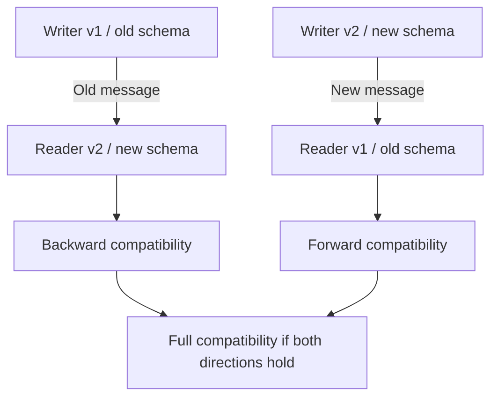
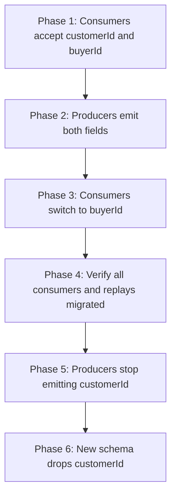

# Backward Compatibility, Forward Compatibility, and Breaking Contract Changes

In event-processing systems, producers and consumers are often deployed at different times. A new producer may emit messages while some consumers are still running an older version; a new consumer may read a backlog created months earlier; another team may replay messages from a dead-letter queue. Therefore, changing event structures must account for both newly produced data and existing data.

**Backward compatibility** and **forward compatibility** describe the ability of two schema versions or two writer/reader sides to interoperate when deployed out of lockstep. A breaking change can prevent messages from decoding, cause consumers to reject payloads, or worse, decode successfully while misinterpreting business semantics.

This lesson places these concepts in the context of Spring Cloud Stream: multiple producers, multiple consumer groups, and messages retained and replayed over Kafka, RabbitMQ, or Pulsar. You will learn how to evaluate schema changes, choose rollout strategies, and test contracts prior to release.

## 1. What Does an Event Contract Include?

An event contract is an agreement between publisher and subscriber regarding the structure, meaning, and delivery mechanics of an event. It spans more than a Java class or a schema file.

An event can include:

- **Identifiers:** event ID, event type, contract version, and occurrence timestamp.
- **Payload:** fields, data types, required rules, default values, and business meaning.
- **Headers:** correlation ID, causation ID, tenant, trace context, content type, and metadata needed for processing.
- **Routing:** destination, message key, routing key, or partition key.
- **Semantics:** event ordering, measurement units, time zone, null rules, idempotency, and state meaning.
- **Retention policies:** retention, replay, DLQ, and how long a consumer may still read older data.

Example `OrderCreated` event:

```json
{
  "eventId": "evt-1001",
  "eventType": "OrderCreated",
  "occurredAt": "2026-11-24T09:30:00Z",
  "aggregateId": "order-42",
  "data": {
    "orderId": "order-42",
    "customerId": "customer-18",
    "total": 1250000
  }
}
```

A change can preserve the exact JSON syntax yet still break the contract. For example, if the `total` field was previously denominated in Vietnamese dong and later switched to thousands of dong without renaming or adding metadata, consumers still parse a number, but business results are off by a factor of one thousand.

Therefore, evaluating compatibility requires checking both structure and semantics. In Spring Cloud Stream, bindings and binders control how messages are delivered to consumers; they do not automatically guarantee that every consumer version understands the same contract.

## 2. Distinguishing Backward and Forward Compatibility

These two concepts are defined by the read/write direction. Be explicit about whether you are looking from the schema reader's or schema writer's perspective to avoid reversing directions.

- **Backward compatible:** a reader using the new schema can read data written by an old writer using the old schema. In short: *new consumers can read old messages*.
- **Forward compatible:** a reader using the old schema can read data written by a new writer using the new schema. In short: *old consumers can read new messages*.
- **Full compatible:** satisfies both directions above.
- **Incompatible (breaking):** one or both directions are no longer guaranteed; the system needs coordinated deployment, data migration, or a new contract/version.

| Compatibility Direction | Writer | Reader | Practical Question |
|---|---|---|---|
| Backward | Old schema | New schema | Can new consumers read the old backlog? |
| Forward | New schema | Old schema | Can old consumers read new messages? |
| Full | Old and new | New and old | Can producers and consumers be deployed in any order? |

Diagram:



Example: version 2 adds an optional `currency` field.

- New consumer reading a v1 event: if the consumer handles the missing `currency` case, the change can be backward compatible.
- Old consumer reading a v2 event: if the consumer ignores unknown fields and the schema permits new fields, the change can be forward compatible.
- If either side rejects unknown fields or requires the new field to always be present, the corresponding direction fails.

Compatibility is not an absolute property of a schema file alone. It depends on the format, reader/writer rules, validator configuration, serializer/deserializer, and how the application handles missing or extra data.

## 3. Evaluating Field Changes

A practical rule of thumb is testing two cases separately: a new reader receiving old data, and an old reader receiving new data. The table below gives general guidance; exact outcomes depend on Avro, Protobuf, JSON Schema, and consumer policies.

| Change | Backward: new consumer reads old data | Forward: old consumer reads new data |
|---|---|---|
| Add optional field with missing-value handling | Usually achievable | Usually achievable if old consumers ignore unknown fields |
| Add required field without default | Usually breaking | Achievable if old readers ignore unknown fields |
| Remove optional field | Usually achievable if new readers do not need it | May break if old readers still require the field |
| Remove required field | New readers can ignore the old field | Usually breaking for old readers needing the field |
| Rename field | Usually breaking without an alias or mapping | Usually breaking unless both old and new names are emitted |
| Change data type | Depends on format type-promotion rules | Depends on format type-promotion rules |
| Change meaning or unit | May parse but yield wrong business logic | May parse but yield wrong business logic |
| Remove enum symbol | May prevent new readers from understanding old data | May prevent old readers from understanding new symbols in reverse |
| Change message key or routing semantics | Can alter partitioning/ordering | Can route data to the wrong consumer stream |

### Adding an Optional Field

Suppose version 1 has:

```json
{
  "orderId": "order-42",
  "total": 1250000
}
```

Version 2 adds `currency`:

```json
{
  "orderId": "order-42",
  "total": 1250000,
  "currency": "VND"
}
```

New consumers must handle old messages missing this field. In Java, do not assume the deserializer always fills in the right business value automatically. Handle nulls or missing fields explicitly:

```java
public record OrderCreated(
        String orderId,
        long total,
        String currency
) {
    public String effectiveCurrency() {
        return currency == null ? "VND" : currency;
    }
}
```

Using `VND` is only valid if that is a verified business rule for historical data. If the system previously handled multiple currencies, never infer currency from a single blanket default; in that case, migration or explicit metadata is required.

In JSON Schema, `default` is an annotation describing a default value. Validators or JSON parsers are not required to inject that value into payloads automatically. The application must implement fallback logic if it wants a default. In Avro, `default` in the reader schema participates in schema resolution when the writer schema lacks that field. These two mechanisms must not be conflated.

### Adding a Required Field

If the new version requires `currency` but old events lack this field, a new consumer may not know which currency unit applies to `total`. Without a justified default or migrated data, backward compatibility is not achieved.

In JSON Schema, adding a field name to the `required` array causes old payloads missing that field to fail validation against the new schema. In Avro, the reader schema needs an appropriate default when reading an older writer schema lacking the field. In Protobuf, new fields are added with new field numbers; presence and default values must be understood according to `proto2`/`proto3` and field type.

### Removing or Renaming a Field

If old consumers still read `customerId`, deleting it right after the producer switches to `buyerId` can break old consumers. A safer transition emits both fields during a transition period, keeps values identical, upgrades consumers to read the new field, and only removes the old field once no consumers or replay data depend on it.

Some formats support aliases or equivalent mechanisms, but aliases only work if the serializer, schema registry, and reader actually apply those rules. Renaming in source code does not automatically create an alias in the wire contract.

## 4. Differences Across Avro, Protobuf, and JSON Schema

The same change can yield different compatibility outcomes across schema formats. Never substitute a generic cheat sheet for the documentation of the actual format.

### Avro

Avro supports schema resolution between writer schema and reader schema. The reader schema can provide defaults for fields absent from the writer schema. Field names, types, union branches, defaults, and aliases all participate in resolution.

Example of a new field with a default:

```json
{
  "type": "record",
  "name": "OrderCreated",
  "fields": [
    {"name": "orderId", "type": "string"},
    {"name": "total", "type": "long"},
    {"name": "currency", "type": "string", "default": "VND"}
  ]
}
```

When the reader schema has `currency` with a default and the old writer schema lacks that field, the reader can use the default during resolution. Remember that `default` is a behavior of Avro schema resolution, not a guarantee that an equivalent JSON payload will automatically receive the field.

Changes like renaming fields require aliases in the right position and reader/writer direction. Changing types is only safe when Avro defines a compatible promotion for those types; never assume every numeric type change is safe.

### Protobuf

Protobuf identifies fields by **field number**, not solely by field name. When removing a field, never reuse previously used field numbers or names. Mark them `reserved` to prevent a new schema from misinterpreting old bytes as a different field.

Example:

```protobuf
syntax = "proto3";

message OrderCreated {
  string order_id = 1;
  int64 total = 2;
  string currency = 3;
}
```

If the `currency` field is later removed, keep number 3 in `reserved`:

```protobuf
syntax = "proto3";

message OrderCreated {
  string order_id = 1;
  int64 total = 2;

  reserved 3;
  reserved "currency";
}
```

Never change the field number of an active published field. Renaming a field usually leaves the wire format unchanged if field number and wire type stay identical, but it can break generated source code, JSON mappings, or name-based consumers. Changing a field type requires checking both wire type and semantics; some types share a wire type yet remain incompatible in meaning or value range.

### JSON Schema

JSON Schema defines valid payload sets via `properties`, `required`, data types, constraints, and rules like `additionalProperties`.

Example:

```json
{
  "type": "object",
  "properties": {
    "orderId": {"type": "string"},
    "total": {"type": "integer"},
    "currency": {"type": "string"}
  },
  "required": ["orderId", "total"],
  "additionalProperties": true
}
```

Here `currency` is optional because it is absent from `required`. `additionalProperties: true` permits unlisted fields. If an older schema used `additionalProperties: false`, new payloads containing extra fields can be rejected by older validators. This is a common reason why an ostensibly additive change breaks forward compatibility.

Also watch constraints. Tightening `maximum`, `minLength`, `enum`, or `pattern` can render previously valid data invalid. Loosening constraints is usually more compatible, though you still need to verify whether consumers assume the narrower value domain.

## 5. Breaking Changes Invisible to Data Types

An event can be syntactically valid yet violate the semantic contract. The following should be treated as high-risk changes:

- Changing the unit of `total` from VND to USD or from dong to thousands of dong without changing the field/contract.
- Switching timestamps from UTC to local time or altering timezone inclusion conventions.
- Changing `status` from a terminal state to an interim state while keeping the same name.
- Switching `customerId` from an internal ID to a public ID with a different uniqueness scope.
- Changing the meaning of null: previously null meant "unknown," later null means "not applicable."
- Switching the event key from `orderId` to `customerId`, altering partition assignment and processing order.
- Renaming event types or routing keys such that consumers stop receiving messages.
- Moving a field from payload to header or vice versa without updating consumers.
- Changing deduplication rules or event IDs, causing an event to be treated as new or duplicate differently.

These changes may go undetected by a schema registry if data types remain unchanged. They must be documented in event specifications, verified in business tests, and caught during code review.

## 6. Compatibility Policies in Schema Registry

Schema Registries typically let you set a policy deciding whether a new schema may be registered relative to the current or prior versions. Common names:

| Policy | Meaning |
|---|---|
| `BACKWARD` | New schema can read data written with the most recent prior schema |
| `FORWARD` | Most recent prior schema can read data written with the new schema |
| `FULL` | Satisfies both backward and forward against the compared version |
| `BACKWARD_TRANSITIVE` | Backward compatibility with all prior versions in the subject |
| `FORWARD_TRANSITIVE` | Forward compatibility with all prior versions in the subject |
| `FULL_TRANSITIVE` | Full compatibility with all prior versions in the subject |
| `NONE` | No policy-based compatibility check is performed |

Policy names and exact behavior depend on the registry. Not every registry supports all modes or defines them identically.

### Non-Transitive vs. Transitive

Suppose there are three schemas: v1, v2, and v3.

- Non-transitive usually compares the new schema against only the immediately preceding schema, e.g., v3 against v2.
- Transitive checks the new schema against all previously registered versions, e.g., v3 against both v1 and v2.

Why is transitive needed? A consumer may have been stopped for days and come back to read v1 events from retention or a DLQ, even though producers now emit v3. Checking that v3 is compatible with v2 alone does not prove v3 can read all v1 data.

Choose a policy based on actual deployment and replay needs. If new consumers must read every event still within retention, backward transitive is usually safer than checking only the latest version. If rolling deployments allow new producers alongside old consumers, evaluate forward compatibility accordingly.

A Schema Registry checks schema structure upon registration. It does not prove consumer business logic is correct, does not guarantee actual producer payloads are always valid, and does not automatically migrate messages already sitting in the broker.

## 7. Rolling Out Changes Safely with Expand-and-Contract

A change can be rolled out safely by expanding the contract first, migrating producers and consumers, and then contracting or removing the old parts. This strategy is commonly called **expand-and-contract**.

Example renaming `customerId` to `buyerId`:



Concrete steps:

1. **Expand consumers:** deploy a version able to read both the old and new fields. Do not change producers yet.
2. **Expand producers:** emit both `customerId` and `buyerId` with identical values. Keep event type and routing unchanged.
3. **Migrate consumers:** switch logic to `buyerId`, monitoring consumer groups and DLQs to ensure no remaining dependency on the old field.
4. **Check old data:** identify retention periods, maximum backlogs, DLQ messages, and replay workflows. Consumers must continue reading old events throughout that entire window.
5. **Retire old field:** only stop emitting `customerId` after all consumers, replay jobs, and external systems have migrated.
6. **Contract schema:** register a schema removing the old field under the chosen policy once the support window for old data expires.

Do not delete the old field immediately after deploying the new producer. Consumer groups may still be running older versions, or an infrequent consumer may restart later and read older backlog items.

### Rolling Deployment of Producers and Consumers

Deployment order depends on the compatibility direction:

- If a change is backward compatible, deploy new consumers first so they can read old data; then deploy new producers.
- If a change is forward compatible, you can deploy new producers before upgrading all consumers, provided old consumers can read new messages.
- If a change is full compatible, rolling deployment is more flexible since both directions are supported.
- If incompatible, coordinate deployments in controlled sequence, use a new event version/topic, or dual-publish during a transition window.

This serves as guidance for schema readers/writers. Before choosing a deployment order, verify serializers, deserializers, registry policies, and actual consumer code.

## 8. Spring Cloud Stream, Multiple Consumer Groups, and Replay

A single topic or destination can serve multiple consumer groups. For example:

- `billing` calculates charges and updates ledgers.
- `analytics` updates reports.
- `notification` sends emails or push alerts.
- `fraud-detection` evaluates risk.

Groups can upgrade at different times and have different backlogs. One group keeping pace with producers may read v3 events, while another group is still reading v1 events from retention. Therefore, compatibility must be evaluated against the **slowest supported consumer group**, not just the most recently deployed application version.

In Spring Cloud Stream, producers and consumers connect through bindings. `content-type` and message conversion determine how payloads are transformed; the binder delivers messages to the broker. When using native encoding/decoding or schema registry integration, serializers/deserializers can perform schema resolution before the Java function receives the payload. When using standard JSON converters, ignoring unknown fields or handling missing fields depends on the converter and object mapper configuration.

Example consumer designed to tolerate optional fields:

```java
public record OrderCreated(
        String orderId,
        String customerId,
        String buyerId,
        Long total
) {
    public String effectiveBuyerId() {
        return buyerId != null ? buyerId : customerId;
    }
}
```

During the transition window, the consumer prefers `buyerId` and falls back to `customerId`. Only remove the fallback once old data is no longer read and every producer has migrated.

### Kafka

Kafka stores events in topics according to retention settings. Each consumer group maintains its own offsets, so a group can lag behind and read older messages even after producers start emitting a new schema. Replays can occur when offsets are reset, new groups are created, or consumers recover from an earlier point.

When changing schemas, check:

- Can all groups still using the topic read the new schema?
- Can new consumers read every event still within retention?
- Do DLQs and replay pipelines contain events older than the deployment?
- Have keys or partitioning changed in a way that disrupts per-aggregate ordering?

### RabbitMQ

RabbitMQ typically retains messages in queues until acknowledged or removed by policy. A queue with a long-lived backlog may hold messages published by older producer versions. DLQs can also retain older messages for investigation or replay.

During rollout, inspect queue depth, unacked messages, redeliveries, and DLQs. Do not remove old fields from producers before relevant queues and DLQs have been drained or handled per plan.

### Pulsar

Pulsar subscriptions maintain their own cursors and can retain backlogs based on retention/backlog policies. An older subscription may replay messages published before a producer upgrade. If using Pulsar's schema enforcement, the broker can validate schemas registered per topic; however, applications still need to verify logic and consumer support for stored versions.

## 9. Versioning Event Contracts

Not every change requires creating a new event type. Distinguish compatible evolution from breaking semantic shifts.

### When to Keep the Same Event Type

You can keep `OrderCreated` if you only add optional fields, preserve semantics, and have a plan for handling older data. Schema Registry can manage distinct schema versions under the same subject according to an appropriate policy.

### When to Create a New Event Type or Version

Create a new contract when semantics or structure shift so significantly that old consumers cannot interpret it accurately. For example, `OrderPriceRecalculated` may be a distinct event from `OrderUpdated` if it carries new business meaning and requires dedicated consumer behavior.

Versions can be represented in metadata:

```json
{
  "eventId": "evt-2001",
  "eventType": "OrderCreated",
  "eventVersion": 2,
  "occurredAt": "2026-11-24T09:30:00Z",
  "data": {
    "orderId": "order-42",
    "buyerId": "customer-18",
    "total": 1250000,
    "currency": "VND"
  }
}
```

A version in the envelope aids observability and version-based routing, but it does not perform migration automatically. Consumers still need logic to read the version and handle it accordingly. Avoid creating a new version solely for adding an optional field if schema evolution already handles that change.

### New Topic or New Destination?

Creating a new topic or destination can isolate incompatible contracts, at the cost of higher operational and synchronization overhead. Choose this when intentionally separating streams, such as:

- Event v2 changes semantics and cannot coexist with v1 consumers.
- Consumers must migrate gradually onto a new destination.
- Independent replay or distinct retention policies are required.
- Separate access controls or SLAs are needed for the new stream.

If only adding compatible fields, keeping the existing destination is usually simpler. Whichever option you choose, prepare a plan for dual-publishing, cutover, replay, and decommissioning the old destination.

## 10. Testing Contracts and Historical Data

A valid schema alone does not prove the application behaves correctly. Testing must cover producers, consumers, serializers/deserializers, and historical data.

### Directional Writer/Reader Tests

For every schema change, write at least two test groups:

- **Backward test:** serialize a fixture with the old schema, deserialize with the new schema.
- **Forward test:** serialize a fixture with the new schema, deserialize with the old schema.

If full compatibility is required, both tests must pass. If the registry enforces transitive compatibility, repeat across all supported historical schemas, not merely the most recent version.

### Golden Fixtures

Store sample events for each contract version in test resources. For example:

```text
src/test/resources/events/
  order-created-v1.json
  order-created-v2.json
  order-created-v3.json
```

Consumer tests read each fixture and verify:

- The payload decodes into the expected object.
- Missing fields are handled per defined rules.
- Unknown fields do not crash old consumers if forward compatibility is required.
- Business values, units, timestamps, and enums are interpreted accurately.
- Event IDs and keys are preserved so idempotency and ordering work.

### Producer-Consumer Contract Tests

Producer tests verify emitted payloads satisfy both schema and semantic contracts. Consumer tests verify all supported versions can be read and trigger expected side effects. Schema registry compatibility checks can run in CI to block incompatible schemas before merge or release.

Spring Cloud Stream's Test Binder is useful for testing functions and binding logic. Integration tests with Kafka, RabbitMQ, or Pulsar must additionally verify serializers, native decoding, registry integration, retention/replay, DLQs, and acknowledgements.

### Rollout Testing

Create a scenario with two versions running concurrently:

1. Run consumer v1.
2. Deploy consumer v2 capable of reading both v1 and v2.
3. Emit events from producer v1 and verify both active consumer versions read them.
4. Deploy producer v2.
5. Emit new events and verify consumer v1 still reads them if forward compatibility is required.
6. Stop consumer v1, replay old events, and verify consumer v2 handles them properly.
7. Check DLQs, retries, and duplicate deliveries during the transition.

Do not test only a single new payload in a unit test. Compatibility bugs typically surface when multiple versions run simultaneously or when reading historical data.

## 11. Handling Discovered Breaking Changes

If an incompatible schema has already been released, first assess the blast radius:

- Which producers emitted events under the new schema?
- Which consumer groups received or rejected the events?
- Are messages still sitting in topics, queues, subscription backlogs, or DLQs?
- Did any consumers commit offsets/acks before completing side effects?
- Can producers be rolled back while keeping new consumers running?

Recovery options:

1. **Roll back producer:** only if the old producer can still operate with current data and infrastructure.
2. **Hotfix consumer:** add support for reading both schemas if that can be done safely.
3. **Adapter or upcaster:** convert old events into the new internal model before executing business logic.
4. **Controlled replay:** replay events after consumers are fixed, relying on event IDs to avoid duplicate side effects.
5. **Split version/destination:** if semantics changed and cannot be handled jointly, move new events to a dedicated contract.
6. **Business reconciliation:** audit already-executed side effects before retrying or replaying.

Do not purge DLQs or bulk-reset offsets before identifying which messages were processed. Replaying can cause duplicate side effects if consumers are not idempotent.

### Upcasting and Adapters

An upcaster transforms an old event into an internal representation understood by the new consumer. For example, event v1 uses `customerId`, while internal model v2 uses `buyerId`. The upcaster can map the old field to the new field before invoking the handler.

```java
public OrderCreatedV2 upcast(OrderCreatedV1 oldEvent) {
    return new OrderCreatedV2(
            oldEvent.orderId(),
            oldEvent.customerId(),
            oldEvent.total(),
            "VND"
    );
}
```

Only supply a default like `VND` if historical data and business rules confirm it. If it cannot be inferred, the new model should represent an unknown state or request enrichment from an authoritative data source.

## 12. Practical Checklist Before Changing a Schema

Before every event contract modification, run through this checklist:

- Identify all producers and consumer groups using the event.
- Determine retention periods, backlogs, and the longest replay window.
- Determine the compatibility direction needed for the planned rollout order.
- Check Schema Registry policies and transitive scope.
- Evaluate both structure and semantics of fields, headers, keys, and routing.
- Add fields in a way old consumers can ignore; handle missing data explicitly in new consumers.
- Never reuse removed Protobuf field numbers; mark them `reserved`.
- Verify defaults according to Avro, JSON Schema, or Protobuf semantics.
- Maintain old/new fields in parallel during expand-and-contract when needed.
- Run contract tests with fixtures from every supported version.
- Test rolling deployments, retries, DLQs, and replays.
- Monitor deserialization errors, schema IDs/versions, consumer lag, and DLQs post-release.
- Remove old fields or destinations only after all dependencies and relevant retention windows have expired.

Backward compatibility enables new consumers to read old data; forward compatibility enables old consumers to read new data. Full compatibility supports more flexible rollouts, though it does not guarantee semantic safety. In Spring Cloud Stream, multiple consumer groups, backlogs, and replays mean supporting an old schema can outlive a single application release cycle. Treat schemas as long-lived contracts, test both read and write directions, and roll out changes in observable, recoverable stages.

## References

- [Apache Avro — Specification: Schema Resolution](https://avro.apache.org/docs/current/specification/)
- [Protocol Buffers — Updating A Message Type](https://protobuf.dev/programming-guides/proto3/#updating)
- [JSON Schema — Understanding JSON Schema](https://json-schema.org/understanding-json-schema/)
- [Confluent Schema Registry — Schema Evolution and Compatibility](https://docs.confluent.io/platform/current/schema-registry/fundamentals/schema-evolution.html)
- [Spring Cloud Stream — Reference Documentation](https://docs.spring.io/spring-cloud-stream/reference/)
