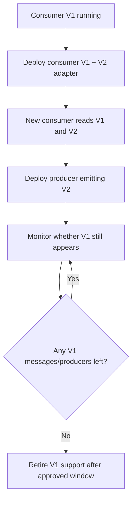

# Managing Event Versions and Running Multiple Versions in Parallel

In an event-driven system, producers and consumers are typically deployed independently. When a producer changes an event's structure or meaning, not all consumers are upgraded at the same time. An old consumer may still be running in production, a new consumer may be undergoing a gradual rollout, and the broker may retain messages emitted days or months earlier. Therefore, event contracts must be versioned and have a compatibility strategy spanning the entire message lifecycle.

Spring Cloud Stream provides the `Supplier`, `Function`, and `Consumer` programming model, bindings, and binders to connect applications with Kafka, RabbitMQ, or Pulsar. These components transport messages according to the defined contract; they do not automatically determine event version semantics or make every schema change compatible. Development teams must define contract versions, how consumers read existing versions, and the rollout sequence for producers/consumers to avoid losing messages or misinterpreting business semantics.

## 1. Distinguishing Event Version and Schema Version

These two concepts are related but not identical:

- **Event version** describes the version of the event contract and business semantics committed by the producer. For example, `OrderCreated v2` might change how shipping addresses are represented or introduce new business rules.
- **Schema version** describes the version of the data structure used for serialization/deserialization, such as field names, data types, required fields, and default values.

A minor schema change might not alter event semantics. Conversely, a change in business meaning may require a new event version even when the JSON retains the exact same fields. Do not treat schema version numbers as sole proof that two messages share the same semantics.

An event envelope can carry metadata like this:

```json
{
  "eventId": "evt-01J8Q7M4",
  "eventType": "com.example.orders.OrderCreated",
  "eventVersion": 2,
  "occurredAt": "2026-11-24T09:30:00Z",
  "aggregateId": "ORD-1001",
  "payload": {
    "orderId": "ORD-1001",
    "total": 250000,
    "currency": "VND"
  }
}
```

`eventVersion` is part of the published contract. The version can live in the payload envelope, headers, or schema registry metadata depending on the system. Choose one clear source of truth and maintain consistent interpretation across brokers, DLQs, replays, and observability tools. If the version lives in a header, verify binder header mapping and ensure that metadata is preserved when messages are forwarded.

## 2. Choosing a Versioning Strategy

Not every change requires creating a new topic or bumping a major version. Classify changes by compatibility impact:

| Change Type | Example | Typically Suitable Approach |
|---|---|---|
| Optional addition | Add nullable/absent `salesChannel` | Can keep the same event version if old consumers ignore new fields and new consumers handle old messages |
| Required addition | Add `warehouseId` required by new logic | Needs a default value, transition phase, or new event version |
| Type change | `total` from integer to object containing amount/currency | Usually an incompatible change; use a new version or adapter |
| Rename/remove field | `customerId` to `buyerId` | Needs a transition period or new version |
| Semantic change | `total` shifts from pre-tax total to post-tax total | Semantic change; must publish a distinct new contract |
| Business rule change | `OrderCreated` emitted only after payment | May require a new event type because the old name no longer describes the event accurately |

Practical rules:

- Keep events immutable once published. Once semantics or data are in use by consumers, do not rewrite historical messages to fit new code.
- Prefer additive, optional changes when possible; consumers should ignore unknown fields.
- Never reuse a deleted field name for a new meaning.
- Use explicit versions for breaking changes.
- Publish schemas and example messages so consumer teams can prepare in advance.
- Define the support window for old versions and the owner responsible for deprecation decisions.

## 3. Backward, Forward, and Full Compatibility

When changing a schema, determine which compatibility direction the new version supports:

| Mode | General Meaning | Verification Question |
|---|---|---|
| Backward compatibility | New consumer/schema can read data written under old schema | Can new consumers read old messages remaining in topics or DLQs? |
| Forward compatibility | Old consumer/schema can read data written under new schema | Can old consumers ignore new fields or handle new values safely? |
| Full compatibility | Satisfies both backward and forward compatibility | Can new producers with old consumers, and old producers with new consumers, operate simultaneously? |

Some schema registries also support checking compatibility across multiple versions (transitive), rather than comparing the new version only with its immediate predecessor. This matters when systems retain messages for a long time or consumers replay from old offsets. Choose the registry policy matching your schema format and deployment model; JSON, Avro, and Protobuf have distinct compatibility rules.

For example, adding an optional `currency` field can usually remain compatible if old consumers ignore unknown fields and new consumers apply a default when reading old messages. However, changing `total` from a number to an object will prevent old consumers from parsing new messages. Never conclude a change is compatible merely because the JSON remains syntactically valid.

## 4. Representing Versions in Contracts and Java Models

Versions can be represented with separate DTOs:

```java
public record OrderCreatedV1(
    String orderId,
    long total
) {}

public record OrderCreatedV2(
    String orderId,
    long total,
    String currency
) {}
```

Consumers needing parallel support can normalize each DTO into a stable internal model:

```java
public record OrderCreatedCommand(
    String orderId,
    long total,
    String currency
) {}

public final class OrderEventMapper {
    public OrderCreatedCommand fromV1(OrderCreatedV1 event) {
        return new OrderCreatedCommand(
            event.orderId(), event.total(), "VND");
    }

    public OrderCreatedCommand fromV2(OrderCreatedV2 event) {
        return new OrderCreatedCommand(
            event.orderId(), event.total(), event.currency());
    }
}
```

This illustrates a change where V1 lacked a currency field and the system has a `VND` default convention. Only apply that default if it is accurate for the business domain; never invent default values merely to make data parse when semantics are ambiguous. If currency cannot be inferred safely, the consumer must reject the message or route it to an error flow for investigation.

An adapter lets business logic operate on a single internal model while the integration layer handles reading multiple external contracts. When adding V3, you can add a new mapper without rewriting all business logic. Keep adapters near the messaging boundary so version-specific DTOs do not leak into the domain model.

## 5. Multi-Version Consumers in Spring Cloud Stream

If messages carry an envelope with `eventVersion`, the consumer can dispatch by version after deserializing the envelope. Simple example with payload converted into an intermediate tree node:

```java
public record EventEnvelope(
    String eventId,
    String eventType,
    int eventVersion,
    JsonNode payload
) {}

@Bean
Consumer<EventEnvelope> consumeOrderCreated(OrderEventHandler handler) {
    return envelope -> {
        if (!"com.example.orders.OrderCreated".equals(envelope.eventType())) {
            throw new IllegalArgumentException("Unsupported event type");
        }

        switch (envelope.eventVersion()) {
            case 1 -> handler.handleV1(
                objectMapper.treeToValue(envelope.payload(), OrderCreatedV1.class));
            case 2 -> handler.handleV2(
                objectMapper.treeToValue(envelope.payload(), OrderCreatedV2.class));
            default -> throw new UnsupportedEventVersionException(
                envelope.eventType(), envelope.eventVersion());
        }
    };
}
```

This example illustrates version-based routing; inject `ObjectMapper` and handle exceptions per your real application structure. What matters is parsing the payload into the exact versioned DTO after reading version metadata. Do not deserialize a V2 payload directly into a V1 DTO expecting fields to convert accurately by themselves.

For multiple event types, you can use a shared envelope and a handler registry keyed by `(eventType, eventVersion)`. This scales better than a long `if/else` chain. Explicitly define behavior for unsupported event types/versions: controlled rejection, DLQ or parking-lot routing, and logging sufficient metadata for investigation. Never silently discard unrecognized messages, as that loses business data.

## 6. Running Multiple Versions in Parallel via Expand–Migrate–Contract

A safe rollout workflow typically has three phases:

1. **Expand:** extend consumers to read both old and new schemas; add optional fields or adapters without forcing producers to switch immediately.
2. **Migrate:** roll out new consumers across enough instances, verify handling of both versions, then switch producers to emit the new version as planned.
3. **Contract:** once no old producers/consumers remain, old messages have expired past retention, or an equivalent replay plan is in place, remove adapters and support for old versions.

Deployment diagram:



The exact sequence depends on compatibility direction. For changes where old consumers cannot read new messages, upgrading consumers or deploying adapters is mandatory before producers begin emitting V2. If new consumers can read both V1 and V2, roll out consumers first, then upgrade producers.

Do not delete V1 code immediately after the new producer ships. Brokers may still hold old messages, consumers might be rolled back, DLQs may be replayed, and external integration systems might still emit old versions. Determine maximum retention windows, replay schedules, and out-of-band producers before dropping support.

## 7. Parallel Runs Using Versioned Topics or Destinations

Two common ways to distribute versions:

| Approach | Description | Suitable When |
|---|---|---|
| Single destination, version in envelope | V1 and V2 share one topic/queue; consumers dispatch by `eventVersion` | Versions share the same purpose and access controls, and consumers can read a common envelope |
| Separate destination per version | E.g., `orders.created.v1` and `orders.created.v2` | Wire format breaks compatibility or separate rollout/retention/ACLs are needed |

A single shared destination reduces broker resources and preserves a single ordered event stream per partition/key, but consumers must understand every active version. Separate destinations isolate contracts and deployment lifecycles, at the cost of more topics/queues, binding configs, monitoring, and potential synchronization between streams.

Example configuration with two input bindings for two destinations:

```yaml
spring:
  cloud:
    function:
      definition: consumeOrderV1;consumeOrderV2
    stream:
      bindings:
        consumeOrderV1-in-0:
          destination: orders.created.v1
          group: order-processor
          content-type: application/json
        consumeOrderV2-in-0:
          destination: orders.created.v2
          group: order-processor
          content-type: application/json
```

This example only illustrates two bindings. When declaring multiple function beans in the same application, verify function list syntax and binding names against your Spring Cloud Function/Spring Cloud Stream version. You can also split V1 and V2 consumers into separate applications/beans that delegate to the same application service.

If a producer publishes simultaneously to both V1 and V2, treat that as risky dual publishing: a send may succeed on one destination and fail on the other. Use an outbox or idempotent relay workflow if both streams must reliably receive the event. Never assume two separate bindings automatically participate in the same transaction.

## 8. Managing Old Producers, Old Consumers, and Rollbacks

During a rollout, these combinations can coexist:

| Producer | Consumer | Condition for Safety |
|---|---|---|
| V1 | V1 | Existing contract operates as before |
| V1 | V2 | Consumer V2 must read V1 data or use an adapter |
| V2 | V1 | Consumer V1 must ignore new structure and preserve semantics; otherwise, do not upgrade producer first |
| V2 | V2 | Both sides agree on V2 schema and semantics |

Before rollout, review the actual compatibility matrix and determine which combinations are permitted. Rolling back a producer to V1 after V2 events were emitted does not erase V2 messages already stored. Consumers must continue supporting V2 until those messages are processed or expire per policy. Likewise, rolling back a consumer is only safe if the older consumer can still read existing newer messages.

One way to lower risk is keeping multi-version reader adapters around longer than the rollout window itself. When a rollback is needed, only swap application versions without altering message history. However, adapters must be tested and monitored like production code; do not leave untested dead branches for old versions.

## 9. Replay, Retention, and DLQs Across Multiple Versions

Historical messages can be re-read when rebuilding projections, recovering data, or investigating incidents. Consequently, schema support windows must cover message retention periods plus copies stored in DLQs, backups, or archives.

Before retiring a version, answer these questions:

- How long do old-version messages remain in the main topic/queue?
- Do DLQs and parking lots have longer retention than the main topic?
- Are there replay procedures from old offsets or archives?
- Can the new consumer read every replayed version?
- If historical transformation is required, who owns the migration job and how are results verified?

Never mutate historical messages in place merely to fit new consumers. If data normalization is needed, use testable upcasters or migration pipelines that record the source version and ensure idempotent re-execution. Retain original events when required for audit or replay.

## 10. Contract and Rollout Testing

Testing versioning requires more than a DTO unit test:

- **Schema compatibility tests:** validate new schemas against the chosen backward/forward/full policy.
- **Golden message tests:** store representative V1/V2 payloads and verify new consumers read them accurately.
- **Cross-version integration tests:** producer V1 sending to consumer V2 and vice versa for permitted combinations.
- **Unknown version tests:** verify unsupported event versions enter observable error/DLQ flows.
- **Replay tests:** read old messages from the broker or archive fixtures using the consumer version about to ship.
- **Rollback tests:** revert to an old consumer or producer while the destination still holds new-version messages.
- **Dual-publish tests:** if using two destinations, simulate partial failure where one publish succeeds and the other fails.

Spring Cloud Stream's Test Binder is helpful for testing functions and bindings at the application level. It does not replace testing against real Kafka, RabbitMQ, or Pulsar when verifying schemas, serializers, retention, partition ordering, redeliveries, or DLQs. Build integration tests targeting your exact production binder and data format.

## 11. Observability and Version Lifecycle Governance

Track message counts by `eventType` and `eventVersion`, active consumers per version, conversion error rates, DLQ counts, consumer lag, and oldest message age. If using separate topics, dashboards should distinguish each destination. If sharing one topic, logs and metrics should tag the version to show whether old producers are still emitting.

Establish a lifecycle policy for each event contract:

- Owning team for the event and approvers for changes.
- Where schemas are published, such as a schema registry or contract repository.
- Compatibility policy and breaking-change review workflow.
- Currently supported versions, producer sunset dates, and consumer sunset dates.
- Retention, replay, and DLQ support windows.
- Migration and rollback guides for consumers and producers.

Do not delete an old version solely because no new messages appeared over a brief period. Confirm every producer has migrated, remaining backlogs are processed, and replay workflows no longer depend on that version.

## 12. Checklist Before Releasing a New Version

- [ ] Classified whether the change is compatible or breaking.
- [ ] Event version and schema version have clear meanings and are not used interchangeably by accident.
- [ ] New schema passed backward/forward/full compatibility checks as appropriate.
- [ ] New consumers can read old messages and apply accurate semantics.
- [ ] Old producers and old consumers can keep operating throughout the rollout.
- [ ] Decided between a single destination with envelope versions or separate versioned destinations.
- [ ] If dual-publishing, handled partial failures with outbox/idempotency or an equivalent workflow.
- [ ] DLQ, retention, archive, and replay windows factored into old-version support timelines.
- [ ] Tested golden messages, cross-version pairs, unknown versions, and rollbacks.
- [ ] Metrics exist to verify old producers stopped emitting and consumers finished processing old messages.

Event versioning lets producers and consumers upgrade independently while continuing to exchange meaningful data. When contracts are clearly published, consumers maintain adapters for active versions, rollouts follow expand–migrate–contract, and both replays and rollbacks are tested, a Spring Cloud Stream system can run multiple versions in parallel without disrupting business flows.
