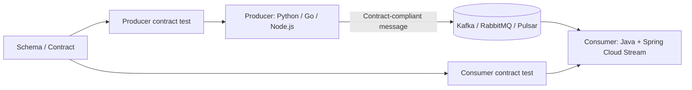

# Contract Testing with Polyglot Producers and Consumers

## Objectives

In event-processing systems, publishers and subscribers are often written in different languages or frameworks. A Python service may emit events to Kafka while a Java consumer uses Spring Cloud Stream; a Go application may send messages via RabbitMQ to a Java service; or a Node.js producer may write data to Pulsar. Components can only collaborate when they share an understanding of a stable message contract.

**Contract testing** verifies that messages produced by a producer match the structure and semantics expected by consumers. It focuses on the exchanged data and how data is interpreted across services, regardless of whether both sides share a language or class model.

This lesson covers defining language-neutral contracts, testing both producers and consumers, handling data type differences, and managing schema changes when deploying Spring Cloud Stream alongside Kafka, RabbitMQ, or Pulsar.

After this lesson, you will be able to:

- Identify what must be included in a message contract.
- Use JSON Schema or another schema format as a language-neutral contract.
- Verify that producers emit schema-compliant messages and consumers can read them.
- Recognize differences between Java types, Python types, and wire formats.
- Distinguish schema testing, consumer-driven contracts, and broker integration tests.
- Evaluate schema changes for compatibility before release.

## 1. Why Is Cross-Language Contract Testing Needed?

A Java class and a Python class may describe the same business concept yet fail to interoperate automatically. For example:

- Java uses `long`, whereas Python uses arbitrary-precision integers.
- Java `BigDecimal` preserves decimal precision, whereas Python `float` uses binary floating-point numbers.
- Java `Instant` represents a point in time, whereas Python can construct naive or timezone-aware datetimes.
- One language may distinguish an absent field from a `null` field; another language's code may conflate the two.
- Enums or property names may be handled differently across serialization libraries.

If each service is only unit-tested in isolation, both producer and consumer unit tests can pass while the two sides still misunderstand the same message. Contract tests place a shared contract in the middle to verify compatibility.



A contract is a document and artifact readable across multiple languages. It describes the wire format, required fields, data types, semantics, important metadata, and compatibility rules. A contract must not depend on Java package names, Python class names, or a service's internal structure.

## 2. What Does a Message Contract Include?

A solid event contract typically specifies:

| Component | Question to Answer | Example |
|---|---|---|
| Event identity | How is an event identified? | Unique, stable `eventId` |
| Event type | What kind of event is this? | `payment.captured` |
| Payload schema | Which fields, types, required vs. optional? | `orderId: string`, `amountMinor: integer` |
| Semantics | What do fields mean, what units, what bounds? | `amountMinor` is in the smallest currency unit |
| Time | Which timezone and format are used? | ISO 8601 UTC |
| Metadata | Which correlation, tenant, or trace context must be passed? | `correlationId` |
| Transport | Which destination and content type are used? | topic `payments.captured`, JSON |
| Evolution | Which rules govern adding, removing, or changing fields? | Only optional additions in minor evolution |

Distinguish between the **payload contract** and the **transport contract**. The payload contract describes business data. The transport contract describes how messages are delivered over Kafka, RabbitMQ, or Pulsar, including destinations, keys, headers, and delivery semantics. Schema contract tests do not prove consumer groups, partitioning, retries, or acknowledgements work properly; those behaviors require separate integration tests.

A contract is not merely a list of field names. It must specify data meaning and rules. For instance, `amount` could mean `125.50` currency units, `12550` cents, or a formatted string. Without explicit units and precision, both sides can deserialize cleanly yet compute wrong business values.

## 3. Defining a Language-Neutral Contract with JSON Schema

JSON Schema is a common choice when producers and consumers exchange JSON. Schemas can be consumed from Java, Python, Go, JavaScript, and many other languages.

Example `PaymentCapturedV1` event:

```json
{
  "$schema": "https://json-schema.org/draft/2020-12/schema",
  "$id": "https://contracts.example.com/events/payment-captured-v1.schema.json",
  "title": "PaymentCapturedV1",
  "type": "object",
  "required": [
    "eventId",
    "eventType",
    "occurredAt",
    "orderId",
    "amountMinor",
    "currency"
  ],
  "properties": {
    "eventId": {
      "type": "string",
      "minLength": 1
    },
    "eventType": {
      "const": "payment.captured"
    },
    "occurredAt": {
      "type": "string",
      "format": "date-time"
    },
    "orderId": {
      "type": "string",
      "minLength": 1
    },
    "amountMinor": {
      "type": "integer",
      "minimum": 0
    },
    "currency": {
      "type": "string",
      "pattern": "^[A-Z]{3}$"
    },
    "paymentReference": {
      "type": ["string", "null"]
    }
  },
  "additionalProperties": true
}
```

The schema specifies:

- Six required fields must be present.
- `eventType` must equal `payment.captured`.
- `occurredAt` uses RFC 3339 / ISO 8601 date-time formatting supported by JSON Schema `date-time`.
- `amountMinor` is a non-negative integer representing the smallest currency unit.
- `currency` is a three-letter uppercase currency code.
- `paymentReference` may be absent or `null`, per the schema above.
- `additionalProperties: true` allows consumers to encounter extra fields they do not yet recognize; consumer code still needs to deliberately ignore or handle extension fields.

If you want to forbid unknown fields, you can set `additionalProperties: false`. That helps catch producers sending out-of-contract data, but it can cause older consumers to reject messages when producers add new fields. Choose the policy based on your system-wide evolution strategy rather than enabling strict mode blindly.

Example valid JSON payload:

```json
{
  "eventId": "evt-7f2a",
  "eventType": "payment.captured",
  "occurredAt": "2026-11-24T05:30:00Z",
  "orderId": "order-42",
  "amountMinor": 12550,
  "currency": "VND",
  "paymentReference": "pay-8831"
}
```

The contract does not mandate that producers use a specific Java or Python class. Any producer generating JSON matching the agreed schema and semantics can emit the event.

## 4. Keeping Data Types Consistent Across Languages

Several data rules should be documented explicitly in the contract:

### Currency and Decimals

Avoid binary floating-point numbers for money. For example, `125.50` may be read as a float with representation error. Two common approaches:

- Use integers in the smallest unit, e.g., `amountMinor: 12550` for `125.50` in a currency with two decimal places.
- Use formatted decimal strings with a clearly specified format, e.g., `amount: "125.50"`, then parse into an exact decimal type in each language.

If using integers, the contract must specify the currency and scaling rules. Never assume every currency shares the same number of decimal places.

### Timestamps

Use timestamps with a timezone, typically UTC with the `Z` suffix, e.g., `2026-11-24T05:30:00Z`. Avoid date-time strings without an offset because producers and consumers might interpret them using different server timezones.

### Null and Missing Fields

Clearly distinguish three cases:

- Required field with a value.
- Optional field that may be omitted.
- Field allowing `null`.

In JSON Schema, `required` mandates that the field appear; type `["string", "null"]` permits `null` values without making the field required. To require a field while allowing `null`, both list its name in `required` and permit the `null` type.

### Enums and Extensible Values

Consumers should have a strategy when encountering new enum values. A consumer using an exhaustive switch can fail when a producer adds a status. If extensibility is needed, explicitly define how unknown values are handled, such as logging and routing to an `UNKNOWN` branch or rejecting in a controlled manner.

### Unicode, Field Names, and Numeric Limits

Specify JSON field casing, UTF-8 encoding, integer ranges, and string length limits. Do not assume every language shares the same integer bounds or type coercion rules.

## 5. Cross-Language Producer: Python Emitting JSON to Kafka

A Python producer can serialize a payload as JSON and send bytes. Example using the `confluent-kafka` client:

```python
import json
from datetime import datetime, timezone
from confluent_kafka import Producer

producer = Producer({
    "bootstrap.servers": "localhost:9092"
})

event = {
    "eventId": "evt-7f2a",
    "eventType": "payment.captured",
    "occurredAt": datetime.now(timezone.utc).isoformat(),
    "orderId": "order-42",
    "amountMinor": 12550,
    "currency": "VND",
    "paymentReference": "pay-8831"
}

payload = json.dumps(
    event,
    ensure_ascii=False,
    separators=(",", ":")
).encode("utf-8")

producer.produce(
    topic="payments.captured",
    key=event["orderId"].encode("utf-8"),
    value=payload,
    headers=[
        ("correlationId", b"corr-900")
    ]
)

producer.flush()
```

This example illustrates sending JSON bytes; in a real pipeline, the producer must validate the event against the schema before publishing. In production systems, configure callbacks/error handling, timeouts, retries, and appropriate delivery confirmations. `flush()` waits for queued messages in the producer to be processed before the process exits, though it does not prove a business consumer has processed the message.

In this example:

- The JSON payload carries the contract-compliant data.
- The Kafka key is `orderId`, used for routing/partitioning per producer settings.
- `correlationId` is header metadata and does not replace the event ID.
- Python classes or type annotations are not part of the wire contract.

If using Avro or Protobuf with a schema registry, the producer uses the corresponding serializer/schema integration instead of calling `json.dumps` manually. Contract tests must still verify the schema and exact bytes consumers read.

## 6. Java Consumer Using Spring Cloud Stream

A Java consumer can receive payloads using a matching DTO:

```java
public record PaymentCapturedV1(
        String eventId,
        String eventType,
        Instant occurredAt,
        String orderId,
        long amountMinor,
        String currency,
        String paymentReference
) {}
```

Spring Cloud Stream binding:

```java
@Bean
Consumer<PaymentCapturedV1> paymentCaptured(PaymentService service) {
    return event -> service.recordCaptured(
            event.eventId(),
            event.orderId(),
            event.amountMinor(),
            event.currency()
    );
}
```

JSON binding configuration:

```yaml
spring:
  cloud:
    function:
      definition: paymentCaptured
    stream:
      bindings:
        paymentCaptured-in-0:
          destination: payments.captured
          group: billing-service
          content-type: application/json
```

Jackson must be configured to read date-time types like `Instant` (typically via the Java Time module in Spring Boot's Jackson configuration). If the DTO uses `paymentReference` which may be missing or null, Java types and validation must accurately reflect the contract. The example above uses a nullable `String`; if you must distinguish missing from explicit `null`, use a clearer representation or validation approach.

Do not assume that successful deserialization satisfies the contract. The consumer must still validate semantics: `amountMinor` is non-negative, `currency` is supported, `eventType` matches, and `eventId` is validly formatted. A schema validator at the boundary can check structure; the application/domain layer remains responsible for business rules.

## 7. Producer-Side Contract Testing

Producer contract tests verify that generated messages conform to the published schema and semantics. Tests should reference the exact same schema artifact used by consumers rather than writing an approximate copy in each repository.

One approach:

1. Construct a sample event using producer code.
2. Serialize with the exact serializer used in production.
3. Re-parse the bytes or message body.
4. Validate content against the published schema.
5. Assert semantic conditions a schema cannot express, such as system-supported currencies, unique event IDs, or reasonable timestamp ranges.
6. If headers are used, verify required application headers and their types.

Python example using `jsonschema` to validate payloads prior to publishing:

```python
import json
from jsonschema import Draft202012Validator

with open("contracts/payment-captured-v1.schema.json", encoding="utf-8") as file:
    schema = json.load(file)

validator = Draft202012Validator(schema)
errors = sorted(
    validator.iter_errors(event),
    key=lambda error: list(error.path)
)

assert not errors, [
    f"{list(error.path)}: {error.message}"
    for error in errors
]
```

In a producer pipeline, this test should run against sample events produced by real application code. If a test only validates a static JSON fixture without passing through the producer's mapper and serializer, it will miss bugs in message construction code.

## 8. Consumer-Side Contract Testing

Consumer contract tests verify that the consumer accepts messages matching the agreed contract and processes key fields accurately.

Java test example reading a shared JSON fixture:

```java
@Test
void shouldReadPaymentCapturedContractFixture() throws Exception {
    var mapper = new ObjectMapper()
            .registerModule(new JavaTimeModule());

    PaymentCapturedV1 event = mapper.readValue(
            getClass().getResourceAsStream(
                    "/contracts/payment-captured-v1-valid.json"
            ),
            PaymentCapturedV1.class
    );

    assertEquals("evt-7f2a", event.eventId());
    assertEquals("payment.captured", event.eventType());
    assertEquals("order-42", event.orderId());
    assertEquals(12550L, event.amountMinor());
    assertEquals("VND", event.currency());
}
```

After deserialization, you can invoke the handler/use case with the event fixture to verify the consumer uses the data properly. Add fixtures for missing optional fields, allowed nulls, unknown enum values, invalid timestamps, and messages missing required fields.

Consumer tests should verify both compatibility and error handling. For instance, if a producer adds an optional field unused by the consumer, old consumers must keep reading new messages per schema policy. If a required field is missing, the consumer must reject the message observably and route it per the error/DLQ policy rather than inventing silent defaults.

## 9. Consumer-Driven Contracts and Provider Verification

Schema validation checks message structure. In some systems, consumers also need to explicitly declare the fields and values they genuinely rely on. This is where **consumer-driven contract testing** helps.

General workflow:

1. The consumer describes the minimal message required to execute its behavior.
2. The consumer produces a contract artifact or message expectation.
3. The producer/provider runs verification tests to confirm the actual messages it emits satisfy the contract.
4. Contract verification runs in CI before publishing a producer release.
5. Verified contracts are stored in versioned storage so teams know which producer versions are compatible with which consumers.

For asynchronous messaging, you can use tools supporting asynchronous/message contracts such as Pact message testing or a shared schema test suite. Specific tools and APIs depend on language, framework, and version. Crucially, provider verification must test output actually generated by producer code, not merely validate a static sample file unrelated to the publish path.

Consumer-driven contracts do not replace a schema registry. The two complement each other:

- A schema registry manages schemas, versions, and compatibility at the wire level.
- Consumer-driven contracts express the real needs of individual consumers and can verify conditions structural schemas cannot describe.

When multiple consumers exist, a change is only valid when it satisfies schema compatibility policies and does not break contracts actively relied upon by consumers.

## 10. Controlling Schema Evolution

Schemas change over time as business needs add fields or alter representations. Before releasing, determine which compatibility direction a change supports.

| Change | Risk | Evaluation Guidance |
|---|---|---|
| Add optional field with sensible default | Usually compatible if consumers ignore unknown fields | Check old consumers and schema policy |
| Add required field | Old producers do not send it; old consumers may not know it | Usually a breaking change |
| Remove an active field | Old consumers may fail to process | Breaking change if any consumer still depends on it |
| Rename field | Equivalent to removing old field and adding new field | Use a transition phase or a new version |
| Change data type | Can cause deserialization errors or shift semantics | Treat as breaking unless compatibility is proven |
| Add enum value | Exhaustive consumers may fail | Consumers must handle unknown values |
| Change unit or field meaning | Schema stays valid but business logic breaks | Semantic change; requires versioning/migration |
| Tighten validation or bounds | Old data may become invalid | Check real data and compatibility policy |

Common terms:

- **Backward compatibility:** new consumers can read data produced under an old schema.
- **Forward compatibility:** old consumers can read data produced under a new schema within defined bounds.
- **Full compatibility:** satisfies both backward and forward compatibility under system policy.

Exact verification depends on the schema format and registry. Avro, Protobuf, and JSON Schema have different evolution rules; never assume a change safe in JSON Schema is also safe in Avro or Protobuf.

A common strategy is favoring additive changes: add optional fields, preserve existing field meanings, and deploy consumers able to ignore unknown fields. When semantics must change or fields must be removed, use a migration with an overlap window or release a new event type version.

## 11. Testing Old and New Data in the Same Pipeline

A good contract suite does not test only the latest sample JSON. Store representative fixtures for all still-supported versions:

```text
contracts/
└── payment-captured/
    ├── v1/
    │   ├── schema.json
    │   ├── valid-minimal.json
    │   ├── valid-full.json
    │   └── invalid-missing-event-id.json
    └── v2/
        ├── schema.json
        ├── valid-minimal.json
        └── valid-with-payment-method.json
```

This is an illustrative layout; repositories may organize artifacts according to local conventions.

Tests should cover:

- Current producer emits messages conforming to the current schema.
- Current consumer reads fixtures from all supported older versions.
- Old consumer is tested against new messages if forward compatibility is mandated.
- Messages missing required fields are rejected.
- Messages with absent or null optional fields are handled properly.
- New enum values do not crash consumers unexpectedly.
- Serializers produce the right wire format and UTF-8 encoding.
- Important application headers are transmitted according to the transport contract.

Do not delete old fixtures simply because the producer bumped its version. Fixtures serve as evidence for the compatibility the system promises for messages stored in brokers, DLQs, or replay archives.

## 12. Distinguishing Contract Tests, Binder Tests, and End-to-End Tests

These test types answer different questions:

| Test Type | Question | Components Required |
|---|---|---|
| Contract/schema test | Does the message conform to the published schema and semantics? | Producer/consumer code, schema artifacts, and fixtures |
| Binder integration test | Does Spring Cloud Stream map payloads, headers, bindings, and errors properly? | Spring context and Test Binder or binder test support |
| Broker integration test | Does the real broker store, route, redeliver, and preserve metadata as expected? | Kafka, RabbitMQ, or Pulsar test instance |
| End-to-end test | Does the full multi-service flow produce accurate business outcomes? | Participating services and integration infrastructure |

Test Binder is helpful for testing functions and bindings at the Spring Cloud Stream layer, but it does not prove an external Python producer serialized correctly or that real Kafka/RabbitMQ/Pulsar preserves metadata identically to tests. Run contract tests independent of brokers when possible; supplement with broker integration tests for transport verification.

## 13. Integrating Contract Tests into CI/CD

A release pipeline can run in this order:

1. Validate schema artifacts and versioning.
2. Validate both valid and invalid fixtures.
3. Run producer contract tests against messages generated by current code.
4. Run consumer contract tests against supported fixtures/versions.
5. Run provider verification for relevant consumer contracts.
6. Check schema compatibility per the chosen registry or tooling policy.
7. Run binder/broker integration tests for transport-dependent behaviors.
8. Release only when all mandatory contracts pass.

When multiple producers/consumers exist, maintain a compatibility matrix:

| Producer Version | Consumer Version | Result |
|---|---|---|
| P1 | C1 | Verified |
| P2 | C1 | Forward compatibility check required |
| P2 | C2 | Verified |
| P3 | C1 | Do not release if contract is broken |

The matrix must rely on actual test results and version support policies, never marking compatibility automatically merely because version numbers increment sequentially.

Store metadata for each contract: owner, event type, schema version, support status, dependent consumers, and planned deprecation date. When modifying a contract, notify consumer-owning teams via your organization's release workflow and establish a migration plan.

## 14. Common Pitfalls in Polyglot Contract Testing

| Error | Cause | Fix |
|---|---|---|
| Java reads it but Python validation fails | Sides use different schemas or format rules | Share the exact same schema artifact and matching validators |
| JSON parses cleanly yet business logic is wrong | Currency units, timezone, or semantics left undefined | Explicitly document units, timezone, and field meanings |
| Old consumer breaks when producer adds a field | Parser/schema validation rejects unknown fields | Define unknown-field policy and test evolution |
| Producer test passes yet live message is wrong | Test only validated a static fixture | Validate bytes produced by real producer code and serializer |
| Headers disappear across broker | Binder did not map headers or native header handling differs | Test transport contracts per binder |
| Message deserializes into wrong type | Mismatched content type or serializer/deserializer | Verify wire format and configuration on both sides |
| Consumer crashes on new enum | Code assumed enum had only the old value set | Add unknown branch or controlled versioning |
| Contract tests pass yet messages fail to reach consumer | Contract tests did not verify broker delivery | Add broker integration tests |

## Conclusion

Contract testing enables polyglot producers and consumers to collaborate through a neutral wire contract. JSON Schema, Avro, or Protobuf describe structure and data rules; producer contract tests verify generated messages, consumer contract tests verify parsing and processing, and provider verification confirms producers satisfy consumer expectations.

With Spring Cloud Stream, keep schemas and DTOs at the integration boundary, share identical contract artifacts across languages, and verify schema evolution before release. Contract tests prove data compatibility; binder and broker integration tests verify content types, header mapping, routing, and real delivery on Kafka, RabbitMQ, or Pulsar.
