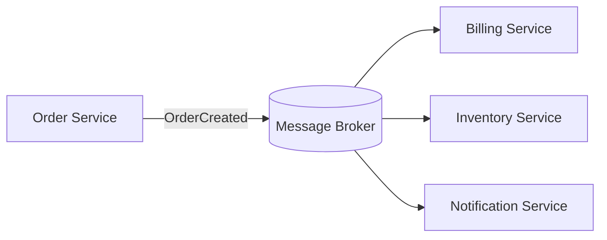
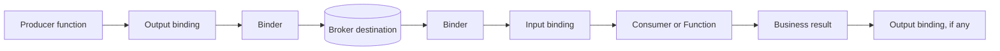

# Spring Cloud Stream là gì và giải quyết bài toán nào

## 1. Bối cảnh: khi các dịch vụ cần trao đổi sự kiện

Trong một hệ thống gồm nhiều dịch vụ, một hành động nghiệp vụ thường tạo ra thông tin mà những phần khác của hệ thống cần biết. Khi đơn hàng được tạo, dịch vụ thanh toán cần chuẩn bị giao dịch, dịch vụ kho cần giữ hàng và dịch vụ thông báo có thể gửi email cho khách. Nếu dịch vụ tạo đơn gọi trực tiếp tất cả các dịch vụ còn lại, nó phải biết địa chỉ, giao thức, thời gian phản hồi và cách xử lý lỗi của từng bên. Một dịch vụ chậm hoặc tạm ngừng cũng có thể làm chậm toàn bộ luồng tạo đơn.

Kiến trúc hướng sự kiện (event-driven architecture) giải quyết sự phụ thuộc này bằng cách công bố một sự kiện mô tả điều đã xảy ra. Các dịch vụ quan tâm đăng ký nhận sự kiện và xử lý độc lập. Dịch vụ phát sự kiện không cần biết có bao nhiêu bên nhận hoặc từng bên được triển khai ở đâu.

Ví dụ, `OrderCreated` là sự kiện cho biết một đơn hàng đã được tạo. Dịch vụ đơn hàng gửi sự kiện đến một hệ thống truyền thông điệp. Dịch vụ thanh toán và dịch vụ kho có thể nhận cùng sự kiện qua hai nhóm tiêu thụ riêng, sau đó thực hiện công việc của mình.



Mô hình này giảm sự phụ thuộc trực tiếp giữa các dịch vụ, cho phép xử lý bất đồng bộ và giúp từng dịch vụ mở rộng theo tải của riêng nó. Đổi lại, hệ thống phải quản lý hợp đồng sự kiện, khả năng giao nhận lặp, thứ tự xử lý, độ trễ và việc quan sát các luồng chạy qua broker.

## 2. Spring Cloud Stream là gì

**Spring Cloud Stream** là framework của hệ sinh thái Spring để xây dựng ứng dụng xử lý thông điệp và sự kiện. Framework cung cấp mô hình lập trình thống nhất cho ứng dụng gửi, nhận và biến đổi thông điệp, đồng thời kết nối ứng dụng với hệ thống trung chuyển thông qua thành phần gọi là *binder*.

Ứng dụng thường được xây dựng trên Spring Boot. Lập trình viên tập trung viết logic nghiệp vụ bằng các hàm Java như `Supplier`, `Function` và `Consumer`. Spring Cloud Stream kết nối các hàm đó với các điểm vào và điểm ra của thông điệp. Binder phụ trách giao tiếp với broker cụ thể, chẳng hạn Apache Kafka hoặc RabbitMQ; có thể tích hợp Apache Pulsar khi dùng binder tương thích với phiên bản nền tảng.

Một ứng dụng Spring Cloud Stream có thể đảm nhiệm một hoặc nhiều vai trò:

- **Phát sự kiện:** tạo thông điệp và gửi đến một destination để các dịch vụ khác nhận.
- **Tiêu thụ sự kiện:** nhận thông điệp từ destination và thực hiện xử lý nghiệp vụ.
- **Biến đổi luồng:** nhận dữ liệu, kiểm tra hoặc chuyển đổi rồi phát kết quả sang destination khác.
- **Xử lý luồng có trạng thái:** kết hợp sự kiện với trạng thái được lưu giữ, thường thông qua Kafka Streams binder khi bài toán và hạ tầng phù hợp.

Spring Cloud Stream cung cấp lớp tích hợp và mô hình lập trình. Nó không thay thế broker, không tự định nghĩa toàn bộ hợp đồng dữ liệu của doanh nghiệp và cũng không làm cho mọi broker có cùng ngữ nghĩa giao nhận.

## 3. Các khái niệm nền tảng

### Message và event

Một **message** là đơn vị dữ liệu được truyền giữa các thành phần. Message thường gồm:

- **Payload:** nội dung chính, ví dụ thông tin đơn hàng.
- **Headers:** metadata như loại nội dung, khóa phân vùng, mã tương quan, dấu thời gian hoặc thông tin định tuyến.

Một **event** là message biểu diễn một sự việc đã xảy ra, thường được đặt tên ở dạng quá khứ như `OrderCreated` hoặc `PaymentCompleted`. Event nên mô tả sự thật nghiệp vụ và mang đủ dữ liệu để consumer xử lý theo hợp đồng đã thống nhất. Consumer không nên phụ thuộc vào đối tượng nội bộ hoặc cơ sở dữ liệu riêng của producer.

Event khác command. Command yêu cầu một thành phần thực hiện hành động; event thông báo một hành động hoặc thay đổi đã xảy ra. Phân biệt hai loại này giúp đặt tên, xác định bên chịu trách nhiệm và xử lý lỗi rõ ràng hơn.

### Destination

**Destination** là tên logic của nơi thông điệp được gửi đến hoặc lấy ra. Tùy binder, destination có thể ánh xạ tới Kafka topic, RabbitMQ exchange/queue hoặc cấu trúc tương ứng của broker khác. Trong cấu hình, ta thường khai báo tên destination thay vì viết mã phụ thuộc trực tiếp vào API của broker.

### Binding

**Binding** nối một hàm trong ứng dụng với destination. Binding đầu vào đưa message từ broker vào hàm; binding đầu ra nhận kết quả từ hàm và gửi đến broker. Một hàm có thể có cả hai loại binding.

Binding có tên được suy ra từ tên bean hàm và vị trí đầu vào/đầu ra. Với bean `processOrder`:

- `processOrder-in-0` là đầu vào thứ nhất.
- `processOrder-out-0` là đầu ra thứ nhất.

Chỉ số `0` biểu thị cổng đầu tiên; các hàm có nhiều đầu vào hoặc đầu ra có thể có thêm chỉ số tương ứng. Tên binding là khóa để cấu hình destination, consumer group, content type và các tùy chọn liên quan.

### Binder

**Binder** là lớp tích hợp giữa Spring Cloud Stream và một loại middleware truyền thông điệp. Binder tạo và cấu hình các binding, chuyển message qua API của broker, đồng thời cung cấp những tùy chọn đặc thù của hệ thống đó.

Các binder thường gặp:

| Binder | Hệ thống | Khái niệm broker cần hiểu |
|---|---|---|
| Kafka binder | Apache Kafka | Topic, partition, offset, consumer group, record key |
| Rabbit binder | RabbitMQ | Exchange, queue, binding key, acknowledgement, dead-letter exchange |
| Pulsar binder | Apache Pulsar | Topic, subscription, subscription type, message key |
| Kafka Streams binder | Kafka Streams trên Apache Kafka | KStream, KTable, state store, topology |

Binder giúp giảm mã kết nối broker trong lớp nghiệp vụ, nhưng không xóa khác biệt giữa các broker. Cấu hình retry, phân vùng, giao nhận, giao dịch và dead-letter vẫn có thể khác nhau. Cần kiểm tra tài liệu của binder và phiên bản đang sử dụng trước khi dựa vào một tính năng cụ thể.

### Consumer group và partition

**Consumer group** xác định một nhóm consumer cùng chia sẻ việc xử lý một luồng dữ liệu. Trong Kafka, các consumer thuộc cùng group phối hợp để đọc các partition; thông thường tại một thời điểm, một partition được gán cho tối đa một consumer trong group. Hai group khác nhau có thể đọc cùng topic độc lập, nhờ đó dịch vụ thanh toán và dịch vụ kho đều nhận được sự kiện.

**Partition** chia một topic thành nhiều phần để tăng khả năng xử lý song song. Với Kafka, các record có cùng key thường được định tuyến vào cùng partition, giúp duy trì thứ tự tương đối của các record đó trong partition. Thứ tự toàn cục giữa nhiều partition không được bảo đảm. Số partition, số instance và cách chọn key vì vậy ảnh hưởng trực tiếp đến khả năng mở rộng và thứ tự nghiệp vụ.

Các khái niệm tương đương trên RabbitMQ hoặc Pulsar có cách hoạt động riêng. Không nên suy ra hành vi của queue, exchange hoặc subscription chỉ từ cách Kafka vận hành.

## 4. Mô hình lập trình hàm: Supplier, Function và Consumer

Spring Cloud Stream ưu tiên mô hình hàm của Spring Cloud Function. Ta khai báo các bean hàm trong Spring context; framework nhận diện chữ ký hàm và tạo binding phù hợp.

| Kiểu hàm | Chữ ký khái quát | Vai trò | Binding thường được tạo |
|---|---|---|---|
| `Supplier<T>` | `T get()` | Tạo dữ liệu để phát đi | `<function>-out-0` |
| `Function<I, O>` | `O apply(I input)` | Nhận và biến đổi dữ liệu | `<function>-in-0`, `<function>-out-0` |
| `Consumer<T>` | `void accept(T input)` | Nhận dữ liệu và thực hiện tác vụ | `<function>-in-0` |

`Supplier` phù hợp với nguồn dữ liệu do ứng dụng tạo ra. Với supplier thông thường, framework gọi hàm theo cơ chế polling; vì vậy cần cân nhắc chu kỳ phát và cách tránh tạo lại cùng một dữ liệu. `Function` phù hợp với xử lý có đầu vào và đầu ra. `Consumer` phù hợp khi xử lý kết thúc bằng một tác dụng phụ như cập nhật cơ sở dữ liệu hoặc gọi dịch vụ nội bộ.

Ví dụ, dịch vụ thanh toán nhận `OrderCreated` và tạo `BillingCommand` để chuyển cho bước xử lý tiếp theo:

```java
import java.util.function.Function;
import org.springframework.context.annotation.Bean;
import org.springframework.context.annotation.Configuration;

record OrderCreated(String orderId, long totalCents) {}
record BillingCommand(String orderId, long amountCents) {}

@Configuration
class BillingFunctions {

    @Bean
    Function<OrderCreated, BillingCommand> createBillingCommand() {
        return event -> new BillingCommand(
            event.orderId(),
            event.totalCents()
        );
    }
}
```

Khi ứng dụng có nhiều hàm, có thể chỉ rõ hàm cần kích hoạt bằng `spring.cloud.function.definition`. Ví dụ dưới đây cấu hình hai binding của hàm `createBillingCommand` và sử dụng Kafka binder:

```yaml
spring:
  cloud:
    function:
      definition: createBillingCommand
    stream:
      bindings:
        createBillingCommand-in-0:
          destination: orders.created
          group: billing-service
          content-type: application/json
        createBillingCommand-out-0:
          destination: billing.commands
          content-type: application/json
      kafka:
        binder:
          brokers: localhost:9092
```

Trong ví dụ:

- `createBillingCommand-in-0` nhận sự kiện từ destination `orders.created`.
- `group: billing-service` đặt consumer vào nhóm xử lý của dịch vụ thanh toán. Các instance cùng group chia sẻ công việc theo quy tắc của Kafka.
- `createBillingCommand-out-0` gửi kết quả đến destination `billing.commands`.
- `content-type: application/json` khai báo định dạng nội dung để Spring Cloud Stream thực hiện chuyển đổi message phù hợp.
- `brokers` chỉ định địa chỉ Kafka broker cho môi trường ví dụ. Khi triển khai thực tế, địa chỉ và thông tin xác thực cần lấy từ cấu hình môi trường hoặc hệ thống quản lý bí mật.

Tên binding phải khớp chính xác giữa bean hàm và cấu hình. Nếu đổi tên bean, tên binding suy ra cũng đổi theo, trừ khi ứng dụng khai báo binding tùy chỉnh. Khi dùng nhiều hàm, cần xác định rõ function definition để tránh kích hoạt nhầm hoặc không kích hoạt hàm mong muốn.

## 5. Spring Cloud Stream xử lý luồng thông điệp như thế nào

Một luồng xử lý điển hình có các bước sau:

1. Ứng dụng producer tạo event hoặc message.
2. Binding đầu ra chuyển message cho binder.
3. Binder gửi message đến destination trên broker.
4. Binder của ứng dụng consumer nhận message từ destination và chuyển vào binding đầu vào.
5. Spring Cloud Stream chuyển payload thành kiểu dữ liệu mà hàm khai báo, nếu cấu hình content type và bộ chuyển đổi tương ứng cho phép.
6. Hàm thực hiện logic nghiệp vụ. Nếu hàm có đầu ra, kết quả đi qua binding đầu ra và được gửi tiếp đến broker.



Với ứng dụng chỉ tiêu thụ, luồng kết thúc ở hàm `Consumer`. Với ứng dụng biến đổi, kết quả của `Function` được phát qua binding đầu ra. Các ứng dụng có thể được triển khai và mở rộng độc lập miễn là chúng tuân thủ hợp đồng message và cấu hình broker phù hợp.

## 6. Những bài toán Spring Cloud Stream giúp giải quyết

### Giảm phụ thuộc giữa các dịch vụ

Producer chỉ cần biết destination và hợp đồng message. Nó không cần gọi trực tiếp từng consumer. Một sự kiện có thể được nhiều nhóm dịch vụ sử dụng cho các mục đích khác nhau. Việc thêm consumer mới thường không yêu cầu thay đổi logic phát sự kiện, miễn là hợp đồng được duy trì.

### Tách thời điểm xử lý và hấp thụ tải

Broker lưu giữ hoặc xếp hàng message theo cơ chế của nó. Producer và consumer không nhất thiết phải hoạt động cùng thời điểm. Consumer có thể xử lý backlog sau khi khởi động lại hoặc tăng số instance khi lượng sự kiện tăng. Khả năng lưu giữ, giới hạn backlog và chính sách hết hạn phụ thuộc broker cùng cấu hình triển khai.

### Chuẩn hóa cách viết ứng dụng message-driven

Mô hình hàm, binding và binder giúp mã nghiệp vụ ít phụ thuộc vào API cụ thể của broker. Ứng dụng có thể chuyển binder hoặc chạy nhiều binder trong những trường hợp phù hợp. Tuy nhiên, việc đổi broker vẫn cần rà soát cấu hình, semantics, giới hạn, thứ tự và cách xử lý lỗi; không phải lúc nào cũng chỉ đổi một dòng cấu hình.

### Tách xử lý thành các bước có thể kết hợp

Một `Function` có thể chuyển event thành dữ liệu đầu ra cho bước kế tiếp. Các hàm có thể được kết hợp theo khả năng của Spring Cloud Function hoặc được triển khai thành các dịch vụ riêng nối với nhau qua broker. Cách chia nhỏ cần dựa trên ranh giới nghiệp vụ, quyền sở hữu dữ liệu và yêu cầu vận hành.

### Xử lý luồng có trạng thái

Với bài toán cần tổng hợp, nối luồng, cửa sổ thời gian hoặc duy trì trạng thái theo khóa, Kafka Streams binder cung cấp cách tích hợp Kafka Streams vào mô hình Spring Cloud Stream. Các khái niệm như `KStream`, `KTable`, state store và topology cần được hiểu riêng vì chúng có vòng đời trạng thái, yêu cầu tài nguyên và quy tắc phục hồi khác với một consumer stateless thông thường.

## 7. Những vấn đề kiến trúc cần giải quyết cùng framework

Spring Cloud Stream cung cấp cơ chế tích hợp; độ tin cậy của hệ thống còn phụ thuộc cách thiết kế message và vận hành broker.

### Consumer group và khả năng mở rộng

Chọn group theo mục đích xử lý độc lập. Hai dịch vụ cần nhận cùng sự kiện thường dùng hai group riêng. Các instance của cùng một dịch vụ thường dùng chung group để chia tải. Nếu nhiều instance cùng group nhưng số partition ít hơn số instance, một số instance Kafka consumer có thể không được gán partition và không xử lý dữ liệu trong thời điểm đó.

### Partition key và thứ tự

Chọn key theo thực thể cần giữ thứ tự, chẳng hạn `orderId` nếu các thay đổi của một đơn hàng phải được xử lý tuần tự. Nếu chọn key không phù hợp, các sự kiện liên quan có thể nằm ở nhiều partition. Tăng số partition có thể ảnh hưởng đến cách phân bố key và cần được xem xét khi thiết kế thứ tự xử lý.

### Hợp đồng message và schema

Producer và consumer có thể được phát hành ở thời điểm khác nhau. Vì vậy, schema cần có quy tắc tương thích khi thêm, bỏ hoặc đổi trường. Nên ưu tiên thay đổi tương thích ngược, quy định rõ trường bắt buộc và mặc định, đồng thời dùng schema registry hoặc cơ chế quản lý schema phù hợp khi hệ thống cần kiểm soát chặt. `content-type` giúp xác định cách chuyển đổi dữ liệu; nó không tự đảm bảo các phiên bản schema tương thích.

### Retry, dead-letter và xử lý lặp

Consumer có thể gặp lỗi tạm thời như mất kết nối hoặc dịch vụ phụ thuộc chưa sẵn sàng. Retry phù hợp với lỗi có khả năng hồi phục, nhưng cần giới hạn số lần thử và cân nhắc backoff để tránh tạo tải lớn hơn khi hệ thống đang lỗi. Message không thể xử lý sau các lần thử có thể được chuyển sang dead-letter queue/topic tùy khả năng của binder và broker.

Một message có thể được giao lại nếu consumer lỗi sau khi thực hiện tác dụng phụ nhưng trước khi xác nhận hoàn tất. Vì vậy, consumer nên có tính **idempotent**: xử lý lại cùng một event không tạo ra tác dụng phụ nghiệp vụ trùng lặp. Có thể dùng event ID, khóa nghiệp vụ, bảng inbox hoặc ràng buộc duy nhất trong cơ sở dữ liệu để nhận diện message đã xử lý. Cần phân biệt retry trong ứng dụng với redelivery của broker vì hai cơ chế có thể có thời điểm và trạng thái khác nhau.

### Bảo đảm giao nhận

Các hệ thống message thường cung cấp những mức bảo đảm như at-most-once hoặc at-least-once tùy cấu hình và cách xác nhận. At-least-once có thể giao trùng, nên consumer cần idempotency. Exactly-once thường gắn với phạm vi và điều kiện cụ thể của broker, binder hoặc giao dịch. Nó không tự động bảo đảm một tác dụng phụ bên ngoài broker, chẳng hạn gửi email hoặc gọi API thanh toán, chỉ xảy ra đúng một lần.

Khi cần cập nhật cơ sở dữ liệu và phát event như một thao tác nghiệp vụ thống nhất, hãy xem xét các mẫu thiết kế như transactional outbox. Khi consumer cập nhật dữ liệu và ghi nhận event đã xử lý, có thể dùng inbox hoặc giao dịch cơ sở dữ liệu để tránh khoảng hở giữa hai thao tác. Việc lựa chọn phải dựa trên yêu cầu nhất quán và khả năng của từng hệ thống.

### Kiểm thử và quan sát

Spring Cloud Stream có test binder để kiểm thử luồng message trong môi trường kiểm thử mà không cần broker thật. Kiểm thử nên xác nhận payload đầu vào, kết quả đầu ra, headers quan trọng và hành vi khi gặp lỗi. Các tính năng đặc thù như partition, transaction, acknowledgement, retry hoặc dead-letter vẫn cần kiểm thử tích hợp với broker tương ứng.

Trong môi trường chạy thật, cần theo dõi tốc độ nhận và xử lý message, độ trễ, backlog/consumer lag, số lần retry, số message vào DLQ và lỗi chuyển đổi dữ liệu. Log nên có event ID hoặc correlation ID để lần theo một nghiệp vụ qua nhiều dịch vụ. Cấu hình kết nối, thông tin xác thực và quyền truy cập broker cũng phải được quản lý theo môi trường.

## 8. Khi nào nên dùng Spring Cloud Stream

Spring Cloud Stream phù hợp khi ứng dụng Spring cần trao đổi sự kiện hoặc message bất đồng bộ, khi nhiều consumer cần sử dụng cùng dữ liệu, khi cần tách producer khỏi consumer hoặc khi muốn tổ chức xử lý thành các hàm độc lập nối qua broker.

Framework đặc biệt hữu ích trong hệ thống microservices, tích hợp giữa các dịch vụ, pipeline xử lý dữ liệu và các ứng dụng cần xử lý luồng liên tục. Với xử lý Kafka có trạng thái, Kafka Streams binder có thể là lựa chọn phù hợp nếu nhóm phát triển chấp nhận mô hình và yêu cầu vận hành của Kafka Streams.

Không nên chọn Spring Cloud Stream chỉ vì ứng dụng có một lời gọi đồng bộ đơn giản cần kết quả ngay. HTTP hoặc gRPC thường phù hợp hơn khi caller cần phản hồi trực tiếp và luồng nghiệp vụ phụ thuộc vào kết quả tức thời. Cũng cần cân nhắc chi phí vận hành broker, độ phức tạp của eventual consistency, khả năng quan sát và năng lực xử lý sự cố trước khi chuyển một luồng đồng bộ thành bất đồng bộ.

## 9. Lộ trình tìm hiểu tiếp theo

Để xây dựng một ứng dụng Spring Cloud Stream hoàn chỉnh, nên đi theo thứ tự:

1. Nắm khái niệm message, event, destination và mô hình xử lý bất đồng bộ.
2. Tạo ứng dụng Spring Boot với một `Supplier`, `Function` hoặc `Consumer`.
3. Cấu hình binding, destination, content type và binder.
4. Thiết kế consumer group, partition key và hợp đồng schema.
5. Bổ sung retry, DLQ, idempotency và chiến lược giao nhận.
6. Kiểm thử bằng test binder rồi kiểm thử tích hợp với Kafka, RabbitMQ hoặc Pulsar.
7. Tìm hiểu Kafka Streams khi cần xử lý luồng có trạng thái, sau đó triển khai cùng giám sát và bảo mật phù hợp.

Điểm cốt lõi là Spring Cloud Stream giúp tổ chức logic xử lý message quanh các hàm và binding, còn broker chịu trách nhiệm trung chuyển theo semantics riêng. Một hệ thống tốt cần thiết kế đồng thời cả hai phần: logic ứng dụng rõ ràng và hợp đồng giao nhận có thể vận hành tin cậy.

