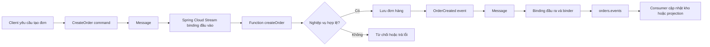

# Phân biệt thông điệp, sự kiện và lệnh

Spring Cloud Stream giúp xây dựng ứng dụng xử lý sự kiện bằng mô hình hàm `Supplier`, `Function` và `Consumer`. Các hàm trao đổi dữ liệu qua những binding, còn binder kết nối binding với hệ thống trung gian như Kafka, RabbitMQ hoặc Pulsar. Để thiết kế luồng dữ liệu rõ ràng, trước hết cần phân biệt ba khái niệm thường xuất hiện cùng nhau: **thông điệp (message)**, **sự kiện (event)** và **lệnh (command)**.

Ba khái niệm này có liên quan nhưng trả lời ba câu hỏi khác nhau:

- Thông điệp cho biết dữ liệu được đóng gói và chuyển đi như thế nào.
- Sự kiện cho biết điều gì đã xảy ra trong nghiệp vụ.
- Lệnh cho biết một thành phần muốn hệ thống thực hiện điều gì.

Một lệnh hoặc một sự kiện có thể được vận chuyển bên trong một thông điệp. Vì vậy, nhìn thấy một `Message<T>` trong mã nguồn chưa đủ để kết luận payload là sự kiện hay lệnh.

## 1. Thông điệp: đơn vị dữ liệu được vận chuyển

Trong Spring Messaging, `Message<T>` là một cấu trúc bao gồm **payload** và **headers**:

- `payload` chứa nội dung chính, thường là một đối tượng Java hoặc dữ liệu đã được chuyển đổi từ/đến định dạng trên broker.
- `headers` chứa thông tin đi kèm như mã tương quan, loại nội dung, thời điểm, thông tin định tuyến hoặc metadata do ứng dụng và framework cung cấp.

Ví dụ, ứng dụng có thể tạo một thông điệp mang dữ liệu đơn hàng:

```java
import org.springframework.messaging.Message;
import org.springframework.messaging.support.MessageBuilder;

CreateOrder command = new CreateOrder(
    "cmd-1042",
    "order-9001",
    "customer-27"
);

Message<CreateOrder> message = MessageBuilder
    .withPayload(command)
    .setHeader("correlationId", "request-7f31")
    .setHeader("source", "checkout-api")
    .build();
```

Ở đây, payload là một lệnh `CreateOrder`; `correlationId` và `source` là metadata giúp theo dõi yêu cầu qua nhiều thành phần. Bản thân đối tượng `Message` không biến payload thành sự kiện. Nếu thay payload bằng `OrderCreated`, ta có một thông điệp mang sự kiện.

Trong Spring Cloud Stream, hàm ứng dụng làm việc với thông điệp ở mức trừu tượng của Spring. Binder ánh xạ dữ liệu và metadata sang biểu diễn tương ứng của Kafka, RabbitMQ hoặc Pulsar. Cách từng binder ánh xạ header, kiểu dữ liệu và thuộc tính broker có thể khác nhau; không nên giả định mọi header Java đều được truyền nguyên vẹn qua mọi hệ thống.

Thông tin nghiệp vụ thiết yếu nên nằm trong payload có schema rõ ràng. Header phù hợp với metadata phục vụ tương quan, định tuyến và vận hành. Tránh đặt dữ liệu nghiệp vụ duy nhất trong header vì giới hạn hoặc quy tắc ánh xạ của broker có thể làm thông tin đó khó được bảo toàn.

## 2. Sự kiện: một sự thật nghiệp vụ đã xảy ra

**Sự kiện** mô tả một việc đã xảy ra và có ý nghĩa đối với nghiệp vụ. Tên sự kiện thường dùng thì quá khứ, chẳng hạn:

- `OrderCreated`: đơn hàng đã được tạo.
- `PaymentAuthorized`: khoản thanh toán đã được chấp thuận.
- `ShipmentDispatched`: lô hàng đã được gửi đi.

Sự kiện ghi nhận sự thật, không yêu cầu một người nhận cụ thể phải thực hiện hành động nào. Thành phần phát sự kiện công bố điều mình biết; các thành phần quan tâm có thể đăng ký nhận và tự quyết định cách phản ứng. Ví dụ, sau `OrderCreated`, hệ thống kho có thể giữ hàng, hệ thống thông báo gửi email và hệ thống phân tích cập nhật số liệu.

Một sự kiện nên phản ánh trạng thái đã được xác nhận. Nếu đơn hàng chưa được lưu thành công, ứng dụng không nên phát `OrderCreated` như thể việc tạo đơn đã hoàn tất. Trong hệ thống có giao dịch cơ sở dữ liệu và broker, cần thiết kế việc phát sự kiện gắn với kết quả commit; transactional outbox là một kỹ thuật thường dùng để giảm nguy cơ dữ liệu đã commit nhưng sự kiện chưa được gửi.

Sự kiện thường có các trường như:

| Trường | Ý nghĩa |
|---|---|
| `eventId` | Định danh duy nhất của sự kiện, hỗ trợ phát hiện xử lý trùng. |
| `orderId` | Định danh đối tượng nghiệp vụ liên quan. |
| `occurredAt` | Thời điểm sự kiện xảy ra theo quy ước của hệ thống. |
| `schemaVersion` | Phiên bản cấu trúc payload để hỗ trợ tiến hóa schema. |
| Dữ liệu nghiệp vụ | Những thông tin người nhận cần để hiểu sự thật vừa xảy ra. |

Sự kiện đã phát nên được xem là bất biến: nếu cần sửa trạng thái, hãy phát một sự kiện mới mô tả thay đổi tiếp theo hoặc xây dựng quy trình điều chỉnh rõ ràng. Không âm thầm sửa ý nghĩa của một sự kiện cũ.

## 3. Lệnh: yêu cầu một hành động

**Lệnh** (command) thể hiện ý định yêu cầu một thành phần có thẩm quyền thực hiện hành động. Tên lệnh thường dùng động từ mệnh lệnh hoặc cụm từ diễn tả ý định:

- `CreateOrder`: yêu cầu tạo đơn hàng.
- `CancelOrder`: yêu cầu hủy đơn hàng.
- `AuthorizePayment`: yêu cầu xác thực khoản thanh toán.

Lệnh hướng đến một nơi xử lý có trách nhiệm quyết định yêu cầu có hợp lệ hay không. Nơi xử lý có thể chấp nhận, từ chối hoặc trả lỗi vì lệnh vi phạm quy tắc nghiệp vụ, thiếu dữ liệu hoặc không còn phù hợp với trạng thái hiện tại.

Ví dụ, `CreateOrder` không khẳng định đơn hàng đã tồn tại. Nó chỉ thể hiện yêu cầu tạo đơn. Sau khi kiểm tra và lưu thành công, thành phần xử lý mới có thể phát sự kiện `OrderCreated`. Nếu yêu cầu bị từ chối, ứng dụng cần biểu diễn kết quả từ chối theo hợp đồng đã thiết kế; không phát sự kiện thành công.

Một lệnh thường có mã định danh hoặc khóa idempotency để hệ thống nhận diện yêu cầu được gửi lại. Điều này hữu ích khi client timeout rồi gửi lại lệnh, hoặc broker giao lại thông điệp. Việc nhận cùng một lệnh nhiều lần không nên vô tình tạo ra nhiều đơn hàng hay thu tiền nhiều lần.

Lệnh có một đích xử lý logic chịu trách nhiệm. Khi triển khai nhiều instance để mở rộng, các instance có thể cùng tham gia một consumer group; điều đó không thay đổi ý nghĩa rằng chỉ một thành phần nghiệp vụ có thẩm quyền quyết định lệnh đó.

## 4. So sánh ba khái niệm

| Tiêu chí | Thông điệp (Message) | Sự kiện (Event) | Lệnh (Command) |
|---|---|---|---|
| Trả lời câu hỏi | Dữ liệu được đóng gói ra sao? | Điều gì đã xảy ra? | Muốn hệ thống làm gì? |
| Bản chất | Cấu trúc vận chuyển gồm payload và headers | Sự thật nghiệp vụ đã xảy ra | Ý định/yêu cầu thực hiện hành động |
| Cách đặt tên thường gặp | Tên kiểu payload hoặc binding | `OrderCreated` | `CreateOrder` |
| Người nhận | Do binding và topology quyết định | Có thể có nhiều nhóm quan tâm | Một nơi xử lý logic có thẩm quyền |
| Kết quả mong đợi | Được chuyển và giải mã theo hợp đồng | Được người đăng ký tiếp nhận, xử lý | Được chấp nhận, từ chối hoặc trả lỗi |
| Tính chất dữ liệu | Phụ thuộc payload | Ghi nhận sự thật; không sửa ý nghĩa sau khi phát | Thể hiện yêu cầu; cần xử lý lặp an toàn |

Có thể ghi nhớ bằng ví dụ sau:

- `Message<CreateOrder>`: một thông điệp có payload là yêu cầu tạo đơn.
- `Message<OrderCreated>`: một thông điệp có payload là sự kiện đơn hàng đã được tạo.
- `Message` là lớp bao vận chuyển; `CreateOrder` và `OrderCreated` quyết định ý nghĩa nghiệp vụ của payload.

## 5. Kết hợp lệnh, sự kiện và thông điệp trong Spring Cloud Stream

Giả sử dịch vụ đơn hàng nhận yêu cầu tạo đơn, lưu đơn hàng và công bố sự kiện khi thao tác thành công. Có thể biểu diễn các kiểu dữ liệu như sau:

```java
import java.time.Instant;

public record CreateOrder(
    String commandId,
    String orderId,
    String customerId
) {}

public record OrderCreated(
    String eventId,
    String orderId,
    String customerId,
    Instant occurredAt,
    int schemaVersion
) {}
```

Hàm `Function` dưới đây nhận một thông điệp mang lệnh, gọi dịch vụ nghiệp vụ và tạo sự kiện đầu ra:

```java
import java.time.Instant;
import java.util.UUID;
import java.util.function.Function;

import org.springframework.context.annotation.Bean;
import org.springframework.messaging.Message;
import org.springframework.messaging.support.MessageBuilder;

@Bean
Function<Message<CreateOrder>, Message<OrderCreated>> createOrder(
        OrderService orderService) {
    return input -> {
        CreateOrder command = input.getPayload();

        // Thực hiện kiểm tra và lưu đơn hàng theo quy tắc nghiệp vụ.
        orderService.create(command);

        OrderCreated event = new OrderCreated(
            UUID.randomUUID().toString(),
            command.orderId(),
            command.customerId(),
            Instant.now(),
            1
        );

        return MessageBuilder.withPayload(event)
            .setHeader("correlationId",
                input.getHeaders().get("correlationId"))
            .build();
    };
}
```

Đây là ví dụ rút gọn để minh họa ranh giới ý nghĩa. `OrderService` đại diện cho phần xử lý nghiệp vụ; trong ứng dụng thực tế, cần bảo đảm sự kiện chỉ được công bố tương ứng với kết quả lưu bền vững. Có thể dùng transactional outbox khi cần đồng bộ việc commit dữ liệu và phát sự kiện.

Với tên hàm `createOrder`, Spring Cloud Stream tạo binding đầu vào `createOrder-in-0` và binding đầu ra `createOrder-out-0`. Cấu hình có thể ánh xạ chúng tới hai destination riêng:

```yaml
spring:
  cloud:
    function:
      definition: createOrder
    stream:
      bindings:
        createOrder-in-0:
          destination: orders.commands
        createOrder-out-0:
          destination: orders.events
```

Trong ví dụ này, `orders.commands` là destination nhận lệnh và `orders.events` là destination công bố sự kiện. Tên destination là cấu hình logic của ứng dụng; binder đảm nhiệm kết nối chúng với tài nguyên tương ứng trên Kafka, RabbitMQ hoặc Pulsar. Cấu hình kết nối broker, nhóm tiêu thụ, phân vùng và các thuộc tính riêng của binder được bổ sung theo môi trường triển khai.

Một thành phần khác có thể đăng ký nhận sự kiện bằng `Consumer`:

```java
@Bean
Consumer<OrderCreated> updateOrderProjection() {
    return event -> {
        // Cập nhật read model hoặc projection từ sự kiện.
    };
}
```

Trong mô hình hàm của Spring Cloud Stream:

| Kiểu hàm | Vai trò kỹ thuật | Ví dụ nghiệp vụ có thể dùng |
|---|---|---|
| `Supplier<T>` | Tạo dữ liệu đầu ra, không có đầu vào | Phát một sự kiện theo lịch hoặc từ nguồn dữ liệu nội bộ |
| `Function<T, R>` | Nhận dữ liệu và tạo dữ liệu đầu ra | Xử lý lệnh rồi phát sự kiện; hoặc biến đổi một sự kiện thành dữ liệu khác |
| `Consumer<T>` | Nhận và xử lý dữ liệu, không trả đầu ra qua binding hàm | Xử lý sự kiện để cập nhật projection |

Chữ ký hàm chỉ mô tả cách dữ liệu đi qua ứng dụng. Nó không tự quyết định payload là lệnh hay sự kiện: `Consumer<T>` có thể nhận lệnh hoặc sự kiện, và `Function<T, R>` có thể thực hiện nhiều kiểu chuyển đổi tùy hợp đồng nghiệp vụ.

Luồng tổng quát có thể hình dung như sau:



## 6. Những nguyên tắc thiết kế nên áp dụng

**Đặt tên theo ý nghĩa nghiệp vụ.** Dùng tên quá khứ cho sự kiện (`PaymentAuthorized`) và tên thể hiện ý định cho lệnh (`AuthorizePayment`). Tránh những tên mơ hồ như `OrderMessage` nếu có thể diễn đạt rõ payload là lệnh hay sự kiện.

**Tách nơi nhận lệnh và nơi công bố sự kiện.** Lệnh cần đến thành phần có thẩm quyền xử lý. Sự kiện được công bố để những thành phần quan tâm có thể phản ứng độc lập. Cách tổ chức destination và topology cụ thể phụ thuộc broker và kiến trúc hệ thống.

**Giữ payload có hợp đồng rõ ràng.** Dùng kiểu dữ liệu và schema có phiên bản. Người tiêu thụ cần biết trường nào bắt buộc, trường nào có thể vắng mặt và cách tương thích khi schema thay đổi.

**Thiết kế xử lý lặp an toàn.** Lệnh có thể được gửi lại; sự kiện có thể được giao lại tùy cấu hình và tình huống lỗi. Dùng định danh phù hợp, lưu dấu xử lý hoặc cơ chế idempotency để tránh tạo tác dụng phụ trùng lặp.

**Dùng header cho metadata.** `correlationId` giúp nối các bước của một luồng xử lý; thông tin nguồn có thể hỗ trợ truy vết. Không dùng header để thay thế payload hoặc làm nơi chứa các dữ liệu nghiệp vụ mà người tiêu thụ bắt buộc phải hiểu.

**Không nhầm tên hàm với ngữ nghĩa dữ liệu.** Một `Function` không mặc nhiên là bộ chuyển đổi sự kiện; một `Consumer` cũng không mặc nhiên chỉ nhận sự kiện. Hãy xác định ý nghĩa qua kiểu payload, tên hợp đồng, destination và trách nhiệm nghiệp vụ.

## 7. Các nhầm lẫn thường gặp

1. **Gọi mọi dữ liệu qua broker là sự kiện.** Broker chỉ vận chuyển dữ liệu. Payload có thể là lệnh, sự kiện hoặc một loại dữ liệu khác.
2. **Cho rằng `Message<T>` đồng nghĩa với event.** `Message<T>` là cấu trúc của Spring Messaging; cần xem kiểu và ý nghĩa của `T` để biết đó là gì.
3. **Phát sự kiện trước khi hành động hoàn tất.** Tên `OrderCreated` phải phản ánh một đơn hàng đã được tạo theo quy tắc nghiệp vụ.
4. **Dùng sự kiện để yêu cầu một dịch vụ làm việc.** Nếu nội dung là “hãy hủy đơn hàng”, đó là lệnh `CancelOrder`. `OrderCancelled` chỉ phù hợp sau khi việc hủy đã xảy ra.
5. **Đưa mọi thông tin vào header.** Header dành cho metadata; dữ liệu cần thiết để hiểu nghiệp vụ phải nằm trong payload có hợp đồng.
6. **Bỏ qua việc giao lại thông điệp.** Hệ thống phân tán có thể gửi lại hoặc xử lý lại sau lỗi. Lệnh và consumer cần có chiến lược chống tác dụng phụ trùng lặp.

## 8. Tự kiểm tra trước khi thiết kế binding

Với mỗi loại dữ liệu dự định truyền qua Spring Cloud Stream, hãy tự trả lời:

1. Payload mô tả một sự thật đã xảy ra hay yêu cầu một hành động?
2. Thành phần nào có thẩm quyền xử lý nếu đó là lệnh?
3. Những thành phần nào có thể quan tâm nếu đó là sự kiện?
4. Trường nào thuộc payload nghiệp vụ, trường nào chỉ là metadata của thông điệp?
5. Nếu dữ liệu được giao lại hoặc xử lý nhiều lần, ứng dụng bảo đảm tính idempotent bằng cách nào?
6. Binding đầu vào và đầu ra được ánh xạ tới destination nào, và binder đang dùng là Kafka, RabbitMQ hay Pulsar?

Khi trả lời rõ các câu hỏi này, nhóm phát triển có thể đặt tên payload và destination nhất quán, lựa chọn `Supplier`, `Function` hoặc `Consumer` phù hợp, đồng thời thiết kế binding dễ đọc và dễ vận hành hơn.
