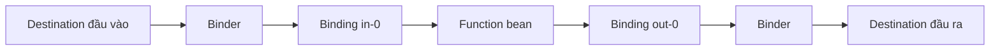

# Mối quan hệ giữa hàm xử lý, binding, binder và destination

Spring Cloud Stream giúp ứng dụng xử lý sự kiện mà không phải gắn chặt mã nghiệp vụ với API của Kafka, RabbitMQ hay Pulsar. Để hiểu cách framework tạo ra kết nối đó, cần phân biệt bốn khái niệm thường xuất hiện cùng nhau: **hàm xử lý (function)**, **binding**, **binder** và **destination**.

Bốn thành phần tạo thành một đường đi của thông điệp. Hàm mô tả ứng dụng làm gì với dữ liệu; binding mô tả đầu vào hoặc đầu ra của hàm được kết nối như thế nào; binder chuyển tiếp dữ liệu giữa ứng dụng và hệ thống nhắn tin; destination là tài nguyên nhận hoặc phát thông điệp trên hệ thống đó. Khi nắm được ranh giới này, ta có thể thay đổi broker, cấu hình consumer group, partition, retry hoặc dead-letter queue mà không phải viết lại phần xử lý nghiệp vụ.

## 1. Bốn khái niệm và trách nhiệm của từng thành phần

### Hàm xử lý: mã nghiệp vụ của ứng dụng

Trong mô hình lập trình hàm của Spring Cloud Stream, ứng dụng khai báo các bean theo một trong ba kiểu chính:

- `Supplier<T>` tạo dữ liệu và phát ra đầu ra. Hàm này thường đóng vai trò nguồn sự kiện.
- `Function<T, R>` nhận một giá trị đầu vào, xử lý và trả về kết quả đầu ra.
- `Consumer<T>` nhận dữ liệu để thực hiện một hành động và không trả về đầu ra.

Ví dụ, một hàm `validateOrder` có thể nhận sự kiện đơn hàng mới, kiểm tra dữ liệu và tạo sự kiện đơn hàng hợp lệ. Hàm tập trung vào quy tắc nghiệp vụ. Nó không cần tự mở kết nối Kafka, khai báo queue RabbitMQ hay gọi API gửi message của Pulsar.

Spring Cloud Function cung cấp cơ chế nhận diện các bean hàm. Thuộc tính `spring.cloud.function.definition` cho Spring Cloud Stream biết hàm nào cần được kết nối với hệ thống nhắn tin. Nếu ứng dụng có nhiều bean hàm, khai báo này giúp chọn đúng hàm hoặc chuỗi hàm cần kích hoạt.

### Binding: điểm nối logic của ứng dụng

Binding biểu diễn một đầu vào hoặc đầu ra của hàm trong môi trường Spring Cloud Stream. Có thể xem binding như cổng giao tiếp của ứng dụng với luồng thông điệp:

- Binding đầu vào đưa thông điệp từ broker vào tham số của hàm.
- Binding đầu ra nhận giá trị do hàm trả về và chuyển giá trị đó về broker.

Với một hàm tên `validateOrder`, Spring Cloud Stream tạo tên binding theo quy ước:

| Thành phần hàm | Tên binding mặc định |
| --- | --- |
| `Supplier` | `validateOrder-out-0` |
| `Function` | `validateOrder-in-0` và `validateOrder-out-0` |
| `Consumer` | `validateOrder-in-0` |

Tên hàm trong ví dụ trên chỉ minh họa quy tắc đặt tên; tên binding thực tế luôn lấy từ tên bean hàm đã khai báo. Hậu tố `in-0` chỉ đầu vào thứ nhất, còn `out-0` chỉ đầu ra thứ nhất. Với hàm có nhiều đầu vào hoặc đầu ra, chỉ số giúp phân biệt từng cổng.

Binding là tên và cấu hình của một điểm nối trong ứng dụng. Nó chưa phải tên topic hay queue trên broker. Ta có thể cấu hình binding `validateOrder-in-0` để đọc từ destination `orders.created`, sau đó đổi destination sang `orders.submitted` mà vẫn giữ nguyên bean và tên binding.

### Destination: tài nguyên trên broker

Destination là địa chỉ logic của luồng thông điệp trên hệ thống nhắn tin. Cấu hình `destination` của binding ánh xạ cổng vào hoặc ra của ứng dụng tới tài nguyên đó.

Ý nghĩa vật lý của destination phụ thuộc binder và broker:

| Broker | Destination thường được ánh xạ tới | Điểm cần chú ý |
| --- | --- | --- |
| Kafka | Topic | Consumer group cùng chia sẻ việc đọc các partition; khóa thông điệp ảnh hưởng cách phân vùng khi được cấu hình phù hợp. |
| RabbitMQ | Exchange | Binder thiết lập queue và liên kết queue với exchange cho phía tiêu thụ; routing key và cấu hình binding ảnh hưởng việc định tuyến. |
| Pulsar | Topic | Binder chuyển cấu hình tiêu thụ thành subscription và cơ chế nhận thông điệp tương ứng của Pulsar. |

Vì vậy, không nên mặc định destination luôn là queue hoặc luôn là topic theo nghĩa vật lý giống nhau ở mọi broker. Trong cấu hình Spring Cloud Stream, destination là tên tài nguyên logic; binder chịu trách nhiệm diễn giải tên đó theo mô hình của broker tương ứng.

Việc tài nguyên được tự tạo hay phải tồn tại trước phụ thuộc binder, cấu hình provisioning và quyền của tài khoản kết nối. Khi triển khai, cần kiểm tra quyền tạo hoặc truy cập topic, exchange, queue hay subscription thay vì giả định khai báo `destination` luôn tạo được tài nguyên.

### Binder: cầu nối với hệ thống nhắn tin

Binder là thành phần tích hợp Spring Cloud Stream với một nền tảng nhắn tin cụ thể. Binder quản lý kết nối và chuyển đổi giữa mô hình binding của ứng dụng với cơ chế gửi, nhận và quản lý tài nguyên của broker.

Ví dụ, Kafka binder làm việc với producer, consumer, topic và consumer group của Kafka. Rabbit binder làm việc với exchange, queue và routing. Pulsar binder làm việc với topic và subscription. Ứng dụng vẫn dùng các bean `Supplier`, `Function` hoặc `Consumer` và cấu hình binding theo mô hình chung của Spring Cloud Stream.

Binder cũng là nơi cấu hình những hành vi phụ thuộc broker như partition, cơ chế xác nhận, retry và dead-letter queue. Các thuộc tính chung của binding có thể được dùng cho nhiều binder, nhưng chi tiết và mức hỗ trợ của từng tính năng có thể khác nhau. Không nên suy ra rằng cùng một cấu hình sẽ tạo ra bảo đảm giao nhận hoàn toàn giống nhau trên mọi broker.

## 2. Đường đi của một thông điệp

Với một hàm `Function`, đường đi thường gồm cả hai chiều:

1. Broker nhận thông điệp tại destination đầu vào.
2. Binder đọc thông điệp và chuyển nó vào binding đầu vào.
3. Spring Cloud Stream chuyển payload tới hàm xử lý.
4. Hàm trả về kết quả; Spring Cloud Stream chuyển kết quả vào binding đầu ra.
5. Binder gửi kết quả tới destination đầu ra trên broker.



Sơ đồ thể hiện trách nhiệm theo từng lớp. Hàm không cần biết destination được triển khai bằng topic Kafka hay exchange RabbitMQ. Binding không tự thực hiện giao thức của broker. Binder biết cách kết nối với broker và chuyển đổi giữa hai mô hình. Destination là nơi thông điệp được lưu trữ, phân phối hoặc tiêu thụ theo khả năng của broker.

Với `Consumer`, đường đi kết thúc ở hàm vì không có binding đầu ra. Với `Supplier`, đường đi bắt đầu từ hàm và đi qua binding đầu ra tới destination. Với `Function`, ứng dụng có cả cổng vào và cổng ra.

## 3. Ví dụ: kết nối hàm xử lý đơn hàng với Kafka

Giả sử dịch vụ nhận sự kiện `OrderCreated`, kiểm tra và phát sự kiện `OrderAccepted`. Phần mã nghiệp vụ có thể viết bằng Java như sau:

```java
import java.util.function.Function;

import org.springframework.boot.SpringApplication;
import org.springframework.boot.autoconfigure.SpringBootApplication;
import org.springframework.context.annotation.Bean;

@SpringBootApplication
public class OrderStreamApplication {

    public record OrderCreated(String orderId, long amount) {}

    public record OrderAccepted(String orderId, String status) {}

    @Bean
    public Function<OrderCreated, OrderAccepted> acceptOrder() {
        return event -> new OrderAccepted(event.orderId(), "ACCEPTED");
    }

    public static void main(String[] args) {
        SpringApplication.run(OrderStreamApplication.class, args);
    }
}
```

Bean `acceptOrder` chỉ mô tả phép biến đổi dữ liệu. Nó không chứa tên topic, địa chỉ broker hoặc mã gửi message. Spring Cloud Stream kết nối bean này thông qua các binding được cấu hình bên ngoài mã nguồn.

Ví dụ cấu hình `application.yml` khi dùng Kafka binder:

```yaml
spring:
  cloud:
    function:
      definition: acceptOrder
    stream:
      bindings:
        acceptOrder-in-0:
          destination: orders.created
          group: order-acceptance
          content-type: application/json
          consumer:
            max-attempts: 3
        acceptOrder-out-0:
          destination: orders.accepted
          content-type: application/json
      kafka:
        binder:
          brokers: localhost:9092
```

Đọc cấu hình theo từng lớp:

- `definition: acceptOrder` chọn bean hàm cần kết nối.
- `acceptOrder-in-0` là binding đầu vào được tạo theo tên bean và quy ước của Spring Cloud Stream.
- `destination: orders.created` nối binding đầu vào với destination chứa sự kiện đơn hàng mới.
- `group: order-acceptance` đặt nhóm tiêu thụ cho binding đầu vào. Với Kafka, các instance cùng group phối hợp đọc các partition của topic.
- `acceptOrder-out-0` là binding đầu ra của hàm; destination `orders.accepted` nhận kết quả xử lý.
- Cấu hình `spring.cloud.stream.kafka.binder.brokers` cung cấp địa chỉ broker cho Kafka binder.
- `content-type` khai báo định dạng nội dung để framework chuyển đổi payload. Với dữ liệu JSON, các kiểu dữ liệu Java cần tương thích với cấu trúc sự kiện được trao đổi.
- `max-attempts` cấu hình số lần thử xử lý theo cơ chế retry của binding. Cách chuyển thông điệp lỗi sang DLQ cần cấu hình tương ứng ở binder và broker.

Điểm quan trọng là `acceptOrder-in-0` và `orders.created` có vai trò khác nhau. Tên thứ nhất xác định cổng logic của ứng dụng; tên thứ hai xác định destination mà cổng đó kết nối tới. Nếu đổi destination sang `orders.submitted`, hàm `acceptOrder` và binding vẫn giữ nguyên, miễn là cấu trúc sự kiện đầu vào vẫn tương thích.

## 4. Cùng một binding, các binder có cách triển khai khác nhau

Mô hình hàm và binding giúp ứng dụng giữ cấu trúc ổn định khi thay đổi broker. Tuy vậy, binder phải ánh xạ cấu hình chung sang khái niệm cụ thể của từng nền tảng.

**Với Kafka**, destination đầu vào thường là topic. `group` xác định consumer group; các instance cùng group được phân công đọc partition. Nếu cần thứ tự xử lý theo đơn hàng, ứng dụng thường chọn key phù hợp để các sự kiện của cùng đơn hàng đi vào cùng partition. Số partition và chiến lược phân vùng ảnh hưởng khả năng song song cũng như thứ tự xử lý.

**Với RabbitMQ**, destination thường đại diện cho exchange. Binder thiết lập queue cho consumer group và liên kết queue với exchange. Routing key, kiểu exchange và các thuộc tính của queue quyết định cách message được định tuyến. Vì vậy, khi chuyển cấu hình từ Kafka sang RabbitMQ, cần rà soát cách đặt tên tài nguyên và quy tắc định tuyến.

**Với Pulsar**, destination thường là topic. Khái niệm `group` trong cấu hình chung được binder ánh xạ sang mô hình subscription của Pulsar. Kiểu subscription, số lượng consumer và cách xử lý xác nhận có thể ảnh hưởng việc phân phối thông điệp; cần kiểm tra thuộc tính cụ thể mà phiên bản binder đang dùng hỗ trợ.

Nếu một ứng dụng có nhiều binder trên classpath, có thể chọn binder mặc định hoặc chỉ định binder cho từng binding. Khi đó, mỗi binding có thể kết nối tới một nền tảng khác nhau, nhưng cần cấu hình riêng thông tin kết nối và thuộc tính đặc thù cho từng binder. Việc chuyển broker vì thế thường bao gồm cả thay đổi dependency, cấu hình kết nối, provisioning và kiểm thử vận hành.

## 5. Binding còn mang cấu hình vận hành

Binding là nơi gắn nhiều thuộc tính điều khiển luồng dữ liệu. Một số cấu hình thường gặp gồm:

- **Consumer group:** xác định nhóm consumer phối hợp nhận dữ liệu. Trên Kafka, group ảnh hưởng việc phân công partition giữa các instance. Trên broker khác, binder ánh xạ nhóm theo cơ chế tiêu thụ tương ứng.
- **Partition:** hỗ trợ phân phối dữ liệu và xử lý song song. Khả năng và cách cấu hình partition phụ thuộc binder; với Kafka, cần chú ý số partition, message key và số consumer trong group.
- **Schema và content type:** xác định cách diễn giải payload. Các bên phát và nhận cần thống nhất schema, phiên bản schema và quy tắc tương thích khi thay đổi cấu trúc sự kiện.
- **Retry và DLQ:** retry cho phép thử xử lý lại khi gặp lỗi tạm thời. Nếu thông điệp vẫn thất bại, dead-letter queue hoặc destination lỗi giúp lưu thông điệp để điều tra và xử lý sau. Tên thuộc tính và hành vi cụ thể phụ thuộc binder.
- **Giao nhận và xác nhận:** producer acknowledgement, consumer acknowledgement, transaction và khả năng xử lý lặp có ảnh hưởng tới bảo đảm giao nhận. Cần kết hợp cấu hình broker với xử lý idempotent trong ứng dụng.

Những cấu hình này không thay đổi ý nghĩa của bốn thành phần. Chúng làm rõ cách binding được thực thi thông qua binder trên destination đã chọn. Khi điều tra lỗi, nên lần lượt kiểm tra hàm có nhận đúng dữ liệu không, binding có trỏ đúng destination không, binder có kết nối và chuyển đổi đúng không, rồi kiểm tra trạng thái của tài nguyên trên broker.

## 6. Trường hợp xử lý trạng thái với Kafka Streams

Khi xử lý luồng cần trạng thái, chẳng hạn đếm số đơn hàng theo khách hàng hoặc ghép hai luồng sự kiện, Kafka Streams binder cung cấp mô hình tích hợp dành cho Kafka Streams. Ứng dụng có thể khai báo hàm làm việc với các kiểu như `KStream` hoặc `KTable`; binder kết nối topology đó với các topic đầu vào và đầu ra.

Trong trường hợp này, binder vẫn là lớp tích hợp giữa ứng dụng và Kafka, còn binding xác định các điểm vào/ra của topology. Tuy nhiên, topology có thể duy trì state store cục bộ và dùng changelog topic để khôi phục trạng thái. Vì thế, vận hành một ứng dụng Kafka Streams còn cần quan tâm tới application id, khả năng khôi phục state, phân vùng và tài nguyên lưu trữ. Không nên xem state store như một destination thông điệp thông thường.

## 7. Kiểm thử mối nối giữa hàm và binding

Spring Cloud Stream cung cấp test binder để kiểm thử luồng message trong môi trường kiểm thử mà không cần kết nối broker thật. Bài kiểm thử có thể gửi dữ liệu vào binding đầu vào, kiểm tra kết quả ở binding đầu ra và xác minh hàm được chọn đúng.

Test binder hữu ích để xác nhận logic hàm, tên binding và việc nối đầu vào/đầu ra ở mức ứng dụng. Nó không thay thế kiểm thử tích hợp với Kafka, RabbitMQ hoặc Pulsar. Những hành vi như phân vùng, routing, quyền truy cập, retry, DLQ, transaction và xác nhận giao nhận cần được kiểm thử với broker tương ứng trước khi triển khai.

## 8. Cách phân tích khi luồng sự kiện không hoạt động

Khi một sự kiện không tới được hàm hoặc kết quả không xuất hiện ở đích, hãy lần theo đường đi của nó:

1. **Kiểm tra hàm:** bean có được khai báo đúng kiểu `Supplier`, `Function` hoặc `Consumer` không? `spring.cloud.function.definition` có chọn đúng tên bean không?
2. **Kiểm tra binding:** tên `in-0` và `out-0` có đúng theo tên hàm không? Có cấu hình alias binding hay nhiều đầu vào/đầu ra cần xem xét không?
3. **Kiểm tra destination:** binding có trỏ đúng topic, exchange hoặc topic Pulsar không? Tài nguyên có tồn tại và tài khoản có quyền truy cập không?
4. **Kiểm tra binder:** dependency và binder được chọn có đúng broker không? Địa chỉ kết nối, xác thực và thuộc tính đặc thù có hợp lệ không?
5. **Kiểm tra cách tiêu thụ:** group, subscription, partition, routing key và số instance có phù hợp với cách phân phối mong muốn không?
6. **Kiểm tra lỗi và giao nhận:** log có cho thấy lỗi chuyển đổi schema, retry hoặc DLQ không? Ứng dụng có xử lý an toàn khi một thông điệp được giao lại không?

Khi triển khai, nên quản lý cấu hình kết nối và tài nguyên broker theo từng môi trường. Đồng thời, theo dõi độ trễ consumer, số lượng thông điệp chưa xử lý, lỗi chuyển đổi, số lần retry và lượng message trong DLQ. Các chỉ số này giúp phân biệt lỗi trong hàm nghiệp vụ với lỗi ở lớp kết nối hoặc broker.

## Kết luận

Hàm xử lý định nghĩa nghiệp vụ; binding cung cấp cổng vào và ra của ứng dụng; binder thực hiện tích hợp với broker; destination xác định tài nguyên trao đổi thông điệp. Spring Cloud Stream giữ cho mã hàm độc lập tương đối với Kafka, RabbitMQ và Pulsar, trong khi binder chuyển mô hình chung thành cách gửi, nhận và vận hành cụ thể của từng nền tảng. Hiểu rõ bốn vai trò này là nền tảng để thiết kế luồng sự kiện dễ thay đổi, kiểm thử và vận hành.
