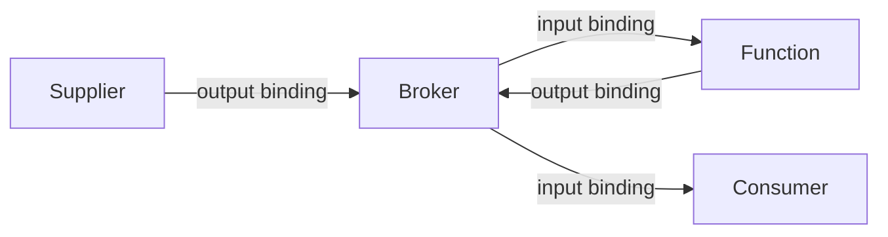

# Trường hợp nên dùng, giới hạn trừu tượng hóa và chi phí vận hành

Spring Cloud Stream phù hợp khi một ứng dụng Spring cần trao đổi dữ liệu qua thông điệp và muốn tổ chức phần xử lý theo các hàm `Supplier`, `Function` hoặc `Consumer`. Framework cung cấp lớp binding để nối các hàm đó với broker như Apache Kafka, RabbitMQ hoặc Apache Pulsar. Nhờ vậy, mã nghiệp vụ có thể tập trung vào việc tạo, biến đổi và xử lý sự kiện; cấu hình binder đảm nhiệm phần kết nối với hệ thống nhắn tin.

Lớp trừu tượng này giúp giảm mã kết nối và tạo cấu trúc thống nhất cho ứng dụng hướng sự kiện. Nó không làm cho Kafka, RabbitMQ và Pulsar có cùng mô hình giao nhận, lưu trữ hay mở rộng. Khi chọn Spring Cloud Stream, nhóm phát triển cần cân nhắc đồng thời lợi ích của binding, giới hạn của binder và chi phí vận hành một hệ thống bất đồng bộ.

## 1. Spring Cloud Stream giải quyết phần việc nào?

Trong mô hình hàm, mỗi bean đảm nhiệm một vai trò:

| Kiểu hàm | Vai trò | Ví dụ |
|---|---|---|
| `Supplier<T>` | Tạo thông điệp đầu ra | Đọc dữ liệu định kỳ và phát sự kiện tồn kho |
| `Function<T, R>` | Nhận dữ liệu, biến đổi và trả kết quả | Kiểm tra đơn hàng rồi tạo sự kiện đơn hàng hợp lệ |
| `Consumer<T>` | Nhận và xử lý thông điệp | Cập nhật tồn kho khi nhận `OrderCreated` |

Một binding là kết nối logic giữa một đầu vào hoặc đầu ra của hàm với một destination. Tên binding thường được suy ra từ tên bean và vị trí cổng, chẳng hạn `handleOrderCreated-in-0` là đầu vào thứ nhất của hàm `handleOrderCreated`. Binder chuyển binding đó thành cấu hình phù hợp với broker đang dùng.



Ví dụ, một dịch vụ nhận sự kiện tạo đơn hàng và yêu cầu giữ chỗ tồn kho:

```java
@Bean
public Consumer<OrderCreated> handleOrderCreated(InventoryService inventory) {
    return event -> inventory.reserve(event.orderId(), event.items());
}
```

Cấu hình binding tương ứng có thể viết như sau:

```properties
spring.cloud.function.definition=handleOrderCreated
spring.cloud.stream.bindings.handleOrderCreated-in-0.destination=orders.created
spring.cloud.stream.bindings.handleOrderCreated-in-0.group=inventory-service
spring.cloud.stream.bindings.handleOrderCreated-in-0.consumer.maxAttempts=3
```

Ở đây, `destination` xác định đích logic của sự kiện; `group` xác định nhóm ứng dụng cùng tiêu thụ luồng đó theo cách binder ánh xạ vào broker; `maxAttempts` giới hạn số lần thử xử lý theo cơ chế retry của Spring Cloud Stream. Cấu hình thực tế còn cần địa chỉ broker, thông tin xác thực, định dạng thông điệp và các thiết lập riêng của binder. Tên thuộc tính và hành vi chi tiết cần đối chiếu với phiên bản binder đang sử dụng.

## 2. Khi nào nên dùng?

### 2.1. Các dịch vụ cần giao tiếp bất đồng bộ

Spring Cloud Stream phù hợp khi một nghiệp vụ có thể được biểu diễn thành sự kiện và bên phát không cần chờ bên nhận hoàn tất xử lý. Ví dụ, dịch vụ đơn hàng phát `OrderCreated`; dịch vụ kho giữ chỗ hàng, dịch vụ thanh toán khởi tạo giao dịch và dịch vụ thông báo gửi email. Các bên có thể triển khai, mở rộng và phục hồi độc lập hơn so với một chuỗi lời gọi đồng bộ.

Mô hình này hữu ích khi:

- Bên gửi và bên nhận cần giảm phụ thuộc về thời điểm hoạt động.
- Một sự kiện cần được nhiều nhóm dịch vụ tiêu thụ với mục đích khác nhau.
- Công việc có thể xử lý nền, chấp nhận độ trễ và cần hấp thụ lưu lượng tăng đột biến.
- Hệ thống cần tách bước tiếp nhận dữ liệu khỏi bước xử lý tốn thời gian.
- Nhóm muốn dùng cùng mô hình hàm và binding cho nhiều ứng dụng Spring trong một nền tảng nhắn tin.

Broker có thể lưu giữ thông điệp trong một khoảng thời gian hoặc tích lũy backlog theo cấu hình. Điều đó giúp bên nhận xử lý bù sau khi khởi động lại hoặc tăng số lượng consumer. Tuy nhiên, khả năng lưu giữ, phát lại và thời hạn lưu dữ liệu phụ thuộc vào broker cùng cấu hình của nó.

### 2.2. Pipeline xử lý sự kiện có cấu trúc rõ ràng

Khi luồng công việc gồm các bước nhận, kiểm tra, làm giàu, định tuyến và ghi kết quả, các hàm `Supplier`, `Function` và `Consumer` giúp biểu diễn từng bước riêng biệt. Binding thể hiện rõ đầu vào và đầu ra của mỗi bước. Cấu trúc này thuận tiện cho việc kiểm thử hàm nghiệp vụ, cấu hình môi trường và quan sát luồng thông điệp.

Ví dụ, một pipeline xử lý dữ liệu giao dịch có thể nhận `TransactionReceived`, chuẩn hóa trường dữ liệu, kiểm tra quy tắc rủi ro rồi phát `TransactionReviewed`. Mỗi bước có thể được triển khai trong cùng ứng dụng hoặc tách thành dịch vụ riêng khi nhu cầu mở rộng và quyền sở hữu dữ liệu yêu cầu.

### 2.3. Khi tổ chức muốn chuẩn hóa tích hợp broker

Binder giúp các ứng dụng dùng một cách khai báo binding tương tự nhau. Điều này có giá trị khi tổ chức có nhiều dịch vụ Spring, cần quản lý cấu hình theo môi trường và muốn giảm mã kết nối lặp lại. Việc thay đổi broker có thể giảm số điểm phải sửa trong mã ứng dụng nếu ứng dụng chỉ dùng các khả năng chung mà binder hỗ trợ.

Lợi ích này rõ nhất khi nhóm đã xác định quy ước chung về tên binding, tên destination, nhóm consumer, định dạng payload, header, xử lý lỗi và cách cấp phát tài nguyên broker. Nếu mỗi dịch vụ tự đặt quy ước riêng, lớp binding không tự tạo ra sự nhất quán đó.

## 3. Khi nào không nên chọn?

Spring Cloud Stream không phải lựa chọn mặc định cho mọi giao tiếp giữa các dịch vụ.

| Tình huống | Lý do cần cân nhắc lựa chọn khác |
|---|---|
| Bên gọi cần kết quả ngay để tiếp tục một yêu cầu của người dùng | HTTP hoặc RPC thường diễn đạt rõ hơn thời gian chờ, lỗi và kết quả đồng bộ |
| Chỉ có một lời gọi nội bộ đơn giản, không cần hàng đợi hay phát lại | Thêm broker và binding làm tăng cấu hình, triển khai và giám sát |
| Yêu cầu độ trễ cực thấp hoặc thông lượng rất cao với tối ưu chuyên biệt | Lớp framework, chuyển đổi payload và xử lý thông điệp có thể làm tăng chi phí; cần đo với tải thực tế |
| Nghiệp vụ phụ thuộc sâu vào tính năng riêng của một broker | Có thể cần API gốc để kiểm soát đầy đủ transaction, routing, consumer hoặc topology |
| Cần cập nhật cơ sở dữ liệu và phát sự kiện như một giao dịch nguyên tử | Binding không tự tạo giao dịch phân tán giữa database và broker; cần thiết kế outbox, CDC hoặc cơ chế tương đương |
| Không có năng lực vận hành broker và chưa có nhu cầu bất đồng bộ đủ lớn | Hệ thống phải quản lý thêm hạ tầng, bảo mật, lưu trữ, cảnh báo và xử lý sự cố |

Một quyết định quan trọng là phân biệt nhu cầu “gửi việc đi xử lý sau” với nhu cầu “gọi một dịch vụ để nhận kết quả”. Nếu luồng nghiệp vụ cần biết ngay một thao tác có thành công hay không, hãy thiết kế API đồng bộ cho phần xác nhận đó. Có thể phát sự kiện sau khi giao dịch được ghi nhận để các tác vụ phụ chạy bất đồng bộ.

## 4. Giới hạn của lớp trừu tượng binder

### 4.1. Cùng một binding không đồng nghĩa cùng ngữ nghĩa broker

Binder chuẩn hóa cách khai báo kết nối, nhưng mỗi broker có mô hình tài nguyên và giao nhận riêng:

| Khía cạnh | Kafka | RabbitMQ | Pulsar |
|---|---|---|---|
| Tài nguyên chính | Topic và partition | Exchange, queue và binding/routing key | Topic và subscription |
| Nhóm tiêu thụ | Consumer group quản lý việc chia partition và offset | Thường là queue riêng cho từng nhóm ứng dụng theo cách binder cấu hình | Subscription xác định cách consumer cùng nhận thông điệp |
| Vị trí xử lý | Offset trong từng partition | Trạng thái giao nhận và acknowledgement của queue | Cursor của subscription |
| Thứ tự | Được bảo toàn trong phạm vi partition theo thứ tự ghi | Phụ thuộc queue, số consumer và cách xử lý acknowledgement | Phụ thuộc partition và loại subscription |
| Khả năng đáng chú ý | Lưu log, phát lại theo offset, xử lý theo partition | Định tuyến qua exchange, queue, acknowledgement và prefetch | Nhiều loại subscription, backlog và cơ chế lưu trữ theo kiến trúc Pulsar |

Các hàng trong bảng mô tả mô hình nền tảng ở mức khái quát. Cấu hình cụ thể của binder có thể tạo thêm tài nguyên hoặc thay đổi cách ánh xạ. Ví dụ, một `group` trong cấu hình Spring Cloud Stream không biến queue RabbitMQ thành consumer group Kafka; nó chỉ là khái niệm cấu hình được từng binder diễn giải theo khả năng của broker.

Vì vậy, đổi `spring.cloud.stream.*` để trỏ sang broker khác chưa đủ để hoàn tất di chuyển. Nhóm cần đánh giá lại topology, cách định tuyến, chính sách lưu giữ, thứ tự, acknowledgement, retry, dead-letter, quyền truy cập và cách mở rộng consumer.

### 4.2. Giao nhận thường có thể tạo thông điệp trùng lặp

Trong hệ thống phân tán, một consumer có thể hoàn tất tác động nghiệp vụ nhưng mất kết nối trước khi broker ghi nhận acknowledgement hoặc offset. Broker có thể giao lại thông điệp. Retry sau lỗi cũng có thể khiến cùng một sự kiện được xử lý nhiều lần. Vì thế, ứng dụng cần thiết kế consumer theo hướng idempotent: nhận lại cùng sự kiện không làm phát sinh thêm tác động nghiệp vụ.

Một cách thường dùng là gắn `eventId` duy nhất cho mỗi sự kiện và lưu dấu xử lý trong cùng ranh giới giao dịch với thay đổi nghiệp vụ. Với nghiệp vụ cập nhật một bản ghi, có thể dùng khóa duy nhất hoặc điều kiện phiên bản để từ chối thao tác lặp. Với nghiệp vụ gọi hệ thống bên ngoài, cần xem xét idempotency key hoặc bảng theo dõi trạng thái gửi.

Không nên mặc định rằng dùng Spring Cloud Stream đồng nghĩa với “exactly once”. Cơ chế xác nhận, retry và transaction khác nhau theo binder. Kafka có thể hỗ trợ giao dịch cho một số luồng đọc-xử lý-ghi trong Kafka, nhưng điều đó không tự làm cho một lần cập nhật cơ sở dữ liệu bên ngoài và một lần gửi thông điệp trở thành giao dịch nguyên tử. Với ranh giới database-broker, transactional outbox hoặc CDC thường là các mẫu thiết kế cần xem xét.

### 4.3. Thứ tự và khả năng mở rộng phụ thuộc partition hoặc queue

Nếu các sự kiện của cùng một đơn hàng phải được xử lý theo thứ tự, producer cần chọn khóa phân vùng nhất quán, chẳng hạn `orderId`, và consumer phải giữ cách xử lý phù hợp với thứ tự đó. Với Kafka, thứ tự được bảo đảm trong một partition, không phải trên toàn bộ topic. Tăng số consumer trong cùng một group không thể tạo thêm mức song song vượt quá số partition đang được phân công.

Với RabbitMQ, số consumer, prefetch, acknowledgement và cách định tuyến ảnh hưởng đến thứ tự quan sát được. Với Pulsar, loại subscription và cách phân vùng topic ảnh hưởng đến thứ tự cũng như mức song song. Khi chuyển broker, cần kiểm tra lại các giả định về thứ tự thay vì chỉ giữ nguyên số lượng instance.

### 4.4. Schema và header vẫn là trách nhiệm của ứng dụng

Binder có thể hỗ trợ chuyển đổi payload và truyền header, nhưng không thể tự quyết định hợp đồng dữ liệu giữa các dịch vụ. Nhóm cần thống nhất:

- Kiểu nội dung và định dạng payload, ví dụ JSON, Avro hoặc Protobuf.
- Tên sự kiện, phiên bản schema và quy tắc tương thích khi thêm, đổi hoặc bỏ trường.
- Trường định danh như `eventId`, `eventType`, `occurredAt`, `correlationId` và khóa nghiệp vụ.
- Quy tắc xử lý trường thiếu, giá trị mặc định, múi giờ và độ chính xác số.
- Cách truyền header qua broker và cách xử lý khi header không được bảo toàn như mong đợi.

Ví dụ một sự kiện có thể mang các trường `eventId`, `eventType`, `schemaVersion`, `occurredAt` và `orderId`. Consumer nên kiểm tra phiên bản hợp đồng và xử lý trường hợp không tương thích một cách có chủ đích. Không nên dùng tên lớp Java nội bộ làm hợp đồng duy nhất giữa các dịch vụ độc lập, vì thay đổi package hoặc cấu trúc lớp có thể làm hỏng việc giải mã ở bên nhận.

### 4.5. Retry và dead-letter cần cấu hình theo binder

Retry phù hợp với lỗi tạm thời như timeout ngắn hoặc dịch vụ phụ thuộc vừa mất kết nối. Nó không giải quyết lỗi dữ liệu sai, schema không hỗ trợ hoặc thông điệp luôn gây lỗi. Lặp lại vô hạn với một thông điệp lỗi có thể làm nghẽn cả luồng.

Dead-letter queue (DLQ) hoặc dead-letter topic cho phép chuyển thông điệp không xử lý được sang nơi cách ly để điều tra và xử lý lại. Tên thuộc tính, cách khai báo tài nguyên, điều kiện chuyển vào DLQ và hành vi redelivery khác nhau giữa Kafka binder, Rabbit binder và Pulsar binder. Cần đọc cấu hình đúng phiên bản đang triển khai và kiểm thử bằng broker thật.

Một chính sách xử lý lỗi nên xác định rõ:

1. Lỗi nào được retry và số lần thử tối đa.
2. Khoảng nghỉ giữa các lần thử và cách tránh retry đồng loạt khi dịch vụ phụ thuộc phục hồi.
3. Lỗi nào chuyển thẳng vào DLQ.
4. Ai theo dõi DLQ, cách tra cứu nguyên nhân và điều kiện phát lại.
5. Cách ngăn phát lại tạo tác động nghiệp vụ trùng lặp.

DLQ chỉ là nơi lưu thông điệp lỗi; nó không tự sửa dữ liệu, không tự thông báo cho đúng người và không bảo đảm phát lại thành công. Hệ thống cần quy trình vận hành đi kèm.

### 4.6. Xử lý có trạng thái là một lớp chuyên biệt

Với xử lý Kafka Streams có trạng thái, ứng dụng có thể cần lưu bảng tổng hợp, cửa sổ thời gian hoặc trạng thái theo khóa. Kafka Streams binder hỗ trợ mô hình xử lý và quản lý state store theo cơ chế của Kafka Streams. Trạng thái cục bộ thường được khôi phục từ changelog topic khi instance khởi động lại hoặc task được chuyển sang instance khác.

Điều này kéo theo yêu cầu về partitioning, key, changelog, dung lượng đĩa, thời gian phục hồi, số task và cách nâng cấp ứng dụng. State store không phải một tính năng trạng thái chung có thể chuyển nguyên trạng giữa mọi binder. Nếu ứng dụng dùng Kafka Streams binder, nhóm cần hiểu các nguyên tắc của Kafka Streams và vận hành các topic nội bộ liên quan; không nên xem phần này như một `Function` thuần có thể thay broker mà không thay kiến trúc.

## 5. Chi phí vận hành cần tính trước

### 5.1. Hạ tầng và tài nguyên broker

Một luồng sự kiện cần broker hoạt động liên tục, lưu trữ, mạng, sao lưu hoặc replication, cơ chế xác thực và phân quyền. Chi phí tăng theo lưu lượng, kích thước thông điệp, thời gian lưu giữ, số partition hoặc queue, số consumer và mức sẵn sàng yêu cầu. Thông điệp lớn cũng làm tăng thời gian serialize, truyền mạng và ghi đĩa.

Không nên chỉ ước lượng số sự kiện mỗi giây. Hãy đo cả kích thước payload, tốc độ tăng backlog, thời gian lưu giữ, đỉnh tải và tốc độ consumer có thể xử lý. Nếu producer nhanh hơn consumer trong thời gian dài, backlog sẽ tăng và kéo theo chi phí lưu trữ cũng như thời gian xử lý trễ.

### 5.2. Cấu hình và tương thích phiên bản

Ứng dụng phải quản lý phiên bản Spring Boot, Spring Cloud, Spring Cloud Stream và binder tương thích. Khi nâng cấp, cần kiểm tra thay đổi về thuộc tính, hành vi mặc định, thư viện client và khả năng tương thích với broker. Cấu hình theo môi trường cần quản lý endpoint, thông tin xác thực, TLS, quyền truy cập destination, group, partition và chính sách retry/DLQ.

Việc dùng binding thống nhất có thể giảm mã lặp, nhưng không loại bỏ công việc cấu hình và cấp phát tài nguyên. Các destination, queue, subscription, DLQ và topic nội bộ có thể cần được tạo trước hoặc được binder tự tạo theo quyền được cấp. Cần xác định rõ cơ chế provisioning để tránh việc ứng dụng production có quyền tạo tài nguyên quá rộng.

### 5.3. Giám sát và xử lý sự cố

Một hệ thống bất đồng bộ khó quan sát hơn một chuỗi lời gọi đồng bộ nếu thiếu correlation ID và chỉ số theo từng chặng. Tối thiểu cần theo dõi:

| Nhóm | Chỉ số hoặc tín hiệu cần quan sát | Điều cần phát hiện |
|---|---|---|
| Lưu lượng | Tốc độ publish, consume, số thông điệp theo destination | Producer ngừng gửi hoặc lưu lượng tăng bất thường |
| Độ trễ | Tuổi thông điệp cũ nhất, thời gian xử lý, end-to-end latency | Consumer chậm hoặc backlog tích tụ |
| Kafka | Consumer lag, rebalance, lỗi commit và tình trạng partition | Consumer không theo kịp hoặc group mất ổn định |
| RabbitMQ | Queue depth, unacked messages, redelivery và consumer utilization | Queue phình to, acknowledgement chậm hoặc giao lại liên tục |
| Pulsar | Backlog theo subscription, redelivery và trạng thái consumer | Subscription không tiêu thụ kịp hoặc có lỗi giao nhận |
| Lỗi | Retry count, DLQ rate, lỗi giải mã và lỗi nghiệp vụ | Thông điệp lỗi lặp lại hoặc hợp đồng dữ liệu không tương thích |
| Broker | Dung lượng, kết nối, replication và tình trạng node | Nguy cơ hết tài nguyên hoặc giảm mức sẵn sàng |

Log cần có `eventId`, `correlationId`, tên destination và định danh consumer khi phù hợp. Tránh ghi toàn bộ payload nhạy cảm vào log. Trace phân tán cần truyền ngữ cảnh qua header hoặc cơ chế tương đương và phải được kiểm tra khi đi qua broker.

### 5.4. Kiểm thử nhiều lớp

Test binder của Spring Cloud Stream hữu ích để kiểm thử hàm và luồng binding trong phạm vi ứng dụng mà không cần khởi chạy broker thật. Nó giúp xác nhận payload đầu vào, đầu ra và một phần cấu hình tích hợp. Tuy nhiên, test binder không thay thế kiểm thử với Kafka, RabbitMQ hoặc Pulsar thật.

Trước khi triển khai, nên có kiểm thử tích hợp cho các tình huống quan trọng: xác thực và quyền truy cập, serialization, consumer group hoặc subscription, partition key, acknowledgement, retry, DLQ, khởi động lại consumer, broker gián đoạn và phát lại thông điệp. Với Kafka Streams có trạng thái, cần kiểm tra khôi phục state store và hành vi khi task được phân công lại.

## 6. Cách ra quyết định và kiểm soát phạm vi

Có thể dùng các câu hỏi sau để quyết định có nên đưa Spring Cloud Stream vào một dịch vụ:

| Câu hỏi | Nếu câu trả lời là “có” | Hệ quả thiết kế |
|---|---|---|
| Bên gửi có thể tiếp tục mà không chờ bên nhận? | Giao tiếp bất đồng bộ có giá trị | Xác định sự kiện và ranh giới xử lý |
| Nhiều consumer cần nhận cùng một sự kiện? | Cần fan-out hoặc nhiều nhóm độc lập | Xác định destination và group rõ ràng |
| Cần hấp thụ đỉnh tải hoặc phát lại dữ liệu? | Broker có thể giải quyết một phần nhu cầu | Chọn retention, backlog và chính sách phát lại |
| Ứng dụng chỉ dùng các khả năng chung của broker? | Binder có thể giảm mã kết nối | Dùng binding chuẩn và giữ cấu hình đặc thù ở mức cần thiết |
| Nghiệp vụ cần transaction hoặc routing đặc thù? | Abstraction có thể không đủ | Đánh giá API gốc, outbox hoặc kiến trúc chuyên biệt |
| Đội ngũ có thể vận hành broker và DLQ? | Có điều kiện duy trì luồng bất đồng bộ | Đặt dashboard, cảnh báo, quy trình xử lý và người phụ trách |

Trước khi mở rộng sang nhiều dịch vụ, nên triển khai một luồng nhỏ có đủ producer, consumer, schema, retry và DLQ. Đo độ trễ, thông lượng, mức tăng backlog, chi phí tài nguyên và công sức xử lý sự cố. Kết quả đo thực tế sẽ cho biết lớp binding có đem lại lợi ích lớn hơn chi phí vận hành trong bối cảnh của hệ thống hay không.

## 7. Danh sách kiểm tra trước khi đưa vào production

- [ ] Mỗi sự kiện có tên, ý nghĩa nghiệp vụ, chủ sở hữu và schema được quản lý.
- [ ] `Supplier`, `Function` hoặc `Consumer` được chọn đúng vai trò; tên binding và destination dễ hiểu.
- [ ] Group hoặc subscription phản ánh đúng nhu cầu chia sẻ và phát lại thông điệp.
- [ ] Khóa phân vùng và giả định về thứ tự được xác định rõ.
- [ ] Consumer có khả năng xử lý lặp an toàn; tác động với database hoặc dịch vụ ngoài có cơ chế idempotency phù hợp.
- [ ] Retry có giới hạn; DLQ có người theo dõi, cảnh báo và quy trình phát lại.
- [ ] Payload, header, schema version và quy tắc tương thích được kiểm thử.
- [ ] Có dashboard cho lưu lượng, độ trễ, backlog, consumer lag hoặc queue depth, retry và DLQ.
- [ ] Có kiểm thử tích hợp với broker thực cho các tình huống lỗi và khởi động lại.
- [ ] Có ước lượng tài nguyên, retention, quyền truy cập và kế hoạch nâng cấp binder/broker.

Spring Cloud Stream phát huy hiệu quả khi hệ thống thực sự cần xử lý sự kiện bất đồng bộ và nhóm có quy ước rõ về hợp đồng dữ liệu, giao nhận và vận hành. Binder giúp chuẩn hóa cách kết nối ở cấp ứng dụng; các quyết định về thứ tự, độ bền, transaction, mở rộng và phục hồi vẫn phải dựa trên ngữ nghĩa của broker được chọn. Đánh giá đầy đủ các phần đó ngay từ đầu giúp tránh một hệ thống có mã nghiệp vụ gọn nhưng khó vận hành khi lưu lượng và số lượng dịch vụ tăng lên.
