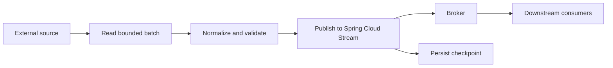

# Đọc nguồn dữ liệu ngoài và quản lý mốc đọc an toàn

Một producer của Spring Cloud Stream không nhất thiết chỉ phát dữ liệu do người dùng gửi vào ứng dụng. Nó còn có thể lấy thay đổi từ cơ sở dữ liệu, REST API, hệ thống tệp hoặc một dịch vụ bên ngoài rồi chuyển chúng thành sự kiện để các consumer xử lý. Với kiểu producer này, bài toán quan trọng là biết đã đọc đến đâu và khi nào có thể lưu mốc đọc mới.

Mốc đọc (checkpoint hoặc cursor) phải được cập nhật theo cách tránh bỏ sót dữ liệu khi ứng dụng dừng đột ngột, broker tạm thời không sẵn sàng hoặc message được phát lại. Nếu lưu mốc quá sớm, một bản ghi có thể bị đánh dấu đã đọc dù chưa được gửi an toàn. Nếu lưu mốc muộn, ứng dụng có thể gửi lại bản ghi đã phát trước đó. Vì vậy, thiết kế thực tế thường ưu tiên không mất dữ liệu và chấp nhận khả năng gửi trùng, sau đó dùng `eventId` ổn định cùng consumer idempotent để kiểm soát tác động lặp.

## 1. Mô hình đọc nguồn và phát sự kiện

Một luồng ingest cơ bản có thể được chia thành các bước:



Nguồn dữ liệu có thể là:

- **Database:** truy vấn các bản ghi mới hoặc đã thay đổi theo khóa tăng dần, thời gian cập nhật hoặc change sequence.
- **REST API:** đọc theo page token, cursor, sequence hoặc `updatedSince` do API cung cấp.
- **File:** đọc file append-only theo byte offset hoặc theo bản ghi đã xử lý, có xét đến rotation và truncation.
- **Dịch vụ khác:** dùng API đồng bộ, subscription hoặc change feed mà dịch vụ đó công bố.

Không nên coi việc đọc được một bản ghi là đã hoàn tất phát sự kiện. Cần xác định rõ từng trạng thái: đã đọc từ nguồn, đã lưu bền vững vào vùng chờ, đã gửi tới broker, và đã được consumer xử lý. Những trạng thái này có thể thuộc các hệ thống khác nhau và không tự động trở thành một giao dịch duy nhất.

## 2. Chọn cursor phù hợp với nguồn dữ liệu

Cursor là vị trí cho phép lần đọc kế tiếp tiếp tục từ nơi lần trước dừng lại. Chọn cursor theo hợp đồng thực tế của nguồn:

| Nguồn | Cursor nên ưu tiên | Điểm cần lưu ý |
|---|---|---|
| Bảng có khóa tăng đơn điệu | ID hoặc sequence | Phù hợp với dữ liệu append-only; không tự phát hiện bản ghi cũ bị cập nhật |
| Bảng có `updated_at` | `(updated_at, primary_key)` | Cần khóa phụ để phân biệt các bản ghi có cùng timestamp |
| CDC/change feed | Log sequence, change token hoặc offset | Phải tuân thủ thời hạn lưu log và quy tắc khôi phục của nguồn |
| REST API phân trang | Opaque page token hoặc continuation token | Không tự tạo lại token; lưu nguyên giá trị do API trả về |
| File append-only | File identity và byte offset hoặc record sequence | Cần phát hiện file bị thay thế, rotate hoặc truncate |

Cursor phải có ý nghĩa ổn định qua lần khởi động lại. Không dùng số thứ tự trong bộ nhớ, `AtomicLong` của một instance hoặc thời điểm hiện tại của máy consumer làm checkpoint lâu dài.

### 2.1. Đọc database theo khóa tăng dần

Với bảng chỉ thêm bản ghi và có khóa tăng đơn điệu, có thể đọc theo ID:

```sql
SELECT id, order_id, status, created_at
FROM orders
WHERE id > :last_id
ORDER BY id
LIMIT :batch_size;
```

Sau khi một bản ghi được phát an toàn, checkpoint có thể lưu ID đó. Cách này đơn giản và có thứ tự rõ ràng. Tuy nhiên, nếu một bản ghi cũ được cập nhật sau khi cursor đã vượt qua ID của nó, truy vấn trên sẽ không đọc lại thay đổi. Với dữ liệu cập nhật, cần dùng change sequence, CDC hoặc một cột `updated_at` có quy tắc đáng tin cậy.

### 2.2. Dùng timestamp cùng khóa phụ

Nếu nguồn có `updated_at`, chỉ lưu timestamp có thể làm mất bản ghi khi nhiều dòng có cùng thời điểm cập nhật. Hãy dùng một cặp `(updated_at, id)` làm cursor:

```sql
SELECT id, order_id, status, updated_at
FROM orders
WHERE (updated_at > :last_updated_at)
   OR (updated_at = :last_updated_at AND id > :last_id)
ORDER BY updated_at, id
LIMIT :batch_size;
```

Điều kiện so sánh kép tạo thứ tự ổn định giữa các dòng có cùng timestamp. Kiểu dữ liệu và độ chính xác của `updated_at` phải thống nhất với cách lưu cursor. Nếu timestamp có độ chính xác mili giây nhưng checkpoint bị làm tròn xuống giây, lần đọc kế tiếp có thể lặp hoặc bỏ sót bản ghi tùy điều kiện truy vấn.

Với nguồn có thể ghi dữ liệu trễ hoặc cập nhật timestamp không đáng tin cậy, truy vấn timestamp đơn thuần chưa đủ. Cân nhắc một khoảng đọc chồng lấn (overlap window), sau đó loại trùng bằng event ID; hoặc dùng CDC có sequence do nguồn cấp. Ví dụ, mỗi lần đọc lại một khoảng vài phút trước cursor sẽ phát lại một số bản ghi, nhưng giảm nguy cơ bỏ sót thay đổi đến muộn. Độ dài overlap phải dựa trên đặc tính trễ của nguồn và chi phí đọc lại.

### 2.3. Chụp giới hạn trên cho mỗi batch

Khi nguồn tiếp tục nhận dữ liệu trong lúc producer đang đọc, hãy xác định một giới hạn trên (high-water mark) tại đầu lượt đọc. Ví dụ, lấy `upperBound` là sequence hiện tại rồi chỉ đọc các bản ghi có sequence lớn hơn cursor và không vượt quá giới hạn đó. Nhờ vậy, batch có phạm vi hữu hạn và lần chạy có thể hoàn tất trước khi chuyển sang phần dữ liệu mới hơn.

Nếu dùng timestamp, `upperBound` cần được lấy từ nguồn hoặc theo quy tắc đồng hồ được kiểm soát. Không nên tự lấy `Instant.now()` trên máy producer rồi mặc định nó tương đương thời điểm cập nhật cuối cùng trong database. Đồng hồ lệch, transaction commit muộn và độ trễ replication đều có thể làm sai giả định.

## 3. Đọc API phân trang an toàn

Với REST API, nên ưu tiên cursor hoặc continuation token do API cung cấp thay vì tự tăng số trang. Số trang có thể thay đổi khi dữ liệu mới được chèn hoặc xóa trong lúc đang đọc, khiến bản ghi bị lặp hoặc bỏ qua.

Một response phân trang có thể có dạng:

```json
{
  "items": [
    { "id": "chg-100", "orderId": "ord-100", "status": "PAID" },
    { "id": "chg-101", "orderId": "ord-101", "status": "PAID" }
  ],
  "nextPageToken": "opaque-token-2"
}
```

Quy trình xử lý:

1. Đọc token đã lưu gần nhất và gọi API để lấy một trang có giới hạn.
2. Kiểm tra response, schema, giới hạn kích thước và các trường bắt buộc.
3. Phát từng sự kiện hoặc lưu chúng vào vùng chờ bền vững.
4. Chỉ chuyển token sang `nextPageToken` khi toàn bộ trang đã được lưu an toàn theo chiến lược đã chọn.
5. Khi API trả trang rỗng hoặc không còn token tiếp theo, kết thúc lượt đọc; lần polling sau dùng cursor đã lưu.

Nếu token hết hạn, không tự tạo token mới từ timestamp hiện tại rồi bỏ qua dữ liệu cũ. Hãy làm theo hợp đồng của API: khởi tạo lại từ một mốc được hỗ trợ, đọc bù, hoặc yêu cầu snapshot mới. Ghi nhận rõ trường hợp reset cursor vì nó có thể tạo một đợt phát lại lớn.

## 4. Tích hợp nguồn đọc với Spring Cloud Stream

Spring Cloud Stream cung cấp mô hình hàm để biểu diễn nguồn phát:

- `Supplier<T>` kiểu imperative thường được framework gọi theo poller để lấy từng message. `Supplier<Flux<T>>` trả về một publisher reactive; publisher cần có cơ chế phát dữ liệu và nhịp polling riêng nếu nguồn không liên tục. Không nên giả định poller imperative sẽ gọi lại supplier cho từng phần tử của một `Flux`.
- `StreamBridge` phù hợp khi một thành phần ứng dụng chủ động gửi message tới output binding, ví dụ một job định kỳ hoặc service tích hợp API.
- Một adapter riêng có thể đọc nguồn, chuẩn hóa dữ liệu và chuyển đổi thành message trước khi gửi.

Producer không nên nhồi logic truy vấn, phân trang, quản lý cursor, serialize và retry vào cùng một lambda. Tách `SourceReader`, `CheckpointStore`, bộ chuẩn hóa và publisher giúp kiểm thử từng phần và xác định rõ nơi cập nhật mốc đọc.

Ví dụ định nghĩa message sự kiện:

```java
public record ExternalOrderChange(
        String eventId,
        String sourceRecordId,
        String orderId,
        String status,
        Instant occurredAt) {}
```

Ví dụ một output binding được cấu hình:

```yaml
spring:
  cloud:
    stream:
      bindings:
        externalOrderChanges-out-0:
          destination: external.orders.changed
          content-type: application/json
```

`Supplier` là nguồn cung cấp message cho binding đầu ra. Với supplier imperative, cơ chế polling có thể được cấu hình bằng poller của Spring Cloud Stream; tên và giá trị thuộc tính cần đối chiếu với phiên bản framework đang dùng. Supplier nên đọc một lượng dữ liệu hữu hạn, có timeout và có giới hạn tốc độ. Với nguồn reactive, publisher phải tự xác định cách lấy dữ liệu mới và xử lý backpressure. Không nên thực hiện một truy vấn không giới hạn hoặc gọi API có thể treo vô hạn trong mỗi lần poll.

Khi cần điều khiển việc gửi từ một job hoặc một thành phần tích hợp, `StreamBridge` có thể gửi message tới binding:

```java
@Component
public class ExternalOrderPublisher {
    private final StreamBridge streamBridge;

    public ExternalOrderPublisher(StreamBridge streamBridge) {
        this.streamBridge = streamBridge;
    }

    public boolean publish(ExternalOrderChange event) {
        Message<ExternalOrderChange> message = MessageBuilder
                .withPayload(event)
                .setHeader("eventId", event.eventId())
                .setHeader("sourceRecordId", event.sourceRecordId())
                .build();

        return streamBridge.send("externalOrderChanges-out-0", message);
    }
}
```

Giá trị `true` từ `StreamBridge.send` cho biết thao tác gửi qua message channel được chấp nhận. Không nên mặc định nó luôn là xác nhận broker đã lưu bền vững message. Nếu việc chuyển checkpoint phụ thuộc vào xác nhận giao nhận, publisher phải dùng cơ chế xác nhận phù hợp với binder/client và cấu hình durability đang triển khai. Cần kiểm tra riêng Kafka producer acknowledgement, Rabbit publisher confirms hoặc cơ chế xác nhận của Pulsar theo phiên bản tương ứng.

## 5. Quy tắc cập nhật checkpoint

Một quy tắc quan trọng là không chuyển checkpoint vượt qua dữ liệu chưa được lưu an toàn. Nếu producer đọc 100 bản ghi, gửi thành công 40 bản ghi rồi gặp lỗi, cursor không được nhảy qua bản ghi thứ 100. Nếu làm vậy, 60 bản ghi còn lại có thể bị bỏ qua vĩnh viễn.

### 5.1. Gửi rồi mới lưu mốc

Với nguồn có cursor và publisher có thể xác nhận giao nhận, quy trình đơn giản là:

1. Đọc bản ghi tiếp theo sau checkpoint đã lưu.
2. Tạo sự kiện với `eventId` ổn định.
3. Gửi message và đợi xác nhận theo hợp đồng của publisher.
4. Chỉ sau xác nhận, lưu cursor tương ứng của bản ghi.
5. Nếu gửi hoặc lưu checkpoint thất bại, dừng lượt đọc và thử lại theo chính sách.

Đoạn code sau minh họa hợp đồng của ứng dụng. `ConfirmedPublisher` là abstraction do ứng dụng xây dựng trên cơ chế xác nhận thực tế của binder; đây không phải một API có sẵn của Spring Cloud Stream:

```java
public interface ConfirmedPublisher<T> {
    void publishAndAwaitConfirmation(T event);
}

public void pollNextBatch() {
    SourceCursor cursor = checkpointStore.load();
    List<SourceRecord> records = sourceReader.readAfter(cursor, 200);

    for (SourceRecord record : records) {
        ExternalOrderChange event = mapper.toEvent(record);

        publisher.publishAndAwaitConfirmation(event);
        checkpointStore.advanceTo(record.cursor());
    }
}
```

Nếu tiến trình dừng sau khi broker xác nhận nhưng trước khi checkpoint được lưu, lần chạy sau sẽ đọc lại bản ghi đó và có thể phát trùng. Đây là cửa sổ lỗi không thể loại bỏ chỉ bằng hai thao tác độc lập ở hai hệ thống. Hãy giữ `eventId` ổn định theo định danh nguồn, ví dụ `sourceName + sourceRecordId + sourceVersion`, để consumer có thể xử lý idempotent.

Không cập nhật checkpoint khi chỉ mới đưa message vào một hàng đợi trong bộ nhớ hoặc khi API gửi trả về trước khi có xác nhận cần thiết. Cũng không cập nhật checkpoint trước khi publish chỉ để tránh trùng; cách đó có thể biến lỗi tạm thời thành mất dữ liệu.

### 5.2. Dùng transactional outbox khi nguồn và outbox cùng database

Nếu dữ liệu nguồn và bảng outbox nằm trong cùng database, có thể đọc bản ghi, tạo outbox record và cập nhật checkpoint trong cùng một transaction database:

```text
BEGIN TRANSACTION
  Read source rows after stored cursor
  Insert outbox rows with stable event_id (unique)
  Update source checkpoint to the last staged cursor
COMMIT
```

Một publisher riêng đọc các outbox row chưa gửi, phát message lên broker, đợi xác nhận theo cơ chế đã cấu hình rồi đánh dấu row là đã gửi. Nếu publisher dừng sau khi broker xác nhận nhưng trước khi đánh dấu, nó có thể gửi lại row; consumer vẫn cần idempotency. Outbox loại bỏ khoảng trống giữa cập nhật checkpoint database và việc ghi nhận ý định phát sự kiện, nhưng không tự tạo exactly-once giữa database và broker.

Nếu nguồn là REST API hoặc một hệ thống không cùng database, không thể đặt cursor của nguồn và outbox local vào một transaction phân tán mặc định. Có thể lưu trang đã đọc vào inbox/staging table cùng token kế tiếp trong một transaction local, sau đó phát từ vùng staging. Chỉ chuyển token API sau khi toàn bộ trang đã được ghi bền vững vào staging. Cách này giúp khôi phục sau khi API hoặc broker gián đoạn.

### 5.3. Lưu cursor theo thứ tự và chống cập nhật lùi

Checkpoint nên có định danh nguồn, loại cursor, giá trị cursor và thời điểm cập nhật. Khi có nhiều worker hoặc nhiều lần polling chồng lấn, cập nhật checkpoint phải được tuần tự hóa hoặc dùng compare-and-set để cursor không bị ghi lùi bởi một batch cũ hoàn tất muộn.

Ví dụ cấu trúc lưu trữ:

| Field | Mục đích |
|---|---|
| `source_name` | Phân biệt nguồn hoặc luồng dữ liệu |
| `cursor_value` | ID, sequence, token hoặc vị trí đã lưu |
| `cursor_type` | Diễn giải đúng định dạng cursor |
| `updated_at` | Thời điểm checkpoint được cập nhật |
| `version` | Kiểm soát cập nhật đồng thời bằng optimistic locking |

Không lưu token API hoặc cursor có thể chứa thông tin truy cập vào log công khai. Nếu token là bí mật hoặc có thể dùng lại để truy cập nguồn, hãy bảo vệ nó như credential.

## 6. Xử lý lỗi và khôi phục

| Tình huống | Cách xử lý an toàn |
|---|---|
| Nguồn timeout trước khi trả đủ batch | Không đổi checkpoint; retry với timeout và backoff |
| Một bản ghi không chuyển đổi được | Cách ly bản ghi, ghi cursor và nguyên nhân; không nhảy qua âm thầm |
| Broker từ chối gửi hoặc không có xác nhận | Giữ checkpoint ở vị trí trước bản ghi chưa xác nhận; thử lại theo chính sách |
| Broker đã nhận nhưng ứng dụng dừng trước khi lưu cursor | Cho phép phát lại; consumer loại trùng bằng event ID ổn định |
| Lưu checkpoint thất bại | Không đọc tiếp; khôi phục từ checkpoint bền vững cũ và chấp nhận phát lại |
| API token hết hạn | Làm theo quy trình khôi phục/snapshot của API; không tự bỏ qua phần dữ liệu chưa đọc |
| File bị rotate hoặc truncate | Phát hiện thay đổi identity/size và khôi phục theo chính sách file nguồn |
| Hai instance cùng đọc một nguồn | Dùng lease/lock hoặc chia partition công việc rõ ràng; ngăn checkpoint ghi lùi |

Retry nên có giới hạn, backoff và jitter để tránh nhiều producer cùng gọi nguồn liên tục sau sự cố. Lỗi xác thực hoặc cursor không hợp lệ thường cần cảnh báo và can thiệp cấu hình; retry vô hạn không giải quyết được nguyên nhân đó.

## 7. Chạy nhiều instance và tránh đọc trùng không kiểm soát

Khi ứng dụng được scale ngang, mỗi instance có thể khởi chạy cùng một job polling. Nếu tất cả cùng đọc một cursor, cùng batch sẽ được phát nhiều lần. Có một số cách tổ chức:

- **Single active poller:** dùng distributed lease hoặc lock có thời hạn để chỉ một instance đọc nguồn tại một thời điểm. Lease cần cơ chế gia hạn và xử lý trường hợp instance cũ thức dậy sau khi lease đã được cấp cho instance khác.
- **Partitioned source:** chia phạm vi theo tenant, key range hoặc partition của nguồn; mỗi worker sở hữu một phạm vi và checkpoint riêng.
- **CDC consumer group:** nếu nguồn CDC hỗ trợ consumer group/partition assignment, dùng cơ chế phân công của nó và lưu offset theo đúng hợp đồng.

Với lease, nên có fencing token hoặc version tăng dần để thao tác từ worker đã mất quyền không thể ghi checkpoint sau worker mới. Chỉ dùng một cờ `isRunning` trong bộ nhớ không có tác dụng phối hợp giữa nhiều instance.

Đừng nhầm checkpoint của producer với consumer group offset của Kafka. Checkpoint producer cho biết nguồn ngoài đã được đọc và chuyển vào luồng phát tới đâu. Offset consumer của Kafka cho biết một consumer group đã xử lý hoặc commit đến vị trí nào trong topic. Hai mốc này thuộc hai hệ thống và hai trách nhiệm khác nhau.

## 8. Kiểm soát lưu lượng và tính ổn định

Đọc nguồn ngoài quá nhanh có thể làm quá tải database/API hoặc khiến broker tích tụ backlog. Mỗi lần poll nên có giới hạn số bản ghi, thời gian truy vấn và tổng thời gian xử lý. Cần theo dõi:

- Số bản ghi đọc được, số bản ghi phát thành công và số bản ghi bị cách ly.
- Thời gian đọc nguồn, thời gian publish và độ trễ từ `occurredAt` đến lúc phát.
- Vị trí cursor hiện tại, tuổi checkpoint và khoảng cách giữa cursor với high-water mark của nguồn.
- Số lần retry, lỗi timeout, lỗi xác thực và số lượng outbox/inbox chưa xử lý.
- Backlog của broker và tốc độ tiêu thụ của các dịch vụ downstream.

Đặt timeout kết nối và timeout truy vấn rõ ràng. Với API có rate limit, tôn trọng `Retry-After` nếu được cung cấp và dùng exponential backoff có jitter. Khi broker chậm hoặc không xác nhận, giảm tốc độ đọc thay vì tiếp tục lấy thêm dữ liệu không có nơi lưu bền vững.

## 9. Thiết kế event ID và dữ liệu phát lại

Một bản ghi nguồn có thể được đọc lại nhiều lần do checkpoint chưa cập nhật hoặc do overlap window. Event ID phải xác định cùng một thay đổi nguồn theo cách ổn định. Nếu một dòng database có thể được cập nhật nhiều lần, chỉ dùng primary key của dòng là chưa đủ; hãy kết hợp phiên bản bản ghi, change sequence hoặc định danh sự kiện do nguồn cấp.

Ví dụ:

```text
eventId = "erp-orders:order-100:version-7"
```

Khi cùng thay đổi phiên bản 7 được đọc lại, event ID vẫn giống nhau. Khi đơn hàng chuyển sang phiên bản 8, event ID thay đổi. Consumer có thể lưu event ID đã xử lý với unique constraint để ngăn cùng một thay đổi tạo tác động hai lần.

Payload nên mang đủ thông tin để consumer hiểu sự kiện mà không phải truy vấn ngược một nguồn có thể đã thay đổi. Nếu sự kiện là notification về một thay đổi, cần xác định rõ consumer nhận snapshot đầy đủ hay chỉ nhận delta. Schema phải ghi rõ phiên bản, thời điểm nghiệp vụ và định danh nguồn.

## 10. Kiểm thử checkpoint và khôi phục

Kiểm thử đơn vị cho mapper và cursor cần xác nhận thứ tự, ranh giới batch và hành vi với các bản ghi cùng timestamp. Kiểm thử tích hợp cần mô phỏng các cửa sổ lỗi quan trọng:

1. Đọc batch thành công, publish thành công và checkpoint được lưu.
2. Publish thất bại ở bản ghi giữa batch; lần chạy sau phải tiếp tục từ vị trí an toàn và không bỏ các bản ghi còn lại.
3. Broker xác nhận nhưng ứng dụng dừng trước khi lưu checkpoint; lần chạy sau có thể phát trùng nhưng không làm consumer thực hiện tác động hai lần.
4. Lưu checkpoint thất bại sau publish; ứng dụng không được tiếp tục đọc vượt quá cursor bền vững.
5. Nhiều bản ghi có cùng timestamp; không có bản ghi nào bị bỏ qua.
6. API trả token kế tiếp, token hết hạn hoặc response trang không đầy đủ.
7. Hai instance tranh lease hoặc cùng xử lý một partition; checkpoint không bị ghi lùi.
8. Nguồn có bản ghi cập nhật muộn hoặc file bị rotate/truncate.

Với outbox, kiểm thử thêm trường hợp publisher gửi thành công nhưng chưa kịp đánh dấu row đã gửi, và trường hợp hai publisher cùng đọc một row. Với CDC, kiểm tra offset/sequence phục hồi sau restart và giới hạn retention của log nguồn.

## 11. Danh sách kiểm tra trước khi triển khai

- [ ] Nguồn dữ liệu có cursor ổn định, thứ tự đọc và giới hạn batch rõ ràng.
- [ ] Timestamp cursor có khóa phụ hoặc có cơ chế overlap/dedupe cho dữ liệu đến muộn.
- [ ] API page token được lưu nguyên vẹn và có quy trình khôi phục khi token hết hạn.
- [ ] Checkpoint được lưu bền vững và không tiến vượt qua dữ liệu chưa được lưu hoặc gửi an toàn.
- [ ] Xác định rõ `StreamBridge.send`/channel acceptance khác với broker delivery confirmation.
- [ ] Nếu cần phối hợp database và phát sự kiện, đã đánh giá transactional outbox hoặc inbox/staging.
- [ ] Event ID ổn định qua retry, phát lại và thay đổi phiên bản của bản ghi nguồn.
- [ ] Consumer có idempotency để xử lý message trùng lặp an toàn.
- [ ] Multi-instance có lease, partition ownership hoặc cơ chế phối hợp checkpoint.
- [ ] Có metric cho cursor age, batch size, publish failure, retry, outbox và backlog.
- [ ] Đã kiểm thử dừng tiến trình tại các thời điểm giữa đọc, publish và lưu checkpoint.

Đọc dữ liệu ngoài an toàn đòi hỏi producer phải quản lý cả tiến độ nguồn lẫn kết quả phát message. Supplier hoặc StreamBridge cung cấp cách nối ứng dụng với output binding; chúng không tự giải quyết giao dịch giữa nguồn ngoài, broker và checkpoint. Khi chọn cursor ổn định, giới hạn batch, lưu mốc sau bước bền vững, chấp nhận phát lại có kiểm soát và thiết kế consumer idempotent, hệ thống có thể phục hồi sau sự cố mà không âm thầm bỏ qua dữ liệu.
