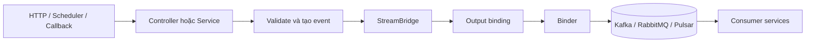
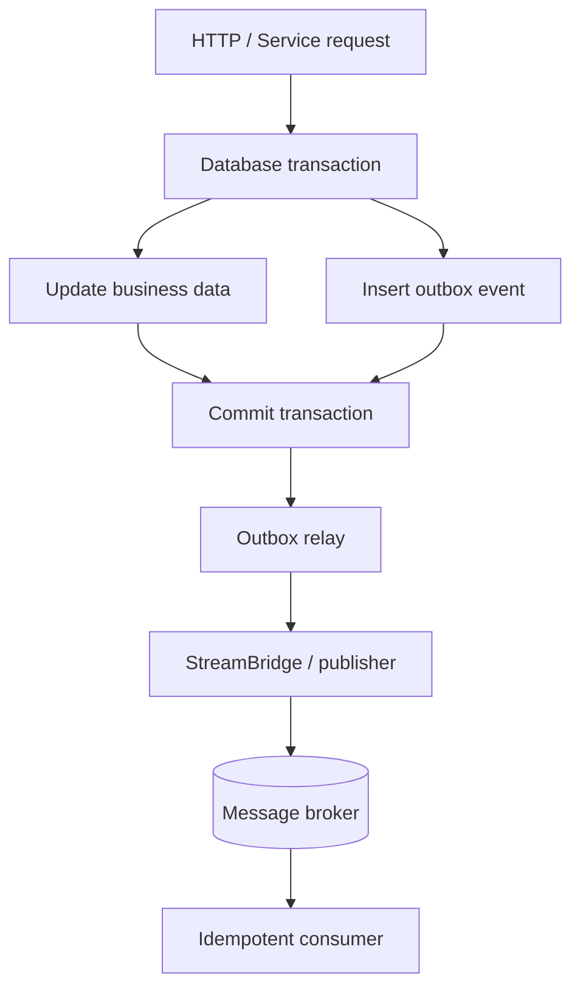

# Vai trò StreamBridge khi phát thông điệp từ nguồn bên ngoài

## 1. Bài toán: dữ liệu đến từ nơi không phải function bean

Spring Cloud Stream thường được giới thiệu qua mô hình hàm `Supplier`, `Function` và `Consumer`. Mô hình này phù hợp khi nguồn dữ liệu, bước xử lý và đích dữ liệu được biểu diễn bằng các bean hàm. Tuy nhiên, trong một ứng dụng Spring Boot thực tế, sự kiện còn có thể xuất phát từ những thành phần không phải function bean:

- Một REST controller nhận yêu cầu HTTP từ hệ thống khác.
- Một tác vụ theo lịch đọc dữ liệu đến hạn và phát sự kiện.
- Một service nghiệp vụ phát hiện thay đổi sau khi hoàn tất thao tác.
- Một listener nhận callback từ thư viện, SDK hoặc hệ thống tích hợp.
- Một tiến trình nhập file hoặc nhận dữ liệu từ nguồn cũ cần đưa vào luồng sự kiện.

Các thành phần này cần gửi message đến Kafka, RabbitMQ hoặc Pulsar mà không phải tự gọi API producer riêng của từng broker. **`StreamBridge`** cung cấp một điểm gửi message từ mã ứng dụng thông thường vào hệ thống binding của Spring Cloud Stream.



Thành phần nguồn chỉ cần biết tên binding mà nó gửi tới và cấu trúc message theo hợp đồng. Binder đảm nhiệm phần tích hợp với broker đã cấu hình. Nhờ vậy, mã nguồn HTTP hoặc service nghiệp vụ không phải phụ thuộc trực tiếp vào `KafkaTemplate`, RabbitMQ client hay Pulsar producer.

## 2. StreamBridge là gì?

`StreamBridge` là API của Spring Cloud Stream dùng để gửi dữ liệu từ một thành phần không phải function bean đến một output binding. Ta có thể inject `StreamBridge` vào controller, service hoặc component khác rồi gọi `send(...)`.

API thường dùng:

```java
boolean send(String bindingName, Object data);
boolean send(String bindingName, MimeType contentType, Object data);
```

Tùy phiên bản Spring Cloud Stream, còn có overload nhận trực tiếp `Message<?>`. Hãy đối chiếu API của phiên bản dự án đang sử dụng khi cần overload cụ thể.

Tham số đầu tiên là **tên binding** trong ứng dụng. Nó không nhất thiết trùng với tên topic hoặc queue trên broker. Tham số `data` là payload hoặc message được gửi qua output binding. Overload có `contentType` cho phép chỉ định MIME type cho dữ liệu gửi đi.

`StreamBridge` không phải broker và không thay thế binder. Nó là cầu nối từ mã ứng dụng sang cơ chế output binding của Spring Cloud Stream. Luồng gửi vẫn sử dụng cấu hình binding, message conversion và binder tương ứng.

## 3. Gửi message từ REST controller

Một trường hợp phổ biến là hệ thống bên ngoài gọi REST API để tạo đơn hàng. Controller xác thực request, chuyển request thành event nghiệp vụ rồi gửi event qua `StreamBridge`.

### Định nghĩa payload sự kiện

```java
public record CreateOrderRequest(String customerId, long totalCents) {}

public record OrderCreated(
    String orderId,
    String customerId,
    long totalCents
) {}
```

Request HTTP và event nội bộ có thể khác nhau. Request mô tả ý định của caller; event `OrderCreated` mô tả sự việc đã xảy ra. Việc tạo event sau khi xác thực và hoàn tất các điều kiện nghiệp vụ giúp consumer nhận một hợp đồng rõ ràng.

### Cấu hình output binding tĩnh

```yaml
spring:
  cloud:
    stream:
      output-bindings: orders-out-0
      bindings:
        orders-out-0:
          destination: orders.created
          content-type: application/json
```

Ở đây:

- `orders-out-0` là tên binding mà ứng dụng dùng khi gọi `StreamBridge`.
- `orders.created` là destination logic được binder ánh xạ tới tài nguyên tương ứng trên broker.
- `content-type` khai báo định dạng payload để message conversion diễn ra phù hợp.

Output binding được khai báo tường minh giúp cấu hình destination và quyền truy cập có thể được chuẩn bị trước khi ứng dụng chạy. Binding này không cần một bean `Supplier` hay `Function` chỉ để tạo ra output.

### Inject và gọi StreamBridge

```java
import java.util.UUID;
import org.springframework.http.HttpStatus;
import org.springframework.http.ResponseEntity;
import org.springframework.messaging.support.MessageBuilder;
import org.springframework.cloud.stream.function.StreamBridge;
import org.springframework.web.bind.annotation.*;

@RestController
@RequestMapping("/api/orders")
class OrderIngressController {

    private final StreamBridge streamBridge;
    private final OrderApplicationService orderService;

    OrderIngressController(
        StreamBridge streamBridge,
        OrderApplicationService orderService
    ) {
        this.streamBridge = streamBridge;
        this.orderService = orderService;
    }

    @PostMapping
    ResponseEntity<Void> create(@RequestBody CreateOrderRequest request) {
        OrderCreated event = orderService.createOrder(request);

        var message = MessageBuilder
            .withPayload(event)
            .setHeader("eventId", UUID.randomUUID().toString())
            .setHeader("aggregateId", event.orderId())
            .setHeader("eventType", "OrderCreated")
            .build();

        boolean accepted = streamBridge.send("orders-out-0", message);
        if (!accepted) {
            return ResponseEntity.status(HttpStatus.SERVICE_UNAVAILABLE).build();
        }

        return ResponseEntity.accepted().build();
    }
}
```

Ví dụ minh họa cách nối HTTP với output binding. Trong ứng dụng thực tế, cần triển khai `OrderApplicationService`, kiểm tra request bằng validation, xử lý lỗi và xác định ranh giới giao dịch phù hợp. Không nên phát `OrderCreated` trước khi nghiệp vụ tạo đơn đã thành công.

Giá trị `true` từ `send` cho biết thao tác gửi được chấp nhận bởi đường gửi trong ứng dụng. Không nên diễn giải nó thành bằng chứng rằng consumer đã nhận hoặc xử lý xong message. Nếu API cần cam kết mạnh hơn về việc lưu bền vững trên broker, cần thiết kế xác nhận theo khả năng của binder/broker hoặc dùng mẫu transactional outbox.

## 4. Binding name và destination là hai khái niệm khác nhau

Khi sử dụng `StreamBridge`, cần phân biệt:

| Khái niệm | Ví dụ | Ý nghĩa |
|---|---|---|
| Binding name | `orders-out-0` | Tên output binding mà mã Java truyền vào `send` |
| Destination | `orders.created` | Nơi binder gửi message trên broker |
| Binder | `kafka` hoặc `rabbit` | Thành phần tích hợp với hệ thống message |
| Payload | `OrderCreated` | Dữ liệu nghiệp vụ được gửi |

Ứng dụng gọi:

```java
streamBridge.send("orders-out-0", event);
```

Binding name được tra trong cấu hình. Nếu binding đã được khai báo, binder dùng destination và các thuộc tính gắn với binding đó. Không nên truyền tên topic vào `send` chỉ vì đó là tên nhìn thấy trong giao diện quản trị broker, trừ khi ứng dụng chủ động dùng tên đó làm binding name động.

Giữ tên binding ổn định trong mã nguồn và cấu hình giúp có thể đổi destination theo môi trường mà không phải sửa controller hoặc service.

## 5. Binding tĩnh và destination động

### Binding tĩnh cho luồng nghiệp vụ đã biết

Với một luồng sự kiện cố định như `orders.created`, nên khai báo output binding trong cấu hình:

```yaml
spring:
  cloud:
    stream:
      bindings:
        orders-out-0:
          destination: orders.created
          content-type: application/json
          producer:
            partition-key-expression: headers['aggregateId']
            partition-count: 6
```

Sau đó, mọi thành phần gửi đơn hàng đều dùng cùng binding name `orders-out-0`. Cấu hình producer có thể điều khiển cách phân vùng theo khóa nghiệp vụ khi binder hỗ trợ thuộc tính đó.

Binding tĩnh phù hợp khi destination, binder và chính sách producer đã biết trước. Nó giúp đội vận hành kiểm soát quyền, tài nguyên và cấu hình theo môi trường.

### Destination động khi đích chỉ biết lúc chạy

`StreamBridge` cũng có thể tạo output binding động khi tên binding được truyền vào chưa tồn tại. Ví dụ, ứng dụng cần gửi sự kiện tới một destination được chọn từ cấu hình tenant:

```java
boolean sent = streamBridge.send("tenant-a.audit", auditEvent);
```

Khi chưa có binding tương ứng, Spring Cloud Stream có thể tạo binding đầu ra cho destination được chỉ định và tái sử dụng binding đã tạo. Cách này hữu ích khi ứng dụng thực sự cần nhiều destination được quyết định trong thời gian chạy.

Tuy nhiên, không nên lấy một chuỗi destination tùy ý từ HTTP request rồi truyền thẳng vào `send`. Điều đó có thể khiến caller gửi dữ liệu tới destination ngoài dự kiến hoặc làm ứng dụng tạo quá nhiều binding động. Hãy ánh xạ một định danh đã được xác thực sang danh sách destination cho phép:

```java
import java.util.Map;

Map<String, String> tenantDestinations = Map.of(
    "tenant-a", "tenant-a.audit",
    "tenant-b", "tenant-b.audit"
);

String destination = tenantDestinations.get(tenantId);
if (destination == null) {
    throw new IllegalArgumentException("Unknown tenant");
}

streamBridge.send(destination, auditEvent);
```

Ví dụ rút gọn minh họa allow-list; ứng dụng cần nạp danh sách này từ cấu hình đáng tin cậy hoặc registry được quản lý. Cần đặt giới hạn và giám sát số binding động, vì mỗi binding có thể tạo tài nguyên client và tiêu thụ tài nguyên broker.

### Chọn binder cho binding

Nếu ứng dụng có nhiều binder, cần xác định binding sẽ dùng binder nào. Với binding khai báo tĩnh, có thể đặt thuộc tính binder cho binding theo cấu hình của phiên bản đang dùng. Với binding động, phải kiểm tra quy tắc binder mặc định và cách cấu hình multi-binder của dự án; không giả định mọi destination động tự chọn đúng broker mong muốn.

## 6. Gửi payload hoặc Message có header

`StreamBridge` có thể gửi một object làm payload:

```java
streamBridge.send("orders-out-0", event);
```

Nếu cần truyền metadata, hãy tạo `Message<?>` bằng `MessageBuilder`:

```java
var message = MessageBuilder
    .withPayload(event)
    .setHeader("eventId", eventId)
    .setHeader("correlationId", correlationId)
    .setHeader("aggregateId", event.orderId())
    .setHeader("eventType", "OrderCreated")
    .build();

streamBridge.send("orders-out-0", message);
```

Header có thể hỗ trợ correlation, tracing, phân vùng hoặc định tuyến nếu binder và cấu hình producer được thiết lập để sử dụng. Không phải mọi header nội bộ Spring đều được chuyển nguyên vẹn qua broker. Chỉ dùng các kiểu metadata có thể serialize và được hợp đồng giữa producer/consumer cho phép.

Nếu cần chỉ định MIME type cho payload, có thể dùng overload nhận `MimeType`:

```java
import org.springframework.util.MimeTypeUtils;

streamBridge.send(
    "orders-out-0",
    MimeTypeUtils.APPLICATION_JSON,
    event
);
```

Hãy đồng bộ content type với định dạng thực tế và converter. Đặt MIME type không tự serialize payload; converter vẫn phải hỗ trợ kiểu dữ liệu.

## 7. Gửi từ service hoặc tác vụ theo lịch

`StreamBridge` không chỉ dành cho REST controller. Có thể inject nó vào service nghiệp vụ để phát event sau khi một thao tác hoàn tất:

```java
import org.springframework.cloud.stream.function.StreamBridge;
import org.springframework.stereotype.Service;

@Service
class InventoryEventPublisher {

    private final StreamBridge streamBridge;

    InventoryEventPublisher(StreamBridge streamBridge) {
        this.streamBridge = streamBridge;
    }

    boolean publishStockChanged(StockChanged event) {
        return streamBridge.send("stock-changed-out-0", event);
    }
}
```

Một tác vụ theo lịch cũng có thể phát message:

```java
import org.springframework.scheduling.annotation.Scheduled;
import org.springframework.stereotype.Component;

@Component
class DailyReportPublisher {

    private final StreamBridge streamBridge;
    private final ReportService reportService;

    DailyReportPublisher(StreamBridge streamBridge, ReportService reportService) {
        this.streamBridge = streamBridge;
        this.reportService = reportService;
    }

    @Scheduled(cron = "0 0 1 * * *")
    void publishDailyReport() {
        DailyReportReady event = reportService.prepareReport();
        streamBridge.send("daily-report-out-0", event);
    }
}
```

Ví dụ yêu cầu ứng dụng đã bật scheduling và có output binding `daily-report-out-0`. Trong môi trường nhiều instance, mỗi instance có thể chạy cùng lịch và phát trùng sự kiện. Cần dùng scheduler phân tán, khóa thực thi, cơ chế idempotency hoặc một nguồn điều phối duy nhất nếu nghiệp vụ chỉ cho phép phát một lần.

## 8. Xử lý kết quả gửi và lỗi

Phương thức `send` trả về boolean. Giá trị này hữu ích để phát hiện thao tác gửi không được chấp nhận ở phía ứng dụng, nhưng không thay thế cơ chế xác nhận bền vững của broker hoặc xác nhận xử lý của consumer.

Khi gửi thất bại, cần quyết định theo loại nguồn:

- **HTTP request:** trả mã lỗi phù hợp nếu chưa thể chấp nhận yêu cầu; không báo thành công khi thao tác gửi đã thất bại.
- **Tác vụ theo lịch:** ghi log có ngữ cảnh, tăng metric lỗi và lên kế hoạch thử lại có giới hạn.
- **Callback hoặc event từ hệ thống ngoài:** lưu trạng thái tiếp nhận và dùng cơ chế retry/replay phù hợp để tránh mất dữ liệu.
- **Luồng nghiệp vụ cần độ tin cậy cao:** cân nhắc transactional outbox để ghi sự kiện cần phát cùng giao dịch dữ liệu nghiệp vụ.

Không nên retry vô hạn ngay trong request thread. Retry cần có backoff, giới hạn số lần, phân loại lỗi tạm thời và lỗi vĩnh viễn. Nếu gửi lại cùng event, nên giữ event ID ổn định để consumer có thể xử lý idempotent.

### Phân biệt các mức xác nhận

| Mốc | Điều có thể kết luận | Điều chưa thể kết luận |
|---|---|---|
| `send` trả về `true` | Đường gửi của ứng dụng chấp nhận thao tác gửi | Message đã được consumer xử lý |
| Broker xác nhận publish/produce theo cơ chế được cấu hình | Broker đã xác nhận việc nhận theo semantics của nó | Tác vụ nghiệp vụ ở consumer đã hoàn tất |
| Consumer xác nhận hoặc commit sau xử lý | Consumer đã hoàn tất theo ranh giới xác nhận được thiết kế | Một tác dụng phụ bên ngoài broker xảy ra đúng một lần nếu chưa có idempotency/giao dịch phù hợp |

Với Kafka, RabbitMQ và Pulsar, cơ chế xác nhận producer có tên gọi và semantics khác nhau. Hãy cấu hình và kiểm thử theo binder cụ thể khi cần biết message đã được broker chấp nhận bền vững.

## 9. Giao dịch nghiệp vụ và transactional outbox

Một lỗi phổ biến là cập nhật cơ sở dữ liệu rồi gọi `StreamBridge.send` như hai thao tác độc lập:

1. Database commit thành công.
2. Ứng dụng gặp lỗi trước khi message được gửi.

Khi đó, trạng thái nghiệp vụ đã thay đổi nhưng event không được phát. Chiều ngược lại cũng có thể xảy ra nếu message được gửi trước khi giao dịch database rollback: consumer nhận một event mô tả thay đổi chưa tồn tại.

Với luồng quan trọng, transactional outbox giúp ghi thay đổi nghiệp vụ và bản ghi outbox trong cùng một giao dịch database. Một tiến trình relay đọc outbox và gửi message qua `StreamBridge` hoặc một cơ chế publisher phù hợp, sau đó đánh dấu bản ghi đã gửi. Relay có thể gửi lặp nếu lỗi xảy ra giữa lúc publish và lúc đánh dấu; consumer vẫn cần idempotency theo event ID.



Outbox tách thời điểm commit dữ liệu khỏi thời điểm gửi broker, đồng thời cung cấp nơi lưu sự kiện cần phát để retry sau sự cố. Nó không tự tạo exactly-once end-to-end; cần khóa sự kiện, trạng thái relay, chính sách retry và consumer idempotent.

## 10. Khi nào dùng StreamBridge và khi nào dùng function

| Tình huống | Cách tiếp cận phù hợp | Lý do |
|---|---|---|
| HTTP controller nhận request rồi phát event | `StreamBridge` | Controller là nguồn dữ liệu ngoài mô hình function |
| Service hoặc scheduler phát sự kiện | `StreamBridge` | Có thể gửi từ bean bất kỳ trong Spring context |
| Một bước nhận message rồi biến đổi thành message khác | `Function` | Logic xử lý có đầu vào và đầu ra rõ ràng |
| Ứng dụng tự tạo dữ liệu theo cơ chế polling | `Supplier` | Nguồn dữ liệu có thể biểu diễn bằng function bean |
| Ứng dụng chỉ nhận và thực hiện tác dụng phụ | `Consumer` | Logic kết thúc ở bước xử lý đầu vào |
| Kết nối nhiều bước xử lý message | Function composition hoặc các binding phù hợp | Giữ pipeline xử lý trong mô hình hàm |

Không cần đưa mọi lời gọi gửi message vào controller. Nếu nhiều nguồn cùng phát một loại event, nên gom quy tắc tạo event và gửi vào một service publisher để tránh lặp cấu hình, header và xử lý lỗi. Ngược lại, nếu logic thực sự là xử lý đầu vào/đầu ra của message, function thường thể hiện luồng đó rõ hơn.

## 11. Bảo mật và kiểm soát nguồn bên ngoài

Khi nguồn phát là HTTP hoặc callback, dữ liệu đầu vào phải được xem là không tin cậy. Trước khi gửi message:

- Xác thực caller và kiểm tra quyền phát loại sự kiện tương ứng.
- Validate cấu trúc, độ dài, miền giá trị và trường bắt buộc của request.
- Tạo event từ dữ liệu đã kiểm tra; không để caller tự đặt header đặc quyền hoặc destination tùy ý.
- Giới hạn kích thước payload và tốc độ gửi để bảo vệ broker.
- Chỉ cho phép destination đã cấu hình hoặc nằm trong allow-list.
- Không đưa token, mật khẩu hoặc dữ liệu nhạy cảm vào header không cần thiết.
- Ghi log event ID/correlation ID và kết quả gửi nhưng tránh log toàn bộ payload nhạy cảm.

Nếu caller gửi một trường `tenantId`, phải xác thực tenant đó thuộc caller trước khi ánh xạ tới destination. Việc đổi tên destination không thay thế kiểm soát quyền truy cập broker.

## 12. Kiểm thử và quan sát

Kiểm thử nguồn gửi nên xác nhận cả logic ứng dụng và đường binding:

1. Mock hoặc thay thế `StreamBridge` để xác nhận controller/service gọi đúng binding name và payload.
2. Kiểm tra header event ID, correlation ID, event type và partition key.
3. Kiểm thử trường hợp `send` trả về `false` và xác nhận API nguồn xử lý lỗi đúng.
4. Kiểm thử destination động với tenant hợp lệ, tenant không hợp lệ và giới hạn destination.
5. Dùng test binder để kiểm tra message đi qua binding ở mức ứng dụng.
6. Kiểm thử tích hợp với broker thật để xác nhận serialization, header mapping, producer confirms hoặc transaction theo binder.
7. Kiểm tra retry và idempotency khi publish thất bại hoặc event được gửi lặp.

Trong vận hành, theo dõi số lần gửi, tỷ lệ lỗi, thời gian gửi, số binding động, backlog phía consumer và số bản ghi outbox đang chờ. Log cần có binding name, destination đã chọn, event ID và correlation ID để truy vết. Không ghi thông tin bí mật hoặc toàn bộ payload nhạy cảm.

## 13. Quy trình triển khai một nguồn phát ngoài function

1. Xác định nguồn dữ liệu: HTTP, scheduler, callback hay thành phần tích hợp.
2. Xác định sự kiện nghiệp vụ và schema mà consumer sẽ hiểu.
3. Validate dữ liệu nguồn rồi chuyển thành event nội bộ.
4. Chọn binding tĩnh nếu destination đã biết; chỉ dùng destination động khi có nhu cầu rõ ràng.
5. Cấu hình destination, content type, binder và producer properties.
6. Dùng `StreamBridge.send` để gửi payload hoặc `Message<?>` có header cần thiết.
7. Định nghĩa ý nghĩa của kết quả `send`, chính sách lỗi và retry.
8. Với dữ liệu quan trọng, đánh giá transactional outbox và idempotency.
9. Kiểm thử với test binder và broker tương ứng; theo dõi metric và log sau triển khai.

`StreamBridge` giúp đưa dữ liệu từ các thành phần Spring thông thường vào luồng sự kiện mà vẫn sử dụng binding và binder của Spring Cloud Stream. Khi phân biệt đúng binding name với destination, chọn kiểu binding phù hợp, kiểm soát nguồn bên ngoài và hiểu giới hạn của kết quả gửi, ứng dụng có thể kết nối REST API, scheduler và các hệ thống tích hợp với Kafka, RabbitMQ hoặc Pulsar theo một cách nhất quán.

