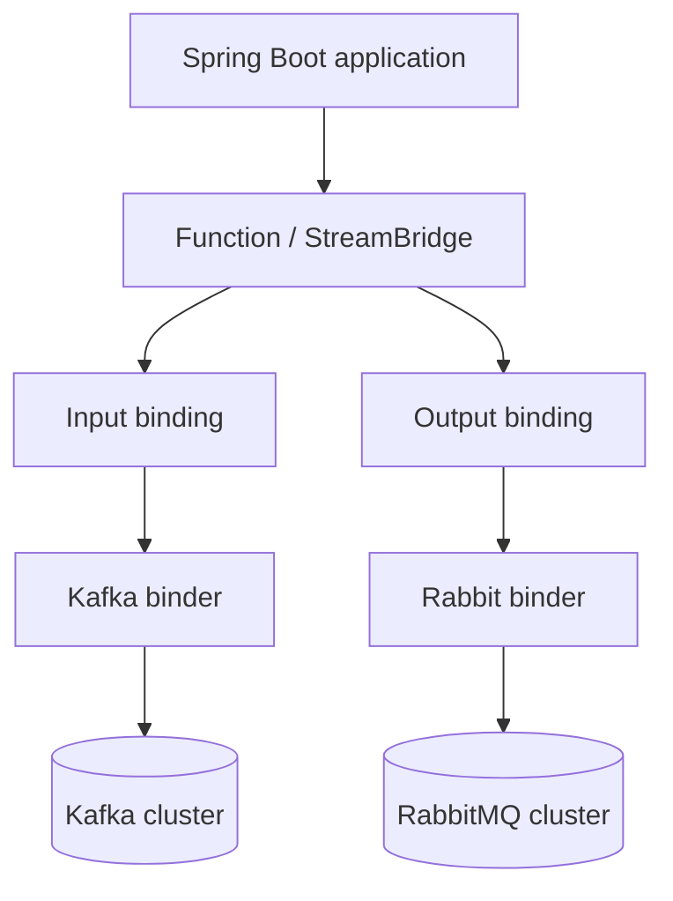
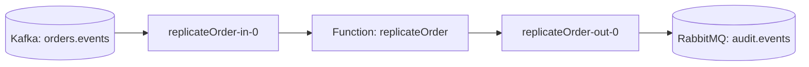

# Chọn binder khi có nhiều hệ thống truyền tin

## 1. Vì sao một ứng dụng cần nhiều binder?

Trong hệ thống hướng sự kiện, mỗi broker có thể phục vụ một nhóm nhu cầu khác nhau. Kafka thường được chọn cho luồng sự kiện có lưu giữ theo log và nhiều consumer group độc lập. RabbitMQ thường phù hợp với định tuyến message qua exchange và queue. Pulsar cung cấp topic, subscription và các kiểu phân phối message riêng. Một tổ chức có thể đang vận hành nhiều nền tảng cùng lúc do lịch sử hệ thống, yêu cầu của từng sản phẩm hoặc quá trình chuyển đổi hạ tầng.

Một ứng dụng Spring Cloud Stream có thể cần kết nối nhiều broker trong các tình huống như:

- Nhận sự kiện đơn hàng từ Kafka và phát bản ghi kiểm toán sang RabbitMQ.
- Đọc dữ liệu từ một cụm Kafka nội bộ và ghi sang cụm Kafka khác.
- Phát sự kiện nghiệp vụ sang Pulsar trong khi vẫn gửi thông báo đến RabbitMQ.
- Chạy một giai đoạn chuyển đổi hạ tầng, trong đó một số binding vẫn dùng broker cũ và binding mới dùng broker mới.

Spring Cloud Stream hỗ trợ cấu hình nhiều **binder** trong cùng ứng dụng. Mỗi binder là một cấu hình tích hợp với một loại broker hoặc một cụm broker cụ thể. Ứng dụng có thể chọn binder mặc định và chỉ định binder riêng cho từng binding.



Việc có nhiều binder không tự động đồng bộ dữ liệu giữa các broker. Ứng dụng phải định nghĩa luồng xử lý, chuyển đổi dữ liệu và chiến lược phục hồi khi một phía thành công còn phía kia thất bại.

## 2. Phân biệt binder type, binder instance và binding

Ba khái niệm này có vai trò khác nhau:

| Khái niệm | Ví dụ | Ý nghĩa |
|---|---|---|
| Binder type | `kafka`, `rabbit`, `pulsar` | Loại tích hợp được cung cấp bởi thư viện binder trên classpath |
| Binder instance/name | `kafkaEast`, `rabbitAudit` | Một cấu hình kết nối cụ thể, có thể trỏ tới một cụm broker riêng |
| Binding | `replicateOrder-in-0`, `replicateOrder-out-0` | Cổng đầu vào hoặc đầu ra của function được nối với destination và binder |

Một ứng dụng có thể khai báo hai binder instance cùng type `kafka` nhưng trỏ tới hai cụm Kafka khác nhau. Ngược lại, hai binder instance có thể có type khác nhau, ví dụ một instance `kafka` và một instance `rabbit`.

Binding là nơi chỉ định binder instance cần sử dụng. Tên binder instance phải khớp với tên đã khai báo trong `spring.cloud.stream.binders`.

## 3. Khai báo nhiều binder trong cấu hình

Giả sử ứng dụng có một function nhận sự kiện từ Kafka và phát thông tin kiểm toán sang RabbitMQ. Ta khai báo hai binder instance:

```yaml
spring:
  cloud:
    function:
      definition: replicateOrder
    stream:
      binders:
        kafkaEast:
          type: kafka
          environment:
            spring:
              cloud:
                stream:
                  kafka:
                    binder:
                      brokers: localhost:9092
        rabbitAudit:
          type: rabbit
          environment:
            spring:
              rabbitmq:
                host: localhost
                port: 5672
                username: app
                password: ${RABBIT_PASSWORD}
      default-binder: kafkaEast
      bindings:
        replicateOrder-in-0:
          destination: orders.events
          group: audit-bridge
          binder: kafkaEast
          content-type: application/json
        replicateOrder-out-0:
          destination: audit.events
          binder: rabbitAudit
          content-type: application/json
```

Giải thích cấu hình:

1. `binders.kafkaEast.type: kafka` chọn Kafka binder implementation.
2. `environment` của `kafkaEast` cung cấp cấu hình broker riêng cho binder instance này.
3. `binders.rabbitAudit.type: rabbit` chọn Rabbit binder implementation.
4. `environment` của `rabbitAudit` cung cấp thông tin kết nối RabbitMQ. Mật khẩu được lấy từ biến môi trường.
5. `default-binder: kafkaEast` đặt binder mặc định cho binding không chỉ rõ binder.
6. `replicateOrder-in-0.binder` chọn Kafka cho đầu vào.
7. `replicateOrder-out-0.binder` chọn RabbitMQ cho đầu ra.

Trong ví dụ, tên binding được suy ra từ bean function `replicateOrder`. Nếu đổi tên bean, tên binding mặc định cũng thay đổi và cấu hình cần được cập nhật tương ứng.

`environment` tạo phạm vi cấu hình riêng cho binder instance. Hãy đặt các thuộc tính đúng namespace của binder và phiên bản thư viện đang dùng. Ví dụ trên minh họa cấu hình Kafka binder qua `spring.cloud.stream.kafka.binder.brokers` và Rabbit binder qua thuộc tính kết nối Spring Boot RabbitMQ.

## 4. Chọn binder cho từng binding

Thuộc tính `binder` dưới một binding xác định binder instance dùng cho binding đó:

```yaml
spring:
  cloud:
    stream:
      bindings:
        orders-in-0:
          destination: orders.events
          binder: kafkaEast
        audit-out-0:
          destination: audit.events
          binder: rabbitAudit
```

Nếu không chỉ định `binder`, Spring Cloud Stream sử dụng binder mặc định theo cấu hình và quy tắc chọn binder của ứng dụng. Khai báo `default-binder` giúp ý định rõ ràng khi có nhiều binder candidate.

Không nhầm `binder` với `destination`:

- `binder: rabbitAudit` chọn cấu hình kết nối RabbitMQ.
- `destination: audit.events` chọn nơi gửi message trong hệ thống RabbitMQ đó.

Hai binder instance có thể cùng trỏ tới một loại broker nhưng dùng cluster, credential hoặc virtual host khác nhau. Điều này hữu ích khi cần cô lập môi trường, vùng dữ liệu hoặc quyền truy cập.

### Binder mặc định và default candidate

`default-binder` chỉ định binder mặc định mà ứng dụng muốn dùng. Khi khai báo nhiều binder instance, hãy cấu hình rõ binder ở các binding quan trọng để tránh phụ thuộc vào lựa chọn ngầm.

Thuộc tính `default-candidate` của một binder instance có thể dùng để kiểm soát việc binder đó có tham gia quá trình chọn binder mặc định hay không. Thuộc tính này hữu ích khi có một binder chuyên biệt chỉ dành cho các binding đã chỉ định tường minh. Cần đối chiếu hành vi với phiên bản Spring Cloud Stream đang sử dụng, đặc biệt khi ứng dụng có nhiều binder cùng type.

## 5. Ví dụ function nối Kafka với RabbitMQ

Function có thể nhận một kiểu event từ Kafka, biến đổi thành bản ghi kiểm toán rồi phát kết quả qua output binding được gắn với RabbitMQ.

```java
import java.util.function.Function;
import org.springframework.context.annotation.Bean;
import org.springframework.context.annotation.Configuration;

record OrderEvent(String orderId, String eventType, long occurredAt) {}
record AuditRecord(String entityId, String action, long timestamp) {}

@Configuration
class OrderAuditFunctions {

    @Bean
    Function<OrderEvent, AuditRecord> replicateOrder() {
        return event -> new AuditRecord(
            event.orderId(),
            event.eventType(),
            event.occurredAt()
        );
    }
}
```

Luồng cấu hình ở phần trước gắn `replicateOrder-in-0` với Kafka và `replicateOrder-out-0` với RabbitMQ. Function không cần gọi Kafka client hoặc Rabbit client trực tiếp; binder xử lý hai đầu của binding.



Đây là luồng chuyển tiếp giữa hai broker. Việc function trả về `AuditRecord` chỉ hoàn thành phần xử lý trong ứng dụng. Để bảo đảm dữ liệu được giao đúng khi broker đích gặp sự cố, cần thiết kế retry, xử lý trùng và phục hồi offset/ack phù hợp.

## 6. Nhiều binder cùng loại

Không nhất thiết phải dùng nhiều loại broker mới cần nhiều binder instance. Ví dụ, ứng dụng có thể đọc từ cụm Kafka của miền bán hàng và phát sang cụm Kafka của miền phân tích:

```yaml
spring:
  cloud:
    stream:
      binders:
        salesKafka:
          type: kafka
          environment:
            spring:
              cloud:
                stream:
                  kafka:
                    binder:
                      brokers: sales-kafka.internal:9092
        analyticsKafka:
          type: kafka
          environment:
            spring:
              cloud:
                stream:
                  kafka:
                    binder:
                      brokers: analytics-kafka.internal:9092
      bindings:
        copySales-in-0:
          destination: sales.orders
          group: analytics-copy
          binder: salesKafka
        copySales-out-0:
          destination: analytics.orders
          binder: analyticsKafka
```

Hai binder instance có cùng type nhưng kết nối tới hai cụm khác nhau. Credential, TLS, truststore, timeout và các thuộc tính client khác có thể được cấu hình riêng trong môi trường của từng binder.

Mô hình này hữu ích khi chuyển dữ liệu giữa vùng mạng hoặc cluster, nhưng cần chú ý quyền truy cập, chi phí truyền dữ liệu, schema compatibility và khả năng khôi phục khi một cụm tạm thời không khả dụng.

## 7. Kết hợp StreamBridge với nhiều binder

`StreamBridge` gửi message qua output binding. Khi destination được chọn động và ứng dụng có nhiều binder, cần xác định rõ binder nào sẽ xử lý output đó. Các binding động thường dựa vào binder mặc định nếu không có cấu hình cụ thể cho binding. Vì vậy, nếu broker đích là yêu cầu cố định, nên khai báo output binding tĩnh và gắn `binder` rõ ràng.

Ví dụ khai báo hai output binding:

```yaml
spring:
  cloud:
    stream:
      output-bindings: audit-kafka-out;audit-rabbit-out
      bindings:
        audit-kafka-out:
          destination: audit.events
          binder: kafkaEast
          content-type: application/json
        audit-rabbit-out:
          destination: audit.events
          binder: rabbitAudit
          content-type: application/json
```

Mã ứng dụng chọn binding name đã được cấu hình:

```java
streamBridge.send("audit-kafka-out", auditRecord);
streamBridge.send("audit-rabbit-out", auditRecord);
```

Hai binding có thể gửi cùng payload đến hai broker khác nhau. Nếu cần fan-out, phải xác định rõ chính sách khi một lần gửi thành công và lần gửi còn lại thất bại. Hai lệnh `send` không tạo thành một giao dịch phân tán nguyên tử.

`output-bindings` yêu cầu Spring Cloud Stream tạo các output binding được liệt kê khi ứng dụng khởi động. Nếu không khai báo trước, `StreamBridge` có thể tạo binding động khi lần đầu gửi đến một tên binding chưa tồn tại; với nhiều binder, việc chọn binder cho binding động cần được kiểm soát theo cấu hình và binder mặc định.

Không nên cho caller bên ngoài truyền trực tiếp binder name hoặc destination tùy ý. Hãy dùng một lựa chọn nghiệp vụ đã được xác thực rồi ánh xạ sang binding name trong allow-list.

## 8. Chọn binder theo tiêu chí kiến trúc

Việc chọn binder nên dựa trên semantics và năng lực cần thiết, không chỉ dựa trên việc thư viện nào đã có sẵn.

| Tiêu chí | Câu hỏi cần trả lời |
|---|---|
| Mô hình lưu trữ | Cần log có retention, queue hay subscription? |
| Phân phối | Cần consumer group, competing consumers, shared subscription hay key-based delivery? |
| Thứ tự | Thứ tự cần giữ ở partition, queue hay theo key? |
| Giao nhận | Cần acknowledgement, publisher confirm, offset commit hay transaction nào? |
| Retry và DLQ | Binder hỗ trợ retry/DLQ ra sao và message lỗi được định tuyến thế nào? |
| Quy mô | Throughput, số kết nối, số partition/queue và kích thước message dự kiến là bao nhiêu? |
| Bảo mật | Broker dùng TLS, SASL, user/password, ACL hay cơ chế danh tính nào? |
| Vận hành | Nhóm có công cụ giám sát, backup, nâng cấp và xử lý sự cố cho broker đó không? |
| Tương thích schema | Producer và consumer quản lý version, serializer và schema registry như thế nào? |

Một binder có thể hỗ trợ nhiều thuộc tính chung của Spring Cloud Stream, nhưng các semantics broker-specific vẫn khác nhau. Ví dụ, Kafka offset commit không giống RabbitMQ acknowledgement; Pulsar subscription type không tương đương hoàn toàn với Kafka consumer group. Không nên sao chép nguyên một cấu hình consumer từ binder này sang binder khác mà không kiểm tra ý nghĩa.

## 9. Cấu hình chung và cấu hình riêng của binder

Spring Cloud Stream có các thuộc tính chung cho binding như `destination`, `group`, `content-type`, `consumer` và `producer`. Ngoài ra, mỗi binder có namespace riêng cho thuộc tính đặc thù:

| Phạm vi | Ví dụ cấu hình | Mục đích |
|---|---|---|
| Chung | `spring.cloud.stream.bindings.<name>.destination` | Chỉ định destination |
| Chung | `spring.cloud.stream.bindings.<name>.content-type` | Định dạng message |
| Chung | `spring.cloud.stream.bindings.<name>.consumer.concurrency` | Điều chỉnh mức song song theo binder hỗ trợ |
| Kafka binder | `spring.cloud.stream.kafka.binder.brokers` | Địa chỉ broker Kafka |
| Rabbit binder | `spring.rabbitmq.host` | Địa chỉ RabbitMQ trong môi trường binder |
| Pulsar binder | `spring.cloud.stream.pulsar.binder.*` | Thuộc tính binder Pulsar theo phiên bản |

Ví dụ khai báo một binder Pulsar riêng, khi ứng dụng đã có Pulsar binder dependency tương thích:

```yaml
spring:
  cloud:
    stream:
      binders:
        pulsarArchive:
          type: pulsar
          environment:
            spring:
              cloud:
                stream:
                  pulsar:
                    binder:
                      service-url: pulsar://pulsar.internal:6650
      bindings:
        archive-out-0:
          destination: audit-archive
          binder: pulsarArchive
          content-type: application/json
```

Tên và vị trí các thuộc tính kết nối Pulsar có thể thay đổi theo thế hệ binder và Spring Boot. Hãy kiểm tra metadata cấu hình của đúng phiên bản dependency trước khi dùng ví dụ này trong production.

Khi dùng nhiều binder instance, thuộc tính kết nối cần được đặt trong `environment` của binder tương ứng để tránh dùng nhầm cấu hình toàn cục. Một số thuộc tính Spring Boot dùng chung có thể cần được tách hoặc truyền qua môi trường riêng của binder. Kiểm tra tài liệu binder và phiên bản Spring Boot/Spring Cloud Stream trước khi chọn namespace.

Không đặt secret trực tiếp trong file YAML được commit. Dùng biến môi trường, secret manager hoặc cơ chế cấu hình bảo mật của nền tảng triển khai. Cấp quyền tối thiểu cho từng binder instance; binder đọc topic không nhất thiết cần quyền ghi và ngược lại.

## 10. Khác biệt về message conversion và schema

Hai broker có thể nhận cùng payload JSON, nhưng điều đó không đảm bảo mọi header hoặc metadata được truyền giống nhau. Binder có thể ánh xạ header Spring sang header transport theo quy tắc riêng. Một header dùng làm partition key trên Kafka có thể cần cấu hình khác khi chuyển sang routing key hoặc message key ở broker khác.

Khi nối nhiều binder:

- Chọn content type rõ ràng cho từng binding.
- Thống nhất schema của payload giữa producer và consumer.
- Không dựa vào header nội bộ của một binder ở binder khác.
- Chuyển đổi header hoặc payload nếu đích yêu cầu tên trường, encoding hoặc schema khác.
- Kiểm thử serializer/deserializer và kích thước message ở cả hai đầu.

Nếu hai hệ thống dùng schema khác nhau, function trung gian có thể chuyển đổi sang một hợp đồng chung. Với hệ thống lớn, schema registry và quy tắc tương thích giúp giảm lỗi khi producer và consumer được phát hành độc lập.

## 11. Giao dịch, lỗi và tính nhất quán giữa các broker

Khi một function đọc từ broker A và ghi sang broker B, không mặc định có một transaction bao trùm cả hai broker. Một tình huống điển hình:

1. Consumer nhận message từ Kafka.
2. Function gửi output sang RabbitMQ thành công.
3. Ứng dụng dừng trước khi Kafka offset được commit.
4. Kafka giao lại input sau khi consumer khởi động lại.
5. Function gửi cùng output lần nữa.

Kết quả là RabbitMQ có thể nhận message trùng. Vì vậy, cần thiết kế event ID ổn định và consumer phía đích idempotent. Với tác vụ cần kiểm soát chặt hơn, có thể lưu trạng thái xử lý hoặc dùng outbox/inbox phù hợp với ranh giới dữ liệu.

### Retry và dead-letter

Retry cần được cấu hình theo từng binding và binder. Lỗi kết nối tạm thời có thể thử lại với backoff; lỗi dữ liệu hoặc schema thường cần đưa vào DLQ hoặc luồng xử lý ngoại lệ. Nếu retry output broker B thất bại, phải quyết định input broker A có được xác nhận hay không. Xác nhận input quá sớm có thể làm mất cơ hội xử lý lại; không xác nhận có thể dẫn đến redelivery và output trùng.

Một thiết kế phổ biến là:

- Giữ input chưa được xác nhận cho đến khi output được gửi theo mức bảo đảm đã chọn.
- Dùng event ID hoặc khóa nghiệp vụ để chống trùng ở consumer đích.
- Giới hạn retry và chuyển message không thể xử lý sang DLQ.
- Có quy trình replay có kiểm soát, giữ nguyên event ID để idempotency hoạt động.
- Theo dõi lag, số lần retry và DLQ ở cả hai broker.

Với giao dịch nghiệp vụ quan trọng, transactional outbox ở phía nguồn và inbox ở phía đích có thể giúp phối hợp trạng thái tốt hơn. Đây là mẫu thiết kế ở tầng ứng dụng/database; nó không biến hai broker thành một giao dịch nguyên tử.

## 12. Provisioning, tài nguyên và vòng đời binder

Mỗi binder instance có thể tạo kết nối, producer, consumer và tài nguyên client riêng. Việc tăng số binder instance có thể làm tăng số connection, thread, buffer và chi phí giám sát. Chỉ khai báo binder thực sự cần thiết.

Provisioning destination phụ thuộc binder và quyền tài khoản. Kafka binder có thể tạo topic nếu cấu hình và quyền cho phép; Rabbit binder có thể khai báo exchange, queue và binding theo cấu hình; Pulsar binder có quy tắc topic và subscription riêng. Trong môi trường production, có thể giao việc tạo tài nguyên cho quy trình hạ tầng để kiểm soát tên, retention, partition, durability và ACL.

Khi ứng dụng dừng hoặc một binding bị unbind, tài nguyên client do binder quản lý được giải phóng theo vòng đời. Điều đó không đồng nghĩa xóa topic, queue hoặc dữ liệu trên broker. Vòng đời dữ liệu broker phải được quản lý riêng.

## 13. Kiểm thử ứng dụng có nhiều binder

Kiểm thử cần xác nhận cả việc chọn binder lẫn luồng dữ liệu:

1. Khởi động ứng dụng với cấu hình nhiều binder và xác nhận mỗi binder instance kết nối đúng cluster.
2. Kiểm tra binding đầu vào/đầu ra gắn đúng binder name và destination.
3. Gửi một message thử vào từng broker và xác nhận function nhận đúng dữ liệu.
4. Kiểm tra payload, content type và các header cần giữ qua ranh giới broker.
5. Làm cho broker đích tạm thời không khả dụng và kiểm tra retry, offset/ack và redelivery.
6. Phát lại cùng event ID để xác nhận consumer đích xử lý idempotent.
7. Kiểm tra quyền truy cập, TLS và secret của từng binder instance.
8. Kiểm tra shutdown, reconnect và provisioning trong môi trường tích hợp.

Test binder hữu ích để kiểm tra logic function và binding ở mức ứng dụng. Nó không thay thế kiểm thử tích hợp với từng broker khi cần xác nhận semantics về acknowledgement, partition, transaction, routing hoặc subscription.

## 14. Quan sát và vận hành

Khi có nhiều broker, cần phân biệt metric theo binder, binding và destination. Theo dõi:

- Trạng thái kết nối của từng binder instance.
- Tỷ lệ gửi/nhận và lỗi của từng binding.
- Kafka consumer lag, RabbitMQ queue depth hoặc Pulsar backlog tương ứng.
- Thời gian xử lý, số lần retry và số message vào DLQ.
- Số kết nối và tài nguyên client theo binder.
- Lỗi chuyển đổi payload, header mapping và schema compatibility.

Log nên chứa binding name, binder name, destination, event ID và correlation ID để truy vết xuyên broker. Tránh ghi credential hoặc payload nhạy cảm. Cảnh báo cần chỉ rõ broker hoặc binding nào gặp vấn đề; một ứng dụng có thể vẫn khỏe ở một luồng trong khi luồng khác đang bị nghẽn.

## 15. Quy trình chọn binder cho một ứng dụng

1. Liệt kê từng luồng input/output và broker cần kết nối.
2. Chọn binder type phù hợp với semantics và yêu cầu vận hành.
3. Khai báo binder instance với cấu hình kết nối và bảo mật riêng.
4. Đặt `default-binder` cho trường hợp không chỉ định và gắn binder rõ ràng cho binding quan trọng.
5. Xác định destination, group, content type và thuộc tính producer/consumer.
6. Kiểm tra cách chuyển đổi payload/header giữa các broker.
7. Thiết kế retry, DLQ, idempotency và phục hồi khi một phía thành công còn phía kia thất bại.
8. Kiểm thử với từng broker thực tế, sau đó triển khai metric, log và cảnh báo theo binder.

Spring Cloud Stream cho phép một ứng dụng làm việc với nhiều hệ thống truyền tin thông qua các binder instance có tên riêng. Chọn binder ở cấp binding giúp tách cấu hình kết nối khỏi logic function, nhưng không xóa khác biệt về giao nhận, thứ tự, transaction và metadata giữa broker. Khi mỗi binding được gắn đúng binder, hợp đồng message được thống nhất và các trường hợp lỗi xuyên broker được thiết kế rõ, ứng dụng có thể tích hợp nhiều nền tảng message một cách có kiểm soát.

