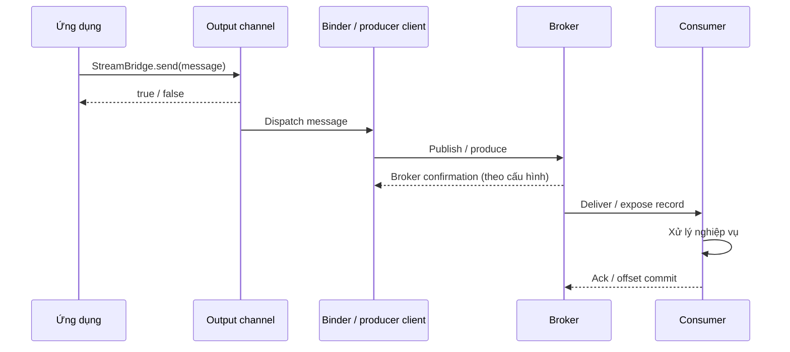

# Diễn giải kết quả send và phân biệt với xác nhận của broker

`StreamBridge` cho phép một thành phần Spring gửi dữ liệu tới output binding mà không cần khai báo một `Supplier` hoặc `Function` riêng cho mỗi lần phát. Phương thức `send()` trả về `boolean`, nhưng giá trị này cần được diễn giải đúng: nó cho biết việc gửi message qua channel của ứng dụng có được chấp nhận hay không. Nó không phải là một xác nhận phổ quát rằng Kafka, RabbitMQ hoặc Pulsar đã lưu message bền vững, càng không chứng minh consumer đã nhận hoặc xử lý message.

Trong hệ thống event-driven, có nhiều chặng giao nhận: ứng dụng tạo message, channel tiếp nhận message, binder chuyển message tới producer client, broker xác nhận việc ghi nhận theo cấu hình, rồi consumer đọc và xử lý. Mỗi chặng có tín hiệu thành công và cơ chế lỗi riêng. Hiểu ranh giới này giúp ứng dụng quyết định khi nào có thể đánh dấu một tác vụ hoàn tất, khi nào cần retry và khi nào phải kiểm tra trạng thái để tránh phát trùng.

## 1. StreamBridge gửi message qua output binding

`StreamBridge` là API của Spring Cloud Stream để gửi message từ các thành phần không phải function, chẳng hạn REST controller, service nghiệp vụ hoặc scheduler. Ứng dụng chỉ định tên binding đầu ra và dữ liệu cần gửi.

Ví dụ một service phát sự kiện đơn hàng:

```java
@Service
public class OrderEventPublisher {

    private final StreamBridge streamBridge;

    public OrderEventPublisher(StreamBridge streamBridge) {
        this.streamBridge = streamBridge;
    }

    public boolean publish(OrderPlaced event) {
        Message<OrderPlaced> message = MessageBuilder
            .withPayload(event)
            .setHeader("eventId", event.eventId())
            .setHeader("correlationId", event.correlationId())
            .build();

        return streamBridge.send("orders-out-0", message);
    }
}
```

Tên `orders-out-0` là tên output binding. Có thể cấu hình destination rõ ràng:

```yaml
spring:
  cloud:
    stream:
      bindings:
        orders-out-0:
          destination: orders.placed
          content-type: application/json
```

Khi gọi `send()`, StreamBridge tìm hoặc tạo binding tương ứng theo cấu hình, rồi gửi message qua output channel đã liên kết với binder. Binder chuyển message sang cơ chế producer của broker được chọn.

API có thể nhận payload trực tiếp hoặc một `Message<?>`. Dùng `Message<?>` khi cần gắn header như event ID, correlation ID hoặc metadata định tuyến đã được thống nhất. Không nên đặt thông tin bí mật vào header vì header có thể được ghi log hoặc chuyển qua các thành phần trung gian.

## 2. Giá trị boolean của send() có ý nghĩa gì?

Hai kết quả chính cần phân biệt:

| Kết quả | Diễn giải đúng |
|---|---|
| `true` | Channel đã chấp nhận message theo semantics của channel và đường gửi đang cấu hình |
| `false` | Channel không chấp nhận message; ứng dụng cần xem xét nguyên nhân và chính sách xử lý lại |

Ví dụ:

```java
boolean accepted = streamBridge.send("orders-out-0", message);

if (!accepted) {
    throw new MessageDeliveryException(
        message,
        "Output channel did not accept the message"
    );
}
```

Đoạn code xử lý trường hợp channel trả về `false`. Trong ứng dụng thực tế, cần cân nhắc nơi exception được bắt và chính sách retry của service gọi publisher.

Giá trị `true` không có nghĩa:

- Broker đã xác nhận message.
- Message đã được ghi bền vững theo replication hoặc durability policy.
- Message đã được định tuyến tới queue mà consumer đang lắng nghe.
- Consumer đã đọc, commit offset hoặc acknowledge message.
- Logic nghiệp vụ của consumer đã hoàn tất.

`StreamBridge.send()` trả về kết quả gửi tới channel. API chung này không trả về một future chứa broker message ID hoặc một đối tượng publisher-confirm có cùng semantics trên mọi binder.

Nếu channel sử dụng cơ chế dispatch đồng bộ, lời gọi có thể thực hiện thêm công việc của handler trước khi trả về. Nếu đường gửi sử dụng channel hoặc executor bất đồng bộ, `true` có thể chỉ cho biết message đã được tiếp nhận vào hàng đợi nội bộ. Dù vậy, không được suy ra broker đã xác nhận chỉ từ giá trị boolean. Hãy dựa vào hợp đồng của binder và cấu hình producer cụ thể khi cần xác nhận ở tầng broker.

## 3. Phân biệt các chặng giao nhận

Một lần phát sự kiện có thể đi qua các chặng sau:



Các tín hiệu trong sơ đồ không phải lúc nào cũng đồng bộ với nhau. Đặc biệt, kết quả channel có thể được trả về trước khi broker phản hồi hoặc trước khi consumer xử lý message.

| Chặng | Tín hiệu có thể quan sát | Điều tín hiệu đó chứng minh |
|---|---|---|
| Ứng dụng → channel | Boolean của `send()` | Channel nhận hoặc từ chối message |
| Binder/client → broker | Producer confirm, future hoàn tất hoặc message ID | Broker đã xác nhận theo cơ chế và cấu hình cụ thể |
| Broker → consumer | Record/queue message có thể được đọc | Message đã sẵn sàng cho consumer theo cơ chế broker |
| Consumer → broker | Offset commit hoặc acknowledgement | Broker ghi nhận tiến độ/ack của consumer |
| Nghiệp vụ consumer | Kết quả xử lý và commit dữ liệu | Tác vụ nghiệp vụ đã hoàn tất theo transaction của ứng dụng |

Broker confirm và consumer acknowledgement là hai tín hiệu khác nhau. Producer confirm không chứng minh consumer đã nhận message. Consumer acknowledgement cũng không chứng minh dữ liệu của producer đã được commit cùng một transaction database ở hệ thống khác.

## 4. Những tình huống có thể xảy ra sau send()

### Channel từ chối message

Nếu `send()` trả về `false`, channel không chấp nhận message. Nguyên nhân có thể liên quan tới trạng thái channel, timeout hoặc khả năng tiếp nhận của đường gửi. Ứng dụng cần ghi nhận lỗi, kiểm tra cấu hình và áp dụng retry có giới hạn nếu lỗi có thể khắc phục.

Không nên bỏ qua giá trị trả về:

```java
streamBridge.send("orders-out-0", message); // Bỏ qua kết quả
```

Cách gọi trên làm mất tín hiệu channel từ chối message. Hãy kiểm tra boolean và xác định hành động tiếp theo.

### Channel chấp nhận nhưng broker từ chối hoặc không thể xác nhận

Channel có thể đã nhận message, nhưng producer client gặp lỗi khi gửi tới broker, ví dụ broker không sẵn sàng, timeout, lỗi xác thực, topic/exchange không tồn tại hoặc dữ liệu không serialize được. Tùy binder, producer client và cấu hình đồng bộ/bất đồng bộ, lỗi có thể được truyền về ngay trong lời gọi, được báo qua cơ chế lỗi của framework hoặc xuất hiện sau khi `send()` đã trả về.

Vì vậy, không nên bắt mọi exception rồi coi message đã gửi thành công. Cần cấu hình error handling phù hợp với binder, ghi log có correlation/event ID và theo dõi metric lỗi producer. Với đường gửi bất đồng bộ, phải xác định cơ chế nhận lỗi bất đồng bộ mà binder cung cấp.

### Broker xác nhận nhưng consumer chưa xử lý

Broker có thể đã lưu hoặc chấp nhận message, nhưng consumer chưa chạy, đang bị dừng, chưa có subscription phù hợp hoặc đang bị lag. Đây là trạng thái message đã được producer gửi thành công nhưng chưa hoàn tất xử lý nghiệp vụ.

Theo dõi consumer lag, queue depth, unacknowledged messages và trạng thái consumer giúp phát hiện tình huống này. Không dùng producer confirm làm chỉ báo duy nhất cho tiến độ end-to-end.

### Consumer xử lý xong nhưng acknowledgement chưa được ghi nhận

Consumer có thể hoàn tất cập nhật database rồi gặp lỗi trước khi commit offset hoặc acknowledge. Broker có thể giao lại message. Vì vậy, consumer cần idempotent hoặc có cơ chế deduplication bằng event ID/khóa nghiệp vụ. Việc broker giao lại không nhất thiết có nghĩa producer đã gửi message hai lần.

## 5. Broker confirmation có semantics riêng

Spring Cloud Stream cung cấp API chung để gửi message, còn xác nhận từ broker phụ thuộc binder và client cụ thể. Không có một ý nghĩa chung cho `true` của StreamBridge có thể thay thế tất cả các cơ chế này.

### Kafka: producer acknowledgement

Kafka producer có cấu hình `acks` để xác định mức xác nhận từ broker:

- `acks=0`: producer không chờ broker acknowledgement.
- `acks=1`: leader xác nhận sau khi ghi record vào log cục bộ của leader.
- `acks=all` (hoặc `-1`): leader chờ các replica trong tập in-sync replicas xác nhận theo giao thức Kafka.

`acks=all` cần được xem cùng `min.insync.replicas` và replication factor. Nó không có nghĩa mọi replica đã cấu hình, kể cả replica đang ngoài ISR, đều xác nhận. Nếu yêu cầu độ bền cao, phải thiết kế replication và ISR policy phù hợp.

Khi dùng Kafka trực tiếp qua Spring for Apache Kafka, `KafkaTemplate.send()` trả về `CompletableFuture<SendResult<K, V>>` trong các phiên bản Spring Kafka hiện đại. Future hoàn tất khi producer nhận kết quả gửi từ Kafka hoặc gặp lỗi:

```java
kafkaTemplate.send("orders.placed", event.orderId(), event)
    .whenComplete((result, failure) -> {
        if (failure != null) {
            log.error("Kafka publish failed: {}", event.eventId(), failure);
            return;
        }

        RecordMetadata metadata =
            result.getRecordMetadata();

        log.info(
            "Kafka acknowledged event {}, partition={}, offset={}",
            event.eventId(),
            metadata.partition(),
            metadata.offset()
        );
    });
```

Ví dụ dùng API Kafka trực tiếp, không phải giá trị trả về của `StreamBridge.send()`. Future hoàn tất thành công cho biết producer nhận được kết quả gửi theo cấu hình `acks`; nó không chứng minh consumer đã xử lý record. Với Kafka binder, cần đọc tài liệu phiên bản binder để chọn chế độ gửi đồng bộ hoặc bất đồng bộ và cơ chế xử lý lỗi tương ứng. Không áp dụng máy móc thuộc tính của `KafkaTemplate` cho StreamBridge.

### RabbitMQ: publisher confirms và returns

RabbitMQ hỗ trợ publisher confirms để publisher nhận biết broker đã xác nhận publish theo giao thức. Cơ chế này tách biệt với consumer acknowledgement. Nếu message không được định tuyến tới queue nào, publisher returns có thể cung cấp thêm thông tin khi chế độ mandatory/returns được cấu hình.

Với Spring AMQP, có thể dùng `RabbitTemplate` và `CorrelationData` để theo dõi publisher confirm:

```java
CorrelationData correlation =
    new CorrelationData(event.eventId());

rabbitTemplate.convertAndSend(
    "orders.exchange",
    "order.placed",
    event,
    correlation
);

correlation.getFuture().whenComplete((confirm, failure) -> {
    if (failure != null) {
        log.error("Rabbit publish failed: {}", event.eventId(), failure);
    } else if (confirm.ack()) {
        log.info("Rabbit broker confirmed event {}", event.eventId());
    } else {
        log.error(
            "Rabbit broker rejected event {}: {}",
            event.eventId(),
            confirm.reason()
        );
    }
});
```

Để sử dụng publisher confirms, cần bật cấu hình tương ứng trên connection factory. Nếu cần phát hiện message không được định tuyến, cấu hình publisher returns/mandatory và kiểm tra thông tin returned message theo phiên bản Spring AMQP. Publisher confirm ack chỉ xác nhận broker đã nhận publish; returns và topology routing mới giúp xác định message có được định tuyến như mong đợi. Confirm cũng không chứng minh consumer đã xử lý.

Ví dụ này gọi API Spring AMQP trực tiếp. Nếu gửi qua Rabbit binder và StreamBridge, hãy kiểm tra khả năng publisher confirm và returns của binder cùng cấu hình binder cụ thể; không suy luận rằng boolean từ StreamBridge là confirm.

### Pulsar: send result và MessageId

Apache Pulsar producer có thể nhận `MessageId` khi broker xác nhận việc gửi thành công theo cấu hình producer. Spring for Apache Pulsar cung cấp `PulsarTemplate` với các phương thức gửi đồng bộ và bất đồng bộ ở các phiên bản hỗ trợ.

Ví dụ khái quát khi dùng template trực tiếp:

```java
MessageId messageId = pulsarTemplate.send(
    "persistent://public/default/orders",
    event
);

log.info(
    "Pulsar acknowledged event {} with messageId {}",
    event.eventId(),
    messageId
);
```

Giá trị `MessageId` là định danh message do Pulsar cấp sau khi gửi thành công. Nếu dùng phương thức bất đồng bộ, cần xử lý kết quả future và exception tương ứng. Cấu hình batching, timeout, retry và durability của topic ảnh hưởng tới semantics thực tế. Đây là kết quả từ API Pulsar/Spring Pulsar; `StreamBridge.send()` vẫn trả về boolean của channel.

## 6. Đồng bộ và bất đồng bộ: cần hiểu đúng phạm vi

Một đường gửi đồng bộ có thể chờ một thao tác phía sau hoàn tất trước khi trả về. Tuy nhiên, chỉ có thể gọi đó là broker confirmation nếu tài liệu của binder xác nhận lời gọi thực sự chờ producer result và định nghĩa rõ điều kiện thành công.

Đường gửi bất đồng bộ thường tách thời điểm channel nhận message khỏi thời điểm producer nhận kết quả từ broker. Điều này tăng thông lượng nhưng yêu cầu có cơ chế quan sát lỗi bất đồng bộ.

| Đặc điểm | Gửi đồng bộ | Gửi bất đồng bộ |
|---|---|---|
| Luồng gọi chờ | Chờ thao tác gửi theo cấu hình | Thường không chờ broker hoàn tất |
| Thời điểm phát hiện lỗi | Có thể ngay trong lời gọi | Có thể qua callback, future hoặc error handling |
| Thông lượng | Có thể thấp hơn khi phải chờ xác nhận | Có thể cao hơn nhờ gửi song song/buffer |
| Cần quản lý trạng thái | Vẫn cần event ID và idempotency | Cần thêm theo dõi kết quả bất đồng bộ |
| Ý nghĩa `StreamBridge.send() == true` | Channel đã chấp nhận | Channel đã chấp nhận, có thể là queue nội bộ |

Không tự đổi sang gửi đồng bộ chỉ để có cảm giác an toàn. Cần đo thông lượng, latency và xác định chính xác broker confirmation nào ứng dụng cần. Nếu binder có thuộc tính producer sync, hãy kiểm tra tài liệu của phiên bản binder và thử nghiệm với broker thật trước khi dựa vào kết quả đó.

## 7. Thiết kế retry mà không phát trùng ngoài kiểm soát

Nếu channel trả về `false`, ứng dụng có thể cân nhắc thử lại sau một khoảng chờ có giới hạn. Nếu producer báo broker send thất bại, cần xác định lỗi có chắc chắn là không được ghi hay trạng thái đang không rõ do timeout. Trong tình huống timeout, broker có thể đã nhận message nhưng phản hồi bị mất; gửi lại có thể tạo bản ghi trùng.

Do đó, mọi sự kiện quan trọng nên có ID ổn định:

```java
public record OrderPlaced(
    String eventId,
    String orderId,
    Instant occurredAt
) {}
```

ID phải được tạo khi sự kiện được hình thành và giữ nguyên trong các lần retry hoặc phát lại. Consumer dùng ID đó để deduplicate hoặc bảo đảm thao tác nghiệp vụ idempotent.

Một chiến lược retry nên xác định:

- Lỗi nào được retry, lỗi nào cần đưa vào nơi lưu lỗi.
- Số lần thử tối đa và backoff.
- Timeout nào được xem là kết quả chưa xác định.
- Cách giữ nguyên event ID và payload trong lần thử lại.
- Cách ghi nhận trạng thái publish để không mất sự kiện.
- Cách xử lý message đã được broker nhận nhưng ứng dụng chưa ghi nhận confirm.

Không nên tạo event ID mới cho mỗi lần retry. Nếu làm vậy, consumer không thể nhận ra các lần giao lại của cùng một sự kiện.

## 8. Dùng transactional outbox khi cần nhất quán với database

Một vấn đề phổ biến là service cập nhật database rồi gọi `StreamBridge.send()`. Nếu database commit nhưng ứng dụng lỗi trước khi publish, trạng thái nghiệp vụ đã thay đổi nhưng sự kiện không được phát. Nếu publish trước rồi database rollback, consumer có thể nhận sự kiện cho một thay đổi chưa được commit.

Transactional outbox giải quyết ranh giới này bằng cách ghi dữ liệu nghiệp vụ và bản ghi outbox trong cùng một transaction database:

1. Service cập nhật dữ liệu nghiệp vụ.
2. Service ghi một outbox record chứa event ID, type, payload và trạng thái pending.
3. Transaction database commit.
4. Một relay đọc outbox và gửi message tới broker.
5. Relay chỉ đánh dấu record đã phát sau khi nhận được tín hiệu gửi thành công ở mức được hệ thống yêu cầu.
6. Nếu relay không chắc broker đã nhận message hay chưa, record có thể được gửi lại; consumer phải idempotent.

Nếu chỉ dùng boolean của StreamBridge, relay biết channel đã nhận message nhưng chưa chắc có broker confirm. Khi yêu cầu outbox phải chờ broker acknowledgement trước khi đánh dấu published, cần cơ chế đồng bộ hoặc callback được binder hỗ trợ, hoặc dùng producer API phù hợp có kết quả broker rõ ràng. Không đánh dấu outbox là published chỉ vì `StreamBridge.send()` trả về `true` nếu yêu cầu nghiệp vụ đòi hỏi broker confirmation.

Outbox thường cung cấp giao nhận ít nhất một lần ở phía relay. Consumer idempotent giúp xử lý bản tin lặp. Nó không tự tạo ra exactly-once xuyên suốt database, broker và mọi hệ thống bên ngoài.

## 9. Theo dõi producer và consumer riêng biệt

Để quan sát luồng sự kiện, nên theo dõi các tín hiệu theo từng chặng:

| Chỉ số / dữ liệu | Giúp phát hiện |
|---|---|
| Số lần gọi `StreamBridge.send()` và tỷ lệ trả về false | Channel từ chối message |
| Exception khi dispatch hoặc lỗi binder | Lỗi trước hoặc trong quá trình producer gửi |
| Producer success/failure, latency, timeout | Kết quả gửi ở tầng client/broker |
| Kafka record metadata, topic/partition/offset | Vị trí record đã được Kafka xác nhận |
| Rabbit confirm/return, queue depth, unacked | Publish confirm, định tuyến và tình trạng consumer |
| Pulsar send result, MessageId, backlog | Gửi thành công và tiến độ subscription |
| Consumer lag, retry count, DLQ count | Consumer chậm, lỗi xử lý và message cần điều tra |

Dùng `eventId` để đối chiếu log giữa producer, broker và consumer; dùng `correlationId` để liên kết nhiều thao tác trong cùng một luồng nghiệp vụ. Tránh ghi toàn bộ payload hoặc thông tin nhạy cảm vào log.

Một dashboard chỉ có số lần `StreamBridge.send()` trả về true sẽ phản ánh hoạt động channel, chưa đủ để kết luận tỷ lệ broker publish thành công hoặc tỷ lệ consumer xử lý hoàn tất.

## 10. Checklist chọn tín hiệu thành công phù hợp

- Xác định câu hỏi cần trả lời: channel nhận message, broker xác nhận, message được định tuyến hay consumer hoàn tất nghiệp vụ.
- Kiểm tra giá trị boolean của `StreamBridge.send()` và xử lý trường hợp channel từ chối.
- Không coi `true` là broker acknowledgement hoặc consumer acknowledgement.
- Đọc tài liệu binder/client để hiểu gửi đồng bộ, bất đồng bộ và đường báo lỗi.
- Dùng Kafka producer result, Rabbit publisher confirms/returns hoặc Pulsar send result khi cần tín hiệu broker-specific.
- Cấu hình durability, replication, acks, routing và timeout phù hợp với broker.
- Giữ event ID ổn định, thiết kế consumer idempotent và retry có giới hạn.
- Dùng transactional outbox khi cần nhất quán giữa database và publish.
- Theo dõi channel, producer, broker và consumer bằng các chỉ số riêng.
- Kiểm thử cả tình huống broker từ chối, timeout không rõ kết quả, consumer chưa chạy và message được giao lại.

## 11. Tài liệu tham khảo

- [Spring Cloud Stream Reference — Producing and Consuming Messages](https://docs.spring.io/spring-cloud-stream/reference/spring-cloud-stream/producing-and-consuming-messages.html), phần sử dụng StreamBridge.
- [Spring for Apache Kafka Reference — Sending Messages](https://docs.spring.io/spring-kafka/reference/kafka/sending-messages.html).
- [Spring AMQP Reference — AmqpTemplate](https://docs.spring.io/spring-amqp/reference/amqp/template.html), phần publisher confirms và returns.
- [Spring for Apache Pulsar Reference](https://docs.spring.io/spring-pulsar/reference/).

`StreamBridge.send()` là điểm gửi thuận tiện trong mô hình Spring Cloud Stream, nhưng boolean trả về thuộc về việc gửi qua output channel. Xác nhận của broker là một tín hiệu khác và phải được lấy từ cơ chế producer/binder tương ứng. Khi tách rõ channel acceptance, broker confirmation và consumer acknowledgement, ứng dụng có thể xử lý lỗi, retry, outbox và trạng thái hoàn tất với độ tin cậy phù hợp yêu cầu nghiệp vụ.

