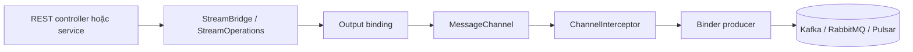

# Áp dụng ChannelInterceptor và kiểm thử qua StreamOperations

`StreamBridge` cho phép một thành phần ứng dụng không phải `Supplier` hoặc `Function` gửi dữ liệu tới output binding của Spring Cloud Stream. Ví dụ, REST controller, service xử lý nghiệp vụ hoặc một listener từ hệ thống bên ngoài có thể gửi sự kiện tới Kafka, RabbitMQ hoặc Pulsar thông qua cùng cơ chế binding và binder mà ứng dụng đang sử dụng.

Trong một số trường hợp, trước khi message được gửi tới binder, ứng dụng cần bổ sung metadata, chuẩn hóa header, ghi nhận thông tin kỹ thuật hoặc từ chối message không hợp lệ. **`ChannelInterceptor`** cung cấp các điểm móc trước và sau thao tác gửi trên `MessageChannel`. Với `StreamBridge`, có thể đăng ký interceptor toàn cục hoặc giới hạn interceptor theo tên binding. Để kiểm thử thành phần gửi mà không phụ thuộc trực tiếp vào `StreamBridge`, ứng dụng có thể inject interface **`StreamOperations`** và mock interface này trong unit test.

## 1. StreamBridge gửi qua MessageChannel

`StreamBridge` là cầu nối giữa nguồn dữ liệu bên ngoài mô hình hàm và output binding. Thành phần ứng dụng gọi `send(...)`, framework chuyển dữ liệu thành message, tìm hoặc tạo output binding, rồi gửi message qua channel gắn với binding đó. Binder tiếp nhận message và chuyển nó tới destination tương ứng trên broker.



Channel interceptor chạy tại ranh giới channel trong ứng dụng. Nó có thể kiểm tra hoặc biến đổi message trước khi message được chuyển tiếp tới handler của binder. Interceptor không phải consumer, không thay thế serializer và không trực tiếp quản lý transaction hoặc xác nhận giao nhận của broker.

Ví dụ, một dịch vụ phát sự kiện đơn hàng:

```java
import org.springframework.cloud.stream.function.StreamBridge;
import org.springframework.stereotype.Service;

@Service
class OrderEventPublisherWithStreamBridge {

    private final StreamBridge streamBridge;

    OrderEventPublisherWithStreamBridge(StreamBridge streamBridge) {
        this.streamBridge = streamBridge;
    }

    boolean publish(OrderCreated event) {
        return streamBridge.send("orderEvents-out-0", event);
    }
}
```

`orderEvents-out-0` là tên output binding được truyền vào `send`. Nếu binding chưa tồn tại, `StreamBridge` có thể tạo binding động ở lần gửi đầu tiên và tái sử dụng binding đó ở các lần sau. Nếu muốn tạo binding ngay khi ứng dụng khởi động, có thể khai báo `spring.cloud.stream.output-bindings`.

```yaml
spring:
  cloud:
    stream:
      output-bindings: orderEvents-out-0
      bindings:
        orderEvents-out-0:
          destination: orders.events
          content-type: application/json
```

Trong ví dụ này, message được gửi tới destination `orders.events`. `StreamBridge` cũng có thể nhận một đối tượng Java hoặc một `Message<?>`; việc chuyển đổi kiểu dữ liệu và các thuộc tính producer của binding vẫn được áp dụng theo cấu hình Spring Cloud Stream.

## 2. ChannelInterceptor và vòng đời gửi message

`ChannelInterceptor` thuộc Spring Messaging. Với output channel, các callback quan trọng là:

| Callback | Thời điểm gọi | Công dụng |
|---|---|---|
| `preSend` | Trước khi channel chuyển message tới subscriber/handler. | Kiểm tra, bổ sung header, thay message hoặc từ chối gửi. |
| `postSend` | Sau thao tác gửi, nhận thêm cờ `sent`. | Ghi nhận kết quả gửi ở mức channel. |
| `afterSendCompletion` | Sau khi thao tác gửi kết thúc, kể cả khi có exception. | Dọn tài nguyên hoặc ghi nhận kết thúc xử lý. |

Các callback `preReceive`, `postReceive` và `afterReceiveCompletion` phục vụ channel có thao tác nhận/poll. Khi dùng interceptor cho `StreamBridge` output, thường tập trung vào nhóm callback gửi.

Chữ ký `preSend`:

```java
Message<?> preSend(Message<?> message, MessageChannel channel)
```

- Trả về message ban đầu nếu không cần thay đổi.
- Trả về message mới nếu cần bổ sung hoặc thay đổi payload/header.
- Trả về `null` để ngăn message tiếp tục đi qua channel.
- Ném exception nếu lỗi cần làm thao tác gửi thất bại theo chính sách ứng dụng.

Message trong Spring Messaging là bất biến ở cấp cấu trúc. Khi cần thay đổi header, nên tạo message mới bằng `MessageBuilder` thay vì cố sửa trực tiếp map headers của message ban đầu.

## 3. Đăng ký interceptor cho StreamBridge

Spring Cloud Stream không tự động đưa mọi bean `ChannelInterceptor` vào các channel do `StreamBridge` sử dụng. Để interceptor được áp dụng trên các channel này, hãy đăng ký bean với annotation `@GlobalChannelInterceptor` và chỉ định pattern phù hợp.

Annotation nằm trong package `org.springframework.integration.config`; interface `ChannelInterceptor` nằm trong `org.springframework.messaging.support`.

```java
import org.springframework.context.annotation.Bean;
import org.springframework.context.annotation.Configuration;
import org.springframework.integration.config.GlobalChannelInterceptor;
import org.springframework.messaging.support.ChannelInterceptor;

@Configuration
class StreamBridgeInterceptorConfiguration {

    @Bean
    @GlobalChannelInterceptor(patterns = "orderEvents-out-0")
    ChannelInterceptor orderEventsInterceptor() {
        return new CorrelationIdChannelInterceptor();
    }
}
```

`patterns` xác định tên channel được áp dụng interceptor. Có thể dùng wildcard để bao phủ một nhóm binding:

```java
@Bean
@GlobalChannelInterceptor(patterns = "orders-*")
ChannelInterceptor ordersInterceptor() {
    return new CorrelationIdChannelInterceptor();
}
```

Nếu cần áp dụng cho mọi channel được quản lý theo cơ chế global interceptor, có thể dùng `patterns = "*"`. Phạm vi toàn cục rộng hơn thường cần thiết; nên ưu tiên pattern cụ thể để tránh vô tình can thiệp vào những luồng không thuộc trách nhiệm của interceptor.

Pattern được so khớp với tên channel/binding mà `StreamBridge` sử dụng. Vì vậy, hãy đối chiếu tên được truyền vào `streamBridge.send(...)` với pattern đã khai báo. Không mặc định tên destination trên broker luôn là tên channel cần so khớp.

## 4. Ví dụ bổ sung correlationId trước khi gửi

Một interceptor có thể bảo đảm message luôn có `correlationId`, giúp nối log và trace giữa API tiếp nhận yêu cầu, producer và các dịch vụ nhận sự kiện.

```java
import java.util.UUID;

import org.springframework.messaging.Message;
import org.springframework.messaging.MessageChannel;
import org.springframework.messaging.support.ChannelInterceptor;
import org.springframework.messaging.support.MessageBuilder;

class CorrelationIdChannelInterceptor implements ChannelInterceptor {

    @Override
    public Message<?> preSend(Message<?> message, MessageChannel channel) {
        Object existingId = message.getHeaders().get("correlationId");
        if (existingId != null && !existingId.toString().isBlank()) {
            return message;
        }

        return MessageBuilder.fromMessage(message)
            .setHeader("correlationId", UUID.randomUUID().toString())
            .build();
    }
}
```

Interceptor giữ nguyên `correlationId` do caller cung cấp nếu giá trị đó đã có. Nếu thiếu, nó tạo một mã mới và gắn vào message đầu ra. `MessageBuilder.fromMessage(...)` giữ payload và các header hiện có, sau đó tạo message mới với header bổ sung.

Nếu một request có correlation ID từ hệ thống gọi tới, nên truyền ID đó xuyên suốt luồng thay vì tạo ID mới tại mọi dịch vụ. Interceptor chỉ nên tạo ID khi không có giá trị phù hợp; việc ghi đè ID hiện có sẽ làm đứt liên kết trace.

## 5. Các công việc phù hợp và không phù hợp với interceptor

Interceptor phù hợp với xử lý kỹ thuật ngắn, đồng bộ và có tính xuyên suốt:

- Bổ sung `correlationId`, `source` hoặc header kỹ thuật còn thiếu.
- Chuẩn hóa tên hoặc định dạng header.
- Kiểm tra metadata bắt buộc trước khi gửi.
- Ghi metric về số message đi qua channel hoặc kết quả gửi.
- Tạo log ngắn gọn phục vụ truy vết mà không ghi dữ liệu nhạy cảm.

Không nên biến interceptor thành nơi thực hiện nghiệp vụ chính. Ví dụ, không nên gọi dịch vụ thanh toán, truy vấn nhiều bảng database, gửi email hoặc chờ một API từ xa trong `preSend`. Các thao tác chậm có thể giữ thread gửi message, làm tăng độ trễ và giảm throughput.

Nếu cần kiểm tra điều kiện nghiệp vụ như “đơn hàng có thể hủy hay không”, hãy xử lý trong service hoặc function trước khi gọi `StreamOperations`. Interceptor nên tập trung vào metadata và quy tắc kỹ thuật áp dụng nhất quán cho message.

### Từ chối message trong preSend

Một interceptor có thể từ chối message bằng cách trả về `null`:

```java
class RequiredHeaderInterceptor implements ChannelInterceptor {

    @Override
    public Message<?> preSend(Message<?> message, MessageChannel channel) {
        Object tenantId = message.getHeaders().get("tenantId");
        if (tenantId == null || tenantId.toString().isBlank()) {
            return null;
        }
        return message;
    }
}
```

Khi `preSend` trả về `null`, message bị chặn tại channel và không được chuyển tiếp tới binder. Đây là hành vi từ chối ở tầng gửi; ứng dụng phải ghi nhận hoặc trả kết quả phù hợp cho caller. Không nên âm thầm loại message mà không có log, metric hoặc thông tin lỗi đủ để điều tra.

Nếu muốn caller nhận lỗi rõ ràng, có thể ném một exception chuyên biệt trong interceptor hoặc kiểm tra điều kiện trước khi gọi `StreamOperations`. Cần thống nhất cách xử lý để tránh cùng một lỗi bị ghi nhận hai lần ở nhiều tầng.

## 6. postSend và afterSendCompletion

`postSend` được gọi sau khi channel thực hiện thao tác gửi và nhận tham số `sent`:

```java
@Override
public void postSend(
        Message<?> message,
        MessageChannel channel,
        boolean sent) {
    if (sent) {
        // Ghi metric hoặc log ở mức channel đã nhận thao tác gửi.
    }
}
```

`afterSendCompletion` có thể được dùng để ghi nhận kết thúc xử lý và exception:

```java
@Override
public void afterSendCompletion(
        Message<?> message,
        MessageChannel channel,
        boolean sent,
        Exception ex) {
    if (ex != null) {
        // Ghi nhận lỗi gửi theo correlationId.
    }
}
```

Không diễn giải `sent = true` như bằng chứng consumer cuối cùng đã xử lý message. Nó phản ánh kết quả thao tác gửi qua channel trong ứng dụng. Mức bảo đảm lưu bền vững, publisher confirm, ACK hoặc xử lý nghiệp vụ hoàn tất còn phụ thuộc binder, broker và consumer.

Tương tự, giá trị boolean trả về từ `StreamOperations.send(...)` giúp caller biết thao tác gửi có thành công ở mức API/channel hay không. Nó không chứng minh message đã được tất cả consumer nhận, cũng không chứng minh dữ liệu nghiệp vụ ở hệ thống đích đã commit.

## 7. Dùng StreamOperations thay cho StreamBridge cụ thể

`StreamOperations` là interface định nghĩa các thao tác `send` của `StreamBridge`. `StreamBridge` triển khai interface này. Ứng dụng có thể inject `StreamOperations` để giảm phụ thuộc vào class cụ thể và dễ mock khi unit test.

```java
import org.springframework.cloud.stream.function.StreamOperations;
import org.springframework.stereotype.Service;

@Service
class OrderEventPublisher {

    private static final String OUTPUT_BINDING = "orderEvents-out-0";

    private final StreamOperations streamOperations;

    OrderEventPublisher(StreamOperations streamOperations) {
        this.streamOperations = streamOperations;
    }

    boolean publish(OrderCreated event) {
        return streamOperations.send(OUTPUT_BINDING, event);
    }
}
```

Interface có các overload `send` để gửi dữ liệu tới binding, bao gồm:

```java
boolean send(String bindingName, Object data);
boolean send(String bindingName, Object data, MimeType outputContentType);
```

Một số overload còn nhận tên binder khi ứng dụng có nhiều binder. Chọn overload phù hợp với nhu cầu; với ứng dụng dùng một binder mặc định và content type đã khai báo ở binding, `send(bindingName, data)` thường là đủ.

Ví dụ, nếu cần đặt content type riêng cho lần gửi:

```java
import org.springframework.util.MimeTypeUtils;

streamOperations.send(
    "orderEvents-out-0",
    event,
    MimeTypeUtils.APPLICATION_JSON
);
```

Khi gửi một `Message<?>`, content type trong message có thể được dùng theo cơ chế content type negotiation của Spring Cloud Stream. Cần bảo đảm metadata mô tả đúng payload và converter tương ứng đã được cấu hình.

## 8. Cấu hình output binding cho StreamBridge

Nếu ứng dụng biết trước tên binding, nên khai báo output binding tường minh để binding được tạo khi khởi động:

```yaml
spring:
  cloud:
    stream:
      output-bindings: orderEvents-out-0
      bindings:
        orderEvents-out-0:
          destination: orders.events
          content-type: application/json
```

Nếu không khai báo `output-bindings`, `StreamBridge` vẫn có thể tạo binding động ở lần `send` đầu tiên. Binding động hữu ích khi destination chỉ được biết tại runtime, nhưng cần giới hạn và quản lý số lượng destination để tránh cache tăng không kiểm soát. Với destination cố định, khai báo tường minh làm cấu hình dễ kiểm tra hơn.

Nếu ứng dụng có nhiều binder, có thể chỉ định binder cho binding thông qua cấu hình binding. Một số overload `send` nhận thêm tên binder, chủ yếu có ý nghĩa khi tạo binding động. Nếu binding đã được tạo hoặc được khai báo sẵn với binder cụ thể, tham số binder truyền vào `send` không nhất thiết thay đổi binder đã chọn.

## 9. Unit test publisher bằng mock StreamOperations

Unit test của service phát message nên kiểm tra hợp đồng giữa service và `StreamOperations`, không cần khởi động broker. Vì service phụ thuộc interface, có thể mock interface và kiểm tra binding name, payload cũng như kết quả trả về.

```java
import static org.junit.jupiter.api.Assertions.assertTrue;
import static org.mockito.Mockito.verify;
import static org.mockito.Mockito.when;

import org.junit.jupiter.api.Test;
import org.springframework.cloud.stream.function.StreamOperations;

class OrderEventPublisherTest {

    @Test
    void sendsEventToExpectedBinding() {
        StreamOperations operations = org.mockito.Mockito.mock(StreamOperations.class);
        OrderEventPublisher publisher = new OrderEventPublisher(operations);
        OrderCreated event = new OrderCreated("evt-101", "order-9001");

        when(operations.send("orderEvents-out-0", event)).thenReturn(true);

        boolean sent = publisher.publish(event);

        assertTrue(sent);
        verify(operations).send("orderEvents-out-0", event);
    }
}

record OrderCreated(String eventId, String orderId) {}
```

Test này xác minh service gọi đúng binding và truyền đúng đối tượng. Có thể bổ sung trường hợp `send` trả về `false` để bảo đảm caller xử lý tình huống gửi không thành công theo hợp đồng của ứng dụng.

```java
when(operations.send("orderEvents-out-0", event)).thenReturn(false);

boolean sent = publisher.publish(event);

assertFalse(sent);
```

Mock `StreamOperations` không chạy `StreamBridge`, không tạo channel thật và không thực thi interceptor. Đây là unit test cho logic của publisher; cần kiểm thử riêng interceptor và đường đi binding.

## 10. Unit test trực tiếp ChannelInterceptor

Interceptor là thành phần độc lập nên có thể kiểm thử bằng cách gọi `preSend` với một message mẫu. Không cần broker để xác minh header được bổ sung hoặc giữ nguyên.

```java
import static org.junit.jupiter.api.Assertions.assertEquals;
import static org.junit.jupiter.api.Assertions.assertNotNull;

import org.junit.jupiter.api.Test;
import org.springframework.messaging.Message;
import org.springframework.messaging.MessageChannel;
import org.springframework.messaging.support.GenericMessage;
import org.mockito.Mockito;

class CorrelationIdChannelInterceptorTest {

    private final CorrelationIdChannelInterceptor interceptor =
        new CorrelationIdChannelInterceptor();
    private final MessageChannel channel = Mockito.mock(MessageChannel.class);

    @Test
    void addsCorrelationIdWhenMissing() {
        Message<String> input = new GenericMessage<>("order-created");

        Message<?> output = interceptor.preSend(input, channel);

        assertNotNull(output.getHeaders().get("correlationId"));
        assertEquals("order-created", output.getPayload());
    }

    @Test
    void preservesExistingCorrelationId() {
        Message<String> input = new GenericMessage<>(
            "order-created",
            java.util.Map.of("correlationId", "request-42")
        );

        Message<?> output = interceptor.preSend(input, channel);

        assertEquals("request-42", output.getHeaders().get("correlationId"));
    }
}
```

Các test này kiểm tra logic của interceptor mà không cần tạo application context. Có thể bổ sung test cho trường hợp message bị từ chối, header không hợp lệ hoặc interceptor phải giữ nguyên payload và các metadata khác.

## 11. Kiểm thử đường đi StreamBridge và interceptor bằng Test Binder

Để xác minh interceptor thực sự được gắn vào channel mà `StreamBridge` sử dụng, hãy dùng Spring Cloud Stream Test Binder. Test Binder tạo broker giả lập trong JVM, cho phép gửi message và nhận kết quả qua `OutputDestination` mà không cần cài Kafka, RabbitMQ hoặc Pulsar.

Thêm dependency kiểm thử:

```xml
<dependency>
    <groupId>org.springframework.cloud</groupId>
    <artifactId>spring-cloud-stream-test-binder</artifactId>
    <scope>test</scope>
</dependency>
```

Ví dụ kiểm thử tích hợp rút gọn:

```java
import static org.junit.jupiter.api.Assertions.assertNotNull;
import static org.junit.jupiter.api.Assertions.assertTrue;

import org.junit.jupiter.api.Test;
import org.springframework.beans.factory.annotation.Autowired;
import org.springframework.boot.test.context.SpringBootTest;
import org.springframework.cloud.stream.binder.test.EnableTestBinder;
import org.springframework.cloud.stream.function.StreamOperations;
import org.springframework.cloud.stream.binder.test.OutputDestination;
import org.springframework.messaging.Message;

@SpringBootTest(properties =
    "spring.cloud.stream.output-bindings=orderEvents-out-0")
@EnableTestBinder
class StreamBridgeInterceptorIntegrationTest {

    @Autowired
    StreamOperations streamOperations;

    @Autowired
    OutputDestination outputDestination;

    @Test
    void interceptorAddsCorrelationIdToStreamBridgeMessage() {
        OrderCreated event = new OrderCreated("evt-102", "order-9002");

        assertTrue(streamOperations.send("orderEvents-out-0", event));

        Message<byte[]> received = outputDestination.receive(
            1000,
            "orderEvents-out-0"
        );

        assertNotNull(received);
        assertNotNull(received.getHeaders().get("correlationId"));
    }
}
```

Test configuration cần import bean `StreamBridgeInterceptorConfiguration` và cấu hình binding phù hợp với ứng dụng đang kiểm thử. Nếu dùng `@SpringBootTest` trên chính application class đã có interceptor bean, không cần khai báo lại bean đó. Cần bảo đảm pattern của `@GlobalChannelInterceptor` khớp đúng tên output binding.

Test Binder xác minh luồng channel/binding và interceptor trong JVM. Nó không thay thế kiểm thử với broker thật cho các hành vi như publisher confirm, Kafka partition, RabbitMQ exchange/queue, Pulsar subscription, native header mapping hoặc serialization đặc thù của binder.

## 12. Phân biệt ba lớp kiểm thử

| Lớp kiểm thử | Công cụ | Xác minh |
|---|---|---|
| Unit test publisher | Mock `StreamOperations` | Service gọi đúng binding, truyền đúng payload và xử lý kết quả boolean. |
| Unit test interceptor | Gọi `preSend` với message mẫu | Header được thêm/giữ, message được biến đổi hoặc bị từ chối đúng quy tắc. |
| Test Binder integration | `@EnableTestBinder`, `OutputDestination` | `StreamBridge` gửi qua binding và interceptor thực sự được áp dụng trên channel. |
| Broker integration test | Kafka/RabbitMQ/Pulsar binder thật | Header mapping, serialization, routing, xác nhận publish và đặc tính riêng của broker. |

Ba lớp đầu có thể chạy nhanh trong pipeline CI. Kiểm thử broker thật nên chạy ở một giai đoạn tích hợp riêng vì cần hạ tầng và xác minh các bảo đảm không thể mô phỏng bằng channel trong JVM.

## 13. Thứ tự interceptor và xử lý lỗi

Khi có nhiều interceptor, thứ tự chạy có thể ảnh hưởng kết quả. `@GlobalChannelInterceptor` hỗ trợ thuộc tính `order` để xác định thứ tự áp dụng. Nên đặt thứ tự rõ ràng khi một interceptor bổ sung header mà interceptor khác phụ thuộc vào header đó.

Ví dụ, interceptor thứ nhất tạo `correlationId`, interceptor thứ hai ghi metric dựa trên ID đó. Hãy bảo đảm interceptor tạo ID chạy trước interceptor ghi metric. Không nên dựa vào thứ tự đăng ký bean ngẫu nhiên.

Nếu `preSend` ném exception, thao tác gửi có thể thất bại và exception truyền về caller tùy đường gọi. Nếu `postSend` hoặc `afterSendCompletion` gặp lỗi, cần tránh làm che mất exception gốc hoặc tạo tác dụng phụ lặp. Các callback phục vụ quan sát nên xử lý lỗi cục bộ một cách thận trọng và không làm gián đoạn đường gửi nếu nghiệp vụ không yêu cầu.

Không gọi `StreamOperations.send(...)` đệ quy từ interceptor của chính output binding đó. Việc này có thể tạo vòng lặp gửi vô hạn hoặc gọi lại interceptor liên tục. Nếu cần phát một sự kiện phụ, hãy thực hiện từ service riêng và thiết kế luồng độc lập.

## 14. Những lỗi thường gặp

1. **Khai báo `ChannelInterceptor` nhưng không có `@GlobalChannelInterceptor`.** Interceptor có thể không được áp dụng trên channel do `StreamBridge` sử dụng.
2. **Pattern không khớp binding name.** Kiểm tra tên được truyền vào `send(...)`, ví dụ `orderEvents-out-0`, thay vì chỉ nhìn destination `orders.events`.
3. **Dùng pattern `*` quá rộng.** Interceptor có thể tác động lên nhiều channel không liên quan; ưu tiên pattern cụ thể.
4. **Cho rằng mock `StreamOperations` kiểm thử interceptor.** Mock chỉ kiểm tra lời gọi interface; dùng Test Binder để xác minh channel pipeline.
5. **Coi `send() == true` là broker đã lưu bền vững.** Kết quả này không chứng minh consumer đã xử lý; cần xác nhận theo binder/broker nếu nghiệp vụ cần bảo đảm cao hơn.
6. **Thực hiện I/O chậm trong `preSend`.** Điều này giữ thread gửi và có thể làm giảm throughput.
7. **Sao chép header không chọn lọc.** Khi thay đổi payload, kiểm tra `contentType`, correlation ID và metadata còn hợp lệ.
8. **Bỏ qua kết quả `send() == false`.** Caller cần có chiến lược báo lỗi, thử lại hoặc lưu yêu cầu để phục hồi.
9. **Không kiểm thử binder thật.** Test Binder không mô phỏng hết xác nhận, routing, partition và native header mapping của broker.

## 15. Quy trình áp dụng trong ứng dụng

Khi thêm interceptor vào một luồng `StreamBridge`, có thể thực hiện theo trình tự:

1. Xác định binding name mà service truyền vào `StreamOperations.send(...)`.
2. Khai báo output binding và destination; nếu biết trước, tạo binding lúc khởi động bằng `spring.cloud.stream.output-bindings`.
3. Xác định metadata cần bổ sung hoặc kiểm tra, chẳng hạn `correlationId`, `source` hay `tenantId`.
4. Viết `ChannelInterceptor` với xử lý ngắn gọn trong `preSend`; chỉ từ chối message khi có quy tắc rõ ràng.
5. Đăng ký interceptor bằng `@GlobalChannelInterceptor` với pattern giới hạn theo binding.
6. Inject `StreamOperations` vào publisher để tách service khỏi implementation cụ thể.
7. Viết unit test publisher bằng mock `StreamOperations` và unit test riêng cho interceptor.
8. Viết Test Binder integration test để xác minh message từ `StreamBridge` đi qua interceptor.
9. Chạy kiểm thử với binder/broker thật khi cần xác minh serialization, header mapping và xác nhận publish.
10. Theo dõi lỗi gửi, số message bị chặn, metric interceptor và correlation ID trong log/trace.

`ChannelInterceptor` giúp áp dụng các quy tắc kỹ thuật nhất quán ngay tại ranh giới channel, còn `StreamOperations` tạo hợp đồng gửi dễ thay thế và kiểm thử. Kết hợp unit test với Test Binder giúp xác minh cả logic publisher lẫn đường đi thực tế của message qua `StreamBridge`; kiểm thử broker thật bổ sung các bảo đảm phụ thuộc Kafka, RabbitMQ hoặc Pulsar.

## Tài liệu tham khảo

- [Spring Cloud Stream – Producing and Consuming Messages: StreamBridge, Channel Interceptors và StreamOperations](https://docs.spring.io/spring-cloud-stream/reference/spring-cloud-stream/producing-and-consuming-messages.html)
- [Spring Cloud Stream – Testing với Spring Integration Test Binder](https://docs.spring.io/spring-cloud-stream/reference/spring-cloud-stream/spring_integration_test_binder.html)
- [Spring Integration – GlobalChannelInterceptor API](https://docs.spring.io/spring-integration/docs/current/api/org/springframework/integration/config/GlobalChannelInterceptor.html)
