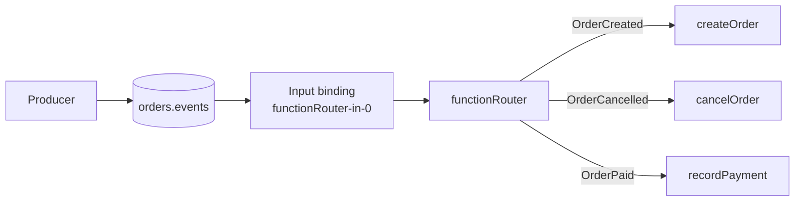

# Định tuyến đến hàm bằng functionRouter và biểu thức định tuyến

Trong một ứng dụng Spring Cloud Stream, một input binding thường được nối với một hàm đã chọn khi ứng dụng khởi động. Nhưng có những luồng sự kiện mà cùng một destination chứa nhiều loại message và mỗi loại cần một hàm xử lý khác nhau. Ví dụ, topic `orders.events` có thể chứa `OrderCreated`, `OrderCancelled` và `OrderPaid`. Nếu mọi message đều đi qua cùng một handler lớn, logic phân nhánh sẽ nhanh chóng phức tạp.

Spring Cloud Function cung cấp cơ chế **function routing** với hàm đặc biệt `functionRouter`. Router nhận message, xác định hàm đích dựa trên metadata hoặc biểu thức định tuyến, rồi chuyển message đến hàm tương ứng trong Function Catalog. Cơ chế này cho phép một input binding chọn hàm xử lý theo từng message mà không cần viết một khối `switch` lớn trong handler.

Bài này trình bày cách bật `functionRouter`, chọn hàm bằng header `spring.cloud.function.definition`, dùng biểu thức SpEL qua `spring.cloud.function.routing-expression`, kết hợp với function composition, và kiểm soát an toàn khi định tuyến động trong hệ thống xử lý sự kiện.

## 1. Định tuyến ở tầng ứng dụng là gì?

Định tuyến có thể xảy ra ở nhiều tầng của hệ thống:

- **Broker routing:** broker quyết định message được đưa tới topic, partition, exchange, queue hoặc subscription nào.
- **Binding:** Spring Cloud Stream nối một input/output target với destination và consumer group.
- **Function routing:** sau khi message đến ứng dụng, router chọn bean function nào trong ứng dụng sẽ xử lý message đó.

`functionRouter` thực hiện tầng thứ ba. Nó không thay đổi topic, partition, queue, routing key hay consumer group trên broker. Nó chỉ chọn hàm đích trong ứng dụng đã nhận message.

Ví dụ, một topic Kafka `orders.events` có một binding và một consumer group. Các message được binding nhận vào. Sau đó:

- `OrderCreated` được chuyển đến hàm `createOrder`.
- `OrderCancelled` được chuyển đến hàm `cancelOrder`.
- `OrderPaid` được chuyển đến hàm `recordPayment`.

Sơ đồ:



Một ứng dụng có thể gom các handler liên quan trong cùng một deployable unit, dùng chung cấu hình và tài nguyên. Nếu mỗi loại sự kiện cần quyền truy cập, scaling, SLA hoặc vòng đời độc lập, nên cân nhắc tách thành destination hoặc dịch vụ riêng thay vì dồn mọi thứ vào một router.

## 2. functionRouter và Function Catalog

Spring Cloud Function quản lý các bean `Supplier`, `Function` và `Consumer` thông qua Function Catalog. Mỗi bean có tên được đăng ký trong catalog; router dùng tên đó để tìm hàm đích.

Để sử dụng routing function, bật thuộc tính:

```yaml
spring:
  cloud:
    function:
      routing:
        enabled: true
      definition: functionRouter
```

Trong Spring Cloud Stream, khi dùng router làm đầu vào của một luồng, khai báo binding tương ứng:

```yaml
spring:
  cloud:
    function:
      routing:
        enabled: true
      definition: functionRouter
    stream:
      bindings:
        functionRouter-in-0:
          destination: orders.events
          group: order-router
          content-type: application/json
```

`functionRouter` là tên hàm định tuyến đặc biệt được Spring Cloud Function cung cấp khi routing được bật. `functionRouter-in-0` là input binding theo quy ước tên hàm. Destination và group vẫn là cấu hình core của Spring Cloud Stream.

Các hàm đích vẫn được khai báo như bean thông thường:

```java
public record OrderEvent(
        String eventId,
        String orderId
) {}

@Configuration
public class OrderHandlers {

    @Bean
    Consumer<OrderEvent> createOrder(OrderService service) {
        return event -> service.create(event.orderId(), event.eventId());
    }

    @Bean
    Consumer<OrderEvent> cancelOrder(OrderService service) {
        return event -> service.cancel(event.orderId(), event.eventId());
    }

    @Bean
    Consumer<OrderEvent> recordPayment(PaymentService service) {
        return event -> service.recordOrderPayment(event.orderId(), event.eventId());
    }

    @Bean
    Consumer<OrderEvent> handleUnknown(InvalidEventHandler handler) {
        return handler::handle;
    }
}
```

Trong ví dụ, các consumer có cùng kiểu payload để đơn giản hóa chuyển đổi. Trong hệ thống thực tế, các loại message có thể có payload khác nhau; cần xác định content type, schema và cơ chế chuyển đổi tương ứng để hàm đích nhận đúng kiểu.

Router chỉ có thể gọi hàm đã được đăng ký trong Function Catalog. Tên bean phải rõ ràng và duy nhất trong phạm vi catalog. Nếu ứng dụng có nhiều hàm cùng tên do cấu hình hoặc composition, hãy kiểm tra kết quả đăng ký và tên definition mà router nhìn thấy.

Vì router nhận một message làm đầu vào, các đích phù hợp là `Consumer` hoặc `Function` có input tương thích. `Supplier` không phải đích xử lý trực tiếp cho message đã nhận vì nó không có input; Supplier thường tạo dữ liệu theo cơ chế riêng của nó.

## 3. Chọn hàm bằng header spring.cloud.function.definition

Một cách định tuyến trực tiếp là đặt header `spring.cloud.function.definition` trên message. Giá trị header là tên function hoặc definition mà router cần gọi.

Lưu ý hai vị trí có cùng tên nhưng khác vai trò: application property `spring.cloud.function.definition` trong cấu hình khởi động chọn `functionRouter` làm hàm được bind; message header `spring.cloud.function.definition` chọn handler cho chính message đó. Trong ví dụ, cấu hình ứng dụng chọn router, còn header của message chọn `createOrder`.

Ví dụ producer tạo message:

```java
Message<OrderEvent> message = MessageBuilder
        .withPayload(new OrderEvent("evt-1001", "order-42"))
        .setHeader("spring.cloud.function.definition", "createOrder")
        .build();

streamBridge.send("orders-out-0", message);
```

Message được phát tới destination mà output binding `orders-out-0` cấu hình. Khi message đến input binding của router, header cho biết hàm đích là `createOrder`.

Nếu producer khác muốn gọi handler hủy đơn, nó có thể đặt definition là `cancelOrder`. Header này là metadata điều khiển routing ở tầng ứng dụng, không phải routing key của RabbitMQ hay key phân vùng Kafka.

### Cấu hình binding đầu vào và đầu ra

Ví dụ cấu hình hai binding:

```yaml
spring:
  cloud:
    function:
      routing:
        enabled: true
      definition: functionRouter
    stream:
      bindings:
        functionRouter-in-0:
          destination: orders.events
          group: order-router
        orders-out-0:
          destination: orders.events
          content-type: application/json
```

Producer có thể dùng `StreamBridge` để gửi message vào destination và gắn header routing. Trong hệ thống nhiều producer, cần thống nhất tên hàm được phép gọi và quy tắc header giữa các bên.

Header phải được bảo toàn qua broker. Kafka binder có thể ánh xạ message headers sang Kafka headers; Rabbit binder ánh xạ sang message properties/headers; Pulsar binder dùng message properties hoặc metadata tương ứng. Khả năng truyền kiểu dữ liệu và tên header phụ thuộc binder, header mapper và cấu hình. Hãy xác minh header thực sự đến router bằng integration test.

### Khi nào nên dùng header definition?

Dùng header khi nguồn phát đã biết rõ loại xử lý cần gọi hoặc một gateway đáng tin cậy đã xác định route. Ví dụ, API gateway phân loại request và gắn definition tương ứng trước khi phát event.

Không nên để mọi producer bên ngoài tự do gửi tên bean tùy ý. Header có thể bị giả mạo hoặc bị cấu hình sai; nếu router cho phép gọi mọi bean trong catalog, một producer không đáng tin có thể kích hoạt logic nội bộ ngoài dự kiến. Hãy giới hạn danh sách route được phép và chỉ tin header từ nguồn đã xác thực.

## 4. Định tuyến bằng biểu thức SpEL

Khi không muốn producer phải biết tên function, ứng dụng có thể tự quyết định route dựa trên payload hoặc header. Spring Cloud Function hỗ trợ biểu thức định tuyến SpEL qua thuộc tính `spring.cloud.function.routing-expression`.

Ví dụ phân loại theo header `eventType`:

```yaml
spring:
  cloud:
    function:
      routing:
        enabled: true
      definition: functionRouter
      routing-expression: "headers['eventType'] == 'OrderCreated' ? 'createOrder' : headers['eventType'] == 'OrderCancelled' ? 'cancelOrder' : headers['eventType'] == 'OrderPaid' ? 'recordPayment' : 'handleUnknown'"
    stream:
      bindings:
        functionRouter-in-0:
          destination: orders.events
          group: order-router
```

Biểu thức nhận message trong evaluation context. Có thể tham chiếu header qua `headers['eventType']` và payload qua `payload`. Kết quả biểu thức là tên function definition mà router sẽ sử dụng.

Một ví dụ khác: định tuyến đơn hàng theo mức ưu tiên:

```yaml
spring:
  cloud:
    function:
      routing:
        enabled: true
      definition: functionRouter
      routing-expression: "headers['priority'] == 'HIGH' ? 'processUrgentOrder' : 'processStandardOrder'"
```

Ở đây hai hàm đích có thể dùng chung kiểu payload nhưng áp dụng chính sách xử lý khác nhau. Nếu định tuyến theo field trong payload, có thể dùng biểu thức như `payload.orderType == 'RETURN' ? 'processReturn' : 'processSale'`, miễn là payload đã được chuyển đổi thành kiểu mà expression có thể truy cập.

### Dùng biểu thức trong header

Spring Cloud Function cũng hỗ trợ header routing-expression để message mang biểu thức định tuyến. Ví dụ tên header là `spring.cloud.function.routing-expression`. Cách này cho phép nguồn phát chỉ định biểu thức cùng message.

Tuy nhiên, đây là một bề mặt điều khiển mạnh: producer có thể ảnh hưởng cách router chọn function. Trong hệ thống production, thường nên giữ expression trong cấu hình ứng dụng và chỉ để message cung cấp dữ liệu đầu vào như `eventType`, `priority` hoặc `tenant`. Tránh thực thi biểu thức SpEL tùy ý do nguồn không tin cậy gửi lên.

Không gửi đồng thời nhiều nguồn route khác nhau nếu không có quy tắc ưu tiên rõ ràng. Khi ứng dụng sử dụng cả header definition, header routing-expression và application-level routing-expression, hãy xác minh thứ tự ưu tiên theo phiên bản Spring Cloud Function đang dùng bằng test thay vì dựa vào giả định.

## 5. Xây dựng biểu thức định tuyến rõ ràng

Một expression nên ngắn, xác định và trả về một trong những function definition đã được cho phép. Không nên biến biểu thức thành nơi chứa toàn bộ logic nghiệp vụ.

Ví dụ, thay vì lồng nhiều điều kiện:

```yaml
spring:
  cloud:
    function:
      routing-expression: "headers['eventType'] == 'A' ? 'handleA' : headers['eventType'] == 'B' ? 'handleB' : headers['eventType'] == 'C' ? 'handleC' : 'handleUnknown'"
```

có thể chuẩn hóa header ở gateway hoặc tạo một route key rõ ràng:

```yaml
spring:
  cloud:
    function:
      routing-expression: "headers['route']"
```

Khi đó, gateway có trách nhiệm ánh xạ event type thành một route đã được duyệt. Router chỉ đọc route key và tìm function tương ứng.

Nếu route key có thể thiếu hoặc sai, cần có chính sách cho trường hợp không xác định. Một lựa chọn là định tuyến đến handler chuyên xử lý message không hỗ trợ; lựa chọn khác là ném lỗi có chủ đích để đưa message vào error flow/DLQ. Không nên âm thầm gửi mọi message không hợp lệ vào một handler nghiệp vụ mặc định vì có thể làm sai dữ liệu.

### Xác thực dữ liệu trước khi định tuyến

Expression có thể tham chiếu payload, nhưng nên xác thực message trước khi dùng các field đó. Ví dụ header `eventType` phải có mặt, thuộc danh sách được hỗ trợ và phù hợp với payload. Nếu event type khai báo `OrderCreated` nhưng payload thiếu `orderId`, việc chọn đúng function vẫn không làm message hợp lệ.

Một lớp kiểm tra đầu vào có thể đảm bảo:

- Header route không rỗng và thuộc allowlist.
- Content type được hỗ trợ.
- Payload có schema/version hợp lệ.
- Tenant hoặc loại nghiệp vụ được phép xử lý.
- Event ID có mặt để phục vụ idempotency và truy vết.

## 6. Kết hợp functionRouter với function composition

Function composition và function routing giải quyết hai câu hỏi khác nhau:

- Composition xác định các hàm nào được nối với nhau theo một chuỗi xử lý.
- Routing chọn chuỗi hoặc hàm nào sẽ nhận một message cụ thể.

Spring Cloud Function biểu diễn composition bằng ký tự phân cách `|`. Ví dụ `validateOrder|enrichOrder|persistOrder` là một definition gồm ba function được nối tuần tự, với kiểu output của bước trước tương thích input của bước sau.

Có thể dùng router để chọn một definition đã composition theo loại message. Ví dụ expression trả về `validateOrder|processNewOrder` hoặc `validateOrder|processCancelledOrder`:

```yaml
spring:
  cloud:
    function:
      routing:
        enabled: true
      definition: functionRouter
      routing-expression: "headers['eventType'] == 'OrderCreated' ? 'validateOrder|processNewOrder' : 'validateOrder|processCancelledOrder'"
```

Chỉ dùng composition khi các hàm trong chuỗi có kiểu input/output tương thích và đều được Function Catalog nhận diện. Hãy kiểm thử riêng từng composition, sau đó mới kiểm thử router chọn đúng definition. Nếu các nhánh có side effect khác nhau, hãy bảo đảm message không bị xử lý qua cả hai nhánh do lỗi routing hoặc retry.

Với nhiều bước nghiệp vụ quan trọng, có thể dễ bảo trì hơn khi đóng gói chuỗi thành một bean function có tên riêng rồi để router chọn bean đó. Cách này làm route expression ngắn và giúp từng pipeline được kiểm thử độc lập.

## 7. Function routing khác broker routing như thế nào?

Đừng nhầm function routing với routing ở broker. Bảng sau cho thấy phạm vi của từng cơ chế:

| Cơ chế | Quyết định điều gì? | Ví dụ |
|---|---|---|
| Kafka partition key | Message được ghi vào partition nào | `orderId` làm key |
| Kafka consumer group | Consumer member nào trong group nhận partition | `order-router` |
| Rabbit exchange routing key | Queue nào nhận bản message | `orders.created` |
| Pulsar topic/subscription | Topic và subscription nào nhận message | `persistent://public/orders/events` |
| Spring Cloud Stream binding | Ứng dụng đọc/ghi destination nào | `functionRouter-in-0` |
| Spring Cloud Function router | Bean function nào xử lý message đã nhận | `createOrder` |

Ví dụ, RabbitMQ exchange có thể route message `orders.created` vào queue `orders.events`. Sau khi Spring Cloud Stream đọc queue, `functionRouter` mới chọn `createOrder` hay `recordAudit`. Routing key quyết định queue; function definition quyết định handler trong ứng dụng.

Tương tự, Kafka key quyết định partition và consumer group assignment. `functionRouter` không thể làm message từ một partition chuyển sang consumer member khác, cũng không tạo consumer group mới.

### Khi nào dùng broker routing?

Dùng broker routing khi cần:

- Cô lập backlog và retention giữa các loại event.
- Scaling hoặc cấp quyền riêng cho từng consumer.
- Nhiều ứng dụng độc lập cùng nhận một loại event.
- Bảo đảm các loại message có policy retry/DLQ khác nhau.
- Tránh đưa message không liên quan vào ứng dụng.

### Khi nào dùng functionRouter?

Dùng functionRouter khi:

- Một ứng dụng nhận nhiều loại message từ cùng input destination.
- Các handler thuộc cùng ranh giới triển khai và có thể dùng chung consumer group.
- Muốn chọn handler dựa trên event type hoặc metadata.
- Muốn tái sử dụng các bean function đã đăng ký trong Function Catalog.
- Cần một điểm vào chung để định tuyến tới nhiều pipeline xử lý nội bộ.

## 8. Lỗi định tuyến và xử lý ngoại lệ

Các lỗi thường gặp:

- Header definition trỏ đến function không tồn tại.
- Expression không hợp lệ hoặc tham chiếu header/payload bị thiếu.
- Route trả về chuỗi rỗng hoặc tên definition không được catalog nhận diện.
- Function đích không tương thích kiểu dữ liệu hoặc không thể chuyển đổi payload.
- Function đích ném exception khi xử lý nghiệp vụ.
- Header routing bị mất khi qua broker hoặc header mapper.
- Message không được xác thực nhưng vẫn được định tuyến vào handler có side effect.

Hãy phân biệt lỗi định tuyến với lỗi trong handler. Nếu router không tìm được function, message chưa đến bước xử lý nghiệp vụ. Nếu handler đã được gọi rồi ném exception, đó là lỗi xử lý của function đích. Log và metrics nên ghi route name để xác định chính xác giai đoạn xảy ra lỗi.

Spring Cloud Stream cung cấp error handling theo binding và binder. Tùy broker, message có thể được retry, chuyển DLQ hoặc xử lý qua error channel. Khi router thất bại, message vẫn thuộc input binding đã nhận nó; retry có thể khiến cùng message được định tuyến lại. Vì vậy, các handler có side effect phải idempotent theo event ID.

Không nên bắt mọi exception rồi trả về kết quả thành công giả. Làm vậy có thể khiến offset được commit hoặc message được ack dù nghiệp vụ chưa hoàn tất. Phân loại lỗi tạm thời và lỗi vĩnh viễn, đặt retry có giới hạn, và lưu message lỗi để điều tra.

## 9. Bảo mật khi định tuyến động

Function routing biến metadata thành quyền chọn hành vi. Vì vậy, route cần được kiểm soát như một API nội bộ.

Các nguyên tắc quan trọng:

1. **Allowlist function:** chỉ cho phép những function được phê duyệt xuất hiện trong route map.
2. **Không tin tên function từ nguồn tùy ý:** chỉ chấp nhận header definition từ producer/gateway đã xác thực.
3. **Giữ SpEL trong cấu hình ứng dụng:** không cho message không tin cậy gửi biểu thức cần thực thi.
4. **Xác thực payload và header:** route không thay thế schema validation hoặc authorization.
5. **Tách tenant:** không để header tenant tùy ý chọn handler có quyền truy cập dữ liệu của tenant khác.
6. **Không log bí mật:** ghi route name và event ID, không ghi token hoặc payload nhạy cảm đầy đủ.

Nếu các handler có quyền khác nhau, việc dùng chung router và một consumer credential có thể làm mờ ranh giới bảo mật. Trong trường hợp đó, tách destination hoặc ứng dụng có quyền riêng có thể an toàn hơn.

## 10. Kiểm thử functionRouter

Kiểm thử cần xác minh cả quyết định chọn function và side effect của function đích.

### Unit test cho biểu thức

Nếu expression dùng một số header cố định, kiểm tra các trường hợp:

- `OrderCreated` trả về `createOrder`.
- `OrderCancelled` trả về `cancelOrder`.
- Header thiếu hoặc giá trị lạ trả về route lỗi hoặc handler fallback được quy định.
- Header priority không hợp lệ không được route vào handler ưu tiên cao.
- Payload null hoặc sai kiểu bị từ chối trước khi xử lý.

Không chỉ kiểm tra nhánh thành công. Các route sai thường là nguyên nhân khiến message đi vào handler không mong muốn.

### Test binder

Dùng Spring Cloud Stream Test Binder để gửi message vào binding `functionRouter-in-0`. Đặt header hoặc payload phù hợp và xác minh function đích được gọi. Có thể dùng mock service hoặc spy bean để xác nhận handler nào đã chạy và handler nào không chạy.

Một test nên gửi hai event khác loại liên tiếp và kiểm tra mỗi event chỉ kích hoạt handler tương ứng. Nếu router trả output từ function đích, kiểm tra output binding và payload đầu ra. Nếu đích là Consumer, kiểm tra side effect hoặc collaborator được gọi.

### Integration test với broker thật

Test Binder không mô phỏng đầy đủ header mapping, partition, queue, subscription hoặc retry của broker. Với Kafka, RabbitMQ và Pulsar, integration test cần xác minh:

- Header route được truyền qua broker và đến input binding.
- `functionRouter` được kích hoạt trong đúng consumer group.
- Route expression chọn đúng function trên message thực.
- Message có header thiếu hoặc không hợp lệ đi vào error flow/DLQ theo thiết kế.
- Retry không tạo side effect trùng.
- Các broker headers được map đúng kiểu dữ liệu và không mất metadata quan trọng.

Dùng event ID riêng cho mỗi test, chờ kết quả bất đồng bộ bằng assertion có timeout, và dọn tài nguyên sau test.

## 11. Quan sát hoạt động định tuyến

Khi vận hành, cần biết message đã được router chuyển đến handler nào. Các trường log/metric hữu ích:

- `eventId` và `eventType`.
- Tên input binding, destination và consumer group.
- Function definition hoặc route key đã chọn.
- Kết quả định tuyến: thành công, không có route, route không hợp lệ.
- Thời gian xử lý và lỗi của function đích.
- Số lần retry, redelivery và số message vào DLQ.

Không tạo metric label có cardinality vô hạn từ route header hoặc event ID. Hãy dùng tập route name hữu hạn đã được allowlist. Event ID phù hợp với log/trace, không phù hợp làm label metric.

Khi một route bị lỗi, log nên giúp phân biệt: expression không đánh giá được, function không tồn tại, conversion thất bại hay handler ném lỗi. Thông tin này giúp xử lý đúng lớp mà không phải suy đoán từ log broker.

## 12. Quy trình thiết kế route

Khi thêm một loại message mới, thực hiện các bước:

1. Xác định message thuộc destination nào và binding nào nhận nó.
2. Xác định route key lấy từ header hay được tính bằng expression.
3. Chọn function đích đã đăng ký trong Function Catalog.
4. Kiểm tra payload type, content type và schema tương thích với function đích.
5. Thêm route vào allowlist và định nghĩa hành vi khi route không xác định.
6. Kiểm tra header mapping qua broker.
7. Kiểm thử function riêng, expression riêng và toàn bộ binding.
8. Cấu hình retry, DLQ và idempotency cho lỗi có thể xảy ra sau khi định tuyến.
9. Theo dõi route name, lỗi định tuyến và hiệu năng từng handler.

`functionRouter` hữu ích khi một ứng dụng cần phân phối message đến nhiều handler nội bộ dựa trên metadata hoặc biểu thức. Header `spring.cloud.function.definition` cho phép chỉ định function definition; `spring.cloud.function.routing-expression` cho phép ứng dụng tính route từ message. Hãy giữ route hữu hạn, kiểm tra schema và quyền trước khi gọi handler, đồng thời phân biệt rõ lựa chọn function trong ứng dụng với định tuyến message ở broker.

## Tài liệu tham khảo

- [Spring Cloud Function — Routing and Filtering](https://docs.spring.io/spring-cloud-function/reference/spring-cloud-function/programming-model.html#_function_routing_and_filtering)
- [Spring Cloud Function — Reference Documentation](https://docs.spring.io/spring-cloud-function/reference/)
- [Spring Cloud Stream — Functional Binding Names](https://docs.spring.io/spring-cloud-stream/reference/spring-cloud-stream/functional-binding-names.html)
- [Spring Cloud Stream — Reference Documentation](https://docs.spring.io/spring-cloud-stream/reference/)

