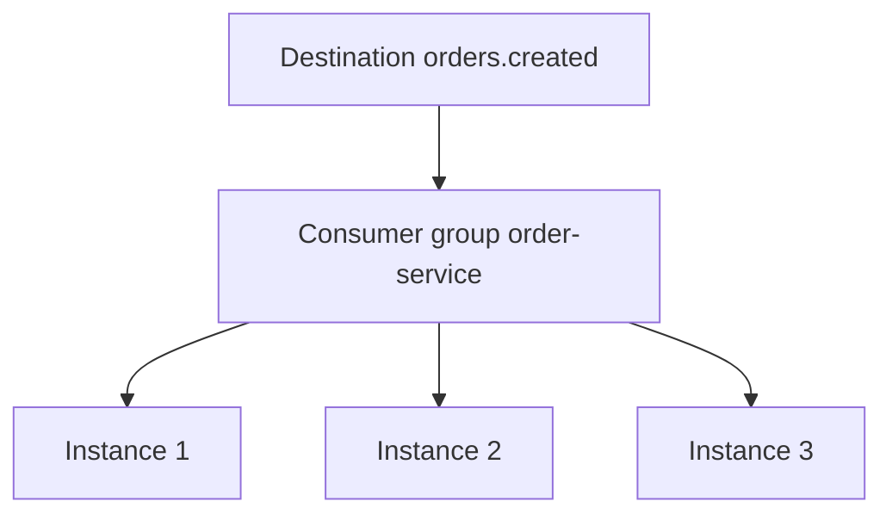
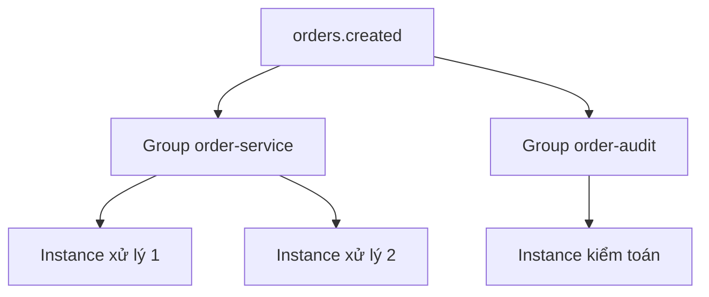
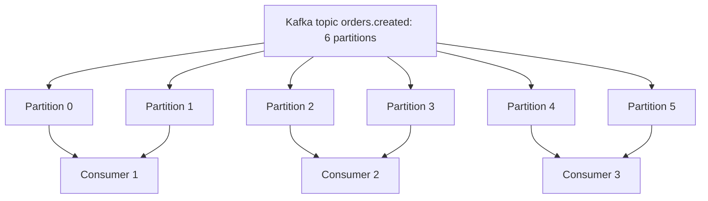
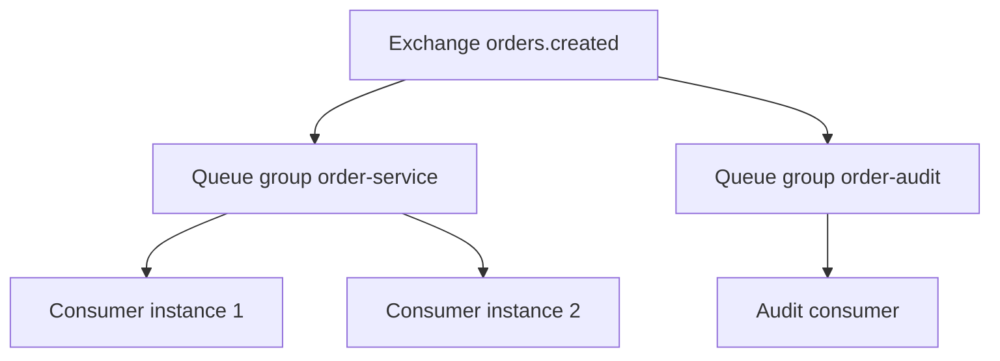

# Consumer group và cơ chế phân phối thông điệp

Trong một ứng dụng Spring Cloud Stream, một binding đầu vào có thể được chạy trên nhiều instance để tăng khả năng xử lý và duy trì tính sẵn sàng. **Consumer group** xác định những consumer nào cùng phối hợp nhận thông điệp từ một destination. Các instance cùng group thường chia sẻ công việc; các group khác nhau thường nhận các bản sao độc lập của luồng sự kiện.

Spring Cloud Stream cung cấp thuộc tính `group` ở cấp binding. Binder chuyển khái niệm chung này thành cơ chế phù hợp với broker: consumer group của Kafka, queue dành cho group trong RabbitMQ hoặc subscription của Pulsar. Vì vậy, cùng một cấu hình ứng dụng có thể giữ được ý nghĩa nghiệp vụ chung, trong khi cách phân phối cụ thể vẫn phụ thuộc broker và binder.

## 1. Consumer group giải quyết vấn đề gì?

Giả sử dịch vụ xử lý đơn hàng nhận sự kiện từ destination `orders.created`. Khi chỉ có một instance, instance đó xử lý toàn bộ sự kiện mà nó nhận được. Khi lưu lượng tăng, có thể chạy nhiều instance của cùng dịch vụ.

Nếu mỗi instance nhận một bản sao độc lập của mọi message, hệ thống có thể xử lý cùng một đơn hàng nhiều lần. Trong phần lớn trường hợp xử lý song song, ta muốn các instance chia nhau message. Consumer group biểu diễn nhóm các consumer cùng thực hiện công việc đó.

Ví dụ có ba instance:



Ba instance có cùng tên group nên binder/broker phối hợp phân phối message cho chúng. Mỗi message được giao cho một consumer trong group theo cơ chế của broker. Nếu cần một dịch vụ khác cũng nhận toàn bộ sự kiện đơn hàng, dịch vụ đó dùng một group khác.

## 2. Khai báo group trong Spring Cloud Stream

Tên group được khai báo tại binding đầu vào thông qua thuộc tính `group`. Ví dụ một hàm xử lý sự kiện:

```java
import java.util.function.Consumer;

import org.springframework.context.annotation.Bean;
import org.springframework.context.annotation.Configuration;

public record OrderCreated(String orderId, String customerId) {}

@Configuration
public class OrderConsumers {

    @Bean
    public Consumer<OrderCreated> processOrder() {
        return event -> {
            System.out.println("Processing order " + event.orderId());
        };
    }
}
```

Cấu hình binding:

```yaml
spring:
  cloud:
    function:
      definition: processOrder
    stream:
      bindings:
        processOrder-in-0:
          destination: orders.created
          group: order-service
          content-type: application/json
```

Trong ví dụ:

- `processOrder` là tên bean hàm được chọn để kích hoạt.
- `processOrder-in-0` là binding đầu vào của hàm.
- `destination` xác định luồng sự kiện mà binding đọc.
- `group: order-service` xác định nhóm consumer phối hợp xử lý luồng đó.
- `content-type` mô tả định dạng payload để framework chuyển đổi thành `OrderCreated`.

Khi chạy nhiều replica của cùng ứng dụng với cùng cấu hình, tất cả cùng tham gia group `order-service`. Nếu cần một dịch vụ khác đọc độc lập cùng destination, dịch vụ đó khai báo một group riêng, ví dụ `order-audit`.

## 3. Cùng group và khác group

Hai cách triển khai thường gặp tạo ra hành vi rất khác nhau:

| Cấu hình | Ý nghĩa | Kết quả mong đợi |
| --- | --- | --- |
| Nhiều instance cùng `destination` và cùng `group` | Các instance là thành viên của một nhóm tiêu thụ | Message được chia cho các thành viên theo cơ chế broker |
| Nhiều instance cùng `destination` nhưng group khác nhau | Mỗi group là một subscriber logic độc lập | Mỗi group có thể nhận toàn bộ luồng sự kiện theo trạng thái tiêu thụ riêng |
| Không khai báo `group` | Framework tạo nhóm ẩn danh theo cơ chế binder | Các instance thường tiêu thụ độc lập và có thể nhận bản sao của luồng |

Ví dụ một topic đơn hàng có hai nhóm:



Group `order-service` chia công việc giữa các instance xử lý. Group `order-audit` nhận luồng độc lập để ghi nhật ký hoặc phục vụ kiểm toán. Tăng số instance trong cùng group thường tăng khả năng xử lý song song; tạo group mới thường tăng số hệ thống nhận độc lập cùng sự kiện.

## 4. Group ẩn danh khi không khai báo group

Nếu binding đầu vào không có thuộc tính `group`, Spring Cloud Stream sử dụng nhóm ẩn danh. Mỗi consumer instance thường có định danh nhóm riêng do binder tạo ra. Vì vậy, các instance không tự động phối hợp chia sẻ công việc như khi dùng một group có tên.

Hành vi vật lý của nhóm ẩn danh tùy broker:

- Kafka có thể dùng group ID được tạo riêng cho consumer; mỗi group độc lập đọc topic theo offset của chính nó.
- Rabbit binder có thể tạo queue ẩn danh riêng cho consumer; queue này thường có vòng đời tạm thời.
- Pulsar binder có thể tạo subscription ẩn danh theo cơ chế binder.

Nhóm ẩn danh hữu ích khi mỗi instance cần nhận luồng độc lập trong thời gian tồn tại của nó, chẳng hạn một consumer tạm thời phục vụ kiểm thử hoặc một subscriber không cần lưu danh tính nhóm ổn định. Với dịch vụ xử lý nghiệp vụ cần phối hợp giữa nhiều replica và duy trì danh tính tiêu thụ qua lần khởi động lại, nên khai báo group có tên.

Không nên giả định vòng đời, khả năng lưu offset hoặc độ bền của nhóm ẩn danh giống nhau giữa Kafka, RabbitMQ và Pulsar. Hãy kiểm tra cách binder hiện tại tạo tài nguyên ẩn danh và dọn dẹp chúng.

## 5. Kafka: group ID, partition và phân công consumer

Với Kafka, consumer group được nhận diện bằng group ID. Các consumer có cùng group ID phối hợp đọc các partition của một topic. Trong một group, tại một thời điểm, mỗi partition được gán cho tối đa một consumer member. Một consumer có thể được gán nhiều partition nếu số partition lớn hơn số consumer.

Ví dụ topic `orders.created` có sáu partition:



Với ba consumer trong cùng group, ví dụ minh họa mỗi consumer được gán hai partition. Phân công thực tế phụ thuộc assignor và trạng thái group. Nếu tăng lên sáu consumer, có thể đạt tối đa sáu consumer hoạt động song song cho topic sáu partition. Nếu tăng lên tám consumer, ít nhất hai consumer không được gán partition và sẽ không nhận dữ liệu từ topic đó trong group này.

### Group khác nhau đọc cùng topic

Kafka duy trì offset riêng cho từng group. Nếu `order-service` và `order-audit` cùng đọc `orders.created`, mỗi group theo dõi vị trí đọc độc lập. Khi có message mới, cả hai group có thể đọc message đó, dù bên trong mỗi group message chỉ được phân công cho một consumer member tại một thời điểm.

### Rebalance khi thành viên thay đổi

Khi consumer tham gia, rời group, mất kết nối hoặc số partition thay đổi, Kafka có thể thực hiện rebalance để phân công partition lại. Trong giai đoạn chuyển giao, việc tiêu thụ có thể tạm gián đoạn hoặc chậm hơn. Ứng dụng cần xử lý an toàn trường hợp message được giao lại và không dựa vào giả định một instance luôn sở hữu một partition cố định.

### Offset và vị trí bắt đầu

Kafka lưu offset theo group. Khi consumer xử lý message, binder và cấu hình acknowledgment/commit quyết định thời điểm offset được xác nhận. Group mới chưa có offset có thể bắt đầu theo cấu hình `startOffset` hoặc hành vi `auto.offset.reset` tương ứng. Việc chọn `earliest` hay `latest` ảnh hưởng message cũ có được đọc lại hay chỉ nhận message mới; cần cấu hình theo yêu cầu nghiệp vụ và kiểm tra đúng phiên bản Kafka binder.

## 6. RabbitMQ: group được thể hiện qua queue

RabbitMQ không dùng consumer group theo cùng mô hình group ID và partition của Kafka. Với Rabbit binder, destination thường được ánh xạ tới exchange; consumer group được thể hiện qua queue được tạo và liên kết với exchange.

Các instance cùng group tiêu thụ từ cùng queue. RabbitMQ phân phối message trong queue cho các consumer theo cơ chế cạnh tranh (competing consumers), chịu ảnh hưởng của prefetch, acknowledgment và trạng thái consumer. Các group khác nhau thường có queue riêng được liên kết với exchange, vì vậy mỗi queue nhận bản sao message theo kiểu exchange và binding đã cấu hình.

Ví dụ về mặt logic:



Hai instance của `order-service` chia sẻ queue `order-service`. Queue riêng của `order-audit` nhận bản sao độc lập để xử lý kiểm toán. Cách exchange định tuyến tới queue phụ thuộc exchange type, routing key và cấu hình binder.

Queue cho group có tên thường được provision bền vững theo cấu hình binder. Consumer không khai báo group thường dùng queue ẩn danh có vòng đời ngắn hơn. Tên queue, durability, auto-delete, exclusive và dead-letter exchange là những chi tiết cần kiểm tra trong cấu hình Rabbit binder; không suy ra chúng giống Kafka offset.

## 7. Pulsar: group được ánh xạ thành subscription

Với Pulsar binder, thuộc tính `group` của binding đầu vào được dùng để xác định subscription name. Các consumer cùng subscription tham gia một nhóm tiêu thụ. Subscription type quy định cách Pulsar phân phối message giữa những consumer thuộc subscription đó.

Các subscription type phổ biến của Pulsar:

| Subscription type | Cách phân phối chính | Trường hợp sử dụng |
| --- | --- | --- |
| `Exclusive` | Chỉ một consumer hoạt động trên subscription | Một consumer duy nhất đọc luồng |
| `Failover` | Một consumer active; consumer khác ở trạng thái dự phòng | Muốn một consumer xử lý chính và có dự phòng |
| `Shared` | Message được phân phối giữa nhiều consumer | Tăng khả năng xử lý song song, không dựa vào thứ tự toàn luồng |
| `Key_Shared` | Message có cùng key được giữ trên cùng consumer theo quy tắc phân phối key | Cần song song nhưng vẫn duy trì xử lý theo key |

Tên group giống nhau giúp consumer tham gia cùng subscription. Hai group khác nhau tạo hai subscription độc lập trên cùng topic, cho phép mỗi ứng dụng đọc luồng theo vị trí xác nhận riêng. Kiểu subscription phải được chọn theo yêu cầu thứ tự, số consumer và khả năng của phiên bản Pulsar/binder.

Không nên mặc định subscription type của mọi phiên bản binder là giống nhau. Hãy khai báo rõ thuộc tính consumer subscription type theo tài liệu phiên bản đang dùng nếu hành vi phân phối là yêu cầu quan trọng.

## 8. Group không phải partition

Consumer group và partition có liên quan nhưng là hai khái niệm khác nhau:

- **Group** xác định tập consumer phối hợp nhận dữ liệu và thường là phạm vi lưu trạng thái tiêu thụ.
- **Partition** chia một luồng thành các phần để lưu trữ và xử lý song song, đặc biệt rõ trong Kafka và topic phân vùng của các broker khác.
- **Consumer instance** là một tiến trình hoặc một bản chạy ứng dụng tham gia group.
- **Concurrency** là số consumer hoặc luồng xử lý song song bên trong một instance, tùy binder và cấu hình.

Tăng số consumer trong một group không tự tạo thêm partition. Với Kafka, số consumer đang hoạt động song song bị giới hạn bởi số partition được gán cho group. Muốn tăng khả năng song song vượt mức hiện tại, cần xem xét tăng partition và bảo đảm key/ordering vẫn đúng với nghiệp vụ.

Với RabbitMQ, khả năng song song phụ thuộc queue, số consumer, prefetch và cách xác nhận message; queue không có cùng mô hình partition assignment như Kafka. Với Pulsar, khả năng song song phụ thuộc partitioned topic, subscription type và số consumer.

## 9. Partition key và thứ tự xử lý

Nếu các sự kiện của cùng một thực thể cần được xử lý theo thứ tự, producer cần dùng khóa ổn định, ví dụ `orderId` hoặc `customerId`, để định tuyến chúng về cùng partition hoặc cùng nhánh xử lý theo cơ chế broker.

Ví dụ cấu hình partitioning ở producer theo biểu thức khóa:

```yaml
spring:
  cloud:
    stream:
      bindings:
        publishOrder-out-0:
          destination: orders.created
          producer:
            partition-key-expression: payload.orderId
            partition-count: 6
```

Đây là ví dụ về cơ chế partitioning chung của Spring Cloud Stream. Mức hỗ trợ và cách ánh xạ partition sang broker phụ thuộc binder. Với Kafka, key của record thường được dùng để chọn partition. Với Pulsar, key và subscription type như `Key_Shared` có thể cùng tham gia bảo toàn thứ tự theo key. RabbitMQ sử dụng exchange, queue và routing thay vì Kafka partition assignment.

Thứ tự thường chỉ được bảo đảm trong phạm vi partition hoặc key theo cơ chế cụ thể, không phải trên toàn bộ topic khi có nhiều partition và consumer chạy song song. Nếu xử lý cùng `orderId` trên nhiều partition, các instance có thể hoàn tất message theo thứ tự khác nhau.

## 10. Cấu hình group cho các binder

Phần cấu hình chung của Spring Cloud Stream giữ nguyên:

```yaml
spring:
  cloud:
    function:
      definition: processOrder
    stream:
      bindings:
        processOrder-in-0:
          destination: orders.created
          group: order-service
```

Khi chạy với Kafka binder, group được ánh xạ tới Kafka consumer group. Cần cấu hình broker, offset, concurrency và các thuộc tính consumer riêng trong namespace Kafka binder khi có yêu cầu.

Khi chạy với Rabbit binder, group được dùng để provision queue tiêu thụ tương ứng. Cần xem xét queue durability, dead-letter exchange, prefetch và acknowledgment theo yêu cầu.

Khi chạy với Pulsar binder, group được dùng làm subscription name. Cần chọn subscription type và cấu hình acknowledgment/receiver phù hợp.

Không nên sao chép thuộc tính đặc thù Kafka sang Rabbit hoặc Pulsar chỉ vì chúng đều được đặt dưới binding consumer. Cấu hình chung mô tả ý nghĩa ứng dụng; phần thuộc tính broker-specific phải theo đúng binder.

## 11. Scale consumer group

Khi cần tăng throughput, trước tiên xác định giới hạn hiện tại:

1. Đo tốc độ message vào và tốc độ xử lý của mỗi consumer.
2. Xem số partition hoặc queue/subscription có thể tiêu thụ song song.
3. Kiểm tra consumer có bị giới hạn bởi I/O, CPU, database hoặc API phụ thuộc không.
4. Tăng số instance hoặc concurrency trong giới hạn broker hỗ trợ.
5. Theo dõi rebalance, queue backlog, subscription backlog và độ trễ xử lý.
6. Kiểm tra lại thứ tự, duplicate và hành vi khi instance dừng đột ngột.

Với Kafka, nếu topic có 4 partition thì tăng từ 4 lên 10 consumer trong cùng group không tạo ra 10 luồng đọc hoạt động cho topic đó; các consumer dư sẽ không được gán partition. Với RabbitMQ, tăng consumer có thể tăng số message xử lý đồng thời từ queue, nhưng prefetch quá lớn có thể khiến một consumer giữ nhiều message chưa xác nhận. Với Pulsar, hiệu quả tăng consumer phụ thuộc subscription type và số partition của topic.

## 12. Rebalance, acknowledgment và xử lý lặp

Thành viên group có thể rời hoặc gia nhập vì autoscaling, deploy, lỗi mạng hoặc restart. Broker sẽ điều chỉnh việc phân phối. Trong quá trình này, một message có thể được giao lại nếu consumer đã xử lý nhưng chưa xác nhận/commit theo cơ chế của broker.

Vì vậy, ứng dụng không nên dựa vào giả định message luôn được xử lý đúng một lần. Hãy:

- Dùng event ID ổn định để nhận diện sự kiện.
- Thiết kế thao tác ghi dữ liệu theo hướng idempotent.
- Chỉ xác nhận message sau khi bước xử lý cần thiết hoàn tất theo chính sách giao nhận.
- Chọn retry và dead-letter handling cho lỗi không thể xử lý.
- Kiểm tra transaction và commit semantics của binder nếu cần ràng buộc giữa xử lý và xác nhận.

Kafka lưu offset theo group; RabbitMQ dùng acknowledgment của message trên queue; Pulsar dùng acknowledgment trên subscription. Đây là các cơ chế khác nhau, vì vậy một cấu hình chung của Spring Cloud Stream không đồng nghĩa với cùng một bảo đảm giao nhận ở mọi broker.

## 13. Ví dụ triển khai hai group độc lập

Giả sử cùng sự kiện `orders.created` cần phục vụ xử lý nghiệp vụ và kiểm toán. Có thể khai báo hai hàm tiêu thụ:

```java
import java.util.function.Consumer;

import org.springframework.context.annotation.Bean;
import org.springframework.context.annotation.Configuration;

@Configuration
public class OrderHandlers {

    @Bean
    public Consumer<OrderCreated> processOrder() {
        return event -> System.out.println("Process " + event.orderId());
    }

    @Bean
    public Consumer<OrderCreated> auditOrder() {
        return event -> System.out.println("Audit " + event.orderId());
    }
}
```

Hai binding có cùng destination nhưng group khác nhau:

```yaml
spring:
  cloud:
    function:
      definition: processOrder;auditOrder
    stream:
      bindings:
        processOrder-in-0:
          destination: orders.created
          group: order-service
          content-type: application/json
        auditOrder-in-0:
          destination: orders.created
          group: order-audit
          content-type: application/json
```

Các replica chạy `processOrder` cùng tham gia `order-service`; các replica chạy `auditOrder` cùng tham gia `order-audit`. Hai nhóm nhận luồng độc lập. Trong production, xử lý nghiệp vụ và kiểm toán thường được triển khai thành dịch vụ hoặc deployment riêng để scale và cấp quyền độc lập; ví dụ trên tập trung minh họa ý nghĩa của group.

## 14. Kiểm thử hành vi consumer group

Test binder có thể kiểm tra logic hàm và luồng binding trong ứng dụng mà không cần broker thật. Tuy nhiên, test binder không mô phỏng đầy đủ group ID, Kafka partition assignment, Rabbit queue competition hoặc Pulsar subscription type.

Nên có các lớp kiểm thử:

- **Unit test:** kiểm tra logic xử lý payload, idempotency và hành vi khi lỗi.
- **Test binder:** xác minh binding đầu vào nhận đúng payload và hàm được chọn.
- **Integration test với broker:** chạy ít nhất hai instance cùng group để xác minh message được chia sẻ theo cơ chế broker.
- **Integration test nhiều group:** xác minh hai group khác nhau cùng nhận một sự kiện.
- **Scale/restart test:** thêm hoặc dừng consumer để quan sát rebalance, redelivery, backlog và phục hồi.

Với Kafka, kiểm tra assignment của partition và offset theo từng group. Với RabbitMQ, quan sát queue, số consumer, unacknowledged message và dead-letter queue. Với Pulsar, quan sát subscription, consumer active, backlog và subscription type.

## 15. Các lỗi thiết kế thường gặp

| Hiện tượng | Nguyên nhân có thể | Hướng xử lý |
| --- | --- | --- |
| Mỗi replica xử lý cùng một message | Mỗi instance dùng group ẩn danh hoặc group name khác nhau | Dùng cùng một group name cho các replica cần chia sẻ công việc. |
| Một dịch vụ kiểm toán không nhận đủ message | Dùng chung group với dịch vụ xử lý nghiệp vụ | Tạo group riêng cho subscriber độc lập. |
| Tăng consumer nhưng throughput không tăng trên Kafka | Số consumer vượt số partition hoặc bottleneck ở dependency | Kiểm tra partition assignment và thời gian xử lý. |
| Thứ tự sự kiện của cùng đơn hàng bị đảo | Các sự kiện cùng đơn hàng đi vào partition/nhánh khác nhau hoặc xử lý bất đồng bộ | Dùng key ổn định và kiểm soát concurrency theo yêu cầu thứ tự. |
| Message xuất hiện lại sau restart | Consumer dừng trước khi acknowledgment/offset commit hoàn tất | Thiết kế idempotent và chọn acknowledgment/commit semantics phù hợp. |
| Rabbit queue tăng không kiểm soát | Nhiều group hoặc consumer ẩn danh tạo queue riêng | Quản lý group và vòng đời queue; kiểm tra auto-delete/durability. |
| Pulsar không phân phối như mong đợi | Subscription type không phù hợp với số consumer hoặc yêu cầu ordering | Chọn `Exclusive`, `Failover`, `Shared` hoặc `Key_Shared` theo use case. |

## 16. Quy trình chọn group và chiến lược phân phối

Trước khi triển khai consumer, hãy trả lời lần lượt:

1. Có bao nhiêu ứng dụng logic cần đọc destination này?
2. Những instance nào cần chia sẻ công việc và vì sao?
3. Những subscriber nào cần nhận bản sao độc lập?
4. Có yêu cầu thứ tự theo key hoặc theo toàn luồng không?
5. Broker đang dùng partition, queue hay subscription để phân phối?
6. Cần bao nhiêu consumer hoạt động song song và giới hạn nằm ở đâu?
7. Offset/acknowledgment được xác nhận lúc nào, và ứng dụng xử lý duplicate ra sao?
8. Khi deploy, scale hoặc restart, hệ thống cần phục hồi như thế nào?

Chọn group theo ranh giới xử lý nghiệp vụ, không chỉ theo tên deployment. Các instance có cùng trách nhiệm xử lý thường dùng cùng group; một subscriber có mục tiêu khác như audit, analytics hoặc notification thường cần group riêng.

## Kết luận

Consumer group xác định những consumer phối hợp nhận message từ một destination. Trong Spring Cloud Stream, thuộc tính `group` cung cấp mô hình chung, còn binder ánh xạ nó thành Kafka group ID, queue của RabbitMQ hoặc subscription của Pulsar. Cùng group giúp chia sẻ công việc; group khác nhau cho phép các ứng dụng đọc luồng độc lập. Hiểu mối quan hệ giữa group, partition, queue, subscription, concurrency và acknowledgment là nền tảng để scale consumer mà vẫn kiểm soát thứ tự, duplicate và khả năng phục hồi.
