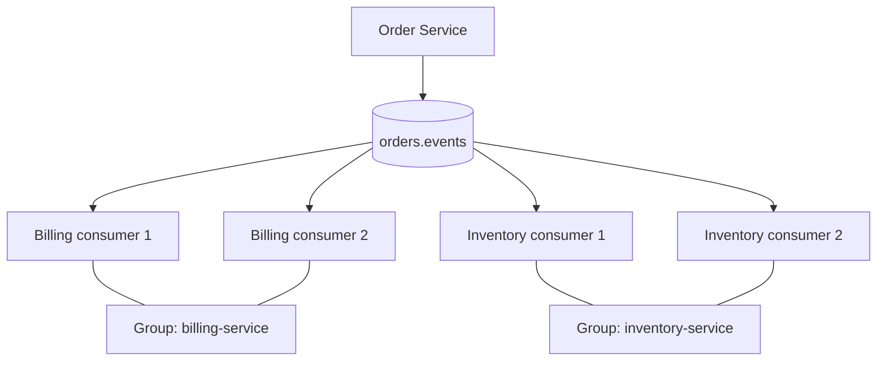
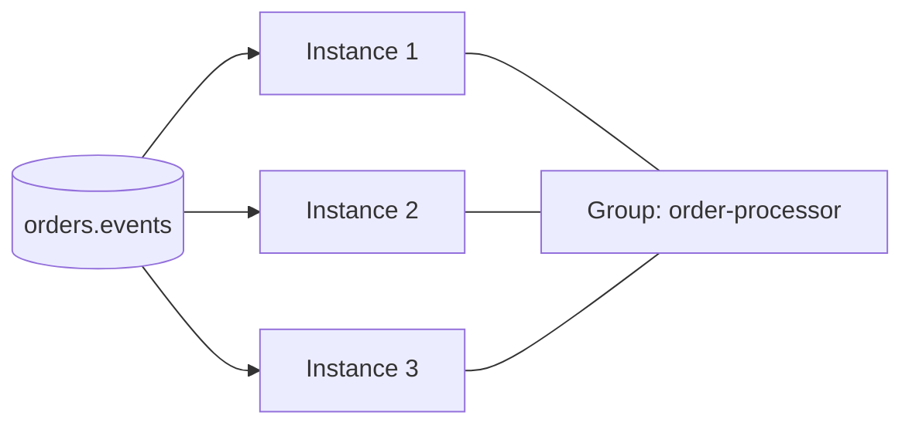
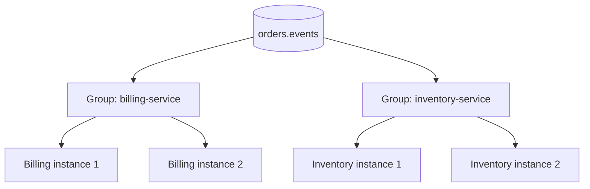
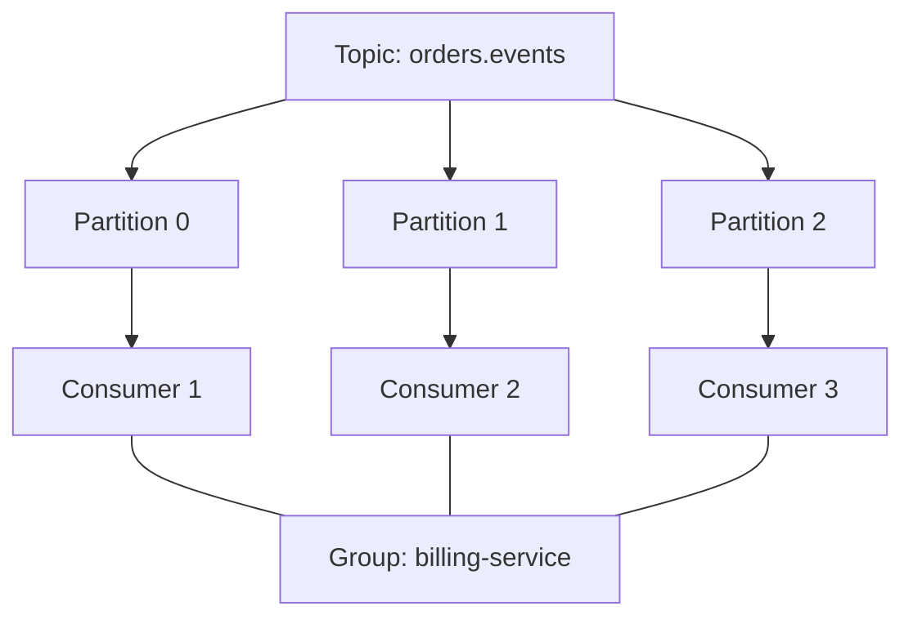
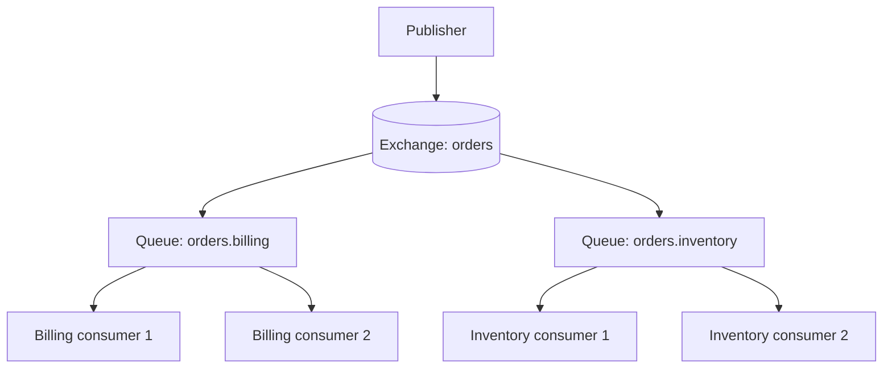

# Cùng nhóm để chia tải, khác nhóm để nhận độc lập

## 1. Bài toán: một sự kiện, nhiều consumer

Trong hệ thống hướng sự kiện, một sự kiện có thể cần được xử lý bởi nhiều thành phần. Khi đơn hàng được tạo, dịch vụ thanh toán cần chuẩn bị giao dịch, dịch vụ kho cần giữ hàng và dịch vụ phân tích cần cập nhật số liệu. Đồng thời, một dịch vụ có thể chạy nhiều instance để tăng năng lực xử lý và duy trì khả năng phục vụ khi một instance gặp sự cố.

Hai nhu cầu này khác nhau:

- **Chia tải:** nhiều instance cùng thực hiện một công việc logic; mỗi message chỉ được giao cho một instance trong nhóm tại một thời điểm theo cơ chế của broker.
- **Nhận độc lập:** nhiều ứng dụng hoặc nhóm xử lý khác nhau đều cần nhận cùng sự kiện để thực hiện công việc riêng.

Consumer group là khái niệm dùng để xác định phạm vi các consumer phối hợp chia sẻ công việc. Các consumer cùng group chia tải. Các group khác nhau có tiến độ tiêu thụ riêng và nhận luồng sự kiện độc lập.

Ví dụ, với event `OrderCreated`:

- Hai instance của `billing-service` cùng group `billing-service` chia nhau xử lý đơn hàng.
- Hai instance của `inventory-service` cùng group `inventory-service` chia nhau xử lý các sự kiện tồn kho.
- Group `billing-service` và group `inventory-service` đều nhận sự kiện `OrderCreated`, vì hai nghiệp vụ cần xử lý độc lập.



Hình minh họa thể hiện hai nhóm nghiệp vụ độc lập. Trong từng group, các instance phối hợp nhận message; giữa hai group, mỗi nhóm có thể nhận cùng một sự kiện.

## 2. Cùng group để chia tải

Giả sử một ứng dụng xử lý đơn hàng chạy ba instance. Cả ba instance dùng cùng destination và cùng consumer group `order-processor`. Broker phân phối công việc trong group để các instance cùng xử lý một luồng dữ liệu.



Các instance trong cùng group không phải là ba bản sao độc lập của cùng một luồng sự kiện. Chúng là các thành viên cùng thực hiện một workload. Khi một instance nhận một message, các instance khác trong cùng group thường không nhận bản sao của message đó trong lần phân phối bình thường.

Đặt group name ổn định theo chức năng xử lý, ví dụ `order-processor`, `billing-service` hoặc `inventory-projection`. Không đặt group name riêng theo từng instance nếu mục tiêu là để các instance chia tải với nhau.

### Khi một instance dừng

Nếu một thành viên rời group, broker hoặc cơ chế điều phối của binder có thể phân phối lại phần công việc của nó cho các thành viên còn lại. Với Kafka, quá trình này là consumer group rebalance và partition có thể được gán lại. Với RabbitMQ, consumer còn hoạt động tiếp tục nhận message từ queue chung. Với Pulsar, các consumer cùng subscription tiếp tục nhận theo subscription type đã chọn.

Message chưa được xác nhận có thể được giao lại. Vì vậy, cùng group không có nghĩa mỗi message chắc chắn chỉ được xử lý đúng một lần. Consumer vẫn cần xử lý idempotent và xác định đúng thời điểm acknowledgement hoặc offset commit.

## 3. Khác group để nhận độc lập

Giả sử billing và inventory đều cần xử lý `OrderCreated`. Nếu cả hai dùng chung group `order-service`, broker sẽ phân phối message cho một trong các consumer thuộc group đó. Một số đơn hàng có thể đến billing, số khác đến inventory; không phải mọi đơn hàng đều được cả hai dịch vụ xử lý.

Muốn cả hai dịch vụ nhận độc lập, cần dùng hai group khác nhau:



Mỗi group có tiến độ tiêu thụ riêng. Billing có thể đang xử lý đến một vị trí trong luồng, trong khi inventory có tiến độ khác. Một group bị chậm hoặc tạm dừng không nhất thiết làm group còn lại dừng theo, miễn là broker và tài nguyên vẫn hoạt động.

Đây là cách tổ chức phổ biến cho pub/sub: một destination phát sự kiện, nhiều nhóm consumer độc lập đăng ký xử lý theo nhu cầu riêng. Việc tạo bản phân phối cho từng group được broker/binder thực hiện bằng cơ chế riêng, chẳng hạn offset riêng trong Kafka hoặc queue/subscription riêng trong RabbitMQ và Pulsar.

## 4. Cấu hình consumer group trong Spring Cloud Stream

Trong Spring Cloud Stream, group được khai báo ở binding đầu vào bằng thuộc tính `group`. Ví dụ, hàm `processOrder` nhận sự kiện đơn hàng:

```java
import java.util.function.Consumer;
import org.springframework.context.annotation.Bean;
import org.springframework.context.annotation.Configuration;

record OrderCreated(String orderId, long totalCents) {}

@Configuration
class OrderFunctions {

    @Bean
    Consumer<OrderCreated> processOrder() {
        return event -> handleOrder(event);
    }

    private void handleOrder(OrderCreated event) {
        // Thực hiện nghiệp vụ xử lý đơn hàng.
    }
}
```

Cấu hình binding:

```yaml
spring:
  cloud:
    function:
      definition: processOrder
    stream:
      bindings:
        processOrder-in-0:
          destination: orders.events
          group: billing-service
          content-type: application/json
```

Trong cấu hình này:

- `processOrder-in-0` là binding đầu vào được suy ra từ tên bean function.
- `destination: orders.events` xác định luồng sự kiện cần nhận.
- `group: billing-service` xác định nhóm xử lý logic.
- Các instance của ứng dụng chạy cùng cấu hình destination và group sẽ tham gia cùng nhóm tiêu thụ, theo semantics của binder.

Nếu một ứng dụng khác cần nhận cùng sự kiện độc lập, nó khai báo group khác, chẳng hạn:

```yaml
spring:
  cloud:
    function:
      definition: updateInventory
    stream:
      bindings:
        updateInventory-in-0:
          destination: orders.events
          group: inventory-service
          content-type: application/json
```

Hai ứng dụng cùng đọc destination `orders.events`, nhưng có group riêng nên mỗi nghiệp vụ nhận luồng sự kiện độc lập.

## 5. Không khai báo group có ý nghĩa gì?

Khi không đặt `group`, Spring Cloud Stream thường tạo consumer thuộc một nhóm ẩn danh (anonymous/anonymous consumer group) theo cơ chế binder. Cách hoạt động cụ thể phụ thuộc broker:

- Với Kafka, consumer không có group được gắn vào một group ẩn danh riêng; các instance thường không chia sẻ một group ổn định như khi khai báo tên group.
- Với RabbitMQ, binder có thể sử dụng queue ẩn danh/không bền vững cho consumer không có group.
- Với Pulsar, binder sử dụng subscription ẩn danh theo cấu hình và cơ chế của nó.

Nhóm ẩn danh phù hợp với một số luồng tạm thời hoặc kiểm thử, khi không cần duy trì tiến độ tiêu thụ ổn định qua các lần triển khai. Với ứng dụng production cần nhiều instance chia tải và cần duy trì danh tính consumer qua lần khởi động lại, nên khai báo group tường minh.

Không nên bỏ group rồi kỳ vọng các replica tự động chia tải như một nhóm bền vững. Hãy kiểm tra cách binder tạo anonymous group, queue hoặc subscription trong phiên bản đang dùng.

## 6. Consumer group trong Kafka

Kafka lưu message trong topic được chia thành các partition. Consumer group là tập hợp các consumer phối hợp đọc những partition đó. Trong một group, tại một thời điểm, một partition được gán cho tối đa một consumer trong mô hình consumer thông thường. Vì vậy, số partition giới hạn mức đọc song song hữu ích của một group.



Với ba partition và ba consumer trong group, mỗi consumer có thể được gán một partition. Nếu chạy sáu consumer nhưng chỉ có ba partition, tối đa ba consumer có partition để đọc tại cùng thời điểm; các consumer còn lại sẽ không nhận partition trong assignment đó.

### Offset riêng theo group

Kafka lưu offset tiêu thụ theo consumer group. `billing-service` và `inventory-service` có offset độc lập cho cùng topic. Billing có thể đã đọc đến offset 500 trong một partition, trong khi inventory mới đọc đến offset 420. Điều này cho phép mỗi nhóm theo tốc độ riêng và phục hồi tiến độ độc lập.

Nếu group mới bắt đầu đọc topic đã có dữ liệu, vị trí bắt đầu phụ thuộc `auto.offset.reset` và việc group đã có offset được commit hay chưa. Các lựa chọn phổ biến là `earliest` để đọc từ phần dữ liệu còn lưu sớm nhất và `latest` để bắt đầu từ dữ liệu mới. Chính sách retention của topic vẫn giới hạn khoảng dữ liệu có thể đọc lại.

### Rebalance khi thành viên thay đổi

Khi consumer tham gia, rời group hoặc partition thay đổi, Kafka thực hiện rebalance để phân phối lại partition. Trong giai đoạn rebalance, việc xử lý có thể tạm dừng hoặc bị ảnh hưởng tùy giao thức và cấu hình. Ứng dụng cần xử lý shutdown có kiểm soát, commit offset đúng thời điểm và tránh xử lý tác dụng phụ trùng khi partition được gán lại.

### Key và thứ tự

Kafka chỉ đảm bảo thứ tự record trong cùng một partition. Nếu cần các sự kiện của cùng một đơn hàng được xử lý theo thứ tự, producer nên dùng `orderId` làm record key để chúng được định tuyến vào cùng partition theo chiến lược partitioner. Consumer group chia partition giữa các thành viên, còn thứ tự toàn cục giữa các partition không được đảm bảo.

## 7. Consumer group trong RabbitMQ

RabbitMQ thường triển khai mô hình chia tải bằng nhiều consumer cùng đọc một queue. Các consumer cùng queue cạnh tranh nhận message; một message được giao cho một consumer tại một thời điểm theo cơ chế dispatch và acknowledgement.

Trong Rabbit binder của Spring Cloud Stream, `group` gắn với queue bền vững của nhóm consumer. Các instance cùng destination và group dùng chung queue đó để chia tải. Những group khác nhau thường có queue riêng được bind vào exchange/destination tương ứng, nhờ vậy mỗi nhóm có thể nhận một bản phân phối message độc lập.



Sơ đồ minh họa topology pub/sub: mỗi group có queue riêng; các instance cùng group cạnh tranh nhận từ queue của group. Tên queue và cách khai báo exchange/queue thực tế phụ thuộc Rabbit binder configuration.

### Acknowledgement và redelivery

RabbitMQ dùng acknowledgement để biết consumer đã xử lý message. Nếu consumer bị đóng trước khi ack, message chưa xác nhận có thể được requeue và giao lại. Khi nhiều consumer cùng queue, thứ tự hoàn tất xử lý có thể khác thứ tự message được đưa vào queue, đặc biệt khi prefetch lớn hoặc thời gian xử lý không đồng đều.

Nếu cần thứ tự chặt hơn, cần xem xét số consumer, prefetch, single active consumer và chiến lược retry. Các lựa chọn này ảnh hưởng đến thông lượng và khả năng chịu lỗi. Group name không tự bảo đảm thứ tự hoàn tất.

## 8. Consumer group trong Apache Pulsar

Trong Pulsar, khái niệm gần tương đương consumer group là **subscription**. Một subscription có tên lưu giữ tiến độ tiêu thụ riêng trên topic. Nhiều consumer cùng subscription phối hợp nhận message theo subscription type được chọn. Các subscription khác nhau trên cùng topic nhận luồng message độc lập.

Ví dụ:

- Subscription `billing-service` dành cho nghiệp vụ thanh toán.
- Subscription `inventory-service` dành cho nghiệp vụ kho.
- Nhiều instance billing cùng dùng subscription `billing-service` để chia tải.

Pulsar có các subscription type quan trọng:

| Subscription type | Cách phân phối khái quát | Ý nghĩa với group |
|---|---|---|
| Exclusive | Một consumer hoạt động trên subscription | Phù hợp xử lý tuần tự trong subscription |
| Failover | Một consumer chính, consumer khác dự phòng | Hỗ trợ tiếp quản khi consumer chính mất |
| Shared | Phân phối message cho nhiều consumer | Tăng khả năng chia tải; thứ tự hoàn tất không được đảm bảo |
| Key_Shared | Phân phối theo key đến consumer phù hợp | Cho phép song song giữa key và giữ affinity/thứ tự theo key theo cấu hình |

Subscription type ảnh hưởng cách các thành viên cùng nhóm nhận message. Vì vậy, chỉ đặt cùng tên group là chưa đủ để hiểu mức song song; cần xem cả subscription type, partition, message key và cấu hình binder.

## 9. So sánh cùng group và khác group giữa các broker

| Broker | Cùng group | Khác group | Tiến độ tiêu thụ |
|---|---|---|---|
| Kafka | Consumer trong cùng group chia partition của topic | Mỗi group đọc topic độc lập | Offset riêng theo group và partition |
| RabbitMQ | Consumer cùng group thường dùng chung queue và cạnh tranh nhận message | Mỗi group có queue riêng được bind để nhận bản phân phối | Trạng thái message/ack nằm ở queue; queue group độc lập |
| Pulsar | Consumer cùng subscription chia nhận theo subscription type | Mỗi subscription có luồng nhận độc lập | Cursor/acknowledgement riêng theo subscription |

Điểm chung là group đại diện cho một workload logic. Tuy nhiên, cách broker tạo bản phân phối, lưu tiến độ, xác nhận và xử lý redelivery khác nhau. Không nên áp dụng máy móc cấu hình Kafka consumer group cho RabbitMQ hoặc Pulsar.

## 10. Đặt tên group và tổ chức workload

Group name nên thể hiện mục đích nghiệp vụ hoặc tên ứng dụng xử lý, không phải tên máy chạy instance. Ví dụ:

| Group name | Mục đích |
|---|---|
| `billing-service` | Tính phí và tạo giao dịch thanh toán |
| `inventory-service` | Cập nhật tồn kho và giữ hàng |
| `notification-service` | Gửi email hoặc thông báo |
| `analytics-projection` | Xây dựng dữ liệu phục vụ phân tích |

Các instance của cùng workload phải dùng cùng group name. Các workload cần nhận đầy đủ message độc lập phải dùng group name riêng.

Không nên đổi group name tùy tiện trong mỗi lần triển khai. Với Kafka, group mới không có offset đã commit nên có thể đọc lại dữ liệu theo `auto.offset.reset`; với RabbitMQ và Pulsar, tên group/subscription mới có thể tạo queue hoặc subscription mới và có chính sách lưu trữ riêng. Đổi tên group có thể làm phát sinh backlog, đọc lại dữ liệu hoặc tạo tài nguyên broker mới.

Khi cần đổi tên group, hãy lập kế hoạch chuyển đổi: xác định có cần replay dữ liệu không, thời gian retention còn bao lâu, cách xử lý message trùng và thời điểm loại bỏ queue/subscription cũ.

## 11. Tăng số instance và giới hạn song song

Tăng số instance chỉ giúp tăng thông lượng khi broker có đủ đơn vị công việc để phân phối và ứng dụng không bị giới hạn bởi tài nguyên khác.

### Với Kafka

Giả sử topic có 8 partition:

| Số consumer trong group | Khả năng phân phối |
|---:|---|
| 1 | Một consumer đọc cả 8 partition |
| 4 | Có thể chia partition cho 4 consumer |
| 8 | Có thể có một partition cho mỗi consumer |
| 12 | Tối đa 8 consumer được gán partition; các consumer còn lại chờ |

Con số này giả định group ổn định và không có giới hạn khác. Số consumer thực tế còn phụ thuộc concurrency trên mỗi instance, số partition và assignment strategy.

### Với RabbitMQ

Có thể tăng số consumer cùng đọc một queue để xử lý song song. Tuy nhiên, throughput còn phụ thuộc prefetch, thời gian xử lý, số queue, tài nguyên broker và hệ thống phụ thuộc. Nhiều consumer có thể làm thứ tự hoàn tất khác thứ tự nhận.

### Với Pulsar

Khả năng song song phụ thuộc subscription type và số partition của topic. Shared hoặc Key_Shared cho phép nhiều consumer cùng nhận; Exclusive giới hạn một consumer hoạt động; Failover dùng consumer dự phòng. Chọn type theo yêu cầu thứ tự và tải.

## 12. Group, partition và thứ tự xử lý

Consumer group và partition có quan hệ chặt chẽ trong Kafka. Group xác định phạm vi chia tải; partition là đơn vị được gán cho consumer. Số partition quyết định số consumer có thể làm việc song song trong group tại một thời điểm.

Nếu các message của cùng một aggregate cần được xử lý theo thứ tự, hãy chọn key theo aggregate ID. Ví dụ, dùng `orderId` cho đơn hàng. Nếu producer dùng key khác nhau cho các event của cùng đơn hàng, chúng có thể đi vào các partition khác nhau và không có thứ tự toàn cục.

Ngay cả khi broker giao theo thứ tự, ứng dụng vẫn có thể làm đảo thứ tự hoàn tất nếu đẩy message vào thread pool không giới hạn hoặc xử lý bất đồng bộ không có cơ chế tuần tự theo key. Khi cần thứ tự nghiệp vụ, hãy giữ xử lý tuần tự trong phạm vi partition/key hoặc kiểm tra sequence/version trước khi áp dụng thay đổi.

## 13. Group và bảo đảm giao nhận

Group giúp tổ chức việc phân phối, nhưng không tự quyết định mức bảo đảm giao nhận. Message vẫn có thể được giao lại nếu consumer gặp lỗi trước khi acknowledgement hoặc offset commit được ghi nhận.

- Với Kafka, offset được commit theo group. Nếu tác dụng phụ đã hoàn tất nhưng offset chưa commit, message có thể được đọc lại.
- Với RabbitMQ, message chưa ack có thể được requeue khi consumer hoặc channel đóng.
- Với Pulsar, message chưa ack có thể được redeliver theo subscription và acknowledgement timeout.

Do đó, consumer nên idempotent. Có thể dùng event ID duy nhất, bảng inbox, khóa nghiệp vụ hoặc ràng buộc unique trong database để phát hiện message đã xử lý. Không dùng group name làm event ID; một group xử lý nhiều message và nhiều lần retry.

Khi một group mới bắt đầu nhận dữ liệu, hãy xác định chính sách bắt đầu và retention. Khi replay hoặc đổi group, consumer có thể gặp lại event cũ. Logic nghiệp vụ phải xử lý được dữ liệu lặp hoặc đến muộn theo quy tắc đã thiết kế.

## 14. Kiểm thử hành vi của group

Kiểm thử nên chứng minh cả hai đặc tính: cùng group chia tải và khác group nhận độc lập.

1. Phát một tập event có ID riêng vào destination.
2. Khởi chạy hai instance với cùng destination và cùng group.
3. Xác nhận cả hai instance cùng nhận một phần workload và tổng thể xử lý đủ event.
4. Khởi chạy một consumer khác với group name riêng.
5. Xác nhận consumer thuộc group thứ hai cũng nhận được toàn bộ tập event theo semantics của broker.
6. Dừng một instance giữa lúc xử lý và kiểm tra redelivery, acknowledgement/offset và idempotency.
7. Tăng số instance vượt số partition (với Kafka) hoặc thay đổi subscription/queue concurrency để quan sát giới hạn song song.
8. Kiểm tra hành vi sau khi đổi group name và xác nhận chính sách replay/retention.

Test binder của Spring Cloud Stream có thể giúp kiểm thử logic function và binding ở mức ứng dụng. Nó không mô phỏng đầy đủ partition assignment, Kafka rebalance, RabbitMQ queue dispatch hoặc Pulsar subscription type. Những hành vi này cần kiểm thử tích hợp với broker tương ứng.

## 15. Quan sát group trong môi trường vận hành

Theo dõi group giúp phát hiện tình trạng consumer chậm, mất kết nối hoặc phân phối không cân bằng. Các chỉ số hữu ích gồm:

- Kafka: số thành viên group, partition assignment, rebalance, committed offset và consumer lag.
- RabbitMQ: queue depth, số consumer đang hoạt động, unacked messages, redelivery và tốc độ ack.
- Pulsar: subscription backlog, consumer count, unacked messages, redelivery và partition distribution.
- Ứng dụng: throughput, thời gian xử lý, tỷ lệ lỗi, retry, DLQ và số event bị trùng.

Log nên ghi group name, destination, event ID và correlation ID. Không ghi payload nhạy cảm. Nếu một group chậm trong khi group khác bình thường, hãy điều tra consumer và tài nguyên của workload bị chậm thay vì tăng tải cho tất cả dịch vụ.

## 16. Quy trình chọn group cho một luồng sự kiện

1. Liệt kê các nghiệp vụ cần nhận event từ destination.
2. Gom các instance thực hiện cùng một workload vào một group ổn định.
3. Tạo group riêng cho mỗi workload cần nhận độc lập.
4. Chọn group name có ý nghĩa và giữ ổn định qua các lần triển khai.
5. Xác định partition/key hoặc queue/subscription type phù hợp với broker.
6. Định nghĩa acknowledgement, offset commit, retry và idempotency.
7. Kiểm thử scale-out, scale-in, redelivery và đổi group.
8. Theo dõi lag/backlog và phân phối tải sau khi triển khai.

Cùng group giúp nhiều instance chia sẻ một workload; khác group giúp nhiều workload nhận sự kiện độc lập. Spring Cloud Stream đưa khái niệm này vào cấu hình binding bằng thuộc tính `group`, còn binder ánh xạ nó sang consumer group của Kafka, queue của RabbitMQ hoặc subscription của Pulsar. Hiểu đúng semantics của broker giúp thiết kế khả năng mở rộng mà vẫn bảo đảm mỗi nghiệp vụ nhận được dữ liệu cần thiết.

