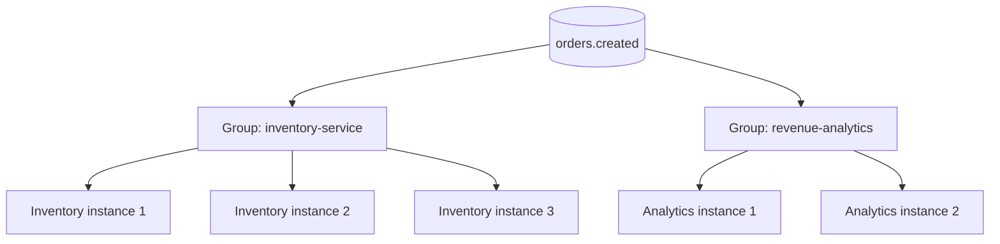

# Nhóm có tên và nhóm ẩn danh

## Mục tiêu

Khi nhiều instance của một ứng dụng cùng nhận sự kiện, hệ thống cần biết chúng đang chia sẻ một luồng công việc hay mỗi instance cần nhận một bản sao độc lập. Spring Cloud Stream biểu diễn quan hệ này bằng **consumer group**. Một binding đầu vào có thể tham gia một nhóm có tên hoặc dùng nhóm ẩn danh khi không khai báo group.

Nhóm có tên thường đại diện cho một logical subscriber ổn định: nhiều instance cùng group chia sẻ việc xử lý message và có thể tiếp tục sử dụng trạng thái tiêu thụ của nhóm. Nhóm ẩn danh được framework tạo tên tự động, phù hợp với một subscription tạm thời hoặc nhu cầu nhận bản sao độc lập; nó không cung cấp danh tính subscription ổn định để dựa vào khi khởi động lại.

Bài học này giải thích hai loại nhóm, cách cấu hình group trong binding, cách broker ánh xạ group sang Kafka consumer group, RabbitMQ queue hoặc Pulsar subscription, và các tác động đến mở rộng, replay, độ bền và kiểm thử.

Sau bài học, bạn có thể:

- Phân biệt nhóm có tên với nhóm ẩn danh.
- Cấu hình group cho từng input binding của Spring Cloud Stream.
- Giải thích cách các instance trong cùng group chia sẻ message.
- Xác định vì sao các group khác nhau nhận bản sao độc lập của cùng luồng sự kiện.
- Hiểu khác biệt về group/subscription giữa Kafka, RabbitMQ và Pulsar.
- Chọn tên group ổn định và kiểm thử hành vi khi scale hoặc khởi động lại.

## 1. Consumer group giải quyết vấn đề gì?

Giả sử topic hoặc destination `orders.created` nhận sự kiện đơn hàng. Dịch vụ tồn kho có ba instance để tăng khả năng xử lý. Nếu cả ba instance đều thuộc cùng một consumer group, broker phân phối công việc giữa chúng: một message được một consumer trong nhóm nhận để xử lý tại một thời điểm theo cơ chế của broker.

Một dịch vụ khác như phân tích doanh thu cũng cần đọc toàn bộ sự kiện đơn hàng. Dịch vụ này phải có group riêng. Nếu nó dùng cùng group với dịch vụ tồn kho, hai dịch vụ sẽ cạnh tranh nhận message và mỗi bên chỉ thấy một phần luồng.



Có hai quy tắc cần nhớ:

- **Các instance cùng group chia sẻ công việc.** Chúng là những thành viên của cùng một logical subscriber.
- **Các group khác nhau nhận bản sao độc lập.** Mỗi logical subscriber có tiến độ tiêu thụ hoặc subscription riêng.

Group không phải tên của function, topic hay instance. Nó xác định danh tính của logical consumer đối với một input destination.

## 2. Nhóm có tên (named consumer group)

Nhóm có tên được khai báo rõ trong thuộc tính `group` của binding:

```yaml
spring:
  cloud:
    function:
      definition: processOrders
    stream:
      bindings:
        processOrders-in-0:
          destination: orders.created
          group: inventory-service
          content-type: application/json
```

Hàm nhận sự kiện:

```java
@Bean
Consumer<OrderCreated> processOrders(InventoryService inventory) {
    return event -> inventory.reserve(event.orderId(), event.lines());
}
```

Tên input binding mặc định là `processOrders-in-0`: `processOrders` là tên function bean, `in` chỉ chiều nhận và `0` là chỉ số input. Thuộc tính `group` gắn logical subscriber `inventory-service` với destination `orders.created`.

Khi triển khai nhiều replica của dịch vụ tồn kho, các replica cần dùng cùng destination và cùng group. Broker sẽ điều phối việc nhận message giữa các thành viên. Nếu đổi group name trong mỗi replica, chúng không còn cùng một nhóm; mỗi nhóm có thể nhận toàn bộ luồng độc lập, làm phát sinh xử lý trùng ở cấp nghiệp vụ.

### Đặc điểm của nhóm có tên

- Danh tính nhóm ổn định qua các lần khởi động nếu cấu hình giữ nguyên.
- Nhiều instance cùng group chia sẻ tải.
- Một group khác có thể nhận lại toàn bộ luồng độc lập.
- Broker thường lưu tiến độ tiêu thụ hoặc trạng thái subscription theo danh tính nhóm.
- Nhóm có thể được scale bằng cách tăng số instance, trong giới hạn partition hoặc khả năng của subscription.
- Message vẫn có thể được giao lại sau lỗi; named group không đồng nghĩa exactly-once.

Việc có tên ổn định là điều kiện để tiếp tục dùng đúng trạng thái nhóm, nhưng độ bền thực tế còn phụ thuộc cấu hình binder và broker: offset commit, queue durability, subscription durability, retention và chính sách lưu message.

## 3. Nhóm ẩn danh (anonymous consumer group)

Nếu không khai báo `group` trên input binding, Spring Cloud Stream tạo một nhóm ẩn danh với tên được sinh tự động.

Ví dụ:

```yaml
spring:
  cloud:
    function:
      definition: observeOrders
    stream:
      bindings:
        observeOrders-in-0:
          destination: orders.created
          content-type: application/json
```

Ở đây không có thuộc tính `group`. Framework tạo danh tính group/subscription riêng cho binding theo cơ chế của binder. Các anonymous group thường có tính tạm thời và không có tên ổn định để ứng dụng dùng lại sau khi restart.

### Hành vi cần dự liệu

- Một anonymous group không chia sẻ danh tính với named group như `inventory-service`.
- Các consumer độc lập dùng anonymous group có thể nhận bản sao riêng của luồng, thay vì cạnh tranh message với nhóm nghiệp vụ có tên.
- Khi ứng dụng khởi động lại và anonymous group được tạo với tên mới, trạng thái tiêu thụ trước đó có thể không được tiếp tục.
- Khả năng queue/subscription tạm thời được xóa, lưu hoặc replay phụ thuộc binder và broker.
- Không nên dựa vào anonymous group cho một consumer nghiệp vụ cần tiếp tục từ tiến độ đã commit qua các lần triển khai.

Anonymous group hữu ích cho thử nghiệm, quan sát tạm thời hoặc một consumer phụ không cần giữ danh tính subscription ổn định. Với xử lý đơn hàng, thanh toán, tồn kho hoặc các tác vụ cần theo dõi tiến độ lâu dài, hãy khai báo group rõ ràng.

**Lưu ý:** "Ẩn danh" không có nghĩa broker không tạo group hoặc subscription. Framework/binder vẫn cần một danh tính kỹ thuật để đăng ký consumer; tên đó chỉ không được ứng dụng chỉ định và không nên được coi là ổn định.

## 4. So sánh nhóm có tên và nhóm ẩn danh

| Tiêu chí | Named group | Anonymous group |
|---|---|---|
| Cách khai báo | Có `group` trong binding | Bỏ thuộc tính `group` |
| Danh tính | Do ứng dụng đặt, ổn định theo cấu hình | Do framework/binder tạo |
| Mục đích | Logical subscriber lâu dài, chia tải giữa replica | Consumer tạm thời hoặc subscription độc lập |
| Nhiều instance | Cùng group chia sẻ công việc | Tùy cách binder tạo anonymous identity; không mặc định chia sẻ trạng thái bền vững |
| Tiến độ sau restart | Có thể tiếp tục theo offset/subscription nếu broker lưu trạng thái | Không nên dựa vào việc tiếp tục vì tên có thể thay đổi |
| Nhận bản sao độc lập | Dùng group name khác | Anonymous identity tách biệt với group khác |
| Sử dụng điển hình | Service nghiệp vụ production | Quan sát tạm thời, thử nghiệm, consumer không cần danh tính ổn định |

Không nên chọn anonymous group chỉ để tránh phải đặt tên. Nếu ứng dụng có yêu cầu vận hành rõ ràng, tên group là một phần của cấu hình cần quản lý.

## 5. Cách group được biểu diễn ở từng broker

Spring Cloud Stream cung cấp abstraction chung, nhưng Kafka, RabbitMQ và Pulsar không dùng cùng một cấu trúc native. Binder ánh xạ group sang khái niệm tương ứng của broker.

### Kafka: consumer group và group ID

Kafka sử dụng `group.id` để nhận diện consumer group. Các consumer có cùng group ID chia sẻ assignment của các partition trong topic. Mỗi partition được gán cho tối đa một consumer trong group tại một thời điểm.

- Named group của Spring Cloud Stream được ánh xạ sang Kafka consumer group ổn định.
- Các group ID khác nhau có offset độc lập; mỗi group có thể đọc toàn bộ topic theo tiến độ riêng.
- Kafka lưu committed offset theo group, cho phép group tiếp tục từ vị trí đã commit sau khi consumer restart.
- Anonymous group được binder tạo tên riêng; nếu tên mới được sinh ở lần khởi động tiếp theo, group không có committed offset cũ dưới danh tính mới. Vị trí bắt đầu khi đó phụ thuộc `auto.offset.reset` và cấu hình binder.
- Rebalance xảy ra khi thành viên group thay đổi hoặc partition topology thay đổi.

Ví dụ cấu hình Kafka consumer group ở cấp Spring Cloud Stream:

```yaml
spring:
  cloud:
    stream:
      bindings:
        processOrders-in-0:
          destination: orders.created
          group: inventory-service
      kafka:
        bindings:
          processOrders-in-0:
            consumer:
              start-offset: earliest
```

`group` là nơi khai báo danh tính logical consumer. Không tự ghi đè `group.id` của Kafka client bằng một giá trị khác với group mà binder quản lý; nếu cần hành vi đặc biệt, hãy theo tài liệu binder của phiên bản đang dùng. `start-offset` chỉ liên quan đến vị trí bắt đầu khi group chưa có committed offset phù hợp; nó không tự tua lại group đã có tiến độ.

### RabbitMQ: queue gắn với group

RabbitMQ binder thường ánh xạ named group thành queue riêng gắn với destination/exchange. Các instance cùng group consume từ cùng queue và chia sẻ message theo cơ chế competing consumers.

- Named group thường tạo queue có tên ổn định dựa trên destination và group.
- Group khác tạo queue riêng được bind đến exchange, nhờ vậy mỗi logical subscriber nhận bản sao message.
- Anonymous group thường dùng queue tạm/ẩn danh, thường có đặc tính exclusive hoặc auto-delete tùy cấu hình binder.
- Durability, auto-delete, dead-letter và binding topology cần được kiểm tra theo Rabbit binder configuration.

Một queue dùng chung không đảm bảo mỗi message chỉ được xử lý đúng một lần: consumer có thể chết trước khi ack, khiến message được requeue và giao lại.

### Pulsar: subscription name

Pulsar sử dụng subscription để theo dõi tiến độ tiêu thụ của consumer. Subscription name tương đương danh tính logical subscriber; nhiều consumer có thể tham gia cùng subscription tùy subscription type.

- Named group được ánh xạ thành subscription name ổn định theo cấu hình binder.
- Các consumer cùng subscription phối hợp nhận message theo loại subscription, ví dụ Shared, Failover hoặc Key_Shared.
- Subscription khác nhau có cursor/tiến độ độc lập và có thể nhận bản sao của luồng.
- Anonymous group có subscription name được sinh tự động; không dựa vào tên đó để tiếp tục trạng thái sau restart.
- Durability, retention, acknowledgment và redelivery còn phụ thuộc cấu hình subscription và cluster.

Với Pulsar, chọn subscription type là một quyết định bổ sung. Cùng một group name không tự quyết định message được chia sẻ, failover hay phân phối theo key; loại subscription mới xác định cơ chế phối hợp giữa các consumer.

| Broker | Named group thường ánh xạ đến | Anonymous group thường ánh xạ đến | Nhiều instance cùng named group |
|---|---|---|---|
| Kafka | Kafka `group.id` | Group ID được sinh tự động | Chia partition assignment |
| RabbitMQ | Queue gắn với destination/group | Queue tạm/ẩn danh theo binder | Competing consumers trên queue |
| Pulsar | Subscription name | Subscription name được sinh tự động | Phối hợp theo subscription type |

## 6. Chọn group name và quản lý vòng đời

Tên group nên thể hiện logical subscriber, không phải tên máy hoặc instance. Ví dụ:

- `inventory-service`
- `billing-service`
- `revenue-analytics`
- `fraud-detection`

Nếu nhiều môi trường dùng chung broker, có thể thêm môi trường vào group name để tách tiến độ:

- `inventory-service-dev`
- `inventory-service-staging`
- `inventory-service-prod`

Các replica của cùng dịch vụ trong cùng môi trường phải dùng chung tên. Không thêm pod ID, hostname, UUID hoặc timestamp vào group name nếu mục tiêu là scale nhiều replica trong cùng logical group.

Đổi group name có thể tạo một logical subscriber mới. Với Kafka, group mới chưa có committed offset và sẽ dùng chính sách offset reset. Với RabbitMQ, binder có thể tạo queue mới và nhận message từ thời điểm queue được bind; message cũ không tự xuất hiện nếu queue chưa tồn tại và không có cơ chế replay. Với Pulsar, subscription mới có cursor riêng và vị trí bắt đầu phụ thuộc subscription initial position/retention. Vì vậy, đổi group name cần được xem là một thay đổi dữ liệu và vận hành.

Khi ngừng một consumer group, cần có kế hoạch cho queue/subscription/offset cũ: giữ để audit, xóa theo chính sách, hoặc chuyển tiến độ theo khả năng broker. Không xóa group chỉ vì đổi tên service nếu chưa xác định tác động đến replay và message tồn đọng.

## 7. Scale instance trong cùng group

Tăng số instance giúp tăng khả năng xử lý song song, nhưng mức scale hiệu quả phụ thuộc broker.

### Kafka partition giới hạn số consumer hoạt động

Trong một consumer group Kafka, mỗi partition chỉ được gán cho tối đa một consumer tại một thời điểm. Nếu topic có bốn partition:

- Một consumer có thể xử lý cả bốn partition.
- Hai consumer có thể chia nhau partition.
- Bốn consumer có thể xử lý song song tối đa bốn partition.
- Tám consumer trong cùng group sẽ có ít nhất bốn consumer không được gán partition ở trạng thái ổn định.

Do đó, số consumer hoạt động tối đa của group bị giới hạn bởi số partition được assign. Tăng replica vượt số partition có thể không tăng throughput và làm tăng chi phí rebalance/connection.

### RabbitMQ và Pulsar

RabbitMQ có thể phân phối message trong queue cho nhiều consumer; throughput còn phụ thuộc prefetch, tốc độ xử lý, queue type và broker resources. Nhiều consumer cùng queue có thể tăng song song nhưng cũng có thể ảnh hưởng thứ tự quan sát.

Pulsar hỗ trợ nhiều subscription type. Shared cho phép nhiều consumer chia message; Key_Shared phân phối theo key để hỗ trợ xử lý theo khóa; Failover có cơ chế consumer active/standby. Chọn subscription type theo yêu cầu ordering và throughput, không chỉ theo số replica.

Dù broker nào, consumer cần xử lý idempotent vì lỗi, timeout hoặc redelivery có thể làm cùng sự kiện được xử lý lại. Group chỉ xác định cách chia sẻ subscription, không thay thế cơ chế chống xử lý trùng.

## 8. Ví dụ hai dịch vụ cần nhận cùng một sự kiện

Giả sử hệ thống có hai logical subscriber:

- `inventory-service` cập nhật tồn kho.
- `revenue-analytics` tổng hợp doanh thu.

Cả hai cần nhận toàn bộ `orders.created`, vì vậy cấu hình group riêng:

```yaml
# inventory-service
spring:
  cloud:
    function:
      definition: processOrders
    stream:
      bindings:
        processOrders-in-0:
          destination: orders.created
          group: inventory-service
```

```yaml
# revenue-analytics
spring:
  cloud:
    function:
      definition: aggregateOrders
    stream:
      bindings:
        aggregateOrders-in-0:
          destination: orders.created
          group: revenue-analytics
```

Trong mỗi dịch vụ, có thể chạy nhiều replica nhưng tất cả replica của dịch vụ đó phải giữ nguyên group name. Kết quả là mỗi logical subscriber nhận bản sao độc lập, còn replica bên trong một subscriber chia sẻ công việc.

Nếu hai dịch vụ vô tình dùng chung group `orders-consumers`, chúng sẽ cạnh tranh nhận message. Một số đơn hàng có thể chỉ đến inventory, số khác chỉ đến analytics; mỗi dịch vụ không còn nhận đủ luồng. Đây là lỗi cấu hình phổ biến khi sao chép YAML giữa các service.

## 9. Kiểm thử named group và anonymous group

Cần kiểm thử cả hành vi framework và semantics của broker.

### Unit/configuration test

Kiểm tra binding có destination và group đúng:

- Binding nghiệp vụ có group name ổn định.
- Các replica trong cùng deployment nhận cùng cấu hình group.
- Các logical subscriber khác nhau có group khác nhau.
- Anonymous binding không vô tình được dùng cho consumer cần subscription bền vững.

Có thể kiểm tra property đã bind trong Spring application context, nhưng điều đó chưa chứng minh broker đã tạo đúng group/queue/subscription.

### Test Binder

Spring Cloud Stream Test Binder hữu ích để kiểm tra function, binding và luồng message ở mức framework. Có thể xác minh bean function được kết nối và message đến output/input channel tương ứng. Test Binder không mô phỏng đầy đủ consumer group coordination, Kafka rebalance, Rabbit queue durability hoặc Pulsar subscription cursor.

### Broker integration test

Dùng broker thật trong test environment để xác minh:

1. Hai instance cùng named group chia sẻ message, không tạo hai bản sao độc lập cho mỗi instance.
2. Hai named group khác nhau đều nhận được cùng sự kiện.
3. Restart named group tiếp tục từ tiến độ theo semantics broker đã cấu hình.
4. Anonymous group được tạo với danh tính riêng và hành vi sau restart đúng như mong đợi.
5. Kafka rebalance khi thêm/bớt consumer; Rabbit redelivery khi consumer dừng trước ack; Pulsar redelivery/Failover theo subscription type.
6. Message xử lý lại không tạo tác động nghiệp vụ trùng.

Không kiểm thử restart anonymous group bằng một giả định chung cho cả ba broker. Hãy xác minh queue/subscription được tạo và xóa thế nào, vị trí bắt đầu được chọn ra sao và dữ liệu cũ còn được giữ ở broker hay không.

## 10. Những lỗi thường gặp

| Triệu chứng | Nguyên nhân có thể | Cách xử lý |
|---|---|---|
| Hai dịch vụ chia nhau đơn hàng, mỗi dịch vụ chỉ thấy một phần | Hai dịch vụ dùng chung group name | Cấp group riêng cho từng logical subscriber |
| Mỗi replica đều xử lý toàn bộ message | Replica dùng group name khác nhau hoặc anonymous identity riêng | Dùng cùng named group cho các replica |
| Restart xong consumer đọc lại từ đầu hoặc không thấy dữ liệu cũ | Group mới, offset reset hoặc queue/subscription tạm | Giữ group name ổn định và kiểm tra retention/initial position |
| Tăng replica nhưng throughput không tăng với Kafka | Số consumer vượt số partition hoặc xử lý bị nghẽn ở bước khác | Đo lag, kiểm tra partition assignment và khả năng xử lý |
| Rabbit queue bị mất sau khi app dừng | Anonymous/auto-delete queue hoặc durability không như dự kiến | Dùng named group và cấu hình queue durability phù hợp |
| Pulsar consumer chia message sai thứ tự mong đợi | Subscription type không phù hợp | Chọn Exclusive, Failover, Shared hoặc Key_Shared theo yêu cầu |
| Message bị xử lý hai lần | Redelivery, retry hoặc crash trước ack/commit | Dùng event ID và consumer idempotent |

## Kết luận

Named group tạo danh tính ổn định cho một logical subscriber; các instance cùng group chia sẻ việc xử lý, còn group khác nhận bản sao độc lập. Anonymous group do framework/binder tạo tên tự động, phù hợp với consumer tạm thời hoặc không cần tiếp tục trạng thái subscription ổn định.

Trong Spring Cloud Stream, hãy khai báo `group` ở input binding cho consumer nghiệp vụ production. Giữ tên group giống nhau giữa các replica và khác nhau giữa các logical subscriber cần nhận toàn bộ luồng. Kiểm tra cách Kafka, RabbitMQ hoặc Pulsar ánh xạ group sang group ID, queue hoặc subscription; durability, replay và scaling còn phụ thuộc cấu hình broker. Consumer vẫn cần idempotency vì group không loại bỏ redelivery.

