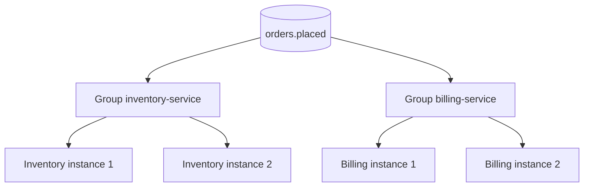

# Đăng ký bền vững và hành vi khi ứng dụng tạm dừng

Trong Spring Cloud Stream, consumer binding có thể được gắn với một consumer group bằng thuộc tính `group`. Group định danh một nhóm nhận có cùng trách nhiệm xử lý một destination. Các instance thuộc cùng group thường chia nhau xử lý message; các group khác nhau có thể nhận các bản sao độc lập của cùng luồng sự kiện.

Đăng ký bền vững giúp broker hoặc binder giữ trạng thái nhận trong thời gian ứng dụng consumer không hoạt động. Khi ứng dụng khởi động lại với cùng danh tính group/subscription, nó có thể tiếp tục từ vị trí đã ghi nhận hoặc nhận các message còn tồn đọng. Cách thực hiện khác nhau giữa Kafka, RabbitMQ và Pulsar: Kafka lưu offset của consumer group trong khi topic giữ record theo retention; RabbitMQ giữ message trong queue; Pulsar lưu cursor của subscription. Vì vậy, cần hiểu cả cấu hình group lẫn chính sách lưu trữ của broker.

## 1. Consumer group trong Spring Cloud Stream

Một function nhận message có thể được khai báo như sau:

```java
@Bean
Consumer<OrderPlaced> reserveInventory(InventoryService inventory) {
    return event -> inventory.reserve(event.orderId(), event.items());
}
```

Binding đầu vào được cấu hình với destination và group:

```yaml
spring:
  cloud:
    function:
      definition: reserveInventory
    stream:
      bindings:
        reserveInventory-in-0:
          destination: orders.placed
          group: inventory-service
          content-type: application/json
```

Trong ví dụ, `inventory-service` là tên group ổn định của dịch vụ giữ hàng. Khi có nhiều instance của ứng dụng cùng dùng destination và group này, chúng tham gia cùng một nhóm nhận theo ngữ nghĩa của binder. Broker phân phối công việc theo cơ chế riêng của nó.

Nếu một dịch vụ khác cần nhận mọi sự kiện đơn hàng để lập hóa đơn, dịch vụ đó dùng group riêng, chẳng hạn `billing-service`. Hai group có trách nhiệm độc lập nên mỗi group nhận luồng sự kiện riêng:



Group có hai mục đích quan trọng:

- **Chia tải trong cùng một dịch vụ**: nhiều instance dùng chung group để xử lý một luồng message.
- **Phân phối độc lập giữa các dịch vụ**: mỗi dịch vụ dùng group riêng để nhận và xử lý cùng sự kiện theo mục tiêu riêng.

Không dùng cùng group cho hai dịch vụ cần nhận đầy đủ mọi sự kiện. Khi cùng group, chúng là các consumer cạnh tranh nhận message; một message thường được giao cho một consumer trong nhóm theo quy tắc broker, thay vì được sao chép cho tất cả.

## 2. Group có tên và đăng ký ẩn danh

Trong Spring Cloud Stream, group có tên tạo danh tính ổn định cho consumer. Đây là lựa chọn thông thường đối với dịch vụ production cần tiếp tục xử lý sau khi restart.

Nếu không khai báo `group`, framework/binder thường tạo một group hoặc subscription ẩn danh. Các consumer ẩn danh có thể nhận luồng riêng thay vì chia tải cùng một nhóm có tên. Danh tính được tạo tự động không phải hợp đồng ổn định để ứng dụng dựa vào khi khởi động lại.

| Kiểu đăng ký | Đặc điểm | Trường hợp sử dụng |
|---|---|---|
| Group có tên | Có danh tính ổn định; các instance cùng group chia tải | Consumer service cần tiếp tục xử lý sau restart |
| Group ẩn danh | Danh tính do framework/binder tạo; vòng đời và lưu trạng thái phụ thuộc binder | Thử nghiệm, consumer tạm thời hoặc luồng riêng cho từng instance |

Với Kafka, group có tên gắn với offset được commit dưới một `group.id`. Nếu mỗi lần khởi động lại tạo group ID mới, consumer không tiếp tục từ offset của group trước. Với RabbitMQ, group có tên thường được ánh xạ thành queue dùng chung; đăng ký ẩn danh thường tạo queue tạm thời. Với Pulsar, group thường được ánh xạ sang subscription name; subscription ẩn danh hoặc được tạo tự động không phải danh tính ổn định cho lần khởi động sau.

Không giả định rằng hành vi dọn dẹp group ẩn danh giống nhau trên mọi binder. Hãy kiểm tra cách binder cụ thể tạo, xóa queue/subscription và lưu trạng thái khi binding bị đóng.

## 3. Đăng ký bền vững có ý nghĩa gì?

Một đăng ký bền vững lưu lại trạng thái nhận message qua khoảng thời gian consumer không kết nối. Khi ứng dụng tạm dừng hoặc tắt, broker vẫn giữ được dữ liệu chưa được xử lý theo chính sách lưu trữ và giới hạn cấu hình.

Tuy nhiên, “bền vững” không có nghĩa dữ liệu được giữ vô thời hạn hoặc tự động bảo đảm xử lý đúng một lần. Cần phân biệt:

- **Danh tính đăng ký**: tên group hoặc subscription có ổn định qua lần restart hay không.
- **Vị trí đọc/acknowledgement**: broker lưu tiến độ consumer đến đâu.
- **Lưu trữ message**: record hoặc message còn tồn tại trong broker bao lâu.
- **Bảo đảm giao nhận**: message có thể được giao lại khi consumer lỗi hay không.
- **Tính bền vững vật lý**: dữ liệu có được ghi theo durability/replication policy của broker hay không.

Một group có tên nhưng topic/queue không có chính sách lưu trữ phù hợp vẫn có thể mất dữ liệu khi retention hoặc TTL hết hạn. Ngược lại, broker có thể giữ message nhưng consumer dùng group mới nên không tiếp tục ở vị trí cũ.

## 4. Kafka: group offset và topic retention

Kafka không tạo một queue riêng cho mỗi consumer group. Các record được lưu trong topic partition theo log. Consumer group có tên lưu offset đã commit cho từng partition. Khi toàn bộ instance của group dừng, topic vẫn có thể tiếp tục nhận record từ producer; khi group khởi động lại với cùng `group.id`, consumer tiếp tục từ offset đã commit nếu record tương ứng vẫn còn trong log.

Có ba yếu tố cần xem xét:

1. **Group ID ổn định**: giữ nguyên group name qua các lần triển khai để Kafka nhận diện cùng consumer group.
2. **Offset commit**: xác định vị trí consumer đã ghi nhận. Record đã xử lý nhưng offset chưa commit có thể được đọc lại sau restart.
3. **Topic retention**: quyết định record được giữ trong log bao lâu hoặc theo giới hạn dung lượng. Consumer offline lâu hơn retention có thể không còn đọc được toàn bộ dữ liệu đã bỏ lỡ.

Ví dụ cấu hình binder:

```yaml
spring:
  cloud:
    function:
      definition: reserveInventory
    stream:
      bindings:
        reserveInventory-in-0:
          destination: orders.placed
          group: inventory-service
      kafka:
        bindings:
          reserveInventory-in-0:
            consumer:
              startOffset: earliest
```

Tên thuộc tính binder và cách áp dụng offset khi group chưa có offset phụ thuộc phiên bản Spring Cloud Stream Kafka binder. `startOffset: earliest` không có nghĩa mỗi lần restart đều đọc lại từ đầu; nó thường xác định vị trí khởi đầu khi group chưa có offset hợp lệ, theo điều kiện binder và Kafka client. Khi group đã có committed offset, consumer tiếp tục theo offset đó.

Nếu group offline quá lâu và offset hoặc record đã hết hạn theo cấu hình broker, lần khởi động lại có thể phải áp dụng chính sách reset offset như `earliest` hoặc `latest`. Cần kiểm tra log và metric consumer lag để phát hiện tình trạng này. Không xem committed offset là một khóa giữ record vĩnh viễn trong topic.

### Dừng và khởi động lại consumer Kafka

Khi consumer dừng có kiểm soát, nó rời group; Kafka có thể thực hiện rebalance để phân phối partition cho các member còn lại. Nếu tất cả member dừng, không có consumer xử lý group trong thời gian đó. Producer vẫn có thể ghi record mới vào topic nếu broker hoạt động.

Khi ứng dụng khởi động lại với cùng group ID, Kafka gán partition và tiếp tục đọc từ committed offset. Nếu ứng dụng xử lý một record rồi dừng trước khi commit offset, record có thể được giao lại. Nếu commit offset trước khi nghiệp vụ hoàn tất, record có thể bị bỏ qua khi khởi động lại. Vì vậy, thời điểm commit phải được thiết kế phù hợp với xử lý nghiệp vụ và transaction.

## 5. RabbitMQ: queue bền vững và message còn tồn đọng

Với RabbitMQ binder, group có tên thường được ánh xạ thành queue dành cho nhóm consumer. Queue có thể tồn tại khi ứng dụng consumer không chạy, để message tiếp tục được broker giữ lại. Các instance cùng group cùng đọc queue đó.

Cần phân biệt durability của queue với durability của message:

- **Durable queue**: định nghĩa queue được lưu qua lần broker restart theo loại queue và cấu hình broker.
- **Persistent message**: message được publish với delivery mode phù hợp để broker có thể lưu bền vững.
- **Publisher confirm**: producer nhận xác nhận publish từ broker theo cơ chế RabbitMQ.
- **Consumer acknowledgement**: consumer xác nhận message đã được xử lý theo acknowledgement mode.

Để có khả năng phục hồi thực tế, các yếu tố này phải phối hợp. Queue durable nhưng message không persistent không tạo ra cùng mức bền vững như queue durable với message persistent. Publisher confirm cũng không thay thế consumer acknowledgement.

Ví dụ binding có group:

```yaml
spring:
  cloud:
    function:
      definition: reserveInventory
    stream:
      bindings:
        reserveInventory-in-0:
          destination: orders
          group: inventory-service
          content-type: application/json
```

Rabbit binder ánh xạ destination và group vào mô hình exchange/queue của RabbitMQ. Với group có tên, binder thường tạo queue bền vững theo cấu hình mặc định và quy tắc của binder; hãy xác minh các thuộc tính `durableSubscription`, queue type, auto-delete, TTL và dead-letter trong phiên bản đang dùng. Consumer không chạy không đồng nghĩa queue tự xóa nếu queue được khai báo durable và không có chính sách xóa khác.

### Khi RabbitMQ consumer tạm dừng

Nếu consumer ngừng nhận message, message mới có thể tích tụ trong queue. Nếu consumer connection/channel đóng trong khi còn message chưa acknowledgement, RabbitMQ có thể đưa các message chưa ack trở lại trạng thái có thể giao cho consumer khác. Khi ứng dụng khởi động lại, message tồn đọng và message được giao lại sẽ được xử lý theo queue và acknowledgement configuration.

Queue vẫn chịu các giới hạn như message TTL, queue TTL, max length, max bytes, overflow policy và dead-letter routing. Khi backlog vượt giới hạn, broker có thể loại bỏ hoặc dead-letter message theo policy. Vì vậy, cần theo dõi queue depth, oldest message age, unacknowledged count và tốc độ tiêu thụ.

## 6. Pulsar: subscription name, cursor và backlog

Trong Apache Pulsar, subscription có tên lưu trạng thái tiêu thụ, thường được biểu diễn bằng cursor và acknowledgement. Khi consumer ngắt kết nối, subscription bền vững có thể tiếp tục giữ backlog để consumer đọc sau khi kết nối lại.

Trong Spring Cloud Stream Pulsar binder, group thường được ánh xạ sang tên subscription. Các instance có cùng subscription name tham gia cùng một subscription; subscription type quyết định cách message được phân phối giữa các consumer.

Một số subscription type quan trọng:

| Subscription type | Cách phân phối khái quát | Trường hợp sử dụng |
|---|---|---|
| Exclusive | Một consumer hoạt động trên subscription | Luồng xử lý đơn consumer |
| Failover | Một consumer active, consumer khác dự phòng | Cần failover theo thứ tự ưu tiên |
| Shared | Message được phân phối cho nhiều consumer | Chia tải, không bảo đảm thứ tự tổng thể |
| Key_Shared | Message cùng key được giữ trên cùng consumer theo quy tắc key-shared | Chia tải nhưng cần giữ thứ tự theo key |

Durable subscription giữ cursor và backlog theo retention/policy của Pulsar. Khi ứng dụng khởi động lại với cùng subscription name, nó tiếp tục từ trạng thái acknowledgement đã lưu. Nếu subscription bị xóa hoặc được tạo lại với tên khác, vị trí tiêu thụ cũ không còn là danh tính được dùng để tiếp tục.

Pulsar còn có các thiết lập về subscription mode, initial position, acknowledgement timeout, negative acknowledgement, retry và backlog quota. Một subscription durable không có nghĩa backlog không giới hạn: retention, backlog quota, message TTL và chính sách broker vẫn ảnh hưởng tới thời gian dữ liệu còn khả dụng.

Khi dùng Pulsar binder, kiểm tra chính xác cách phiên bản binder ánh xạ `group` sang subscription name, chọn subscription type và xử lý subscription khi binding dừng. Không giả định tên property hoặc default của Pulsar binder giống Kafka/Rabbit binder.

## 7. So sánh đăng ký bền vững giữa ba broker

| Khía cạnh | Kafka | RabbitMQ | Pulsar |
|---|---|---|---|
| Danh tính consumer | `group.id` | Queue gắn với group | Subscription name |
| Trạng thái tiến độ | Committed offset theo partition | Message ack/unacked và trạng thái queue | Cursor/acknowledgement của subscription |
| Khi consumer offline | Record tiếp tục được giữ theo topic retention | Message tích tụ trong queue | Backlog tích tụ trong subscription |
| Tiếp tục sau restart | Cùng group ID và offset còn hợp lệ | Kết nối lại queue durable còn tồn tại | Kết nối lại subscription durable cùng tên |
| Giới hạn lưu trữ chính | Topic retention, segment/disk policy, offset retention | TTL, queue limits, overflow, broker storage | Retention, backlog quota, message TTL |
| Chia tải | Partition được phân cho member trong group | Nhiều consumer đọc chung queue | Subscription type quyết định phân phối |
| Rủi ro đọc lại | Xử lý xong nhưng offset chưa commit | Xử lý xong nhưng chưa ack | Xử lý xong nhưng chưa ack |

Ba mô hình cùng hỗ trợ consumer tiếp tục sau khi ứng dụng tạm dừng, nhưng không có cùng một cơ chế nội bộ. Khi chuyển binder, cần thiết kế lại group identity, retention, acknowledgement và khả năng redelivery theo broker đích.

## 8. Tạm dừng binding, dừng ứng dụng và mất kết nối

Ba tình huống sau không hoàn toàn giống nhau:

**Tạm dừng tiêu thụ (pause)**: ứng dụng hoặc container ngừng yêu cầu message mới trong một khoảng thời gian. Kết nối và trạng thái consumer có thể vẫn tồn tại. Cách pause/resume và tác động lên assignment, prefetch hoặc subscription phụ thuộc binder và phiên bản.

**Dừng binding hoặc graceful shutdown**: listener/consumer được đóng có kiểm soát. Framework có thể hoàn tất hoặc chờ các message đang xử lý trong giới hạn shutdown timeout, sau đó đóng tài nguyên. Message chưa xác nhận có thể được giao lại tùy broker.

**Ứng dụng bị kill hoặc mất kết nối đột ngột**: broker phát hiện connection/member mất sau timeout. Partition có thể được rebalance, queue message chưa ack có thể được requeue, hoặc Pulsar consumer disconnect và backlog tiếp tục tăng. Những message đã xử lý nhưng chưa ghi nhận ack/offset có thể được giao lại.

Không nên coi pause là cách lưu trữ message. Pause chỉ kiểm soát việc tiêu thụ; broker mới chịu trách nhiệm giữ dữ liệu theo chính sách lưu trữ. Cũng không nên dùng pause quá lâu mà không giám sát backlog, vì message có thể hết retention hoặc vượt giới hạn dung lượng.

## 9. Thiết kế shutdown và restart an toàn

Một quy trình dừng consumer có kiểm soát nên xem xét:

1. Ngừng nhận công việc mới hoặc pause binding theo API được binder hỗ trợ.
2. Chờ các message đang xử lý hoàn tất trong giới hạn thời gian cho phép.
3. Ghi nhận kết quả nghiệp vụ và acknowledgement/offset theo cấu hình.
4. Đóng binding và kết nối broker.
5. Khi khởi động lại, dùng cùng destination và group/subscription name.
6. Theo dõi rebalance, redelivery, backlog và consumer lag sau khi hoạt động trở lại.

Không phải ứng dụng nào cũng có thể hoàn tất mọi message đang xử lý trước shutdown. Cần đặt shutdown timeout hợp lý và chấp nhận rằng một số message có thể được giao lại. Vì vậy, handler nên idempotent.

Ví dụ consumer chống xử lý trùng bằng event ID:

```java
@Service
public class OrderEventHandler {

    private final ProcessedEventRepository processedEvents;
    private final OrderService orderService;

    public OrderEventHandler(
            ProcessedEventRepository processedEvents,
            OrderService orderService) {
        this.processedEvents = processedEvents;
        this.orderService = orderService;
    }

    @Transactional
    public void handle(OrderPlaced event) {
        if (processedEvents.existsById(event.eventId())) {
            return;
        }

        orderService.apply(event);
        processedEvents.save(new ProcessedEvent(event.eventId()));
    }
}
```

Ví dụ giả định `ProcessedEventRepository` và thay đổi nghiệp vụ dùng cùng transaction database. Cần đặt unique constraint trên event ID để ngăn hai instance xử lý đồng thời cùng sự kiện tạo bản ghi trùng. Nếu nghiệp vụ và kho deduplication nằm ở hệ thống khác nhau, cần thiết kế idempotency theo ranh giới thực tế.

## 10. Các tình huống cần dự đoán khi ứng dụng tạm dừng

| Tình huống | Hành vi có thể xảy ra | Cách chuẩn bị |
|---|---|---|
| Consumer dừng vài phút, broker còn dữ liệu | Backlog tăng; consumer tiếp tục khi trở lại | Dùng group ổn định, theo dõi lag/queue depth |
| Consumer dừng lâu hơn retention/TTL | Một phần message cũ có thể hết hạn hoặc bị loại bỏ | Đặt retention theo thời gian gián đoạn dự kiến, cảnh báo backlog |
| Process chết giữa lúc xử lý | Message có thể được giao lại | Idempotent, event ID, transaction phù hợp |
| Group/subscription name thay đổi | Consumer có thể bắt đầu như một đăng ký mới | Giữ tên ổn định khi deploy |
| Hai ứng dụng dùng cùng group ngoài ý muốn | Chúng chia tải thay vì mỗi ứng dụng nhận đầy đủ sự kiện | Dùng group riêng cho từng trách nhiệm nghiệp vụ |
| Consumer khởi động lại với nhiều message tồn | Tải tăng đột biến khi bắt kịp backlog | Giới hạn concurrency/prefetch và scale có kiểm soát |
| Queue/subscription bị xóa | Trạng thái nhận cũ có thể mất | Bảo vệ tài nguyên broker và kiểm soát thao tác xóa |

## 11. Kiểm thử hành vi đăng ký bền vững

Test Binder hữu ích để kiểm tra function, binding và logic ứng dụng trong bộ nhớ, nhưng không mô phỏng đầy đủ việc broker giữ trạng thái khi consumer dừng. Muốn xác minh durability, cần integration test với broker thực hoặc môi trường tương đương.

Một kịch bản kiểm thử có thể gồm:

1. Khởi chạy broker và ứng dụng consumer với group có tên cố định.
2. Phát một số message và xác minh consumer xử lý chúng.
3. Dừng consumer một cách có kiểm soát.
4. Phát thêm message trong thời gian consumer offline.
5. Khởi động lại consumer với cùng group/subscription name.
6. Xác minh message còn trong retention/queue/backlog được xử lý.
7. Mô phỏng lỗi sau khi xử lý nhưng trước ack/offset commit để xác minh redelivery và idempotency.
8. Kiểm tra trường hợp dữ liệu vượt TTL/retention hoặc backlog limit nếu đó là rủi ro vận hành.

Các điểm cần kiểm tra riêng:

- Kafka: committed offset, topic retention, rebalance và `auto.offset.reset` khi không có offset hợp lệ.
- RabbitMQ: queue durable, persistent delivery, publisher confirm, consumer ack, TTL và dead-letter.
- Pulsar: subscription name/type, cursor, acknowledgement, backlog quota và retention.
- Spring Cloud Stream: group mapping, binder lifecycle, concurrency và error handling của phiên bản đang dùng.

## 12. Checklist production

- Mỗi dịch vụ cần nhận đầy đủ sự kiện có một group/subscription name riêng và ổn định.
- Các replica cần chia tải dùng chung group theo ngữ nghĩa của binder.
- Kiểm tra group ẩn danh và vòng đời queue/subscription trước khi dùng trong production.
- Đặt retention, TTL, queue limit và backlog quota theo thời gian gián đoạn dự kiến.
- Xác định chính sách offset/ack và thời điểm ghi nhận xử lý thành công.
- Thiết kế handler idempotent để chịu được redelivery.
- Có graceful shutdown, timeout và quy trình restart.
- Theo dõi Kafka consumer lag, Rabbit queue depth/unacked hoặc Pulsar backlog.
- Cảnh báo khi backlog tăng nhanh, message sắp hết hạn hoặc subscription bị xóa.
- Kiểm thử bằng broker thật cho tình huống offline, restart, redelivery và hết retention.

## 13. Tài liệu tham khảo

- [Spring Cloud Stream Reference — Consumer Groups](https://docs.spring.io/spring-cloud-stream/reference/spring-cloud-stream/consumer-groups.html).
- [Apache Kafka Documentation — Consumer Configs](https://kafka.apache.org/documentation/#consumerconfigs), đặc biệt các cấu hình group, offset và reset offset.
- [RabbitMQ Documentation — Queues](https://www.rabbitmq.com/docs/queues), phần durable queue, message TTL và queue lifecycle.
- [Apache Pulsar Documentation — Messaging](https://pulsar.apache.org/docs/), phần subscriptions, acknowledgement và retention.

Đăng ký bền vững giúp consumer tiếp tục từ trạng thái nhận đã lưu khi ứng dụng tạm dừng, nhưng hiệu quả phụ thuộc vào danh tính group/subscription, cơ chế offset hoặc acknowledgement và chính sách giữ dữ liệu của broker. Giữ tên đăng ký ổn định, đặt retention phù hợp, xử lý idempotent và kiểm thử restart với broker thật là những điều kiện quan trọng để hệ thống tiếp tục xử lý sự kiện đáng tin cậy.

