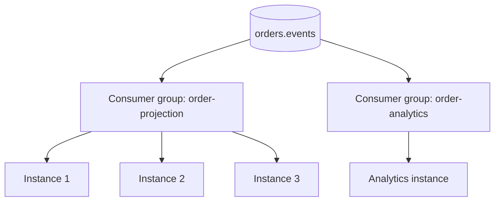
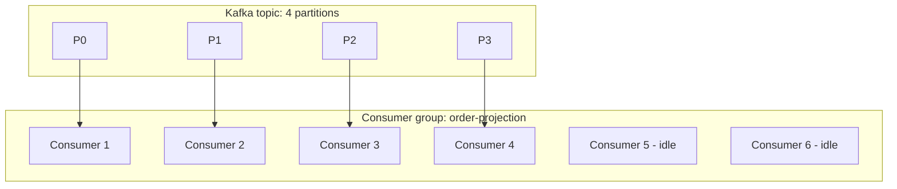

# Mở rộng nhiều instance và cấu hình concurrency

Khi lượng message tăng, một consumer duy nhất có thể không xử lý kịp tốc độ dữ liệu. Spring Cloud Stream cho phép mở rộng một luồng tiêu thụ theo hai hướng: chạy nhiều instance của ứng dụng và tăng số consumer/thread xử lý đồng thời trong mỗi instance bằng thuộc tính `concurrency`.

Hai hướng mở rộng này có liên quan nhưng không giống nhau. Nhiều instance giúp phân phối tải qua nhiều tiến trình hoặc máy/container. `concurrency` tăng số consumer hoạt động bên trong một instance. Broker quyết định message được phân phối giữa các consumer dựa trên cơ chế của Kafka, RabbitMQ hoặc Pulsar. Hiệu quả mở rộng còn phụ thuộc partition, queue/subscription, consumer group, thứ tự message và năng lực của hệ thống phía sau.

## 1. Consumer group chia sẻ công việc như thế nào?

Một consumer group là nhóm các consumer cùng tham gia xử lý một luồng dữ liệu logic. Các thành viên trong cùng group chia sẻ message hoặc partition theo quy tắc của broker. Khi tăng số instance thuộc cùng group, broker có thể phân phối công việc cho nhiều thành viên hơn.

Ví dụ, dịch vụ `order-projection` nhận sự kiện từ destination `orders.events`:

```yaml
spring:
  cloud:
    function:
      definition: updateOrderProjection
    stream:
      bindings:
        updateOrderProjection-in-0:
          destination: orders.events
          group: order-projection
          content-type: application/json
```

Nếu chạy ba bản sao của ứng dụng với cùng destination và cùng group `order-projection`, chúng tham gia cùng một nhóm xử lý. Broker phân phối message để các bản sao chia sẻ tải. Nếu chạy một dịch vụ phân tích độc lập cần nhận toàn bộ sự kiện, dịch vụ đó phải dùng group/subscription riêng, chẳng hạn `order-analytics`, thay vì dùng chung group `order-projection`.



Các group độc lập nhận luồng dữ liệu theo cách fan-out của broker. Những instance trong cùng group chia sẻ việc xử lý; chúng không phải mỗi instance đều nhận một bản sao đầy đủ của mọi message.

## 2. Hai chiều mở rộng: instance và concurrency

Giả sử một dịch vụ chạy ba instance, mỗi instance có `concurrency=2`:

Tổng consumer slot = số instance nhân concurrency mỗi instance.

Theo mô hình đơn giản, hệ thống có tối đa sáu consumer slot. Đây là số consumer có thể tham gia nhận việc, không phải cam kết cả sáu luôn hoạt động. Broker có thể giới hạn số consumer hữu ích bởi partition, queue, subscription hoặc loại subscription.

| Cách mở rộng | Thay đổi | Tác động |
|---|---|---|
| Horizontal scaling | Tăng số instance/container của ứng dụng. | Thêm tiến trình, tài nguyên CPU/RAM và thành viên group. |
| Consumer concurrency | Tăng `consumer.concurrency` trong mỗi instance. | Tạo thêm consumer/listener xử lý đồng thời trong tiến trình. |
| Tăng partition hoặc khả năng phân phối | Điều chỉnh cấu trúc destination trên broker. | Có thể tăng mức song song tối đa, tùy broker và quy tắc thứ tự. |

Ví dụ, một instance với concurrency 4 và bốn instance với concurrency 1 có cùng số consumer slot theo phép nhân. Tuy nhiên, cách phân bổ tài nguyên, cô lập lỗi, chi phí kết nối và cách broker phân công khác nhau. Không nên chỉ nhìn tổng số slot để kết luận hai cấu hình có hiệu năng tương đương.

## 3. Cấu hình concurrency trong Spring Cloud Stream

Thuộc tính `consumer.concurrency` được đặt dưới binding đầu vào. Giá trị mặc định thường là 1. Ví dụ cấu hình hai consumer đồng thời cho binding `updateOrderProjection-in-0`:

```yaml
spring:
  cloud:
    function:
      definition: updateOrderProjection
    stream:
      bindings:
        updateOrderProjection-in-0:
          destination: orders.events
          group: order-projection
          consumer:
            concurrency: 2
```

Với cấu hình này, mỗi instance của ứng dụng được yêu cầu sử dụng concurrency bằng 2 cho binding tương ứng, nếu binder hỗ trợ cách triển khai đó. Khi triển khai ba instance, tổng số consumer được tạo có thể lên tới sáu.

Concurrency là thuộc tính của consumer binding. Đặt nó dưới binding đầu ra của `Supplier` hoặc `Function` không làm tăng số consumer nhận dữ liệu. Với function có cả input và output, concurrency áp dụng cho phía tiêu thụ đầu vào của function.

Có thể đặt giá trị khác nhau cho từng binding:

```yaml
spring:
  cloud:
    function:
      definition: updateOrderProjection;updateInventory
    stream:
      bindings:
        updateOrderProjection-in-0:
          destination: orders.events
          group: order-projection
          consumer:
            concurrency: 3
        updateInventory-in-0:
          destination: orders.events
          group: inventory-service
          consumer:
            concurrency: 1
```

Hai luồng xử lý dùng group riêng và có mức concurrency khác nhau. Cấu hình này hữu ích khi projection cần nhiều tài nguyên hơn cập nhật tồn kho, hoặc khi hai luồng có đặc tính tải khác nhau.

## 4. Nhiều instance khi triển khai

Horizontal scaling thường được điều khiển bởi nền tảng triển khai như Kubernetes, Docker Compose hoặc hệ thống điều phối container. Mỗi instance cần nhận cùng cấu hình destination và group để tham gia cùng consumer group.

Ví dụ khái niệm khi chạy ba replica:

```yaml
apiVersion: apps/v1
kind: Deployment
metadata:
  name: order-projection
spec:
  replicas: 3
  selector:
    matchLabels:
      app: order-projection
  template:
    metadata:
      labels:
        app: order-projection
    spec:
      containers:
        - name: application
          image: example/order-projection:1.0.0
          env:
            - name: SPRING_CLOUD_STREAM_BINDINGS_UPDATEORDERPROJECTION_IN_0_GROUP
              value: order-projection
```

Đây là minh họa cấu trúc triển khai; tên biến môi trường cần khớp với property thực tế và cách nền tảng nạp cấu hình. Không đặt group khác nhau cho từng replica nếu mục tiêu là chúng chia sẻ công việc trong cùng group.

Khi tăng replica, broker cần thời gian nhận biết thành viên mới và phân phối lại công việc. Với Kafka, quá trình này là consumer group rebalance. Với RabbitMQ, consumer mới đăng ký vào queue và bắt đầu nhận message theo prefetch/ACK. Với Pulsar, consumer tham gia subscription và broker phân phối message theo subscription type.

## 5. Kafka: concurrency bị giới hạn bởi partition

Trong Kafka, một consumer group đọc các partition của topic. Mỗi partition tại một thời điểm được gán cho tối đa một consumer trong cùng group. Vì vậy, số partition là giới hạn trên của số consumer có thể tích cực đọc song song trong group.

Ví dụ, topic có bốn partition:

| Tổng consumer trong group | Partition được phân công | Kết quả |
|---:|---|---|
| 1 | Consumer 1 nhận P0, P1, P2, P3 | Một consumer đọc cả bốn partition. |
| 2 | Consumer 1 nhận P0, P1; Consumer 2 nhận P2, P3 | Hai consumer cùng xử lý. |
| 4 | Mỗi consumer nhận một partition | Tất cả partition có consumer riêng. |
| 6 | Bốn consumer nhận partition; hai consumer không có partition | Hai consumer dư không tăng throughput đọc của group. |



Giả sử ứng dụng có ba instance và `concurrency=2`, tổng cộng có thể tạo sáu Kafka consumers. Nếu topic chỉ có bốn partition, tối đa bốn consumer trong group được gán partition tại một thời điểm. Tăng concurrency lên 3 mỗi instance không làm topic bốn partition xử lý được sáu partition song song.

Khi cần mở rộng Kafka, cần xem xét cả số partition, throughput từng partition, key distribution, số instance và concurrency. Tăng partition có thể thay đổi cách key được ánh xạ tới partition khi dùng partitioner dựa trên số partition hiện tại; cần đánh giá tác động tới thứ tự theo key và các consumer đang chạy.

### 5.1. Bảo toàn thứ tự theo partition

Kafka bảo đảm thứ tự đọc trong một partition. Nếu các sự kiện cùng `orderId` phải được xử lý tuần tự, producer nên dùng `orderId` làm key để chúng được định tuyến nhất quán tới cùng partition.

Tuy nhiên, thứ tự nhận không luôn đồng nghĩa với thứ tự hoàn tất nghiệp vụ. Nếu ứng dụng đưa các message trong cùng partition vào xử lý bất đồng bộ song song bên trong code, sự kiện đến sau có thể hoàn tất trước sự kiện đến trước. Khi thứ tự là yêu cầu nghiệp vụ, cần giữ xử lý tuần tự trong phạm vi key/partition hoặc dùng cơ chế điều phối phù hợp.

### 5.2. Rebalance khi thêm hoặc bớt instance

Khi một consumer tham gia hoặc rời group, Kafka có thể phân công lại partition. Trong thời gian rebalance, việc đọc có thể tạm dừng; các message chưa commit offset có thể được đọc lại. Consumer cần xử lý idempotent và commit offset theo thời điểm phù hợp với tác dụng nghiệp vụ.

Tránh tăng/giảm replica liên tục trong thời gian ngắn. Cấu hình health check, shutdown grace period và cơ chế dừng consumer đúng cách giúp giảm việc rebalance bất thường.

## 6. RabbitMQ: nhiều consumer cùng nhận từ queue

Với RabbitMQ, consumer group của Spring Cloud Stream thường được ánh xạ thành queue gắn với destination/exchange theo cấu hình binder. Nhiều consumer cùng đăng ký vào một queue có thể chia sẻ message. Không có một khái niệm partition cố định tương đương Kafka cho queue thông thường.

Concurrency tăng số consumer nhận message từ queue. Rabbit binder cũng có thuộc tính riêng như `maxConcurrency` và `prefetch`, tùy phiên bản binder. `concurrency` xác định mức consumer ban đầu; `maxConcurrency` có thể cho phép container tăng số consumer trong giới hạn cấu hình. `prefetch` điều khiển số message chưa ACK có thể được giao trước cho mỗi consumer, ảnh hưởng tới lượng message đang nằm trong xử lý và độ công bằng phân phối.

Ví dụ cấu hình consumer binding:

```yaml
spring:
  cloud:
    function:
      definition: updateOrderProjection
    stream:
      bindings:
        updateOrderProjection-in-0:
          destination: orders.events
          group: order-projection
          consumer:
            concurrency: 2
      rabbit:
        bindings:
          updateOrderProjection-in-0:
            consumer:
              maxConcurrency: 5
              prefetch: 20
```

Trong ví dụ, binder có thể khởi tạo hai consumer và tăng tới năm consumer theo khả năng của container. Mỗi consumer có thể nhận trước tối đa số message theo cấu hình prefetch trước khi ACK. Cần kiểm tra tài liệu đúng phiên bản Rabbit binder vì các tùy chọn mở rộng và đơn vị/giới hạn có thể thay đổi.

Nhiều consumer trên cùng queue có thể làm thay đổi thứ tự hoàn tất xử lý. Một message chậm có thể được consumer A xử lý trong khi message sau được consumer B hoàn tất trước. Nếu cần thứ tự theo khóa nghiệp vụ, cần routing tới các queue riêng, dùng cơ chế tuần tự hóa theo key hoặc thiết kế xử lý có khả năng chịu message đến lệch thứ tự.

## 7. Pulsar: concurrency phụ thuộc subscription type

Trong Pulsar, nhiều consumer có thể cùng tham gia một subscription. Cách broker phân phối message phụ thuộc subscription type:

| Subscription type | Hành vi khái quát | Khả năng mở rộng |
|---|---|---|
| Exclusive | Chỉ một consumer hoạt động trên subscription. | Không mở rộng bằng cách thêm consumer vào cùng subscription. |
| Failover | Một consumer active; consumer khác dự phòng. | Tăng khả năng sẵn sàng, không chia tải đồng thời theo kiểu Shared. |
| Shared | Nhiều consumer nhận message luân phiên/được phân phối qua subscription. | Phù hợp mở rộng song song; thứ tự toàn cục không được bảo đảm. |
| Key_Shared | Nhiều consumer cùng hoạt động, message cùng key được gắn với consumer theo quy tắc key-shared. | Mở rộng song song và giữ affinity theo key trong phạm vi chính sách. |

Với subscription `Exclusive` hoặc `Failover`, tăng số instance/concurrency không đồng nghĩa tăng số consumer xử lý đồng thời. Với `Shared`, nhiều consumer có thể nhận song song nhưng message có thể được xử lý hoàn tất không theo thứ tự ban đầu. `Key_Shared` hữu ích khi cần phân phối song song nhưng vẫn muốn message cùng key được giao cho cùng consumer theo cơ chế của Pulsar.

Ví dụ cấu hình subscription type cho Pulsar binder có thể được đặt trong phần thuộc tính consumer riêng của binder. Tên property và cách khai báo phụ thuộc phiên bản Pulsar binder/client, do đó cần dùng đúng tài liệu phiên bản đang triển khai. Không nên sao chép nguyên cấu hình Kafka `group` hoặc Rabbit `prefetch` sang Pulsar và kỳ vọng cùng ý nghĩa.

## 8. Chọn concurrency theo năng lực xử lý

Tăng concurrency chỉ hữu ích khi có đủ công việc độc lập và các tài nguyên phía sau còn dư năng lực. Nếu consumer xử lý mỗi message bằng một truy vấn database nặng, tăng concurrency có thể làm cạn connection pool và tăng thời gian phản hồi thay vì tăng throughput.

Khi chọn giá trị, cần xem xét:

- Số partition của Kafka hoặc số consumer mà queue/subscription hỗ trợ.
- Số CPU core và bộ nhớ của mỗi instance.
- Kích thước connection pool của database.
- Giới hạn rate của API hoặc dịch vụ bên ngoài.
- Thời gian xử lý trung bình và phân bố message lớn/nhỏ.
- Số lượng message đang chờ, consumer lag và tốc độ phát từ producer.
- Mức độ yêu cầu về thứ tự, idempotency và giao nhận.

Không nên đặt concurrency bằng số CPU một cách máy móc. Consumer có thể bị giới hạn bởi I/O, database hoặc broker; một concurrency thấp hơn vẫn có thể đạt throughput tốt. Hãy tăng từng bước và đo kết quả.

## 9. Thread safety của function và service

Trong Spring, bean function thường là singleton. Khi binding chạy nhiều consumer đồng thời, cùng một instance function hoặc dependency có thể được gọi từ nhiều thread. Vì vậy, code xử lý phải an toàn khi chạy song song.

Ví dụ consumer không giữ trạng thái thay đổi dùng chung:

```java
import java.util.function.Consumer;

import org.springframework.context.annotation.Bean;
import org.springframework.context.annotation.Configuration;

@Configuration
class OrderProjectionFunctions {

    @Bean
    Consumer<OrderCreated> updateOrderProjection(
            OrderProjectionService service) {
        return event -> service.apply(event);
    }
}

record OrderCreated(String eventId, String orderId) {}
```

Đoạn code này chuyển mỗi sự kiện tới service. `OrderProjectionService` và các repository bên dưới cần hỗ trợ lời gọi đồng thời; transaction và idempotency phải được thiết kế ở tầng dữ liệu.

Tránh lưu payload đang xử lý vào field mutable của bean singleton, ví dụ `currentOrder`, `lastEvent` hoặc một `ArrayList` dùng chung mà không đồng bộ. Dữ liệu theo từng message nên nằm trong biến cục bộ hoặc context riêng của lần xử lý. Nếu phải cập nhật trạng thái dùng chung, sử dụng thao tác atomic, lock phù hợp hoặc cơ chế đồng bộ ở database.

## 10. Concurrency, batch và prefetch là các khái niệm khác nhau

Các thuộc tính này thường bị nhầm lẫn:

| Khái niệm | Điều khiển | Không có nghĩa là |
|---|---|---|
| `consumer.concurrency` | Số consumer/listener xử lý đồng thời trong một instance theo binder. | Số message trong một batch. |
| Số instance/replica | Số tiến trình ứng dụng tham gia group/subscription. | Số partition của topic. |
| Kafka partitions | Số luồng log có thể được phân công độc lập trong một topic. | Số thread tự động được tạo trong ứng dụng. |
| RabbitMQ prefetch | Số message chưa ACK được broker giao trước cho consumer. | Số consumer hoặc số message đã xử lý xong. |
| Batch mode | Cách consumer nhận một nhóm message trong một lần xử lý. | Số instance trong group. |

Tăng concurrency không tự bật batch mode. Tăng prefetch không tạo thêm consumer. Tăng số partition không tự tăng replica ứng dụng. Cần cấu hình từng chiều theo mục tiêu cụ thể.

## 11. Ví dụ tính toán quy mô consumer

Giả sử dịch vụ xử lý `orders.events` cần chạy trên ba instance, mỗi instance dùng concurrency 2. Topic Kafka có bốn partition.

| Tham số | Giá trị |
|---|---:|
| Số instance | 3 |
| Concurrency mỗi instance | 2 |
| Tổng consumer slot | 6 |
| Kafka partitions | 4 |
| Consumer được gán partition tối đa | 4 |
| Consumer slot có thể nhàn rỗi | 2 |

Nếu throughput vẫn không đủ, cần xem xét tăng partition trước hoặc đồng thời với tăng số consumer, nhưng phải đánh giá key distribution, thứ tự và chi phí broker. Nếu partition đã có nhiều nhưng consumer xử lý chậm do database, tăng connection pool hoặc tối ưu thao tác dữ liệu có thể hiệu quả hơn việc thêm thread.

Với RabbitMQ, không có giới hạn partition tương tự; cần theo dõi queue depth, số consumer active, unacked messages và năng lực xử lý của queue/broker. Với Pulsar, cần chọn subscription type cho phép chia tải nếu muốn nhiều consumer active đồng thời.

## 12. Quan sát hiệu quả mở rộng

Không đánh giá concurrency chỉ bằng số thread đã cấu hình. Hãy quan sát các chỉ số ở cả ứng dụng và broker:

- Consumer lag hoặc số message đang chờ.
- Throughput: message nhận và xử lý thành công mỗi giây.
- Thời gian xử lý trung bình, p95/p99 và số message xử lý quá hạn.
- Số consumer active, số partition được gán và rebalance (Kafka).
- Queue depth, unacked message, consumer utilization và redelivery (RabbitMQ).
- Subscription backlog, số consumer connected và redelivery (Pulsar).
- CPU, heap, GC, thread pool và connection pool của database.
- Tỷ lệ lỗi, retry, DLQ và message trùng lặp.

Một cấu hình concurrency tốt thường làm throughput tăng và lag giảm mà không khiến độ trễ, lỗi hoặc tài nguyên downstream tăng mất kiểm soát. Nếu tăng concurrency mà throughput không tăng, cần xác định nút thắt nằm ở partition, database, API ngoài, lock hay broker.

## 13. Triển khai tăng/giảm instance an toàn

Khi scale up, instance mới tham gia group/subscription và broker phân phối lại công việc. Khi scale down, consumer rời nhóm và message chưa xác nhận có thể được giao lại. Cần chuẩn bị cho cả hai tình huống:

1. Dùng cùng destination và group cho mọi replica thuộc cùng dịch vụ xử lý.
2. Cấu hình shutdown grace period đủ để consumer hoàn tất hoặc dừng xử lý có kiểm soát.
3. Chọn ACK/offset commit phù hợp với thời điểm tác dụng nghiệp vụ đã bền vững.
4. Thiết kế consumer idempotent để chịu được message được giao lại.
5. Không scale quá nhanh khiến Kafka rebalance liên tục hoặc Rabbit/Pulsar tạo nhiều consumer trong thời gian ngắn.
6. Đặt readiness/liveness probe phản ánh trạng thái ứng dụng và kết nối cần thiết.
7. Theo dõi lag/backlog sau mỗi lần thay đổi replica hoặc concurrency.

Nếu dùng autoscaling theo consumer lag hoặc queue depth, nên đặt ngưỡng và thời gian ổn định (stabilization) để tránh dao động replica liên tục. Cũng cần giới hạn replica tối đa theo số partition hoặc năng lực broker, cùng giới hạn database/API phía sau.

## 14. Các lỗi thường gặp

1. **Tăng instance nhưng vô tình đổi group.** Mỗi instance có group khác nhau có thể nhận bản sao đầy đủ thay vì chia tải.
2. **Tăng Kafka consumer vượt số partition.** Consumer dư không được gán partition nên không tăng throughput.
3. **Dùng chung group cho hai dịch vụ độc lập.** Hai dịch vụ có thể chia nhau message thay vì mỗi dịch vụ nhận toàn bộ sự kiện.
4. **Đặt concurrency quá cao.** Database pool, CPU hoặc API phụ thuộc có thể trở thành nút thắt.
5. **Giả định mọi binder có cùng cách phân phối.** Kafka dùng partition assignment; RabbitMQ dùng queue consumers; Pulsar phụ thuộc subscription type.
6. **Bỏ qua thread safety.** Nhiều thread có thể gọi cùng bean singleton và gây race condition trên trạng thái mutable.
7. **Nhầm concurrency với batch/prefetch.** Các thuộc tính này điều khiển các lớp khác nhau của đường nhận message.
8. **Không tính message được giao lại khi rebalance/restart.** Consumer cần idempotency và xử lý ACK/offset đúng thời điểm.
9. **Tăng concurrency nhưng không đo.** Số thread lớn hơn không tự động đồng nghĩa throughput cao hơn.

## 15. Quy trình chọn cấu hình mở rộng

Trước khi tăng instance hoặc concurrency cho một binding, hãy trả lời:

1. Consumer group/subscription hiện tại có đúng là nhóm xử lý cần chia tải không?
2. Topic Kafka có bao nhiêu partition, hoặc queue/subscription của RabbitMQ/Pulsar cho phép bao nhiêu consumer active?
3. Mỗi instance nên có bao nhiêu consumer đồng thời dựa trên CPU, I/O và connection pool?
4. Tổng số consumer sau khi nhân với replica có vượt giới hạn hữu ích của broker không?
5. Message có cần giữ thứ tự theo key hoặc entity không?
6. Bean function, service và repository có an toàn khi nhiều thread cùng gọi không?
7. Consumer có idempotent khi message được giao lại sau restart/rebalance không?
8. Metric nào chứng minh throughput tăng và backlog giảm mà độ trễ vẫn chấp nhận được?
9. Scale down có đủ thời gian để consumer dừng và xác nhận công việc an toàn không?

Hãy bắt đầu từ concurrency thấp, đo throughput và độ trễ, sau đó tăng dần trong giới hạn partition/queue/subscription và năng lực hệ thống phụ thuộc. Kết hợp horizontal scaling với concurrency đúng mức sẽ giúp Spring Cloud Stream xử lý tải lớn hơn mà vẫn giữ được hành vi giao nhận, thứ tự và tính ổn định của ứng dụng.
