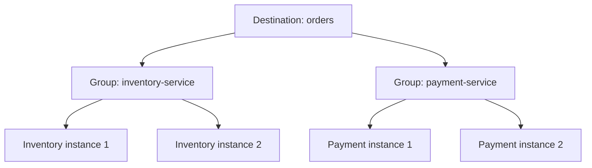

# Thay đổi tên nhóm, khởi động lại và nguy cơ xử lý lại

Trong Spring Cloud Stream, thuộc tính `group` xác định danh tính của một nhóm consumer trên broker. Các instance dùng cùng destination và cùng group thường phối hợp để chia tải cho một luồng xử lý. Khi ứng dụng khởi động lại với cùng group, broker có thể tiếp tục từ trạng thái giao nhận hoặc vị trí đã lưu. Khi đổi tên group, ứng dụng thường tạo một nhóm tiêu thụ độc lập với trạng thái riêng. Điều đó có thể khiến message cũ được đọc lại, message mới được nhận thêm lần nữa hoặc backlog của nhóm cũ bị bỏ lại.

Vì vậy, cần phân biệt ba thao tác: khởi động lại một instance, triển khai lại cả nhóm với cùng danh tính và tạo một nhóm mới để phát lại hoặc chạy song song. Ba thao tác có tác động khác nhau lên offset, queue, subscription và dữ liệu nghiệp vụ. Nếu không xác định rõ mục đích, một thay đổi nhỏ trong cấu hình `group` có thể tạo ra việc xử lý trùng lặp trên quy mô lớn.

## 1. Group đại diện cho một luồng xử lý logic

Giả sử topic `orders` chứa các sự kiện tạo đơn hàng. Hai instance của dịch vụ kho cùng dùng group `inventory-service` sẽ phối hợp tiêu thụ các partition của topic. Khi thêm instance, broker phân công lại partition để chia tải. Một dịch vụ thanh toán cần nhận đầy đủ các sự kiện tương tự nên dùng group riêng, ví dụ `payment-service`.



Trong mô hình này:

- Các instance cùng group là các bản sao triển khai của cùng một luồng xử lý logic; chúng chia nhau công việc.
- Các group khác nhau là các luồng xử lý độc lập; mỗi group có thể nhận bản sao của các sự kiện theo cơ chế của broker.
- Nếu hai dịch vụ không nên chia nhau message mà mỗi dịch vụ phải xử lý toàn bộ sự kiện, chúng không nên dùng chung group.
- Group name cần ổn định qua lần restart và được cấu hình nhất quán ở mọi replica của cùng ứng dụng.

Ví dụ cấu hình Spring Cloud Stream:

```yaml
spring:
  cloud:
    function:
      definition: processOrder
    stream:
      bindings:
        processOrder-in-0:
          destination: orders
          group: inventory-service
```

Các pod hoặc process của dịch vụ kho cùng dùng cấu hình trên sẽ tham gia cùng nhóm logic. Không đặt group theo hostname, pod name, request ID hoặc giá trị ngẫu nhiên nếu muốn broker nhớ tiến độ tiêu thụ giữa các lần triển khai.

## 2. Khởi động lại với cùng group

Khi khởi động lại consumer với cùng destination và group, mục tiêu thông thường là tiếp tục xử lý từ tiến độ đã lưu. Broker giữ trạng thái theo cơ chế riêng; việc khôi phục không có nghĩa message cuối cùng đã xử lý chắc chắn sẽ không bao giờ được giao lại.

Một tình huống phổ biến:

1. Consumer nhận message `evt-101`.
2. Ứng dụng cập nhật database thành công.
3. Process dừng trước khi broker ghi nhận acknowledgement hoặc offset commit.
4. Sau restart, broker giao lại `evt-101`.

Nếu consumer không idempotent, đơn hàng có thể bị trừ tồn kho hai lần hoặc email có thể được gửi hai lần. Đây là lý do phải thiết kế xử lý lặp an toàn ngay cả khi group name không thay đổi.

### 2.1. Kafka: group ID và committed offset

Với Kafka, `group` của binding được ánh xạ thành consumer group ID. Kafka lưu committed offset theo group và partition. Khi consumer khởi động lại bằng cùng group ID, nó tiếp tục từ offset đã commit gần nhất, nếu offset đó còn hợp lệ và topic vẫn lưu giữ record tương ứng.

Một số điểm cần nhớ:

- Offset được quản lý riêng cho từng partition trong group.
- Consumer xử lý một record nhưng chưa commit offset trước khi dừng có thể nhận lại record đó sau restart.
- Nếu offset được commit trước khi tác động nghiệp vụ hoàn tất, process dừng có thể khiến record không được xử lý lại dù nghiệp vụ chưa hoàn thành. Cần chọn acknowledgement/transaction strategy phù hợp.
- Khi không có committed offset hợp lệ, chính sách bắt đầu như `startOffset` của Kafka binder hoặc `auto.offset.reset` của client có thể quyết định vị trí đọc ban đầu, tùy cấu hình và phiên bản.
- Topic retention và chính sách lưu offset của broker giới hạn khoảng thời gian có thể tiếp tục hoặc phát lại dữ liệu.

Để khai báo vị trí bắt đầu khi group chưa có offset, Kafka binder hỗ trợ cấu hình `startOffset` theo binding:

```yaml
spring:
  cloud:
    stream:
      bindings:
        processOrder-in-0:
          destination: orders
          group: inventory-service
      kafka:
        bindings:
          processOrder-in-0:
            consumer:
              startOffset: earliest
```

`earliest` yêu cầu bắt đầu từ record sớm nhất còn được lưu khi cần khởi tạo vị trí đọc. `latest` bắt đầu từ các record mới theo chính sách tương ứng. Thiết lập này không có nghĩa mỗi lần restart sẽ tự đọc lại từ đầu khi group đã có committed offset. Hãy kiểm tra cấu hình binder và phiên bản đang dùng trước khi thay đổi vị trí bắt đầu.

### 2.2. RabbitMQ: group được ánh xạ thành queue

Với Rabbit binder, destination thường được ánh xạ thành exchange và group thành queue dành cho nhóm consumer. Các instance dùng cùng group cạnh tranh nhận message từ queue đó. Khi restart bằng cùng group, chúng tiếp tục đọc queue hiện có; message chưa được acknowledgement có thể được giao lại.

Nếu queue được cấu hình durable và message được publish với delivery mode phù hợp, backlog có thể tồn tại qua lần broker restart. Điều này phụ thuộc cấu hình queue, message persistence, chính sách TTL, dead-letter và cách provisioning. Không nên suy ra rằng mọi queue hoặc mọi message đều được lưu bền vững chỉ vì ứng dụng có `group`.

### 2.3. Pulsar: group được ánh xạ thành subscription

Với Pulsar binder, group thường được dùng làm subscription name. Subscription giữ cursor và trạng thái acknowledgement riêng. Khởi động lại consumer với cùng subscription cho phép tiếp tục theo cursor đã lưu; message chưa được xác nhận có thể được redeliver tùy subscription type và chính sách acknowledgement.

Subscription type như Exclusive, Failover, Shared hoặc Key_Shared quyết định cách consumer trong cùng subscription nhận message và có thể ảnh hưởng thứ tự. Vị trí khởi tạo subscription mới được điều khiển bởi cấu hình initial position của binder/client và chính sách lưu giữ topic. Cần kiểm tra các thiết lập này trước khi thay subscription name hoặc phát lại dữ liệu.

## 3. Đổi tên group thực chất tạo một danh tính tiêu thụ mới

Không nên xem đổi group name như đổi nhãn cho cùng một consumer. Với Kafka, group ID mới không có committed offset của group cũ. Với RabbitMQ, group mới thường dẫn tới queue mới. Với Pulsar, group mới thường dẫn tới subscription mới có cursor riêng.

| Broker | Ý nghĩa của group | Hệ quả khi đổi tên |
|---|---|---|
| Kafka | Consumer group ID và committed offsets theo partition | Group mới có trạng thái offset riêng; vị trí đọc ban đầu phụ thuộc chính sách start/reset và record còn retention |
| RabbitMQ | Queue dành cho consumer group, gắn với destination/exchange | Queue mới nhận các message được định tuyến sau khi queue được tạo; backlog của queue cũ vẫn thuộc queue cũ |
| Pulsar | Subscription name và cursor riêng | Subscription mới có vị trí đọc độc lập; initial position và retention quyết định dữ liệu có thể đọc |

Ví dụ, cấu hình ban đầu:

```yaml
spring:
  cloud:
    stream:
      bindings:
        processOrder-in-0:
          destination: orders
          group: inventory-service
```

Đổi thành:

```yaml
spring:
  cloud:
    stream:
      bindings:
        processOrder-in-0:
          destination: orders
          group: inventory-service-v2
```

Đây là một nhóm mới. Nếu Kafka được cấu hình để bắt đầu từ `earliest`, nhóm mới có thể đọc lại toàn bộ record còn trong retention. Nếu bắt đầu từ `latest`, nhóm mới có thể chỉ nhận record mới sau khi được tạo. Với RabbitMQ, queue mới thường chỉ nhận message được exchange định tuyến sau khi queue tồn tại; nó không tự lấy backlog của queue cũ. Với Pulsar, subscription mới đọc theo initial position đã cấu hình.

### 3.1. Tránh triển khai lẫn group cũ và group mới ngoài ý muốn

Trong rolling deployment, nếu một phần pod dùng `inventory-service` và phần còn lại dùng `inventory-service-v2`, hai nhóm có thể cùng tiêu thụ độc lập. Khi đó, mỗi sự kiện có thể được xử lý một lần ở nhóm cũ và một lần ở nhóm mới. Đây là hành vi bình thường của các nhóm độc lập, không phải broker tự nhân đôi message.

Trước khi rollout, cần xác định:

- Tất cả replica có được cập nhật group cùng lúc hay không.
- Có chủ ý chạy hai group song song để kiểm tra hoặc chuyển đổi hay không.
- Nhóm mới có thực hiện tác động nghiệp vụ thật hay chỉ chạy shadow/read-only.
- Ai sở hữu backlog của nhóm cũ và khi nào queue/subscription/group cũ được dừng hoặc xóa.

Không đổi group bằng biến môi trường ở một số replica trong khi các replica còn lại vẫn chạy group cũ, trừ khi việc chạy hai nhóm đã được thiết kế và kiểm soát rõ ràng.

## 4. Phân biệt restart, rebalance và replay

Ba khái niệm này thường bị gộp chung nhưng có ý nghĩa khác nhau:

| Thao tác | Mục tiêu | Tác động chính |
|---|---|---|
| Restart | Khởi động lại process hoặc pod | Giữ danh tính group; broker khôi phục từ offset, queue hoặc subscription hiện có |
| Rebalance | Phân công lại partition/consumer khi membership thay đổi | Có thể tạm dừng nhận dữ liệu và chuyển partition sang consumer khác; không phải yêu cầu đọc lại toàn bộ topic |
| Replay | Cố ý xử lý lại một phần hoặc toàn bộ dữ liệu | Thay đổi vị trí đọc/cursor hoặc phát lại message; có thể lặp tác động nghiệp vụ |

Với Kafka, khi một member dừng hoặc member mới tham gia, group có thể rebalance. Một record chưa được commit có thể được xử lý lại sau khi partition được giao cho consumer khác. Rebalance tự nó không đặt mọi offset về đầu topic.

Với RabbitMQ, consumer bị mất kết nối khiến các message chưa được acknowledgement được đưa lại trạng thái sẵn sàng trong queue. Consumer khác trong cùng queue có thể nhận chúng. Đây là redelivery, không phải tạo queue mới hoặc đọc lại toàn bộ lịch sử.

Với Pulsar, message chưa được acknowledgement có thể được redeliver theo subscription type và acknowledgement timeout/negative acknowledgement. Cursor đã xác nhận vẫn giữ tiến độ riêng của subscription.

## 5. Chủ động phát lại dữ liệu trên Kafka

Kafka cho phép điều chỉnh committed offsets của một consumer group để đọc lại dữ liệu. Đây là thao tác vận hành có ảnh hưởng trực tiếp đến nghiệp vụ. Trước khi thực hiện, cần dừng toàn bộ consumer thuộc group mục tiêu để tránh chúng tiếp tục commit offset trong lúc reset.

Ví dụ kiểm tra vị trí nếu muốn đọc lại từ đầu phần dữ liệu còn lưu trong topic `orders`:

```bash
kafka-consumer-groups.sh \
  --bootstrap-server localhost:9092 \
  --group inventory-service-v2 \
  --topic orders \
  --reset-offsets \
  --to-earliest \
  --dry-run
```

Đọc kỹ kết quả `dry-run`, xác nhận đúng cluster, group, topic và partition. Chỉ sau khi dừng consumer, kiểm tra tác động nghiệp vụ và có phê duyệt vận hành phù hợp, mới thay `--dry-run` bằng `--execute` để áp dụng. Không chạy lệnh reset offset trên group đang có consumer hoạt động.

Một số nguyên tắc khi replay:

- `--to-earliest` chỉ đưa offset về record sớm nhất còn trong retention; nó không khôi phục dữ liệu đã hết hạn.
- Có thể reset theo topic/partition hoặc vị trí cụ thể, nhưng phải tính đến phạm vi dữ liệu và thứ tự sự kiện.
- Reset offset không xóa dữ liệu cũ và không tạo bản sao mới trong topic; nó làm consumer đọc lại record hiện có.
- Nếu nhiều dịch vụ dùng group riêng, chỉ reset group cần replay; không tác động nhầm group của dịch vụ khác.
- Theo dõi consumer lag, tốc độ replay và tải lên database/downstream để tránh gây quá tải.

Với RabbitMQ, queue không có offset để đặt lại như Kafka. Replay thường cần lấy message từ DLQ, republish từ kho lưu trữ hoặc dùng một cơ chế lưu trữ sự kiện riêng. Với Pulsar, việc phát lại có thể dùng thao tác seek/reset cursor hoặc subscription mới theo khả năng của client/binder và quyền được cấp. Không áp dụng lệnh Kafka cho RabbitMQ hoặc Pulsar.

## 6. Nguy cơ xử lý lại và tác động nghiệp vụ trùng lặp

Một message có thể được giao lại vì consumer dừng trước acknowledgement, lỗi mạng làm mất xác nhận, offset chưa commit hoặc quản trị viên chủ động replay. Do đó, consumer nên idempotent: xử lý cùng một sự kiện nhiều lần vẫn tạo ra một kết quả nghiệp vụ tương đương với xử lý một lần.

Ví dụ, nếu mỗi lần nhận `OrderCreated` đều trừ tồn kho, việc replay có thể trừ hàng hai lần. Có thể dùng `eventId` ổn định và bảng lưu dấu xử lý với ràng buộc duy nhất:

```java
@Service
public class InventoryService {
    private final ProcessedEventRepository processedEvents;
    private final InventoryRepository inventory;

    public InventoryService(
            ProcessedEventRepository processedEvents,
            InventoryRepository inventory) {
        this.processedEvents = processedEvents;
        this.inventory = inventory;
    }

    @Transactional
    public void reserveOnce(OrderCreated event) {
        if (processedEvents.existsById(event.eventId())) {
            return;
        }

        int updated = inventory.reserveIfAvailable(
                event.productId(), event.quantity());
        if (updated != 1) {
            throw new InsufficientInventoryException(event.productId());
        }

        processedEvents.save(new ProcessedEvent(event.eventId()));
    }
}
```

Đây là cấu trúc minh họa. Trong triển khai thực tế, cột `event_id` cần unique constraint và thao tác ghi dấu phải nằm trong cùng transaction với cập nhật tồn kho. Chỉ kiểm tra `existsById` rồi ghi sau mà không có ràng buộc duy nhất vẫn có thể gặp race condition khi hai consumer xử lý cùng một event đồng thời. Cập nhật tồn kho cũng cần câu lệnh có điều kiện, khóa hoặc optimistic locking phù hợp.

Nếu consumer gọi một hệ thống ngoài database, cần xem xét idempotency key của API đích, bảng trạng thái gửi hoặc outbox. Một transaction database không thể tự làm cho thao tác HTTP bên ngoài và acknowledgement broker trở thành một giao dịch nguyên tử.

Không nên dựa vào “exactly once” như một thuộc tính chung của Spring Cloud Stream. Một số binder/broker hỗ trợ transaction hoặc bảo đảm mạnh trong phạm vi cụ thể, nhưng tác động tới database, email, thanh toán và dịch vụ ngoài vẫn cần thiết kế idempotency hoặc phối hợp giao dịch riêng.

## 7. Quy trình đổi group an toàn

Trước khi đổi group, hãy viết rõ lý do: tách dịch vụ logic mới, chạy shadow, khôi phục dữ liệu hay chỉ sửa lỗi cấu hình. Sau đó thực hiện theo trình tự:

1. **Xác định broker và binding.** Ghi nhận destination, group hiện tại, số replica, partition/queue/subscription và cấu hình lưu giữ.
2. **Xác định vị trí bắt đầu của nhóm mới.** Với Kafka chọn chính sách offset ban đầu; với RabbitMQ xác định queue mới sẽ nhận message từ thời điểm nào; với Pulsar xác định initial subscription position.
3. **Đánh giá tác động nghiệp vụ.** Xác định message có thể bị xử lý lại và các downstream side effect cần idempotency.
4. **Chọn chiến lược rollout.** Dừng nhóm cũ trước, chạy nhóm mới song song ở chế độ shadow, hoặc chuyển đổi có kiểm soát theo một cutover plan rõ ràng.
5. **Kiểm tra schema và cấu hình.** Đảm bảo nhóm mới đọc được các phiên bản payload còn trong retention và có quyền truy cập destination.
6. **Triển khai và quan sát.** Theo dõi lag/backlog, tốc độ xử lý, redelivery, lỗi, DLQ và số bản ghi nghiệp vụ được tạo.
7. **Đối soát kết quả.** So sánh số lượng sự kiện, kết quả nghiệp vụ và lỗi giữa nhóm cũ/mới trước khi dừng nhóm cũ.
8. **Dọn tài nguyên sau khi xác nhận.** Chỉ xóa queue, subscription hoặc group cũ khi đã xác định không còn backlog cần xử lý và không cần khả năng rollback.

Nếu mục tiêu chỉ là restart hoặc triển khai phiên bản code mới của cùng một dịch vụ, giữ nguyên group name thường là lựa chọn đúng. Nếu mục tiêu là phát lại dữ liệu, hãy dùng quy trình replay riêng và chuẩn bị idempotency thay vì đổi group như một cách reset ngầm.

## 8. Kiểm thử restart và thay đổi group

Kiểm thử cần tái hiện các tình huống có thể gây trùng hoặc mất message:

- Restart consumer khi đang xử lý một message nhưng trước acknowledgement/offset commit.
- Restart sau khi database commit thành công nhưng broker chưa ghi nhận acknowledgement.
- Thay group name với chính sách bắt đầu `earliest` và `latest` trên Kafka.
- Chạy đồng thời group cũ và group mới để xác nhận mỗi nhóm nhận dữ liệu độc lập.
- Thêm/bớt replica trong cùng group để quan sát rebalance và phân công partition.
- Với RabbitMQ, kiểm tra queue cũ còn backlog và queue mới chỉ nhận message theo thời điểm được bind.
- Với Pulsar, kiểm tra cùng subscription sau restart và subscription mới với initial position đã chọn.
- Replay một event đã xử lý và xác nhận idempotency ngăn side effect lặp.
- Kiểm tra backlog, DLQ và thời gian phục hồi sau khi consumer trở lại.

Một bài kiểm thử hữu ích cần kiểm tra kết quả nghiệp vụ trong database hoặc hệ thống đích, không chỉ kiểm tra log “message received”. Log có thể xuất hiện nhiều lần trong khi nghiệp vụ chỉ nên được áp dụng một lần.

## 9. Quan sát group trong vận hành

Mỗi broker cung cấp chỉ số khác nhau, nhưng nhóm vận hành cần theo dõi tối thiểu:

| Broker | Chỉ số/tín hiệu | Câu hỏi cần trả lời |
|---|---|---|
| Kafka | Consumer lag, committed offsets, số member, rebalance và trạng thái partition | Group có theo kịp topic không? Có bị reset offset hoặc rebalance liên tục không? |
| RabbitMQ | Queue depth, messages ready, unacknowledged, redelivery và consumer count | Queue nào còn backlog? Có message bị giao lại nhiều lần không? |
| Pulsar | Subscription backlog, cursor, unacknowledged messages và redelivery | Subscription có tiến triển không? Cursor có bị đứng hoặc tạo subscription ngoài ý muốn không? |

Log nên có tên group, destination, `eventId`, correlation ID và định danh instance. Khi đổi group, ghi nhận rõ thời điểm thay đổi và phiên bản cấu hình để phân biệt backlog tăng do tải thực với việc tạo một nhóm mới đọc lại dữ liệu.

Không xóa group/queue/subscription chỉ để làm dashboard sạch. Trước khi dọn, phải xác nhận trạng thái backlog, retention, DLQ và nhu cầu audit. Tài nguyên cũ có thể vẫn chứa dữ liệu chưa được xử lý.

## 10. Danh sách kiểm tra trước khi restart hoặc đổi group

- [ ] Group name ổn định và giống nhau trên mọi replica của cùng một luồng xử lý.
- [ ] Đã xác định các instance dùng chung group hay cần các group độc lập.
- [ ] Restart giữ nguyên group nếu mục tiêu là tiếp tục tiến độ hiện tại.
- [ ] Đổi group được xem là tạo danh tính tiêu thụ mới, không phải đổi nhãn.
- [ ] Kafka: đã xác định committed offset, retention và initial offset cho group mới.
- [ ] RabbitMQ: đã kiểm tra queue cũ, queue mới, durability, backlog và acknowledgement.
- [ ] Pulsar: đã kiểm tra subscription name, cursor, initial position và subscription type.
- [ ] Replay có kế hoạch dừng consumer, kiểm tra vị trí đọc và theo dõi tải.
- [ ] Consumer idempotent theo `eventId` hoặc khóa nghiệp vụ ổn định.
- [ ] Có đối soát kết quả, theo dõi lag/backlog và kế hoạch rollback trước khi xóa tài nguyên cũ.

Giữ nguyên group name khi cần khởi động lại cùng một luồng xử lý giúp broker tiếp tục từ trạng thái đã lưu. Đổi group tạo một luồng tiêu thụ độc lập với offset, queue hoặc subscription riêng và có thể làm message được xử lý lại. Khi chủ động replay hoặc chạy song song hai phiên bản, cần kiểm soát vị trí bắt đầu, backlog, idempotency và tác động nghiệp vụ để tránh nhân đôi giao dịch hoặc bỏ sót dữ liệu.
