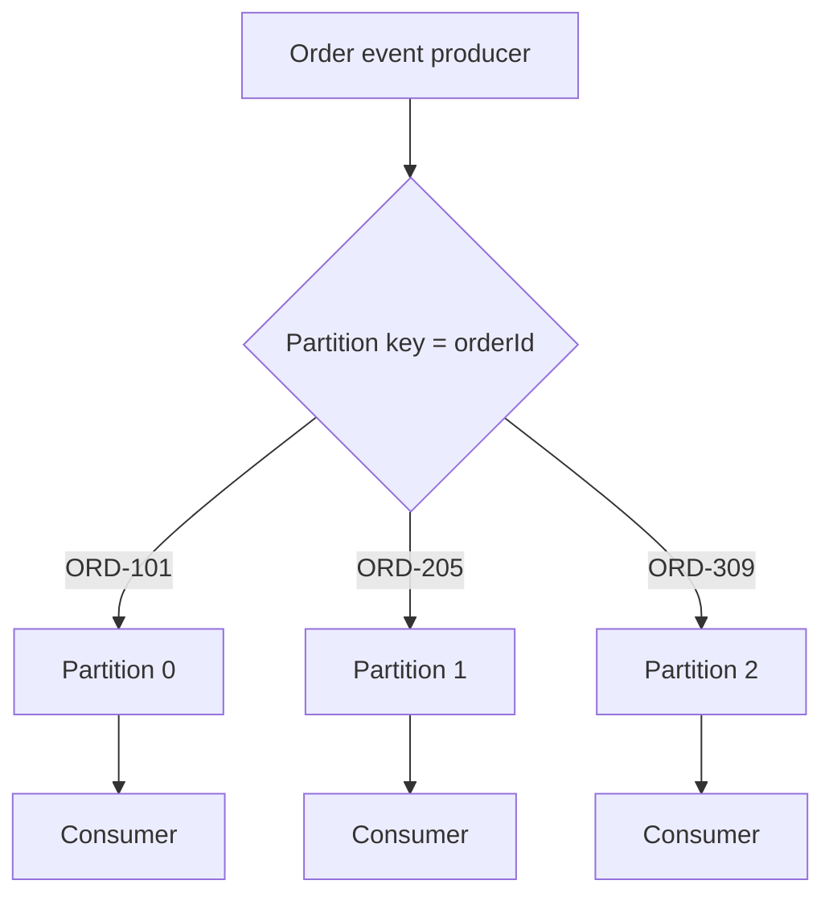
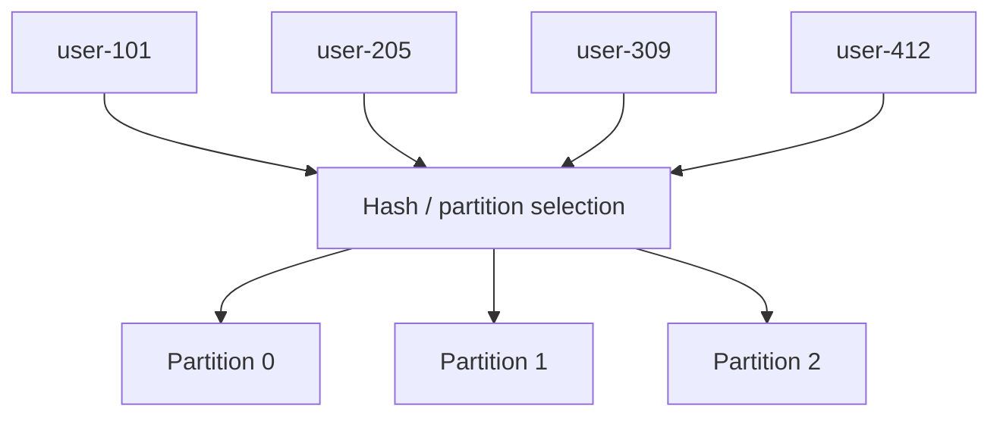

# Chọn khóa theo người dùng, đơn hàng hoặc thiết bị

## 1. Partition key quyết định điều gì?

Khi một destination được chia thành nhiều partition, broker có thể xử lý các phần dữ liệu song song. Producer cần một quy tắc để quyết định message nào đi vào partition nào. **Partition key** là giá trị đại diện cho nhóm message cần được định tuyến cùng nhau, thường là ID của một thực thể nghiệp vụ như `userId`, `orderId` hoặc `deviceId`.

Chọn key đúng giúp đạt hai mục tiêu:

- Các message liên quan đến cùng một thực thể được đưa vào cùng partition theo chiến lược phân vùng đã cấu hình. Điều này hỗ trợ giữ thứ tự trong phạm vi thực thể đó.
- Các thực thể khác nhau có thể được phân bố trên nhiều partition để tăng khả năng xử lý song song.

Ví dụ, hệ thống thương mại điện tử phát các event `OrderCreated`, `PaymentAuthorized` và `OrderShipped`. Nếu nghiệp vụ cần xử lý tuần tự các thay đổi của một đơn hàng, `orderId` là key tự nhiên. Các đơn hàng khác nhau vẫn có thể được xử lý đồng thời.



Partition key không phải là một cơ chế khóa phân tán và cũng không tự bảo đảm tác vụ nghiệp vụ chỉ chạy một lần. Nó là quy tắc định tuyến. Muốn giữ thứ tự hoàn tất, consumer vẫn phải tránh xử lý bất đồng bộ không kiểm soát trong cùng partition/key. Muốn tránh tác dụng phụ lặp, consumer vẫn cần idempotency.

## 2. Chọn key theo phạm vi cần giữ thứ tự

Hãy bắt đầu bằng câu hỏi: **Những message nào bắt buộc phải được xử lý theo thứ tự tương đối với nhau?** Key nên đại diện cho thực thể nhỏ nhất đáp ứng yêu cầu nghiệp vụ đó.

| Key | Phù hợp khi | Ví dụ event | Đánh đổi |
|---|---|---|---|
| `userId` | Các thay đổi của cùng người dùng phải theo thứ tự | `ProfileUpdated`, `PreferenceChanged`, `AccountStatusChanged` | Một người dùng hoạt động nhiều có thể tạo partition nóng |
| `orderId` | Vòng đời của từng đơn hàng cần được tuần tự hóa | `OrderCreated`, `PaymentAuthorized`, `OrderShipped` | Các đơn hàng của cùng người dùng có thể nằm ở nhiều partition |
| `deviceId` | Dữ liệu cảm biến hoặc trạng thái thiết bị cần theo thứ tự | `TemperatureMeasured`, `DeviceOnline`, `DeviceOffline` | Một thiết bị phát dữ liệu quá dày có thể gây tải lệch |
| `accountId` | Các giao dịch của cùng tài khoản phải được áp dụng tuần tự | `MoneyDeposited`, `MoneyWithdrawn` | Tài khoản lớn có thể trở thành hot key |
| `tenantId` | Cần tuần tự hóa toàn bộ luồng của một tenant | `TenantConfigChanged`, `TenantEvent` | Tenant lớn có thể chiếm phần lớn tải của một partition |

Không có key tốt cho mọi bài toán. Nếu chỉ cần thứ tự trong một đơn hàng, dùng `userId` có thể tuần tự hóa nhiều đơn hàng không liên quan và làm giảm song song. Ngược lại, nếu nghiệp vụ yêu cầu tất cả thao tác trên tài khoản của một người dùng phải có thứ tự, `orderId` sẽ quá hẹp.

### Ví dụ chọn giữa userId và orderId

Giả sử một người dùng có ba đơn hàng. Nếu key là `userId`, mọi event của cả ba đơn hàng được đưa về cùng một partition theo chiến lược key, giúp tuần tự hóa theo người dùng nhưng tạo điểm nóng cho người dùng hoạt động nhiều. Nếu key là `orderId`, mỗi đơn hàng có thể nằm ở partition khác nhau, nhờ vậy ba đơn hàng có thể xử lý song song; thứ tự giữa các event của cùng một đơn hàng vẫn được giữ ở phạm vi partition.

Hãy chọn theo invariant nghiệp vụ, không chọn theo trường ID nào tiện lấy nhất trong payload.

## 3. Key phải ổn định và có mặt ở mọi producer

Một key có ích khi mọi producer gửi cùng loại luồng dữ liệu đều tính key theo cùng quy tắc. Nếu producer A dùng `orderId`, còn producer B dùng `userId`, hai event của cùng một đơn hàng có thể bị định tuyến vào hai partition khác nhau.

Quy tắc key nên được xem là một phần của hợp đồng event:

- Chọn một trường có ý nghĩa nghiệp vụ và ổn định trong suốt vòng đời thực thể.
- Dùng cùng kiểu dữ liệu và cách chuẩn hóa ở tất cả producer.
- Không dùng giá trị ngẫu nhiên cho event nếu cần giữ thứ tự theo thực thể.
- Không dùng timestamp làm key khi các event của cùng thực thể phải đi cùng nhau.
- Xác định cách xử lý khi key thiếu hoặc null.
- Nếu cần key ghép, chuẩn hóa định dạng và cách phân tách để tránh va chạm chuỗi.

Ví dụ, nếu `orderId` có thể trùng giữa các tenant, key nên gồm cả tenant và order:

```java
String partitionKey = tenantId + ":" + orderId;
```

Hãy dùng một quy tắc mã hóa không nhập nhằng. Nếu ID có thể chứa dấu phân cách, dùng định dạng có escaping hoặc cấu trúc serialize ổn định thay vì nối chuỗi tùy tiện.

## 4. Cấu hình partition key bằng Spring Cloud Stream

Spring Cloud Stream hỗ trợ khai báo biểu thức lấy key trên producer binding bằng `partition-key-expression`. Có thể chỉ định số partition dự kiến bằng `partition-count`.

Ví dụ producer phát event đơn hàng và dùng `orderId` làm key:

```java
import java.util.function.Function;
import org.springframework.context.annotation.Bean;
import org.springframework.context.annotation.Configuration;

record OrderEvent(String orderId, String eventType, long occurredAt) {}

@Configuration
class OrderEventFunctions {

    @Bean
    Function<OrderEvent, OrderEvent> publishOrderEvent() {
        return event -> event;
    }
}
```

Ví dụ cấu hình output binding với Kafka binder:

```yaml
spring:
  cloud:
    function:
      definition: publishOrderEvent
    stream:
      bindings:
        publishOrderEvent-out-0:
          destination: orders.events
          producer:
            partition-key-expression: payload.orderId
            partition-count: 12
      kafka:
        binder:
          brokers: localhost:9092
```

`payload.orderId` là biểu thức SpEL truy cập trường `orderId` của payload. Spring Cloud Stream dùng giá trị đó làm partition key theo cơ chế phân vùng của binder. `partition-count` mô tả số partition mà producer partitioning sử dụng; với Kafka, topic thực tế cần được provision với số partition tương thích. Không đặt giá trị này tùy tiện lớn hơn số partition có thể nhận record.

Ví dụ trên dùng Kafka binder. Với RabbitMQ hoặc Pulsar, cần kiểm tra cách binder tương ứng ánh xạ partitioning và key sang exchange/queue hoặc topic/subscription; không mặc định mọi binder có semantics giống Kafka.

## 5. Lấy key từ header

Đôi khi key không nằm trực tiếp trong payload hoặc nhiều loại payload khác nhau cùng dùng một header chung. Có thể gắn key vào header khi tạo message rồi tham chiếu header trong biểu thức producer.

```java
import org.springframework.messaging.Message;
import org.springframework.messaging.support.MessageBuilder;

Message<OrderEvent> message = MessageBuilder
    .withPayload(event)
    .setHeader("partitionKey", event.orderId())
    .build();
```

Cấu hình binding:

```yaml
spring:
  cloud:
    stream:
      bindings:
        publishOrderEvent-out-0:
          destination: orders.events
          producer:
            partition-key-expression: headers['partitionKey']
            partition-count: 12
```

Header phải có mặt trước khi message được gửi qua output binding. Nếu header có thể thiếu, cần xác thực hoặc cung cấp chính sách fallback rõ ràng. Đừng để các message thiếu key vô tình dồn vào cùng một partition hoặc bị phân phối không nhất quán.

Với dữ liệu không tin cậy, không cho caller bên ngoài tự đặt partition key tùy ý nếu điều đó có thể làm lệch tải hoặc phá vỡ phạm vi thứ tự. Hãy tính key từ dữ liệu nghiệp vụ đã xác thực.

## 6. Dùng key theo từng loại nghiệp vụ

### Theo người dùng: userId

Chọn `userId` khi các event liên quan đến hồ sơ, quyền, trạng thái tài khoản hoặc cài đặt của cùng một người dùng phải được áp dụng tuần tự.

```yaml
producer:
  partition-key-expression: payload.userId
  partition-count: 12
```

Ví dụ các event `UserRegistered`, `UserProfileUpdated` và `UserSuspended` của cùng user sẽ được định tuyến theo cùng key nếu producer dùng chung quy tắc partitioning. Điều này giúp consumer xử lý trạng thái người dùng theo trình tự trong partition.

Tránh dùng `userId` nếu nghiệp vụ chỉ cần thứ tự theo từng đơn hàng. Một người dùng có thể tạo nhiều đơn hàng đồng thời; gom tất cả vào một key có thể làm tăng độ trễ cho các đơn hàng không liên quan.

### Theo đơn hàng: orderId

Chọn `orderId` khi cần giữ chuỗi chuyển trạng thái của từng đơn hàng:

```yaml
producer:
  partition-key-expression: payload.orderId
  partition-count: 12
```

Ví dụ:

```text
ORD-101: OrderCreated -> PaymentAuthorized -> OrderShipped
ORD-205: OrderCreated -> PaymentFailed
```

Các event của `ORD-101` cùng key và được đưa vào cùng partition. Các event của `ORD-205` có thể được xử lý song song ở partition khác.

### Theo thiết bị: deviceId

Chọn `deviceId` khi chuỗi dữ liệu của cùng thiết bị phải giữ thứ tự, chẳng hạn dữ liệu telemetry, trạng thái kết nối hoặc lệnh điều khiển.

```yaml
producer:
  partition-key-expression: payload.deviceId
  partition-count: 24
```

Một thiết bị có thể phát hàng nghìn event, vì vậy cần kiểm tra phân bố tải. Nếu một thiết bị hoặc một nhóm thiết bị chiếm phần lớn lưu lượng, key theo thiết bị có thể tạo hot partition.

### Theo tài khoản: accountId

Với hệ thống tài chính, các giao dịch của cùng tài khoản thường cần được áp dụng theo thứ tự để tránh tính toán số dư trên trạng thái cũ. `accountId` có thể là key phù hợp, nhưng phải kết hợp với kiểm soát giao dịch, sequence/version và idempotency ở consumer. Partition key không thay thế khóa dữ liệu hoặc transaction của database.

## 7. Composite key khi cần nhiều phạm vi

Một số nghiệp vụ cần phân biệt thực thể trong một tenant hoặc vùng dữ liệu. Khi đó, key có thể là tổ hợp:

```java
String key = tenantId + ":" + deviceId;
```

Hoặc định nghĩa một hàm chuyên biệt để tạo key thống nhất:

```java
record DeviceEvent(String tenantId, String deviceId, String status) {}

String partitionKey(DeviceEvent event) {
    return event.tenantId() + ":" + event.deviceId();
}
```

Composite key hữu ích khi `deviceId` chỉ duy nhất trong phạm vi tenant. Nếu không ghép tenant, hai thiết bị khác tenant nhưng cùng ID có thể bị định tuyến vào cùng key. Việc đó không nhất thiết làm sai dữ liệu, nhưng có thể trộn phạm vi tuần tự hóa và gây tải không cần thiết.

Hãy định nghĩa composite key như một phần của schema hoặc thư viện dùng chung. Nếu các producer tự nối chuỗi theo cách khác nhau, cùng một thực thể có thể đi vào các partition khác nhau.

## 8. Key phân phối tải như thế nào?

Với chiến lược mặc định dựa trên hash, key được chuyển thành giá trị dùng để chọn partition trong phạm vi partition count đã cấu hình. Những message có cùng key thường được ánh xạ vào cùng partition khi số partition và thuật toán không đổi.

Không cần mỗi key có một partition riêng. Nhiều key khác nhau có thể cùng rơi vào một partition do số key thường lớn hơn số partition. Mục tiêu là phân bố đủ đều, đồng thời giữ các message cùng key ở cùng nơi.



Sơ đồ chỉ minh họa việc nhiều key được ánh xạ vào một tập partition hữu hạn; không thể suy ra key cụ thể sẽ vào partition nào nếu chưa biết thuật toán, số partition và cấu hình binder.

Với Kafka, partition là đơn vị lưu trữ và đọc có thứ tự. Consumer group phân phối partition cho các consumer. Vì vậy, số partition đặt giới hạn mức song song hữu ích của một group. Tăng số consumer vượt số partition không làm tăng số partition có thể xử lý đồng thời.

## 9. Hot key và phân bố lệch

Một key có lượng message vượt trội so với phần còn lại được gọi là **hot key**. Vì cùng key phải đi về cùng partition theo chiến lược giữ thứ tự, thêm consumer hoặc thêm instance không thể chia nhỏ luồng của key đó một cách tự động.

Ví dụ:

- Một tài khoản doanh nghiệp phát lượng giao dịch lớn hơn nhiều tài khoản khác.
- Một thiết bị gateway gửi telemetry cho hàng nghìn thiết bị con nhưng mọi event đều dùng chung `gatewayId`.
- Một tenant lớn tạo phần lớn lưu lượng của toàn hệ thống.

Hậu quả có thể là một partition có lag cao, consumer xử lý partition đó quá tải, trong khi các partition khác còn rảnh.

### Cách giảm ảnh hưởng hot key

1. Chọn key ở cấp thực thể nhỏ hơn nếu nghiệp vụ cho phép, ví dụ `deviceId` thay vì `gatewayId`.
2. Tách tenant hoặc khách hàng lớn sang destination/luồng riêng.
3. Dùng sharding key có chủ đích, chẳng hạn `accountId + shardNumber`, nếu có thể nới yêu cầu thứ tự toàn cục của account.
4. Tối ưu thời gian xử lý và tác vụ I/O của consumer.
5. Theo dõi phân bố record và lag theo partition để phát hiện lệch tải.

Sharding một key có thể phá vỡ thứ tự của toàn bộ thực thể. Chỉ thực hiện khi nghiệp vụ chấp nhận chia thực thể thành nhiều luồng độc lập hoặc có cơ chế tổng hợp/tuần tự hóa ở bước sau.

## 10. Key thiếu, null hoặc không hợp lệ

Một partition key cần được xác định trước khi gửi. Nếu `userId`, `orderId` hoặc `deviceId` bị null, biểu thức có thể trả về null hoặc phát sinh lỗi tùy cách xử lý của framework/binder. Với Kafka, record không có key có thể được phân phối theo partitioner mặc định và không còn bảo đảm các event của cùng thực thể đi cùng nhau.

Hãy chọn chính sách rõ ràng:

- Từ chối event nếu thiếu định danh bắt buộc.
- Đưa event vào luồng xử lý lỗi hoặc DLQ nếu dữ liệu không hợp lệ.
- Dùng một key thay thế chỉ khi key đó có ý nghĩa nghiệp vụ và không làm trộn các thực thể không liên quan.

Không nên gán UUID ngẫu nhiên làm fallback nếu cần giữ thứ tự; mỗi event sẽ có key khác nhau và có thể đi vào partition khác nhau. Cũng không nên dùng chuỗi cố định như `unknown` cho mọi message thiếu key vì nó tạo một hot key.

## 11. Thay đổi số partition và tác động đến key

Số partition ảnh hưởng đến ánh xạ key sang partition. Khi số partition thay đổi, nhiều key có thể được ánh xạ sang partition khác theo thuật toán phân vùng. Điều này đặc biệt quan trọng với Kafka vì các event cũ của một key có thể còn trong partition cũ trong khi event mới được ghi vào partition mới.

Nếu yêu cầu thứ tự nghiêm ngặt, việc tăng partition cần được lập kế hoạch:

1. Xác định key nào cần giữ thứ tự và khoảng thời gian xử lý còn tồn tại trong partition cũ.
2. Cân nhắc tạm dừng producer hoặc drain luồng cũ trong cửa sổ chuyển đổi.
3. Dùng phiên bản topic hoặc routing scheme mới nếu cần tách rõ hai giai đoạn.
4. Kiểm tra consumer có thể đọc dữ liệu cũ và mới mà không áp dụng sai thứ tự hay không.
5. Giữ sequence/version nghiệp vụ để phát hiện event đến muộn hoặc thiếu event.

Không thay đổi `partition-count` trong cấu hình producer mà không kiểm tra số partition thật trên broker. Với Kafka, topic không tự giảm số partition; việc tăng số partition là thao tác một chiều trong nhiều cấu hình phổ biến và có thể ảnh hưởng chiến lược key.

## 12. Phân vùng giữa Kafka, RabbitMQ và Pulsar

Khái niệm partition key có thể xuất hiện ở nhiều broker, nhưng semantics và cách cấu hình không hoàn toàn giống nhau.

| Broker | Cách key thường được dùng | Điều cần kiểm tra |
|---|---|---|
| Kafka | Record key giúp chọn partition; record cùng key thường đi cùng partition theo partitioner | Số partition, partitioner, consumer group và cách commit offset |
| RabbitMQ | Routing key định tuyến qua exchange; binder có thể cung cấp cơ chế partitioning riêng | Exchange type, binding key, queue topology, consumer concurrency và binder partition support |
| Pulsar | Message key/ordering key kết hợp partitioned topic và subscription type | Key-based routing, Key_Shared, batching, partition count và ordering semantics |

Với RabbitMQ, routing key của exchange không tự động đồng nghĩa với partition key của Spring Cloud Stream. Cần xem cách Rabbit binder triển khai partitioned producer/consumer và topology queue trong phiên bản đang dùng.

Với Pulsar, nếu cần nhiều consumer cùng xử lý song song nhưng message cùng key đi đến consumer phù hợp để giữ thứ tự theo key, cần xem xét Key_Shared subscription và cấu hình key/batching tương ứng. Chỉ đặt tên header `partitionKey` không đủ nếu producer/binder không ánh xạ nó thành message key mà Pulsar sử dụng.

## 13. Kiểm thử lựa chọn partition key

Kiểm thử cần xác nhận cả tính đúng đắn của key lẫn phân bố tải:

1. Phát nhiều event cho cùng một `orderId` và xác nhận chúng được chọn cùng partition theo cấu hình.
2. Phát event cho nhiều `orderId` khác nhau và quan sát phân bố trên các partition.
3. Gửi event từ nhiều producer và xác nhận tất cả dùng cùng quy tắc key.
4. Kiểm tra payload thiếu key, key null, key rỗng và key không hợp lệ.
5. Tạo một key có lưu lượng lớn để quan sát hot partition và consumer lag.
6. Kiểm tra thứ tự hoàn tất ở consumer, đặc biệt nếu xử lý có thread pool hoặc bất đồng bộ.
7. Kiểm tra hành vi khi thay đổi số partition hoặc số consumer instance.
8. Với RabbitMQ/Pulsar, kiểm thử topology, routing/subscription và semantics của binder thực tế.

Test binder có thể hỗ trợ kiểm thử logic function và message trong ứng dụng, nhưng không thay thế kiểm thử tích hợp với broker khi cần xác nhận partition assignment hoặc message key thực tế.

## 14. Quan sát partition trong production

Theo dõi dữ liệu ở cấp partition giúp phát hiện lệch tải mà metric tổng thể có thể che khuất. Các chỉ số hữu ích gồm:

- Số message và byte được ghi vào từng partition.
- Consumer lag theo partition.
- Thời gian xử lý p95/p99 theo loại event hoặc key group.
- Tỷ lệ key null hoặc key không hợp lệ.
- Tỷ lệ retry, redelivery và DLQ.
- Phân bố số lượng key và lưu lượng của các key lớn nhất.

Không ghi toàn bộ user ID hoặc dữ liệu cá nhân vào log chỉ để quan sát partition. Có thể dùng hash hoặc nhóm thống kê phù hợp với chính sách bảo mật. Khi thấy một partition nóng, hãy kiểm tra key phân phối trước khi tăng số consumer.

## 15. Quy trình chọn partition key

1. Xác định invariant nghiệp vụ: những event nào phải được áp dụng theo thứ tự?
2. Chọn ID đại diện cho đúng phạm vi đó: `userId`, `orderId`, `deviceId`, `accountId` hoặc composite key.
3. Đảm bảo key ổn định, không null và được mọi producer tính giống nhau.
4. Chọn số partition theo throughput dự kiến, mức song song và giới hạn vận hành.
5. Cấu hình `partition-key-expression` và `partition-count` trên producer binding.
6. Kiểm tra binder ánh xạ key sang partition, routing key hoặc message key như thế nào.
7. Kiểm thử cùng key, khác key, hot key, key thiếu và thay đổi partition count.
8. Theo dõi lag và phân bố tải để điều chỉnh dựa trên dữ liệu thực tế.

Chọn key theo người dùng, đơn hàng hoặc thiết bị là quyết định về phạm vi thứ tự và khả năng song song của hệ thống. Key càng rộng thì càng nhiều message bị tuần tự hóa cùng nhau; key càng hẹp thì càng có nhiều cơ hội xử lý song song nhưng có thể không giữ được invariant nghiệp vụ cần thiết. Hãy bắt đầu từ yêu cầu thứ tự, chọn ID ổn định ở đúng cấp thực thể, rồi kiểm chứng phân bố và semantics trên broker thực tế.

