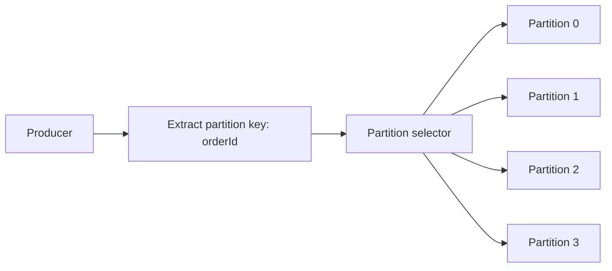

# Cấu hình partitionKeyExpression và partitionCount

## Mục tiêu

Khi xử lý sự kiện, một số message cần được đưa về cùng một phân vùng để giữ thứ tự theo một khóa nghiệp vụ hoặc để xử lý dữ liệu song song. Ví dụ, mọi sự kiện của cùng một đơn hàng nên đi qua cùng partition; các đơn hàng khác nhau có thể được xử lý trên nhiều partition. Spring Cloud Stream hỗ trợ chọn khóa phân vùng ở producer bằng `partitionKeyExpression` hoặc một key extractor tùy chỉnh, sau đó xác định partition trong phạm vi `partitionCount`.

Hai thuộc tính này có vai trò khác nhau:

- `partitionKeyExpression` xác định **khóa logic** lấy từ message, chẳng hạn `orderId` hoặc `customerId`.
- `partitionCount` khai báo **số lượng partition dự kiến** mà cơ chế phân vùng dùng để tính lựa chọn và có thể được binder dùng khi provision destination.

Bài học này trình bày cách cấu hình hai thuộc tính, cách chúng phối hợp với partition selector, cách dùng khóa ổn định, các giới hạn theo Kafka, RabbitMQ và Pulsar, cùng chiến lược kiểm thử.

Sau bài học, bạn có thể:

- Cấu hình `partitionKeyExpression` cho output binding.
- Chọn `partitionCount` phù hợp với topology và tải xử lý.
- Phân biệt partition key, partition selector và partition thực tế trên broker.
- Viết custom `PartitionKeyExtractorStrategy` hoặc `PartitionSelectorStrategy`.
- Hiểu ảnh hưởng của việc tăng partition đến thứ tự và phân phối dữ liệu.
- Kiểm thử việc cùng khóa được định tuyến nhất quán và kiểm tra hành vi của binder.

## 1. Partitioning giải quyết vấn đề gì?

Partitioning chia một luồng dữ liệu thành nhiều phần độc lập để broker và consumer có thể xử lý song song. Một partition là một đơn vị lưu trữ/đọc có thứ tự riêng theo khả năng của broker. Với Kafka, thứ tự được đảm bảo trong một partition, không phải trên toàn topic.

Giả sử hệ thống phát các sự kiện:

- `OrderCreated(orderId="A-10")`
- `OrderPaid(orderId="A-10")`
- `OrderShipped(orderId="A-10")`
- `OrderCreated(orderId="B-20")`

Nếu dùng `orderId` làm partition key, ba sự kiện của đơn hàng A-10 được định tuyến theo cùng một khóa và thường đi vào cùng partition trong cùng topology. Consumer có thể xử lý sự kiện của một đơn hàng theo thứ tự trong partition đó, trong khi các đơn hàng khác được xử lý song song.



Partitioning hữu ích khi:

- Cần giữ thứ tự tương đối cho cùng một thực thể nghiệp vụ.
- Cần chia tải consumer theo nhiều partition.
- Muốn tránh mọi message dồn vào một consumer.
- Có khóa tự nhiên như order ID, account ID hoặc customer ID.

Partitioning không tự đảm bảo exactly-once, không bảo đảm thứ tự giữa các partition và không thay thế idempotency. Retry, redelivery và consumer restart vẫn có thể làm message được xử lý lại.

## 2. Phân biệt partition key, selector và partition count

Ba thành phần cần được hiểu riêng:

| Thành phần | Câu hỏi | Ví dụ |
|---|---|---|
| Partition key | Message thuộc về thực thể/nhóm nào? | `orderId = A-10` |
| Partition selector | Từ key, chọn số partition nào? | Hàm hash hoặc thuật toán tùy chỉnh |
| Partition count | Có bao nhiêu partition trong topology mà producer đang nhắm đến? | 6 |

Trong Spring Cloud Stream:

- `partitionKeyExpression` là SpEL expression để lấy key từ message.
- `partitionKeyExtractorName` trỏ đến bean `PartitionKeyExtractorStrategy` nếu cần logic trích key bằng Java.
- `partitionSelectorExpression` cho phép tùy chỉnh cách chuyển key thành lựa chọn partition.
- `partitionSelectorName` trỏ đến bean `PartitionSelectorStrategy`.
- `partitionCount` cung cấp số lượng partition cho cơ chế phân vùng và cho binder khi provision destination theo khả năng của binder.

Nếu không khai báo selector tùy chỉnh, framework dùng chiến lược mặc định dựa trên hash của key. Không nên dựa vào giá trị partition cụ thể của một message nếu chưa cố định thuật toán và topology; điều quan trọng thường là cùng khóa được xử lý nhất quán trong cùng cấu hình.

## 3. Cấu hình partitionKeyExpression và partitionCount

Ví dụ producer phát sự kiện đơn hàng:

```java
public record OrderEvent(
        String eventId,
        String region,
        String orderId,
        String eventType,
        Instant occurredAt
) {}

@Bean
Supplier<OrderEvent> orderEvents(OrderEventSource source) {
    return source::next;
}
```

Cấu hình output binding:

```yaml
spring:
  cloud:
    function:
      definition: orderEvents
    stream:
      bindings:
        orderEvents-out-0:
          destination: orders.events
          content-type: application/json
          producer:
            partition-key-expression: payload.orderId
            partition-count: 6
```

Ở đây:

- `orderEvents-out-0` là output binding.
- `orders.events` là destination.
- `payload.orderId` lấy order ID từ payload của message.
- `partition-count: 6` khai báo sáu partition dự kiến cho cơ chế phân vùng.

SpEL expression được đánh giá trên message; `payload` truy cập payload và `headers` truy cập headers. Nếu muốn dùng tenant làm khóa:

```yaml
producer:
  partition-key-expression: headers['tenantId']
  partition-count: 6
```

Chỉ dùng header đã được xác thực và có quy tắc ổn định. Nếu tenant ID có thể thay đổi hoặc producer không gửi header đó, key có thể null hoặc không nhất quán. Nên ưu tiên trường payload có ý nghĩa nghiệp vụ ổn định nếu nó là khóa phân vùng chính.

### Cấu hình theo từng binding

Mỗi output binding có thể dùng key và số partition riêng:

```yaml
spring:
  cloud:
    stream:
      bindings:
        orders-out-0:
          destination: orders.events
          producer:
            partition-key-expression: payload.orderId
            partition-count: 12
        payments-out-0:
          destination: payments.events
          producer:
            partition-key-expression: payload.accountId
            partition-count: 6
```

Cách này cho phép tối ưu topology theo đặc tính tải và yêu cầu thứ tự của từng luồng. Cần bảo đảm partition count khai báo phù hợp với số partition thật và cách provision của binder.

## 4. Cách hoạt động của partitionKeyExpression

`partitionKeyExpression` là SpEL expression được đánh giá trên Spring Message. Một số ví dụ:

| Expression | Ý nghĩa | Khi phù hợp |
|---|---|---|
| `payload.orderId` | Lấy khóa từ order ID | Mọi sự kiện của cùng đơn hàng cần đi cùng partition |
| `payload.customerId` | Lấy khóa khách hàng | Cần xử lý theo khách hàng |
| `payload.accountId` | Lấy khóa tài khoản | Cần giữ thứ tự cho các thao tác cùng tài khoản |
| `headers['tenantId']` | Lấy tenant ID từ header | Khi tenant là khóa phân vùng đã xác thực |
| `payload.region + ':' + payload.orderId` | Ghép vùng và đơn hàng | Khi khóa phải phân biệt cùng ID giữa các vùng |

Chọn key dựa trên **đơn vị cần giữ thứ tự**, không chỉ dựa trên trường dễ truy cập. Nếu yêu cầu là các thao tác trên cùng tài khoản phải có thứ tự, dùng `customerId` có thể chưa đủ vì nhiều tài khoản của một khách hàng có thể bị gom vào cùng partition; điều này có thể làm giảm song song mà không mang lại lợi ích nghiệp vụ tương ứng.

Key nên:

- Có giá trị với mọi message thuộc binding.
- Ổn định giữa các sự kiện cùng thực thể.
- Có kiểu và quy tắc chuẩn hóa nhất quán.
- Phân bố đủ đều để tránh một partition quá nóng.
- Không chứa dữ liệu bí mật hoặc dữ liệu cá nhân không cần thiết.

Nếu expression có thể trả về null, hãy xác định rõ chính sách: từ chối message, dùng fallback hợp lệ hay chọn một khóa mặc định có chủ đích. Không để một lượng lớn message thiếu key cùng rơi vào một partition ngoài dự kiến.

## 5. Dùng PartitionKeyExtractorStrategy khi expression không đủ

Với logic trích key phức tạp, có thể tạo bean triển khai `PartitionKeyExtractorStrategy` và tham chiếu bằng `partition-key-extractor-name`.

Ví dụ:

```java
import org.springframework.cloud.stream.binder.PartitionKeyExtractorStrategy;
import org.springframework.messaging.Message;
import org.springframework.context.annotation.Bean;
import org.springframework.context.annotation.Configuration;

@Configuration
class PartitioningConfiguration {

    @Bean
    PartitionKeyExtractorStrategy orderKeyExtractor() {
        return (Message<?> message) -> {
            OrderEvent event = (OrderEvent) message.getPayload();
            return event.region() + ":" + event.orderId();
        };
    }
}
```

Cấu hình binding:

```yaml
spring:
  cloud:
    stream:
      bindings:
        orderEvents-out-0:
          destination: orders.events
          producer:
            partition-key-extractor-name: orderKeyExtractor
            partition-count: 6
```

Khi dùng extractor bean, không cần khai báo thêm `partition-key-expression` cho cùng binding. Chọn một cách trích key để tránh hai nguồn cấu hình cạnh tranh hoặc khiến người đọc không biết cơ chế nào đang có hiệu lực.

Extractor chỉ nên làm nhiệm vụ xác định key. Không gọi database, API từ xa hoặc thực hiện nghiệp vụ trong extractor; việc đó làm tăng độ trễ gửi và khiến partitioning phụ thuộc vào dịch vụ bên ngoài.

## 6. Tùy chỉnh partition selector

Sau khi có key, selector quyết định partition index. Mặc định framework sử dụng hash-based selection. Nếu cần quy tắc riêng, có thể cung cấp `PartitionSelectorStrategy`:

```java
import org.springframework.cloud.stream.binder.PartitionSelectorStrategy;
import org.springframework.context.annotation.Bean;
import org.springframework.context.annotation.Configuration;

@Configuration
class PartitionSelectorConfiguration {

    @Bean
    PartitionSelectorStrategy stablePartitionSelector() {
        return (key, partitionCount) ->
                Math.floorMod(key.hashCode(), partitionCount);
    }
}
```

Cấu hình:

```yaml
spring:
  cloud:
    stream:
      bindings:
        orderEvents-out-0:
          destination: orders.events
          producer:
            partition-key-expression: payload.orderId
            partition-selector-name: stablePartitionSelector
            partition-count: 6
```

Ví dụ dùng `Math.floorMod` để kết quả không âm, kể cả khi `hashCode()` âm. Đây là một chiến lược minh họa; nếu nhiều ngôn ngữ hoặc producer độc lập cần tính cùng partition, không nên dùng Java `hashCode()` làm wire contract vì cách hash của kiểu dữ liệu ở ngôn ngữ khác có thể khác. Hãy định nghĩa thuật toán ổn định, chuẩn hóa key và kiểm thử chéo ngôn ngữ nếu partition mapping phải giống nhau giữa producer.

Selector phải trả về chỉ số hợp lệ theo hợp đồng của framework/binder và partition count đang dùng. Đối chiếu API phiên bản Spring Cloud Stream cụ thể và kiểm thử với binder thực tế trước khi thay selector mặc định.

## 7. partitionCount và số partition thật trên broker

`partitionCount` không phải lệnh đảm bảo rằng broker luôn tạo hoặc tăng số partition thành công. Nó là thông tin cấu hình của producer và có thể được binder sử dụng khi provision destination. Số partition thực tế còn phụ thuộc:

- Destination đã tồn tại hay chưa.
- Binder có bật auto-provisioning/auto-add partition hay không.
- Tài khoản ứng dụng có quyền tạo hoặc thay đổi destination không.
- Broker có cho phép tăng partition và có giới hạn vận hành nào.
- Cấu hình riêng của binder có giá trị tối thiểu hoặc quy tắc riêng nào.

Với Kafka, topic có số partition được quản lý ở broker. Nếu topic đã tồn tại với số partition thấp hơn giá trị mà producer partitioning có thể chọn, việc gửi đến partition index không tồn tại có thể thất bại. Kafka cho phép tăng partition nhưng không giảm số partition của topic. Binder có thể có các tùy chọn như auto-create hoặc auto-add partitions; cần cấu hình và xác minh theo phiên bản Kafka binder đang dùng.

Ví dụ Kafka binder với provisioning được kiểm soát:

```yaml
spring:
  cloud:
    stream:
      bindings:
        orderEvents-out-0:
          destination: orders.events
          producer:
            partition-key-expression: payload.orderId
            partition-count: 6
      kafka:
        binder:
          auto-create-topics: true
          auto-add-partitions: true
          min-partition-count: 1
```

Các tùy chọn provisioning cần được kiểm tra với phiên bản binder và quyền broker. Trong production, nhiều tổ chức quản lý topic bằng IaC hoặc quy trình nền tảng và không cấp quyền tạo topic cho ứng dụng runtime. Khi đó, topic phải được tạo trước với số partition phù hợp.

Với RabbitMQ, binder có thể dùng cơ chế partitioned queue và topology exchange/queue riêng; với Pulsar, topic có thể là partitioned topic. Cách provisioning và phân phối không giống Kafka. Đừng giả định `partition-count` có cùng tác động vật lý trên cả ba binder.

## 8. Phân vùng ảnh hưởng đến thứ tự và mở rộng như thế nào?

Trong Kafka, thứ tự được đảm bảo trong một partition. Nếu tất cả sự kiện của cùng `orderId` luôn được định tuyến vào cùng partition và producer gửi theo thứ tự cần thiết, consumer có thể quan sát thứ tự của các record trong partition đó. Tuy nhiên:

- Không có thứ tự toàn cục giữa các partition.
- Nhiều producer đồng thời có thể phát sự kiện cho cùng key; thứ tự thực tế phụ thuộc thời điểm và cơ chế gửi.
- Retry, xử lý bất đồng bộ hoặc consumer logic có thể làm thứ tự tác động nghiệp vụ khác thứ tự đọc.
- Nếu key không ổn định, cùng thực thể có thể bị gửi sang partition khác.

### Tăng partition count có thể thay đổi mapping

Giả sử partition được chọn dựa trên hash của key và partition count. Khi tăng từ 6 lên 12, kết quả mapping của nhiều key có thể thay đổi. Những sự kiện cũ của một order có thể nằm ở partition cũ, còn sự kiện mới được ghi vào partition khác. Hai partition không có thứ tự chung, nên yêu cầu ordering theo order có thể bị ảnh hưởng trong giai đoạn chuyển đổi.

Trước khi tăng partition:

1. Xác định yêu cầu ordering theo key có phải cam kết nghiệp vụ không.
2. Kiểm tra producer, consumer và mọi luồng replay dùng cùng partition strategy.
3. Đánh giá cách tăng partition ảnh hưởng key mapping và dữ liệu đang tồn đọng.
4. Chọn kế hoạch migration, ví dụ tạo topic version mới hoặc dùng routing/versioning có kiểm soát.
5. Kiểm thử sự kiện cũ và mới trong giai đoạn chuyển tiếp.

Partition count lớn hơn không luôn tốt hơn. Nhiều partition tăng khả năng song song nhưng cũng tăng metadata, file, chi phí replication, số consumer task và độ phức tạp vận hành. Chọn count dựa trên throughput, kích thước message, retention, số consumer và khả năng broker.

## 9. Quan hệ giữa partition và consumer group

Partitioning ở producer quyết định message được ghi vào phần nào của destination. Consumer group quyết định các instance chia sẻ việc đọc những phần đó như thế nào.

Với Kafka:

- Mỗi partition trong một consumer group được gán cho tối đa một consumer tại một thời điểm.
- Số consumer hoạt động có thể bị giới hạn bởi số partition.
- Tăng partition có thể tạo thêm khả năng song song cho group, nhưng chỉ khi consumer và xử lý phía sau đủ năng lực.
- Các group khác nhau có assignment và offset độc lập.

Với RabbitMQ, partitioned queue topology và consumer concurrency được binder quản lý theo cơ chế riêng. Với Pulsar, partitioned topic và subscription type phối hợp để quyết định phân phối message. Cần xem tài liệu binder cụ thể thay vì áp dụng quy tắc assignment của Kafka cho mọi broker.

Một key có tính phân bố tốt giúp cân bằng tải, nhưng nếu một khách hàng hoặc tài khoản tạo phần lớn traffic thì partition chứa key đó có thể trở thành hot partition. Tăng consumer không thể chia một key duy nhất thành nhiều partition mà vẫn giữ cùng một khóa định tuyến.

## 10. Kiểm thử partitionKeyExpression và partitionCount

Không chỉ kiểm tra rằng ứng dụng khởi động được. Cần xác minh key được trích đúng, mapping ổn định và broker có topology phù hợp.

### Unit test cho key extractor

Nếu dùng custom extractor, kiểm tra các trường hợp:

- Payload hợp lệ trả về đúng key.
- Thiếu order ID hoặc tenant ID được xử lý theo chính sách.
- Hai event cùng thực thể trả cùng key.
- Hai thực thể khác nhau có khả năng được phân bố trên các partition khác nhau.
- Key được chuẩn hóa nhất quán, ví dụ trim/casing nếu hợp đồng yêu cầu.

### Test cho selector

Với custom selector, kiểm tra:

- Kết quả nằm trong miền partition hợp lệ.
- Key giống nhau và cùng partition count cho kết quả giống nhau.
- Key khác nhau có phân bố chấp nhận được trên tập dữ liệu đại diện.
- Hash âm không tạo chỉ số âm.
- Thay đổi partition count được đánh giá rõ thay vì vô tình làm thay đổi mapping.

### Binder/broker integration test

Dùng Test Binder cho kiểm thử ở mức framework nếu cần, nhưng Test Binder không chứng minh broker thật có đúng số partition vật lý. Với Kafka Testcontainers hoặc môi trường Kafka test, xác minh:

1. Topic có đúng số partition dự kiến.
2. Các record cùng key đi vào cùng partition khi topology không thay đổi.
3. Record key và payload được serialize đúng.
4. Consumer group nhận assignment theo partition.
5. Tăng/giảm số consumer có hành vi dự kiến.
6. Thay partition count có ảnh hưởng mapping như phân tích.

Với RabbitMQ và Pulsar, kiểm thử queue/topic partition topology và hành vi phân phối theo binder thực tế. Không suy ra kết quả từ Kafka integration test.

## 11. Lỗi thường gặp

| Triệu chứng | Nguyên nhân có thể | Cách xử lý |
|---|---|---|
| Cùng một đơn hàng xuất hiện ở nhiều partition | Key expression lấy sai trường hoặc giá trị thay đổi | Dùng khóa nghiệp vụ ổn định và test extractor |
| Một partition nhận quá nhiều message | Key cardinality thấp hoặc một key quá nóng | Phân tích phân bố key, xem lại đơn vị ordering |
| Gửi message lỗi vì partition không tồn tại | partitionCount không khớp topic hoặc provisioning chưa hoàn tất | Kiểm tra topic thực tế và quyền/config auto-add |
| Consumer không tăng throughput khi tăng replica | Số partition ít hơn số consumer hoặc downstream nghẽn | Kiểm tra assignment, lag và thời gian xử lý |
| Thứ tự theo key bị thay đổi sau khi tăng partition | Hash-to-partition mapping thay đổi | Lập kế hoạch migration/versioning |
| Key null hoặc selector lỗi | Payload/header thiếu dữ liệu | Validate message trước khi publish và định nghĩa fallback |
| Các ngôn ngữ chọn partition khác nhau | Dùng hash code không có hợp đồng chung | Định nghĩa thuật toán ổn định, dùng test vector chung |
| Rabbit/Pulsar không có hành vi giống Kafka | Binder dùng cơ chế partitioning native khác | Đọc tài liệu binder và test broker tương ứng |

## Kết luận

`partitionKeyExpression` xác định khóa logic từ message; `partitionCount` cung cấp số lượng partition mà producer partitioning và binder dùng để tính toán hoặc provision destination. Key phải đại diện cho đơn vị cần giữ thứ tự và có giá trị ổn định; selector chuyển key thành lựa chọn partition.

Trong Spring Cloud Stream, hãy cấu hình partition ở output binding, kiểm tra số partition thật trên broker và hiểu cách binder thực hiện provisioning. Kafka bảo đảm thứ tự trong từng partition; RabbitMQ và Pulsar có topology partition riêng. Tăng partition có thể thay đổi mapping của key, vì vậy cần đánh giá tác động đến ordering, consumer group và dữ liệu đang tồn đọng trước khi triển khai.

