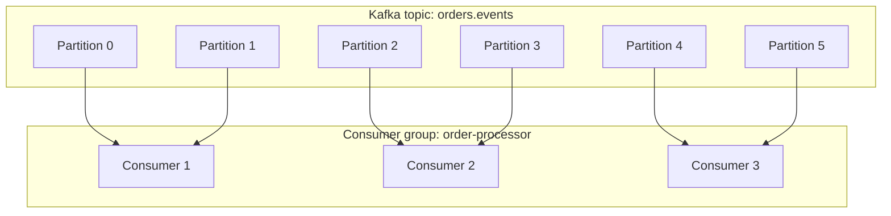
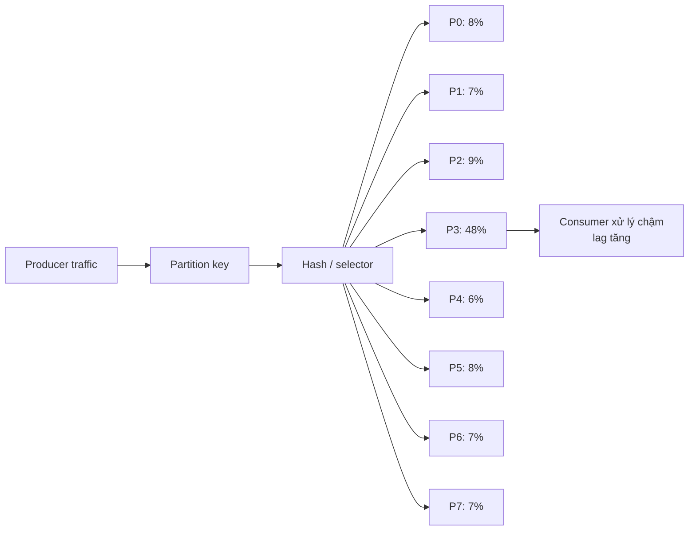
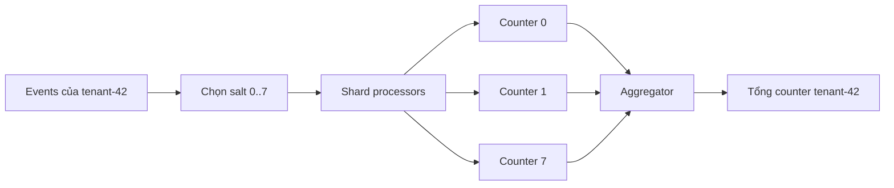

# Khóa lệch tải, phân vùng nóng và chiến lược phân phối

Phân vùng (partitioning) giúp một luồng sự kiện được xử lý song song. Tuy nhiên, có nhiều partition không đồng nghĩa tải sẽ được chia đều. Nếu producer liên tục dùng cùng một key, hoặc một số key có lưu lượng cao hơn hẳn phần còn lại, nhiều message sẽ dồn vào một partition. Partition đó trở thành **hot partition**: consumer phụ trách nó xử lý chậm, lag tăng, trong khi các consumer khác vẫn còn năng lực nhàn rỗi.

Trong Spring Cloud Stream, lựa chọn partition key và cách binder ánh xạ key sang partition ảnh hưởng trực tiếp tới thứ tự, mức song song và khả năng mở rộng. Bài này giải thích nguyên nhân lệch tải, cách nhận diện partition nóng, cách chọn key, và các chiến lược phân phối phù hợp với Kafka, RabbitMQ và Pulsar.

## 1. Partitioning giải quyết bài toán gì?

Một destination có thể chứa lượng message lớn hơn khả năng xử lý của một consumer đơn lẻ. Partitioning chia luồng dữ liệu thành nhiều phần để nhiều consumer xử lý đồng thời.

Với Kafka, topic gồm nhiều partition. Mỗi partition là một log có thứ tự riêng. Trong cùng một consumer group, một partition tại một thời điểm được gán cho tối đa một consumer member. Vì vậy, partition count giới hạn mức song song đọc của group.

Ví dụ topic `orders.events` có 6 partition và group `order-processor` có 3 consumer:



Mỗi consumer đọc hai partition trong ví dụ. Thực tế assignment được Kafka coordinator và partition assignor quyết định. Khi số consumer tăng hoặc giảm, Kafka có thể rebalance để phân công lại partition.

Partitioning thường phục vụ ba mục tiêu:

- **Thông lượng:** nhiều consumer xử lý các partition khác nhau cùng lúc.
- **Thứ tự theo key:** các sự kiện có cùng key được định tuyến về cùng partition để giữ thứ tự trong phạm vi key.
- **Cô lập tải:** một luồng có thể được chia thành các đơn vị xử lý độc lập, dễ đo lag và mở rộng.

Ba mục tiêu có thể xung đột. Nếu giữ mọi sự kiện của một đơn hàng ở cùng partition, ta có thứ tự theo đơn hàng nhưng không thể chia tải của chính đơn hàng đó sang nhiều partition cùng lúc.

## 2. Khóa phân vùng và cách chọn partition

Partition key là giá trị producer dùng để quyết định message thuộc partition nào. Ví dụ với sự kiện đơn hàng, key thường là `orderId`; với dữ liệu tài khoản, key có thể là `accountId`.

Một cách ánh xạ phổ biến là băm key rồi lấy phần dư theo số partition:

\[
partition = positiveHash(key) \bmod partitionCount
\]

Đây là mô hình khái quát. Cách tính hash, xử lý key rỗng và chọn partition cụ thể phụ thuộc producer client, binder và partitioner được cấu hình.

Nếu mọi message có key `order-42`, chúng sẽ cùng đi vào một partition trong cùng một cấu hình ánh xạ. Điều này giúp consumer đọc các sự kiện của order-42 theo thứ tự offset. Nhưng nếu order-42 phát 30% tổng lưu lượng, partition chứa key đó có thể nóng hơn hẳn các partition còn lại.

### Chọn key theo ranh giới thứ tự

Hãy bắt đầu bằng câu hỏi: những message nào bắt buộc phải được xử lý theo thứ tự?

| Loại dữ liệu | Key thường phù hợp | Lý do |
|---|---|---|
| Vòng đời một đơn hàng | `orderId` | Giữ thứ tự OrderCreated, OrderPaid, OrderShipped |
| Số dư tài khoản | `accountId` | Tránh cập nhật đồng thời cùng tài khoản ở nhiều partition |
| Hồ sơ khách hàng | `customerId` | Giữ thứ tự thay đổi của cùng khách hàng |
| Trạng thái thiết bị | `deviceId` | Giữ thứ tự telemetry/command theo thiết bị |
| Nhật ký độc lập không cần thứ tự theo entity | Key có cardinality cao hoặc phân phối ngẫu nhiên | Tận dụng song song khi không có aggregate cần tuần tự |

Không chọn key chỉ vì field đó có sẵn trong payload. Key phải phản ánh ranh giới nhất quán của nghiệp vụ. Nếu dùng `customerId` cho mọi event nhưng một khách hàng có nhiều đơn hàng độc lập, tất cả đơn hàng của khách hàng đó bị dồn vào cùng partition dù không cần tuần tự hóa giữa chúng.

Ngược lại, nếu các cập nhật số dư cùng tài khoản có thể ghi đồng thời ở nhiều partition, hệ thống có thể gặp race condition hoặc cần một cơ chế đồng bộ khác. Chọn key nhỏ hơn giúp giữ thứ tự, nhưng có thể làm giảm khả năng chia tải.

### Cardinality và phân phối key

Cardinality là số lượng key khác nhau trong dữ liệu. Key có cardinality quá thấp thường tạo ít nhóm tải. Ví dụ chỉ dùng `country` với ba giá trị sẽ khiến toàn bộ dữ liệu của một quốc gia đi cùng một partition trong cách hash key thông thường.

Key có cardinality cao tạo nhiều nhóm hơn, nhưng chưa chắc phân phối đều. Một vài key có lưu lượng lớn có thể chiếm phần lớn traffic dù tổng số key rất nhiều.

Cần xem cả hai phân bố:

- **Key cardinality:** có bao nhiêu key khác nhau.
- **Key frequency:** mỗi key phát bao nhiêu message hoặc bao nhiêu byte trong một khoảng thời gian.

Một hệ thống có hàng triệu customer ID vẫn có thể có hot key nếu một khách hàng lớn phát nhiều sự kiện hơn hàng trăm nghìn khách hàng nhỏ cộng lại.

## 3. Lệch tải và hot partition hình thành ra sao?

Lệch tải (skew) xảy ra khi số message, byte hoặc chi phí xử lý không phân bố đều giữa các partition. Một partition nóng có thể do:

1. **Hot key:** một key có tần suất phát cao, khiến tất cả message của key đi cùng partition.
2. **Key cardinality thấp:** chỉ có một số ít giá trị key, nên chỉ một số partition được sử dụng.
3. **Hash hoặc selector không đều:** cách băm/định tuyến tạo phân phối lệch, đặc biệt khi key có pattern hoặc selector tùy chỉnh có lỗi.
4. **Message size khác nhau:** số message tương đương nhưng một partition chứa payload lớn hơn nhiều.
5. **Chi phí xử lý không đồng đều:** cùng số message nhưng một số loại event gọi API chậm, truy vấn nặng hoặc xử lý nhiều side effect hơn.
6. **Partition count hoặc assignment không phù hợp:** số partition quá ít, số consumer quá nhiều hoặc assignment bị lệch do số partition không chia đều.
7. **Producer routing sai:** một số producer gửi thiếu key, dùng constant key hoặc ghi trực tiếp vào một partition cố định.

Ví dụ topic có 8 partition. Phần lớn key phân phối khá đều, nhưng một tenant lớn phát 40% tổng message và mọi message của tenant đó dùng tenant ID làm key. Partition chứa tenant này nhận gần một nửa traffic; các partition khác chỉ nhận phần còn lại.



Một hot partition làm giới hạn thông lượng toàn luồng. Consumer group không thể chuyển một phần message của partition nóng sang consumer khác trong khi vẫn giữ nguyên thứ tự log của partition đó.

### Hot key và hot partition khác nhau

- **Hot key** là một giá trị key có lưu lượng hoặc chi phí xử lý vượt trội.
- **Hot partition** là partition nhận tải cao hoặc có backlog lớn.
- Nhiều hot key có thể cùng rơi vào một partition, tạo hot partition.
- Một partition có thể nóng dù không có hot key riêng lẻ nếu nhiều key ngẫu nhiên vô tình cùng được ánh xạ tới partition đó hoặc payload/chi phí xử lý ở partition đó cao.

Cách khắc phục phụ thuộc nguyên nhân. Tăng partition count có thể giúp phân phối nhiều key hơn, nhưng không tự chia một key nóng nếu key vẫn phải đi cùng partition để giữ thứ tự.

## 4. Đo skew trước khi thay đổi cấu hình

Đừng kết luận partition nóng chỉ từ tổng consumer lag. Cần quan sát theo partition và theo key.

### Chỉ số ở Kafka

Theo dõi ít nhất:

- Message rate và byte rate theo topic-partition.
- Consumer lag theo từng partition, không chỉ tổng lag của group.
- Tốc độ xử lý record và thời gian xử lý trung bình/p95/p99.
- Số record fetch mỗi poll, thời gian poll và rebalance.
- Kích thước record, lỗi deserialize, retry và số message đi DLQ.
- Phân bố key: top key theo số message, byte và chi phí xử lý.

Một vài chỉ số tổng hợp hữu ích:

\[
skewRatio = \frac{max(partitionLoad)}{average(partitionLoad)}
\]

\[
loadShare_i = \frac{partitionLoad_i}{\sum_j partitionLoad_j}
\]

Nếu skewRatio lớn và một partition chiếm tỷ lệ cao trong thời gian dài, hãy điều tra key và routing của partition đó. Ngưỡng cảnh báo phụ thuộc workload; không có một con số duy nhất đúng cho mọi hệ thống.

Cũng cần tách **ingress skew** khỏi **processing skew**. Ingress skew là partition nhận nhiều message hơn. Processing skew là partition có thời gian xử lý hoặc chi phí lớn hơn. Một partition nhận ít message vẫn có thể lag nếu message ở đó gọi API chậm.

### Không chỉ xem số message

Giả sử P0 nhận 10.000 message nhỏ, P1 nhận 2.000 message nhưng mỗi message có payload 2 MB. P1 có thể tiêu thụ nhiều network và memory hơn. Tương tự, một loại event có thể cần gọi hệ thống thanh toán, trong khi event khác chỉ cập nhật cache. So sánh message count đơn thuần sẽ che mất khác biệt chi phí.

Đo cả:

- Records per second.
- Bytes per second.
- Processing time per event type.
- Retry/redelivery rate.
- Backlog age, tức tuổi của message cũ nhất chưa xử lý.
- CPU, heap, GC, network và downstream latency theo consumer.

### Phân tích top key

Có thể lấy mẫu key ở producer hoặc consumer và tạo histogram theo khoảng thời gian. Không nhất thiết log toàn bộ key nếu key chứa dữ liệu nhạy cảm hoặc cardinality quá cao. Có thể dùng hash có salt cho telemetry hoặc chỉ xuất top-N key đã được làm mờ.

Một dashboard tốt nên cho biết partition nào đang nhận tải lớn, key nào đóng góp nhiều nhất, loại event nào tốn thời gian và consumer nào đang giữ partition đó.

## 5. Cấu hình partitioning trong Spring Cloud Stream

Spring Cloud Stream cung cấp thuộc tính partitioning chung cho producer binding. Một ví dụ đơn giản:

```java
@Bean
Supplier<OrderEvent> publishOrder(OrderEventSource source) {
    return source::next;
}
```

```yaml
spring:
  cloud:
    function:
      definition: publishOrder
    stream:
      bindings:
        publishOrder-out-0:
          destination: orders.events
          producer:
            partition-key-expression: "payload.orderId"
            partition-count: 12
```

`partition-key-expression` xác định key từ message, còn `partition-count` cung cấp số partition mà producer partitioning sử dụng để tính partition đích. Biểu thức có thể tham chiếu payload hoặc headers. Tên property và cách binder sử dụng chúng cần được xác nhận theo phiên bản binder.

Nếu key nằm trong header:

```yaml
spring:
  cloud:
    stream:
      bindings:
        publishOrder-out-0:
          destination: orders.events
          producer:
            partition-key-expression: "headers['orderId']"
            partition-count: 12
```

Có thể dùng một selector tùy chỉnh khi cần chiến lược phân phối khác:

```yaml
spring:
  cloud:
    stream:
      bindings:
        publishOrder-out-0:
          destination: orders.events
          producer:
            partition-key-expression: "payload.orderId"
            partition-selector-expression: "headers['targetPartition']"
            partition-count: 12
```

Trong ví dụ này, producer hoặc gateway đặt header số `targetPartition`; giá trị phải nằm trong khoảng từ 0 đến 11 và phải được xác thực trước khi gửi. Đây là định tuyến tường minh, không phải cách phân phối đều tự động. Nếu nhiều message cùng mang một giá trị header, partition đó sẽ nóng. Selector cần trả về giá trị partition hợp lệ theo hợp đồng của binder. Tránh tự viết phép modulo nếu chưa xử lý hash âm, null key và thay đổi partition count. Nếu cần custom partition selector class/bean, dùng cơ chế selector mà phiên bản Spring Cloud Stream hỗ trợ và kiểm tra metadata cấu hình tương ứng.

### Kafka native message key

Kafka binder còn có thuộc tính mở rộng để xác định Kafka record key, ví dụ `message-key-expression` trong producer binding. Khi dùng native Kafka key, Kafka producer partitioner sẽ quyết định partition theo key và partitioner đang cấu hình.

```yaml
spring:
  cloud:
    stream:
      bindings:
        publishOrder-out-0:
          destination: orders.events
      kafka:
        bindings:
          publishOrder-out-0:
            producer:
              message-key-expression: "payload.orderId"
```

Phân biệt hai cách:

- Core partitioning properties của Spring Cloud Stream tính partition theo mô hình partitioning chung của framework.
- Kafka message key đặt key cho Kafka record để Kafka partitioner thực hiện phân phối theo semantics Kafka.

Không cấu hình cả hai cách với giả định chúng luôn bổ trợ nhau. Hãy chọn cơ chế mà binder và ứng dụng cần, rồi kiểm tra partition thực tế trong integration test. Nếu ứng dụng cần consumer khác đọc cùng key, bảo đảm message key trên wire được giữ đúng.

### Partition count và consumer parallelism

Với Kafka, topic phải có số partition phù hợp với `partition-count` và cấu hình provisioner. Nếu topic đã tồn tại, binder không nhất thiết tự tăng partition chỉ vì producer khai báo số lớn hơn. Việc tự tạo hoặc tự thêm partition phụ thuộc `auto-create-topics`, `auto-add-partitions`, quyền broker và các thuộc tính binder.

Trong cùng consumer group, số consumer có thể xử lý song song không vượt số partition đang được gán. Nếu topic có 12 partition và group có 4 consumer, mỗi consumer có thể nhận khoảng 3 partition. Nếu group có 16 consumer, một số consumer không có partition để đọc.

Tăng partition count có thể tăng tổng khả năng song song cho nhiều key. Tuy nhiên, nó có thể làm thay đổi kết quả hash modulo đối với key mới, khiến các event mới của cùng entity đi vào partition khác với event cũ. Nếu cần thứ tự xuyên suốt khi mở rộng partition, cần có chiến lược migration hoặc partition mapping ổn định.

## 6. Chiến lược chọn và phân phối key

Không có một chiến lược phân phối phù hợp cho mọi event. Hãy chọn theo thứ tự và tính chất nghiệp vụ.

### Chiến lược 1: Key theo aggregate

Dùng `orderId`, `accountId` hoặc `deviceId` khi các sự kiện của cùng aggregate phải giữ thứ tự. Đây thường là lựa chọn an toàn cho event sourcing và cập nhật trạng thái.

Ưu điểm:

- Giữ thứ tự trong phạm vi key trên Kafka partition.
- Dễ xử lý stateful consumer theo entity.
- Dễ deduplicate và kiểm tra phiên bản trạng thái.

Hạn chế:

- Một aggregate quá nóng sẽ tạo hot key.
- Không thể chia tải của một key sang nhiều partition mà vẫn dựa vào thứ tự đơn partition.
- Nếu cardinality thấp, tổng tải dễ lệch.

### Chiến lược 2: Key có cardinality cao hơn

Nếu nghiệp vụ chỉ cần thứ tự theo đơn hàng, dùng `orderId` thay vì `customerId` có thể chia tải tốt hơn khi một khách hàng có nhiều đơn hàng. Nếu nghiệp vụ cần thứ tự theo tài khoản, không thể đổi sang transaction ID chỉ để phân tán mà không thiết kế lại consistency.

Đây thường là cách giảm skew ít xâm lấn nhất: chọn key nhỏ nhất vẫn giữ được ranh giới thứ tự cần thiết.

### Chiến lược 3: Salting hoặc thêm shard suffix

Với một hot key có thể xử lý song song, có thể thêm suffix để tạo nhiều khóa con:

- Key gốc: `tenant-42`.
- Key đã salt: `tenant-42:0`, `tenant-42:1`, ..., `tenant-42:7`.

Producer phân phối message vào các salt bucket. Một hot tenant khi đó có thể trải tải trên nhiều partition.

Tuy nhiên, salting phá vỡ thứ tự toàn cục của key gốc. Nếu các event của tenant-42 phụ thuộc nhau, consumer có thể xử lý event sau trước event trước. Chỉ dùng salting khi:

- Các message độc lập hoặc phép xử lý có tính giao hoán.
- Có thể tổng hợp kết quả ở bước sau.
- Có version/sequence number để phát hiện thứ tự nếu cần.
- Có một tầng merge hoặc aggregation chịu trách nhiệm tạo kết quả cuối.

Ví dụ đếm lượt xem có thể chia theo shard rồi cộng kết quả. Cập nhật số dư tài khoản không thể tùy tiện salt nếu các giao dịch phải áp dụng theo thứ tự.

### Chiến lược 4: Tách hot key thành luồng riêng

Nếu một tenant hoặc aggregate có lưu lượng vượt trội và cần chính sách riêng, có thể đưa nó vào topic/destination hoặc queue riêng. Các key thông thường tiếp tục dùng luồng chung.

Ưu điểm:

- Cô lập backlog và giới hạn tài nguyên cho hot tenant.
- Có thể đặt partition count, retention, consumer group và autoscaling riêng.
- Dễ đặt SLA hoặc quota riêng.

Chi phí:

- Tăng số destination và cấu hình vận hành.
- Cần logic định tuyến ở producer hoặc gateway.
- Cần xử lý cutover, replay và tránh event đi vào hai luồng hoặc không luồng nào.

### Chiến lược 5: Virtual shards

Thay vì ánh xạ trực tiếp key vào partition vật lý, ánh xạ key vào một số lượng virtual shard cố định lớn hơn, sau đó ánh xạ virtual shard sang partition vật lý. Bảng mapping giúp thay đổi phân bố vật lý có kiểm soát hơn.

Ví dụ có 256 virtual shard nhưng chỉ 16 partition. Khi mở rộng lên 24 partition, có thể di chuyển một phần virtual shard thay vì thay đổi modulo cho mọi key. Tuy nhiên, việc di chuyển vẫn cần quản lý thời điểm cutover, thứ tự, ownership và message đang xử lý.

Virtual shard hữu ích khi cần kiểm soát tái cân bằng key giữa partition. Nó làm tăng độ phức tạp và cần một mapping nhất quán được producer và consumer cùng hiểu.

## 7. Tăng partition có giải quyết hot partition không?

Câu trả lời phụ thuộc nguyên nhân:

| Nguyên nhân | Tăng partition có giúp? | Hướng xử lý |
|---|---|---|
| Nhiều key phân phối đều nhưng tổng throughput cao | Thường có | Tăng partition và consumer song song |
| Một key chiếm phần lớn traffic | Không tự chia key đó | Salting có kiểm soát, tách luồng hoặc xử lý aggregate |
| Key cardinality thấp | Có thể chỉ giúp một phần | Chọn key có cardinality cao hơn nếu semantics cho phép |
| Một partition nhận nhiều byte vì payload lớn | Có thể nếu key phân phối được lại | Giảm payload, nén, chia message hoặc phân phối lại key |
| Consumer xử lý chậm do downstream | Không nhất thiết | Tối ưu downstream, concurrency có giới hạn, backpressure |
| Selector hoặc custom partitioner có lỗi | Không giải quyết gốc rễ | Sửa thuật toán và kiểm thử phân bố |

Khi tăng partition count của Kafka topic, hash modulo thường thay đổi kết quả cho nhiều key. Một key có thể chuyển sang partition khác đối với message mới, trong khi message cũ vẫn nằm ở partition trước. Nếu consumer xử lý song song, hai message của cùng entity ở hai partition khác nhau có thể hoàn tất sai thứ tự.

Vì vậy, tăng partition là thay đổi kiến trúc có ảnh hưởng tới ordering và consumer assignment. Trước khi áp dụng, hãy kiểm tra:

- Key nào sẽ được ánh xạ sang partition nào sau thay đổi.
- Có aggregate nào cần thứ tự xuyên suốt không.
- Consumer đang có backlog trên partition cũ hay không.
- Có cần drain, pause, dual-write hoặc migration mapping không.
- Broker có đủ dung lượng và replica để chịu thêm partition không.

## 8. Chiến lược phân phối theo từng broker

Khái niệm partition có ý nghĩa khác nhau giữa Kafka, RabbitMQ và Pulsar. Spring Cloud Stream cung cấp binding abstraction, nhưng không làm cho ba broker có cùng semantics.

### Kafka

Kafka partition là log có thứ tự. Producer key thường quyết định partition; consumer group chia partition cho các member. Để giảm skew:

- Dùng key phù hợp với aggregate và có cardinality đủ cao.
- Tránh constant key hoặc key có ít giá trị.
- Dùng custom partitioner hoặc selector khi có lý do rõ ràng.
- Tách hot tenant hoặc salt key khi có thể xử lý song song.
- Theo dõi lag và traffic theo partition.
- Cẩn trọng khi tăng partition count vì mapping key có thể thay đổi.

Kafka là lựa chọn tự nhiên khi cần log bền vững, replay và thứ tự theo partition. Nếu một key cần xử lý tuần tự, một consumer tại một thời điểm sẽ xử lý partition đó; tăng consumer count không thể chia cùng partition cho nhiều consumer trong group.

### RabbitMQ

RabbitMQ truyền thống định tuyến message qua exchange tới queue. Queue là đơn vị lưu trữ và nhiều consumer có thể cạnh tranh nhận message từ cùng queue. RabbitMQ không mặc định biến một queue thông thường thành nhiều Kafka-style partition.

Để chia tải, có thể:

- Dùng nhiều queue theo shard hoặc routing key.
- Dùng consistent-hash exchange plugin khi hạ tầng hỗ trợ, để route cùng key vào một queue shard.
- Dùng RabbitMQ Streams hoặc partitioned stream topology nếu yêu cầu và phiên bản triển khai hỗ trợ.
- Tách queue cho hot tenant hoặc loại event có tải lớn.
- Điều chỉnh prefetch và consumer concurrency để tránh một consumer giữ quá nhiều unacked message.

Nếu cần giữ thứ tự theo key, phải bảo đảm cùng key luôn được route tới cùng queue shard và hiểu rằng nhiều consumer cùng đọc một queue vẫn có thể hoàn tất message theo thứ tự khác nhau. Acknowledgement, redelivery và prefetch ảnh hưởng thứ tự quan sát được.

Rabbit binder có các thuộc tính partitioning theo khả năng binder; không giả định chúng tự tạo một topology shard tùy ý. Kiểm tra exchange, queue, binding và plugin thực tế trên broker.

### Pulsar

Pulsar hỗ trợ partitioned topic. Producer có thể dùng message key hoặc routing mode để chọn partition. Subscription type quyết định cách nhiều consumer phối hợp; `Key_Shared` giúp các message cùng key được giao tới cùng consumer theo semantics của Pulsar, trong khi vẫn cho phép nhiều consumer nhận các key khác nhau.

Để giảm skew:

- Dùng key có cardinality phù hợp với ranh giới thứ tự.
- Dùng `Key_Shared` khi cần phân phối nhiều key song song nhưng giữ affinity theo key.
- Kiểm tra batching và key-based batching; batching không phù hợp có thể làm giảm hiệu quả phân phối key.
- Theo dõi backlog theo partition và subscription.
- Tách hot key hoặc dùng salt khi nghiệp vụ cho phép.

Pulsar partitioned topic vẫn không thể tự chia một hot key thành nhiều partition nếu cần giữ affinity của key. `Shared` có thể phân phối message linh hoạt hơn nhưng không giữ thứ tự theo key theo cùng cách `Key_Shared` được thiết kế.

## 9. Xử lý hot key mà vẫn giữ đúng nghiệp vụ

Một chiến lược phân phối chỉ tốt khi không phá vỡ tính đúng đắn. Trước khi salting hoặc đổi key, hãy phân loại sự kiện:

| Loại xử lý | Có thể chia cùng key sang nhiều shard? | Gợi ý |
|---|---|---|
| Cộng số lượt xem | Thường có | Salt rồi aggregate |
| Đếm lượt click | Thường có | Shard counter, tổng hợp theo cửa sổ |
| Cập nhật trạng thái đơn hàng | Thường không | Giữ orderId làm key |
| Ghi sổ cái tài khoản | Không nếu cần thứ tự giao dịch | Giữ accountId và tuần tự hóa |
| Gửi email độc lập | Thường có | Key theo eventId hoặc recipient tùy yêu cầu |
| Tính projection có thể rebuild | Có thể nếu phép tổng hợp đúng | Dùng partition key theo dimension và merge state |

### Two-stage aggregation

Với phép cộng có tính kết hợp và giao hoán, có thể chia hot key thành các shard, tính kết quả từng shard rồi cộng lại:



Kết quả tổng hợp có thể có độ trễ hoặc tính nhất quán cuối cùng. Nếu consumer cần đọc giá trị tức thời, phải xác định rõ có chấp nhận kết quả tạm thời không và cách xử lý event đến muộn.

### Sequence number và reorder buffer

Nếu bắt buộc chia tải nhưng vẫn cần khôi phục thứ tự, producer có thể gắn sequence number tăng dần theo aggregate. Consumer xử lý các shard song song rồi một bước merge sắp xếp theo sequence. Cách này phức tạp: cần lưu trạng thái, phát hiện gap, timeout, xử lý duplicate và quyết định khi một event bị mất hoặc đến muộn.

Không dùng sequence number như một lý do để bỏ qua idempotency. Event có thể được giao lại hoặc xử lý sau khi consumer restart; sequence và event ID cần phối hợp để tránh áp dụng một thay đổi hai lần.

## 10. Tránh các nguyên nhân gây skew trong producer

Producer là nơi kiểm soát key đầu tiên. Một số lỗi phổ biến:

**Dùng một key mặc định cho mọi message.** Ví dụ tất cả event đều có key `orders`. Mọi message dồn về một partition. Hãy lấy key từ aggregate ID hoặc bỏ key nếu không cần ordering theo key.

**Dùng field có cardinality thấp.** `country`, `eventType` hoặc `status` thường có ít giá trị. Chúng phù hợp làm filter hoặc metadata, nhưng hiếm khi là key tốt để chia tải cho topic lớn.

**Dùng key không ổn định.** Nếu cách chuẩn hóa key thay đổi giữa producer phiên bản cũ và mới, cùng một entity có thể đi vào partition khác nhau. Hãy chuẩn hóa trước khi hash và giữ quy tắc ổn định.

**Không xử lý null key.** Null key có thể khiến producer dùng round-robin hoặc sticky partitioning tùy client và cấu hình. Nếu ordering theo entity là yêu cầu, null key phải bị từ chối hoặc đưa vào error flow.

**Dùng hash không đồng nhất giữa producer.** Nếu nhiều ngôn ngữ hoặc client tự tính partition bằng thuật toán khác nhau, cùng key có thể vào partition khác nhau. Hãy để broker client/binder thực hiện partitioning theo một chuẩn chung hoặc dùng thư viện mapping dùng chung đã được kiểm thử.

**Ghi trực tiếp partition ID cố định.** Một producer gửi mọi message vào partition 0 có thể tạo hot partition dù topic có nhiều partition. Chỉ chỉ định partition tường minh khi có yêu cầu và cơ chế phân phối được quản lý.

## 11. Consumer scaling, backpressure và partition nóng

Khi partition nóng, thêm consumer vào cùng group chỉ có tác dụng nếu còn partition chưa được gán. Nếu mọi partition đã có consumer, tăng số pod không làm partition nóng được xử lý song song hơn.

Các hướng xử lý phía consumer:

- Tăng concurrency trong giới hạn partition count và tài nguyên.
- Tối ưu xử lý từng record, giảm I/O đồng bộ hoặc batch các thao tác phù hợp.
- Tách xử lý chậm sang một pipeline khác để không chặn partition chính.
- Dùng bounded worker pool và backpressure để không làm tràn heap.
- Đặt timeout, retry có giới hạn và circuit breaker cho downstream.
- Theo dõi lag theo partition và thời gian xử lý theo event type.

Không nên chuyển message sang thread pool không giới hạn rồi commit offset ngay khi submit task. Nếu ứng dụng ack/commit trước khi công việc hoàn tất, process crash có thể làm mất side effect dù record đã được xem là xử lý xong. Nếu xử lý song song trong cùng partition, phải kiểm soát thứ tự hoàn tất và commit offset sao cho không vượt qua record chưa xử lý.

### Batching không thay thế phân phối key

Batching có thể giảm overhead và tăng throughput, nhưng không làm một hot key tự phân tán sang nhiều partition. Với Kafka, batch được gom theo partition. Với Pulsar, key-based batching cần cấu hình tương thích để không làm sai affinity. Với RabbitMQ, prefetch điều chỉnh số message broker giao trước chứ không thay đổi routing key của exchange.

## 12. Thay đổi partition count và migration

Tăng partition là thay đổi có tác động lâu dài. Trước khi tăng:

1. Đo skew theo partition và key trong khoảng thời gian đủ đại diện.
2. Xác định nguyên nhân là hot key, key cardinality, payload size hay consumer processing.
3. Dự đoán partition mapping mới và những key bị remap.
4. Xác định có yêu cầu thứ tự xuyên suốt cho các entity không.
5. Kiểm tra replication, retention, broker capacity và giới hạn vận hành.
6. Lập kế hoạch consumer rebalance và thời gian phục hồi.
7. Kiểm thử producer/consumer với partition count mới.
8. Theo dõi lag, error rate và phân phối key sau rollout.

Nếu cần bảo toàn thứ tự khi thay đổi partition mapping, có thể dùng một trong các cách:

- Dừng hoặc pause producer, drain backlog cũ, cập nhật mapping, rồi tiếp tục phát.
- Dùng topic version mới và cutover có kiểm soát.
- Dùng virtual shard mapping ổn định, chuyển từng shard sau khi xử lý hết dữ liệu cũ.
- Dùng event sequence và cơ chế merge nếu nghiệp vụ chấp nhận độ phức tạp.

Không có thao tác tăng partition nào tự di chuyển record cũ sang partition mới. Message cũ vẫn nằm trong partition ban đầu; message mới có thể dùng mapping mới. Điều này quan trọng khi consumer cần thứ tự theo aggregate.

## 13. Kiểm thử phân phối và skew

Kiểm thử partitioning nên xác minh cả correctness và distribution.

### Unit test cho key extraction

Kiểm tra:

- Cùng aggregate ID luôn tạo cùng key.
- Hai aggregate độc lập có thể tạo key khác nhau.
- Null hoặc malformed key bị xử lý theo chính sách.
- Key được chuẩn hóa giống nhau giữa các producer.
- Custom selector luôn trả partition hợp lệ.

### Distribution test

Tạo tập key đại diện và phân phối message qua selector. Đo số message/byte theo partition, tính skew ratio và kiểm tra không có partition bị bỏ trống bất thường. Dùng phân phối thực tế hoặc dữ liệu mô phỏng có hot key; dữ liệu random đều không đủ để phát hiện skew từ tenant lớn.

### Integration test với broker

Với Kafka, tạo topic nhiều partition, gửi message có cùng key và xác minh chúng cùng partition; gửi nhiều key và kiểm tra phân phối. Tăng partition trong test riêng để xác minh tác động remap.

Với RabbitMQ, xác minh exchange, routing key và queue shard thực tế. Nếu dùng consistent-hash exchange plugin, test cần chạy broker có plugin tương ứng.

Với Pulsar, tạo partitioned topic và xác minh key routing, subscription type, backlog từng partition và hành vi `Key_Shared`.

Test không nên giả định mọi partition nhận số message bằng nhau tuyệt đối trong một tập nhỏ. Hãy dùng ngưỡng thống kê hợp lý và dữ liệu đủ lớn, đồng thời kiểm tra correctness của cùng-key ordering.

## 14. Quy trình xử lý một hot partition trong production

Khi dashboard cho thấy một partition lag tăng nhanh, xử lý theo trình tự:

1. **Xác nhận:** so sánh ingress rate, bytes, lag và processing time của partition đó với các partition khác.
2. **Tìm key:** lấy top key hoặc nhóm key đóng góp nhiều nhất vào partition.
3. **Tìm nguyên nhân:** key nóng, payload lớn, event type xử lý chậm, selector lỗi hay downstream nghẽn.
4. **Đánh giá thứ tự:** xác định key có cần giữ thứ tự hoặc consistency không.
5. **Chọn biện pháp:** đổi key, salt, tách destination, tối ưu handler, tăng partition hoặc điều chỉnh consumer.
6. **Thử nghiệm:** dùng traffic mẫu hoặc staging để xác minh phân phối và side effect.
7. **Triển khai từng bước:** theo dõi rebalance, lag, DLQ và lỗi nghiệp vụ.
8. **Đối soát:** xác nhận không mất event, không duplicate side effect và thứ tự vẫn đúng trong phạm vi cam kết.

Nếu hot partition xuất phát từ một key có thứ tự nghiêm ngặt, lựa chọn thường là tối ưu xử lý tuần tự, cô lập key hoặc thay đổi mô hình nghiệp vụ. Không thể vừa chia cùng một chuỗi event tùy ý sang nhiều partition, vừa kỳ vọng một thứ tự đơn giản tự nhiên như trước.

## 15. Checklist thiết kế partitioning

Trước khi triển khai producer hoặc thay đổi partition count, hãy xác nhận:

- Key phản ánh đúng aggregate cần giữ thứ tự.
- Cardinality và frequency của key đã được đo, không chỉ đo số key.
- Null key, constant key và key có pattern đã được kiểm soát.
- Hash/selector ổn định giữa producer và phiên bản.
- Partition count đủ cho throughput và consumer parallelism.
- Consumer concurrency không vượt quá nhu cầu hoặc tài nguyên.
- Có metrics theo partition và top key.
- Có kế hoạch cho hot tenant/hot aggregate.
- Salting chỉ được dùng khi có thể merge kết quả hoặc không cần thứ tự toàn cục.
- Tăng partition đã được đánh giá ảnh hưởng tới key remapping và ordering.
- Retry, DLQ, idempotency và offset/ack vẫn an toàn khi consumer xử lý song song.
- Integration test xác minh key routing thực tế trên broker đang triển khai.

Partitioning tốt cân bằng ba yêu cầu: giữ đúng thứ tự nghiệp vụ, phân phối tải đủ đều và cho phép mở rộng consumer. Hãy chọn key theo ranh giới nhất quán trước, đo skew theo partition và key sau, rồi mới quyết định tăng partition, salt key hay tách luồng. Với Spring Cloud Stream, core partitioning properties và thuộc tính riêng của từng binder là công cụ để hiện thực chiến lược đó; chúng không thay thế việc hiểu semantics của Kafka, RabbitMQ hoặc Pulsar.

## Tài liệu tham khảo

- [Spring Cloud Stream — Partitioning](https://docs.spring.io/spring-cloud-stream/reference/spring-cloud-stream/overview-partitioning.html)
- [Spring Cloud Stream — Binding Properties](https://docs.spring.io/spring-cloud-stream/reference/spring-cloud-stream/binding-properties.html)
- [Apache Kafka — Documentation](https://kafka.apache.org/documentation/)
- [Apache Pulsar — Concepts: Messaging](https://pulsar.apache.org/docs/concepts-messaging/)
- [RabbitMQ — Exchanges and Routing](https://www.rabbitmq.com/docs/exchanges)

