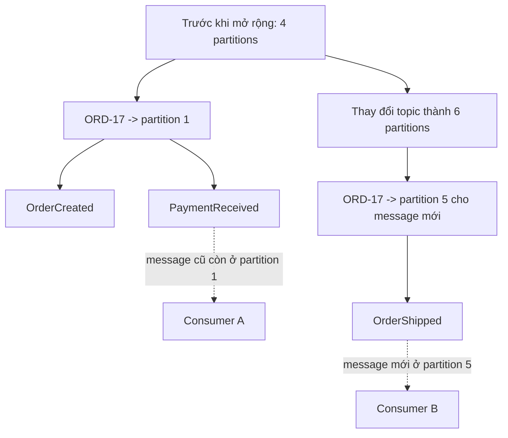
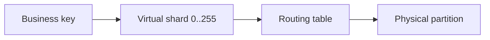

# Thay đổi số phân vùng và đánh giá tác động đến ánh xạ khóa

Partition (phân vùng) giúp chia một luồng sự kiện thành nhiều phần để tăng khả năng lưu trữ và xử lý song song. Khi số lượng message hoặc yêu cầu throughput tăng, nhóm vận hành có thể cần tăng số partition của topic. Tuy nhiên, thay đổi số partition có thể làm thay đổi cách một khóa nghiệp vụ được ánh xạ tới partition. Nếu ứng dụng dựa vào thứ tự xử lý theo `orderId`, `customerId` hoặc một khóa khác, đây là thay đổi ảnh hưởng trực tiếp đến hành vi nghiệp vụ.

Trong Spring Cloud Stream, producer có thể trích xuất partition key bằng `partitionKeyExpression` hoặc `PartitionKeyExtractorStrategy`, rồi chọn partition bằng `partitionSelectorExpression` hoặc `PartitionSelectorStrategy`. Với chiến lược mặc định, chỉ số partition được tính từ hash của key và `partitionCount`. Khi mẫu số thay đổi, nhiều key có thể chuyển sang partition khác. Với Kafka, topic có thể được tăng partition nhưng không thể giảm số partition trực tiếp; dữ liệu cũ vẫn nằm ở partition cũ.

## 1. Phân biệt partitionCount của ứng dụng và số partition thật của topic

Trong Spring Cloud Stream có hai giá trị thường bị nhầm lẫn:

- `producer.partitionCount` là số partition mục tiêu mà cấu hình producer dùng khi thực hiện partitioning. Giá trị này phải lớn hơn 1 để cơ chế partitioning của producer có hiệu lực.
- Số partition thực tế của destination là cấu trúc đã được tạo trên broker. Với Kafka, đây là số partition của topic.

Ví dụ producer khai báo `partitionCount: 6`, nhưng topic Kafka đã có 8 partition. Kafka binder xem `partitionCount` là một gợi ý và dùng số lớn hơn giữa cấu hình producer và số partition thực tế của topic. Vì vậy, cấu hình producer không thể làm topic đang có 8 partition quay về 6 partition.

Với Kafka binder, `minPartitionCount` ở cấp binder cũng tham gia quyết định số partition khi topic được tự động tạo. Giá trị lớn hơn giữa `minPartitionCount` và `producer.partitionCount` được dùng làm số partition mục tiêu khi tạo topic. Nếu topic đã tồn tại, số partition thực tế của topic cũng phải được xem xét.

## 2. Cách Spring Cloud Stream chọn partition từ key

Để partitioning hoạt động ở producer, cần xác định một key ổn định từ message. Ví dụ, mọi sự kiện thuộc cùng một đơn hàng dùng `orderId` làm key:

```yaml
spring:
  cloud:
    function:
      definition: publishOrder
    stream:
      bindings:
        publishOrder-out-0:
          destination: orders.events
          producer:
            partition-key-expression: payload.orderId
            partition-count: 6
```

`partition-key-expression` là SpEL expression được đánh giá trên message đầu ra. Trong ví dụ, giá trị `payload.orderId` là partition key. `partition-count` khai báo số partition mục tiêu cho cơ chế partitioning.

Nếu không cấu hình selector riêng, Spring Cloud Stream dùng hash của key modulo số partition để chọn chỉ số trong phạm vi `0` đến `partitionCount - 1`:

\[
partition = hash(key) \bmod partitionCount
\]

Ví dụ minh họa với các giá trị hash không âm:

| Hash của key | 4 partition | 6 partition |
| ---: | ---: | ---: |
| 17 | 1 | 5 |
| 24 | 0 | 0 |
| 11 | 3 | 5 |
| 30 | 2 | 0 |

Kết quả cho thấy một số key vẫn nằm cùng partition, nhưng nhiều key khác chuyển sang partition mới khi số partition thay đổi. Không thể giả định key nào cũng giữ nguyên vị trí sau khi mở rộng topic.

### Chọn key ổn định

Partition key nên là giá trị đại diện cho thực thể mà ứng dụng cần giữ thứ tự, chẳng hạn:

- `orderId` nếu các sự kiện của một đơn hàng cần được xử lý theo thứ tự.
- `customerId` nếu cần gom sự kiện của cùng khách hàng vào cùng partition.
- `accountId` nếu các thao tác số dư của một tài khoản cần được xử lý tuần tự.

Không nên dùng giá trị ngẫu nhiên, timestamp hiện tại hoặc object Java có `hashCode()` dựa trên identity làm key nếu cần các message liên quan đi cùng partition. Với nhiều ngôn ngữ hoặc nhiều loại producer, cần thống nhất cách chuẩn hóa key và thuật toán phân vùng; cùng một chuỗi key nhưng các client dùng partitioner khác nhau vẫn có thể chọn partition khác nhau.

## 3. Vì sao tăng partition có thể làm thay đổi thứ tự theo key?

Kafka bảo đảm thứ tự trong một partition. Kafka không bảo đảm thứ tự tổng thể giữa nhiều partition. Khi tăng số partition, message mới của một key có thể được gửi tới partition khác với partition đang chứa message cũ của key đó.

Giả sử topic `orders.events` ban đầu có 4 partition. Các sự kiện `OrderCreated`, `PaymentReceived` và `OrderShipped` của `ORD-17` đều được gửi tới partition 1. Consumer có thể đọc chúng theo thứ tự ghi trong partition.

Sau khi topic được tăng lên 6 partition, hash của `ORD-17` có thể ánh xạ tới partition 5. Message mới của đơn hàng này sẽ đi tới partition 5, trong khi các message cũ vẫn nằm ở partition 1. Hai partition có thể được xử lý đồng thời bởi hai consumer khác nhau. Vì vậy, consumer có thể hoàn tất sự kiện mới trước khi xử lý xong sự kiện cũ.



Kafka không tự di chuyển các record cũ sang partition mới khi tăng partition. Việc mở rộng chỉ bổ sung partition; nó không sắp xếp lại lịch sử message theo key. Đây là lý do thay đổi partition count cần được đánh giá như một thay đổi hợp đồng phân phối, đặc biệt khi nghiệp vụ phụ thuộc thứ tự.

## 4. Thay đổi số partition ảnh hưởng những gì?

| Khía cạnh | Tác động có thể xảy ra | Điều cần đánh giá |
| --- | --- | --- |
| Ánh xạ key | Nhiều key được ánh xạ sang partition khác | Key nào có thể đổi partition và thời điểm bắt đầu dùng mapping mới |
| Thứ tự theo key | Message cũ và mới của cùng key có thể nằm ở các partition khác nhau | Có cần tạm dừng producer và drain dữ liệu cũ không |
| Consumer group | Kafka phân công lại partition khi topic mở rộng | Rebalance, số consumer, lag và thời gian ổn định sau thay đổi |
| Throughput | Có thêm khả năng xử lý song song | Consumer, broker, network và downstream có theo kịp không |
| Storage và replication | Có thêm log partition và replica cần lưu trữ | Disk, replication factor, network và chi phí broker |
| Vận hành | Thay đổi cấu hình producer và topology topic | Đồng bộ cấu hình, quyền quản trị, kế hoạch rollback |
| Hệ thống tích hợp | Producer khác có thể dùng thuật toán partition khác | Tính nhất quán của key và partitioner giữa các client |

Tăng partition không tự động làm throughput tăng theo cùng tỷ lệ. Nếu database phía consumer là bottleneck hoặc producer không đủ tải, partition mới có thể không tạo ra cải thiện đáng kể. Ngược lại, tăng partition có thể làm tăng chi phí file, metadata, leader election và phân phối replica trên broker.

## 5. Cấu hình partitioning trong Spring Cloud Stream

Ví dụ cấu hình producer đầy đủ hơn:

```yaml
spring:
  cloud:
    function:
      definition: publishOrder
    stream:
      bindings:
        publishOrder-out-0:
          destination: orders.events
          producer:
            partition-key-expression: payload.orderId
            partition-count: 6
```

Trong ví dụ, producer dùng selector mặc định của Spring Cloud Stream. Nếu cần quy tắc riêng, có thể cấu hình `partition-selector-expression` hoặc bean `PartitionSelectorStrategy`. Selector tùy chỉnh phải luôn trả về chỉ số hợp lệ trong phạm vi partition đang dùng. Nếu biểu thức selector chứa hằng số hoặc bảng ánh xạ theo số partition, cần xem xét cập nhật chúng khi partition count thay đổi; không để selector vô tình giới hạn message ở các partition cũ.

Có thể thay expression bằng bean triển khai `PartitionKeyExtractorStrategy` hoặc `PartitionSelectorStrategy` khi quy tắc nghiệp vụ phức tạp. Không cấu hình đồng thời hai cách thay thế cho cùng một nhiệm vụ: `partitionKeyExpression` và `partitionKeyExtractorName` là hai lựa chọn thay thế nhau; `partitionSelectorExpression` và `partitionSelectorName` cũng vậy.

### Partition count của Kafka binder

Kafka binder dùng `producer.partitionCount` như gợi ý khi tạo topic. `minPartitionCount` có thể đặt mức tối thiểu ở cấp binder. Thuộc tính `autoAddPartitions` điều khiển việc binder có tự tăng số partition của topic đã tồn tại hay không:

```yaml
spring:
  cloud:
    stream:
      bindings:
        publishOrder-out-0:
          destination: orders.events
          producer:
            partition-key-expression: payload.orderId
            partition-count: 6
      kafka:
        binder:
          min-partition-count: 3
          auto-add-partitions: false
```

Trong cấu hình này, `partition-count: 6` lớn hơn `min-partition-count: 3`, nên số partition mục tiêu khi binder tạo topic là 6. Nếu topic đã tồn tại với ít partition hơn và `auto-add-partitions` là `false` (mặc định), binder có thể từ chối khởi động do topology không đáp ứng số partition mong đợi. Nếu bật `auto-add-partitions`, binder có thể thêm partition khi cần và có đủ quyền broker. Nếu topic đã có nhiều partition hơn giá trị mục tiêu, số partition hiện có được sử dụng.

Trong môi trường production, nên quyết định rõ ai chịu trách nhiệm thay đổi topic: nhóm vận hành qua quy trình quản trị Kafka hay binder trong lúc khởi động ứng dụng. Tránh để nhiều service cùng thay đổi topology mà không có quy trình phối hợp.

Nếu số partition của topic thay đổi khi ứng dụng đang chạy, khả năng binder nhận biết topology mới phụ thuộc phiên bản. Tài liệu Kafka binder hiện hành ghi nhận hỗ trợ thay đổi partition count lúc runtime từ Spring Cloud Stream 4.0.3; khoảng thời gian làm mới metadata của Kafka producer có thể được điều chỉnh bằng `spring.kafka.producer.properties.metadata.max.age.ms`. Với phiên bản cũ hơn hoặc khi cần thay đổi có kiểm soát, hãy dùng quy trình triển khai phù hợp và xác minh ứng dụng đã nhận topology mới trước khi tiếp tục phát dữ liệu.

## 6. Không thể giảm số partition của Kafka topic tại chỗ

Kafka hỗ trợ tăng partition cho topic thông thường, nhưng không hỗ trợ giảm số partition trực tiếp. Vì thế, nếu tăng từ 6 lên 12 rồi nhận ra 6 phù hợp hơn, việc đặt lại `partition-count: 6` trong ứng dụng không làm topic giảm về 6.

Nếu cần giảm số partition, thường phải tạo topic mới với số partition mong muốn rồi chuyển dữ liệu hoặc chuyển luồng ghi/đọc sang topic mới theo kế hoạch. Cần xác định retention, offset, consumer group, schema và thời điểm ngừng topic cũ. Không xóa topic cũ trước khi đã xác minh dữ liệu và consumer đã chuyển hoàn toàn.

Điều này cũng ảnh hưởng rollback. Sau khi topic đã được tăng partition, rollback riêng cấu hình ứng dụng không khôi phục topology cũ. Nếu cần khôi phục cách ánh xạ cũ, phải có kế hoạch rõ như selector tương thích tạm thời hoặc chuyển sang topic mới; cần kiểm tra kỹ selector và partition count thực tế mà binder sử dụng.

## 7. Chiến lược mở rộng an toàn khi cần giữ thứ tự

Trước khi tăng partition, hãy xác định mức độ bảo đảm thứ tự cần có:

- Nếu chỉ cần thứ tự trong tương lai và chấp nhận dữ liệu cũ/nội dung mới được xử lý song song trong giai đoạn chuyển đổi, có thể mở rộng topic theo kế hoạch và thiết kế consumer idempotent.
- Nếu cần bảo toàn thứ tự tuyệt đối cho từng key qua thời điểm chuyển đổi, cần phối hợp producer, consumer và topology để không có cùng key đồng thời được ghi vào hai partition.

### Cách 1: Tạm dừng ghi và drain dữ liệu cũ

Đây là cách dễ kiểm soát hơn khi chấp nhận một khoảng dừng ghi:

1. Dừng hoặc chặn tạm thời producer của topic.
2. Chờ các message đã ghi được consumer xử lý và xác nhận hết theo group liên quan.
3. Xác minh lag bằng 0 hoặc đạt checkpoint đã thống nhất.
4. Tăng partition của topic và cập nhật cấu hình producer/consumer cần thiết.
5. Khởi động producer với mapping mới.
6. Theo dõi message đầu tiên sau thay đổi và xác minh thứ tự theo key.

Khi toàn bộ message cũ đã được xử lý xong trước khi message mới được phát, rủi ro consumer hoàn tất message mới trước message cũ của cùng key giảm đáng kể. Cần có tiêu chí drain rõ ràng; chỉ dừng producer mà chưa chờ consumer xử lý xong là chưa đủ.

### Cách 2: Chuyển sang topic phiên bản mới

Khi không thể dừng luồng lâu, có thể tạo topic mới với số partition mới, ví dụ `orders.events.v2`. Sau đó thực hiện chuyển đổi có kiểm soát:

1. Tạo topic mới với partition count, replication factor và retention đã duyệt.
2. Triển khai consumer tương thích với topic mới và schema hiện tại.
3. Xác định checkpoint hoặc ranh giới sự kiện để mỗi key chỉ có một luồng ghi có thẩm quyền tại một thời điểm.
4. Chuyển producer theo từng nhóm key hoặc theo một mốc cắt rõ ràng.
5. Chờ consumer xử lý hết dữ liệu còn lại ở topic cũ.
6. Đối chiếu số lượng sự kiện, offset/checkpoint và kết quả nghiệp vụ trước khi ngừng topic cũ.

Không nên dual-write cùng một key vào cả hai topic mà không có cơ chế phối hợp. Hai luồng có thể được xử lý với tốc độ khác nhau, gây đảo thứ tự hoặc xử lý trùng. Nếu cần dual-write, phải có event ID, checkpoint, deduplication và quy tắc chọn nguồn có thẩm quyền.

### Cách 3: Dùng virtual shard để tách định danh logic khỏi partition vật lý

Với hệ thống có yêu cầu mở rộng định kỳ, có thể chia key vào một số lượng virtual shard cố định, sau đó ánh xạ mỗi shard tới partition vật lý qua một bảng cấu hình. Ví dụ có 256 virtual shard nhưng topic ban đầu chỉ có 8 partition.



Khi tăng partition vật lý, ứng dụng có thể chuyển một số virtual shard sang partition mới. Việc di chuyển shard vẫn cần quy trình handoff: dừng hoặc khóa ghi vào shard, drain dữ liệu cũ, cập nhật routing table đồng bộ cho producer và consumer, rồi mới tiếp tục ghi vào đích mới. Virtual shard không tự bảo đảm thứ tự; nó tạo một lớp định danh ổn định để việc di chuyển có thể được kiểm soát theo nhóm key nhỏ hơn.

## 8. Cập nhật consumer và consumer group

Với Kafka, consumer group tự nhận biết số partition topic và broker phân công partition cho các consumer member. Khi số partition tăng, group có thể rebalance để phân phối partition mới. Không cần khai báo `instanceCount` và `instanceIndex` cho Kafka theo cơ chế partitioning chung của Spring Cloud Stream; Kafka tự phân công partition cho group.

Với binder khác, cơ chế consumer partitioning có thể dựa trên cấu hình instance của ứng dụng. Spring Cloud Stream có các thuộc tính `spring.cloud.stream.instanceCount` và `spring.cloud.stream.instanceIndex` cho một số kịch bản partitioned consumer. Khi dùng các binder cần cấu hình này, phải cập nhật nhất quán tổng số instance và chỉ số từng instance. Không áp dụng máy móc cấu hình đó cho Kafka consumer group.

Sau khi mở rộng, số consumer hoạt động hữu ích của Kafka group vẫn bị giới hạn bởi số partition có thể gán. Nếu có 12 partition và 4 consumer, một consumer có thể nhận nhiều partition. Nếu có 20 consumer, một số consumer sẽ không được gán partition. Cần scale consumer theo số partition, thời gian xử lý và năng lực downstream.

## 9. Tác động đến hệ thống dùng cùng key

Một topic có thể được nhiều ứng dụng đọc bởi các consumer group khác nhau. Khi partition count thay đổi:

- Mỗi group cần rebalance theo topology mới.
- Consumer có thể xử lý partition mới hoặc nhận lại partition đã có.
- Các dịch vụ khác dùng cùng key có thể quan sát thứ tự khác nhau nếu chúng xử lý song song hoặc có checkpoint riêng.
- Một ứng dụng tự ghi trực tiếp vào Kafka có thể chọn partition khác với ứng dụng dùng Spring Cloud Stream nếu hai bên sử dụng partitioner khác nhau.
- Kafka Streams hoặc một processor có state store có thể cần đánh giá lại topology, changelog và cách phân phối state; không tự thay đổi partition của internal topic do Kafka Streams quản lý.

Lưu ý rằng partition selector mặc định của Spring Cloud Stream Kafka binder dùng `key.hashCode() % partitionCount`; thuật toán này khác partitioner mặc định của một Kafka producer độc lập và cách phân vùng mặc định của Kafka Streams. Nếu nhiều loại client cùng ghi vào một topic và cần key luôn đi tới cùng partition, phải cấu hình một thuật toán tương thích ở tất cả client hoặc dùng một quy tắc partitioning được thống nhất rõ ràng.

Nếu nhiều ứng dụng phát message vào cùng topic, cần công bố một hợp đồng partitioning chung: trường key, cách chuẩn hóa key, thuật toán hash/selector, số partition và quy trình thay đổi topology. Không chỉ cập nhật một producer rồi giả định tất cả producer khác tự thích nghi.

## 10. Ví dụ đánh giá thay đổi từ 4 lên 8 partition

Giả sử topic `orders.events` có 4 partition và producer dùng key `orderId` với selector mặc định. Nhóm vận hành muốn tăng lên 8 partition để nâng khả năng xử lý.

| Hạng mục | Trước thay đổi | Sau thay đổi |
| --- | --- | --- |
| Topic partition count | 4 | 8 |
| Key mapping | `hash(key) % 4` | `hash(key) % 8` |
| Số partition có thể gán trong group | Tối đa 4 consumer có partition riêng cho topic này | Tối đa 8 consumer có partition riêng cho topic này |
| Message cũ | Nằm trong partition 0–3 | Vẫn nằm trong partition 0–3 |
| Message mới | Nằm trong partition 0–3 | Có thể nằm trong partition 0–7 |
| Thứ tự theo key trong giai đoạn chuyển đổi | Theo partition cũ | Có thể bị chia giữa partition cũ và mới |

Kế hoạch thay đổi nên có các bước:

1. Đo throughput, consumer lag, thời gian xử lý và mức sử dụng broker để xác nhận partition là bottleneck.
2. Kiểm tra mọi producer dùng cùng key và cùng selector.
3. Xác định yêu cầu thứ tự theo `orderId`; nếu bắt buộc, chọn phương án dừng ghi/drain hoặc topic mới.
4. Tạo partition mới bằng quy trình quản trị hoặc bật `auto-add-partitions` theo chính sách đã duyệt.
5. Đồng bộ cấu hình producer và kiểm tra partition count thực tế.
6. Cho phép ghi lại và xác minh key được ánh xạ đúng, consumer group ổn định và lag giảm.
7. Kiểm tra các dịch vụ đọc độc lập, báo cáo và job replay cũng hiểu topology mới.

## 11. Kiểm thử trước và sau khi thay đổi

Nên kiểm thử ở cả cấp thuật toán và broker:

### Kiểm thử partition selector

Với tập key đại diện, ghi nhận partition trước và sau khi đổi partition count. Đếm số key thay đổi partition, xác nhận mọi partition ID đều nằm trong phạm vi hợp lệ và kiểm tra key có cùng giá trị luôn được xử lý nhất quán trong cùng một cấu hình.

Nếu dùng `PartitionSelectorStrategy` tùy chỉnh, viết unit test cho các trường hợp key null, key rỗng, key Unicode, key có hash âm và key có phân bố lệch. Selector phải trả chỉ số hợp lệ và không làm nhiều key dồn vào một partition ngoài chủ ý.

### Kiểm thử tích hợp Kafka

- Tạo topic với partition count cũ.
- Gửi nhiều message có cùng key và key khác nhau.
- Mở rộng topic theo cách triển khai production.
- Gửi message mới và kiểm tra partition metadata.
- Quan sát consumer group rebalance, assignment và lag.
- Xác minh message cũ không bị di chuyển và message mới có thể dùng partition mới.
- Kiểm tra consumer xử lý idempotent khi có redelivery hoặc restart.

### Kiểm thử tải

Chạy tải gần với phân bố key thực tế. Đo throughput, p95/p99 latency, broker CPU, disk I/O, network, consumer lag và thời gian rebalance. Nếu key phân bố lệch, tăng partition count không nhất thiết giải quyết hot partition; cần đánh giá lại key và chiến lược partitioning.

## 12. Những lỗi thường gặp khi đổi partition count

| Hiện tượng | Nguyên nhân có thể | Hướng xử lý |
| --- | --- | --- |
| Producer không khởi động sau khi tăng `partition-count` | Topic đã tồn tại với ít partition hơn yêu cầu và `auto-add-partitions` đang tắt | Tạo partition qua quản trị hoặc bật auto-add theo quy trình được duyệt. |
| Cấu hình giảm partition nhưng topic không giảm | Kafka không hỗ trợ giảm partition tại chỗ | Tạo topic mới và chuyển dữ liệu/luồng có kiểm soát. |
| Cùng key xuất hiện trên hai partition sau mở rộng | Mapping hash modulo thay đổi | Dừng ghi và drain trước khi mở rộng nếu thứ tự bắt buộc; hoặc thiết kế migration có handoff. |
| Một số partition mới ít dữ liệu | Phân bố key không đều hoặc traffic key bị lệch | Phân tích phân bố hash và hot key; điều chỉnh key/selector khi cần. |
| Consumer lag tăng sau thay đổi | Rebalance, consumer chưa scale hoặc downstream quá tải | Theo dõi assignment, scale có kiểm soát và kiểm tra bottleneck. |
| Producer khác chọn partition khác | Các client dùng partitioner hoặc key normalization khác nhau | Chuẩn hóa hợp đồng key và thuật toán giữa tất cả producer. |
| Rollback cấu hình không khôi phục mapping cũ | Topic vẫn giữ số partition mới và binder dùng số lớn hơn giữa cấu hình với topic | Dùng selector tương thích tạm thời hoặc topic mới; không kỳ vọng cấu hình cũ tự giảm topic. |

## 13. Checklist thay đổi số partition trong production

Trước khi thay đổi:

- Xác nhận partition count hiện tại và mục tiêu của từng topic.
- Xác định key expression, extractor và selector đang được sử dụng.
- Đánh giá các key cần bảo đảm thứ tự và consumer group liên quan.
- Kiểm tra tất cả producer, kể cả producer ngoài Spring Cloud Stream.
- Đánh giá broker capacity, replication, disk, network và giới hạn quản trị.
- Chọn cách thay đổi: tăng tại chỗ, dừng ghi/drain hay chuyển topic mới.
- Xác định ai được phép provision partition và quyền cần thiết.
- Chuẩn bị dashboard, cảnh báo và tiêu chí hoàn tất/rollback.

Sau khi thay đổi:

- Xác minh partition count thực tế trên broker.
- Xác minh producer dùng mapping dự kiến và không có partition ID ngoài phạm vi.
- Theo dõi rebalance, consumer lag, throughput và độ trễ.
- Kiểm tra thứ tự theo key, duplicate và kết quả nghiệp vụ.
- Đối chiếu dữ liệu giữa producer, broker và consumer trước khi đóng thay đổi.
- Cập nhật tài liệu vận hành và hợp đồng partitioning cho các producer khác.

## Tài liệu tham khảo

- [Spring Cloud Stream — Partitioning](https://docs.spring.io/spring-cloud-stream/reference/spring-cloud-stream/overview-partitioning.html)
- [Spring Cloud Stream — Binding Properties: Producer Properties](https://docs.spring.io/spring-cloud-stream/reference/spring-cloud-stream/binding-properties.html)
- [Spring Cloud Stream Kafka Binder — Partitioning](https://docs.spring.io/spring-cloud-stream/reference/kafka/kafka-binder/partitions.html)
- [Spring Cloud Stream Kafka Binder — Configuration Options](https://docs.spring.io/spring-cloud-stream/reference/kafka/kafka-binder/config-options.html)
- [Apache Kafka — Basic Operations: Modifying Topics](https://kafka.apache.org/44/operations/basic-kafka-operations/)

## Kết luận

Thay đổi số partition ảnh hưởng trực tiếp đến cách key được ánh xạ và cách consumer xử lý dữ liệu song song. Với selector mặc định của Spring Cloud Stream, partition được tính từ hash của key modulo `partitionCount`; thay đổi số partition có thể đưa cùng một key sang partition khác. Kafka giữ nguyên record cũ ở partition cũ, không tự phân phối lại dữ liệu và không hỗ trợ giảm partition tại chỗ. Vì vậy, hãy đánh giá yêu cầu thứ tự theo key, đồng bộ mọi producer, lập kế hoạch consumer rebalance và chọn phương án chuyển đổi có kiểm soát trước khi mở rộng topology.
