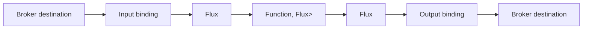

# Xây dựng `Function<Flux<T>, Flux<R>>`

Spring Cloud Stream hỗ trợ mô hình hàm phản ứng dựa trên Project Reactor. Với chữ ký `Function<Flux<T>, Flux<R>>`, hàm nhận một luồng message đầu vào và trả về một luồng kết quả đầu ra. Framework nối luồng đầu vào với input binding, đăng ký xử lý kết quả của luồng đầu ra với output binding và quản lý vòng đời kết nối theo binder.

Khác với `Function<T, R>` được gọi cho từng message, `Function<Flux<T>, Flux<R>>` được áp dụng lên publisher của cả luồng. Điều này cho phép dùng các toán tử Reactor để lọc, biến đổi, gom nhóm, kết hợp hoặc xử lý bất đồng bộ dữ liệu. Để sử dụng đúng mô hình này, cần hiểu publisher/subscriber, vòng đời subscription, backpressure, lỗi kết thúc luồng và giới hạn của binder khi chuyển tín hiệu phản ứng sang cơ chế giao nhận của broker.

## 1. Mô hình luồng đầu vào và đầu ra

`Flux<T>` là một publisher có thể phát không, một hoặc nhiều phần tử theo thời gian. Trong Spring Cloud Stream, `T` thường là kiểu payload sau khi message được chuyển đổi. `R` là kiểu payload mà hàm phát ra cho output binding.



Ví dụ, dịch vụ nhận sự kiện đơn hàng, kiểm tra dữ liệu rồi phát sự kiện đã xác thực:

```java
@Bean
Function<Flux<OrderCreated>, Flux<OrderValidated>> validateOrders(
        OrderValidator validator) {
    return orders -> orders
            .map(validator::validate);
}
```

Framework kết nối hàm với các binding theo tên bean. Với bean `validateOrders`, tên mặc định là `validateOrders-in-0` cho đầu vào thứ nhất và `validateOrders-out-0` cho đầu ra thứ nhất.

```yaml
spring:
  cloud:
    function:
      definition: validateOrders
    stream:
      bindings:
        validateOrders-in-0:
          destination: orders.created
          group: order-validation
          content-type: application/json
        validateOrders-out-0:
          destination: orders.validated
          content-type: application/json
```

`destination` xác định đích logic mà binder ánh xạ tới topic, exchange/queue hoặc topic/subscription của broker. `group` ở input binding xác định nhóm tiêu thụ. Content type cần phù hợp với payload và converter/serializer được cấu hình.

## 2. Khác biệt với Function xử lý từng message

Hai chữ ký sau biểu diễn hai cách tổ chức xử lý khác nhau:

```java
@Bean
Function<OrderCreated, OrderValidated> validateOne(OrderValidator validator) {
    return validator::validate;
}

@Bean
Function<Flux<OrderCreated>, Flux<OrderValidated>> validateStream(
        OrderValidator validator) {
    return orders -> orders.map(validator::validate);
}
```

| Khía cạnh | `Function<T, R>` | `Function<Flux<T>, Flux<R>>` |
|---|---|---|
| Cách gọi | Framework gọi hàm cho từng message | Framework cung cấp một publisher đại diện cho luồng |
| Góc nhìn của hàm | Một payload mỗi lần gọi | Một chuỗi payload theo thời gian |
| Xử lý theo nhóm | Phải tự xây dựng cơ chế khác nếu cần | Có thể dùng `buffer`, `window`, `groupBy` và toán tử tương ứng |
| Xử lý bất đồng bộ | Có thể trả kiểu bất đồng bộ theo mô hình hàm được hỗ trợ | Có thể ghép các publisher bằng `flatMap`, `concatMap` và các toán tử Reactor |
| Vòng đời | Gắn với từng lần xử lý message | Pipeline và subscription có vòng đời dài hơn, do framework quản lý |

Không bọc một hàm xử lý từng message vào `Flux` chỉ để làm cho ứng dụng có vẻ reactive. Chọn chữ ký dựa trên yêu cầu thực tế: nếu chỉ cần biến đổi độc lập từng message, hàm thông thường thường dễ hiểu hơn. Dùng reactive function khi cần xử lý luồng, phối hợp publisher, điều tiết demand hoặc thực hiện phép biến đổi theo nhóm.

## 3. Các toán tử Reactor thường dùng

Các toán tử tạo thành một pipeline khai báo. Chúng chỉ mô tả cách dữ liệu sẽ được xử lý khi publisher được subscribe.

| Toán tử | Tác dụng | Tình huống |
|---|---|---|
| `map` | Biến đổi một phần tử thành một phần tử | Chuẩn hóa hoặc đổi DTO |
| `filter` | Giữ hoặc loại một phần tử | Bỏ sự kiện không đáp ứng điều kiện |
| `flatMap` | Ánh xạ mỗi phần tử sang publisher và hợp nhất kết quả | Gọi dịch vụ bất đồng bộ cho từng sự kiện |
| `concatMap` | Xử lý publisher con tuần tự, giữ thứ tự phát | Cần xử lý tuần tự theo luồng |
| `flatMapSequential` | Chạy publisher con đồng thời nhưng phát kết quả theo thứ tự nguồn | Cần concurrency và thứ tự đầu ra |
| `buffer(n)` | Gom tối đa `n` phần tử thành một danh sách | Ghi batch hoặc gọi API theo lô |
| `window(...)` | Chia luồng thành các publisher con theo kích thước hoặc thời gian | Tính toán theo cửa sổ |
| `distinct` | Loại phần tử trùng trong phạm vi toán tử | Loại trùng tạm thời trong một luồng, không thay idempotency bền vững |
| `take` | Giới hạn số phần tử | Bài kiểm thử hoặc luồng hữu hạn |
| `doOnNext` | Quan sát phần tử mà không biến đổi nó | Metric hoặc log có kiểm soát |

### 3.1. Biến đổi và lọc

Ví dụ chuẩn hóa mã khách hàng rồi chỉ phát các đơn hàng có tổng tiền dương:

```java
@Bean
Function<Flux<OrderCreated>, Flux<OrderAccepted>> acceptOrders() {
    return orders -> orders
            .filter(order -> order.total().signum() > 0)
            .map(order -> new OrderAccepted(
                    order.eventId(),
                    order.orderId(),
                    order.customerId().trim().toUpperCase(Locale.ROOT),
                    order.total()));
}
```

`filter` loại phần tử không đạt điều kiện khỏi luồng đầu ra. Nếu việc loại bỏ có ý nghĩa nghiệp vụ, không nên âm thầm bỏ qua message: hãy ghi metric, tạo sự kiện từ chối hoặc định tuyến sang luồng cách ly theo yêu cầu của hệ thống.

Reactor không cho phép phát `null` như một phần tử `onNext`. Vì vậy, không dùng `filter(Objects::nonNull)` để xử lý payload null trong `Flux`; hãy kiểm tra trường bắt buộc và tính hợp lệ của object trong validator. Nếu nguồn dữ liệu bên ngoài có thể tạo giá trị null, cần loại hoặc chuyển đổi giá trị đó trước khi đưa vào publisher.

### 3.2. Gọi dịch vụ bất đồng bộ với flatMap

Khi mỗi đơn hàng cần tra cứu thông tin khách hàng qua API reactive, `flatMap` cho phép nhiều yêu cầu chạy đồng thời:

```java
@Bean
Function<Flux<OrderCreated>, Flux<OrderEnriched>> enrichOrders(
        CustomerClient customerClient) {
    return orders -> orders.flatMap(
            order -> customerClient.findCustomer(order.customerId())
                    .map(customer -> new OrderEnriched(order, customer)),
            16);
}
```

Tham số `16` giới hạn số publisher con đang được xử lý đồng thời trong toán tử này. Nó không phải số consumer broker, số partition hay mức concurrency của toàn bộ ứng dụng. Chọn giá trị dựa trên giới hạn kết nối, quota của dịch vụ phụ thuộc, độ trễ và năng lực downstream.

`flatMap` có thể phát kết quả theo thứ tự hoàn tất của các publisher con. Nếu sự kiện của cùng một khóa nghiệp vụ phải giữ thứ tự, cân nhắc `concatMap` hoặc `flatMapSequential`, đồng thời kiểm tra cách partition và consumer của broker phân phối dữ liệu. Chỉ đổi toán tử trong ứng dụng không thể tạo thứ tự toàn cục giữa các partition.

### 3.3. Gom nhóm thành batch

Nếu downstream hỗ trợ ghi theo lô, có thể dùng `buffer`:

```java
@Bean
Function<Flux<OrderCreated>, Flux<BatchResult>> writeBatches(
        OrderBatchRepository repository) {
    return orders -> orders
            .buffer(100)
            .filter(batch -> !batch.isEmpty())
            .concatMap(repository::saveBatch);
}
```

Mỗi phần tử đầu ra ở ví dụ là kết quả của một batch. `buffer(100)` phát batch khi đủ 100 phần tử; nếu nguồn hoàn tất, batch cuối chưa đủ kích thước cũng được phát. Với nguồn vô hạn, nếu lưu lượng thấp và không có giới hạn thời gian, batch cuối có thể chờ lâu. Có thể dùng `bufferTimeout` khi cần kết hợp ngưỡng số lượng và thời gian, nhưng phải tính đến độ trễ và việc giữ dữ liệu trong bộ nhớ.

## 4. Framework quản lý subscription

Một lỗi thường gặp khi mới dùng Reactor là gọi `subscribe()` bên trong reactive function:

```java
// Không nên: pipeline bị tách khỏi output binding do framework quản lý.
@Bean
Function<Flux<OrderCreated>, Flux<OrderValidated>> wrong(OrderValidator validator) {
    return orders -> {
        orders.map(validator::validate).subscribe();
        return Flux.empty();
    };
}
```

Đoạn mã trên tự tạo subscription riêng, rồi trả một publisher rỗng cho framework. Kết quả có thể không đi tới output binding, lỗi có thể không được liên kết với vòng đời binding và ứng dụng mất quyền kiểm soát backpressure của pipeline.

Hãy trả về pipeline để framework subscribe:

```java
@Bean
Function<Flux<OrderCreated>, Flux<OrderValidated>> validateOrders(
        OrderValidator validator) {
    return orders -> orders.map(validator::validate);
}
```

Không gọi `.block()`, `.toIterable()` hoặc chuyển luồng thành collection đồng bộ trong reactive chain. Các thao tác này có thể chặn thread, tiêu thụ bộ nhớ không giới hạn hoặc làm mất đặc tính điều tiết demand. Nếu cần tích hợp một API blocking, hãy cô lập nó bằng scheduler phù hợp như phần tiếp theo.

## 5. Backpressure và giới hạn của binder

Reactive Streams sử dụng demand: subscriber yêu cầu số phần tử mà nó sẵn sàng nhận, publisher phát theo nhu cầu đó. Reactor dùng cơ chế này để điều tiết luồng trong pipeline và hạn chế việc một bước nhanh đẩy dữ liệu không giới hạn sang bước chậm.

Tuy nhiên, backpressure bên trong `Flux` không đồng nghĩa broker luôn nhận được tín hiệu demand theo cùng cách. Binder phải chuyển cơ chế tiêu thụ của broker thành publisher và chuyển output publisher thành producer send. Kafka dùng poll, fetch và cơ chế consumer riêng; RabbitMQ có prefetch và acknowledgement; Pulsar có receiver queue và flow control. Những lớp này có bộ đệm và giới hạn riêng.

Do đó:

- Không giả định `request(n)` của Reactor luôn làm broker chỉ gửi đúng `n` message.
- Không dùng `onBackpressureBuffer()` với hàng đợi không giới hạn trong luồng có thể tăng nhanh hơn tốc độ xử lý.
- Đo consumer lag, queue depth, subscription backlog, bộ nhớ heap và thời gian xử lý.
- Cấu hình concurrency, prefetch, poll/fetch và giới hạn buffer theo binder đang dùng.
- Thử tải với lưu lượng đỉnh và tình huống downstream chậm, không chỉ thử với vài message.

Một số toán tử backpressure có thể thay đổi hành vi dữ liệu:

| Toán tử | Hành vi | Rủi ro cần hiểu |
|---|---|---|
| `onBackpressureBuffer` | Giữ phần tử khi downstream chưa nhận kịp | Buffer tăng bộ nhớ; cần giới hạn dung lượng và chính sách overflow |
| `onBackpressureDrop` | Bỏ phần tử khi thiếu demand | Có thể mất sự kiện; chỉ dùng khi nghiệp vụ cho phép bỏ |
| `onBackpressureLatest` | Giữ phần tử mới nhất | Loại bỏ các giá trị trung gian; phù hợp một số luồng trạng thái, không phù hợp mọi event |
| `limitRate` | Chia nhỏ lượng demand gửi lên upstream | Điều tiết demand trong pipeline, không thay thế cấu hình broker |

Với sự kiện nghiệp vụ cần giao nhận, không tự chọn drop/latest để xử lý quá tải. Hãy làm rõ liệu hệ thống phải giữ mọi event, có thể từ chối producer, cần lưu backlog hay có thể lấy mẫu dữ liệu.

## 6. Tích hợp lời gọi blocking

Reactive chain không tự biến một thư viện blocking thành non-blocking. Nếu gọi JDBC đồng bộ, SDK cũ hoặc HTTP client blocking bên trong `map`, thread thực thi pipeline có thể bị giữ trong suốt thời gian chờ.

Có thể bọc một lời gọi blocking bằng `Mono.fromCallable` và chuyển nó sang `Schedulers.boundedElastic()`:

```java
@Bean
Function<Flux<OrderCreated>, Flux<OrderEnriched>> enrichWithLegacyApi(
        LegacyCustomerClient client) {
    return orders -> orders.flatMap(
            order -> Mono.fromCallable(() -> client.loadCustomer(order.customerId()))
                    .subscribeOn(Schedulers.boundedElastic())
                    .map(customer -> new OrderEnriched(order, customer)),
            8);
}
```

`boundedElastic` dành cho tác vụ blocking và có giới hạn tài nguyên. Concurrency `8` giới hạn số lời gọi đồng thời trong toán tử; hãy chọn giá trị phù hợp với connection pool và giới hạn của API. Nếu có thể, ưu tiên client reactive thật sự để tránh chuyển thread và chi phí chuyển đổi không cần thiết.

Không dùng `Schedulers.parallel()` cho tác vụ I/O blocking. Scheduler đó dành cho công việc tính toán ngắn và CPU-bound. Cũng không tạo `newCachedThreadPool()` hoặc thread mới cho từng message mà không có giới hạn.

## 7. Xử lý lỗi trong reactive function

Trong Reactor, lỗi là một tín hiệu kết thúc (`onError`) của publisher. Nếu một phép `map` ném exception, pipeline có thể kết thúc và không phát các phần tử tiếp theo. Điều này khác với việc một message lỗi độc lập trong consumer imperative được framework xử lý riêng theo từng lần gọi.

Ví dụ:

```java
return orders.map(validator::validate);
```

Nếu `validate` ném exception cho một order, publisher đầu ra phát lỗi. Binder và Spring Cloud Stream xử lý lỗi theo cơ chế của binding/binder, nhưng không nên giả định mọi message tiếp theo trong publisher vẫn tiếp tục hoặc mọi lỗi đều tự vào DLQ.

Nếu muốn cô lập lỗi theo từng record, có thể biến mỗi record thành một publisher con và xử lý lỗi ngay bên trong publisher đó:

```java
@Bean
Function<Flux<OrderCreated>, Flux<ValidationOutcome>> validateIndividually(
        OrderValidator validator) {
    return orders -> orders.flatMap(order ->
            Mono.fromCallable(() -> ValidationOutcome.accepted(validator.validate(order)))
                    .onErrorResume(InvalidOrderException.class,
                            error -> Mono.just(ValidationOutcome.rejected(
                                    order.eventId(), error.getMessage()))));
}
```

`ValidationOutcome` là kiểu kết quả do ứng dụng định nghĩa, có thể biểu diễn sự kiện hợp lệ hoặc bị từ chối. Cách này giữ pipeline hoạt động khi gặp lỗi nghiệp vụ đã được xử lý rõ ràng. Với lỗi hạ tầng như database timeout hoặc lỗi gửi sang dịch vụ phụ thuộc, không nên tự biến thành kết quả từ chối; cần phát lỗi để retry hoặc chuyển sang error flow phù hợp.

Một số nguyên tắc:

- `onErrorResume` thay publisher lỗi bằng publisher khác; nếu dùng quá rộng, lỗi có thể bị che giấu.
- `onErrorContinue` có ngữ nghĩa phụ thuộc toán tử và có thể khiến việc xử lý khó dự đoán; tránh dùng như giải pháp chung.
- `retry`/`retryWhen` subscribe lại nguồn hoặc publisher con; cần xác định thao tác có idempotent và nguồn có thể phát lại hay không.
- DLQ, retry, acknowledgement và commit offset phụ thuộc binder; kiểm tra tài liệu đúng phiên bản và kiểm thử với broker thực.
- Khi publish lỗi sang luồng cách ly, lỗi của chính thao tác cách ly cũng phải được xử lý; không được âm thầm bỏ message gốc.

## 8. Stateful operation và thứ tự

Reactive function có thể dùng `scan`, `reduce`, `buffer`, `window` hoặc `groupBy` để tính toán trên nhiều phần tử. Tuy nhiên, trạng thái trong pipeline chỉ tồn tại theo vòng đời subscription và instance. Khi ứng dụng restart, state trong bộ nhớ có thể mất; khi chạy nhiều instance, mỗi instance có state riêng.

Ví dụ `scan` tạo tổng tích lũy trong một subscription:

```java
Flux<Long> runningTotals = amounts.scan(0L, Long::sum);
```

Đây là phép tính trạng thái trong luồng hiện tại, không phải kho dữ liệu bền vững. Nếu cần tổng hợp có thể phục hồi qua restart, nhiều partition hoặc nhiều instance, cần dùng state store hoặc database phù hợp. Với Kafka, Kafka Streams cung cấp state store và changelog cho xử lý trạng thái theo partition; không thay thế nó bằng một `Map` trong field của bean reactive.

`groupBy` tạo nhiều publisher con và có thể giữ tài nguyên nếu số khóa tăng không giới hạn hoặc các nhóm không được tiêu thụ. `window` và `buffer` cũng giữ phần tử trong bộ nhớ. Cần đặt giới hạn kích thước, thời gian, số nhóm và concurrency theo đặc điểm dữ liệu.

Thứ tự đầu ra cũng cần được chọn rõ:

- `map` giữ thứ tự phần tử.
- `concatMap` xử lý publisher con tuần tự và giữ thứ tự phát.
- `flatMap` có thể phát theo thứ tự hoàn tất, không bảo đảm thứ tự nguồn.
- `flatMapSequential` cho phép chạy publisher con đồng thời nhưng giữ thứ tự phát theo nguồn, đổi lại có thể phải đệm kết quả đã hoàn tất.

Ngay cả khi pipeline giữ thứ tự, nhiều partition hoặc nhiều consumer có thể xử lý song song. Nếu thứ tự theo `orderId` là yêu cầu nghiệp vụ, cần dùng partition key nhất quán và kiểm tra bảo đảm của broker.

## 9. Cấu hình binder và giao nhận

Reactive function là mô hình xử lý ở tầng ứng dụng; Kafka, RabbitMQ và Pulsar vẫn có mô hình giao nhận riêng. Binder phải kết nối publisher/subscriber với client broker và quản lý acknowledgement, offset, queue, subscription cùng các bộ đệm liên quan.

| Broker | Điều cần quan tâm khi dùng reactive function |
|---|---|
| Kafka | Consumer poll, partition assignment, offset commit, lag, producer send và thứ tự trong partition |
| RabbitMQ | Prefetch, acknowledgement, redelivery, queue depth và consumer concurrency |
| Pulsar | Subscription type, receiver queue, acknowledgement, backlog và redelivery |

Không suy ra rằng dùng `Flux` đồng nghĩa ứng dụng đang dùng một reactive broker client end-to-end. Một binder có thể dùng client imperative rồi thích nghi với Reactor ở tầng tích hợp. Hiệu năng, backpressure và cách xử lý lỗi cần được đo trên đúng binder/version.

Với sự kiện quan trọng, reactive pipeline cũng cần idempotency, retry có giới hạn và DLQ theo chính sách của broker. Việc trả một `Flux<R>` không tự bảo đảm exactly-once hoặc transaction giữa broker và database. Nếu consumer cập nhật database, hãy thiết kế transaction và khóa idempotency ở tầng dữ liệu.

## 10. Kiểm thử bằng StepVerifier và binder

`StepVerifier` của Reactor Test phù hợp để kiểm thử pipeline thuần. Ví dụ:

```java
@Test
void validatesEachOrder() {
    record TestOrder(String eventId, String orderId, int quantity) {}
    record TestValidated(String eventId, String orderId, int quantity) {}

    Function<Flux<TestOrder>, Flux<TestValidated>> function = orders ->
            orders.map(order -> new TestValidated(
                    order.eventId(), order.orderId(), order.quantity()));

    StepVerifier.create(function.apply(Flux.just(
                    new TestOrder("evt-1", "ord-1", 2),
                    new TestOrder("evt-2", "ord-2", 1))))
            .expectNextMatches(result -> result.orderId().equals("ord-1"))
            .expectNextMatches(result -> result.orderId().equals("ord-2"))
            .verifyComplete();
}
```

Unit test nên kiểm tra:

- Biến đổi và lọc payload đúng.
- Luồng rỗng và luồng chỉ có một phần tử.
- Publisher hoàn tất bình thường.
- Exception phát sinh ở một phần tử và chính sách xử lý lỗi mong muốn.
- `flatMap` concurrency, thứ tự đầu ra và giới hạn buffer khi phù hợp.
- Hủy subscription và cleanup tài nguyên khi pipeline bị cancel.

Sau đó kiểm thử tích hợp với Spring Cloud Stream Test Binder hoặc broker thực:

- Xác nhận input/output binding được tạo đúng tên và destination.
- Gửi message có content type/schema đúng và kiểm tra output payload.
- Kiểm tra lỗi conversion, retry, DLQ và acknowledgement theo binder.
- Tạo tải nhanh hơn tốc độ xử lý để quan sát lag, queue depth và bộ nhớ.
- Dừng consumer hoặc broker trong lúc xử lý để kiểm tra redelivery và idempotency.
- Kiểm tra shutdown và restart để xác nhận subscription/publisher được đóng và khởi tạo đúng.

Test Binder hữu ích cho luồng tích hợp trong ứng dụng nhưng không mô phỏng mọi đặc tính của Kafka, RabbitMQ hoặc Pulsar. Các yêu cầu về partition, offset, prefetch, subscription type, durability và broker-level flow control cần kiểm thử trên broker tương ứng.

## 11. Lỗi thường gặp

| Triệu chứng | Nguyên nhân có thể | Hướng xử lý |
|---|---|---|
| Không thấy message ở output binding | Hàm trả publisher rỗng hoặc đã gọi `subscribe()` thủ công | Trả trực tiếp pipeline cho framework quản lý |
| Luồng dừng sau một message lỗi | Exception thoát khỏi pipeline và phát `onError` | Phân loại lỗi theo record hoặc để binder xử lý theo chính sách đã cấu hình |
| Heap tăng liên tục | Buffer không giới hạn, `groupBy` quá nhiều key hoặc downstream chậm | Giới hạn buffer/concurrency và theo dõi demand/backlog |
| Thứ tự kết quả thay đổi | Dùng `flatMap` với các publisher hoàn tất không đồng đều | Dùng `concatMap` hoặc `flatMapSequential` nếu yêu cầu thứ tự |
| Thread bị chặn | Gọi API blocking trực tiếp trong `map` hoặc `flatMap` | Dùng client reactive hoặc cô lập lời gọi bằng `boundedElastic` |
| Retry tạo side effect trùng | Publisher con có tác động không idempotent | Dùng event ID ổn định, idempotency và transaction phù hợp |
| Backpressure không ngăn broker backlog tăng | Binder/client có buffer hoặc flow control riêng | Kiểm tra cấu hình binder, poll/prefetch/receiver queue và metric broker |
| Pipeline không dừng khi ứng dụng shutdown | Tự tạo subscription hoặc tài nguyên ngoài vòng đời framework | Để framework quản lý subscription; dùng hook cleanup có vòng đời rõ cho tài nguyên riêng |

## 12. Danh sách kiểm tra trước khi triển khai

- [ ] Chọn `Function<Flux<T>, Flux<R>>` khi cần thao tác trên luồng, không chỉ vì muốn dùng Reactor.
- [ ] Đặt `spring.cloud.function.definition` và tên input/output binding chính xác.
- [ ] Đảm bảo Reactor có trên classpath và phiên bản tương thích với Spring Boot/Spring Cloud.
- [ ] Trả pipeline từ hàm; không tự `subscribe()`, `block()` hoặc thu toàn bộ stream thành collection.
- [ ] Chọn toán tử theo yêu cầu về thứ tự, concurrency và kích thước batch.
- [ ] Cô lập lời gọi blocking trên scheduler phù hợp hoặc thay bằng client reactive.
- [ ] Có chính sách backpressure, buffer, overflow và giới hạn tài nguyên.
- [ ] Phân loại lỗi từng record với lỗi làm hỏng toàn pipeline; cấu hình retry/DLQ theo binder.
- [ ] Không lưu trạng thái nghiệp vụ lâu dài trong bộ nhớ của pipeline hoặc bean singleton.
- [ ] Kiểm thử bằng StepVerifier, Test Binder và broker thực cho các đặc tính giao nhận cần thiết.
- [ ] Theo dõi lag/backlog, thời gian xử lý, lỗi, retry, DLQ, thread và heap.

`Function<Flux<T>, Flux<R>>` giúp xây dựng một pipeline phản ứng trên luồng message thay vì xử lý từng payload riêng lẻ. Mô hình này phát huy hiệu quả khi cần kết hợp publisher, gom nhóm, xử lý bất đồng bộ hoặc điều tiết demand. Để vận hành đúng, phải để framework quản lý subscription, giới hạn buffer/concurrency, xử lý lỗi theo từng record khi cần và kiểm tra các giới hạn backpressure cùng giao nhận của binder/broker thực tế.
