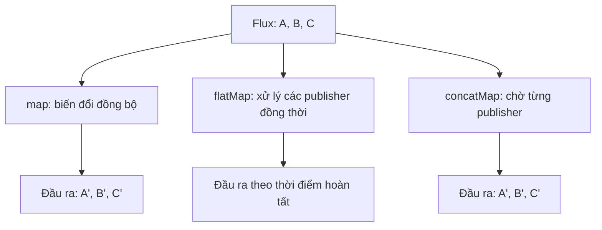
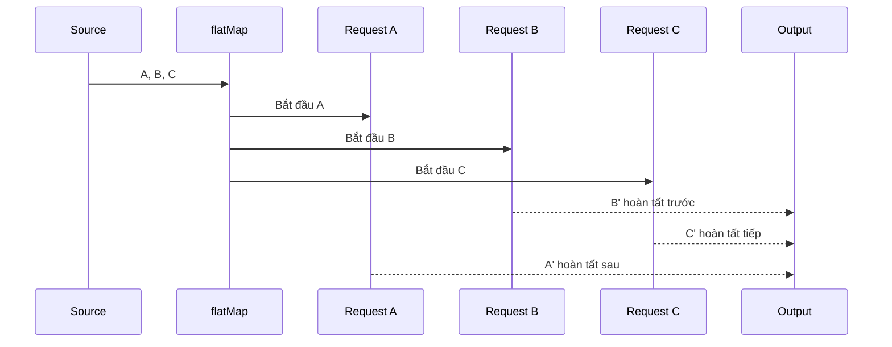
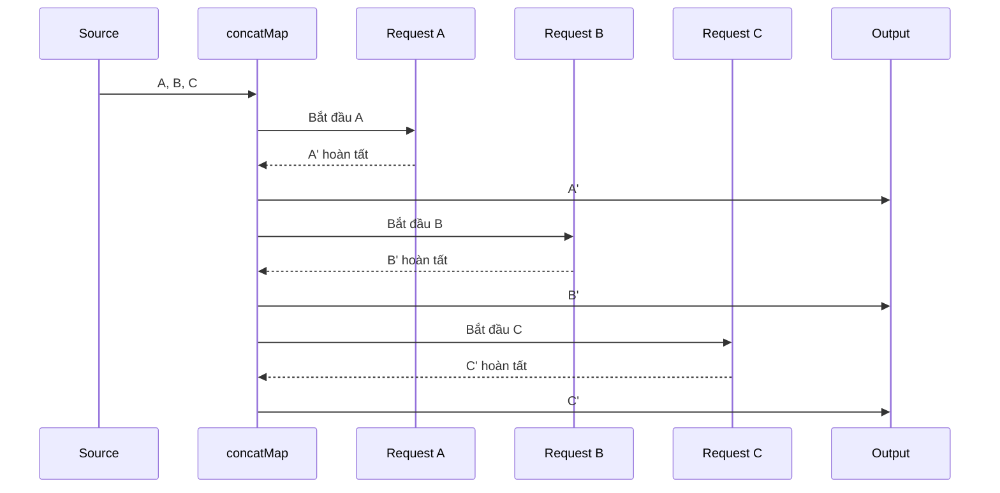

# map, flatMap và concatMap trong bảo toàn thứ tự

## 1. Vì sao thứ tự thay đổi khi xử lý reactive?

Trong ứng dụng Spring Cloud Stream, một consumer có thể nhận một luồng message liên tục. Với Reactor, luồng đó thường được biểu diễn bằng `Flux<T>`. Mỗi message có thể cần biến đổi dữ liệu, gọi dịch vụ khác hoặc ghi trạng thái trước khi phát kết quả qua output binding.

Ba toán tử `map`, `flatMap` và `concatMap` đều biến đổi phần tử của một luồng, nhưng chúng có cách xử lý khác nhau:

- `map` biến đổi đồng bộ từng phần tử và giữ thứ tự của luồng đầu vào.
- `flatMap` biến mỗi phần tử thành một publisher rồi hợp nhất kết quả; các tác vụ con có thể chạy đồng thời và phát kết quả theo thời điểm hoàn tất.
- `concatMap` biến mỗi phần tử thành publisher nhưng chỉ xử lý publisher tiếp theo sau khi publisher hiện tại hoàn tất; thứ tự đầu ra theo thứ tự đầu vào được giữ.

Sự khác biệt quan trọng nhất xuất hiện khi một bước xử lý có I/O bất đồng bộ với thời gian hoàn tất khác nhau. Nếu message A đến trước B nhưng thao tác của A chậm hơn B, `flatMap` có thể phát kết quả B trước A. `concatMap` giữ trình tự bằng cách chờ A hoàn tất rồi mới xử lý B.



Thứ tự ở đây là thứ tự phần tử trong một subscription Reactor. Nó không tự tạo ra thứ tự toàn cục giữa nhiều Kafka partition, nhiều consumer instance hoặc nhiều broker destination. Muốn giữ thứ tự nghiệp vụ, phải thiết kế cả partition key, consumer concurrency và cách thực hiện tác dụng phụ.

## 2. map: biến đổi đồng bộ và giữ thứ tự

`map` nhận một hàm đồng bộ, lấy một phần tử và trả về một phần tử mới. Mỗi phần tử đầu vào tương ứng với đúng một phần tử đầu ra. Reactor xử lý phép biến đổi theo thứ tự phát của nguồn.

Ví dụ, chuẩn hóa tên và tạo một đối tượng hiển thị từ event đơn hàng:

```java
import reactor.core.publisher.Flux;

record OrderEvent(String orderId, String customerId, String customerName, long totalCents) {}
record OrderView(String orderId, String customerName, long totalCents) {}

Flux<OrderEvent> orderEvents = Flux.just(
    new OrderEvent("ORD-1", "CUS-1", " An ", 10000),
    new OrderEvent("ORD-2", "CUS-2", " Binh ", 20000)
);

Flux<OrderView> views = orderEvents.map(event -> new OrderView(
    event.orderId(),
    event.customerName().trim(),
    event.totalCents()
));
```

Nếu nguồn phát A, B, C thì `map` phát A', B', C' theo cùng thứ tự. Đây là lựa chọn phù hợp cho các phép biến đổi nhanh, không cần chờ một publisher khác như chuẩn hóa trường, tính toán, ánh xạ DTO hoặc kiểm tra điều kiện đơn giản.

### map không phải toán tử cho I/O bất đồng bộ

Nếu hàm bên trong `map` trả về `Mono<R>`, kết quả sẽ là `Flux<Mono<R>>`, tức một luồng chứa các publisher chưa được ghép vào pipeline:

```java
Flux<Mono<Customer>> nested = orderEvents.map(
    event -> customerClient.findById(event.customerId())
);
```

Trong trường hợp muốn thực thi và nhận kết quả của lời gọi bất đồng bộ, cần dùng `flatMap`, `concatMap` hoặc toán tử tương ứng. Không nên gọi `block()` trong `map` để chờ kết quả vì thao tác đó biến luồng bất đồng bộ thành chặn luồng thực thi và có thể làm cạn tài nguyên.

### Giữ map thuần và dễ kiểm thử

Nên ưu tiên dùng `map` cho phép biến đổi không có tác dụng phụ. Việc ghi database, gửi HTTP hoặc cập nhật hệ thống bên ngoài nên được biểu diễn bằng publisher trả về từ API reactive để Reactor có thể theo dõi thời gian hoàn tất, lỗi và hủy tác vụ.

## 3. flatMap: xử lý publisher đồng thời

`flatMap` nhận một hàm biến mỗi phần tử thành một publisher như `Mono<R>` hoặc `Flux<R>`, sau đó hợp nhất kết quả của các publisher con vào một luồng đầu ra.

Ví dụ, mỗi event đơn hàng cần truy vấn thông tin khách hàng qua HTTP:

```java
import reactor.core.publisher.Flux;
import reactor.core.publisher.Mono;

record Customer(String displayName) {}
interface CustomerClient {
    Mono<Customer> findById(String customerId);
}

Flux<OrderView> enriched = orderEvents.flatMap(
    event -> customerClient.findById(event.customerId())
        .map(customer -> new OrderView(
            event.orderId(),
            customer.displayName(),
            event.totalCents()
        ))
);
```

Mỗi lời gọi `findById` trả về một `Mono<Customer>`. `flatMap` subscribe các publisher con và hợp nhất kết quả khi chúng phát ra. Nếu A mất 300 ms, B mất 50 ms và C mất 100 ms, kết quả có thể phát B', C', A' dù đầu vào là A, B, C.



Đây là hành vi mong đợi khi ưu tiên thông lượng và các phần tử có thể xử lý độc lập. Nếu thứ tự không quan trọng, `flatMap` giúp tận dụng thời gian chờ I/O để xử lý nhiều message đồng thời.

### Giới hạn concurrency

Có thể giới hạn số publisher con được subscribe đồng thời:

```java
Flux<OrderView> enriched = orderEvents.flatMap(
    event -> customerClient.findById(event.customerId())
        .map(customer -> new OrderView(
            event.orderId(), customer.displayName(), event.totalCents()
        )),
    8
);
```

Tham số `8` giới hạn số inner publisher hoạt động đồng thời theo API Reactor. Giới hạn này giúp tránh tạo quá nhiều request cùng lúc, bảo vệ dịch vụ phụ thuộc và kiểm soát lượng công việc đang chờ.

Không nên mặc định tăng concurrency càng cao càng tốt. Nếu database hoặc HTTP service chỉ chịu được một mức tải nhất định, concurrency quá lớn có thể làm tăng timeout, retry và backlog. Hãy đo latency, throughput và tỷ lệ lỗi để chọn giá trị phù hợp.

## 4. concatMap: xử lý tuần tự và giữ thứ tự đầu ra

`concatMap` cũng biến mỗi phần tử thành publisher, nhưng subscribe và chờ publisher hiện tại hoàn tất trước khi chuyển sang publisher tiếp theo. Kết quả được phát theo thứ tự nguồn.

```java
Flux<OrderView> enrichedInOrder = orderEvents.concatMap(
    event -> customerClient.findById(event.customerId())
        .map(customer -> new OrderView(
            event.orderId(), customer.displayName(), event.totalCents()
        ))
);
```

Nếu đầu vào là A, B, C thì `concatMap` bắt đầu xử lý A, chờ publisher của A hoàn tất, rồi mới xử lý B và tiếp theo là C. Nếu A chậm, B và C phải chờ dù dịch vụ có thể xử lý chúng nhanh hơn.



`concatMap` phù hợp khi các thao tác có quan hệ phụ thuộc hoặc cần áp dụng lần lượt, ví dụ cập nhật trạng thái theo sequence, ghi các thay đổi của cùng một thực thể theo thứ tự, hoặc gọi một hệ thống bên ngoài không chịu được nhiều yêu cầu đồng thời.

### Đổi lại thông lượng thấp hơn

Vì chỉ xử lý một inner publisher tại một thời điểm, một tác vụ chậm có thể làm chậm toàn bộ luồng phía sau. Đây là trade-off để giữ trình tự. Nếu dữ liệu đến nhanh hơn tốc độ xử lý tuần tự, hàng đợi chờ có thể tăng và độ trễ đầu-cuối tăng.

Không dùng `concatMap` cho toàn bộ luồng chỉ vì một vài loại event cần thứ tự. Hãy xác định phạm vi cần tuần tự hóa và xem xét phân vùng theo key để các thực thể khác nhau vẫn xử lý song song.

## 5. So sánh map, flatMap và concatMap

| Toán tử | Hàm ánh xạ | Cách thực thi | Thứ tự đầu ra | Trường hợp phù hợp |
|---|---|---|---|---|
| `map` | `T -> R` | Biến đổi đồng bộ một-một | Giữ thứ tự nguồn | Tính toán, chuẩn hóa, DTO mapping |
| `flatMap` | `T -> Publisher<R>` | Inner publisher có thể chạy đồng thời | Không bảo đảm thứ tự nguồn | I/O độc lập, ưu tiên throughput |
| `concatMap` | `T -> Publisher<R>` | Inner publisher lần lượt, chờ hoàn tất | Giữ thứ tự nguồn | Cần tuần tự hóa thao tác |
| `flatMapSequential` | `T -> Publisher<R>` | Subscribe inner publisher đồng thời | Phát kết quả theo thứ tự nguồn | Cần concurrency nhưng muốn thứ tự emission |

Chọn toán tử theo yêu cầu nghiệp vụ và đặc tính của thao tác bên trong. Đừng dùng `map` để chứa một publisher chưa được thực thi; đừng dùng `flatMap` khi thứ tự phát kết quả là một invariant; cũng đừng dùng `concatMap` toàn cục nếu chỉ cần thứ tự theo từng khóa.

## 6. flatMapSequential: chạy đồng thời, phát theo thứ tự nguồn

Reactor còn có `flatMapSequential`. Toán tử này subscribe các inner publisher với concurrency, nhưng giữ thứ tự phát kết quả theo thứ tự phần tử nguồn. Kết quả của publisher hoàn tất sớm có thể phải chờ trong buffer cho đến khi các publisher trước đó phát xong.

```java
Flux<OrderView> orderedResults = orderEvents.flatMapSequential(
    event -> customerClient.findById(event.customerId())
        .map(customer -> new OrderView(
            event.orderId(), customer.displayName(), event.totalCents()
        )),
    8
);
```

Ví dụ A, B, C bắt đầu gần như đồng thời. B và C có thể hoàn tất trước A, nhưng `flatMapSequential` giữ B' và C' chờ, sau đó phát A', B', C' theo thứ tự nguồn.

Điều này khác với `concatMap`: `flatMapSequential` cho phép các thao tác con chạy đồng thời, còn `concatMap` chỉ bắt đầu thao tác tiếp theo sau khi thao tác hiện tại hoàn tất.

### Thứ tự emission không đồng nghĩa thứ tự tác dụng phụ

Đây là điểm cần đặc biệt chú ý. Nếu inner publisher thực hiện một thao tác ghi database và thao tác đó đã commit trước khi publisher phát kết quả, `flatMapSequential` không thể đảo ngược thứ tự commit đã xảy ra. Nó chỉ sắp xếp thứ tự phát kết quả downstream.

Nếu thứ tự cập nhật bên ngoài là bắt buộc, cần tuần tự hóa chính thao tác cập nhật bằng `concatMap`, hoặc dùng cơ chế version/sequence, transaction và kiểm soát đồng thời ở database. Không dựa riêng vào thứ tự emission để suy ra thứ tự side effect.

## 7. Chọn toán tử theo bài toán nghiệp vụ

### Chỉ biến đổi dữ liệu

Ví dụ chuẩn hóa event, đổi tên trường hoặc tính giá trị dẫn xuất mà không gọi I/O. Dùng `map` vì thao tác đồng bộ và một-một.

### Gọi dịch vụ độc lập, không cần thứ tự

Ví dụ mỗi event cập nhật một chỉ số độc lập hoặc tra cứu thông tin có thể hoàn tất theo bất kỳ thứ tự nào. Dùng `flatMap` với concurrency được giới hạn.

### Ghi các thay đổi cần theo thứ tự

Ví dụ các event có sequence 1, 2, 3 cập nhật trạng thái cùng một đơn hàng. Dùng `concatMap` trong phạm vi đơn hàng hoặc cơ chế tuần tự hóa tương đương.

### Cần chạy I/O đồng thời nhưng downstream cần thứ tự nguồn

Ví dụ tạo các kết quả độc lập song song, nhưng một bước tiếp theo yêu cầu nhận kết quả theo đúng thứ tự đầu vào. Cân nhắc `flatMapSequential`, đồng thời kiểm tra chi phí buffer và thứ tự tác dụng phụ.

## 8. Kết hợp thứ tự theo key với xử lý song song

Trong hệ thống sự kiện, thường không cần tuần tự hóa tất cả message. Nhu cầu phổ biến là giữ thứ tự cho cùng một thực thể nhưng cho phép các thực thể khác nhau xử lý đồng thời.

Ví dụ:

- Các event của `orderId=ORD-1` phải được xử lý theo sequence.
- Các event của `orderId=ORD-2` có thể được xử lý song song với ORD-1.

Ở tầng broker, producer dùng `orderId` làm partition key để event của cùng đơn hàng vào cùng Kafka partition. Ở tầng Reactor, có thể tuần tự hóa xử lý của từng key và cho phép các key khác nhau chạy song song. Một mẫu nâng cao là nhóm theo key rồi dùng `concatMap` bên trong mỗi nhóm:

```java
Flux<OrderResult> results = events
    .groupBy(OrderEvent::orderId)
    .flatMap(group -> group.concatMap(orderService::process));
```

Trong ví dụ, mỗi group tương ứng một `orderId`; các event trong cùng group được xử lý tuần tự, còn các group khác nhau có thể được xử lý đồng thời bởi `flatMap` bên ngoài.

`groupBy` cần được dùng cẩn thận. Nếu số key rất lớn hoặc group không kết thúc, ứng dụng có thể giữ nhiều group và buffer trong thời gian dài. Cần đo cardinality, giới hạn concurrency bên ngoài, kiểm soát tốc độ đầu vào và đánh giá khả năng phân vùng tại broker. Với nhiều ứng dụng, phân vùng theo key ở Kafka cùng một consumer pipeline tuần tự trong partition có thể đơn giản hơn.

## 9. Dùng trong Spring Cloud Stream reactive function

Spring Cloud Stream có thể kết nối reactive function với binding đầu vào và đầu ra. Một function nhận `Flux<OrderEvent>` và trả về `Flux<OrderResult>` để framework/binder quản lý luồng message.

```java
import java.util.function.Function;
import org.springframework.context.annotation.Bean;
import org.springframework.context.annotation.Configuration;
import reactor.core.publisher.Flux;

record OrderEvent(String orderId, long totalCents) {}
record OrderResult(String orderId, String status) {}

interface OrderService {
    reactor.core.publisher.Mono<OrderResult> process(OrderEvent event);
}

@Configuration
class ReactiveOrderFunctions {

    @Bean
    Function<Flux<OrderEvent>, Flux<OrderResult>> processOrders(OrderService service) {
        return events -> events.concatMap(service::process);
    }
}
```

Với `concatMap`, function xử lý từng event theo thứ tự của Flux đầu vào. Nếu nghiệp vụ không yêu cầu thứ tự và cần tăng throughput, có thể đổi sang:

```java
return events -> events.flatMap(service::process, 8);
```

Hoặc nếu cần inner publisher chạy đồng thời nhưng muốn kết quả phát downstream theo thứ tự nguồn:

```java
return events -> events.flatMapSequential(service::process, 8);
```

Đây là các lựa chọn thay thế cho cùng một function, không phải ba pipeline cần chạy đồng thời trên cùng một binding. Hãy chọn theo yêu cầu nghiệp vụ và kiểm thử thứ tự thực tế.

### Cấu hình binding

```yaml
spring:
  cloud:
    function:
      definition: processOrders
    stream:
      bindings:
        processOrders-in-0:
          destination: orders.events
          group: order-processor
          content-type: application/json
        processOrders-out-0:
          destination: orders.results
          content-type: application/json
      kafka:
        binder:
          brokers: localhost:9092
```

Binding đầu vào đưa message từ `orders.events` vào reactive function; các giá trị trả về được gửi qua `orders.results`. Consumer group và partition key vẫn do cấu hình broker/binder quyết định. Toán tử Reactor chỉ điều khiển việc xử lý các phần tử đã đi vào subscription.

### Không tự subscribe trong function

Trong reactive function, hãy trả về `Flux` hoặc `Mono` để framework quản lý vòng đời subscription. Không gọi `.subscribe()` bên trong function rồi trả về rỗng hoặc một luồng không liên quan. Làm vậy có thể khiến framework không theo dõi được tác vụ, lỗi, backpressure và thời điểm hoàn tất xử lý message.

Tương tự, tránh `block()` trong reactive pipeline. Hãy dùng API reactive của HTTP client, database driver hoặc service phụ thuộc. Nếu buộc phải gọi API blocking, cần cô lập trên scheduler phù hợp và đánh giá giới hạn tài nguyên; không chặn event loop.

## 10. Thứ tự ở Reactor và thứ tự ở broker

Một pipeline có thể giữ thứ tự đầu vào nhưng không bảo đảm thứ tự toàn hệ thống. Cần phân biệt các phạm vi:

1. **Thứ tự trong một Flux:** `map`, `concatMap` và `flatMapSequential` có hành vi giữ thứ tự emission theo quy tắc đã mô tả; `flatMap` không bảo đảm.
2. **Thứ tự trong Kafka partition:** Kafka lưu record theo offset trong từng partition. Producer key giúp các event cùng thực thể đi vào cùng partition theo partitioner.
3. **Thứ tự giữa nhiều partition:** không có thứ tự toàn cục. Một consumer có thể nhận dữ liệu từ nhiều partition và các luồng có thể được hợp nhất.
4. **Thứ tự giữa nhiều instance:** consumer group phân chia partition cho instance; các instance có thể xử lý song song.
5. **Thứ tự tác dụng phụ:** phụ thuộc việc pipeline chờ publisher hoàn tất, transaction, database và các hệ thống bên ngoài.

Nếu nghiệp vụ yêu cầu tuần tự theo `orderId`, cần dùng cùng một partition key ở producer, bảo đảm event của đơn hàng đi cùng partition và xử lý theo thứ tự trong pipeline consumer. Chỉ chọn `concatMap` mà không thiết kế key và partition thì không thể giữ thứ tự giữa các instance hoặc nhiều partition.

Với RabbitMQ và Pulsar, thứ tự còn phụ thuộc queue, consumer concurrency, prefetch, subscription type và message key. Hãy kiểm tra semantics của binder tương ứng thay vì suy ra từ hành vi Kafka.

## 11. Backpressure và giới hạn tài nguyên

Reactive Streams có cơ chế backpressure để consumer/downstream điều tiết lượng dữ liệu được phát. Tuy nhiên, backpressure chỉ có hiệu quả khi các thành phần trong pipeline tuân thủ giao thức và không tạo hàng đợi nội bộ không giới hạn.

Các yếu tố cần kiểm soát:

- Concurrency của `flatMap` và `flatMapSequential`.
- Số phần tử được prefetch và buffer trong các operator.
- Tốc độ nhận message từ binder/broker.
- Thời gian phản hồi của database hoặc HTTP service.
- Số group đang mở nếu dùng `groupBy`.
- Dung lượng bộ nhớ cho các kết quả hoàn tất sớm đang chờ đúng thứ tự.

`concatMap` hạn chế số inner publisher hoạt động đồng thời nhưng có thể tạo backlog nếu đầu vào nhanh hơn đầu ra. `flatMap` tăng concurrency nhưng có thể làm dịch vụ phụ thuộc quá tải. `flatMapSequential` giữ thứ tự emission nhưng có thể phải giữ kết quả của publisher hoàn tất sớm trong buffer khi publisher trước còn chậm.

Không có toán tử nào tự giải quyết mọi vấn đề tải. Hãy đo throughput, latency, queue depth, consumer lag và mức sử dụng bộ nhớ khi thử tải.

## 12. Xử lý lỗi và retry trong pipeline

Trong Reactor, lỗi thường là terminal signal của một publisher. Khi một inner publisher trong `flatMap` hoặc `concatMap` phát lỗi, lỗi có thể kết thúc pipeline nếu không được xử lý. Có thể dùng `onErrorResume` để chuyển sang luồng dự phòng hoặc `retryWhen` để thử lại lỗi tạm thời.

Ví dụ retry có giới hạn cho một thao tác xử lý:

```java
import java.time.Duration;
import reactor.util.retry.Retry;

Mono<OrderResult> processWithRetry(OrderEvent event) {
    return orderService.process(event)
        .retryWhen(Retry.backoff(3, Duration.ofMillis(200))
            .filter(this::isTransientFailure));
}
```

Nếu dùng `concatMap`, một event lỗi có thể làm dừng các event phía sau trong cùng pipeline cho đến khi lỗi được xử lý hoặc pipeline kết thúc. Nếu dùng `flatMap`, các inner publisher khác có thể đang chạy khi một inner phát lỗi; hành vi hủy và xử lý lỗi cần được thiết kế rõ.

Retry có thể thực hiện lại tác dụng phụ. Nếu một thao tác đã ghi database nhưng response bị mất, lần retry có thể ghi trùng. Dùng event ID, khóa idempotency, inbox hoặc ràng buộc duy nhất để bảo vệ nghiệp vụ. Không retry vô hạn lỗi dữ liệu hoặc schema không thể tự hồi phục.

Với Spring Cloud Stream, retry và DLQ ở binder/container có thể tương tác với retry trong Reactor. Tránh tạo nhiều tầng retry không giới hạn. Hãy xác định tầng nào chịu trách nhiệm retry, số lần thử tổng cộng, backoff và điều kiện xác nhận/commit message.

## 13. Kiểm thử thứ tự bằng StepVerifier

Reactor cung cấp `StepVerifier` để kiểm tra thứ tự emission của một publisher.

Ví dụ kiểm tra `map` giữ thứ tự:

```java
import org.junit.jupiter.api.Test;
import reactor.core.publisher.Flux;
import reactor.test.StepVerifier;

class OrderingOperatorsTest {

    @Test
    void mapPreservesSourceOrder() {
        Flux<String> result = Flux.just("A", "B", "C")
            .map(value -> value + "'");

        StepVerifier.create(result)
            .expectNext("A'", "B'", "C'")
            .verifyComplete();
    }
}
```

Có thể dùng các publisher trễ khác nhau để quan sát sự khác biệt giữa `flatMap` và `concatMap`:

```java
import java.time.Duration;
import org.junit.jupiter.api.Test;
import reactor.core.publisher.Flux;
import reactor.core.publisher.Mono;
import reactor.test.StepVerifier;

class AsyncOrderingOperatorsTest {

    @Test
    void concatMapEmitsInSourceOrder() {
        StepVerifier.withVirtualTime(() -> Flux.just("A", "B", "C")
                .concatMap(this::delayed))
            .thenAwait(Duration.ofSeconds(1))
            .expectNext("A", "B", "C")
            .verifyComplete();
    }

    @Test
    void flatMapEmitsAsInnerPublishersComplete() {
        StepVerifier.withVirtualTime(() -> Flux.just("A", "B", "C")
                .flatMap(this::delayed))
            .thenAwait(Duration.ofSeconds(1))
            .expectNext("B", "C", "A")
            .verifyComplete();
    }

    private Mono<String> delayed(String value) {
        Duration delay = switch (value) {
            case "A" -> Duration.ofMillis(300);
            case "B" -> Duration.ofMillis(50);
            default -> Duration.ofMillis(100);
        };
        return Mono.delay(delay).thenReturn(value);
    }
}
```

Kiểm thử tạo publisher bên trong supplier của `withVirtualTime` để scheduler ảo được áp dụng đúng lúc. Với các độ trễ minh họa, `flatMap` phát B, C, A theo thời điểm hoàn tất, còn `concatMap` phát A, B, C theo thứ tự nguồn.

Kiểm thử ở mức Reactor chỉ chứng minh thứ tự emission của pipeline. Kiểm thử tích hợp với binder/broker mới xác nhận thứ tự nhận, partition assignment, acknowledgement và hành vi khi consumer restart.

## 14. Lỗi thường gặp

| Triệu chứng | Nguyên nhân | Hướng xử lý |
|---|---|---|
| Kết quả phát ra sai thứ tự | Dùng `flatMap` với inner publisher có thời gian hoàn tất khác nhau | Dùng `concatMap` hoặc `flatMapSequential` nếu cần thứ tự emission |
| Pipeline có kiểu `Flux<Mono<T>>` | Dùng `map` với hàm trả về publisher | Dùng `flatMap`, `concatMap` hoặc `flatMapSequential` |
| Throughput giảm mạnh | Dùng `concatMap` cho toàn bộ luồng dù các event độc lập | Tuần tự hóa đúng phạm vi key, giới hạn concurrency phù hợp |
| Bộ nhớ tăng | Concurrency quá cao, buffer lớn hoặc `flatMapSequential` phải giữ kết quả chờ | Giảm concurrency/prefetch, đo latency và kiểm soát đầu vào |
| Side effect vẫn sai thứ tự | Chỉ sắp xếp emission nhưng thao tác bên ngoài đã chạy song song | Tuần tự hóa thao tác side effect hoặc dùng sequence/transaction |
| Message bị xử lý lặp sau retry | Tác dụng phụ đã xảy ra trước khi xác nhận/commit | Thiết kế idempotency và ranh giới xác nhận |
| Thứ tự sai giữa các partition | Kỳ vọng có thứ tự toàn cục từ nhiều partition | Dùng key theo aggregate và xác định rõ phạm vi thứ tự |

## 15. Quy trình chọn toán tử

1. Xác định phép biến đổi là đồng bộ hay trả về `Mono`/`Flux`.
2. Nếu đồng bộ một-một, dùng `map`.
3. Nếu cần I/O bất đồng bộ và các phần tử độc lập, dùng `flatMap` với concurrency có giới hạn.
4. Nếu cần chờ từng thao tác theo thứ tự nguồn, dùng `concatMap`.
5. Nếu muốn chạy inner publisher đồng thời nhưng phát kết quả theo thứ tự nguồn, cân nhắc `flatMapSequential`.
6. Nếu chỉ cần tuần tự theo từng thực thể, thiết kế partition key và cân nhắc tuần tự hóa theo key thay vì toàn bộ luồng.
7. Xác định retry, timeout, cancellation, idempotency và thời điểm xác nhận message.
8. Kiểm thử thứ tự bằng StepVerifier và kiểm thử tích hợp với broker thực tế.

`map`, `flatMap` và `concatMap` không chỉ là các cách viết khác nhau để biến đổi dữ liệu. Chúng quyết định cách các tác vụ bất đồng bộ được kết hợp và thứ tự kết quả được phát. Trong Spring Cloud Stream reactive function, hãy dùng `map` cho phép biến đổi đồng bộ, `flatMap` cho công việc độc lập cần song song và `concatMap` khi cần tuần tự hóa. Kết hợp lựa chọn đó với partition key, consumer group, backpressure và idempotency để bảo toàn đúng thứ tự nghiệp vụ mà vẫn tận dụng được khả năng xử lý song song.

