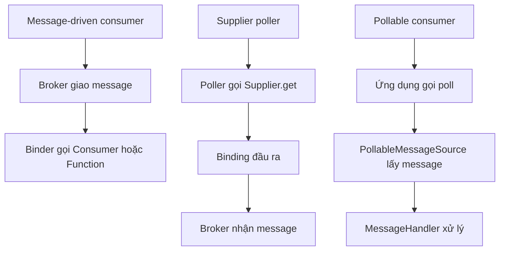

# Phân biệt nhận do sự kiện, Supplier poller và pollable consumer

Spring Cloud Stream hỗ trợ nhiều cách kích hoạt xử lý message. Với consumer nhận theo sự kiện, binder chuyển message tới hàm khi message sẵn sàng. Với `Supplier`, framework chủ động gọi nguồn phát theo lịch để tạo message đầu ra. Với pollable consumer, ứng dụng chủ động gọi `PollableMessageSource.poll()` để lấy message đầu vào khi muốn.

Ba cơ chế đều có thể xuất hiện trong một hệ thống xử lý sự kiện, nhưng chúng điều khiển những chiều khác nhau. `Supplier` tạo dữ liệu để gửi đi; message-driven consumer nhận dữ liệu do broker chuyển tới; pollable consumer đọc dữ liệu từ binding đầu vào theo nhịp do ứng dụng quản lý. Phân biệt rõ ba cơ chế giúp chọn đúng mô hình theo yêu cầu về độ trễ, tốc độ xử lý, quyền kiểm soát và vòng đời message.

## 1. Ba cơ chế kích hoạt khác nhau

| Cơ chế | Hướng dữ liệu | Ai kích hoạt xử lý? | API tiêu biểu | Khi nào dùng? |
| --- | --- | --- | --- | --- |
| Message-driven consumer | Broker → ứng dụng | Binder/broker chuyển message khi có dữ liệu và listener sẵn sàng | `Consumer<T>`, `Function<T, R>` | Phản ứng nhanh với message đến, xử lý liên tục và để framework quản lý listener |
| Supplier poller | Ứng dụng → broker | Poller của framework gọi `Supplier.get()` theo chu kỳ | `Supplier<T>` | Đọc trạng thái hoặc tạo sự kiện theo lịch, mỗi lần gọi tạo dữ liệu đầu ra |
| Pollable consumer | Broker → ứng dụng | Code ứng dụng, scheduler hoặc worker gọi `PollableMessageSource.poll()` | `PollableMessageSource` | Muốn tự điều khiển thời điểm, số lần đọc, vòng lặp hoặc tốc độ lấy message |

Có thể nhớ theo ba câu hỏi:

- Message-driven consumer: *Khi broker có message, ai gọi hàm xử lý?* Binder gọi hàm khi message được giao.
- Supplier poller: *Ai gọi hàm tạo dữ liệu và gọi khi nào?* Poller gọi supplier theo lịch.
- Pollable consumer: *Khi nào ứng dụng muốn lấy một message?* Chính code ứng dụng quyết định lúc gọi `poll()`.



Điểm dễ nhầm nhất là hai chữ “poll”. Poller của `Supplier` gọi một hàm tạo dữ liệu để phát ra ngoài. `PollableMessageSource` lấy message từ binding đầu vào. Một cơ chế là nguồn phát, cơ chế còn lại là nguồn nhận.

## 2. Message-driven consumer: nhận message khi có sự kiện

Đây là mô hình tiêu thụ phổ biến nhất trong Spring Cloud Stream. Ứng dụng khai báo bean `Consumer<T>` hoặc `Function<T, R>`. Binder kết nối binding đầu vào với destination và gọi hàm khi message được giao.

Ví dụ dịch vụ xử lý đơn hàng:

```java
import java.util.function.Consumer;

import org.springframework.context.annotation.Bean;
import org.springframework.context.annotation.Configuration;

public record OrderCreated(String orderId, String customerId) {}

@Configuration
public class OrderEventHandlers {

    @Bean
    public Consumer<OrderCreated> processOrder() {
        return event -> {
            System.out.println("Processing order " + event.orderId());
        };
    }
}
```

Cấu hình binding:

```yaml
spring:
  cloud:
    function:
      definition: processOrder
    stream:
      bindings:
        processOrder-in-0:
          destination: orders.created
          group: order-service
          content-type: application/json
```

Khi broker giao một message, binder chuyển payload thành `OrderCreated` rồi gọi `processOrder`. Code ứng dụng không cần viết vòng lặp `while` để liên tục kiểm tra broker có dữ liệu hay không.

### Đặc điểm

- Listener được kích hoạt khi message đến, vì vậy phù hợp với xử lý hướng sự kiện có độ trễ thấp.
- Binder và broker quản lý cơ chế nhận message, consumer lifecycle và nhiều chi tiết giao nhận.
- Tốc độ nhận phụ thuộc listener concurrency, prefetch, partition assignment, acknowledgment và khả năng xử lý của downstream.
- Ứng dụng vẫn phải thiết kế retry, idempotency, dead-letter handling và giám sát lỗi theo yêu cầu nghiệp vụ.

Message-driven không có nghĩa là hệ thống luôn xử lý ngay lập tức hoặc không có giới hạn tải. Nếu consumer xử lý chậm, backlog có thể tăng ở broker. Cần điều chỉnh concurrency và cấu hình binder phù hợp, đồng thời bảo vệ database hoặc API phía sau khỏi quá tải.

## 3. Supplier poller: poller gọi nguồn phát để tạo message

`Supplier<T>` không có đầu vào. Framework cần một cơ chế khác để biết khi nào gọi `get()`. Spring Cloud Stream cung cấp poller mặc định, thường gọi supplier mỗi giây và mỗi lần lấy một message theo cấu hình mặc định.

Ví dụ nguồn phát trạng thái dịch vụ:

```java
import java.time.Instant;
import java.util.function.Supplier;

import org.springframework.context.annotation.Bean;
import org.springframework.context.annotation.Configuration;

public record ServiceSnapshot(String service, Instant capturedAt) {}

@Configuration
public class SnapshotSource {

    @Bean
    public Supplier<ServiceSnapshot> serviceSnapshot() {
        return () -> new ServiceSnapshot("order-service", Instant.now());
    }
}
```

Supplier có binding đầu ra mặc định `serviceSnapshot-out-0`. Cấu hình có thể điều chỉnh destination và chu kỳ poll:

```yaml
spring:
  cloud:
    function:
      definition: serviceSnapshot
    stream:
      bindings:
        serviceSnapshot-out-0:
          destination: service.snapshots
          content-type: application/json
  integration:
    poller:
      fixed-delay: 5000
      initial-delay: 1000
      max-messages-per-poll: 1
```

Với cấu hình trên, poller bắt đầu sau một giây rồi gọi supplier theo fixed delay năm giây. Mỗi lần gọi tạo một `ServiceSnapshot` và gửi tới `service.snapshots`.

Trong các phiên bản Spring Cloud Stream hiện hành, các thuộc tính poller mặc định dùng prefix `spring.integration.poller`. Một số phiên bản cũ dùng `spring.cloud.stream.poller`; prefix cũ đã được đánh dấu deprecated từ Spring Cloud Stream 3.2. Hãy đối chiếu phiên bản release train của dự án trước khi áp dụng cấu hình.

### Poller điều khiển nguồn phát, không điều khiển consumer

Poller của supplier chịu trách nhiệm gọi hàm tạo dữ liệu. Nó không lấy message từ một input destination. Nếu cần đọc message từ broker theo lịch do ứng dụng quản lý, hãy dùng pollable consumer.

### Supplier trả Flux

Với `Supplier<Flux<T>>`, supplier thường được gọi một lần để tạo publisher liên tục; các phần tử sau đó được publisher phát ra. Poller mặc định không gọi lại supplier cho từng phần tử trong một Flux liên tục.

Nếu muốn một supplier reactive tạo một Flux hữu hạn rồi được gọi lại định kỳ, có thể dùng `@PollableBean`:

```java
import java.util.function.Supplier;

import reactor.core.publisher.Flux;

import org.springframework.cloud.function.context.PollableBean;
import org.springframework.context.annotation.Configuration;

@Configuration
public class FiniteBatchSource {

    @PollableBean
    public Supplier<Flux<String>> dailyBatch() {
        return () -> Flux.just("REPORT_READY", "REPORT_ARCHIVED");
    }
}
```

`@PollableBean` báo cho framework biết supplier reactive này cần được poll định kỳ. Thuộc tính `splittable` mặc định là `true`, nghĩa là các phần tử của Flux được tách và gửi thành từng message riêng. Nếu đặt `splittable = false`, Flux được xử lý như một kết quả duy nhất theo cơ chế của framework. Cần chọn theo hợp đồng payload mà consumer mong đợi.

## 4. Pollable consumer: ứng dụng chủ động lấy message đầu vào

Pollable consumer cung cấp quyền kiểm soát trực tiếp hơn cho code ứng dụng. Thay vì binder tự gọi một `Consumer<T>` khi message đến, Spring Cloud Stream cung cấp `PollableMessageSource`. Ứng dụng gọi `poll()` để thử lấy một message và truyền một `MessageHandler` để xử lý nó.

Để tạo pollable input binding theo mô hình hàm, khai báo `spring.cloud.stream.pollable-source`. Ví dụ:

```yaml
spring:
  cloud:
    stream:
      pollable-source: orders
      bindings:
        orders-in-0:
          destination: orders.created
          group: order-poller
          content-type: application/json
```

Tên `pollable-source` là `orders`, vì vậy binding đầu vào được đặt tên `orders-in-0`. Ứng dụng có thể inject `PollableMessageSource` và quyết định khi nào đọc.

### Ví dụ dùng Scheduled task

```java
import org.springframework.scheduling.annotation.EnableScheduling;
import org.springframework.scheduling.annotation.Scheduled;
import org.springframework.stereotype.Component;
import org.springframework.cloud.stream.binder.PollableMessageSource;
import org.springframework.core.ParameterizedTypeReference;

@Component
@EnableScheduling
public class OrderPoller {

    private final PollableMessageSource source;

    public OrderPoller(PollableMessageSource source) {
        this.source = source;
    }

    @Scheduled(fixedDelayString = "${orders.poll-delay:1000}")
    public void pollOneOrder() {
        try {
            boolean received = source.poll(message -> {
                OrderCreated event = (OrderCreated) message.getPayload();
                System.out.println("Polled order " + event.orderId());
                process(event);
            }, new ParameterizedTypeReference<OrderCreated>() {});

            if (!received) {
                // Không có message ở thời điểm poll này.
            }
        }
        catch (Exception ex) {
            // Ghi nhận và xử lý lỗi theo chính sách của ứng dụng.
        }
    }

    private void process(OrderCreated event) {
        // Xử lý nghiệp vụ.
    }
}
```

`PollableMessageSource.poll()` nhận một `MessageHandler`. Overload có `ParameterizedTypeReference` cung cấp gợi ý kiểu để framework chuyển đổi payload, hữu ích với DTO hoặc kiểu generic. Phương thức trả về `true` khi đã nhận và xử lý thành công một message; trả về `false` khi không có message được lấy trong lần poll đó.

Ví dụ dùng `@Scheduled` để định kỳ thử đọc một message. Có thể thay scheduler bằng `ApplicationRunner`, worker thread hoặc một cơ chế điều phối khác. Điều quan trọng là ứng dụng phải tự chịu trách nhiệm về chu kỳ, số lần poll, số thread và việc dừng worker khi ứng dụng shutdown.

## 5. Pollable consumer điều khiển số message mỗi chu kỳ

Một lần gọi `poll()` lấy tối đa một message. Nếu muốn lấy một nhóm message trong mỗi chu kỳ, ứng dụng có thể gọi `poll()` nhiều lần và dừng khi không còn message hoặc đạt giới hạn.

Ví dụ thuật toán:

```java
int maxMessages = 20;

for (int i = 0; i < maxMessages; i++) {
    boolean received = source.poll(message -> handle(message));
    if (!received) {
        break;
    }
}
```

Giới hạn 20 giúp tránh một lần chạy chiếm worker vô hạn khi queue luôn có dữ liệu. Trong hệ thống thực tế, nên cấu hình giới hạn này theo thời gian xử lý, latency mục tiêu và khả năng downstream. Nếu cần nhiều worker poll đồng thời, phải đánh giá concurrency và semantics của binder để tránh xử lý trùng hoặc vượt quá khả năng của hệ thống phụ thuộc.

## 6. So sánh sâu hơn ba cơ chế

| Tiêu chí | Message-driven consumer | Supplier poller | Pollable consumer |
| --- | --- | --- | --- |
| Vai trò | Nhận message | Tạo và phát message | Nhận message |
| Binding | Input | Output | Input |
| Điểm bắt đầu | Message được giao | Poller đến lịch | Code gọi `poll()` |
| Kiểm soát tốc độ | Qua listener concurrency, prefetch, broker và downstream | Qua poller delay và số message mỗi poll | Qua lịch poll, vòng lặp, giới hạn message và số worker |
| Không có message | Listener không được gọi | Không liên quan; supplier vẫn được gọi để tạo message | `poll()` trả về `false` |
| Mức độ tự chủ | Framework quản lý việc giao message | Framework quản lý lịch gọi supplier | Ứng dụng quản lý lịch và vòng poll |
| Độ phức tạp | Thường thấp nhất | Thấp đến trung bình | Cao hơn vì phải quản lý worker, lịch và lỗi |
| Use case | Xử lý event liên tục | Snapshot, heartbeat, batch phát theo lịch | Đọc theo nhịp giới hạn, phối hợp với tài nguyên hoặc cửa sổ xử lý |

Supplier poller không phải một dạng consumer. Nó tạo message đầu ra. Message-driven consumer và pollable consumer đều nhận message đầu vào, nhưng khác nhau ở bên quyết định thời điểm gọi handler.

## 7. Xử lý acknowledgment và lỗi trong pollable consumer

Thông thường, `poll()` xác nhận message khi `MessageHandler` kết thúc bình thường. Nếu handler ném exception, message bị reject theo mặc định và không được requeue. Hành vi cụ thể còn phụ thuộc binder và cấu hình của broker.

Spring Cloud Stream cấu hình error channel cho pollable source. Khi callback ném exception, `ErrorMessage` được gửi tới error channel có tên theo destination và group, đồng thời được bridge tới global Spring Integration `errorChannel`. Nếu không có subscriber xử lý error channel, lỗi có thể chỉ được ghi log và message được xác nhận thành công theo hành vi mặc định. Nếu service activator xử lý error channel tiếp tục ném exception, message bị reject theo mặc định.

Nếu muốn yêu cầu broker giao lại message, có thể dùng `RequeueCurrentMessageException` theo cơ chế được tài liệu Spring Cloud Stream mô tả. Với trường hợp cần tự quản lý acknowledgment, lấy `AcknowledgmentCallback` từ header của message, gọi `noAutoAck()` rồi chủ động `ack` hoặc `nack/requeue` sau khi xử lý. Khi đã tắt auto-ack, bắt buộc phải xác nhận hoặc từ chối message ở mọi nhánh xử lý; nếu bỏ quên, tài nguyên broker có thể bị giữ lại.

Khả năng tắt auto-ack phụ thuộc implementation của `MessageSource`; không phải mọi nguồn đều hỗ trợ. Một số nguồn Kafka yêu cầu thao tác commit trên cùng thread và không cho phép trì hoãn acknowledgment sang thread khác. Hãy kiểm tra binder và phiên bản cụ thể trước khi dùng manual acknowledgment hoặc chuyển việc xử lý sang executor khác.

Ví dụ minh họa quản lý acknowledgment thủ công:

```java
import org.springframework.integration.StaticMessageHeaderAccessor;
import org.springframework.integration.acks.AcknowledgmentCallback;

source.poll(message -> {
    AcknowledgmentCallback callback =
            StaticMessageHeaderAccessor.getAcknowledgmentCallback(message);
    callback.noAutoAck();

    try {
        process((OrderCreated) message.getPayload());
        callback.acknowledge(AcknowledgmentCallback.Status.ACCEPT);
    }
    catch (Exception ex) {
        callback.acknowledge(AcknowledgmentCallback.Status.REQUEUE);
    }
});
```

Đây là khung minh họa; cần bổ sung log, giới hạn retry và chính sách lỗi phù hợp. Không requeue vô hạn một message độc hại hoặc luôn thất bại, vì nó có thể tạo vòng lặp giao nhận và chặn tiến độ xử lý.

Một lưu ý quan trọng với Kafka: khi một offset được yêu cầu requeue hoặc xử lý lại, các message phía sau đã được xác nhận có thể bị giao lại theo cách binder quản lý offset. Vì vậy, không giả định `REQUEUE` có nghĩa chỉ một record duy nhất được phát lại. Consumer nên idempotent và cần kiểm thử với broker thật.

## 8. Chọn mô hình theo yêu cầu nghiệp vụ

### Dùng message-driven consumer khi

- Cần phản ứng ngay khi message tới.
- Không cần ứng dụng tự viết vòng lặp lấy dữ liệu.
- Muốn binder quản lý listener lifecycle và cơ chế nhận message.
- Có thể kiểm soát tải bằng consumer concurrency, prefetch, partition và downstream capacity.

Ví dụ: dịch vụ thanh toán nhận `PaymentRequested` và bắt đầu xử lý ngay khi broker giao message.

### Dùng Supplier poller khi

- Ứng dụng chủ động tạo sự kiện theo lịch.
- Mỗi lần poll có thể đọc snapshot, trạng thái hoặc một phần dữ liệu từ nguồn nội bộ.
- Không có input destination cần đọc.

Ví dụ: mỗi năm phút dịch vụ phát `InventorySnapshot` để hệ thống phân tích nhận dữ liệu.

### Dùng pollable consumer khi

- Ứng dụng cần giới hạn rõ số message đọc trong một lượt.
- Việc lấy message cần phối hợp với một scheduler hoặc worker riêng.
- Cần kiểm soát thời điểm đọc theo trạng thái tài nguyên hoặc cửa sổ nghiệp vụ.
- Muốn tích hợp polling với quy trình xử lý đồng bộ hoặc một cơ chế điều phối nội bộ.

Ví dụ: worker chỉ lấy tối đa 50 tác vụ trong một chu kỳ khi hệ thống xử lý batch còn đủ capacity.

Không nên chọn pollable consumer chỉ để “có thêm quyền kiểm soát” nếu message-driven consumer đã đáp ứng yêu cầu. Polling tự quản lý làm tăng trách nhiệm về scheduling, concurrency, shutdown, retry, acknowledgment và giám sát.

## 9. Consumer group và nhiều poller instance

Pollable consumer vẫn sử dụng input binding và consumer group. Khi nhiều instance cùng poll một destination với cùng group, binder/broker phối hợp phân phối message theo cơ chế của broker. Nếu các instance dùng group khác nhau, mỗi group có thể nhận luồng độc lập.

Điều này có nghĩa pollable consumer không tự bảo đảm chỉ có một worker toàn hệ thống. Nếu nhiều instance cùng chạy, cần cấu hình group và hiểu cách broker phân phối. Với Kafka, consumer group và partition assignment quyết định consumer nào nhận partition. Với RabbitMQ, queue và competing consumers quyết định việc phân phối. Với Pulsar, subscription type ảnh hưởng cách message được giao cho consumer.

Không dùng `@Scheduled` trên nhiều replica mà không đánh giá group, concurrency và idempotency. Nếu nghiệp vụ cần đúng một tác vụ chạy trên toàn cụm tại một thời điểm, cần thêm cơ chế điều phối hoặc distributed lock phù hợp; consumer group đơn thuần không phải distributed scheduler tổng quát.

## 10. Kiểm soát tài nguyên và vòng đời worker

Pollable consumer khiến ứng dụng chịu trách nhiệm quản lý lịch và thread. Một số nguyên tắc vận hành:

1. Đặt fixed delay hoặc cron rõ ràng; tránh vòng lặp bận liên tục khi không có message.
2. Giới hạn số message mỗi lượt poll để worker không chiếm tài nguyên vô hạn.
3. Dùng executor có kích thước phù hợp nếu cần nhiều worker; không tạo thread mới cho từng message.
4. Tránh gọi API hoặc database chậm trong thread scheduler nếu nó làm trễ các công việc khác; cân nhắc tách bước xử lý bằng executor có giới hạn.
5. Đảm bảo shutdown hủy scheduler/worker và xử lý message đang chạy theo chính sách rõ ràng.
6. Theo dõi số lần poll, số lần poll rỗng, throughput, processing latency, lỗi, requeue và backlog.
7. Kiểm tra giới hạn của binder: không phải broker nào cũng có cùng semantics hoặc hiệu năng polling.

Nếu `poll()` thường xuyên trả về `false`, khoảng poll có thể đang quá dày so với tốc độ message hoặc nguồn. Nếu backlog tăng, tăng tần suất hoặc số worker chỉ hữu ích khi broker và downstream còn khả năng xử lý. Hãy đo thời gian xử lý trước khi tăng concurrency.

## 11. Kiểm thử ba cơ chế

### Kiểm thử message-driven consumer

Dùng Spring Integration Test Binder để gửi message vào `InputDestination`, sau đó xác minh handler đã xử lý đúng payload hoặc side effect. Test binder phù hợp để kiểm tra logic hàm và binding mà không cần broker thật.

### Kiểm thử Supplier poller

Gọi supplier trực tiếp để xác minh giá trị được tạo đúng. Nếu cần kiểm tra lịch poll, dùng kiểm thử Spring context với clock hoặc scheduler có thể kiểm soát, tránh phụ thuộc vào sleep dài trong unit test.

### Kiểm thử pollable consumer

Test binder hỗ trợ `PollableMessageSource`. Có thể cấu hình `spring.cloud.stream.pollable-source` trong test, tạo `MessageSource` giả làm nguồn dữ liệu và gọi `poll()` để xác minh message được nhận và xử lý. Test binder không mô phỏng đầy đủ acknowledgment, requeue, offset và prefetch của broker thật; các hành vi này cần integration test với Kafka, RabbitMQ hoặc Pulsar tương ứng.

Các tình huống nên có:

- Có message và handler xử lý thành công.
- Không có message và `poll()` trả về `false`.
- Handler ném exception.
- Handler yêu cầu requeue hoặc manual acknowledgment.
- Nhiều worker cùng đọc một group.
- Ứng dụng shutdown khi đang xử lý message.
- Downstream chậm khiến backlog tăng.

## 12. Lỗi thường gặp và cách khắc phục

| Hiện tượng | Nguyên nhân có thể | Cách xử lý |
| --- | --- | --- |
| `Consumer<T>` không được gọi | Sai function definition, binding hoặc destination; binder chưa kết nối | Kiểm tra tên bean, binding input, group và log binder. |
| Supplier không phát message | Supplier không được chọn hoặc poller chưa được cấu hình đúng | Kiểm tra `spring.cloud.function.definition`, binding output và cấu hình poller. |
| Supplier reactive chỉ chạy một lần | `Supplier<Flux<T>>` được hiểu là publisher liên tục và supplier được gọi một lần | Nếu Flux hữu hạn cần lặp theo lịch, dùng `@PollableBean` phù hợp. |
| Pollable consumer không có binding | Thiếu `spring.cloud.stream.pollable-source` hoặc cấu hình sai tên | Kiểm tra property và tên binding `<source>-in-0`. |
| `poll()` luôn trả về `false` | Không có message, sai destination/group hoặc binder không kết nối | Kiểm tra broker, destination, group và trạng thái backlog. |
| Message bị mất sau lỗi handler | Handler ném exception và mặc định message bị reject, không requeue | Cấu hình error handling, requeue hoặc acknowledgment phù hợp. |
| Message bị giao lại nhiều lần | Requeue/offset semantics hoặc xử lý chưa idempotent | Dùng event ID, idempotent handler và kiểm thử broker thật. |
| Worker dùng CPU cao khi queue rỗng | Vòng lặp poll liên tục không có delay | Dừng vòng lặp khi `poll()` trả false hoặc thêm backoff/fixed delay. |
| Tăng worker nhưng hệ thống chậm hơn | Downstream quá tải hoặc concurrency vượt khả năng broker | Đo latency, giới hạn worker và điều chỉnh batch size. |

## 13. Quy trình chọn và triển khai

Trước khi viết consumer, hãy xác định:

1. Dữ liệu được tạo bởi ứng dụng hay đã có sẵn trên broker?
2. Cần nhận message ngay khi đến hay chỉ cần lấy theo chu kỳ?
3. Ai chịu trách nhiệm quyết định tốc độ: binder/broker, poller của Supplier hay scheduler của ứng dụng?
4. Có cần kiểm soát số message trong một lượt không?
5. Group nào sẽ chia sẻ công việc giữa các instance?
6. Khi handler lỗi, message cần reject, requeue, retry hay chuyển DLQ?
7. Cần bảo đảm idempotency và thứ tự ở mức nào?
8. Test binder có đủ cho logic ứng dụng hay cần integration test với broker thật?

Chọn message-driven consumer cho luồng phản ứng theo sự kiện thông thường. Chọn Supplier poller khi cần phát dữ liệu theo lịch. Chọn pollable consumer khi ứng dụng thực sự cần kiểm soát thao tác lấy message và sẵn sàng quản lý thêm scheduling, worker và acknowledgment.

## Tài liệu tham khảo

- [Spring Cloud Stream — Producing and Consuming Messages](https://docs.spring.io/spring-cloud-stream/reference/spring-cloud-stream/producing-and-consuming-messages.html)
- [Spring Cloud Stream — Using Polled Consumers](https://docs.spring.io/spring-cloud-stream/docs/current/reference/html/spring-cloud-stream.html#_using_polled_consumers)
- [Spring Cloud Stream — Testing, including PollableMessageSource](https://docs.spring.io/spring-cloud-stream/docs/current/reference/html/spring-cloud-stream.html#_test_binder_and_pollablemessagesource)

Hãy đối chiếu tài liệu của release train đang dùng, vì prefix cấu hình poller và chi tiết hỗ trợ polling có thể thay đổi theo phiên bản và binder.

## Kết luận

Message-driven consumer nhận message khi binder giao sự kiện; Supplier poller được framework gọi theo lịch để tạo message đầu ra; pollable consumer để ứng dụng gọi `PollableMessageSource.poll()` và chủ động quyết định lúc lấy message đầu vào. Ba cơ chế khác nhau ở hướng dữ liệu và bên điều khiển thời điểm kích hoạt. Chọn đúng cơ chế giúp cân bằng độ trễ, throughput, khả năng kiểm soát và độ phức tạp vận hành; khi dùng pollable consumer, cần đặc biệt chú ý scheduling, group, acknowledgment, requeue, idempotency và shutdown.
