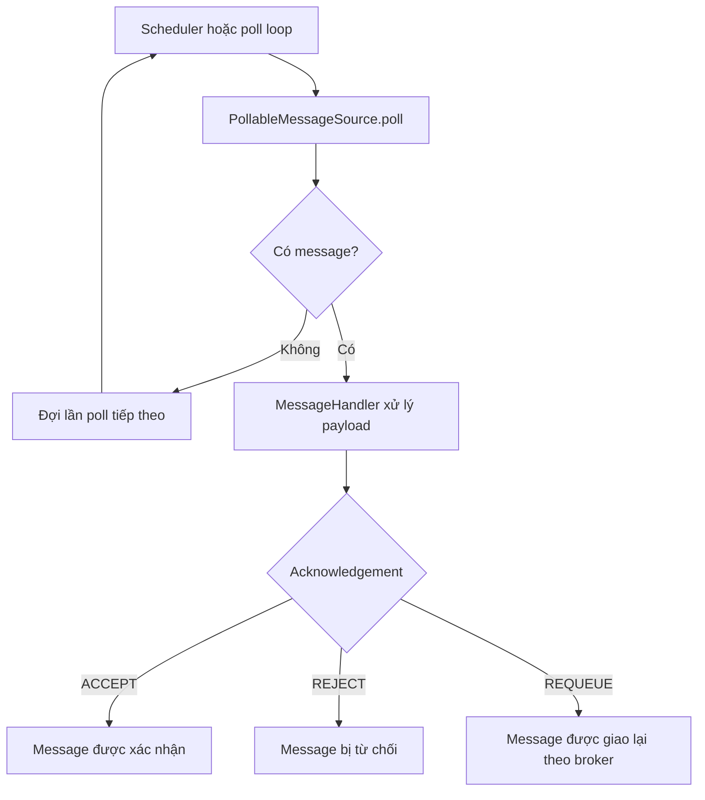

# Xác nhận tự động và quản lý AcknowledgmentCallback

Với pollable consumer, ứng dụng chủ động gọi `PollableMessageSource.poll()` để lấy message thay vì chờ framework gọi một `Consumer<T>` cho từng message. Sau khi xử lý, message cần được xác nhận để broker hoặc message source biết ứng dụng đã hoàn tất việc nhận. Spring Cloud Stream mặc định tự xác nhận khi callback xử lý kết thúc bình thường. Khi cần quyết định rõ message được chấp nhận, từ chối hay đưa trở lại hàng đợi, ứng dụng có thể lấy `AcknowledgmentCallback` từ header và quản lý acknowledgement thủ công.

Quyết định acknowledgement ảnh hưởng trực tiếp đến khả năng giao lại message. Xác nhận quá sớm có thể làm mất cơ hội xử lý lại khi giao dịch nghiệp vụ thất bại. Xác nhận quá muộn hoặc requeue không có giới hạn có thể khiến message bị giao nhiều lần, tạo vòng lặp lỗi hoặc làm backlog tăng. Vì vậy, cần đặt thời điểm ack sau khi tác động nghiệp vụ đã hoàn tất và thiết kế consumer idempotent để chịu được redelivery.

## 1. Pollable consumer và vòng đời một message

`PollableMessageSource` là abstraction cho phép ứng dụng lấy message theo nhu cầu. Ứng dụng có thể gọi `poll()` trong một tác vụ `@Scheduled`, `ApplicationRunner` hoặc vòng lặp do mình quản lý. Mỗi lần poll có thể nhận được một message; giá trị trả về cho biết có message được nhận và xử lý thành công theo hợp đồng của phương thức hay không.



Ví dụ cấu hình một pollable input binding:

```yaml
spring:
  cloud:
    stream:
      pollable-source: orders
      bindings:
        orders-in-0:
          destination: orders.created
          group: inventory-service
          content-type: application/json
```

Với `pollable-source: orders`, binding đầu vào có tên `orders-in-0`. `destination` là đích logic mà binder ánh xạ tới broker; `group` xác định nhóm tiêu thụ theo mô hình của binder. Tên binding và thuộc tính cụ thể cần khớp với phiên bản Spring Cloud Stream cùng binder trong dự án.

Không phải mọi binder đều cung cấp cùng khả năng poll và deferred acknowledgement. `AcknowledgmentCallback` là abstraction của Spring Integration, nhưng điều đó không có nghĩa mọi broker binder đều cung cấp callback hoặc hỗ trợ mọi trạng thái. Tài liệu Spring Integration 6.1.x mô tả các message source có deferred acknowledgement trong các module hỗ trợ, bao gồm AMQP và Kafka; không nên suy ra Pulsar binder cũng hỗ trợ `PollableMessageSource` hoặc manual ack tương tự. Hãy kiểm tra khả năng của đúng binder và phiên bản trước khi chọn kiến trúc pollable consumer.

Một poller có thể được triển khai bằng scheduled task:

```java
@Component
public class OrderPoller {
    private final PollableMessageSource source;
    private final OrderHandler orderHandler;

    public OrderPoller(PollableMessageSource source, OrderHandler orderHandler) {
        this.source = source;
        this.orderHandler = orderHandler;
    }

    @Scheduled(fixedDelayString = "${orders.poll-delay:500}")
    public void poll() {
        source.poll(message -> orderHandler.handle(message),
                new ParameterizedTypeReference<OrderCreated>() {});
    }
}
```

`ParameterizedTypeReference` là gợi ý kiểu để framework chuyển đổi payload sang `OrderCreated`. Nếu không cần gợi ý kiểu, có thể dùng overload `poll(MessageHandler)` tương ứng với phiên bản đang dùng. `@Scheduled` cần được bật bằng `@EnableScheduling`. Với nguồn có lưu lượng lớn, cần đo thời gian xử lý, tần suất poll và số message tồn đọng; không tăng tốc độ poll vượt quá khả năng xử lý của database hoặc dịch vụ phụ thuộc.

## 2. Cơ chế xác nhận tự động

Mặc định, `PollableMessageSource.poll()` xác nhận message khi `MessageHandler` kết thúc bình thường. Điều này thuận tiện khi toàn bộ công việc xử lý diễn ra ngay trong callback và ứng dụng không cần tự chọn trạng thái ack.

```java
source.poll(message -> {
    OrderCreated event = (OrderCreated) message.getPayload();
    orderHandler.process(event);
});
```

Nếu `process` hoàn tất bình thường, message được xác nhận tự động. Nếu callback kết thúc bất thường, message đi qua cơ chế error handling của pollable source. Hành vi cụ thể cần hiểu kỹ:

- Pollable source mặc định có error channel riêng theo destination và group, dạng `<destination>.<group>.errors`, đồng thời được nối với global Spring Integration `errorChannel`.
- Nếu callback ném exception, một `ErrorMessage` được gửi tới error channel.
- Nếu không có handler đăng ký trên error channel, lỗi được log và message được xác nhận thành công theo mặc định. Message sẽ không tự động được giao lại chỉ vì exception đã xuất hiện trong log.
- Nếu error-channel service activator ném exception, message mặc định bị reject và không redeliver.
- Nếu handler ném `RequeueCurrentMessageException`, message được đưa lại hàng đợi theo hỗ trợ của broker và được lấy ở lần poll sau; trường hợp này không đi qua error channel như luồng lỗi thông thường.

Do đó, không nên giả định “callback ném exception” luôn đồng nghĩa với “message sẽ được thử lại”. Nếu cần kiểm soát rõ retry, reject hoặc requeue, hãy chọn một chính sách error handling có chủ đích hoặc dùng `AcknowledgmentCallback`.

## 3. Lấy AcknowledgmentCallback từ message

`AcknowledgmentCallback` được cung cấp qua header của message. Dùng `StaticMessageHeaderAccessor.getAcknowledgmentCallback(message)` để lấy callback:

```java
AcknowledgmentCallback callback =
        StaticMessageHeaderAccessor.getAcknowledgmentCallback(message);
```

Interface này thuộc Spring Integration và định nghĩa ba trạng thái chính:

| Trạng thái | Ý nghĩa | Mục đích thường gặp |
|---|---|---|
| `ACCEPT` | Xác nhận đã chấp nhận message | Xử lý nghiệp vụ hoàn tất |
| `REJECT` | Từ chối message | Message không thể hoặc không được phép xử lý; có thể bị loại bỏ tùy broker |
| `REQUEUE` | Từ chối và yêu cầu đưa message trở lại để giao lại | Lỗi tạm thời, có thể xử lý lại sau |

Có thể xác nhận bằng:

```java
callback.acknowledge(AcknowledgmentCallback.Status.ACCEPT);
```

`AcknowledgmentCallback` cũng có `noAutoAck()` để tắt việc xác nhận tự động và `isAcknowledged()` để kiểm tra callback đã được xác nhận hay chưa. Nếu đã gọi `noAutoAck()`, ứng dụng phải gọi `acknowledge(...)` ở mọi nhánh xử lý cuối cùng. Giữ message ở trạng thái chưa xác nhận vô thời hạn có thể làm cạn tài nguyên broker hoặc giữ delivery/offset chưa hoàn tất.

## 4. Chuyển sang chế độ xác nhận thủ công

Gọi `noAutoAck()` trước khi thực hiện công việc cần kiểm soát. Sau đó, chỉ chọn trạng thái ack khi đã biết kết quả xử lý:

```java
private void handle(Message<?> message) {
    AcknowledgmentCallback callback =
            StaticMessageHeaderAccessor.getAcknowledgmentCallback(message);

    callback.noAutoAck();

    try {
        OrderCreated event = (OrderCreated) message.getPayload();
        inventoryService.reserveOnce(event);
        callback.acknowledge(AcknowledgmentCallback.Status.ACCEPT);
    }
    catch (TransientInventoryException ex) {
        callback.acknowledge(AcknowledgmentCallback.Status.REQUEUE);
    }
    catch (InvalidOrderException ex) {
        try {
            deadLetterPublisher.publishAndConfirm(message, ex);
            callback.acknowledge(AcknowledgmentCallback.Status.ACCEPT);
        }
        catch (Exception publishFailure) {
            callback.acknowledge(AcknowledgmentCallback.Status.REQUEUE);
        }
    }
    catch (Exception ex) {
        callback.acknowledge(AcknowledgmentCallback.Status.REQUEUE);
    }
}
```

Ví dụ trên minh họa chính sách, các lớp `InventoryService`, `TransientInventoryException`, `InvalidOrderException` và `deadLetterPublisher` là thành phần ứng dụng. `publishAndConfirm` phải chỉ trả về khi message cách ly đã được gửi thành công theo cơ chế xác nhận của publisher; nếu thao tác đó thất bại, không được xác nhận message gốc như thể đã xử lý xong.

Ở ví dụ, `inventoryService.reserveOnce` nên hoàn tất transaction database trước khi trả về. Khi transaction commit thành công, callback mới gửi `ACCEPT`. Nếu database gặp lỗi tạm thời, ứng dụng yêu cầu `REQUEUE`. Nếu payload sai vĩnh viễn, ứng dụng đưa message vào luồng cách ly/DLQ rồi mới xác nhận message gốc. Một triển khai thật cần xử lý cả exception phát sinh trong lúc publish DLQ và bảo đảm mọi nhánh đều kết thúc bằng quyết định ack phù hợp.

### 4.1. Không ack trước khi công việc nghiệp vụ hoàn tất

Giả sử consumer thực hiện hai thao tác:

1. Xác nhận message với broker.
2. Cập nhật tồn kho trong database.

Nếu ứng dụng dừng sau bước 1 nhưng trước bước 2, broker đã coi message hoàn tất và không giao lại; dữ liệu tồn kho có thể không được cập nhật. Vì vậy, với xử lý đồng bộ, thứ tự thông thường là commit transaction nghiệp vụ trước rồi mới `ACCEPT`.

Vẫn có một cửa sổ lỗi ngược lại: database commit thành công nhưng process dừng trước khi broker nhận ack. Message có thể được giao lại. Consumer cần idempotency bằng `eventId` hoặc khóa nghiệp vụ ổn định để lần xử lý thứ hai không tạo thêm tác động.

Acknowledgement không tạo một giao dịch nguyên tử giữa broker và database. Nếu cần phối hợp chặt chẽ giữa thay đổi database và phát sự kiện, hãy xem xét transactional outbox, inbox/deduplication hoặc cơ chế transaction mà broker hỗ trợ trong đúng phạm vi của nó.

## 5. Xử lý bất đồng bộ sau khi poll

Một trường hợp cần manual ack là poller nhận message rồi chuyển công việc sang executor hoặc worker thread. Nếu callback tự động ack khi handler kết thúc, message có thể bị xác nhận ngay sau khi task được đưa vào executor, trước khi task thật sự hoàn tất.

Để giữ message chưa xác nhận trong lúc xử lý nền, gọi `noAutoAck()` trước khi chuyển giao callback:

```java
private void dispatch(Message<?> message) {
    AcknowledgmentCallback callback =
            StaticMessageHeaderAccessor.getAcknowledgmentCallback(message);
    callback.noAutoAck();

    try {
        processingExecutor.execute(() -> {
            try {
                orderHandler.process((OrderCreated) message.getPayload());
                callback.acknowledge(AcknowledgmentCallback.Status.ACCEPT);
            }
            catch (TransientInventoryException ex) {
                callback.acknowledge(AcknowledgmentCallback.Status.REQUEUE);
            }
            catch (Exception ex) {
                errorReporter.report(message, ex);
                callback.acknowledge(AcknowledgmentCallback.Status.REJECT);
            }
        });
    }
    catch (RejectedExecutionException ex) {
        callback.acknowledge(AcknowledgmentCallback.Status.REQUEUE);
    }
}
```

Đây là ví dụ khái niệm; executor phải có giới hạn hàng đợi và chính sách shutdown rõ ràng. Nếu executor từ chối task, message cần được xử lý theo chính sách lỗi thay vì bị bỏ qua. Worker phải ack/nack sau khi hoàn tất và cần có timeout/giám sát cho task bị treo. Không giữ callback trong một tác vụ có thể bị mất khi process shutdown mà không có cơ chế phục hồi.

Việc xác nhận từ thread khác cần được kiểm thử với binder cụ thể. Không phải mọi message source đều có cùng thời hạn giữ delivery hoặc cùng yêu cầu thread affinity. Nếu công việc kéo dài, broker có thể có visibility timeout, acknowledgement timeout hoặc cơ chế redelivery riêng; cấu hình các giới hạn đó theo thời gian xử lý thực tế.

**Lưu ý với Kafka:** một số `KafkaMessageSource` không hỗ trợ tắt auto ack rồi commit offset từ thread khác, vì thao tác commit offset phải diễn ra trên thread poll. Không dùng ví dụ handoff ở trên cho Kafka nếu binder/client đang dùng không hỗ trợ. Với Kafka, nên hoàn tất xử lý và xác nhận trong luồng poll phù hợp, hoặc thiết kế worker/partition/offset coordination theo cơ chế Kafka thay vì chuyển callback tùy ý sang executor. Với RabbitMQ hoặc Pulsar, cũng phải kiểm tra khả năng của binder và acknowledgement timeout trước khi áp dụng.

## 6. Hiểu đúng ACCEPT, REJECT và REQUEUE theo broker

`AcknowledgmentCallback.Status` là abstraction chung, nhưng broker không có cùng ngữ nghĩa giao nhận. Binder ánh xạ trạng thái callback sang API của broker và có thể giới hạn những trạng thái được hỗ trợ.

| Broker | Cách hiểu khi xử lý pollable message | Điều cần kiểm tra |
|---|---|---|
| Kafka | Tiến độ tiêu thụ gắn với offset theo partition; requeue không giống đưa một record trở lại queue vật lý | Offset commit, thứ tự ack trong partition và việc các record sau có thể bị đọc lại |
| RabbitMQ | Ack xác nhận delivery; reject/nack có thể loại message hoặc requeue tùy cờ và cấu hình binder | Requeue có tạo vòng lặp nóng không, dead-letter exchange và redelivery count |
| Pulsar | Ack cập nhật trạng thái subscription; negative acknowledgement hoặc timeout có thể làm message được redeliver | Subscription type, acknowledgement timeout, redelivery delay và dead-letter policy |

Không phải message source nào cũng hỗ trợ `REJECT`. Với một số source như Kafka, trạng thái này có thể được xử lý tương tự `ACCEPT`; vì vậy, không dựa vào `REJECT` như một lệnh loại bỏ vĩnh viễn dùng chung cho mọi binder. Kiểm tra tài liệu binder và kiểm thử trên broker thực trước khi chọn chính sách.

### 6.1. Lưu ý riêng với Kafka offset

Kafka lưu dữ liệu theo log và consumer group commit offset theo partition. Khi một record được yêu cầu `REQUEUE`, nó không được đưa về cuối một queue như cách hiểu thông thường của RabbitMQ. Do cơ chế offset tuần tự, nếu một record trước đó chưa được xác nhận nhưng các record sau đã được ack, những record sau có thể được đọc lại khi group phục hồi hoặc offset được commit theo cách tương ứng.

Ví dụ một partition có các record 10, 11 và 12. Nếu record 10 được requeue trong khi 11 và 12 đã được xác nhận, việc commit offset không thể biểu diễn một khoảng trống tùy ý theo từng record như queue acknowledgement. Khi consumer khởi động lại, 11 và 12 có thể được giao lại. Do đó, consumer Kafka cần idempotent cho toàn bộ luồng, không chỉ record được đánh dấu requeue.

### 6.2. Tránh vòng lặp REQUEUE vô hạn

Nếu một message sai schema hoặc vi phạm quy tắc nghiệp vụ nhưng luôn được `REQUEUE`, poller có thể nhận lại cùng message liên tục. Điều này làm tốn CPU, tăng log, chặn các message khác và gây áp lực lên broker.

Một chính sách thường dùng:

1. Phân loại lỗi tạm thời và lỗi vĩnh viễn.
2. Retry lỗi tạm thời với số lần giới hạn và backoff phù hợp.
3. Sau ngưỡng retry, chuyển message sang DLQ hoặc kho cách ly.
4. Chỉ `ACCEPT` message gốc sau khi việc cách ly đã được xác nhận thành công.
5. Theo dõi redelivery count, DLQ depth và thời gian message bị giữ.

Với RabbitMQ và Pulsar, có thể cấu hình dead-letter và redelivery theo broker/binder. Với Kafka, DLQ thường là một topic khác và việc chuyển message cần được thiết kế cùng offset/transaction phù hợp. Cấu hình cụ thể không giống nhau giữa các binder.

## 7. Error channel và AcknowledgmentCallback phối hợp ra sao?

Error channel của pollable source và manual acknowledgement là hai cơ chế liên quan nhưng không đồng nhất:

- Error channel nhận `ErrorMessage` khi callback poll phát sinh exception theo cơ chế mặc định.
- `AcknowledgmentCallback` cho phép ứng dụng chủ động chọn `ACCEPT`, `REJECT` hoặc `REQUEUE`.
- `noAutoAck()` chuyển trách nhiệm xác nhận sang ứng dụng; khi đó không được trông chờ callback tự ack chỉ vì handler đã kết thúc.
- `RequeueCurrentMessageException` là cách yêu cầu requeue trong luồng error handling mặc định; nó không thay thế mọi chính sách DLQ hoặc retry có giới hạn.

Nếu dùng manual ack, nên bắt và phân loại exception ngay tại nơi xử lý để mỗi nhánh có quyết định rõ ràng. Tránh vừa gọi `noAutoAck()` vừa để exception thoát ra mà không ack/nack; message có thể ở trạng thái chưa xác nhận và giữ tài nguyên. Nếu lỗi xảy ra trước khi lấy được callback, cần xử lý theo cơ chế error channel mặc định và kiểm tra hành vi của binder.

## 8. Idempotency khi message được giao lại

Ngay cả khi ứng dụng ack đúng thời điểm, vẫn có thể xảy ra redelivery do process crash, mất kết nối hoặc timeout. Vì vậy, mọi consumer tạo tác động nghiệp vụ quan trọng nên có cơ chế idempotency.

Ví dụ, `eventId` được tạo ở producer và giữ ổn định qua retry. Consumer ghi dấu đã xử lý trong cùng transaction với cập nhật nghiệp vụ:

```java
@Transactional
public void reserveOnce(OrderCreated event) {
    if (processedEventRepository.existsById(event.eventId())) {
        return;
    }

    inventoryRepository.reserveIfAvailable(
            event.productId(), event.quantity());
    processedEventRepository.save(new ProcessedEvent(event.eventId()));
}
```

Bảng `processed_event` cần unique constraint trên `event_id`; cập nhật tồn kho cần điều kiện hoặc khóa phù hợp để xử lý cạnh tranh. Chỉ kiểm tra `existsById` mà không có ràng buộc duy nhất vẫn có race condition khi hai worker nhận cùng một event gần như đồng thời.

Nếu consumer gọi dịch vụ ngoài, hãy dùng idempotency key của API đích hoặc ghi trạng thái yêu cầu gửi vào database/outbox. Không giả định callback ack và một lời gọi HTTP có thể commit nguyên tử.

## 9. Kiểm thử hành vi acknowledgement

Kiểm thử cần xác nhận trạng thái broker và kết quả nghiệp vụ, không chỉ kiểm tra callback được gọi. Có thể chia thành các lớp:

| Tình huống | Kết quả mong đợi |
|---|---|
| Handler kết thúc bình thường với auto ack | Message được xác nhận |
| Handler ném exception và không có error-channel handler | Xác minh đúng hành vi mặc định của phiên bản; không giả định message tự requeue |
| Manual ack với `ACCEPT` sau transaction commit | Message được xác nhận sau khi nghiệp vụ hoàn tất |
| Manual ack với `REQUEUE` do lỗi tạm thời | Message được giao lại theo cơ chế broker |
| Manual ack với `REJECT` | Xác minh broker có hỗ trợ reject và message bị loại/được xử lý như thế nào |
| `noAutoAck()` nhưng không ack/nack | Kiểm thử phát hiện delivery bị giữ và cảnh báo tài nguyên |
| Executor từ chối task | Message được requeue hoặc xử lý theo chính sách đã chọn |
| Process dừng sau DB commit nhưng trước ack | Message có thể redeliver nhưng idempotency ngăn tác động lặp |
| Message độc hại hoặc sai schema | Chuyển DLQ/cách ly sau số lần retry giới hạn |

Unit test có thể mock `AcknowledgmentCallback` để kiểm tra lời gọi `noAutoAck()` và trạng thái được chọn. Integration test cần dùng Test Binder hoặc broker thật để xác minh mapping thực tế. Test Binder không mô phỏng đầy đủ offset, queue durability, subscription cursor và redelivery của mọi broker.

## 10. Quan sát và vận hành

Để điều tra acknowledgement, nên ghi nhận metadata sau, tránh log toàn bộ payload:

- Binding, destination, group/subscription và broker.
- `eventId`, `correlationId` và message key nếu có.
- Thời điểm poll, bắt đầu xử lý, kết thúc transaction và thời điểm ack.
- Trạng thái ack đã chọn: `ACCEPT`, `REJECT` hay `REQUEUE`.
- Số lần redelivery/retry và nguyên nhân lỗi.
- Kafka partition/offset, RabbitMQ delivery tag/redelivered flag hoặc Pulsar message ID/subscription nếu binder cung cấp.
- Thời gian message ở trạng thái in-flight, số task nền đang chờ và độ sâu DLQ.

Không ghi token, thông tin xác thực hoặc dữ liệu cá nhân vào log. Đặt cảnh báo khi số message requeue tăng liên tục, thời gian in-flight vượt ngưỡng, DLQ có message mới hoặc poller không nhận được message trong khi backlog vẫn tăng.

## 11. Danh sách kiểm tra trước khi triển khai

- [ ] Xác định rõ pollable source, binding, destination và group.
- [ ] Hiểu mặc định auto ack khi handler kết thúc bình thường.
- [ ] Kiểm tra error channel vì exception không mặc nhiên làm message được requeue.
- [ ] Chỉ gọi `noAutoAck()` khi ứng dụng có quy trình ack/nack cho mọi nhánh.
- [ ] Chọn `ACCEPT`, `REJECT` hoặc `REQUEUE` theo loại lỗi và khả năng của binder.
- [ ] Ack sau khi transaction nghiệp vụ hoàn tất; không ack ngay sau khi đưa task vào executor.
- [ ] Giới hạn retry và tránh vòng lặp requeue vô hạn.
- [ ] Chuyển lỗi vĩnh viễn vào DLQ/cách ly trước khi xác nhận message gốc.
- [ ] Consumer idempotent theo event ID hoặc khóa nghiệp vụ ổn định.
- [ ] Kiểm thử restart, redelivery, lỗi executor, DLQ và hành vi thực trên broker.
- [ ] Theo dõi trạng thái ack, thời gian in-flight, redelivery, backlog và DLQ.

Auto acknowledgement phù hợp với poll handler đơn giản, xử lý xong trước khi callback kết thúc. `AcknowledgmentCallback` cần thiết khi ứng dụng phải quyết định trạng thái giao nhận, chuyển việc sang thread khác hoặc phân loại lỗi tạm thời và lỗi vĩnh viễn. Dù chọn cách nào, ack chỉ nên được gửi sau khi công việc nghiệp vụ đã hoàn tất; idempotency và kiểm thử với binder thực tế giúp hệ thống xử lý an toàn khi message được giao lại.

## Tài liệu tham khảo

- [Spring Cloud Stream — Producing and Consuming Messages, Using Polled Consumers and Handling Errors](https://docs.spring.io/spring-cloud-stream/reference/spring-cloud-stream/producing-and-consuming-messages.html)
- [Spring Integration — Core Messaging: Deferred Acknowledgment Pollable Message Source](https://docs.spring.io/spring-integration/docs/6.1.x/reference/html/core.html)
