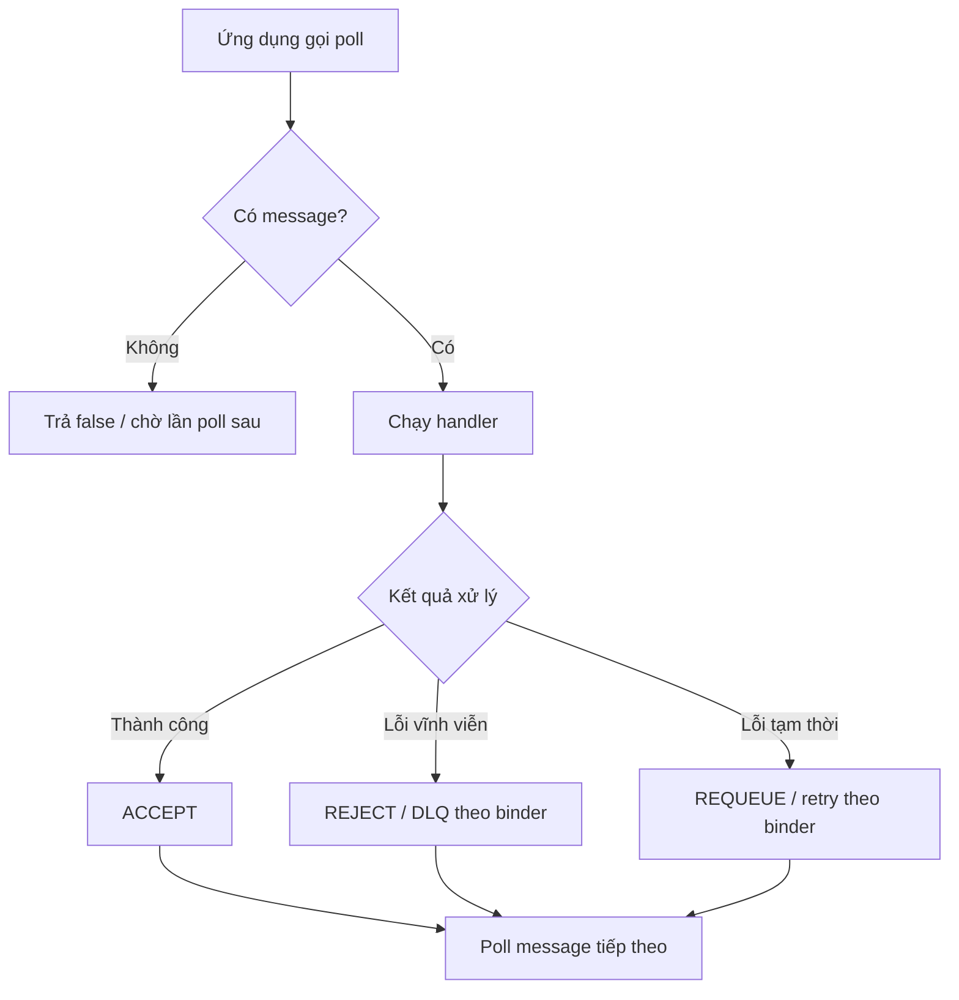

# Chấp nhận, từ chối hoặc đưa lại thông điệp theo khả năng binder

## Mục tiêu

Với consumer chủ động (pollable consumer), ứng dụng quyết định khi nào lấy message từ broker và thực hiện xử lý trong callback do ứng dụng cung cấp. Sau khi nhận message, ứng dụng cần có chính sách rõ ràng: **chấp nhận** message đã xử lý thành công, **từ chối** message không thể xử lý, hoặc **đưa message trở lại** để thử lại.

Spring Cloud Stream cung cấp abstraction `PollableMessageSource` để đọc message theo yêu cầu và `AcknowledgmentCallback` để điều khiển trạng thái giao nhận khi binder hỗ trợ. Các trạng thái này có ý nghĩa chung ở tầng framework, nhưng cách thực hiện cụ thể phụ thuộc Kafka, RabbitMQ, Pulsar binder và cấu hình broker.

Bài học này giải thích vòng đời poll, các lựa chọn ACCEPT/REJECT/REQUEUE, cách tắt xác nhận tự động khi cần xác nhận thủ công, cách tránh vòng lặp message lỗi và cách kiểm thử theo binder.

Sau bài học, bạn có thể:

- Dùng `PollableMessageSource` để chủ động lấy message.
- Phân biệt kết quả không có message với xử lý message thất bại.
- Dùng `AcknowledgmentCallback` để chấp nhận, từ chối hoặc yêu cầu giao lại.
- Chọn thời điểm xác nhận sau khi side effect nghiệp vụ hoàn tất.
- Thiết kế retry, DLQ và xử lý poison message theo khả năng binder.
- Kiểm thử acknowledgment và redelivery trên broker đích.

## 1. Pollable consumer hoạt động như thế nào?

Consumer theo mô hình message-driven thường được binder gọi khi message đến. Với pollable consumer, ứng dụng gọi `poll()` để yêu cầu lấy message. Nếu có message, framework chuyển message đó cho handler; nếu không có message, phương thức trả về `false`.

Một vòng poll cơ bản:



`PollableMessageSource` là abstraction do binder cung cấp cho input binding. Ví dụ cấu hình một input:

```yaml
spring:
  cloud:
    stream:
      bindings:
        input:
          destination: orders.created
          group: inventory-service
          content-type: application/json
```

Ứng dụng có thể nhận `PollableMessageSource` và gọi `poll` trong một vòng lặp hoặc một tác vụ định kỳ. Ví dụ dưới đây dùng một vòng lặp có khoảng nghỉ khi không có message:

```java
@Bean
ApplicationRunner orderPoller(
        PollableMessageSource source,
        OrderService orderService) {

    return args -> {
        while (!Thread.currentThread().isInterrupted()) {
            try {
                boolean received = source.poll(message -> {
                    OrderCreated event =
                            (OrderCreated) message.getPayload();
                    orderService.process(event);
                });

                if (!received) {
                    Thread.sleep(200);
                }
            }
            catch (InterruptedException ex) {
                Thread.currentThread().interrupt();
                return;
            }
            catch (Exception ex) {
                log.error("Polling or message handling failed", ex);
            }
        }
    };
}
```

Đây là ví dụ imperative tối giản. Ứng dụng production cần xác định rõ cách dừng poller khi shutdown, giới hạn thời gian xử lý, xử lý exception và tránh vòng lặp bận khi queue rỗng. Có thể dùng scheduler hoặc executor do ứng dụng quản lý thay vì tự tạo nhiều thread poll không giới hạn.

### Phân biệt hai kết quả

- `poll()` trả về `false`: lần poll không nhận được message. Đây không phải lỗi xử lý.
- `poll()` trả về `true`: một message đã được nhận và callback đã được gọi; điều đó không tự chứng minh nghiệp vụ thành công.
- Handler ném exception: việc từ chối, xác nhận hoặc giao lại phụ thuộc acknowledgment mode và binder.
- Lỗi khi kết nối hoặc đọc broker: là lỗi poll/hạ tầng, cần được xử lý riêng với lỗi nghiệp vụ trong handler.

Không nên dùng `while (true)` gọi poll liên tục mà không có giới hạn hoặc khoảng chờ nếu binder trả về ngay khi không có message. Busy loop có thể tiêu thụ CPU dù không có dữ liệu.

## 2. Xác nhận tự động và xác nhận thủ công

Khi binder hỗ trợ acknowledgment callback, message nhận được có thể mang callback trong header. Có thể lấy callback bằng Spring Integration accessor:

```java
AcknowledgmentCallback callback =
        StaticMessageHeaderAccessor.getAcknowledgmentCallback(message);
```

Callback cho phép ứng dụng chọn một trong các trạng thái:

- `ACCEPT`: chấp nhận message đã xử lý.
- `REJECT`: từ chối message.
- `REQUEUE`: yêu cầu đưa message trở lại để giao lại theo khả năng binder.

Theo chế độ tự động, binder/framework có thể xác nhận message khi handler hoàn tất bình thường hoặc áp dụng chính sách lỗi khi handler ném exception. Chi tiết phụ thuộc binder và cấu hình acknowledgment. Nếu muốn tự quyết định thời điểm xác nhận, cần tắt auto-ack trên callback trước khi thực hiện xử lý:

```java
AcknowledgmentCallback callback =
        StaticMessageHeaderAccessor.getAcknowledgmentCallback(message);

if (callback != null) {
    callback.noAutoAck();
}
```

Sau đó, ứng dụng gọi `acknowledge(status)` đúng một lần khi đã có kết quả xử lý. Không vừa xác nhận thủ công vừa để một nhánh khác xác nhận lại cùng delivery.

Nếu callback là `null`, binder hoặc đường nhận hiện tại có thể không cung cấp cơ chế này. Không được giả định có thể điều khiển ACCEPT/REJECT/REQUEUE thủ công trên mọi binder. Hãy kiểm tra khả năng hỗ trợ của binder và dùng cơ chế mặc định hoặc API đặc thù được tài liệu hóa.

## 3. ACCEPT: chấp nhận sau khi xử lý thành công

`ACCEPT` cho biết consumer đã hoàn tất công việc cần thiết đối với message. Thời điểm chấp nhận nên nằm sau side effect cần bảo đảm, ví dụ sau khi transaction database commit.

Ví dụ:

```java
private void handle(Message<?> message) {
    AcknowledgmentCallback callback =
            StaticMessageHeaderAccessor.getAcknowledgmentCallback(message);

    if (callback != null) {
        callback.noAutoAck();
    }

    try {
        OrderCreated event = (OrderCreated) message.getPayload();
        orderService.processAndCommit(event);

        if (callback != null) {
            callback.acknowledge(AcknowledgmentCallback.Status.ACCEPT);
        }
    }
    catch (RuntimeException ex) {
        if (callback != null) {
            callback.acknowledge(AcknowledgmentCallback.Status.REQUEUE);
            return;
        }
        throw ex;
    }
}
```

Trong ví dụ, `processAndCommit` đại diện cho thao tác nghiệp vụ chỉ hoàn tất sau khi transaction cần thiết đã commit. Nếu ứng dụng xác nhận trước khi database commit, sự cố ở giữa có thể làm message không được giao lại dù dữ liệu nghiệp vụ chưa được ghi.

`ACCEPT` không đồng nghĩa với exactly-once. Nếu broker đã giao lại message sau một sự cố trước khi xác nhận được lưu, consumer vẫn có thể nhận cùng event lần nữa. Hãy dùng event ID ổn định và idempotent processing để tránh tác động lặp.

Với nghiệp vụ cập nhật database rồi phát sự kiện tiếp theo, cân nhắc transactional outbox. Ghi trạng thái nghiệp vụ và outbox trong cùng transaction; relay phát sự kiện sau đó. Điều này xử lý khoảng trống giữa database và broker tốt hơn việc giả định một acknowledgment bao trùm hai hệ thống.

## 4. REJECT: từ chối message không thể xử lý

`REJECT` biểu thị consumer không muốn xử lý lại message theo đường giao nhận hiện tại. Nó thường phù hợp với lỗi vĩnh viễn như:

- Payload không đúng schema và không thể chuyển đổi.
- Message vi phạm hợp đồng bắt buộc.
- Loại sự kiện không được consumer hỗ trợ.
- Dữ liệu không hợp lệ và cần điều tra hoặc sửa thủ công.

Ví dụ:

```java
private void rejectInvalid(
        AcknowledgmentCallback callback,
        String reason) {

    log.warn("Rejecting message: {}", reason);

    if (callback != null) {
        callback.noAutoAck();
        callback.acknowledge(AcknowledgmentCallback.Status.REJECT);
    }
}
```

REJECT không tự động có nghĩa message được đưa vào DLQ. Tùy binder và cấu hình broker, message có thể bị loại bỏ, dead-letter hoặc xử lý theo chính sách khác. Nếu cần giữ message để điều tra, hãy cấu hình DLQ/dead-letter destination, quyền truy cập, retention và cảnh báo rõ ràng.

Không dùng REJECT cho mọi lỗi chỉ để tránh retry. Lỗi hạ tầng tạm thời như database timeout hoặc broker dependency chưa sẵn sàng thường cần retry/requeue hoặc cơ chế phục hồi khác. Phân loại lỗi trước khi quyết định trạng thái.

## 5. REQUEUE: yêu cầu giao lại message

`REQUEUE` yêu cầu binder/broker đưa message trở lại quá trình giao nhận hoặc làm cho nó được đọc lại theo semantics tương ứng. Nó thường phù hợp với lỗi tạm thời có khả năng tự phục hồi:

- Database tạm thời không truy cập được.
- Dịch vụ phụ thuộc đang quá tải.
- Lock hoặc tài nguyên tạm thời chưa sẵn sàng.
- Một dependency gặp timeout có giới hạn.

Ví dụ:

```java
private void requeue(
        AcknowledgmentCallback callback,
        Throwable failure) {

    log.warn("Requesting message redelivery", failure);

    if (callback != null) {
        callback.noAutoAck();
        callback.acknowledge(AcknowledgmentCallback.Status.REQUEUE);
    }
}
```

REQUEUE có thể khiến cùng message quay lại ngay hoặc được giao lại theo timeout/policy của broker. Nếu lỗi luôn tái diễn, message có thể tạo vòng lặp nóng, tiêu thụ tài nguyên và ngăn các message khác tiến triển. Cần kết hợp backoff, giới hạn số lần thử, delayed retry hoặc DLQ theo khả năng binder.

Không phải mọi broker có thao tác requeue giống nhau. RabbitMQ có semantics requeue ở mức delivery; Kafka là log có offset, nên giao lại liên quan đến vị trí đọc/commit hoặc cơ chế retry của binder, không phải đơn giản đưa record xuống cuối queue; Pulsar sử dụng negative acknowledgment hoặc acknowledgment timeout để kích hoạt redelivery theo subscription policy. Hãy kiểm tra cách binder ánh xạ trạng thái REQUEUE trước khi dựa vào thứ tự hoặc thời gian giao lại.

## 6. Ví dụ phân loại lỗi và quyết định trạng thái

Một handler có thể chia lỗi thành tạm thời và vĩnh viễn:

```java
private void handleOrder(Message<?> message) {
    AcknowledgmentCallback callback =
            StaticMessageHeaderAccessor.getAcknowledgmentCallback(message);

    if (callback != null) {
        callback.noAutoAck();
    }

    try {
        OrderCreated event = (OrderCreated) message.getPayload();
        orderService.processAndCommit(event);

        acknowledge(callback, AcknowledgmentCallback.Status.ACCEPT);
    }
    catch (InvalidOrderException | UnsupportedSchemaException ex) {
        log.error("Permanent message error", ex);
        acknowledge(callback, AcknowledgmentCallback.Status.REJECT);
    }
    catch (TransientDependencyException ex) {
        log.warn("Temporary dependency failure", ex);
        acknowledge(callback, AcknowledgmentCallback.Status.REQUEUE);
    }
}

private void acknowledge(
        AcknowledgmentCallback callback,
        AcknowledgmentCallback.Status status) {

    if (callback != null) {
        callback.acknowledge(status);
    }
}
```

Đây là cấu trúc minh họa. Trong code thật, cần xử lý trường hợp callback không được binder cung cấp: có thể để exception truyền ra theo chính sách auto-ack/retry mặc định, hoặc dùng một cơ chế lỗi được tài liệu hóa cho binder. Không âm thầm bỏ qua exception khi không có callback vì handler có thể bị xem là thành công.

Nếu muốn phân biệt lỗi parse trước khi có payload Java, hãy xử lý ở tầng conversion/error channel phù hợp. Khi deserialize thất bại trước lúc handler được gọi, code trong `handleOrder` không thể tự lấy payload để phân loại.

## 7. Khác biệt theo binder

Các trạng thái ở Spring abstraction không đảm bảo mọi broker có hành vi giống nhau. Bảng dưới đây mô tả cách hiểu ở mức khái niệm; chi tiết phải được xác minh với phiên bản binder và cấu hình đang chạy.

| Binder | ACCEPT | REJECT | REQUEUE / giao lại |
|---|---|---|---|
| Kafka | Tiến độ tiêu thụ được xác nhận theo cơ chế offset/ack của binder | Có thể bỏ qua record theo cấu hình xử lý lỗi hoặc chuyển DLQ nếu được cấu hình | Thường liên quan đến việc chưa commit/đọc lại offset hoặc retry của binder; không phải đưa record xuống cuối log |
| RabbitMQ | Ack delivery | Reject/nack không requeue; có thể dead-letter nếu queue/exchange được cấu hình | Nack/reject với requeue hoặc cơ chế redelivery tương ứng |
| Pulsar | Ack message trên subscription | Từ chối/negative ack theo khả năng binder và policy | Negative ack hoặc ack timeout có thể kích hoạt redelivery theo subscription |

Một số lưu ý:

- Kafka là log phân vùng; offset commit ảnh hưởng tiến độ của consumer group. Không suy ra REQUEUE có cùng thứ tự với RabbitMQ.
- RabbitMQ queue có thể requeue message, nhưng requeue không bảo đảm message sẽ được xử lý ngay hoặc giữ nguyên thứ tự tuyệt đối trong mọi cấu hình.
- Pulsar redelivery phụ thuộc subscription type, negative acknowledgment delay, acknowledgment timeout và dead-letter policy.
- Một số binder hoặc chế độ nhận có thể không expose callback hay không hỗ trợ đầy đủ mọi status. Kiểm tra tài liệu binder đúng phiên bản.

## 8. Retry, backoff và DLQ

REQUEUE không nên là chính sách duy nhất cho lỗi tạm thời. Cần kiểm soát số lần thử và thời gian chờ:

- **Retry tại ứng dụng:** handler thử lại dependency trong một khoảng giới hạn trước khi quyết định trạng thái message.
- **Redelivery của broker:** broker giao lại message khi không nhận ack hoặc khi consumer yêu cầu requeue/negative ack.
- **DLQ:** message vượt quá chính sách retry hoặc không thể xử lý được chuyển sang destination lỗi để điều tra.

Hai tầng retry có thể cộng dồn. Ví dụ ứng dụng thử ba lần cho mỗi delivery, broker giao lại năm lần, tổng số lần gọi dependency có thể lớn hơn dự kiến. Hãy lập bảng retry budget và kiểm thử số lần thực tế.

Một chính sách thường dùng:

| Loại lỗi | Quyết định | Hành động tiếp theo |
|---|---|---|
| Payload sai schema, dữ liệu vĩnh viễn không hợp lệ | REJECT | DLQ hoặc lưu lỗi để điều tra |
| Dependency timeout ngắn | Retry có backoff, sau đó REQUEUE nếu còn budget | Giao lại hoặc delayed retry |
| Hết retry budget | REJECT hoặc chuyển DLQ theo policy | Cảnh báo và xử lý thủ công |
| Lỗi lập trình chưa phân loại | Không tự động coi là thành công | Log có event ID, giới hạn retry và cảnh báo |
| Xử lý thành công, transaction đã commit | ACCEPT | Tiếp tục message tiếp theo |

DLQ cần giữ đủ thông tin để replay an toàn: payload, event ID, thời điểm, nguồn, lỗi, số lần giao lại và correlation ID. Không ghi bí mật hoặc toàn bộ metadata nhạy cảm vào log.

## 9. Polling loop và vận hành

Pollable consumer đưa quyền lấy message về ứng dụng, vì vậy ứng dụng phải quản lý tải và vòng đời:

- Đặt giới hạn số message mỗi vòng hoặc mỗi batch để shutdown có thể diễn ra đúng lúc.
- Dùng khoảng chờ khi không có message để tránh busy loop.
- Không tạo nhiều poller không giới hạn cùng đọc một binding.
- Điều chỉnh concurrency theo khả năng broker và downstream.
- Theo dõi poll rate, số lần poll rỗng, thời gian handler, số ACCEPT/REJECT/REQUEUE và độ dài DLQ.
- Dừng poller có kiểm soát khi ứng dụng shutdown; không ngắt giữa transaction nghiệp vụ nếu có thể tránh.
- Nếu handler gọi dịch vụ ngoài, đặt timeout và giới hạn concurrency.

Một cách tổ chức là tách logic xử lý message khỏi vòng poll:

```java
@Component
public class OrderMessageHandler {

    public void handle(Message<?> message) {
        // Validate payload, execute use case, then decide disposition.
    }
}

@Component
public class OrderPollingTask {

    private final PollableMessageSource source;
    private final OrderMessageHandler handler;

    public OrderPollingTask(
            PollableMessageSource source,
            OrderMessageHandler handler) {
        this.source = source;
        this.handler = handler;
    }

    @Scheduled(fixedDelayString = "${app.poll.delay-ms:200}")
    public void pollOnce() {
        try {
            source.poll(handler::handle);
        }
        catch (Exception ex) {
            log.error("Poll failed", ex);
        }
    }
}
```

Cần bật scheduling và cấu hình scheduler phù hợp. Nếu có nhiều pollable input binding, inject đúng source theo binding name/qualifier mà phiên bản framework cung cấp. Không dựa vào một bean mặc định mơ hồ khi ứng dụng có nhiều nguồn.

## 10. Idempotency và xử lý message giao lại

Một message REQUEUE có thể được giao lại nhiều lần. Consumer phải chịu được việc cùng event ID xuất hiện hơn một lần.

Một cách phổ biến là dùng inbox table có unique constraint:

```sql
CREATE TABLE processed_event (
    event_id VARCHAR(100) PRIMARY KEY,
    processed_at TIMESTAMP NOT NULL
);
```

Trong cùng transaction với thay đổi nghiệp vụ:

1. Thử ghi `eventId` vào bảng inbox.
2. Nếu đã tồn tại, bỏ qua side effect lặp và hoàn tất xử lý như một duplicate đã biết.
3. Nếu là lần đầu, thực hiện nghiệp vụ.
4. Commit transaction rồi mới ACCEPT message.

Nếu nghiệp vụ gọi API bên ngoài, truyền event ID làm idempotency key nếu API hỗ trợ. Nếu không, cần cơ chế đối soát hoặc bù. Ack/requeue của broker không thể làm một API bên ngoài trở thành idempotent.

## 11. Kiểm thử ACCEPT, REJECT và REQUEUE

Unit test có thể xác minh quyết định của handler bằng cách cung cấp message có acknowledgment callback test double. Kiểm tra:

- Xử lý thành công gọi ACCEPT sau khi service hoàn tất.
- Lỗi vĩnh viễn gọi REJECT.
- Lỗi tạm thời gọi REQUEUE.
- Callback được chuyển sang manual mode trước side effect nếu cần.
- Mỗi delivery chỉ được xác nhận một lần.
- Khi callback không có, lỗi không bị nuốt thành thành công.
- Duplicate event không tạo side effect thứ hai.

Integration test với binder/broker cần xác minh semantics thật:

### Kafka

- Commit offset sau xử lý thành công theo cấu hình.
- Lỗi trước commit khiến record có thể được đọc lại sau restart/rebalance.
- REJECT/DLQ có đúng hành vi cấu hình.
- Retry không làm consumer group kẹt vô hạn tại một record poison.

### RabbitMQ

- ACCEPT ack message và queue giảm số message chưa xác nhận.
- REJECT có requeue=false hoặc dead-letter theo topology.
- REQUEUE tạo redelivery theo policy.
- Consumer dừng trước ack khiến message được giao lại.

### Pulsar

- ACCEPT ack message trên subscription.
- Negative ack hoặc timeout kích hoạt redelivery theo policy.
- DLQ được sử dụng khi đạt giới hạn redelivery nếu cấu hình hỗ trợ.
- Subscription type không làm thay đổi giả định ordering ngoài dự kiến.

Test Binder hữu ích để kiểm tra wiring của Spring Cloud Stream, nhưng không thay thế broker integration test cho ack, offset, queue redelivery, subscription cursor hoặc DLQ.

## 12. Checklist trước khi triển khai

Trước khi bật pollable consumer trong production, hãy xác nhận:

1. Binder được chọn có hỗ trợ pollable source và acknowledgment callback cần dùng không?
2. `poll()` được gọi trên một scheduler/executor có giới hạn và có shutdown rõ ràng không?
3. Khi không có message, ứng dụng có tránh busy loop không?
4. Side effect nào phải hoàn tất trước ACCEPT?
5. Lỗi nào là vĩnh viễn để REJECT, lỗi nào tạm thời để retry/REQUEUE?
6. Có retry budget, backoff và DLQ cho poison message không?
7. Consumer có idempotent khi broker giao lại không?
8. Metric/log có phân biệt poll rỗng, poll lỗi, xử lý lỗi và redelivery không?
9. Integration test đã chạy trên đúng Kafka, RabbitMQ hoặc Pulsar binder chưa?
10. Quy trình replay DLQ có giữ event ID và tránh nhân đôi tác động không?

## Kết luận

Pollable consumer cho ứng dụng chủ động lấy message qua `PollableMessageSource`. Khi binder cung cấp `AcknowledgmentCallback`, ứng dụng có thể chọn ACCEPT sau xử lý thành công, REJECT cho lỗi không thể khắc phục hoặc REQUEUE cho lỗi tạm thời cần giao lại. Hãy gọi `noAutoAck()` trước khi xử lý nếu muốn tự kiểm soát thời điểm xác nhận, rồi chỉ xác nhận một lần theo kết quả thực tế.

Ý nghĩa của từng trạng thái phụ thuộc binder: RabbitMQ có requeue ở mức queue delivery, Kafka dựa trên offset/log và Pulsar dùng acknowledgment/redelivery của subscription. Kết hợp retry có giới hạn, backoff, DLQ và idempotency; sau đó kiểm thử với broker đích để chứng minh hành vi giao nhận đúng như ứng dụng mong đợi.

