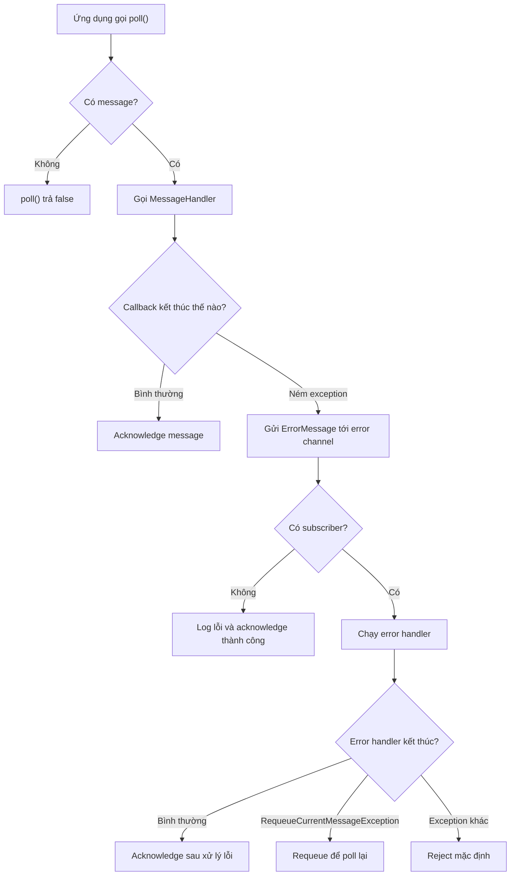

# Xử lý lỗi và kênh lỗi của nguồn pollable

PollableMessageSource cho phép ứng dụng chủ động lấy message từ một input binding. Ứng dụng quyết định thời điểm đọc, nhịp polling và cách phối hợp với quy trình xử lý. Đổi lại, code poller phải hiểu rõ khi nào message được acknowledge, khi nào bị reject hoặc requeue, và lỗi được chuyển tới đâu.

Spring Cloud Stream tạo error channel riêng cho pollable source. Khi callback ném exception, framework gửi ErrorMessage tới channel theo mẫu `<destination>.<group>.errors`, đồng thời bridge channel đó tới Spring Integration `errorChannel`. Nếu không có subscriber, lỗi chỉ được log và message được acknowledge như đã xử lý thành công. Đây là hành vi quan trọng cần xử lý rõ trước khi đưa poller vào production.

## 1. PollableMessageSource hoạt động như thế nào?

Với consumer dạng message-driven, binder nhận message và gọi handler khi message đến. Với `PollableMessageSource`, ứng dụng gọi `poll()` để yêu cầu lấy message. Phương thức trả về `true` khi có message được nhận và xử lý thành công; trả về `false` khi không có message trong lần poll đó.

Một cấu hình pollable source:

```yaml
spring:
  cloud:
    stream:
      pollable-source: orders
      bindings:
        orders-in-0:
          destination: orders
          group: order-poller
          content-type: application/json
```

Thuộc tính `spring.cloud.stream.pollable-source` khai báo nguồn pollable. Với tên `orders`, binding input theo quy ước là `orders-in-0`. Group nên được khai báo rõ để xác định danh tính consumer và tên error channel. Tài nguyên thực tế và cách group được ánh xạ vẫn phụ thuộc binder.

Có thể dùng một scheduled task để điều khiển nhịp đọc:

```java
@Component
public class OrderPoller {

    private final PollableMessageSource source;
    private final OrderService orderService;

    public OrderPoller(PollableMessageSource source,
                       OrderService orderService) {
        this.source = source;
        this.orderService = orderService;
    }

    @Scheduled(fixedDelay = 1000)
    public void poll() {
        source.poll(message -> {
            OrderCreated event = (OrderCreated) message.getPayload();
            orderService.handle(event);
        });
    }
}
```

Cần bật scheduling bằng `@EnableScheduling` trong cấu hình ứng dụng. Ví dụ trên đọc tối đa một message mỗi lần gọi `poll()`. Nếu không có message, lần gọi tiếp theo vẫn diễn ra theo lịch. Có thể dùng overload `poll(MessageHandler, ParameterizedTypeReference<?>)` khi cần gợi ý kiểu để chuyển đổi payload phức tạp, chẳng hạn `Map<String, OrderCreated>`.

### Polling khác retry

Polling quyết định **khi nào ứng dụng yêu cầu message tiếp theo**. Retry quyết định **điều gì xảy ra khi xử lý một message thất bại**. Hai khái niệm này không thay thế nhau.

Một lịch poll mỗi giây không có nghĩa message lỗi sẽ được retry sau một giây. Message có thể đã được reject, requeue, acknowledge hoặc gửi vào error channel tùy cách callback kết thúc và chính sách xử lý lỗi. Hãy thiết kế nhịp polling, retry và redelivery thành các quyết định riêng.

## 2. Acknowledge mặc định của poll()

Thông thường, `poll()` acknowledge message khi callback `MessageHandler` kết thúc. Nếu callback kết thúc bất thường, message bị reject theo hành vi mặc định của pollable source; reject không đồng nghĩa với requeue.



Điểm quan trọng là error channel có thể làm thay đổi kết quả giao nhận. Một callback ném exception không tự động bảo đảm message được giữ lại để retry. Nếu error channel không có subscriber, framework log lỗi và acknowledge message như thành công. Nếu subscriber xử lý lỗi rồi kết thúc bình thường, message cũng được acknowledge. Nếu subscriber ném exception thông thường, message bị reject theo mặc định và không được redeliver. Muốn requeue, cần yêu cầu rõ ràng.

## 3. Error channel của pollable source

Spring Cloud Stream tạo error channel theo mẫu:

```text
<destination>.<group>.errors
```

Với destination `orders` và group `order-poller`, tên channel là:

```text
orders.order-poller.errors
```

Error channel này nhận `ErrorMessage`. Payload của `ErrorMessage` là exception; message gốc gây lỗi được giữ kèm để handler có thể ghi log, lưu trữ, gửi thông báo hoặc chuyển message sang một luồng xử lý khác.

Ví dụ subscriber ở cấp binding:

```java
@ServiceActivator(inputChannel = "orders.order-poller.errors")
public void handlePollError(ErrorMessage errorMessage) {
    Throwable cause = errorMessage.getPayload();
    Message<?> original = errorMessage.getOriginalMessage();

    log.error(
            "Pollable source failed; original message id={}",
            original == null ? null : original.getHeaders().getId(),
            cause
    );

    // Ghi nhận lỗi hoặc lưu message gốc vào kho cách ly.
}
```

Tên channel phải khớp destination và group của binding. Nếu thay đổi group hoặc destination, hãy kiểm tra lại tên channel. Đừng mặc định tên error channel được tạo từ tên Java class hoặc tên bean poller.

### Error channel toàn cục

Error channel riêng của pollable source được bridge tới Spring Integration channel `errorChannel`. Có thể dùng một subscriber toàn cục nếu nhiều pollable source chia sẻ cùng chính sách xử lý:

```java
@ServiceActivator(inputChannel = "errorChannel")
public void handleAnyPollError(ErrorMessage errorMessage) {
    Throwable cause = errorMessage.getPayload();
    Message<?> original = errorMessage.getOriginalMessage();

    log.error("Pollable source error: messageId={}",
            original == null ? null : original.getHeaders().getId(),
            cause);
}
```

Hãy chọn channel riêng hoặc channel toàn cục theo phạm vi xử lý. Vì channel riêng được bridge tới channel toàn cục, đăng ký cùng một nghiệp vụ xử lý ở cả hai nơi có thể khiến cùng một lỗi được xử lý hai lần. Nếu dùng global channel, handler cần xác định binding/destination nguồn từ metadata để phân loại lỗi.

### Điều gì xảy ra khi không có subscriber?

Đây là hành vi cần kiểm tra đầu tiên khi vận hành. Nếu không có subscriber trên error channel, lỗi được log và message được acknowledge như thành công. Broker có thể không gửi lại message đó nữa. Vì vậy:

- Đăng ký error handler trước khi đưa poller vào production.
- Kiểm tra handler thực sự được đăng ký vào đúng channel.
- Tạo integration test gây lỗi có chủ đích và xác minh kết quả acknowledge/requeue.
- Theo dõi số lỗi được gửi tới error channel và số lỗi được xử lý thành công.
- Không coi log xuất hiện là bằng chứng message đã được giữ lại.

## 4. Phân loại lỗi trước khi quyết định giao nhận

Không phải mọi exception đều nên retry. Một poller thường cần phân biệt ít nhất ba nhóm:

| Nhóm lỗi | Ví dụ | Hành động thường phù hợp |
|---|---|---|
| Tạm thời | Database timeout, dịch vụ đích tạm mất kết nối, lỗi mạng | Retry có giới hạn hoặc requeue có backoff |
| Dữ liệu/logic vĩnh viễn | Payload sai schema, field bắt buộc thiếu, trạng thái nghiệp vụ không hợp lệ | Reject hoặc chuyển sang quarantine/DLQ để điều tra |
| Hạ tầng/ứng dụng | Credentials hết hạn, cấu hình destination sai, lỗi khởi tạo client | Dừng poller hoặc cảnh báo vận hành; không lặp vô hạn từng message |

Một message lỗi do dữ liệu không hợp lệ thường sẽ thất bại giống nhau ở mọi lần thử. Requeue liên tục chỉ làm tăng tải, giữ backlog và trì hoãn các message khác. Ngược lại, lỗi mạng thoáng qua có thể được khắc phục sau một khoảng thời gian ngắn.

Hãy định nghĩa chính sách retry theo loại exception và hậu quả nghiệp vụ. Nếu error handler bắt tất cả exception rồi trả về bình thường, framework sẽ coi lỗi đã được xử lý và acknowledge message. Chỉ làm vậy khi handler đã ghi nhận hoặc chuyển message đến một nơi lưu trữ bền vững.

## 5. Requeue bằng RequeueCurrentMessageException

Với pollable source, `RequeueCurrentMessageException` là tín hiệu rõ ràng để yêu cầu broker đưa message hiện tại trở lại luồng giao nhận để nó được lấy lại ở lần poll sau.

Có hai vị trí có thể ném exception này:

1. Ném trực tiếp trong callback của `poll()`: message được requeue và không được gửi tới error channel.
2. Ném trong subscriber của error channel: message được requeue và được lấy lại trong một lần poll tiếp theo.

Ví dụ requeue khi xử lý gặp lỗi tạm thời:

```java
source.poll(message -> {
    try {
        orderService.handle((OrderCreated) message.getPayload());
    }
    catch (TemporaryDependencyException ex) {
        throw new RequeueCurrentMessageException(
                "Dependency is temporarily unavailable", ex);
    }
});
```

Ví dụ quyết định requeue trong error handler:

```java
@ServiceActivator(inputChannel = "orders.order-poller.errors")
public void handlePollError(ErrorMessage errorMessage) {
    Throwable cause = errorMessage.getPayload();

    if (isTemporary(cause)) {
        throw new RequeueCurrentMessageException(
                "Retry after transient failure", cause);
    }

    quarantine(errorMessage.getOriginalMessage(), cause);
}
```

Nếu error handler xử lý lỗi vĩnh viễn bằng cách lưu message gốc vào kho cách ly và kết thúc bình thường, message đầu vào sẽ được acknowledge. Nếu lưu trữ thất bại và handler ném exception thông thường, pollable source mặc định reject message; không nên giả định nó tự requeue.

### Tránh vòng lặp requeue vô hạn

`RequeueCurrentMessageException` yêu cầu redelivery ở lần poll tiếp theo, không tự tạo một chính sách retry có giới hạn hoặc backoff tăng dần. Nếu downstream mất kết nối trong thời gian dài, cùng một message có thể liên tục quay lại.

Để tránh poison-message loop:

- Chỉ requeue lỗi thực sự có khả năng hồi phục.
- Ghi nhận số lần giao lại nếu binder/broker cung cấp metadata phù hợp.
- Dùng giới hạn số lần thử hoặc một bộ đếm bền vững ở tầng ứng dụng khi cần.
- Sau ngưỡng, chuyển message sang quarantine/DLQ và acknowledge bản gốc sau khi việc chuyển đã thành công.
- Nếu cần delay, dùng retry destination, delayed exchange, scheduler hoặc kho retry có thời điểm thử lại; không dùng polling nhanh làm backoff ngầm.
- Cảnh báo khi một message hoặc một nhóm message bị giao lại liên tục.

## 6. Tự quản lý acknowledge với AcknowledgmentCallback

Mặc định, framework quyết định acknowledge khi callback kết thúc. Trong một số trường hợp, ứng dụng cần giữ quyền acknowledge, ví dụ giao message cho worker thread hoặc chỉ xác nhận sau khi ghi dữ liệu bền vững.

Lấy callback từ message bằng `StaticMessageHeaderAccessor.getAcknowledgmentCallback(message)`, sau đó gọi `noAutoAck()` để tắt acknowledge tự động. Từ thời điểm đó, ứng dụng phải gọi acknowledge hoặc negative acknowledge đúng một lần theo nhánh xử lý.

```java
import org.springframework.integration.acks.AcknowledgmentCallback;
import org.springframework.messaging.Message;
import org.springframework.messaging.support.StaticMessageHeaderAccessor;

source.poll(message -> {
    AcknowledgmentCallback callback =
            StaticMessageHeaderAccessor.getAcknowledgmentCallback(message);

    callback.noAutoAck();

    try {
        orderService.handle((OrderCreated) message.getPayload());
        callback.acknowledge(AcknowledgmentCallback.Status.ACCEPT);
    }
    catch (TemporaryDependencyException ex) {
        callback.acknowledge(AcknowledgmentCallback.Status.REQUEUE);
    }
    catch (InvalidOrderEventException ex) {
        quarantineService.store(message, ex);
        callback.acknowledge(AcknowledgmentCallback.Status.REJECT);
    }
});
```

Ý nghĩa trạng thái:

- `ACCEPT`: xác nhận message đã được xử lý.
- `REQUEUE`: yêu cầu giao lại message.
- `REJECT`: từ chối message; việc message bị loại bỏ hay được chuyển tới dead-letter destination phụ thuộc binder và broker.

Khi đã gọi `noAutoAck()`, không được quên acknowledge/nack. Nếu message được chuyển sang thread khác, callback phải được giữ lại và gọi khi công việc kết thúc. Nếu worker pool từ chối task, thread bị dừng hoặc ứng dụng shutdown trước khi callback được gọi, message có thể bị giữ ở trạng thái chưa xác nhận cho tới khi broker/client xử lý việc đóng kết nối.

Không acknowledge trước khi side effect quan trọng đã được ghi bền vững. Nếu acknowledge rồi mới ghi database, process crash ở giữa hai thao tác có thể làm mất công việc. Nếu ghi database rồi crash trước acknowledge, message có thể được giao lại; do đó handler vẫn cần idempotency.

## 7. Error channel, reject, requeue và DLQ là các cơ chế khác nhau

Các thuật ngữ này thường bị dùng thay thế cho nhau nhưng có trách nhiệm khác nhau:

| Cơ chế | Nơi hoạt động | Vai trò |
|---|---|---|
| Error channel | Trong ứng dụng Spring Integration | Nhận ErrorMessage và cho phép ứng dụng xử lý exception/message gốc |
| Acknowledge callback | Ranh giới ứng dụng/binder | Ứng dụng chọn ACCEPT, REQUEUE hoặc REJECT |
| Requeue | Broker/client delivery semantics | Đưa message trở lại luồng giao nhận để poll lại |
| DLQ | Tài nguyên broker hoặc destination riêng | Cất message thất bại để điều tra, sửa dữ liệu hoặc phát lại |
| Retry destination | Destination riêng hoặc hạ tầng retry | Lưu message để thử lại sau một khoảng thời gian |

Error channel không phải DLQ. Error channel có thể được subscriber dùng để gửi message sang DLQ, nhưng bản thân việc phát ErrorMessage không đồng nghĩa message gốc đã được lưu bền vững ở broker. Nếu không có subscriber, message được acknowledge thành công theo hành vi mặc định của pollable source.

Nếu ứng dụng tự gửi message gốc sang một output binding dùng làm quarantine/DLQ, hãy kiểm tra kết quả gửi trước khi để error handler kết thúc bình thường. Nếu publish thất bại, đừng acknowledge message gốc như thể việc cách ly đã hoàn tất.

### Binder-specific behavior

Kafka, RabbitMQ và Pulsar có semantics giao nhận khác nhau. Một thao tác REQUEUE hoặc REJECT không nhất thiết tạo cùng kết quả trên mọi broker:

- **Kafka:** lưu record trong log và quản lý tiến độ bằng offset. Requeue không giống đưa record về đầu queue; khi một offset cần đọc lại, các record phía sau đã được xác nhận có thể cũng được giao lại tùy cơ chế commit/acknowledgement.
- **RabbitMQ:** dùng queue và acknowledgement. Requeue có thể làm message được giao lại; reject không requeue có thể loại message hoặc chuyển sang DLX nếu queue được cấu hình dead-letter.
- **Pulsar:** dùng acknowledgement, negative acknowledgement, redelivery và subscription cursor. Thời điểm redelivery và dead-letter policy phụ thuộc subscription, client và binder.

Pollable source dùng abstraction chung nhưng không làm mất các khác biệt này. Kiểm tra tài liệu binder, cấu hình thực tế và integration test trước khi dựa vào một kết quả giao nhận cụ thể.

## 8. Thiết kế error handler có thể vận hành

Một error handler production cần thực hiện được bốn việc:

1. **Nhận diện nguồn:** binding, destination, group và loại event gây lỗi.
2. **Giữ bằng chứng:** event ID, payload hoặc bản tham chiếu an toàn, exception type, stack trace cần thiết và thời điểm.
3. **Quyết định:** xử lý xong, requeue, reject hoặc chuyển quarantine.
4. **Quan sát:** ghi metric, log có correlation ID và phát cảnh báo khi lỗi vượt ngưỡng.

Ví dụ handler lưu lỗi vĩnh viễn:

```java
@ServiceActivator(inputChannel = "orders.order-poller.errors")
public void handlePollError(ErrorMessage errorMessage) {
    Message<?> original = errorMessage.getOriginalMessage();
    Throwable cause = errorMessage.getPayload();

    if (isTemporary(cause)) {
        throw new RequeueCurrentMessageException(
                "Temporary order dependency failure", cause);
    }

    quarantineService.store(
            original,
            cause,
            "orders.order-poller"
    );

    // Kết thúc bình thường chỉ sau khi bản ghi quarantine đã bền vững.
}
```

Nếu `quarantineService.store` ghi thành công, handler kết thúc bình thường và message đầu vào được acknowledge. Nếu ghi quarantine thất bại, cần quyết định rõ cách bảo toàn message. Vì exception thông thường từ error channel activator dẫn đến reject mặc định, hãy kiểm tra binder/broker có DLQ hoặc cơ chế lưu trữ khác hay không; không giả định message sẽ tự quay lại.

### Nội dung cần lưu trong quarantine

Một bản ghi quarantine nên chứa tối thiểu:

- Event ID và event type.
- Destination, group và binding.
- Payload gốc hoặc tham chiếu tới payload được lưu an toàn.
- Headers cần thiết cho truy vết và phát lại.
- Exception class, message và stack trace đã được lọc thông tin nhạy cảm.
- Thời điểm nhận, thời điểm lỗi và số lần thử nếu có.
- Trạng thái điều tra: mới, đang xử lý, đã sửa, sẵn sàng replay, đã replay.

Không ghi token, password hoặc dữ liệu cá nhân không cần thiết vào log. Nếu payload nhạy cảm, dùng kho mã hóa và giới hạn quyền truy cập.

## 9. Retry có giới hạn và backoff

Requeue ngay có thể phù hợp với lỗi rất ngắn, nhưng retry có giới hạn giúp kiểm soát tải và tránh lặp vô hạn. Một chính sách retry cần xác định:

- Số lần thử tối đa.
- Khoảng chờ ban đầu.
- Hệ số tăng backoff.
- Khoảng chờ tối đa.
- Jitter để nhiều message không cùng retry một thời điểm.
- Những exception nào được retry và exception nào không.
- Điểm đến sau khi hết lần thử.

Với pollable source, hãy xác minh cách binder hiện thực retry, requeue và ack cho đúng phiên bản đang dùng. Không tự suy ra rằng các thuộc tính retry của message-driven consumer sẽ áp dụng y hệt cho callback pollable. Nếu cần backoff hoặc lịch retry chính xác, có thể ghi message lỗi vào retry store/destination kèm thời điểm thử lại rồi để một poller khác đọc khi đến hạn.

Một ví dụ lịch retry:

| Lần thử | Thời điểm chờ ví dụ | Hành động |
|---|---:|---|
| 1 | 1 giây | Retry lỗi tạm thời |
| 2 | 2 giây | Retry nếu dependency vẫn lỗi |
| 3 | 4 giây | Retry lần cuối theo chính sách |
| Hết giới hạn | — | Chuyển quarantine/DLQ và cảnh báo |

Đây chỉ là lịch minh họa. Thời gian thực tế phải dựa trên SLA, khả năng downstream và lượng backlog.

### Không đánh đồng error channel với RetryTemplate

Spring Cloud Stream có các thuộc tính retry cho message handler dạng imperative, nhưng pollable source có luồng error channel và acknowledge riêng như mô tả ở trên. Hãy kiểm tra tài liệu và behavior của binder/version đang triển khai trước khi giả định `maxAttempts`, `backOffInitialInterval` hoặc `retryableExceptions` tự động điều khiển mọi lần gọi `poll()`. Nếu cần chính sách xác định, hãy hiện thực ở error handler hoặc retry store và kiểm thử bằng broker thật.

## 10. Idempotency và duplicate delivery

Requeue, retry và redelivery đều có thể khiến cùng một message được xử lý nhiều lần. Điều này đặc biệt quan trọng khi poller thực hiện side effect như trừ tiền, tạo hóa đơn hoặc gửi thông báo.

Một cách phổ biến là dùng event ID làm idempotency key:

```java
@Transactional
public void handle(OrderCreated event) {
    if (processedEventRepository.existsById(event.eventId())) {
        return;
    }

    orderRepository.create(event.orderId());
    processedEventRepository.save(event.eventId());
}
```

Để bảo đảm tốt hơn, việc ghi trạng thái nghiệp vụ và đánh dấu event đã xử lý nên nằm trong cùng transaction nếu chúng dùng chung database. Nếu side effect nằm ở hệ thống ngoài, cần dùng idempotency key mà hệ thống đó hỗ trợ hoặc mô hình outbox/inbox và đối soát.

Không dùng việc message đã được acknowledge làm bằng chứng side effect chỉ chạy đúng một lần. Acknowledgement và transaction nghiệp vụ thường không phải một transaction phân tán nguyên tử.

## 11. Chuyển message lỗi sang DLQ hoặc retry destination

Nếu ứng dụng muốn tự quản lý quarantine, có thể dùng một output binding riêng để publish bản ghi lỗi. Quy trình nên là:

1. Lấy message gốc từ ErrorMessage.
2. Tạo envelope lỗi chứa event ID, payload, exception metadata và thời điểm.
3. Gửi tới destination quarantine/DLQ.
4. Xác nhận publish thành công theo semantics của binder.
5. Chỉ sau đó mới kết thúc handler bình thường để message pollable được acknowledge.
6. Nếu publish thất bại, áp dụng chính sách bảo toàn message đã định nghĩa.

DLQ của binder có thể tự động tạo và route message thất bại trong một số mô hình consumer, nhưng hỗ trợ và cấu hình khác nhau giữa binder. Với pollable source, không được mặc định rằng chỉ cần khai báo một thuộc tính DLQ là toàn bộ hành vi error channel sẽ giống message-driven consumer. Hãy kiểm tra tài liệu Kafka/Rabbit/Pulsar binder của phiên bản đang dùng và thử nghiệm với broker thật.

Quy trình replay từ DLQ cần có kiểm soát:

- Xác minh nguyên nhân lỗi đã được sửa.
- Chọn message theo event ID, loại lỗi hoặc khoảng thời gian.
- Giữ event ID gốc để idempotency hoạt động.
- Gửi lại theo tốc độ giới hạn.
- Theo dõi số message thành công, tiếp tục lỗi và duplicate.
- Không xóa bản gốc cho đến khi có bằng chứng replay và đối soát hoàn tất.

## 12. Khác biệt giao nhận cần kiểm tra theo broker

### Kafka

Kafka dùng offset theo partition. Khi pollable source yêu cầu requeue qua acknowledgment callback, binder phải ánh xạ hành vi đó vào cơ chế offset/consumer tương ứng. Nếu một record thất bại được đọc lại, các record có offset sau đã được acknowledge có thể cũng bị đọc lại. Handler phải idempotent và không giả định requeue chỉ ảnh hưởng một record duy nhất.

Kiểm tra:

- Commit/ack mode mà binder sử dụng.
- Consumer group và partition assignment.
- Offset của partition sau lỗi.
- Hành vi khi một record requeue sau khi record phía sau đã được xử lý.
- DLQ topic, partition và quyền publish nếu có.
- Khả năng pause/resume và tác động tới poll loop.

### RabbitMQ

RabbitMQ dùng acknowledgement trên delivery. Requeue có thể khiến message được giao lại ở một lần poll tiếp theo. Nếu message lỗi được requeue liên tục, nó có thể tạo vòng lặp và làm queue nóng. Reject không requeue có thể loại message hoặc chuyển sang dead-letter exchange nếu queue có cấu hình phù hợp.

Kiểm tra:

- Acknowledge mode và callback mapping.
- Requeue/reject behavior của binder.
- Dead-letter exchange, queue và routing key.
- Redelivery flag và số lần giao lại nếu có metadata.
- Prefetch và số message unacked.
- Quyền configure/write/read của tài khoản broker.

### Pulsar

Pulsar quản lý tiến độ theo subscription cursor. Acknowledge và negative acknowledge ảnh hưởng tới redelivery theo semantics của subscription và client. Dead-letter policy có thể được hỗ trợ bởi client/binder nhưng cần kiểm tra đúng phiên bản và cấu hình.

Kiểm tra:

- Subscription name và subscription type.
- Ack timeout, negative ack delay và redelivery behavior.
- Dead-letter policy và maximum redelivery count.
- Backlog quota, retention và trạng thái subscription.
- Cách binder ánh xạ manual acknowledgment callback.

Không chuyển nguyên cấu hình retry/DLQ của Kafka hoặc RabbitMQ sang Pulsar. Chỉ dùng thuộc tính mà binder tương ứng công bố.

## 13. Polling loop, shutdown và backpressure

Poller tự điều khiển nhịp đọc nên cần có giới hạn tài nguyên:

- Dùng scheduler hoặc loop có delay khi không có message; tránh vòng lặp busy-spin.
- Chỉ tăng tần suất poll khi downstream có năng lực xử lý.
- Dùng bounded executor nếu tách xử lý sang worker thread.
- Không submit vô hạn message vào memory queue rồi acknowledge sớm.
- Dừng lịch poll khi ứng dụng shutdown và chờ các công việc đã nhận hoàn tất.
- Nếu dùng manual ack, bảo đảm mọi callback được kết thúc trước khi đóng binder connection.
- Đặt timeout cho downstream và retry theo giới hạn.

Nếu một poller đọc nhanh hơn khả năng xử lý, backlog có thể chuyển từ broker sang hàng đợi trong memory của ứng dụng. Điều này không giải quyết quá tải; nó chỉ làm tăng heap và khiến shutdown khó kiểm soát. Hãy dùng backpressure ở cấp ứng dụng: giảm tần suất poll, giới hạn số công việc đang chạy hoặc tạm dừng đọc khi worker pool đầy.

## 14. Kiểm thử error channel và acknowledgment

Unit test cho handler không đủ để xác minh giao nhận. Cần kiểm tra cả error channel và hành vi binder.

### Unit test

Kiểm tra các trường hợp:

- Handler xử lý thành công và kết thúc bình thường.
- Handler ném lỗi tạm thời.
- Handler ném lỗi dữ liệu không hợp lệ.
- Error handler nhận đúng ErrorMessage và message gốc.
- Error handler requeue đúng nhóm lỗi.
- Quarantine được ghi thành công trước khi handler kết thúc.
- Quarantine thất bại không bị coi là đã lưu thành công.
- Manual acknowledgment gọi ACCEPT, REQUEUE hoặc REJECT đúng nhánh.

### Test với Spring Cloud Stream Test Binder

Test Binder có thể giúp xác minh wiring của function/binding và logic xử lý ở mức framework. Tuy nhiên, nó không mô phỏng đầy đủ offset Kafka, queue redelivery RabbitMQ hoặc subscription cursor Pulsar. Dùng nó để kiểm tra phần ứng dụng, không dùng nó làm bằng chứng cuối cùng cho broker delivery semantics.

### Integration test với broker thật

Với từng binder được triển khai, hãy tạo các tình huống:

1. Poll khi destination rỗng: poll trả về false và scheduler tiếp tục theo lịch.
2. Poll message hợp lệ: callback xử lý xong và message được acknowledge.
3. Callback ném exception: ErrorMessage đến đúng `<destination>.<group>.errors`.
4. Không đăng ký subscriber: xác minh hành vi log và acknowledge mặc định để tránh mất message ngoài ý muốn.
5. Error handler kết thúc bình thường: xác minh message được acknowledge sau khi xử lý lỗi.
6. Error handler ném RequeueCurrentMessageException: xác minh message xuất hiện lại trong một lần poll sau.
7. Error handler ném exception khác: xác minh reject/redelivery theo hành vi mặc định và broker.
8. Manual ack: xác minh từng trạng thái ACCEPT/REQUEUE/REJECT được ánh xạ đúng.
9. Ứng dụng restart giữa xử lý: xác minh duplicate delivery và idempotency.
10. Quarantine/DLQ publish thất bại: xác minh message gốc không bị acknowledge như thể đã lưu thành công.

Dùng event ID riêng cho từng test, timeout hữu hạn và dọn destination sau test. Với Kafka, quan sát offset theo partition; với RabbitMQ, quan sát ready/unacked/redelivered; với Pulsar, quan sát subscription backlog và redelivery.

## 15. Quan sát và xử lý sự cố

Các metric và log hữu ích:

- Số lần poll, số lần không có message và số message được nhận.
- Poll duration và thời gian callback xử lý.
- Số ErrorMessage theo binding, exception type và event type.
- Số lần requeue, reject, acknowledge và DLQ publish.
- Queue depth, consumer lag hoặc subscription backlog.
- Tuổi message cũ nhất chưa xử lý.
- Số message trong quarantine và thời gian chờ điều tra.
- Tỷ lệ retry thành công và tỷ lệ message tiếp tục lỗi.

Log nên chứa event ID, destination, group, binding, correlation ID và exception class. Tránh dùng payload nhạy cảm hoặc event ID làm metric label có cardinality cao.

Khi message không được xử lý như mong đợi, kiểm tra theo thứ tự:

1. Poller có thực sự gọi đúng PollableMessageSource không?
2. Binding có trỏ đúng destination và group không?
3. Callback có ném exception không, hay lỗi xảy ra trước khi callback được gọi?
4. ErrorMessage được gửi tới channel tên gì?
5. Có subscriber đúng channel không?
6. Subscriber kết thúc bình thường, ném RequeueCurrentMessageException hay ném exception khác?
7. Acknowledgment callback có bị chuyển sang manual mode mà quên ack không?
8. Broker đang ở trạng thái offset/queue/subscription nào?
9. Có duplicate delivery hoặc side effect đã xảy ra trước khi lỗi không?

## 16. Checklist thiết kế pollable error handling

Trước khi triển khai pollable source, hãy xác nhận:

- Destination, group và binding name đã được xác định rõ.
- Nhịp poll có delay hoặc scheduler phù hợp, không busy-spin.
- Có error channel subscriber cho channel riêng hoặc global.
- Đã hiểu hành vi mặc định khi không có subscriber: log và acknowledge.
- Đã phân loại lỗi tạm thời, lỗi dữ liệu và lỗi hạ tầng.
- Requeue chỉ áp dụng cho lỗi có thể hồi phục và có giới hạn.
- Không nhầm error channel với DLQ.
- Nếu dùng manual ack, mọi nhánh đều có ACCEPT/REQUEUE/REJECT phù hợp.
- Quarantine/DLQ publish phải thành công trước khi acknowledge message gốc.
- Handler có idempotency để chịu duplicate delivery.
- Integration test xác minh semantics trên broker thực tế.
- Metrics theo dõi poll, error channel, redelivery, lag/backlog và DLQ.
- Shutdown không bỏ quên acknowledgment callback hoặc công việc đang chạy.

`PollableMessageSource` cho phép ứng dụng kiểm soát thời điểm nhận message, nhưng cũng đặt trách nhiệm giao nhận rõ hơn vào code poller và error handler. Hãy đăng ký subscriber cho error channel, phân loại lỗi, quyết định rõ acknowledge/requeue/reject, và xác minh hành vi trên binder thực tế. Khi message được xử lý lỗi, mục tiêu không chỉ là ghi log exception mà là bảo toàn khả năng phục hồi, tránh mất message và ngăn side effect bị lặp ngoài ý muốn.

## Tài liệu tham khảo

- [Spring Cloud Stream — Producing and Consuming Messages: Using Polled Consumers](https://docs.spring.io/spring-cloud-stream/reference/spring-cloud-stream/producing-and-consuming-messages.html)
- [Spring Cloud Stream — Error Handling](https://docs.spring.io/spring-cloud-stream/reference/spring-cloud-stream/overview-error-handling.html)
- [Spring Cloud Stream — Binding Properties](https://docs.spring.io/spring-cloud-stream/reference/spring-cloud-stream/binding-properties.html)
- [RequeueCurrentMessageException — API Documentation](https://docs.spring.io/spring-cloud-stream/docs/current/api/org/springframework/cloud/stream/binder/RequeueCurrentMessageException.html)


