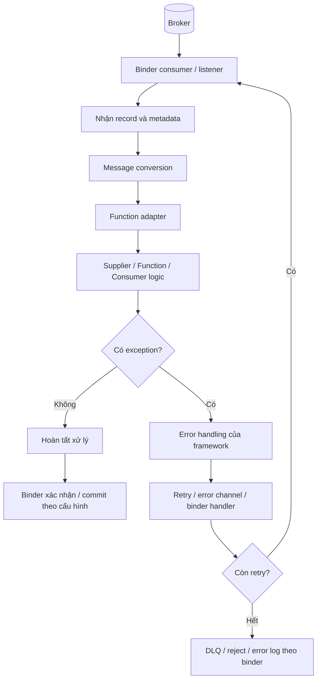

# Đường đi của exception từ hàm tới binder

## 1. Vì sao cần hiểu đường đi của exception?

Trong Spring Cloud Stream, `Supplier`, `Function` và `Consumer` tập trung vào logic ứng dụng. Binder kết nối các binding với Kafka, RabbitMQ hoặc Pulsar. Khi một hàm ném exception, lỗi đi qua nhiều lớp trước khi broker quyết định message được giao lại, xác nhận, chuyển vào dead-letter queue (DLQ) hay bị loại bỏ.

Nếu không hiểu đường đi này, ứng dụng có thể retry sai tầng, xác nhận message quá sớm hoặc ghi log lỗi nhưng vẫn làm mất dữ liệu. Một exception có thể xuất phát từ nhiều vị trí:

- Message không chuyển đổi được thành kiểu Java đầu vào.
- Logic trong `Consumer` hoặc `Function` ném exception.
- Function trả về dữ liệu nhưng output conversion hoặc serialization thất bại.
- Binder không gửi được message đến broker đích.
- Kết nối broker, acknowledgement hoặc thao tác commit offset gặp lỗi.

Mỗi loại lỗi có ngữ cảnh và cơ chế phục hồi khác nhau. Cần xác định lỗi xảy ra trước, trong hay sau lời gọi hàm để chọn đúng nơi xử lý.

## 2. Đường đi tổng quát của message đầu vào

Với một input binding, đường đi cơ bản như sau:



Đây là sơ đồ khái niệm. Thứ tự chính xác của acknowledgement, offset commit, retry và error channel phụ thuộc binder, kiểu function, cấu hình và phiên bản Spring Cloud Stream. Điểm quan trọng là exception từ logic hàm thường được truyền trở lại message handling infrastructure; binder và container mới có đủ ngữ cảnh để áp dụng chính sách giao nhận của broker.

Với consumer imperative, lời gọi hàm thường diễn ra trong quá trình xử lý message của listener. Nếu hàm ném exception và exception không được xử lý, nó có thể đi ngược lên adapter/container. Container hoặc binder sau đó áp dụng retry, error handler, DLQ hoặc chính sách từ chối message.

## 3. Exception trong Consumer

`Consumer<T>` nhận payload và thực hiện tác dụng phụ. Nếu logic ném runtime exception, exception thoát khỏi hàm và được framework quan sát như lỗi xử lý message.

```java
import java.util.function.Consumer;
import org.springframework.context.annotation.Bean;
import org.springframework.context.annotation.Configuration;

record OrderCreated(String orderId, long totalCents) {}

@Configuration
class OrderConsumers {

    @Bean
    Consumer<OrderCreated> processOrder() {
        return event -> {
            if (event.totalCents() <= 0) {
                throw new IllegalArgumentException(
                    "totalCents must be positive: " + event.orderId()
                );
            }

            reserveOrder(event);
        };
    }

    private void reserveOrder(OrderCreated event) {
        // Gọi nghiệp vụ giữ đơn hàng.
    }
}
```

Nếu `reserveOrder` thất bại do lỗi database hoặc dịch vụ phụ thuộc, exception cũng có thể thoát ra khỏi Consumer. Khi đó, binder/container không thể mặc định rằng message đã được xử lý thành công.

### Không nuốt exception nếu muốn binder retry

Đoạn code sau ghi log rồi kết thúc bình thường:

```java
@Bean
Consumer<OrderCreated> processOrder() {
    return event -> {
        try {
            reserveOrder(event);
        } catch (RuntimeException ex) {
            log.error("Cannot reserve order {}", event.orderId(), ex);
        }
    };
}
```

Vì exception đã bị bắt và không được ném lại, framework nhìn thấy lời gọi hàm hoàn tất bình thường. Binder có thể xác nhận hoặc commit message theo cấu hình như một lần xử lý thành công. Ghi log không kích hoạt retry.

Nếu muốn lỗi tiếp tục đi lên binder, hãy ném lại exception:

```java
try {
    reserveOrder(event);
} catch (RuntimeException ex) {
    log.error("Cannot reserve order {}", event.orderId(), ex);
    throw ex;
}
```

Chỉ xử lý tại hàm khi ứng dụng thực sự phục hồi được lỗi hoặc có quyết định nghiệp vụ rõ ràng. Với lỗi dữ liệu không thể phục hồi, có thể chuyển sang luồng lỗi/DLQ theo chính sách; không nên giả vờ xử lý thành công.

## 4. Exception trong Function

`Function<T, R>` nhận một giá trị và trả về giá trị mới. Exception có thể xuất hiện trong lúc kiểm tra, biến đổi hoặc gọi service:

```java
import java.util.function.Function;
import org.springframework.context.annotation.Bean;
import org.springframework.context.annotation.Configuration;

record OrderAccepted(String orderId, String authorizationId) {}

interface PaymentService {
    OrderAccepted authorize(OrderCreated order);
}

@Configuration
class OrderFunctions {

    @Bean
    Function<OrderCreated, OrderAccepted> acceptOrder(PaymentService paymentService) {
        return order -> {
            validateOrder(order);
            return paymentService.authorize(order);
        };
    }

    private void validateOrder(OrderCreated order) {
        if (order.totalCents() <= 0) {
            throw new IllegalArgumentException("Invalid order total");
        }
    }
}
```

Nếu `validateOrder` hoặc `paymentService.authorize` ném exception, function không tạo được kết quả bình thường. Framework chuyển lỗi về đường xử lý message của input binding. Với function có cả input và output binding, việc tạo output chỉ hoàn tất sau khi function trả về kết quả và framework xử lý gửi message đầu ra.

Điều này có nghĩa lỗi trong logic function có thể được xử lý như lỗi consumer đầu vào, nhưng lỗi gửi output cần được phân biệt theo thời điểm và cơ chế xác nhận của binder. Nếu output send thất bại đồng bộ trong cùng luồng xử lý, exception có thể quay về handler đang xử lý input; lỗi producer xảy ra bất đồng bộ có thể được báo qua cơ chế producer riêng và không nhất thiết làm input được giao lại.

## 5. Exception trong Supplier

`Supplier<T>` tạo dữ liệu mà không nhận message đầu vào từ broker. Spring Cloud Stream thường gọi Supplier theo cơ chế polling hoặc lịch phát được cấu hình. Nếu Supplier ném exception, lỗi phát sinh trong chu kỳ gọi nguồn dữ liệu; không có một input record cụ thể để consumer retry hoặc chuyển sang DLQ.

```java
import java.util.function.Supplier;
import org.springframework.context.annotation.Bean;
import org.springframework.context.annotation.Configuration;

record DailySnapshot(String reportDate, long orderCount) {}

interface SnapshotService {
    DailySnapshot loadCurrent();
}

@Configuration
class SnapshotFunctions {

    @Bean
    Supplier<DailySnapshot> dailySnapshot(SnapshotService snapshotService) {
        return () -> {
            DailySnapshot snapshot = snapshotService.loadCurrent();
            if (snapshot == null) {
                throw new IllegalStateException("Snapshot is not available");
            }
            return snapshot;
        };
    }
}
```

Lỗi của Supplier cần được xử lý theo vòng đời polling, scheduler hoặc publisher. Chính sách retry của input binding không tự động áp dụng cho Supplier. Nếu nguồn dữ liệu có thể đọc lại, hãy xác định chu kỳ tiếp theo có thể thử lại hay không, cách tránh phát trùng và cách ghi nhận lỗi nguồn.

Với `Supplier<Flux<T>>`, lỗi có thể xuất hiện trong lúc tạo Flux hoặc sau đó như một `onError` signal khi Flux đang phát. Hai thời điểm này không giống nhau và cần kiểm tra cách function adapter/binder quản lý subscription trong phiên bản ứng dụng.

## 6. Các lớp có thể bọc exception

Exception gốc có thể được bọc bởi các lớp của Spring Messaging, Spring Integration hoặc thư viện binder. Một số loại thường gặp:

| Loại exception | Vị trí thường gặp | Ý nghĩa |
|---|---|---|
| `IllegalArgumentException` hoặc exception nghiệp vụ | Trong code hàm | Dữ liệu hoặc trạng thái không thỏa điều kiện nghiệp vụ |
| `MessageHandlingException` | Message handler/adapter | Xử lý message thất bại; thường có message liên quan |
| `MessagingException` | Spring Messaging | Exception gắn với message, có thể chứa failed message |
| `MessageConversionException` | Trước khi gọi hàm hoặc khi chuyển đổi output | Không thể chuyển payload theo content type/kiểu đích |
| Jackson `JsonProcessingException` hoặc lỗi serializer | Chuyển đổi dữ liệu | JSON/schema/kiểu dữ liệu không phù hợp |
| Exception client broker | Binder hoặc producer/consumer client | Lỗi kết nối, publish, fetch, ack hoặc commit |

Không nên chỉ đọc dòng exception ngoài cùng. Hãy kiểm tra cause chain, failed message, binding name và broker metadata để tìm lỗi gốc. Một `MessageHandlingException` có thể chỉ là lớp bọc quanh `IllegalArgumentException` do code ứng dụng ném ra.

## 7. Lỗi xảy ra trước khi hàm được gọi

Binder nhận record và message converter phải tạo được payload Java trước khi gọi function. Nếu JSON không hợp lệ, content type sai hoặc kiểu đầu vào không tương thích, hàm có thể chưa được chạy.

Ví dụ binding khai báo JSON và hàm nhận DTO:

```yaml
spring:
  cloud:
    function:
      definition: processOrder
    stream:
      bindings:
        processOrder-in-0:
          destination: orders.events
          group: order-processor
          content-type: application/json
```

```java
import java.util.function.Consumer;
import org.springframework.context.annotation.Bean;

// Trong class có logger `log` và phương thức reserveOrder(...).
@Bean
Consumer<OrderCreated> processOrder() {
    return order -> reserveOrder(order);
}
```

Nếu record chứa JSON không thể giải mã thành `OrderCreated`, lỗi chuyển đổi phát sinh ở tầng message conversion. Không có log trong `processOrder` vì code hàm chưa được gọi. Tuy vậy, lỗi vẫn thuộc đường xử lý message của binding và cần chính sách retry/DLQ phù hợp.

Retry một payload hỏng cố định thường không giúp ích. Nếu lỗi do dữ liệu sai schema, nên giới hạn retry và đưa message vào DLQ để kiểm tra hoặc sửa dữ liệu. Nếu lỗi do schema registry hoặc dịch vụ giải mã tạm thời không sẵn sàng, retry có backoff có thể hữu ích.

## 8. Lỗi xảy ra sau khi hàm trả về

Với Function có output, framework còn phải chuyển đổi payload đầu ra và gửi qua output binding. Các lỗi có thể xuất hiện sau khi code hàm đã trả kết quả:

1. Output converter không serialize được object.
2. Header hoặc content type không phù hợp.
3. Broker đích không khả dụng.
4. Producer bị từ chối hoặc timeout.
5. Lỗi xác nhận publish xảy ra bất đồng bộ.

Lỗi conversion/serialization đồng bộ có thể xuất hiện trong cùng luồng xử lý function. Lỗi producer bất đồng bộ có thể đi qua producer error channel hoặc callback riêng của binder. Không nên giả định mọi lỗi output đều tự động kích hoạt retry của input binding.

Với `StreamBridge`, phương thức `send` trả về boolean cho biết thao tác gửi được chấp nhận bởi đường gửi ở mức API. Giá trị `true` không chứng minh consumer đã nhận hoặc xử lý xong message. Khi cần theo dõi xác nhận từ broker, hãy dùng cơ chế producer confirm/acknowledgement hoặc callback được binder hỗ trợ.

## 9. ErrorMessage và error channel

Spring Messaging biểu diễn lỗi được gửi qua error channel bằng `ErrorMessage`. Payload của `ErrorMessage` là `Throwable`; message gốc có thể được đính kèm để handler biết lỗi xảy ra với dữ liệu nào.

Một error channel có thể được dùng để quan sát hoặc xử lý lỗi:

```java
import org.springframework.integration.annotation.ServiceActivator;
import org.springframework.messaging.Message;
import org.springframework.messaging.MessagingException;
import org.springframework.messaging.support.ErrorMessage;
import org.slf4j.Logger;
import org.slf4j.LoggerFactory;
import org.springframework.stereotype.Component;

@Component
class OrderErrorHandler {

    private static final Logger log = LoggerFactory.getLogger(OrderErrorHandler.class);

    // Tên channel minh họa cho input binding có destination=orders, group=billing.
    @ServiceActivator(inputChannel = "orders.billing.errors")
    public void handle(ErrorMessage errorMessage) {
        Throwable cause = errorMessage.getPayload();
        Message<?> original = errorMessage.getOriginalMessage();

        if (cause instanceof MessagingException messagingException
                && messagingException.getFailedMessage() != null) {
            original = messagingException.getFailedMessage();
        }

        log.error("Order input failed; originalMessage={}", original, cause);
    }
}
```

Trong ví dụ, `orders.billing.errors` minh họa tên error channel theo destination và group. Tên thực tế phụ thuộc binding, anonymous/named group, binder và phiên bản Spring Cloud Stream; hãy xác minh tên channel được tạo cho binding của ứng dụng trước khi đăng ký handler.

`ErrorMessage` giúp lấy exception và message liên quan để log, tạo metric hoặc gửi cảnh báo. Việc đăng ký handler không tự biến mọi lỗi thành DLQ và cũng không tự quyết định acknowledgement. Hãy hiểu rõ error channel handler đang tham gia đường xử lý đồng bộ hay nhận lỗi từ một luồng bất đồng bộ, và binder sẽ xử lý message sau khi handler hoàn tất như thế nào.

### Error channel và global errorChannel

Spring Integration có global `errorChannel` cho một số lỗi phát sinh từ các thành phần message-driven/asynchronous. Spring Cloud Stream cũng có error channel gắn với binding. Chúng không phải lúc nào cũng là cùng một nơi và không phải mọi exception của broker đều tự động được gửi vào global channel.

Khi cần xử lý lỗi của một input binding, ưu tiên xác định error channel gắn với binding đó. Dùng global channel cho lỗi không gắn với một binding cụ thể khi cấu trúc ứng dụng và cấu hình cho phép. Không đăng ký handler rồi giả định rằng mọi lỗi producer, consumer và scheduler đều sẽ đi qua một channel duy nhất.

## 10. Retry của consumer binding

Với consumer imperative, Spring Cloud Stream có thể cấu hình retry cho lỗi phát sinh khi xử lý message. Các thuộc tính phổ biến nằm dưới `spring.cloud.stream.bindings.<bindingName>.consumer`:

```yaml
spring:
  cloud:
    function:
      definition: processOrder
    stream:
      bindings:
        processOrder-in-0:
          destination: orders.events
          group: billing-service
          consumer:
            max-attempts: 4
            back-off-initial-interval: 1000
            back-off-max-interval: 10000
            back-off-multiplier: 2.0
```

Trong ví dụ, `max-attempts: 4` tính tổng số lần gọi, bao gồm lần đầu và các lần thử lại. Backoff bắt đầu ở 1 giây, tăng theo hệ số 2 và bị giới hạn ở 10 giây. Hãy xác nhận giá trị mặc định và khả năng của binder theo phiên bản dự án; khai báo tường minh giúp chính sách dễ đọc và kiểm soát hơn.

Retry phù hợp với lỗi tạm thời như timeout ngắn hoặc dịch vụ phụ thuộc đang khởi động lại. Với lỗi dữ liệu không hợp lệ, lỗi schema cố định hoặc vi phạm nghiệp vụ, retry nhiều lần chỉ kéo dài xử lý và tăng tải. Có thể đặt `max-attempts: 1` khi muốn tắt retry ở tầng consumer binding và chuyển nhanh sang chính sách lỗi tiếp theo.

### Retry có thể làm phát sinh xử lý lặp

Giả sử consumer ghi đơn hàng vào database thành công nhưng ứng dụng mất kết nối trước khi acknowledgement/offset commit được ghi nhận. Broker có thể giao lại message. Lần xử lý tiếp theo có thể ghi cùng đơn hàng lần nữa.

Vì vậy, retry cần đi cùng idempotency:

- Mỗi event có `eventId` ổn định.
- Database có ràng buộc duy nhất hoặc bảng inbox để phát hiện event đã xử lý.
- Tác dụng phụ được thực hiện trong transaction phù hợp.
- Retry không tạo thêm giao dịch hoặc gửi thông báo trùng ngoài ý muốn.

## 11. Dead-letter queue theo binder

Khi message vẫn thất bại sau retry, DLQ là nơi giữ message lỗi để điều tra hoặc xử lý lại. Cấu hình DLQ là đặc thù binder và không hoàn toàn giống nhau.

### Kafka binder

Kafka binder có thể bật dead-letter publishing cho consumer binding có group:

```yaml
spring:
  cloud:
    stream:
      bindings:
        processOrder-in-0:
          destination: orders.events
          group: billing-service
          consumer:
            max-attempts: 3
      kafka:
        bindings:
          processOrder-in-0:
            consumer:
              enable-dlq: true
```

Khi số lần xử lý thất bại đã hết, binder có thể gửi record sang dead-letter topic theo cấu hình. Tên topic, phân vùng, quyền ghi và khả năng tạo topic phụ thuộc thuộc tính Kafka binder và môi trường broker. Đảm bảo tài khoản ứng dụng có quyền cần thiết.

### Rabbit binder

Rabbit binder có các thuộc tính riêng để tự động bind DLQ và cấu hình republish exception:

```yaml
spring:
  cloud:
    stream:
      bindings:
        processOrder-in-0:
          destination: orders.events
          group: billing-service
          consumer:
            max-attempts: 3
      rabbit:
        bindings:
          processOrder-in-0:
            consumer:
              auto-bind-dlq: true
              republish-to-dlq: true
```

Các thuộc tính và topology exchange/queue cần được đối chiếu với phiên bản Rabbit binder. DLQ có thể chứa thông tin exception khi republish được bật. Hãy kiểm tra quyền khai báo exchange/queue và chính sách TTL, dead-letter routing trên broker.

### Pulsar binder

Pulsar hỗ trợ dead-letter policy ở cấp subscription/consumer theo khả năng binder và phiên bản. Cấu hình có thể bao gồm tên dead-letter topic, retry topic và số lần redelivery tối đa. Không dùng thuộc tính Kafka hoặc Rabbit cho Pulsar; hãy cấu hình theo namespace Pulsar binder tương ứng và kiểm tra cách binder chuyển message sau khi đạt ngưỡng redelivery.

DLQ không tự sửa dữ liệu. Cần quy trình quan sát, phân loại, sửa lỗi và replay có kiểm soát. Khi phát lại message, giữ event ID gốc để consumer idempotent vẫn nhận diện được bản tin đã xử lý.

## 12. Phân biệt retry trong Reactor và retry của binder

Với reactive function, lỗi thường được biểu diễn bằng `onError` signal trong `Mono` hoặc `Flux`. Có thể xử lý lỗi trong pipeline bằng các toán tử Reactor:

```java
import java.time.Duration;
import java.util.function.Function;
import org.springframework.context.annotation.Bean;
import org.springframework.context.annotation.Configuration;
import reactor.core.publisher.Flux;
import reactor.core.publisher.Mono;
import reactor.util.retry.Retry;

interface ReactiveOrderService {
    Mono<OrderAccepted> processReactive(OrderCreated order);
}

@Configuration
class ReactiveOrderFunctions {

    @Bean
    Function<Flux<OrderCreated>, Flux<OrderAccepted>> processOrdersReactive(
            ReactiveOrderService orderService) {
        return orders -> orders.concatMap(order ->
            orderService.processReactive(order)
                .retryWhen(Retry.backoff(2, Duration.ofMillis(250))
                    .filter(ReactiveOrderFunctions::isTransientFailure))
        );
    }

    private static boolean isTransientFailure(Throwable error) {
        return error instanceof java.util.concurrent.TimeoutException;
    }
}
```

`retryWhen` ở đây resubscribe publisher của thao tác xử lý theo chính sách Reactor. Nó không đồng nghĩa broker đã giao lại record đầu vào. Retry của binder/container nằm ở tầng message delivery và có thể có semantics khác.

Với reactive function, không nên mặc định các thuộc tính retry/DLQ của consumer imperative sẽ được áp dụng cho từng phần tử trong `Flux`. Một lỗi terminal có thể kết thúc publisher đang xử lý cả luồng; hãy xác định cách cô lập lỗi theo từng message, cách phát message lỗi và hành vi resubscription theo phiên bản Spring Cloud Stream cùng binder đang dùng.

Một số toán tử cần phân biệt:

| Toán tử | Tác dụng | Exception còn đi lên không? |
|---|---|---|
| `doOnError` | Quan sát/log lỗi | Có; chỉ thêm side effect |
| `onErrorMap` | Chuyển exception sang loại khác | Có; phát exception mới |
| `onErrorResume` | Chuyển sang publisher dự phòng | Thường không, nếu publisher dự phòng hoàn tất bình thường |
| `retryWhen` | Subscribe lại theo chính sách retry | Nếu hết retry vẫn lỗi thì có |
| `onErrorComplete` | Chuyển lỗi thành completion | Không; lỗi bị kết thúc tại đây |

Nếu dùng `onErrorResume` để ghi log rồi trả `Mono.empty()`, pipeline có thể hoàn tất bình thường và framework không còn thấy exception gốc để áp dụng retry binder. Chỉ chuyển lỗi thành kết quả dự phòng khi nghiệp vụ chấp nhận việc bỏ qua hoặc thay thế message.

### Không retry mù quáng toàn bộ stream

Với `Flux`, retry có thể resubscribe toàn bộ nguồn upstream. Nếu nguồn có side effect hoặc không replay được, hành vi retry có thể tạo message trùng hoặc không khôi phục được phần tử đã mất. Ưu tiên retry thao tác nhỏ nhất có thể lặp an toàn, dùng event ID và hiểu rõ publisher nguồn có thể phát lại dữ liệu hay không.

## 13. Producer-side error khác consumer-side error

Lỗi consumer xảy ra khi ứng dụng không xử lý được message đầu vào. Lỗi producer xảy ra khi ứng dụng không gửi được message đầu ra. Hai lỗi này có đường đi khác nhau:

| Loại lỗi | Ví dụ | Nơi cần kiểm tra |
|---|---|---|
| Consumer function | Logic `processOrder` ném exception | Function adapter, input binding, retry/error channel của consumer |
| Input conversion | JSON không tạo được DTO | Message converter, content type, input binding và binder |
| Output conversion | Object trả về không serialize được | Output converter, schema, content type |
| Producer send | Broker đích từ chối hoặc timeout | Output binding, producer client, producer error channel/callback |
| StreamBridge send | Gửi qua binding động hoặc tĩnh thất bại | Binding name, binder, destination và kết quả `send` |

Với lỗi producer, hãy kiểm tra cơ chế báo lỗi mà binder hỗ trợ. Một số binder cho phép bật producer error channel hoặc callback xác nhận gửi. Tên thuộc tính và semantics phụ thuộc binder. Không giả định retry của consumer sẽ tự chạy lại một lần publish bất đồng bộ thất bại sau khi input đã được xác nhận.

Nếu cần bảo đảm cập nhật database và phát event không bị tách rời, hãy cân nhắc transactional outbox. Nếu cần gửi tới nhiều broker, phải có chiến lược phục hồi khi một broker thành công còn broker khác thất bại; các lần gọi `send` riêng không tạo transaction phân tán nguyên tử.

## 14. Acknowledgement và offset commit liên quan thế nào?

Binder điều phối giao nhận theo semantics của broker:

- Kafka theo dõi offset đã commit của từng consumer group và partition.
- RabbitMQ dùng acknowledgement để xác định message đã được consumer xử lý.
- Pulsar dùng acknowledgement và subscription cursor để theo dõi tiến độ.

Nếu exception được truyền lên và container quyết định retry, message thường chưa được xác nhận hoàn tất ở thời điểm retry. Khi retry hết, binder áp dụng chính sách tiếp theo như DLQ, reject hoặc error handler. Tuy nhiên, chi tiết ack/commit có thể khác theo binder, chế độ transaction, batch listener và cấu hình concurrency.

Không dùng một quy tắc chung kiểu “hàm ném exception thì chắc chắn broker giao lại đúng một lần”. Redelivery có thể xảy ra, có thể trùng, và không có bảo đảm exactly-once end-to-end chỉ nhờ exception propagation. Thiết kế consumer idempotent và kiểm thử với broker thật.

## 15. Phân loại exception để chọn chính sách

Một ứng dụng nên phân loại lỗi trước khi quyết định retry:

| Nhóm lỗi | Ví dụ | Chính sách thường phù hợp |
|---|---|---|
| Tạm thời | Timeout, mất kết nối ngắn, rate limit có thể hồi phục | Retry có backoff và giới hạn |
| Dữ liệu không hợp lệ | Thiếu trường bắt buộc, JSON hỏng, sai schema | DLQ/quarantine và điều tra; tránh retry dài |
| Vi phạm nghiệp vụ | Đơn hàng đã hủy, trạng thái không cho phép | Xử lý theo kết quả nghiệp vụ hoặc luồng từ chối riêng |
| Hạ tầng kéo dài | Broker/database không khả dụng | Retry có giới hạn, circuit breaker hoặc dừng tiêu thụ có kiểm soát |
| Lỗi lập trình | Null không mong đợi, invariant bị phá vỡ | Báo động, giữ nguyên stack trace và sửa code; tránh retry vô hạn |

Không phân loại chỉ bằng tên exception. Cùng một `RuntimeException` có thể bọc lỗi tạm thời hoặc lỗi dữ liệu cố định. Nên dùng exception domain rõ ràng hoặc kiểm tra cause chain để quyết định.

## 16. Quan sát đường đi của lỗi

Log và metric nên giúp xác định lỗi nằm ở đâu trong pipeline. Một bản ghi lỗi hữu ích nên có:

- Tên function và input/output binding liên quan.
- Destination, group và binder nếu có.
- Event ID và correlation ID.
- Loại exception gốc và cause chain.
- Số lần thử, thời điểm retry và trạng thái DLQ.
- Thông tin partition/offset hoặc delivery metadata khi binder cung cấp.

Không log credential hoặc toàn bộ payload nhạy cảm. Dùng metric để theo dõi số lỗi theo binding, retry count, DLQ count, producer send failures, consumer lag và thời gian xử lý. Cảnh báo khi DLQ tăng đột biến hoặc retry kéo dài làm backlog tăng.

## 17. Quy trình chẩn đoán một exception

1. Xác định message đến từ input binding, Supplier polling hay producer output.
2. Kiểm tra function có thực sự được gọi hay lỗi xảy ra trong conversion trước đó.
3. Đọc exception gốc và failed message, không chỉ lớp exception ngoài cùng.
4. Xác định lỗi xảy ra trong logic hàm, output conversion hay broker send.
5. Kiểm tra exception có bị bắt và nuốt trong code hay không.
6. Kiểm tra retry/backoff của consumer binding và error channel tương ứng.
7. Kiểm tra binder-specific DLQ, acknowledgement, offset hoặc redelivery policy.
8. Đánh giá khả năng xử lý trùng và idempotency trước khi bật retry/replay.
9. Kiểm thử lại với broker tương ứng và xác nhận message đi đúng đường phục hồi.

Exception từ function không đi thẳng tới broker như một payload nghiệp vụ. Nó được framework và binder xử lý qua message handling, error channel hoặc error handler, rồi mới áp dụng retry, acknowledgement và DLQ theo cấu hình. Hiểu đúng vị trí lỗi và ranh giới xác nhận giúp ứng dụng Spring Cloud Stream tránh nuốt exception, tránh retry sai tầng và phục hồi message có kiểm soát.

