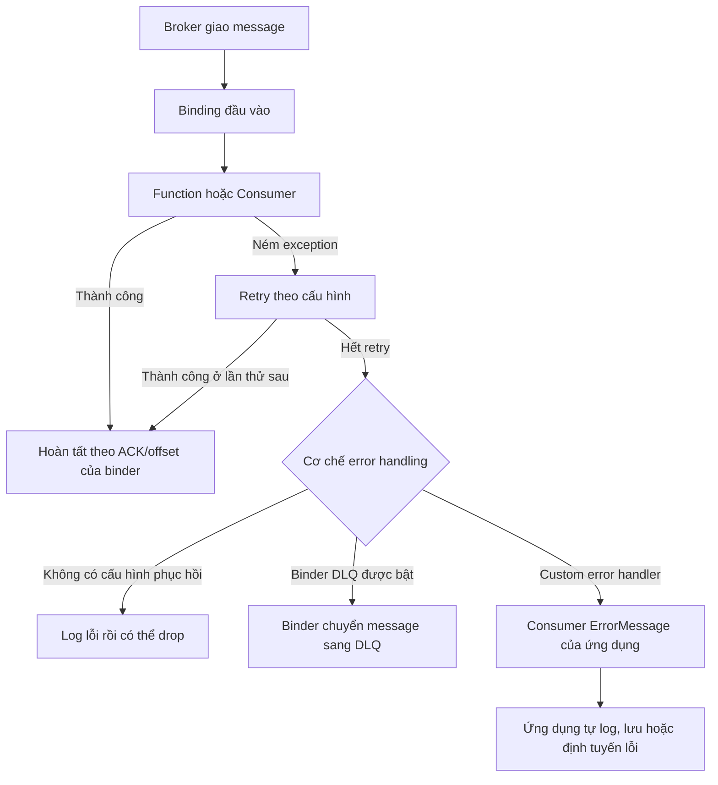

# Tác động của error handler riêng đến cơ chế DLQ mặc định

Spring Cloud Stream cung cấp nhiều lớp xử lý lỗi cho consumer: retry khi hàm nghiệp vụ ném exception, error handler mặc định của framework, cơ chế phục hồi riêng của binder và dead-letter queue/topic (DLQ). Ứng dụng cũng có thể khai báo một error handler riêng để ghi nhận lỗi, gửi cảnh báo hoặc lưu message thất bại.

Điểm cần đặc biệt chú ý là **error handler riêng được khai báo bằng `error-handler-definition` thay thế các error handler do framework cung cấp, bao gồm error handler đặc thù của binder dùng để chuyển message sang DLQ**. Vì vậy, khi binding đã gắn custom handler, việc bật `enable-dlq` của Kafka hoặc `auto-bind-dlq` của RabbitMQ không có nghĩa binder vẫn tự động chuyển message lỗi vào DLQ. Nếu custom handler cần lưu message thất bại, chính handler phải thực hiện việc định tuyến hoặc ghi nhận theo một cơ chế phục hồi do ứng dụng quản lý.

## 1. Đường đi của lỗi trong consumer

Với hàm imperative như `Function<T, R>` hoặc `Consumer<T>`, mỗi message được chuyển tới message handler. Nếu hàm ném exception, lỗi được truyền về hạ tầng xử lý của Spring Cloud Stream và binder. Thông thường, framework thực hiện một số lần retry trước khi quyết định cách xử lý message thất bại.



Các bước chi tiết phụ thuộc binder và programming model. Với message handler imperative, lỗi xử lý được đưa về binder; nếu retry không thành công, binder có thể drop, requeue hoặc gửi DLQ theo khả năng và cấu hình của broker. Nếu không có cấu hình phục hồi, lỗi có thể chỉ được ghi log rồi message bị loại bỏ. Không nên coi log lỗi là bằng chứng message đã được lưu để xử lý lại.

Spring Cloud Stream hiện hành mô tả hai error handler mặc định: handler ghi log và handler đặc thù binder. Handler thứ hai có thể chuyển message sang DLQ khi cơ chế DLQ đã được cấu hình. Khi khai báo custom handler theo `error-handler-definition`, custom handler loại trừ hai handler mặc định này để tránh nhiều thành phần cùng xử lý một lỗi.

## 2. Retry và DLQ là hai giai đoạn khác nhau

Retry cho phép thử xử lý lại message khi lỗi có khả năng tạm thời, ví dụ dịch vụ phụ thuộc tạm thời không truy cập được. DLQ lưu message sau khi các lần thử không thành công để đội vận hành kiểm tra, sửa dữ liệu hoặc phát lại có kiểm soát.

Các thuộc tính retry phổ biến của consumer binding:

| Thuộc tính | Ý nghĩa |
|---|---|
| `max-attempts` | Tổng số lần thử xử lý theo cơ chế retry của binding, bao gồm lần đầu. |
| `back-off-initial-interval` | Thời gian chờ ban đầu giữa các lần thử. |
| `back-off-multiplier` | Hệ số tăng thời gian chờ sau mỗi lần thử. |
| `back-off-max-interval` | Giới hạn thời gian chờ tối đa. |
| `default-retryable` / `retryable-exceptions` | Điều chỉnh nhóm exception được retry, tùy phiên bản và cấu hình. |

Ví dụ cấu hình retry cho binding `processOrder-in-0`:

```yaml
spring:
  cloud:
    function:
      definition: processOrder
    stream:
      bindings:
        processOrder-in-0:
          destination: orders.commands
          group: order-command-handler
          consumer:
            max-attempts: 3
            back-off-initial-interval: 1000
            back-off-multiplier: 2.0
            back-off-max-interval: 10000
```

Với cấu hình minh họa, handler có tối đa ba lần thử và khoảng chờ tăng theo hệ số 2, tối đa 10 giây. Giá trị mặc định và cách áp dụng retry có thể khác theo binder, phiên bản và việc bật DLQ. Cần xem tài liệu binder đang triển khai trước khi dựa vào một con số cụ thể.

Retry phù hợp với lỗi tạm thời. Với lỗi dữ liệu cố định như payload sai schema hoặc thiếu trường bắt buộc, retry cùng một message thường không làm lỗi biến mất. Khi đó, cần phân loại lỗi để chuyển sang DLQ hoặc parking-lot destination.

## 3. Cơ chế DLQ mặc định của binder

DLQ là một destination riêng để giữ message không xử lý thành công. Nó có thể được dùng cho kiểm tra, đối soát, sửa dữ liệu hoặc phát lại. Spring Cloud Stream không tự bật DLQ cho mọi binding; cần cấu hình theo binder.

### Kafka binder

Kafka binder yêu cầu consumer group được khai báo rõ ràng để dùng DLQ. Bật DLQ cho binding bằng thuộc tính `enable-dlq`:

```yaml
spring:
  cloud:
    function:
      definition: processOrder
    stream:
      bindings:
        processOrder-in-0:
          destination: orders.commands
          group: order-command-handler
          consumer:
            max-attempts: 3
      kafka:
        bindings:
          processOrder-in-0:
            consumer:
              enable-dlq: true
              dlq-name: orders.commands.order-command-handler.dlq
```

Khi được bật và các lần thử xử lý thất bại, Kafka binder có thể publish record lỗi tới DLQ topic. Nếu không đặt `dlq-name`, tên mặc định thường theo dạng `error.<destination>.<group>`. Consumer anonymous không có group không dùng được tính năng DLQ này. Mặc định record DLQ được gửi tới partition tương ứng với record gốc; vì vậy topic DLQ cần đủ partition hoặc phải cấu hình cách chọn partition khác.

Ở một số phiên bản Kafka binder hiện hành, khi DLQ không bật, `max-attempts` của binding không điều khiển retry theo cách nhiều người mong đợi; việc retry có thể theo mặc định của listener container. Hãy kiểm tra tài liệu đúng phiên bản và cấu hình `ListenerContainerCustomizer`/`ListenerContainerWithDlqAndRetryCustomizer` nếu cần tùy chỉnh sâu hành vi container.

### RabbitMQ binder

Với RabbitMQ, có thể yêu cầu binder khai báo dead-letter exchange và queue bằng `auto-bind-dlq`:

```yaml
spring:
  cloud:
    stream:
      bindings:
        processOrder-in-0:
          destination: orders.commands
          group: order-command-handler
          consumer:
            max-attempts: 3
      rabbit:
        bindings:
          processOrder-in-0:
            consumer:
              auto-bind-dlq: true
              republish-to-dlq: true
```

Queue DLQ mặc định thường được đặt tên từ destination và group, chẳng hạn `orders.commands.order-command-handler.dlq`. `republish-to-dlq: true` yêu cầu binder publish lại message thất bại và bổ sung metadata lỗi như exception message hoặc stack trace vào headers. Nếu không bật republish, broker có thể dead-letter message bị reject theo cấu hình exchange/queue.

Tránh đặt `requeue-rejected: true` cùng cấu hình không có chiến lược retry/giới hạn phù hợp. Message lỗi có thể bị đưa lại queue liên tục, gây vòng lặp redelivery và làm consumer không tiến triển.

### Pulsar và binder khác

Khả năng dead-letter phụ thuộc binder và cơ chế subscription của broker. Pulsar có dead-letter policy ở cấp consumer/subscription; cách khai báo, số lần redelivery và tên dead-letter topic phụ thuộc Pulsar client cùng phiên bản Pulsar binder. Không sao chép thuộc tính Kafka `enable-dlq` hoặc Rabbit `auto-bind-dlq` sang Pulsar. Hãy kiểm tra tài liệu của binder cụ thể và xác nhận liệu lỗi từ message handler có được chuyển tới dead-letter topic theo cấu hình hay không.

## 4. Custom error handler là gì?

Spring Cloud Stream cho phép khai báo một bean hàm nhận `ErrorMessage`. ErrorMessage chứa exception trong payload và thông tin về message gốc gây lỗi. Spring Cloud Stream nhận diện bean này là custom error handler khi binding tham chiếu tên bean qua thuộc tính `error-handler-definition`.

Ví dụ handler ghi nhận lỗi:

```java
import java.util.function.Consumer;

import org.slf4j.Logger;
import org.slf4j.LoggerFactory;
import org.springframework.context.annotation.Bean;
import org.springframework.context.annotation.Configuration;
import org.springframework.messaging.support.ErrorMessage;

@Configuration
class OrderErrorHandlerConfiguration {

    private static final Logger log =
        LoggerFactory.getLogger(OrderErrorHandlerConfiguration.class);

    @Bean
    Consumer<ErrorMessage> orderErrorHandler() {
        return errorMessage -> {
            Throwable cause = errorMessage.getPayload();
            log.error("Order consumer failed; originalMessagePresent={}",
                errorMessage.getOriginalMessage() != null, cause);
        };
    }
}
```

Khai báo binding sử dụng handler:

```yaml
spring:
  cloud:
    stream:
      bindings:
        processOrder-in-0:
          destination: orders.commands
          group: order-command-handler
          error-handler-definition: orderErrorHandler
```

`error-handler-definition` nằm trực tiếp dưới cấu hình binding, không nằm trong `consumer`. Tên được khai báo phải khớp tên bean hàm. Khi cần dùng một handler mặc định cho tất cả function bean, có thể đặt `spring.cloud.stream.default.error-handler-definition`.

Ví dụ chọn một handler mặc định ở cấp ứng dụng:

```yaml
spring:
  cloud:
    stream:
      default:
        error-handler-definition: applicationErrorHandler
```

Khi cần ngoại lệ cho một binding cụ thể, có thể khai báo `error-handler-definition` trực tiếp trên binding đó để chỉ rõ handler cần dùng cho binding.

Custom handler có thể gửi cảnh báo, ghi lỗi vào database, tạo ticket hoặc chuyển message tới destination riêng. Vì nó thay thế error handler mặc định, handler phải chủ động thực hiện mọi công việc cần thiết như ghi log, bảo toàn message gốc, phát metric và lưu trữ lỗi.

## 5. Tác động quan trọng: custom handler vô hiệu hóa đường DLQ mặc định

Đây là hành vi dễ gây mất message nếu cấu hình không được hiểu đúng:

1. Binding bật DLQ của binder, ví dụ Kafka `enable-dlq: true` hoặc Rabbit `auto-bind-dlq: true`.
2. Ứng dụng đồng thời gắn `error-handler-definition` trỏ tới một `Consumer<ErrorMessage>`.
3. Khi message handler thất bại và đi tới giai đoạn xử lý lỗi, custom handler được sử dụng thay cho error handler logging và binder-specific của framework.
4. Binder-specific error handler không còn thực hiện việc chuyển message sang DLQ mặc định.

Do đó, **message không tự động xuất hiện trong DLQ của binder chỉ vì thuộc tính DLQ vẫn đang bật**. Việc tạo queue/topic ở broker (nếu đã được provision) cũng không đồng nghĩa message sẽ được gửi vào đó. Custom handler cần có một đường lưu/định tuyến riêng nếu muốn giữ message thất bại.

Có thể chọn một trong hai hướng:

- Dùng retry và DLQ do binder quản lý: không gắn custom `error-handler-definition` cho binding đó; cấu hình DLQ và retry theo binder.
- Dùng custom error handler: handler chịu trách nhiệm log, lưu hoặc publish message lỗi tới recovery destination; thiết kế xác nhận, retry và xử lý lỗi của chính đường phục hồi.

Không nên bật cả hai với kỳ vọng framework sẽ tự chạy song song. Việc loại trừ là chủ ý để tránh hai handler cùng ACK, publish hoặc xử lý một lỗi theo hai cách khác nhau.

## 6. Gửi message lỗi tới recovery destination từ custom handler

Nếu cần logic riêng nhưng vẫn muốn lưu message để xử lý lại, custom handler có thể dùng `StreamBridge` để gửi message gốc tới một output binding dành riêng cho lỗi. Đây là luồng phục hồi do ứng dụng quản lý; nó không phải cơ chế DLQ mặc định của binder.

Ví dụ khai báo output binding:

```yaml
spring:
  cloud:
    stream:
      output-bindings: orderFailures-out-0
      bindings:
        processOrder-in-0:
          destination: orders.commands
          group: order-command-handler
          error-handler-definition: orderErrorHandler
        orderFailures-out-0:
          destination: orders.commands.failures
          content-type: application/json
```

Thay implementation chỉ ghi log ở ví dụ trước bằng implementation có định tuyến message gốc:

```java
import java.util.function.Consumer;

import org.springframework.cloud.stream.function.StreamBridge;
import org.springframework.context.annotation.Bean;
import org.springframework.messaging.Message;
import org.springframework.messaging.support.ErrorMessage;
import org.springframework.messaging.support.MessageBuilder;

@Bean
Consumer<ErrorMessage> orderErrorHandler(StreamBridge streamBridge) {
    return errorMessage -> {
        Message<?> original = errorMessage.getOriginalMessage();
        Throwable cause = errorMessage.getPayload();

        if (original == null) {
            throw new IllegalStateException(
                "Cannot route failure because the original message is missing",
                cause
            );
        }

        Message<?> failure = MessageBuilder.fromMessage(original)
            .setHeader("x-failure-type", cause.getClass().getName())
            .setHeader("x-failure-stage", "order-command-handler")
            .build();

        if (!streamBridge.send("orderFailures-out-0", failure)) {
            throw new IllegalStateException("Could not publish failed order message", cause);
        }
    };
}
```

Ví dụ chỉ minh họa đường gửi. Trong production, cần xác minh `send` thành công ở mức channel/binder theo hợp đồng của phiên bản đang dùng; giá trị `true` không chứng minh consumer ở recovery destination đã xử lý message. Nếu cần bảo đảm lưu bền vững, hãy thiết kế xác nhận publish, transaction hoặc outbox phù hợp với broker và nghiệp vụ.

Chỉ chuyển tiếp các header cần thiết. Không đưa toàn bộ stack trace, access token, thông tin cá nhân hoặc header nội bộ của broker vào destination lỗi nếu không có yêu cầu và chính sách bảo mật rõ ràng. Exception message đôi khi chứa SQL, URL hoặc dữ liệu nhạy cảm; cần lọc trước khi lưu.

Đường recovery phải tách khỏi input binding gây lỗi. Nếu handler publish lại vào chính destination mà consumer đang đọc, message có thể quay lại cùng logic và tạo vòng lặp lỗi. Nên dùng topic/queue lỗi riêng, có quyền truy cập giới hạn và chính sách retention rõ ràng.

## 7. Handler riêng có trách nhiệm gì?

Khi chọn custom handler, hãy xác định rõ trách nhiệm của nó. Một handler chỉ ghi log không tự động giữ message. Một handler gửi email cũng không tự động tạo DLQ. Tối thiểu cần quyết định:

- **Ghi nhận:** log exception, binding, destination, group và định danh message.
- **Bảo toàn:** lấy original message nếu có và giữ payload cần thiết để điều tra hoặc phát lại.
- **Phân loại:** lỗi tạm thời, lỗi dữ liệu, lỗi schema, lỗi cấu hình hay lỗi không thể phục hồi.
- **Phục hồi:** lưu database, publish tới recovery destination hoặc đưa vào hệ thống ticket/alert.
- **Xác nhận:** xử lý trường hợp lưu/publish thất bại; không âm thầm bỏ qua kết quả gửi.
- **Chống lặp:** gắn event ID hoặc khóa idempotency để cùng một lỗi không tạo nhiều bản ghi phục hồi ngoài ý muốn.
- **Bảo mật:** lọc thông tin nhạy cảm trong payload, header, exception và stack trace.
- **Vận hành:** cung cấp metric, cảnh báo, retention và quy trình redrive có kiểm soát.

Handler nên ngắn gọn và không thực hiện nhiều I/O blocking trong đường callback lỗi. Nếu phải ghi database hoặc gọi dịch vụ từ xa, cần timeout, retry có giới hạn và cơ chế lưu bền vững. Tránh để lỗi của chính handler tạo một vòng lỗi khó quan sát.

## 8. Phân biệt custom error handler với error channel subscriber

Spring Integration và Spring Cloud Stream có các error channel để phát `ErrorMessage`. Một thành phần có thể subscribe vào error channel để quan sát hoặc xử lý lỗi. Tuy nhiên, cần phân biệt cách đăng ký một subscriber với việc chọn `Consumer<ErrorMessage>` làm error handler của binding qua `error-handler-definition`.

Đối với cơ chế `error-handler-definition` được mô tả trong bài, tài liệu Spring Cloud Stream xác định custom handler là cơ chế thay thế logging handler và binder-specific handler. Không nên suy rộng quy tắc đó sang mọi listener/subscriber error channel mà không xem xét cách channel được cấu hình và phiên bản framework. Khi một ứng dụng vừa có subscriber error channel vừa có binder DLQ, cần kiểm thử thực tế xem message đi qua những subscriber nào và ai chịu trách nhiệm ACK/republish.

Nếu mục tiêu chỉ là quan sát lỗi, cân nhắc cơ chế logging/metrics/observation không thay thế binder recovery. Nếu mục tiêu là tự quyết định nơi lưu message, dùng custom handler một cách tường minh và quản lý đầy đủ đường phục hồi.

## 9. Reactive function có cùng cơ chế DLQ không?

Không nên áp dụng máy móc phần retry/DLQ của imperative message handler cho reactive function. Một function có chữ ký `Function<Flux<T>, Flux<R>>` không được xem là message handler xử lý từng message theo cùng cách; framework nối publisher của binding với publisher do function trả về. Với mô hình reactive, cần dùng các toán tử Reactor như `retryWhen`, `onErrorResume` hoặc `onErrorMap` theo yêu cầu của pipeline.

Ví dụ:

```java
import java.time.Duration;
import java.util.function.Function;

import org.springframework.context.annotation.Bean;
import reactor.core.publisher.Flux;
import reactor.util.retry.Retry;

@Bean
Function<Flux<OrderCreated>, Flux<OrderProcessed>> processOrders(
        OrderService orderService) {
    return orders -> orders
        .flatMap(orderService::process)
        .retryWhen(Retry.backoff(3, Duration.ofSeconds(1)));
}
```

Đây là retry của Reactor trên publisher, không phải `RetryTemplate` retry từng message của imperative handler. Cần xác định lỗi làm hỏng một phần tử hay kết thúc toàn bộ publisher, cũng như cách binder và broker xử lý ACK/offset khi pipeline lỗi. Nếu cần đưa phần tử lỗi vào một luồng phục hồi, hãy thiết kế rõ `onErrorResume` hoặc nhánh xử lý theo từng phần tử; không giả định `enable-dlq` của binder tự động bắt mọi lỗi trong reactive pipeline.

## 10. Kiểm thử tác động của custom handler tới DLQ

Vì custom handler thay thế binder error handler, cần có kiểm thử chứng minh hành vi thực tế thay vì chỉ kiểm tra file YAML.

| Trường hợp | Thiết lập | Kết quả cần xác minh |
|---|---|---|
| Binder DLQ thuần | Bật DLQ, không khai báo custom error handler | Message lỗi được chuyển vào DLQ sau khi retry cạn theo cấu hình binder. |
| Custom handler chỉ log | Khai báo `error-handler-definition` | Handler nhận `ErrorMessage`; binder DLQ mặc định không tự xử lý message đó. |
| Custom handler + DLQ property | Vừa khai báo custom handler vừa bật `enable-dlq`/`auto-bind-dlq` | Không giả định DLQ binder vẫn chạy; xác minh message không tự xuất hiện ở DLQ mặc định. |
| Custom handler tự publish | Handler gửi original message tới recovery binding | Message được nhận ở recovery destination và có metadata lỗi cần thiết. |
| Original message thiếu | Handler nhận ErrorMessage không có original message | Có log/metric và đường xử lý thay thế rõ ràng; không mất dấu lỗi. |
| Publish recovery thất bại | Recovery destination/broker không sẵn sàng | Handler ghi nhận lỗi và có phương án phục hồi, không âm thầm bỏ message. |
| Message lỗi lặp | Broker giao lại hoặc handler được gọi nhiều lần | Recovery storage có idempotency hoặc cách nhận biết bản ghi trùng. |

Spring Cloud Stream Test Binder có thể giúp kiểm thử function và logic handler trong JVM, nhưng không mô phỏng đầy đủ retry, dead-letter routing, ACK, offset, queue/exchange hoặc native behavior của broker. Cần integration test với Kafka/RabbitMQ/Pulsar binder thật để xác minh DLQ và redelivery.

## 11. Quy trình lựa chọn cơ chế

Trước khi thêm custom error handler, hãy trả lời các câu hỏi sau:

1. Lỗi phát sinh trong imperative handler hay reactive pipeline?
2. Có cần logic riêng như lưu database, cảnh báo hoặc phân loại lỗi không?
3. Nếu không cần logic riêng, binder hiện tại đã hỗ trợ DLQ/requeue đủ dùng chưa?
4. Nếu khai báo `error-handler-definition`, ứng dụng có chấp nhận thay thế error handler binder và tự quản lý recovery không?
5. Original message có được giữ lại, và các header nào cần đưa sang recovery destination?
6. Nếu publish hoặc ghi database thất bại, handler sẽ làm gì để không mất dấu message?
7. Có idempotency, retry giới hạn và chính sách parking lot/redrive không?
8. Có kiểm thử tích hợp chứng minh đúng hành vi với broker đang chạy không?

Nếu mục tiêu chính là chuyển message lỗi sang DLQ, hãy ưu tiên cấu hình DLQ của binder và không gắn custom error handler không cần thiết. Nếu cần logic phục hồi riêng, khai báo custom handler và chủ động triển khai việc lưu/định tuyến message. Cần xem `error-handler-definition` như một quyết định thay đổi đường xử lý lỗi của binding, không phải chỉ là một callback bổ sung.

## 12. Tài liệu tham khảo

- [Spring Cloud Stream – Error Handling](https://docs.spring.io/spring-cloud-stream/reference/spring-cloud-stream/overview-error-handling.html)
- [Spring Cloud Stream – Kafka Dead-Letter Topic Processing](https://docs.spring.io/spring-cloud-stream/reference/kafka/kafka-binder/dlq.html)
- [Spring Cloud Stream – Kafka Binder Retry and Dead Letter Processing](https://docs.spring.io/spring-cloud-stream/docs/current/reference/html/spring-cloud-stream-binder-kafka.html)
- [Spring Cloud Stream RabbitMQ Binder – Usage and DLQ configuration](https://docs.spring.io/spring-cloud-stream-binder-rabbit/docs/current/reference/html/README.html)
