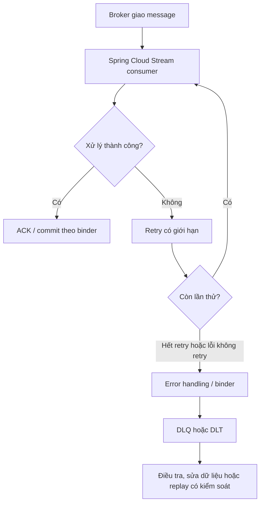

# DLQ, DLT và điều kiện cấu hình theo từng binder

## Mục tiêu

Trong một luồng xử lý sự kiện, có những lỗi chỉ tồn tại trong thời gian ngắn như database timeout hoặc dịch vụ phụ thuộc quá tải. Một số lỗi khác không thể tự phục hồi bằng cách thử lại, chẳng hạn payload sai schema, thiếu trường bắt buộc hoặc một message luôn làm consumer phát sinh exception. Nếu cứ retry vô hạn, message lỗi có thể chiếm tài nguyên, làm chậm các message khác hoặc khiến consumer liên tục thất bại.

**Dead Letter Queue (DLQ)** và **Dead Letter Topic (DLT)** là nơi cách ly message không thể xử lý theo luồng bình thường sau khi chính sách retry/error đã được áp dụng. DLQ thường được gọi theo khái niệm hàng đợi lỗi; DLT nhấn mạnh cách triển khai bằng topic, phổ biến với Kafka và Pulsar. Đây là đích lưu message lỗi để điều tra, sửa dữ liệu hoặc replay có kiểm soát.

Spring Cloud Stream không tự làm cho mọi binder có cùng cơ chế dead-letter. Kafka binder, RabbitMQ binder và Pulsar binder có namespace, điều kiện kích hoạt và semantics riêng. Bài học này giải thích cách retry dẫn đến DLQ/DLT, cách cấu hình từng binder và cách vận hành message lỗi an toàn.

Sau bài học, bạn có thể:

- Phân biệt DLQ, DLT, error channel và retry.
- Xác định khi nào message được chuyển sang dead-letter destination.
- Cấu hình DLQ/DLT theo Kafka, RabbitMQ và Pulsar binder.
- Phân biệt retry của framework với redelivery của broker.
- Lưu metadata đủ để điều tra và replay message lỗi.
- Tránh vòng lặp retry/DLQ và kiểm thử hành vi trên broker thực tế.

## 1. DLQ và DLT giải quyết vấn đề gì?

Giả sử consumer `processOrders` nhận message `OrderCreated`. Một message có thể thất bại vì:

- JSON không hợp lệ hoặc không tương thích schema.
- Trường `orderId` bị thiếu.
- Database tạm thời không truy cập được.
- Quy tắc nghiệp vụ từ chối đơn hàng.
- Code consumer gặp lỗi chưa được dự đoán.

Nếu tất cả lỗi đều được retry giống nhau, một message poison có thể được giao đi giao lại mà không bao giờ thành công. Nếu mọi lỗi đều bị loại bỏ, nhóm vận hành mất khả năng điều tra và khôi phục.

DLQ/DLT tạo một đường đi riêng cho message đã thất bại theo chính sách. Luồng điển hình:



DLQ/DLT không phải nơi xử lý nghiệp vụ thay thế. Nó là vùng cách ly để message không bị mất dấu khi luồng chính không thể hoàn tất. Mỗi message ở đó cần có owner, chính sách lưu giữ, cảnh báo và quy trình xử lý tiếp.

## 2. Phân biệt retry, error channel, DLQ và DLT

Các cơ chế sau có liên quan nhưng không thay thế nhau:

| Cơ chế | Vai trò | Phạm vi |
|---|---|---|
| Retry | Thử lại xử lý một message sau lỗi | Có thể ở framework hoặc broker |
| Redelivery | Broker giao lại message chưa được xác nhận hoặc bị yêu cầu giao lại | Broker/binder |
| Error channel | Chuyển lỗi đến thành phần xử lý lỗi trong ứng dụng Spring | Application context |
| DLQ | Cách ly message lỗi tại một queue hoặc destination chuyên biệt | Broker topology |
| DLT | Cách ly message lỗi tại một topic chuyên biệt | Broker topic |

Spring Cloud Stream consumer có thể dùng retry ở cấp binding. Ví dụ:

```yaml
spring:
  cloud:
    stream:
      bindings:
        processOrders-in-0:
          destination: orders.created
          group: order-processor
          consumer:
            max-attempts: 3
            back-off-initial-interval: 1000
            back-off-multiplier: 2.0
            back-off-max-interval: 10000
```

Cấu hình này yêu cầu framework thử xử lý tối đa ba lần theo chính sách retry của consumer, với backoff tăng dần. Đây là retry của tầng Spring Cloud Stream. Sau khi retry thất bại, việc message được gửi vào DLQ/DLT, bị reject hay được redeliver phụ thuộc binder và cấu hình riêng.

Cần phân biệt retry của framework với redelivery của broker. Nếu framework thử ba lần trong một lần delivery rồi binder yêu cầu broker giao lại thêm năm lần, tổng số lần xử lý có thể lớn hơn tám tùy cách các tầng phối hợp. Hãy xác định retry budget toàn hệ thống và kiểm tra số lần thực tế bằng integration test.

### Error channel không phải DLQ

Error channel có thể dùng để nhận exception và xử lý trong process, ví dụ ghi log, phát metric hoặc chuyển một lỗi sang handler riêng. Nhưng error channel không mặc nhiên là một kho message bền vững. Nếu process dừng hoặc handler không lưu message, dữ liệu có thể không còn để replay.

DLQ/DLT là destination broker có thể lưu message lỗi theo retention/durability đã cấu hình. Một ứng dụng có thể dùng error channel để quan sát lỗi và DLQ để cách ly message, nhưng cần tránh xử lý cùng một lỗi hai lần hoặc gửi message lỗi vòng lại luồng chính.

## 3. Phân loại lỗi trước khi đưa vào DLQ

Không phải lỗi nào cũng nên retry hoặc dead-letter ngay.

| Loại lỗi | Ví dụ | Hướng xử lý |
|---|---|---|
| Lỗi tạm thời | Database timeout, HTTP 503, lock tạm thời | Retry có backoff; sau khi hết budget mới redelivery/DLQ theo policy |
| Lỗi dữ liệu vĩnh viễn | JSON sai, thiếu trường bắt buộc, schema không hỗ trợ | Không retry vô hạn; cách ly vào DLQ/DLT |
| Lỗi nghiệp vụ | Đơn đã bị hủy, trạng thái không cho phép | Trả kết quả nghiệp vụ rõ ràng; chỉ DLQ nếu cần điều tra message vi phạm contract |
| Lỗi cấu hình/hạ tầng | Credential hết hạn, destination không tồn tại | Cảnh báo và khôi phục hạ tầng; retry vô hạn có thể che giấu sự cố |
| Lỗi lập trình | Null pointer, bug trong mapper | Giới hạn retry, giữ message và thông tin lỗi để sửa code rồi replay |

Một lỗi nghiệp vụ có thể là kết quả hợp lệ chứ không phải message hỏng. Ví dụ đơn hàng đã bị hủy có thể cần phát sự kiện `OrderRejected`, không nhất thiết phải đưa message vào DLQ. DLQ nên dành cho message không thể hoàn tất theo contract hoặc policy vận hành.

Không bắt exception rồi trả về bình thường chỉ để tránh retry. Framework/binder có thể xem handler hoàn tất thành công và xác nhận message, dù side effect chưa xảy ra. Nếu lỗi đã được xử lý có chủ đích, hãy ghi nhận kết quả nghiệp vụ và phát sự kiện tương ứng.

## 4. Kafka binder: Dead Letter Topic

Kafka lưu record trong topic/partition; vì vậy dead-letter destination thường là một **topic**, dù Spring Cloud Stream Kafka binder dùng tên thuộc tính `enableDlq`. Consumer cần có group ổn định để binder quản lý tiến độ và dead-letter routing theo nhóm.

Ví dụ cấu hình input binding:

```yaml
spring:
  cloud:
    function:
      definition: processOrders
    stream:
      bindings:
        processOrders-in-0:
          destination: orders.created
          group: order-processor
          consumer:
            max-attempts: 3
            back-off-initial-interval: 1000
            back-off-multiplier: 2.0
            back-off-max-interval: 10000
      kafka:
        bindings:
          processOrders-in-0:
            consumer:
              enable-dlq: true
              dlq-name: orders.created.order-processor.dlt
```

Các điểm chính:

- `group` xác định consumer group. Không nên dùng anonymous group cho một luồng nghiệp vụ cần tiến độ và dead-letter destination ổn định.
- `enable-dlq: true` bật hỗ trợ DLQ của Kafka binder cho binding consumer.
- `dlq-name` chỉ định tên topic lỗi; nếu bỏ qua, binder có thể dùng tên mặc định theo destination và group của phiên bản đang dùng.
- `max-attempts` là retry ở cấp Spring Cloud Stream; sau khi thất bại, binder áp dụng dead-letter behavior nếu đã bật và đáp ứng điều kiện.
- Topic DLT phải có partition phù hợp với cách binder gửi record lỗi. Số partition, mapping partition và provisioning cần được kiểm tra theo binder version và cấu hình topic thực tế.

Kafka binder có các thuộc tính mở rộng liên quan như `dlqPartitions`, `dlqProducerProperties` và khả năng tùy chỉnh partition function trong các trường hợp cần thiết. Cách chọn partition cho DLT phải phù hợp với partition của record nguồn và số partition DLT. Không tự giả định một DLT có một partition luôn phù hợp với mọi consumer partitioning strategy.

### Điều kiện và lưu ý Kafka

1. Dùng consumer group có tên ổn định cho luồng cần DLQ và theo dõi offset.
2. Bật DLQ ở namespace Kafka binder của đúng input binding.
3. Xác nhận tài khoản ứng dụng có quyền publish vào DLT; nếu binder tự tạo topic, cần quyền provisioning tương ứng.
4. Nếu quản lý topic bằng IaC và tắt auto-provisioning, tạo DLT trước với số partition và replication phù hợp.
5. Kiểm tra record key, headers, original topic/partition/offset và thông tin exception được giữ hoặc ánh xạ như mong đợi.
6. Kiểm tra behavior khi consumer xử lý lỗi, rebalance hoặc restart trước/sau commit offset.

Kafka DLT không giống thao tác RabbitMQ requeue. Kafka là log bất biến; record lỗi thường được publish sang topic khác. Việc consumer group tiến offset và việc gửi DLT cần được kiểm thử để hiểu failure window. Nếu publish DLT thất bại, cần xác minh binder xử lý lỗi đó thế nào và tránh coi message nguồn đã được cách ly thành công khi chưa có bằng chứng.

## 5. RabbitMQ binder: Dead Letter Exchange và Dead Letter Queue

RabbitMQ sử dụng exchange để định tuyến message đến queue. Dead-letter flow thường gồm:

- **Dead Letter Exchange (DLX):** exchange nhận message bị dead-letter.
- **Dead Letter Queue (DLQ):** queue được bind vào DLX để lưu message lỗi.
- **Dead-letter routing key:** khóa định tuyến message từ DLX đến queue lỗi.

Rabbit binder có thể tự tạo DLX/DLQ khi bật `autoBindDlq`. Ví dụ:

```yaml
spring:
  cloud:
    function:
      definition: processOrders
    stream:
      bindings:
        processOrders-in-0:
          destination: orders.created
          group: order-processor
          consumer:
            max-attempts: 3
      rabbit:
        bindings:
          processOrders-in-0:
            consumer:
              auto-bind-dlq: true
              republish-to-dlq: true
              requeue-rejected: false
              dead-letter-exchange: orders.dlx
              dead-letter-queue-name: orders.order-processor.dlq
              dead-letter-routing-key: orders.failed
```

Các thuộc tính minh họa:

- `auto-bind-dlq`: yêu cầu binder cấu hình dead-letter topology cho queue consumer.
- `dead-letter-exchange`: tên exchange nhận message dead-letter.
- `dead-letter-queue-name`: tên queue lưu message lỗi nếu phiên bản binder hỗ trợ thuộc tính này.
- `dead-letter-routing-key`: routing key dùng để đưa message vào DLQ.
- `republish-to-dlq`: yêu cầu binder republish message lỗi, thường giúp bổ sung thông tin exception vào headers.
- `requeue-rejected`: điều khiển việc message bị reject có được đưa lại queue hay không theo behavior Rabbit binder.

Tên và khả năng của một số thuộc tính Rabbit binder có thể khác theo phiên bản. Đối chiếu reference của phiên bản đang dùng, đặc biệt với các tùy chọn queue arguments, quorum queue, TTL và dead-letter routing. Không sao chép nguyên cấu hình Rabbit sang Kafka hoặc Pulsar.

### Điều kiện và lưu ý RabbitMQ

- Consumer group thường được dùng để binder tạo queue ổn định cho logical subscriber. Queue name và durability phụ thuộc destination, group và binder configuration.
- `auto-bind-dlq` cần quyền khai báo exchange, queue và binding nếu binder thực hiện provisioning.
- DLX và DLQ phải tồn tại hoặc được binder tạo đúng; routing key phải đưa message vào queue dự kiến.
- `requeue-rejected: true` có thể làm message quay lại queue và tạo vòng lặp nóng nếu lỗi không thể phục hồi.
- Khi `republish-to-dlq` bật, kiểm tra headers exception và kích thước message; stack trace lớn có thể làm tăng dung lượng.
- Với queue đã tồn tại, arguments của queue phải tương thích. RabbitMQ không cho phép khai báo lại một queue cùng tên với arguments khác nhau mà không xử lý topology cũ.

RabbitMQ có cơ chế dead-letter native khi message bị reject không requeue, hết TTL hoặc vượt giới hạn queue tùy cấu hình. Rabbit binder cũng có thể republish message vào DLQ để bổ sung thông tin lỗi. Hai cách có semantics và trade-off khác nhau; chọn một cách dựa trên nhu cầu metadata, độ tin cậy và topology hiện có.

## 6. Pulsar binder: Dead Letter Topic và Retry Letter Topic

Pulsar dùng subscription để theo dõi tiến độ tiêu thụ. Message không được acknowledge hoặc bị negative-ack có thể được giao lại. Pulsar hỗ trợ dead-letter policy để giới hạn số lần redelivery và chuyển message sang dead-letter topic; có thể có retry letter topic để quản lý retry có độ trễ theo cấu hình client/binder.

Về khái niệm, cấu hình consumer cần xác định:

- Subscription name và subscription type.
- Số lần redelivery tối đa trước khi chuyển dead-letter.
- Tên dead-letter topic.
- Retry letter topic nếu dùng cơ chế retry topic.
- Acknowledgment timeout và negative-ack redelivery policy.
- Quyền publish/consume trên các topic liên quan.

Ví dụ dưới đây minh họa vị trí cấu hình theo namespace Pulsar binder; tên thuộc tính và cách bind `DeadLetterPolicy` cần được xác minh theo phiên bản Spring Cloud Stream Pulsar binder và Pulsar client:

```yaml
spring:
  cloud:
    function:
      definition: processOrders
    stream:
      bindings:
        processOrders-in-0:
          destination: orders.created
          group: order-processor
      pulsar:
        bindings:
          processOrders-in-0:
            consumer:
              subscription-type: shared
              dead-letter-policy:
                max-redeliver-count: 5
                dead-letter-topic: persistent://public/default/orders.created.dlt
                retry-letter-topic: persistent://public/default/orders.created.retry
```

Nếu binder version không expose một trường của native `DeadLetterPolicy` bằng cấu hình YAML như ví dụ, cần cấu hình qua customizer/client configuration được phiên bản đó hỗ trợ. Không giả định mọi thuộc tính của Pulsar client đều được bind tự động chỉ vì chúng có trong API native.

### Điều kiện và lưu ý Pulsar

- Dead-letter policy cần subscription phù hợp và tên subscription ổn định nếu muốn duy trì trạng thái xử lý.
- Broker/client cần hỗ trợ cơ chế redelivery và dead-letter policy theo phiên bản đang dùng.
- Tài khoản cần quyền publish vào retry/DLQ topic và quyền consume topic nguồn.
- Số lần redelivery và thời gian chờ phải được kiểm soát để tránh poison message lặp vô hạn.
- Subscription type (Shared, Failover, Key_Shared hoặc Exclusive) ảnh hưởng cách nhiều consumer phối hợp; chọn theo yêu cầu thứ tự và concurrency.
- Kiểm tra message ID, key, properties và metadata redelivery được giữ như thế nào khi chuyển sang DLT.

Pulsar retry topic và dead-letter topic là hai đích khác nhau về mục đích: retry topic dùng để trì hoãn hoặc tổ chức việc thử lại; dead-letter topic giữ message đã vượt quá chính sách redelivery hoặc không thể xử lý tiếp. Không đưa message lỗi quay lại topic chính vô hạn mà không có retry budget.

## 7. So sánh điều kiện cấu hình theo binder

| Nội dung | Kafka binder | RabbitMQ binder | Pulsar binder |
|---|---|---|---|
| Dead-letter destination | Topic (DLT/DLQ) | Queue gắn với DLX | Topic |
| Cấu hình bật | `enable-dlq` | `auto-bind-dlq` | Dead-letter policy |
| Namespace | `spring.cloud.stream.kafka.bindings.<binding>.consumer` | `spring.cloud.stream.rabbit.bindings.<binding>.consumer` | `spring.cloud.stream.pulsar.bindings.<binding>.consumer` |
| Danh tính consumer | Consumer group | Queue/subscriber gắn với group | Subscription name |
| Retry/redelivery | Framework retry, offset/commit và binder error handling | Framework retry, reject/nack/requeue và broker redelivery | Framework retry, negative ack/timeout và subscription redelivery |
| Điều kiện quan trọng | Group ổn định, DLT partition/provisioning, quyền publish | DLX/DLQ topology, routing key, quyền declare/publish | Subscription và dead-letter policy, topic quyền truy cập |
| Điều cần test | Offset, DLT topic, partition mapping | Ack/requeue, DLX routing và queue durability | Redelivery count, subscription type và DLT |

Các thuộc tính cấu hình ở bảng là điểm bắt đầu để tra cứu. Hãy dùng đúng phiên bản binder đang chạy và kiểm thử trên broker thật. Spring Cloud Stream abstraction giúp chuẩn hóa function/binding nhưng không làm cho topology DLQ của ba broker giống nhau.

## 8. Metadata cần giữ trong DLQ/DLT

Một message lỗi cần đủ thông tin để nhóm vận hành xác định nguồn gốc và quyết định replay. Nên giữ hoặc bổ sung metadata phù hợp:

- Event ID ổn định và event type.
- Destination/topic/queue nguồn.
- Consumer group hoặc subscription.
- Thời điểm nhận và thời điểm dead-letter.
- Số lần thử hoặc redelivery count nếu binder cung cấp.
- Exception class và thông điệp lỗi đã được làm sạch.
- Correlation ID và trace context nếu được phép.
- Kafka partition/offset, Rabbit delivery metadata hoặc Pulsar message ID trong log/metadata điều tra.
- Schema version/content type.

Không phải mọi binder tự động cung cấp tất cả trường trên. Hãy kiểm tra headers và native metadata thực tế. Không nhúng stack trace không giới hạn hoặc thông tin bí mật vào header; giới hạn kích thước và che dữ liệu nhạy cảm.

Giữ payload gốc khi có thể để phục vụ replay. Nếu message bị chuyển đổi hoặc republish, cần xác định rõ payload trong DLQ là bytes gốc hay object đã serialize lại. Sự khác biệt này ảnh hưởng khả năng đọc bằng consumer công cụ và việc xác minh chữ ký/schema.

## 9. Replay message từ DLQ/DLT

Replay là phát lại message đã được cách ly sau khi nguyên nhân lỗi được khắc phục. Quy trình replay cần được kiểm soát:

1. Xác định lý do message vào DLQ/DLT và nhóm chịu trách nhiệm.
2. Xác minh lỗi đã được sửa, ví dụ deploy consumer hỗ trợ schema mới hoặc khôi phục database.
3. Chọn message cần replay theo event ID, thời gian, loại lỗi hoặc batch.
4. Kiểm tra payload và headers trước khi gửi lại.
5. Chọn destination replay rõ ràng; không mặc định publish thẳng vào topic/queue chính nếu chưa đánh giá tác động.
6. Giữ event ID gốc để consumer idempotent nhận diện bản phát lại.
7. Ghi nhận người/tiến trình thực hiện, thời điểm và số lượng message replay.
8. Theo dõi kết quả và cách ly lại message tiếp tục thất bại.

Không xóa DLQ ngay sau khi replay. Giữ audit trail theo retention policy để có thể đối soát. Với lượng lớn message, replay theo batch nhỏ và giới hạn tốc độ để tránh gây tải đột biến lên consumer hoặc database.

### Tránh vòng lặp dead-letter

Nếu consumer DLQ đọc message lỗi rồi gửi lại chính DLQ khi thất bại, message có thể quay vòng vô hạn. Hãy dùng một trong các chiến lược:

- Replay sang destination chính sau khi có xác nhận sửa lỗi.
- Gửi message không thể phục hồi sang parking-lot destination riêng.
- Giới hạn số lần replay và thêm metadata replay attempt.
- Tách consumer điều tra thủ công khỏi consumer nghiệp vụ.
- Dùng event ID để chống trùng và ghi lại kết quả replay.

DLQ consumer không nên tự động phát lại mọi message ngay khi nhận. Điều đó biến DLQ thành một retry loop không có kiểm soát.

## 10. Bảo mật và quyền truy cập

DLQ thường chứa payload lỗi, thông tin khách hàng hoặc dữ liệu nhạy cảm. Cần áp dụng quyền truy cập tối thiểu:

- Consumer nghiệp vụ chỉ có quyền đọc destination cần thiết.
- Producer/consumer chỉ có quyền publish/consume DLQ/DLT theo nhu cầu.
- Tách quyền tạo topic/queue khỏi quyền publish runtime nếu hạ tầng được quản lý tập trung.
- Giới hạn ai có thể đọc, export hoặc replay message lỗi.
- Áp dụng retention, encryption và audit theo chính sách dữ liệu.
- Không ghi access token, mật khẩu hoặc thông tin thẻ vào exception header/log.
- Có cảnh báo khi DLQ tăng nhanh hoặc vượt ngưỡng tuổi message.

Khi dùng RabbitMQ, quyền trên exchange và queue cần khớp với topology DLX. Với Kafka, ACL phải cho phép publish vào DLT và có thể cần quyền describe/create tùy provisioning. Với Pulsar, role cần quyền trên topic nguồn, retry topic và dead-letter topic.

## 11. Kiểm thử retry và DLQ theo binder

Unit test cho service không chứng minh binder đã gửi message vào DLQ. Cần tách test logic, test framework và broker integration.

### Unit test

- Lỗi tạm thời được phân loại đúng.
- Lỗi vĩnh viễn không bị retry vô hạn.
- Event ID và correlation ID được giữ trong error context.
- Logic replay không tạo event ID mới ngoài ý muốn.
- Handler không nuốt exception khi nghiệp vụ chưa hoàn tất.

### Test Binder / application context

- Binding có tên và group đúng.
- Cấu hình retry cấp consumer được bind đúng.
- Error handler được gọi khi function ném exception.
- Header ứng dụng quan trọng còn tồn tại qua đường error handling nếu framework hỗ trợ.
- Cấu hình binder-specific được nạp đúng profile.

Test Binder giúp kiểm tra wiring ở mức framework nhưng không xác minh native DLQ topology của broker.

### Broker integration test

**Kafka:**

- Bật `enable-dlq` và tạo message khiến consumer thất bại.
- Xác minh retry count và record được publish sang DLT sau khi hết retry.
- Kiểm tra key, headers, source partition/offset và partition mapping.
- Kiểm tra offset consumer group khi publish DLT thành công hoặc thất bại.
- Xác minh quyền publish và provisioning topic.

**RabbitMQ:**

- Bật `auto-bind-dlq`, gửi message lỗi và xác minh message đi vào DLQ qua DLX.
- Kiểm tra `requeue-rejected`, `republish-to-dlq` và routing key.
- Dừng consumer trước ack để quan sát redelivery.
- Kiểm tra queue durability, TTL và topology khi redeploy.

**Pulsar:**

- Cấu hình dead-letter policy và subscription name.
- Negative-ack message nhiều lần và xác minh redelivery count.
- Xác minh message vượt giới hạn được chuyển đến dead-letter topic.
- Kiểm tra retry topic, subscription type và quyền publish/consume.
- Kiểm tra metadata message ID/key/properties khi dead-letter.

Các test cần chạy với phiên bản binder và broker tương ứng production. Không suy ra Kafka DLT hoạt động đúng chỉ vì Rabbit DLQ test đã pass.

## 12. Những lỗi thường gặp

| Triệu chứng | Nguyên nhân có thể | Cách xử lý |
|---|---|---|
| Message thất bại nhưng không vào DLQ | Chưa bật thuộc tính binder hoặc group/condition không đáp ứng | Kiểm tra namespace và điều kiện DLQ của binder |
| Kafka consumer tiếp tục đọc nhưng DLT trống | Lỗi publish DLT, partition mapping hoặc quyền topic | Kiểm tra log binder, ACL, topic partition và producer |
| Rabbit message quay lại queue liên tục | Requeue bật hoặc exception luôn được xem là retryable | Phân loại lỗi, giới hạn retry và cấu hình DLX |
| Pulsar message redelivery vô hạn | Thiếu dead-letter policy hoặc max redelivery không áp dụng | Kiểm tra subscription và cấu hình binder/client |
| DLQ có message nhưng thiếu thông tin lỗi | Cơ chế native dead-letter không republish exception headers | Bổ sung error metadata hoặc log có correlation ID |
| Replay tạo đơn hàng/side effect trùng | Consumer không idempotent hoặc event ID bị thay đổi | Giữ event ID gốc và dùng inbox/unique constraint |
| DLQ consumer lại gửi message về DLQ | Destination replay hoặc error route tạo vòng lặp | Dùng parking lot và giới hạn replay |
| Topic/queue không được tạo | Thiếu quyền provisioning hoặc auto-provisioning tắt | Quản lý topology bằng IaC hoặc cấp quyền phù hợp |

## 13. Quy trình thiết kế DLQ/DLT cho một binding

Trước khi bật dead-letter cho input binding, hãy thực hiện:

1. Xác định loại lỗi nào được retry và loại nào là lỗi vĩnh viễn.
2. Đặt retry budget, backoff và timeout tổng thể.
3. Chọn destination dead-letter và tên ổn định theo destination/group.
4. Xác định binder-specific condition: Kafka `enable-dlq`, Rabbit `auto-bind-dlq`, Pulsar dead-letter policy.
5. Xác minh group/subscription, partition, queue topology và quyền truy cập.
6. Quyết định metadata nào cần giữ trong dead-letter message.
7. Thiết kế cảnh báo, retention, owner và quy trình replay.
8. Viết unit test, Test Binder test và integration test trên broker thật.
9. Kiểm tra failure window khi dead-letter publish thất bại và khi consumer restart.
10. Theo dõi DLQ depth, tuổi message, số lần retry và tốc độ replay trong production.

## Kết luận

DLQ/DLT là vùng cách ly message không thể xử lý sau retry hoặc theo chính sách lỗi. Kafka thường dùng dead-letter topic với `enable-dlq`; RabbitMQ dùng DLX/DLQ với `auto-bind-dlq`; Pulsar dùng dead-letter policy gắn với subscription. Các binder khác nhau về điều kiện cấu hình, redelivery, provisioning, partition và metadata.

Hãy phân loại lỗi, giới hạn retry, giữ event ID và thông tin nguồn, bảo vệ quyền truy cập DLQ, rồi replay có kiểm soát sau khi nguyên nhân được khắc phục. Cấu hình chỉ được xem là hoàn tất khi đã kiểm thử trên đúng binder/broker, bao gồm trường hợp dead-letter publish thất bại và consumer khởi động lại.

