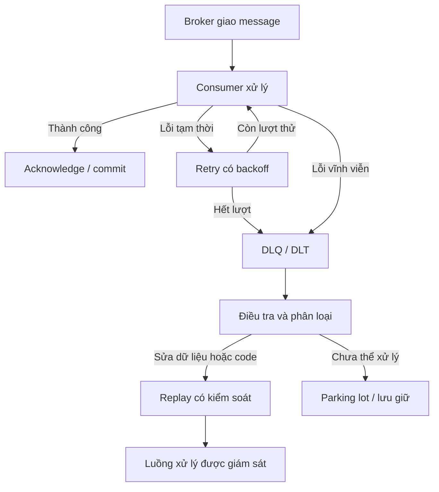

# Chặn vòng lặp thử lại và cô lập thông điệp gây lỗi lặp lại

Trong hệ thống xử lý sự kiện, một message có thể thất bại vì dịch vụ phụ thuộc tạm thời không sẵn sàng, dữ liệu không hợp lệ hoặc lỗi lập trình. Thử lại giúp khắc phục lỗi tạm thời, nhưng nếu message luôn thất bại mà liên tục được giao lại, nó có thể tạo vòng lặp retry, tiêu tốn tài nguyên và làm chậm các message khác. Một message độc hại hoặc không thể xử lý theo hợp đồng hiện tại thường được gọi là *poison message*.

Spring Cloud Stream cung cấp retry và tích hợp với cơ chế dead-letter của binder để giới hạn số lần thử và cô lập message lỗi. Thiết kế tốt cần phân loại lỗi, giới hạn retry, đặt backoff, chuyển message không thể xử lý sang DLQ/DLT hoặc parking lot, rồi cung cấp quy trình điều tra và phát lại có kiểm soát. Cấu hình cụ thể khác nhau giữa Kafka, RabbitMQ và Pulsar; không có một thiết lập chung bảo đảm cùng ngữ nghĩa trên mọi broker.

## 1. Vì sao vòng lặp retry xuất hiện?

Giả sử một consumer nhận sự kiện `OrderPlaced` và gọi dịch vụ kho để giữ hàng. Nếu dịch vụ kho tạm thời mất kết nối, thử lại sau một khoảng chờ có thể thành công. Nhưng nếu message thiếu `orderId` hoặc chứa schema không hỗ trợ, mọi lần thử đều thất bại như nhau.

Một vòng lặp có thể hình thành khi:

1. Broker giao message cho consumer.
2. Consumer xử lý và ném exception.
3. Framework thử lại theo chính sách retry.
4. Hết retry, message bị từ chối hoặc được giao lại theo cơ chế broker.
5. Broker tiếp tục giao cùng message.
6. Consumer lại thực hiện cùng thao tác và thất bại.

Nếu broker requeue hoặc redelivery vô hạn mà không có giới hạn, cùng một message có thể chiếm consumer liên tục. Các message hợp lệ phía sau có thể bị trì hoãn, backlog tăng và log bị lặp.

Cần phân biệt hai lớp thử lại:

- **Retry trong ứng dụng/framework**: cùng một lần nhận có thể gọi lại handler nhiều lần trước khi quyết định kết quả cuối.
- **Redelivery của broker**: broker giao lại message sau khi consumer từ chối, mất kết nối hoặc chưa ghi nhận acknowledgement/offset.

Nếu cả hai lớp đều retry mà không tính tổng số lần giao, số lần xử lý thực tế có thể lớn hơn dự kiến. Chính sách cần xác định rõ lớp nào chịu trách nhiệm retry và khi nào message được chuyển sang nơi lưu lỗi.

## 2. Phân loại lỗi trước khi cấu hình retry

Không phải lỗi nào cũng nên thử lại. Hãy phân loại theo khả năng khắc phục:

| Loại lỗi | Ví dụ | Hướng xử lý |
|---|---|---|
| Lỗi tạm thời | Timeout dịch vụ kho, database tạm mất kết nối, giới hạn tốc độ ngắn hạn | Retry có giới hạn và backoff |
| Lỗi dữ liệu vĩnh viễn | Thiếu trường bắt buộc, định dạng sai, event version không hỗ trợ | Không retry nhiều lần; chuyển DLQ/DLT |
| Lỗi nghiệp vụ không thể tự khắc phục | Đơn hàng đã bị hủy, trạng thái không cho phép chuyển tiếp | Tùy hợp đồng: từ chối có kiểm soát hoặc cô lập để điều tra |
| Lỗi cấu hình/hạ tầng kéo dài | Sai credential, topic/queue không tồn tại, quyền truy cập bị thu hồi | Dừng hoặc giảm retry, cảnh báo vận hành và sửa cấu hình |
| Lỗi lập trình | Null pointer, lỗi mapping, bug trong handler | Giới hạn retry, cô lập message và sửa ứng dụng |

Retry chỉ hữu ích nếu có khả năng trạng thái bên ngoài thay đổi theo thời gian. Nếu message không thể được xử lý do schema sai, chờ thêm vài giây không làm dữ liệu hợp lệ hơn.

Có thể định nghĩa exception theo ý nghĩa:

```java
public class TransientInventoryException extends RuntimeException {
    public TransientInventoryException(String message, Throwable cause) {
        super(message, cause);
    }
}

public class InvalidOrderEventException extends RuntimeException {
    public InvalidOrderEventException(String message) {
        super(message);
    }
}
```

Handler nên phát sinh exception phù hợp thay vì bắt tất cả lỗi rồi bỏ qua:

```java
@Bean
Consumer<OrderPlaced> reserveInventory(InventoryService inventory) {
    return event -> {
        if (event.orderId() == null || event.orderId().isBlank()) {
            throw new InvalidOrderEventException("orderId is required");
        }

        inventory.reserve(event);
    };
}
```

Lỗi dữ liệu được phân loại rõ để chính sách retry có thể tránh lặp lại vô ích. Lỗi từ dịch vụ kho cần được chuyển thành exception tạm thời nếu thực sự có thể khắc phục bằng lần thử tiếp theo.

## 3. Giới hạn số lần thử trong Spring Cloud Stream

Consumer binding hỗ trợ các thuộc tính retry chung. Ví dụ:

```yaml
spring:
  cloud:
    function:
      definition: reserveInventory
    stream:
      bindings:
        reserveInventory-in-0:
          destination: orders.placed
          group: inventory-service
          consumer:
            max-attempts: 4
            back-off-initial-interval: 1000
            back-off-max-interval: 10000
            back-off-multiplier: 2.0
```

Ý nghĩa:

- `max-attempts`: số lần xử lý tối đa cho một message trong cơ chế retry của framework, bao gồm lần xử lý đầu tiên.
- `back-off-initial-interval`: khoảng chờ ban đầu giữa các lần thử.
- `back-off-max-interval`: giới hạn trên của khoảng chờ.
- `back-off-multiplier`: hệ số tăng khoảng chờ sau mỗi lần thất bại.

Với cấu hình ví dụ, message được thử tối đa bốn lần ở tầng retry này. Khoảng chờ tăng dần theo backoff và bị giới hạn ở giá trị tối đa. Giá trị thực tế cần chọn theo timeout của dịch vụ phụ thuộc và thời gian message có thể chờ.

Không đặt `max-attempts` quá lớn chỉ để tránh đưa message vào DLQ. Retry dài có thể giữ message lỗi lâu, chiếm tài nguyên consumer và kéo dài thời gian xử lý message khác. Một số binder còn có cơ chế redelivery riêng; cần xem tổng số lần giao có thể xảy ra thay vì chỉ nhìn `max-attempts`.

### Chọn backoff

Retry liên tục không có khoảng chờ có thể tạo *retry storm*: nhiều consumer cùng gọi lại một dịch vụ đang quá tải, khiến dịch vụ càng khó phục hồi.

Backoff tăng dần giúp giảm áp lực:

```text
Lần thử 1: thất bại
       |
       +-- chờ 1 giây
Lần thử 2: thất bại
       |
       +-- chờ 2 giây
Lần thử 3: thất bại
       |
       +-- chờ 4 giây
Lần thử 4: thất bại
       |
       +-- hết số lần thử -> chuyển sang error handling / DLQ
```

Trong hệ thống có nhiều consumer, có thể bổ sung jitter ở tầng retry phù hợp để tránh mọi instance cùng retry vào một thời điểm. Cần xác minh cơ chế retry được dùng có hỗ trợ jitter hay không; không tự giả định thuộc tính chung của Spring Cloud Stream có một khóa jitter dùng chung cho mọi binder.

## 4. Chỉ retry các exception có khả năng phục hồi

Nếu mọi exception đều được retry, lỗi dữ liệu sẽ tạo tải không cần thiết. Có thể cấu hình danh sách exception có thể retry theo thuộc tính consumer của Spring Cloud Stream. Ví dụ dưới đây minh họa ý định: chỉ retry lỗi dịch vụ tạm thời, còn lỗi dữ liệu được xử lý ngay theo error path.

```yaml
spring:
  cloud:
    stream:
      bindings:
        reserveInventory-in-0:
          consumer:
            max-attempts: 4
            default-retryable: false
            retryable-exceptions:
              com.example.TransientInventoryException: true
              com.example.InvalidOrderEventException: false
```

Cấu hình map exception cần dùng tên lớp đầy đủ và phải được kiểm tra với phiên bản Spring Cloud Stream trong dự án. Khi `default-retryable` là `false`, các exception không được liệt kê không tự động được retry theo chính sách này.

Một nguyên tắc hữu ích là không dùng exception quá tổng quát cho mọi lỗi. Nếu một client ném `RuntimeException` cho cả timeout và lỗi dữ liệu, adapter nên phân loại hoặc bọc exception để retry policy có đủ thông tin. Không nên retry lỗi xác thực, lỗi quyền truy cập hoặc payload sai định dạng như thể đó là lỗi mạng tạm thời.

## 5. Dead-letter queue và dead-letter topic

Khi message đã hết số lần retry hoặc không thể xử lý, có thể chuyển nó sang một đích lưu lỗi riêng:

- **DLQ (Dead-Letter Queue)** thường dùng trong mô hình queue như RabbitMQ.
- **DLT (Dead-Letter Topic)** thường dùng trong hệ thống topic như Kafka.
- Trong một số tài liệu hoặc binder, thuật ngữ DLQ được dùng chung cho đích dead-letter, kể cả khi broker gọi tài nguyên đó là topic.

Mục tiêu của DLQ/DLT là cô lập message lỗi khỏi luồng chính để consumer tiếp tục xử lý message hợp lệ. Message lỗi cần giữ đủ thông tin để điều tra và quyết định có phát lại hay không.

Một dead-letter record thường cần giữ hoặc bổ sung:

- Payload gốc và content type/schema version.
- Event ID và correlation ID.
- Destination nguồn và group/subscription liên quan.
- Thời điểm nhận hoặc chuyển sang dead-letter.
- Exception class và thông tin lỗi có ích.
- Số lần giao/thử lại nếu binder cung cấp.
- Metadata cần để phục hồi hoặc phát lại message.

Không đưa secret, access token hoặc dữ liệu nhạy cảm vào header lỗi. Nếu payload chứa dữ liệu cá nhân hoặc thông tin nhạy cảm, DLQ phải có quyền truy cập, thời hạn lưu và audit phù hợp.

DLQ không tự sửa message. Nó chỉ tạo một nơi cô lập để vận hành có thể điều tra, sửa dữ liệu hoặc ứng dụng, rồi phát lại có kiểm soát.

## 6. Cấu hình dead-letter với Kafka binder

Với Kafka binder, dead-letter topic thường được bật cho consumer binding có group. Ví dụ cấu hình:

```yaml
spring:
  cloud:
    function:
      definition: reserveInventory
    stream:
      bindings:
        reserveInventory-in-0:
          destination: orders.placed
          group: inventory-service
          consumer:
            max-attempts: 3
      kafka:
        bindings:
          reserveInventory-in-0:
            consumer:
              enable-dlq: true
              dlq-name: orders.placed.inventory-service.dlq
```

Kafka binder dùng consumer group để quản lý việc đọc topic và định tuyến message lỗi sang dead-letter topic khi cơ chế DLQ được bật. Các thuộc tính như số partition của DLT, producer properties cho DLT và quyền tạo topic phụ thuộc phiên bản binder và môi trường triển khai. Nếu DLT cần nhiều partition hoặc được quản lý thủ công, hãy cấu hình/provision theo tài liệu binder.

Khi message thất bại, binder cần ghi nhận lỗi theo chính sách retry và chuyển record tới DLT. Cần kiểm tra quyền ghi của producer tới DLT; nếu không thể ghi dead-letter, message có thể tiếp tục gây lỗi ở đường consumer. Không chỉ bật `enable-dlq` rồi giả định tài nguyên đã sẵn sàng trong mọi môi trường.

## 7. Cấu hình dead-letter với Rabbit binder

RabbitMQ sử dụng exchange và queue. Rabbit binder có thể tự khai báo dead-letter exchange và queue cho consumer group. Ví dụ:

```yaml
spring:
  cloud:
    function:
      definition: reserveInventory
    stream:
      bindings:
        reserveInventory-in-0:
          destination: orders
          group: inventory-service
          consumer:
            max-attempts: 3
      rabbit:
        bindings:
          reserveInventory-in-0:
            consumer:
              auto-bind-dlq: true
              republish-to-dlq: true
```

`auto-bind-dlq` yêu cầu binder tạo/bind cấu trúc dead-letter theo quy tắc của nó. `republish-to-dlq` cho phép binder republish message lỗi cùng thông tin exception vào dead-letter destination theo khả năng của binder. Tên exchange, queue, routing key, TTL và các thuộc tính queue có thể cấu hình riêng.

Cần phân biệt dead-letter do broker và republish do binder:

- RabbitMQ có thể dead-letter message khi message bị reject/nack không requeue, hết TTL hoặc queue vượt giới hạn theo cấu hình.
- Binder có thể bắt lỗi xử lý rồi republish message cùng metadata lỗi sang DLQ.
- Consumer acknowledgement và requeue policy quyết định message gốc được xác nhận, trả lại queue hay dead-letter.

Không bật requeue vô hạn cho message lỗi vĩnh viễn. Cần xác minh cấu hình `requeueRejected`, acknowledgement mode và cách binder áp dụng retry trong phiên bản đang dùng. Nếu binder republish sang DLQ, cần bảo đảm ứng dụng có quyền publish và DLQ được khai báo đúng.

## 8. Pulsar và dead-letter policy

Pulsar quản lý subscription, acknowledgement và redelivery. Consumer có thể cấu hình negative acknowledgement hoặc acknowledgement timeout; subscription có thể dùng dead-letter policy để chuyển message sau số lần redelivery được giới hạn sang dead-letter topic.

Khái niệm quan trọng:

- **Negative acknowledgement**: consumer báo message chưa xử lý thành công và yêu cầu broker giao lại theo chính sách.
- **Acknowledgement timeout**: message chưa được ack trong thời gian cấu hình có thể được giao lại.
- **Dead-letter policy**: đặt giới hạn redelivery và đích dead-letter topic.
- **Retry letter topic**: một số mô hình dùng topic riêng để trì hoãn và quản lý retry trước khi chuyển sang dead-letter.

Với Spring Cloud Stream Pulsar binder, tên thuộc tính và khả năng cấu hình phụ thuộc phiên bản binder và Pulsar client. Hãy xác minh cách binder ánh xạ group thành subscription, cách cấu hình dead-letter policy và liệu binder tự tạo topic hay yêu cầu provision trước. Không sao chép cấu hình Kafka `enable-dlq` hoặc Rabbit `auto-bind-dlq` sang Pulsar.

Dù broker có redelivery policy, consumer vẫn nên idempotent. Message có thể được giao lại nếu xử lý thành công nhưng acknowledgement bị mất hoặc timeout xảy ra.

## 9. Poison message và parking lot

Một poison message là message liên tục gây lỗi và không thể xử lý bằng retry thông thường. DLQ cô lập message để luồng chính không bị mắc kẹt. Với hệ thống cần quy trình vận hành nghiêm ngặt, có thể thêm một **parking lot** sau DLQ.

Luồng xử lý gợi ý:



Parking lot có thể là một topic/queue riêng hoặc kho lưu trữ vận hành. Nó phù hợp khi message cần được giữ lại lâu hơn DLQ thông thường hoặc phải chờ quyết định nghiệp vụ. Không phát lại liên tục message từ parking lot vào luồng chính nếu nguyên nhân chưa được khắc phục.

Một quy trình xử lý poison message nên có:

1. Cảnh báo khi DLQ tăng hoặc một event ID xuất hiện nhiều lần.
2. Tra cứu payload, schema version, exception và nguồn phát.
3. Xác định lỗi dữ liệu, lỗi tương thích, lỗi nghiệp vụ hay lỗi code.
4. Sửa dữ liệu hoặc triển khai phiên bản consumer có thể xử lý.
5. Chọn replay toàn bộ hay chỉ các message đã được duyệt.
6. Giới hạn tốc độ replay để tránh tạo tải đột biến.
7. Theo dõi kết quả replay và giữ audit trail.

## 10. Không tạo thêm vòng lặp retry ở tầng ứng dụng

Một nguyên nhân phổ biến gây retry storm là cùng một thao tác được retry ở nhiều lớp:

- HTTP client tự retry.
- Service nghiệp vụ có vòng lặp retry riêng.
- Spring Cloud Stream retry handler.
- Broker redelivery.
- Job vận hành phát lại DLQ.

Ví dụ, nếu HTTP client thử ba lần, framework thử bốn lần và broker giao lại năm lần, một message có thể kích hoạt nhiều lần gọi downstream hơn dự kiến. Cần lập bản đồ tất cả retry layer và đặt ngân sách tổng thể.

Nguyên tắc thiết kế:

- Chỉ retry tại lớp có đủ thông tin để phân biệt lỗi tạm thời và vĩnh viễn.
- Đặt timeout cho mỗi lần gọi và deadline tổng thể cho một message.
- Tránh lồng retry không giới hạn.
- Dùng backoff và jitter khi nhiều instance có thể retry đồng thời.
- Giữ event ID ổn định qua các lần retry.
- Đảm bảo thao tác nghiệp vụ idempotent.
- Đưa message vượt ngân sách retry vào DLQ hoặc parking lot.

Không nên bắt exception trong function rồi trả về bình thường nếu message chưa được xử lý. Điều đó có thể khiến framework/binder coi message đã thành công và không chạy retry hoặc DLQ như mong muốn.

## 11. Idempotency khi message được giao lại

Retry và redelivery có nghĩa cùng một message có thể được xử lý nhiều lần. Consumer cần bảo đảm xử lý lặp không tạo tác dụng phụ trùng.

Một cách phổ biến là lưu event ID đã xử lý trong cùng transaction với thay đổi nghiệp vụ:

```java
@Service
public class OrderEventHandler {

    private final ProcessedEventRepository processedEvents;
    private final OrderRepository orders;

    public OrderEventHandler(
            ProcessedEventRepository processedEvents,
            OrderRepository orders) {
        this.processedEvents = processedEvents;
        this.orders = orders;
    }

    @Transactional
    public void handle(OrderPlaced event) {
        if (processedEvents.existsById(event.eventId())) {
            return;
        }

        orders.apply(event);
        processedEvents.save(
            new ProcessedEvent(event.eventId())
        );
    }
}
```

Ví dụ giả định cập nhật đơn hàng và ghi nhận event ID cùng nằm trong một transaction database, event ID có unique constraint. Nếu hai consumer có thể xử lý đồng thời cùng event, cần xử lý xung đột unique constraint một cách rõ ràng. Kiểm tra tồn tại trước khi ghi không tự ngăn race condition.

Nếu thao tác gọi dịch vụ bên ngoài không tham gia transaction database, hãy dùng idempotency key do dịch vụ đó hỗ trợ hoặc ghi trạng thái xử lý theo một workflow có thể phục hồi. Không thể dựa vào transaction cục bộ để bảo đảm exactly-once xuyên qua broker và mọi dịch vụ bên ngoài.

## 12. Replay DLQ an toàn

Phát lại DLQ là một thao tác vận hành, không phải hành động tự động lặp lại vô hạn. Trước khi replay:

- Xác định nguyên nhân lỗi đã được sửa.
- Xác minh consumer mới hỗ trợ schema version của message.
- Giữ nguyên event ID và thông tin nguồn để deduplication hoạt động.
- Chọn phạm vi message cần replay theo event ID, thời gian hoặc loại lỗi.
- Chạy thử với số lượng nhỏ và tốc độ giới hạn.
- Theo dõi lỗi mới, duplicate và tác động nghiệp vụ.
- Ghi lại người thực hiện, thời điểm, lý do và kết quả.

Nếu message lỗi do dữ liệu sai, cần sửa theo quy trình có audit hoặc chuyển sang luồng xử lý thủ công. Không chỉnh payload âm thầm trong DLQ mà không ghi lại thay đổi. Nếu message đã được xử lý một phần, phải kiểm tra trạng thái nghiệp vụ trước khi replay để tránh thực hiện tác dụng phụ lần nữa.

## 13. Kiểm thử retry, DLQ và poison message

Nên kiểm thử các trường hợp:

1. Lỗi tạm thời ở lần đầu, thành công ở lần sau.
2. Lỗi kéo dài đến khi hết `max-attempts`.
3. Lỗi dữ liệu vĩnh viễn không bị retry nhiều lần.
4. Message được chuyển sang đúng DLQ/DLT.
5. DLQ không khả dụng hoặc producer không có quyền ghi.
6. Consumer restart trong khi message đang được xử lý.
7. Broker redelivery cùng event ID.
8. Replay DLQ sau khi sửa nguyên nhân.
9. Nhiều lớp retry không nhân số lần gọi vượt ngân sách.
10. Message lớn hoặc schema không hỗ trợ được cô lập và quan sát đúng.

Unit test có thể xác minh phân loại exception và logic idempotency. Spring Cloud Stream Test Binder giúp kiểm tra wiring/error handling ở mức ứng dụng, nhưng không thay thế broker thật. Dùng Testcontainers hoặc môi trường integration riêng để xác minh Kafka DLT, Rabbit dead-letter exchange/queue hoặc Pulsar dead-letter policy.

Khi test số lần thử, hãy xác minh số lần handler thực sự được gọi và phân biệt retry của framework với redelivery của broker. Đừng chỉ kiểm tra một log message vì log có thể được ghi nhiều lần ở các lớp khác nhau.

## 14. Checklist production

- Phân loại exception thành tạm thời, vĩnh viễn và lỗi cấu hình/lập trình.
- Đặt `max-attempts` hữu hạn và backoff có giới hạn.
- Không retry lỗi dữ liệu hoặc lỗi nghiệp vụ không thể tự khắc phục.
- Kiểm tra các lớp retry của HTTP client, service, framework và broker để tránh nhân số lần thử.
- Bật và provision DLQ/DLT phù hợp với binder.
- Đảm bảo consumer group/subscription ổn định và có quyền ghi dead-letter destination.
- Giữ event ID, content type, schema version và metadata chẩn đoán cần thiết.
- Cấu hình retention, TTL, quyền truy cập và cảnh báo cho DLQ.
- Thiết kế consumer idempotent để chịu được redelivery và replay.
- Xây dựng quy trình điều tra, sửa lỗi, replay và audit.
- Kiểm thử broker thật cho retry exhaustion, DLQ failure và poison message.

## 15. Tài liệu tham khảo

- [Spring Cloud Stream Reference — Consumer Properties](https://docs.spring.io/spring-cloud-stream/reference/spring-cloud-stream/binding-properties.html), phần retry và consumer binding properties.
- [Spring Cloud Stream Kafka Binder](https://docs.spring.io/spring-cloud-stream/reference/kafka/kafka-binder/index.html), phần dead-letter topic và consumer error handling.
- [Spring Cloud Stream Rabbit Binder](https://docs.spring.io/spring-cloud-stream/reference/rabbit/rabbit_overview.html), phần dead-letter exchange/queue và retry.
- [Apache Pulsar Documentation — Messaging](https://pulsar.apache.org/docs/), phần negative acknowledgement, redelivery và dead-letter policy.

Retry có giới hạn giúp xử lý lỗi tạm thời; DLQ/DLT cô lập message không thể xử lý để luồng chính tiếp tục tiến triển. Chặn vòng lặp cần phối hợp phân loại exception, ngân sách retry, backoff, chính sách redelivery của broker và idempotency. Khi có cảnh báo, quy trình replay và kiểm thử broker thật, poison message có thể được điều tra và phục hồi mà không làm hệ thống mắc kẹt trong vòng lặp vô hạn.

