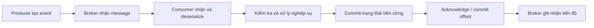
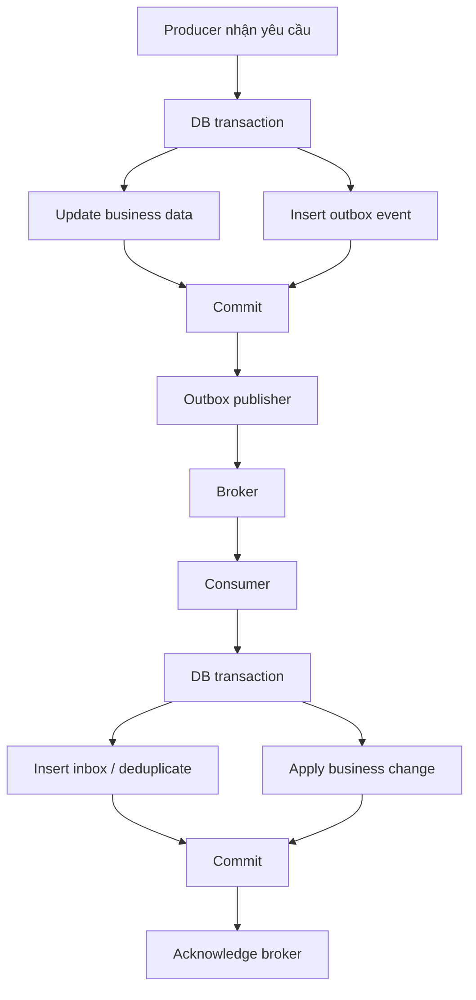

# Xác định điểm hoàn tất nghiệp vụ và thời điểm xác nhận

Trong ứng dụng Spring Cloud Stream, nhận được message chưa có nghĩa là nghiệp vụ đã hoàn tất. Một consumer có thể đã đọc và deserialize message nhưng chưa ghi dữ liệu; có thể đã ghi database nhưng chưa xác nhận với broker; hoặc đã gọi một dịch vụ ngoài nhưng chưa biết kết quả cuối cùng. Muốn giao nhận đáng tin cậy, nhóm phải định nghĩa chính xác thế nào là “xử lý xong” và chỉ xác nhận message sau khi đạt điểm hoàn tất đó.

Điểm hoàn tất nghiệp vụ phụ thuộc vào tác động mà message đại diện. Với sự kiện `OrderCreated`, có thể đó là lúc trạng thái giữ hàng và dấu đã xử lý được commit trong cùng transaction database. Với một lệnh gửi email, có thể đó là lúc nhà cung cấp email chấp nhận yêu cầu và mã yêu cầu được lưu bền vững. Với một quy trình nhiều dịch vụ, không có một transaction cục bộ duy nhất bao phủ toàn bộ quy trình; mỗi bước cần ghi nhận trạng thái và có khả năng tiếp tục hoặc bù trừ.

Acknowledgement là tín hiệu cho broker hoặc message source biết consumer đã xử lý đến một mức nhất định. Nó không tự tạo transaction phân tán với database, không chứng minh một dịch vụ ngoài đã hoàn thành và không tự bảo đảm exactly-once. Vì vậy, thiết kế đúng cần kết hợp điểm hoàn tất rõ ràng, thời điểm ack phù hợp, idempotency và cơ chế phục hồi.

## 1. Phân biệt các mốc trong vòng đời message

Một message thường đi qua nhiều mốc khác nhau:



Các mốc không thể thay thế cho nhau:

| Mốc | Ý nghĩa | Chưa chứng minh điều gì? |
|---|---|---|
| Producer gọi `send` | Ứng dụng yêu cầu gửi message | Broker đã lưu bền vững hay consumer đã nhận |
| Producer nhận kết quả gửi/confirm | Broker hoặc client xác nhận theo cơ chế producer đang dùng | Consumer đã xử lý nghiệp vụ |
| Consumer nhận message | Bytes đã tới consumer | Payload hợp lệ hoặc nghiệp vụ đã hoàn tất |
| Deserialize thành công | Có thể tạo object Java theo kiểu đích | Dữ liệu hợp lệ về nghiệp vụ |
| Handler trả về bình thường | Mã handler đã kết thúc theo luồng ứng dụng | Database/external side effect đã commit nếu chúng được chạy bất đồng bộ |
| Database transaction commit | Trạng thái nằm trong ranh giới transaction đã bền vững theo database | Broker đã ghi nhận acknowledgement |
| Consumer ack/offset commit | Broker ghi nhận tiến độ theo ngữ nghĩa của nó | Các side effect bên ngoài transaction đó đã hoàn tất |

Đặc biệt, `StreamBridge.send(...)` trả về `true` chỉ cho biết thao tác gửi được chấp nhận theo hợp đồng của channel. Kết quả đó không phải consumer acknowledgement. Tương tự, log “message received” không phải bằng chứng nghiệp vụ đã được cập nhật.

## 2. Định nghĩa điểm hoàn tất nghiệp vụ

Trước khi chọn ack mode, hãy viết một câu mô tả điều kiện để message được coi là xử lý xong. Câu đó cần nói rõ dữ liệu nào đã được ghi, tác động nào đã được thực hiện và điều kiện nào phải đúng.

Ví dụ:

| Message | Điểm hoàn tất có thể chọn | Bằng chứng cần lưu |
|---|---|---|
| `OrderCreated` | Giữ hàng thành công hoặc đơn hàng được chuyển sang trạng thái từ chối có lý do | Trạng thái đơn hàng, thay đổi tồn kho và `eventId` đã xử lý |
| `PaymentRequested` | Nhà cung cấp thanh toán đã chấp nhận yêu cầu hoặc giao dịch được ghi nhận là cần đối soát | Provider reference, idempotency key và trạng thái payment |
| `InvoiceGenerated` | File hóa đơn đã được lưu bền vững và metadata hóa đơn đã commit | File reference, checksum và bản ghi hóa đơn |
| `NotificationRequested` | Nhà cung cấp thông báo đã chấp nhận yêu cầu gửi | Provider message ID và trạng thái gửi |
| `InventorySnapshot` | Snapshot hợp lệ đã được ghi vào kho dữ liệu đích | Version, timestamp và checksum của snapshot |

Không phải mọi kết quả đều là “thành công”. Một message có thể hoàn tất hợp lệ bằng cách từ chối nghiệp vụ, cách ly dữ liệu sai hoặc ghi nhận trạng thái cần người xử lý. Điểm quan trọng là kết quả đó phải được lưu bền vững và có thể kiểm tra trước khi xác nhận message gốc.

Một định nghĩa hữu ích nên trả lời bốn câu hỏi:

1. Tác động nghiệp vụ nào phải xảy ra?
2. Tác động đó được lưu ở đâu và khi nào transaction commit?
3. Nếu cùng `eventId` được giao lại, làm sao biết đã hoàn tất?
4. Nếu không thể hoàn tất, message sẽ retry, requeue, vào DLQ hay chuyển sang quy trình bù trừ?

## 3. Quy tắc cơ bản: commit nghiệp vụ trước, ack sau

Với consumer đồng bộ cập nhật một database, thứ tự thường dùng là:

1. Nhận message và kiểm tra schema/dữ liệu.
2. Bắt đầu transaction database.
3. Áp dụng thay đổi nghiệp vụ và lưu dấu `eventId` đã xử lý.
4. Commit transaction.
5. Để binder xác nhận message hoặc thực hiện ack theo cơ chế được cấu hình.

Ví dụ function consumer gọi service transactional:

```java
@Bean
Consumer<OrderCreated> handleOrder(InventoryService inventoryService) {
    return event -> inventoryService.reserveOnce(event);
}

@Service
public class InventoryService {
    private final ProcessedEventRepository processedEvents;
    private final InventoryRepository inventory;

    public InventoryService(
            ProcessedEventRepository processedEvents,
            InventoryRepository inventory) {
        this.processedEvents = processedEvents;
        this.inventory = inventory;
    }

    @Transactional
    public void reserveOnce(OrderCreated event) {
        if (processedEvents.existsById(event.eventId())) {
            return;
        }

        int updated = inventory.reserveIfAvailable(
                event.productId(), event.quantity());
        if (updated != 1) {
            throw new InsufficientInventoryException(event.productId());
        }

        processedEvents.save(new ProcessedEvent(event.eventId()));
    }
}
```

Ví dụ giả định `reserveIfAvailable` thực hiện cập nhật có điều kiện trong database và trả về số dòng được cập nhật. Bảng `processed_event` cần unique constraint trên `event_id`; kiểm tra `existsById` một mình không ngăn được hai transaction đồng thời cùng xử lý một event. Có thể dùng insert có điều kiện, bắt lỗi unique constraint hoặc cơ chế inbox tương ứng để xử lý race condition.

Transaction phải commit trước khi phương thức nghiệp vụ trả về thành công. Cần bảo đảm `@Transactional` được áp dụng qua Spring proxy đúng cách, không gọi self-invocation làm bỏ qua proxy và không đưa công việc sang thread khác bên trong transaction rồi giả định thread mới dùng chung transaction.

Với message-driven consumer thông thường, binder quản lý acknowledgement dựa trên cơ chế của binding và broker. Không tự thêm ack thủ công nếu binder đang quản lý commit/ack, trừ khi cấu hình và API của binder yêu cầu. Hãy kiểm tra acknowledgement mode thực tế và xác minh bằng integration test.

## 4. Điều gì xảy ra nếu ack quá sớm?

Nếu consumer xác nhận message trước khi trạng thái nghiệp vụ được commit, có thể xảy ra mất xử lý:

1. Consumer nhận `OrderCreated`.
2. Consumer ack message.
3. Process dừng trước khi ghi tồn kho.
4. Broker coi message đã hoàn tất và không giao lại theo tiến độ đã xác nhận.
5. Đơn hàng tồn tại nhưng tồn kho chưa được giữ.

Đây là khoảng trống giữa acknowledgement và tác động nghiệp vụ. Ack sớm chỉ phù hợp khi message đã được chuyển an toàn sang một nơi lưu trữ bền vững khác, nơi sẽ chịu trách nhiệm xử lý tiếp. Ví dụ, nếu consumer ghi message vào inbox table rồi commit transaction, có thể ack broker sau khi inbox đã được lưu; một worker khác xử lý inbox theo trạng thái. Chỉ đưa message vào một executor hoặc hàng đợi trong bộ nhớ không phải chuyển giao bền vững.

Với xử lý bất đồng bộ, không ack ngay sau khi submit task:

```java
// Không an toàn: task chỉ được xếp vào executor, chưa hoàn tất nghiệp vụ.
processingExecutor.execute(() -> inventoryService.reserveOnce(event));
// Nếu callback/binder ack tại đây, process crash có thể làm mất task đang nằm trong RAM.
```

Nếu cần tách nhận message khỏi xử lý lâu dài, hãy ghi payload và metadata vào inbox/durable work table trong transaction, sau đó ack. Worker đọc các bản ghi chưa xử lý từ database và cập nhật trạng thái hoàn tất bằng transaction riêng.

## 5. Điều gì xảy ra nếu ack quá muộn?

Nếu nghiệp vụ đã commit nhưng consumer dừng trước khi broker nhận acknowledgement, broker có thể giao lại message. Đây là cửa sổ duplicate thường gặp trong mô hình at-least-once.

Ví dụ:

1. Consumer nhận `evt-101`.
2. Database commit thay đổi tồn kho và ghi `evt-101` vào bảng đã xử lý.
3. Process dừng trước khi ack broker.
4. Sau restart, broker giao lại `evt-101`.
5. Consumer kiểm tra inbox/processed event, nhận ra event đã hoàn tất và không áp dụng thay đổi lần nữa.
6. Consumer xác nhận message được giao lại.

Vì vậy, mục tiêu thực tế thường là **at-least-once delivery kết hợp xử lý idempotent**, thay vì giả định message chỉ được giao đúng một lần. Redelivery không nhất thiết là lỗi của broker; nó là hệ quả bình thường khi broker không thể biết chắc consumer đã hoàn tất tới đâu sau một sự cố mạng hoặc process.

## 6. Idempotency và Inbox pattern

Idempotency nghĩa là xử lý cùng một yêu cầu hoặc sự kiện nhiều lần vẫn không tạo thêm tác động nghiệp vụ ngoài kết quả mong muốn. Để làm được điều đó, producer cần phát một `eventId` ổn định và consumer cần lưu dấu xử lý bền vững.

Một bảng inbox đơn giản có thể gồm:

| Cột | Mục đích |
|---|---|
| `event_id` | Khóa duy nhất để nhận diện sự kiện |
| `event_type` | Loại sự kiện |
| `received_at` | Thời điểm consumer ghi nhận |
| `status` | `RECEIVED`, `PROCESSING`, `COMPLETED` hoặc `FAILED` theo thiết kế |
| `payload_ref` | Tham chiếu tới payload nếu cần lưu riêng |
| `processed_at` | Thời điểm hoàn tất nghiệp vụ |
| `failure_reason` | Nguyên nhân thất bại đã phân loại |

Với tác động nằm trong cùng database, inbox record và thay đổi nghiệp vụ nên được cập nhật trong cùng transaction. Có thể dùng unique constraint trên `event_id` để hai consumer không cùng tạo hai bản ghi cho một sự kiện.

```java
@Transactional
public ProcessingResult processOnce(OrderCreated event) {
    if (inboxRepository.existsByEventId(event.eventId())) {
        return ProcessingResult.ALREADY_COMPLETED;
    }

    inboxRepository.insertReceived(event.eventId(), "OrderCreated");
    inventoryRepository.reserveIfAvailable(event.productId(), event.quantity());
    inboxRepository.markCompleted(event.eventId(), Instant.now());
    return ProcessingResult.COMPLETED;
}
```

Đây là ví dụ rút gọn. Trong hệ thống đồng thời, `insertReceived` phải dựa vào unique constraint và xử lý xung đột duplicate một cách xác định. Nếu transaction rollback, cả dấu inbox và thay đổi tồn kho cùng rollback. Nếu transaction commit, lần giao lại có thể nhận ra event đã hoàn tất.

Không nên dùng cache hoặc `ConcurrentHashMap` làm inbox nghiệp vụ. Cache có thể mất khi restart, không chia sẻ giữa nhiều instance và không đồng bộ với transaction database.

## 7. Producer confirm và consumer acknowledgement là hai hướng khác nhau

Một hệ thống có ít nhất hai chiều xác nhận:

| Cơ chế | Ai xác nhận cho ai? | Câu hỏi được trả lời |
|---|---|---|
| Producer confirm/send result | Broker/client phản hồi cho producer | Broker có nhận hoặc xác nhận việc publish theo cơ chế đã cấu hình không? |
| Consumer acknowledgement/offset commit | Consumer báo cho broker | Consumer đã xử lý đến vị trí nào theo ngữ nghĩa broker? |

Producer confirm không chứng minh consumer đã xử lý message. Consumer ack cũng không chứng minh producer đã lưu thay đổi nghiệp vụ ban đầu một cách nguyên tử với việc publish.

Ví dụ, một service cập nhật đơn hàng trong database rồi gửi `OrderCreated`. Nếu process dừng sau database commit nhưng trước publish, database có đơn hàng nhưng broker không có event. Nếu publish trước rồi database rollback, consumer có thể xử lý một event không có trạng thái tương ứng trong hệ thống nguồn.

Đây là bài toán dual-write. Với sự kiện quan trọng, transactional outbox giúp giải quyết bằng cách ghi thay đổi nghiệp vụ và bản ghi outbox trong cùng transaction database. Publisher đọc outbox, gửi message và đánh dấu đã phát sau khi nhận kết quả gửi phù hợp. Nếu publisher dừng sau khi broker nhận message nhưng trước khi đánh dấu outbox, message có thể được gửi lại; consumer vẫn cần idempotency.

## 8. Outbox và Inbox phối hợp như thế nào?

Outbox giải quyết độ tin cậy ở phía phát; inbox/idempotency giải quyết xử lý trùng ở phía nhận.



Trong sơ đồ:

- Producer commit dữ liệu nghiệp vụ và outbox cùng lúc.
- Outbox publisher có thể retry khi broker chưa xác nhận gửi.
- Consumer lưu dấu event và tác động nghiệp vụ trong transaction.
- Consumer ack sau khi transaction commit.
- Nếu message được giao lại, inbox nhận diện event đã xử lý và consumer có thể ack mà không lặp side effect.

Outbox không tự bảo đảm message chỉ được publish một lần. Nó bảo đảm event không bị tách khỏi transaction tạo ra nó; publisher vẫn có thể phát trùng khi không xác định được kết quả gửi sau lỗi mạng. Inbox/idempotency hoàn thiện phía nhận.

## 9. Khi nghiệp vụ gọi dịch vụ ngoài database

Một transaction database không thể tự rollback email đã gửi, lệnh thanh toán đã chấp nhận hoặc file đã ghi lên object storage. Cần xác định điểm hoàn tất phù hợp cho từng side effect.

Ví dụ với thanh toán:

1. Consumer nhận `PaymentRequested`.
2. Gọi payment provider với idempotency key dựa trên `eventId`.
3. Provider trả về reference hoặc trạng thái chưa xác định do timeout.
4. Lưu kết quả/reference và trạng thái yêu cầu vào database.
5. Chỉ ack khi ứng dụng đã lưu được trạng thái đủ để tiếp tục hoặc đối soát.

Nếu timeout xảy ra sau khi provider đã chấp nhận thanh toán nhưng trước khi consumer nhận phản hồi, không nên gửi yêu cầu mới với key khác. Hãy truy vấn trạng thái bằng idempotency key/reference hoặc thực hiện retry với cùng key theo hợp đồng của provider.

Với quy trình nhiều bước, dùng Saga hoặc workflow state machine để ghi nhận trạng thái từng bước và định nghĩa hành động bù trừ. Ví dụ, nếu giữ hàng thành công nhưng thanh toán thất bại, hệ thống có thể phát `ReleaseInventory`. Ack `PaymentRequested` chỉ nên diễn ra khi trạng thái yêu cầu đã được lưu đủ để workflow tiếp tục; không cần chờ toàn bộ saga hoàn tất nếu message đó chỉ chịu trách nhiệm khởi tạo một bước đã được ghi nhận bền vững.

## 10. Điểm hoàn tất và acknowledgement theo broker

Spring Cloud Stream cung cấp abstraction chung, nhưng Kafka, RabbitMQ và Pulsar có cách ghi nhận tiến độ khác nhau. Không nên áp dụng một cách hiểu “ack message” giống hệt cho cả ba.

| Broker | Cách ghi nhận tiến độ | Hệ quả khi xác nhận |
|---|---|---|
| Kafka | Commit offset theo consumer group và partition | Offset biểu diễn vị trí tiếp theo cần đọc; commit là tiến độ của partition, không phải một ack queue độc lập cho từng record tùy ý |
| RabbitMQ | Acknowledge delivery tag trên channel | Broker loại message khỏi trạng thái unacknowledged; nếu channel/connection mất trước ack, message chưa xác nhận có thể được redeliver |
| Pulsar | Acknowledge message theo subscription; một số subscription hỗ trợ cumulative ack với giới hạn riêng | Cursor/subscription tiến lên theo loại acknowledgement và subscription type |

### 10.1. Kafka: commit offset sau khi xử lý đúng phạm vi

Kafka lưu log theo partition. Consumer group commit offset cho từng partition. Khi ứng dụng commit offset quá sớm, record có thể bị bỏ qua sau restart dù nghiệp vụ chưa hoàn tất. Khi commit quá muộn, record đã xử lý có thể được đọc lại.

Với xử lý song song trong cùng partition, cần đặc biệt cẩn thận: nếu record offset 12 hoàn tất trước offset 11, không thể đơn giản commit đến 13 rồi giả định 11 đã hoàn tất. Commit offset là tiến độ tuần tự của partition. Hãy dùng cơ chế acknowledgement/commit của Kafka binder hoặc Kafka client phù hợp với concurrency và bảo đảm thứ tự, và kiểm thử các trường hợp record xử lý lệch thứ tự.

### 10.2. RabbitMQ: ack delivery sau transaction

RabbitMQ giữ message ở trạng thái unacknowledged sau khi giao cho consumer. Khi consumer ack delivery, broker có thể loại message khỏi queue. Nếu consumer hoặc channel mất trước ack, broker có thể giao lại. `prefetch` giới hạn số message chưa xác nhận được giao cho consumer; đặt quá cao có thể làm nhiều message cùng bị giữ trong bộ nhớ và tăng thời gian phục hồi khi consumer chết.

Với message xử lý lâu, cân nhắc acknowledgement timeout, prefetch, số consumer và khả năng dead-letter. Ack sau khi transaction database commit; nếu lỗi tạm thời, dùng retry/requeue có giới hạn để tránh vòng lặp nóng.

### 10.3. Pulsar: ack theo subscription

Pulsar lưu cursor theo subscription. Consumer acknowledgement cập nhật trạng thái message đã xử lý. Subscription type và loại acknowledgement ảnh hưởng tới cách consumer phối hợp và thứ tự. Với Shared subscription, individual ack thường phù hợp hơn khi nhiều consumer xử lý song song; cumulative ack có thể không phù hợp với kiểu subscription hoặc có thể xác nhận cả các message trước đó. Kiểm tra tài liệu client/binder của phiên bản đang triển khai.

Với cả ba broker, ack chỉ nên theo sau điểm hoàn tất mà ứng dụng đã định nghĩa. Broker-specific setting cần được kiểm thử riêng thay vì dựa trên tên cấu hình giống nhau.

## 11. Reactive consumer và điểm hoàn tất

Với reactive function `Function<Flux<T>, Flux<R>>`, framework quản lý subscription của pipeline. Không gọi `subscribe()` thủ công rồi xem việc tạo subscription là hoàn tất. Một pipeline có thể phát kết quả trước khi side effect bên trong publisher hoàn thành nếu code tách công việc ra một tác vụ không được ghép vào chain.

Ví dụ, nếu service trả `Mono<Void>`, cần ghép nó vào pipeline:

```java
@Bean
Function<Flux<OrderCreated>, Flux<OrderAccepted>> processOrders(
        ReactiveOrderService service) {
    return orders -> orders.concatMap(event ->
            service.processTransactionally(event)
                    .thenReturn(new OrderAccepted(event.eventId(), event.orderId())));
}
```

`concatMap` chờ publisher con hoàn tất trước khi phát kết quả tương ứng và giữ thứ tự đầu ra. Nếu dùng `doOnNext` để gọi một hàm fire-and-forget hoặc gọi `subscribe()` bên trong, pipeline bên ngoài có thể kết thúc trước side effect. Với reactive database, transaction phải bao phủ đúng publisher và chỉ hoàn tất khi publisher commit thành công.

Vẫn cần kiểm tra cách binder gắn lifecycle, acknowledgement và output send với reactive function. Trả một `Flux<R>` không tự làm cho transaction giữa broker và database trở thành nguyên tử. Consumer vẫn cần idempotency vì broker có thể redeliver khi downstream hoàn tất nhưng acknowledgement chưa được ghi nhận.

## 12. Retry, reject và DLQ theo điểm hoàn tất

Khi xử lý thất bại, quyết định retry cần dựa trên khả năng lỗi biến mất và trạng thái nghiệp vụ hiện tại:

| Tình huống | Trạng thái nghiệp vụ | Hướng xử lý |
|---|---|---|
| Database timeout trước commit | Transaction chưa hoàn tất | Retry có giới hạn; không ack thành công |
| Database commit thành công, ack bị mất | Nghiệp vụ đã hoàn tất | Chấp nhận redelivery và deduplicate bằng event ID |
| Payload sai schema | Không thể xử lý với phiên bản hiện tại | Cách ly/DLQ, không retry vô hạn |
| Quy tắc nghiệp vụ từ chối | Kết quả từ chối có thể là kết quả cuối cùng | Ghi trạng thái từ chối và lý do, sau đó ack nếu đó là điểm hoàn tất đã định nghĩa |
| API ngoài timeout, kết quả không rõ | Trạng thái side effect chưa xác định | Tra cứu hoặc retry bằng cùng idempotency key; chưa ack nếu chưa có trạng thái bền vững để tiếp tục |
| DLQ publish thành công nhưng ack message gốc thất bại | Message có thể được giao lại và vào DLQ lần nữa | Dùng event ID để chống tạo nhiều bản ghi cách ly; kiểm tra confirm của publisher |

DLQ không phải điểm hoàn tất tự động. Nếu quy trình quy định cách ly là kết quả cuối cùng, cần bảo đảm bản ghi/message DLQ đã được lưu thành công trước khi ack message gốc. Nếu DLQ publish thất bại, giữ khả năng retry hoặc phục hồi message gốc.

## 13. Quan sát thời điểm hoàn tất

Để biết consumer có ack đúng thời điểm hay không, log và metric nên phân biệt các mốc:

- Thời điểm nhận message và bắt đầu xử lý.
- Thời điểm bắt đầu transaction và thời điểm commit/rollback.
- Thời điểm side effect ngoài được xác nhận hoặc chuyển sang trạng thái cần đối soát.
- Thời điểm gửi acknowledgement/commit offset.
- Số lần redelivery, retry và trạng thái DLQ.
- Độ trễ từ publish đến nhận, từ nhận đến business commit và từ commit đến ack.

Các trường ngữ cảnh nên có `eventId`, `correlationId`, destination, group/subscription, partition/offset hoặc message ID khi có. Không log toàn bộ payload nhạy cảm. Có thể đặt cảnh báo khi khoảng cách giữa business commit và ack tăng bất thường, số duplicate tăng, message ở trạng thái in-flight quá lâu hoặc DLQ tăng đột biến.

## 14. Kiểm thử các cửa sổ lỗi

Một test chỉ xác nhận consumer nhận được message là chưa đủ. Hãy kiểm thử các điểm crash quan trọng:

1. Dừng process sau khi nhận message nhưng trước transaction.
2. Làm transaction rollback rồi xác nhận message có thể được thử lại.
3. Dừng process sau DB commit nhưng trước ack; xác nhận message được giao lại và idempotency ngăn side effect trùng.
4. Làm broker mất kết nối ngay lúc ack/commit offset; xác minh kết quả khi consumer khởi động lại.
5. Gửi cùng event ID hai lần đồng thời; xác nhận unique constraint và transaction bảo vệ dữ liệu.
6. Làm dịch vụ ngoài timeout sau khi đã nhận yêu cầu; xác minh cùng idempotency key được dùng khi retry/đối soát.
7. Làm DLQ publish thất bại; xác nhận message gốc không bị ack như đã cách ly thành công.
8. Kiểm tra restart, rebalance, redelivery và shutdown trong cấu hình binder thực tế.

Test Binder phù hợp để kiểm tra một số luồng tích hợp trong ứng dụng, nhưng không thay thế broker thật cho offset, acknowledgement, durability, transaction và redelivery. Những yêu cầu giao nhận cần thiết phải có integration test trên Kafka, RabbitMQ hoặc Pulsar tương ứng.

## 15. Danh sách kiểm tra trước khi triển khai

- [ ] Định nghĩa điểm hoàn tất nghiệp vụ bằng điều kiện có thể kiểm chứng.
- [ ] Xác định dữ liệu nào phải commit trước khi message được xác nhận.
- [ ] Không ack chỉ vì message đã nhận, deserialize hoặc được đưa vào executor trong bộ nhớ.
- [ ] Commit database trước ack khi tác động nghiệp vụ nằm trong database.
- [ ] Có `eventId` ổn định và cơ chế inbox/unique constraint để xử lý redelivery.
- [ ] Dùng outbox khi thay đổi database và publish event phải nhất quán.
- [ ] Với side effect ngoài, dùng idempotency key, trạng thái bền vững hoặc Saga/workflow.
- [ ] Hiểu producer confirm khác consumer acknowledgement.
- [ ] Cấu hình ack/offset theo đúng ngữ nghĩa của binder và broker.
- [ ] Phân loại retry, reject và DLQ dựa trên trạng thái nghiệp vụ.
- [ ] Kiểm thử crash sau commit trước ack, duplicate, timeout và lỗi DLQ.
- [ ] Theo dõi business commit, ack latency, redelivery, backlog và DLQ.

Điểm hoàn tất nghiệp vụ là mốc mà ứng dụng có đủ bằng chứng bền vững để khẳng định message đã được xử lý hoặc đã được chuyển sang một quy trình phục hồi có trách nhiệm. Với consumer cập nhật database, mốc đó thường là transaction commit; acknowledgement nên diễn ra sau mốc này. Vì broker và database không tự tạo một transaction nguyên tử, thiết kế phải chấp nhận redelivery, dùng idempotency và kiểm thử các cửa sổ lỗi để không mất hoặc nhân đôi tác động nghiệp vụ.
