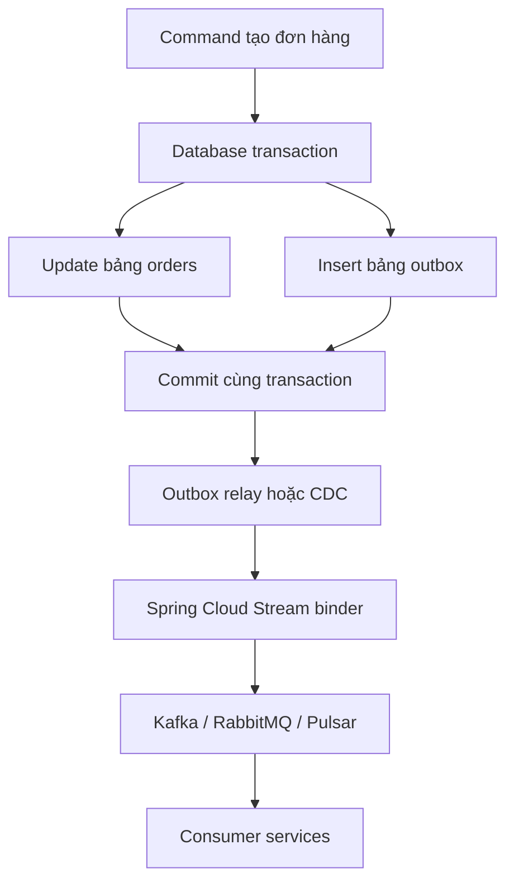

# Khoảng hở giữa ghi cơ sở dữ liệu và phát sự kiện

Một dịch vụ Spring Cloud Stream thường vừa cập nhật dữ liệu nghiệp vụ trong cơ sở dữ liệu vừa phát sự kiện sang Kafka, RabbitMQ hoặc Pulsar. Ví dụ, khi tạo đơn hàng, ứng dụng ghi đơn hàng vào database rồi phát `OrderCreated` để dịch vụ thanh toán, kho hàng và thông báo tiếp tục xử lý.

Hai thao tác này thường đi qua hai hệ thống lưu trữ độc lập. Transaction của database không tự động bao trùm việc gửi message tới broker. Nếu ứng dụng ghi database thành công nhưng dừng trước khi gửi message, trạng thái nghiệp vụ đã thay đổi nhưng các dịch vụ khác không biết. Nếu gửi message trước rồi database rollback, consumer có thể nhận một sự kiện mô tả thay đổi chưa từng được commit.

Khoảng thời gian và các tình huống lỗi giữa hai thao tác đó được gọi là *dual-write problem* (vấn đề ghi kép). Bài học này phân tích các cửa sổ lỗi và cách dùng transactional outbox, CDC, idempotency cùng cơ chế retry để duy trì tính nhất quán giữa dữ liệu và luồng sự kiện.

## 1. Vì sao hai thao tác ghi tạo ra khoảng hở?

Một luồng xử lý đơn giản có thể trông như sau:

```java
@Transactional
public Order createOrder(CreateOrderCommand command) {
    Order order = orderRepository.save(Order.create(command));
    streamBridge.send("orders.created", toEvent(order));
    return order;
}
```

`@Transactional` thường quản lý transaction của database được cấu hình cho repository. Lệnh `streamBridge.send` gửi message qua binder tới broker. Nếu database và broker không tham gia cùng một distributed transaction được cấu hình đúng, hai thao tác không có một điểm commit nguyên tử chung.

Các trường hợp có thể xảy ra:

| Thứ tự | Sự cố | Kết quả |
| --- | --- | --- |
| Ghi database rồi gửi message | Database commit xong, tiến trình dừng trước khi gửi | Dữ liệu đã có nhưng không có sự kiện |
| Ghi database rồi gửi message | Broker tạm thời không sẵn sàng và gửi thất bại | Dữ liệu đã commit nhưng sự kiện chưa được phát |
| Gửi message rồi ghi database | Broker nhận message, sau đó database rollback | Consumer xử lý một sự kiện không có thay đổi tương ứng trong database |
| Gửi message rồi ghi database | Broker nhận message nhưng ứng dụng mất kết nối trước khi nhận kết quả gửi | Ứng dụng không biết message đã được nhận hay chưa; retry có thể tạo bản sao |
| Gửi message trong transaction database | Database rollback sau khi broker đã nhận message | Transaction database không thể tự thu hồi message đã phát |

Đặt hai lệnh cạnh nhau trong cùng một phương thức `@Transactional` không làm cho chúng trở thành một transaction nguyên tử. Transaction manager của database và transaction của broker có vòng đời riêng, trừ khi hệ thống triển khai một cơ chế phối hợp distributed transaction phù hợp.

## 2. Vì sao gửi sau commit vẫn còn rủi ro?

Một cách cải thiện đơn giản là chỉ gửi sự kiện sau khi transaction database commit, ví dụ dùng transaction synchronization hoặc sự kiện `@TransactionalEventListener(phase = AFTER_COMMIT)`.

```java
@Transactional
public Order createOrder(CreateOrderCommand command) {
    Order order = orderRepository.save(Order.create(command));
    applicationEventPublisher.publishEvent(new OrderSaved(order.getId()));
    return order;
}

@TransactionalEventListener(phase = TransactionPhase.AFTER_COMMIT)
public void publishOrderCreated(OrderSaved event) {
    Order order = orderRepository.findById(event.orderId()).orElseThrow();
    streamBridge.send("orders.created", toEvent(order));
}
```

Cách này tránh phát sự kiện trước khi transaction database commit thành công. Tuy nhiên, nó chưa bảo đảm sự kiện chắc chắn được phát:

1. Database commit thành công.
2. Tiến trình bị dừng hoặc máy chủ mất điện trước khi listener `AFTER_COMMIT` chạy.
3. Thay đổi database vẫn tồn tại, nhưng không có message trong broker.

Listener sau commit hữu ích khi chấp nhận mức bảo đảm best-effort hoặc khi có cơ chế khôi phục khác. Với sự kiện quan trọng, cần lưu dấu vết của sự kiện trong cùng transaction database để có thể phát lại sau khi tiến trình gặp sự cố.

## 3. Transactional outbox giải quyết khoảng hở như thế nào?

Transactional outbox là mẫu thiết kế lưu sự kiện cần phát vào một bảng outbox trong chính database chứa dữ liệu nghiệp vụ. Thay đổi nghiệp vụ và bản ghi outbox được ghi trong cùng một transaction database.

Một tiến trình relay riêng đọc các bản ghi outbox chưa phát, gửi chúng tới broker rồi đánh dấu đã phát. Nếu tiến trình ứng dụng dừng trước khi relay gửi, bản ghi outbox vẫn còn để xử lý sau. Nếu transaction database rollback, cả thay đổi nghiệp vụ lẫn bản ghi outbox đều rollback.



Outbox làm cho *thay đổi nghiệp vụ và ý định phát sự kiện* trở nên nguyên tử trong database. Việc chuyển bản ghi outbox sang broker vẫn là một bước riêng và thường có ngữ nghĩa at-least-once; do đó consumer cần chịu được message trùng.

## 4. Thiết kế bảng outbox

Một bảng outbox cần lưu đủ thông tin để relay có thể phát message mà không phải suy đoán lại sự kiện từ trạng thái hiện tại của aggregate.

Ví dụ cấu trúc khái niệm:

```sql
CREATE TABLE outbox_event (
    event_id           VARCHAR(36) PRIMARY KEY,
    aggregate_type     VARCHAR(100) NOT NULL,
    aggregate_id       VARCHAR(100) NOT NULL,
    aggregate_sequence BIGINT NOT NULL,
    event_type         VARCHAR(150) NOT NULL,
    payload            TEXT NOT NULL,
    content_type       VARCHAR(100) NOT NULL,
    created_at         TIMESTAMP NOT NULL,
    published_at       TIMESTAMP NULL,
    attempts           INTEGER NOT NULL DEFAULT 0,
    next_attempt_at    TIMESTAMP NULL,
    lock_owner         VARCHAR(100) NULL,
    locked_until       TIMESTAMP NULL
);

CREATE INDEX idx_outbox_pending
    ON outbox_event (published_at, next_attempt_at, created_at);

CREATE UNIQUE INDEX uq_outbox_aggregate_sequence
    ON outbox_event (aggregate_type, aggregate_id, aggregate_sequence);
```

Đây là schema minh họa; kiểu dữ liệu, cú pháp index và chiến lược khóa cần điều chỉnh theo database thực tế. Một số trường có ý nghĩa:

- `event_id`: định danh duy nhất, ổn định qua mọi lần retry; consumer dùng nó để phát hiện message trùng.
- `aggregate_type` và `aggregate_id`: xác định đối tượng nghiệp vụ mà sự kiện mô tả.
- `aggregate_sequence`: số thứ tự sự kiện của một aggregate, hữu ích khi cần giữ thứ tự.
- `event_type`: loại sự kiện như `OrderCreated` hoặc `OrderCancelled`.
- `payload`: nội dung sự kiện đã được chụp tại thời điểm transaction commit.
- `content_type`: định dạng payload, ví dụ `application/json`.
- `published_at`: thời điểm relay xác nhận đã gửi thành công theo tiêu chí của ứng dụng.
- `attempts` và `next_attempt_at`: hỗ trợ retry có backoff.
- `lock_owner` và `locked_until`: hỗ trợ nhiều relay worker cùng xử lý mà không chủ động claim cùng một bản ghi.

Không nhất thiết mọi triển khai đều cần toàn bộ cột này. Điều quan trọng là phải có event ID ổn định, payload đã xác định, trạng thái xử lý có thể phục hồi và cơ chế phối hợp worker phù hợp.

## 5. Ghi dữ liệu nghiệp vụ và outbox trong cùng transaction

Service nghiệp vụ cập nhật aggregate và thêm outbox event trong cùng transaction. Ví dụ dùng Spring Data JPA:

```java
import java.time.Instant;
import java.util.UUID;

import org.springframework.stereotype.Service;
import org.springframework.transaction.annotation.Transactional;

@Service
public class OrderApplicationService {

    private final OrderRepository orderRepository;
    private final OutboxRepository outboxRepository;
    private final ObjectMapper objectMapper;

    public OrderApplicationService(
            OrderRepository orderRepository,
            OutboxRepository outboxRepository,
            ObjectMapper objectMapper) {
        this.orderRepository = orderRepository;
        this.outboxRepository = outboxRepository;
        this.objectMapper = objectMapper;
    }

    @Transactional
    public Order create(CreateOrderCommand command) {
        Order order = orderRepository.save(Order.create(command));
        OrderCreated event = new OrderCreated(
                order.getId(), order.getCustomerId(), order.getTotal());

        outboxRepository.save(new OutboxEvent(
                UUID.randomUUID(),
                "Order",
                order.getId(),
                order.getVersion(),
                "OrderCreated",
                serialize(event),
                "application/json",
                Instant.now()));

        return order;
    }

    private String serialize(Object event) {
        try {
            return objectMapper.writeValueAsString(event);
        }
        catch (JsonProcessingException ex) {
            throw new IllegalStateException("Cannot serialize outbox event", ex);
        }
    }
}
```

Các kiểu `Order`, `OrderCreated`, `OutboxEvent`, repository và `ObjectMapper` là model/bean minh họa cần được định nghĩa trong dự án. Nếu serialize thất bại, exception phải làm transaction rollback để không lưu thay đổi nghiệp vụ mà thiếu outbox event.

Điểm quan trọng là hai lệnh `save` dùng cùng transaction manager và cùng database transaction. Nếu outbox nằm ở một database khác, tính nguyên tử này không còn được bảo đảm chỉ bằng `@Transactional` thông thường.

## 6. Relay đọc outbox và gửi bằng Spring Cloud Stream

Relay chịu trách nhiệm lấy các bản ghi chưa phát, chuyển payload thành message và gửi qua `StreamBridge`. Có thể chạy relay theo lịch hoặc bằng một worker liên tục.

Một luồng xử lý khái niệm:

1. Claim một batch outbox event chưa được xử lý, đặt lease để worker khác không claim cùng lúc.
2. Commit việc claim để không giữ transaction database trong suốt thời gian gọi broker.
3. Gửi từng event tới destination phù hợp bằng `StreamBridge`.
4. Khi send được xác nhận theo tiêu chí của binder, đánh dấu event đã phát.
5. Nếu gửi lỗi, tăng attempts và đặt `next_attempt_at` theo backoff; sau ngưỡng cấu hình, đưa event vào trạng thái cần can thiệp.

Ví dụ phần gửi một event:

```java
import org.springframework.cloud.stream.function.StreamBridge;
import org.springframework.messaging.Message;
import org.springframework.messaging.MessageHeaders;
import org.springframework.messaging.support.MessageBuilder;
import org.springframework.stereotype.Component;
import org.springframework.util.MimeTypeUtils;

@Component
public class OutboxPublisher {

    private final StreamBridge streamBridge;

    public OutboxPublisher(StreamBridge streamBridge) {
        this.streamBridge = streamBridge;
    }

    public boolean publish(OutboxEvent event) {
        Message<String> message = MessageBuilder
                .withPayload(event.payload())
                .setHeader("eventId", event.eventId().toString())
                .setHeader("eventType", event.eventType())
                .setHeader("aggregateId", event.aggregateId())
                .setHeader(MessageHeaders.CONTENT_TYPE,
                        MimeTypeUtils.parseMimeType(event.contentType()))
                .build();

        return streamBridge.send("orders-out-0", message);
    }
}
```

Đoạn mã minh họa giả định binding `orders-out-0` đã được cấu hình và payload được lưu dưới dạng chuỗi JSON. Với hệ thống có nhiều loại sự kiện, relay có thể ánh xạ event type hoặc aggregate type sang một tập destination được kiểm soát. Không lấy trực tiếp tên destination tùy ý từ dữ liệu bên ngoài.

Giá trị `true` từ `StreamBridge.send` biểu thị thao tác gửi được chấp nhận theo hợp đồng của API/binder; không nên diễn giải nó thành consumer đích đã xử lý nghiệp vụ xong. Với relay cần đánh dấu outbox chỉ sau khi có xác nhận gửi phù hợp, hãy kiểm tra semantics producer của binder và broker (ví dụ Kafka producer acknowledgment, Rabbit publisher confirms hoặc send acknowledgment của Pulsar). Nếu chỉ đánh dấu sau khi message được đưa vào channel nội bộ, nhưng lỗi gửi bất đồng bộ xảy ra sau đó, relay có thể đánh dấu nhầm event là đã phát. Cần chọn API/callback xác nhận phù hợp với binder đang dùng và kiểm thử lỗi gửi thực tế.

## 7. Vì sao outbox vẫn có thể phát trùng?

Giả sử relay gửi message thành công, nhưng tiến trình dừng trước khi cập nhật `published_at`:

1. Relay đọc event `E-123` từ outbox.
2. Broker nhận message `E-123`.
3. Relay bị dừng trước khi đánh dấu event đã phát.
4. Lease hết hạn; relay khác đọc lại `E-123`.
5. Broker nhận thêm một bản sao `E-123`.

Nếu đánh dấu `published_at` trước khi gửi, lỗi lại có thể gây mất message: database ghi nhận đã phát nhưng broker chưa nhận được. Vì không có transaction nguyên tử chung giữa database và broker trong mô hình relay thông thường, thiết kế an toàn thường ưu tiên không mất sự kiện và chấp nhận có thể phát trùng.

Đây là lý do transactional outbox thường cung cấp ngữ nghĩa *at-least-once* ở chặng relay. Muốn hệ thống xử lý đúng, consumer cần idempotency dựa trên `eventId` hoặc một khóa nghiệp vụ ổn định.

## 8. Idempotency ở consumer

Consumer nên ghi nhận event ID đã xử lý trong cùng transaction với thay đổi nghiệp vụ mà nó thực hiện. Ví dụ có bảng inbox/deduplication:

```sql
CREATE TABLE processed_event (
    consumer_name VARCHAR(100) NOT NULL,
    event_id       VARCHAR(36) NOT NULL,
    processed_at   TIMESTAMP NOT NULL,
    PRIMARY KEY (consumer_name, event_id)
);
```

Luồng xử lý:

1. Bắt đầu transaction database.
2. Thử insert `(consumer_name, event_id)` vào bảng `processed_event`.
3. Nếu khóa đã tồn tại, message đã được xử lý; bỏ qua side effect trùng.
4. Nếu insert thành công, thực hiện thay đổi nghiệp vụ.
5. Commit cả bản ghi deduplication và thay đổi nghiệp vụ cùng transaction.
6. Chỉ sau đó mới để binder xác nhận message theo cơ chế phù hợp.

Ví dụ code khái niệm:

```java
@Transactional
public void handle(OrderCreated event, String eventId) {
    boolean firstDelivery = processedEventRepository.insertIfAbsent(
            "billing-service", eventId);

    if (!firstDelivery) {
        return;
    }

    billingService.createInvoice(event.orderId());
}
```

`insertIfAbsent` nên được triển khai bằng unique constraint hoặc câu lệnh upsert phù hợp với database; không nên chỉ kiểm tra tồn tại rồi insert bằng hai câu lệnh rời rạc vì hai consumer đồng thời có thể cùng vượt qua bước kiểm tra. Nếu side effect nằm ngoài transaction database (ví dụ gọi API thanh toán), cần idempotency key ở hệ thống đích hoặc một quy trình bù trừ riêng.

## 9. Giữ thứ tự sự kiện của cùng aggregate

Outbox có thể chứa nhiều sự kiện cho cùng một aggregate. Nếu nhiều relay worker gửi song song, event có sequence 12 có thể đến broker trước sequence 11. Partition key giúp đưa các message của cùng aggregate về cùng partition, nhưng chỉ khi producer gửi chúng theo đúng thứ tự.

Một số biện pháp:

- Ghi `aggregate_sequence` tăng đơn điệu trong cùng transaction với aggregate.
- Claim sự kiện theo `aggregate_id` và không gửi event kế tiếp trước khi event trước đã được xác nhận theo chính sách relay.
- Dùng một worker hoặc khóa phân phối cho mỗi nhóm aggregate khi cần thứ tự nghiêm ngặt.
- Đặt `aggregateId` làm partition key khi gửi tới broker hỗ trợ partitioning theo key.
- Consumer kiểm tra sequence và phát hiện sự kiện đến thiếu hoặc sai thứ tự.

Ví dụ binding output:

```yaml
spring:
  cloud:
    stream:
      bindings:
        orders-out-0:
          destination: orders.events
          producer:
            partition-key-expression: headers['aggregateId']
            partition-count: 6
```

Partition key chỉ đảm bảo cùng key được định tuyến cùng partition theo chiến lược đang cấu hình. Nó không tự sửa thứ tự nếu relay đã gửi sai thứ tự, cũng không bảo đảm thứ tự toàn cục giữa nhiều partition.

## 10. Retry, backoff và sự kiện lỗi không thể phát

Relay cần phân biệt lỗi tạm thời với lỗi dữ liệu hoặc cấu hình:

| Loại lỗi | Ví dụ | Hành vi phù hợp |
| --- | --- | --- |
| Tạm thời | Broker mất kết nối, timeout, leader đổi | Retry với exponential backoff và jitter |
| Cấu hình | Sai destination, thiếu ACL, schema registry không truy cập được | Cảnh báo, retry có giới hạn và yêu cầu sửa cấu hình |
| Dữ liệu | Payload không serialize được hoặc thiếu trường bắt buộc | Đưa event vào trạng thái lỗi cần xử lý, không lặp vô hạn |
| Quá tải | Broker throttling hoặc downstream backlog cao | Giảm tốc độ relay, giới hạn batch/concurrency và retry theo backoff |

Không nên xóa outbox event chỉ vì đã vượt quá số lần retry. Có thể chuyển event sang trạng thái `FAILED` hoặc bảng lưu lỗi, giữ nguyên payload và thông tin lỗi để vận hành điều tra. Quy trình replay phải dùng cùng `eventId` nếu muốn consumer nhận diện bản phát lại là bản sao của sự kiện gốc.

## 11. Polling relay và CDC relay

Có hai cách phổ biến để chuyển outbox event tới broker:

### Polling relay

Một worker truy vấn bảng outbox theo chu kỳ, claim batch, gửi message rồi cập nhật trạng thái. Cách này dễ hiểu, có thể triển khai bằng Spring Scheduler, `Supplier` hoặc một service worker riêng.

Ưu điểm:

- Dễ bắt đầu với Spring Boot và Spring Cloud Stream.
- Không cần đọc transaction log của database.
- Có thể kiểm soát batch size, retry, lịch poll và logic claim trong ứng dụng.

Đánh đổi:

- Có độ trễ ít nhất bằng một phần chu kỳ poll và thời gian xử lý batch.
- Tạo tải đọc định kỳ lên database.
- Cần quản lý lease, khóa, nhiều worker và cleanup.

Khi dùng nhiều worker, có thể dùng `SELECT ... FOR UPDATE SKIP LOCKED` nếu database hỗ trợ để claim các hàng khác nhau. Đây là cú pháp phụ thuộc database, không phải SQL portable. Một lựa chọn khác là cập nhật nguyên tử `lock_owner` và `locked_until` theo điều kiện trạng thái. Không giữ transaction database mở trong lúc chờ mạng broker lâu hơn mức cần thiết.

### CDC relay

Change Data Capture đọc transaction log của database để phát hiện bản ghi outbox mới rồi chuyển chúng tới broker. Một triển khai phổ biến là Debezium cùng Outbox Event Router.

Ưu điểm:

- Không cần poll bảng liên tục.
- Có thể giảm độ trễ và tận dụng thứ tự commit trong transaction log.
- Tách tiến trình relay khỏi ứng dụng nghiệp vụ.

Đánh đổi:

- Cần vận hành connector, quyền đọc transaction log, schema và offset của connector.
- Cần quản lý retention transaction log và khả năng khôi phục connector.
- Vẫn phải xử lý phát lại, duplicate, schema evolution và idempotency ở consumer.

CDC không làm cho database và broker trở thành một transaction nguyên tử duy nhất. Connector có thể phát lại record sau restart hoặc khi offset chưa được commit; consumer vẫn cần chịu được duplicate.

## 12. Lựa chọn giữa outbox, CDC và distributed transaction

| Giải pháp | Bảo đảm chính | Chi phí/giới hạn |
| --- | --- | --- |
| Gửi trực tiếp trong service | Đơn giản, ít thành phần | Có khoảng hở dual-write; dễ mất hoặc phát sai sự kiện khi lỗi |
| Gửi sau commit | Không phát trước khi database commit | Tiến trình có thể dừng sau commit trước khi gửi; vẫn có thể mất sự kiện |
| Transactional outbox + polling | Dữ liệu nghiệp vụ và ý định phát sự kiện commit cùng DB transaction | Relay polling, retry, duplicate, cleanup và độ trễ |
| Transactional outbox + CDC | Cùng bảo đảm lưu outbox trong DB, relay dựa trên transaction log | Vận hành connector và log; vẫn cần idempotency |
| Distributed transaction/XA | Có thể phối hợp commit/rollback giữa resource manager tương thích | Cấu hình và vận hành phức tạp, phụ thuộc broker/database/driver, ảnh hưởng availability và hiệu năng |

Kafka transaction có thể phối hợp việc consume và produce trong Kafka, nhưng không tự làm cho một transaction JPA ở relational database trở thành một phần của cùng transaction Kafka. Nếu yêu cầu thực sự là atomic commit qua nhiều resource manager, cần đánh giá đầy đủ hỗ trợ XA/distributed transaction của từng thành phần và tác động vận hành. Trong nhiều hệ thống microservice, outbox cùng idempotent consumer là lựa chọn dễ kiểm soát hơn.

## 13. Quan sát và vận hành outbox

Outbox là một hàng đợi bền vững trong database, vì vậy cần được giám sát như một thành phần vận hành:

- Số bản ghi đang chờ phát.
- Tuổi của bản ghi pending lâu nhất.
- Tốc độ tạo event so với tốc độ relay.
- Tỷ lệ send thành công/thất bại.
- Số lần retry và số event chuyển sang trạng thái lỗi.
- Thời gian từ `created_at` đến lúc publish.
- Số bản ghi đang bị lease và số lease hết hạn.
- Dung lượng bảng, tốc độ tăng và thời gian cleanup.

Nếu backlog tăng liên tục, tăng số worker chưa chắc giải quyết được vấn đề. Hãy xác định broker có chậm, database bị nghẽn, một destination lỗi, hoặc một event poison làm batch bị chặn. Có thể tách batch theo destination hoặc loại lỗi để một đích gặp sự cố không ngăn mọi event khác được phát.

Cleanup chỉ nên xóa bản ghi đã phát sau khoảng retention được thống nhất và sau khi có khả năng đối soát/replay phù hợp. Với hệ thống cần audit, có thể chuyển event đã phát sang kho lưu trữ hoặc giữ metadata lâu hơn. Không xóa các event đang pending, đang lease hoặc đang cần điều tra.

## 14. Kiểm thử khoảng hở và khả năng phục hồi

Unit test cho service nghiệp vụ nên xác minh việc cập nhật aggregate và lưu outbox xảy ra cùng transaction. Integration test với database thật hoặc Testcontainers giúp kiểm tra rollback: nếu insert outbox thất bại, thay đổi aggregate cũng phải rollback; nếu cập nhật aggregate thất bại, outbox event không được tồn tại.

Relay cần kiểm thử các cửa sổ lỗi quan trọng:

1. Database commit thành công nhưng relay chưa chạy.
2. Relay claim event rồi dừng trước khi gửi; lease hết hạn và worker khác tiếp tục.
3. Broker nhận message nhưng relay dừng trước khi đánh dấu published; message được gửi lại và consumer bỏ qua duplicate.
4. Broker không sẵn sàng trong thời gian dài; retry có backoff và backlog được giữ lại.
5. Một event không serialize được; event được giữ ở trạng thái lỗi và các event khác vẫn có thể tiến triển.
6. Hai worker chạy đồng thời; không claim cùng event hoặc không vi phạm thứ tự aggregate đã cam kết.
7. Consumer xử lý thành công nhưng acknowledgment bị mất; redelivery không tạo side effect trùng.

Kiểm thử end-to-end nên dùng broker tương ứng để xác nhận binder, producer acknowledgment, key/partition, schema và consumer group. Test binder hữu ích cho logic Spring Cloud Stream nhưng không mô phỏng đầy đủ crash, durability, transaction log, provisioning và semantics giao nhận của broker thật.

## 15. Checklist triển khai

Trước khi phát hành transactional outbox:

- Xác định những thay đổi database nào bắt buộc phải phát sự kiện.
- Đảm bảo aggregate và outbox row dùng cùng database transaction.
- Định nghĩa event ID ổn định, event type, schema version và aggregate sequence.
- Chọn polling relay hay CDC dựa trên throughput, độ trễ và năng lực vận hành.
- Thiết kế claim/lease để nhiều worker không tranh cùng bản ghi.
- Xác định tiêu chí broker send thành công và thời điểm đánh dấu published.
- Thiết kế retry, backoff, trạng thái lỗi và quy trình replay.
- Làm consumer idempotent bằng unique event ID hoặc idempotency key.
- Nếu cần thứ tự theo aggregate, đảm bảo relay gửi tuần tự theo key và dùng partition key phù hợp.
- Thiết lập metrics, alert backlog, tuổi event pending và lỗi relay.
- Xác định retention và cleanup an toàn cho outbox.
- Kiểm thử crash tại các điểm giữa database commit, broker send và cập nhật trạng thái relay.

## Tài liệu tham khảo

- [Spring Cloud Stream — Producing and Consuming Messages](https://docs.spring.io/spring-cloud-stream/reference/spring-cloud-stream/producing-and-consuming-messages.html)
- [Spring Framework — Transaction-bound Events](https://docs.spring.io/spring-framework/reference/data-access/transaction/event.html)
- [Debezium — Outbox Event Router](https://debezium.io/documentation/reference/stable/transformations/outbox-event-router.html)
- [microservices.io — Transactional Outbox pattern](https://microservices.io/patterns/data/transactional-outbox.html)

## Kết luận

Ghi database và phát message là hai thao tác độc lập nếu không có distributed transaction được cấu hình đầy đủ. Gửi sau commit tránh phát sự kiện cho transaction rollback nhưng vẫn có cửa sổ mất message nếu tiến trình dừng sau commit. Transactional outbox khắc phục khoảng hở bằng cách lưu thay đổi nghiệp vụ và ý định phát sự kiện trong cùng database transaction; polling relay hoặc CDC chuyển event tới broker sau đó. Relay có thể phát trùng khi crash giữa gửi và đánh dấu hoàn tất, vì vậy consumer cần idempotency, còn hệ thống cần quản lý thứ tự, retry, backlog, replay và cleanup như các phần của hợp đồng giao nhận.
