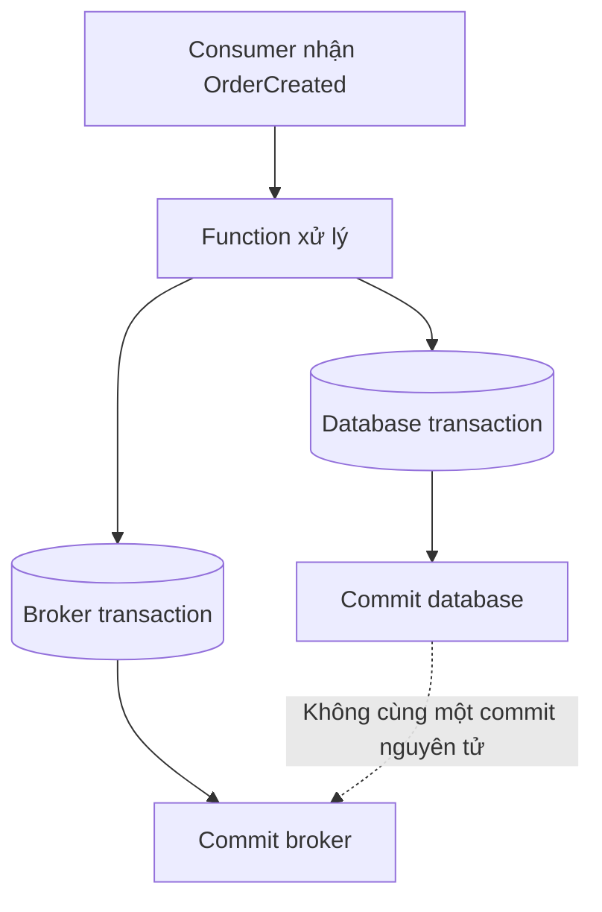
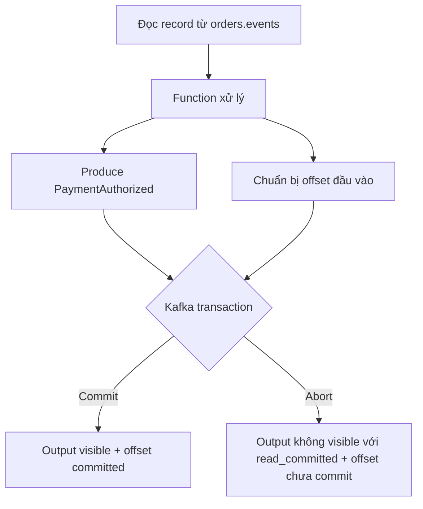
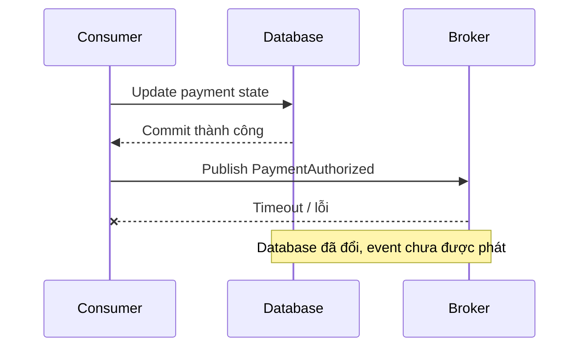
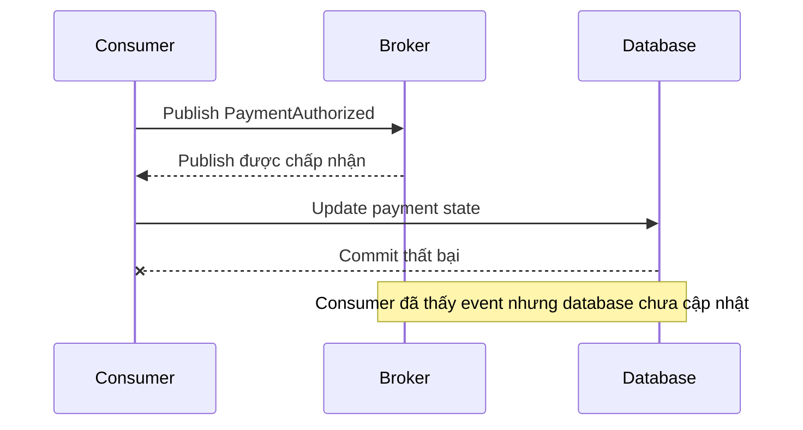
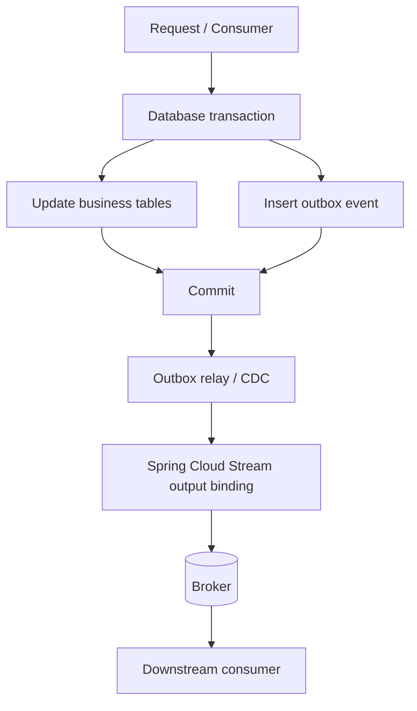

# Phạm vi giao dịch broker và giới hạn exactly-once đầu cuối

## 1. Vì sao giao dịch trong broker chưa đủ cho toàn bộ nghiệp vụ?

Một ứng dụng Spring Cloud Stream thường đọc message từ broker, cập nhật dữ liệu trong database rồi phát event tiếp theo. Ví dụ, khi nhận `OrderCreated`, dịch vụ thanh toán ghi giao dịch vào PostgreSQL và phát `PaymentAuthorized` sang Kafka. Có ít nhất hai hệ thống lưu trữ tham gia: database và message broker.

Nếu database commit nhưng việc publish thất bại, trạng thái nghiệp vụ đã thay đổi mà event không được phát. Nếu publish thành công nhưng database rollback, consumer có thể nhận một event mô tả thay đổi chưa tồn tại. Nếu ứng dụng dừng giữa lúc xử lý và xác nhận message đầu vào, broker có thể giao lại message và tác dụng phụ bị thực hiện lần nữa.

Giao dịch broker giải quyết tính nguyên tử trong phạm vi mà broker hỗ trợ. Nó không tự động gộp database, HTTP service, email provider hoặc một broker khác vào cùng một giao dịch. Vì vậy, cần phân biệt rõ:

- **Broker transaction:** nhóm thao tác message/offset được broker hỗ trợ commit hoặc abort cùng nhau.
- **Database transaction:** nhóm thao tác dữ liệu được database commit hoặc rollback cùng nhau.
- **End-to-end business operation:** toàn bộ tác dụng phụ nghiệp vụ qua các hệ thống; cần một thiết kế phối hợp riêng.



Hai commit độc lập tạo ra một khoảng thời gian có thể xảy ra lỗi. Hiểu đúng ranh giới giao dịch là nền tảng để chọn Kafka transaction, RabbitMQ transaction, Pulsar transaction, transactional outbox hoặc inbox/idempotency.

## 2. At-most-once, at-least-once và exactly-once

Các thuật ngữ giao nhận mô tả điều gì có thể xảy ra khi message được gửi, nhận và xử lý:

| Semantics | Cách vận hành khái quát | Rủi ro chính |
|---|---|---|
| At-most-once | Xác nhận/commit trước hoặc không thử lại sau lỗi | Có thể mất message nếu ứng dụng dừng trước khi xử lý xong |
| At-least-once | Chỉ xác nhận sau xử lý; giao lại khi chưa xác nhận | Có thể xử lý cùng message nhiều lần |
| Exactly-once trong phạm vi broker | Broker phối hợp ghi message và tiến độ tiêu thụ trong một transaction được hỗ trợ | Chỉ áp dụng trong phạm vi transaction và các thành phần tham gia |
| Effectively-once ở tầng nghiệp vụ | Có thể nhận message lặp nhưng tác dụng phụ được khử trùng lặp | Cần event ID, ràng buộc dữ liệu và xử lý idempotent |

Trong hệ thống phân tán, từ “exactly-once” phải luôn đi cùng phạm vi. Một broker có thể bảo đảm record được commit đúng một lần trong transaction của nó, nhưng điều đó không chứng minh email chỉ được gửi một lần hoặc database bên ngoài chỉ được cập nhật một lần.

### Vì sao at-least-once thường được chọn?

Với xử lý nghiệp vụ, mất một event thường khó phục hồi hơn việc nhận trùng event. At-least-once cho phép broker giao lại khi consumer gặp sự cố trước acknowledgement hoặc offset commit. Đổi lại, consumer phải chấp nhận redelivery và bảo vệ tác dụng phụ bằng idempotency.

### Producer idempotence không phải exactly-once nghiệp vụ

Producer idempotent có thể ngăn bản ghi bị nhân đôi do một số lần retry ở giao thức producer, ví dụ khi phản hồi publish bị mất nhưng broker đã ghi nhận request trước đó. Nó không tự phát hiện hai lệnh gửi riêng biệt do ứng dụng chủ động tạo, hai lần xử lý cùng event hoặc hai lần tạo giao dịch nghiệp vụ.

## 3. Phạm vi transaction của Kafka

Kafka hỗ trợ producer transaction. Một transaction có thể ghi nhiều record vào nhiều topic/partition và commit hoặc abort chúng như một đơn vị. Với luồng consume-transform-produce được cấu hình đúng, transaction còn có thể đưa offset của record đầu vào vào cùng transaction với record đầu ra.

Ví dụ một function đọc `orders.events`, tạo `payments.events` và xử lý offset đầu vào. Khi binder Kafka được cấu hình transaction, các record đầu ra cùng offset tiêu thụ có thể được commit nguyên tử trong một transaction Kafka, nếu chúng thuộc phạm vi cluster và cơ chế transaction được hỗ trợ.



Consumer đọc với isolation phù hợp, thường là `read_committed`, để không nhìn thấy record thuộc transaction đã abort. Consumer ở chế độ `read_uncommitted` có thể nhìn thấy record chưa commit hoặc đã bị abort theo semantics Kafka, vì vậy không phù hợp khi cần quan sát kết quả transaction đã commit.

### Cấu hình Kafka binder transaction

Với Spring Cloud Stream Kafka binder, transaction có thể được bật bằng `transactionIdPrefix` trong cấu hình binder. Ví dụ minh họa:

```yaml
spring:
  cloud:
    function:
      definition: authorizePayment
    stream:
      kafka:
        binder:
          transaction:
            transactionIdPrefix: ${INSTANCE_ID}-orders-
      bindings:
        authorizePayment-in-0:
          destination: orders.events
          group: payment-service
        authorizePayment-out-0:
          destination: payments.events
```

`INSTANCE_ID` cần được cấp một giá trị phù hợp với cách triển khai để transaction ID không xung đột giữa các instance đồng thời. Cách đặt prefix, transaction timeout, producer properties và listener container behavior phải được kiểm tra theo phiên bản Spring Cloud Stream Kafka binder đang dùng.

Khi transaction binder được bật, producer binding sử dụng producer có transaction theo cấu hình binder. Trong luồng consumer-initiated transaction được hỗ trợ, listener container có thể bắt đầu transaction và các output gửi trong phạm vi xử lý được tham gia transaction cùng offset đầu vào. Không nên giả định mọi cách gửi bất đồng bộ, `StreamBridge` gọi từ thread khác hoặc tác vụ được tách khỏi listener thread đều tự động tham gia transaction đó.

### Transaction ID và fencing

Kafka dùng transactional ID để nhận diện producer có transaction. Nếu nhiều producer hoạt động đồng thời với cùng transactional ID, broker có thể fence producer cũ để tránh hai producer cùng ghi trong một vai trò. Vì vậy, prefix phải được thiết kế phù hợp với số instance và vòng đời ứng dụng. Khi chạy nhiều replica, hãy dùng cơ chế tạo transaction ID mà binder hỗ trợ và xác minh không có xung đột giữa các instance.

### Kafka transaction bảo vệ điều gì?

- Nhiều record đầu ra trong transaction được commit hoặc abort cùng nhau.
- Offset đầu vào có thể được commit cùng output khi luồng binder/container hỗ trợ consume-transform-produce transaction.
- Consumer `read_committed` chỉ đọc record thuộc transaction đã commit.
- Producer idempotence nằm trong cơ chế transactional producer.

Kafka transaction không tự bao gồm commit PostgreSQL, lời gọi REST, gửi email hoặc publish sang RabbitMQ/Pulsar. Nếu các thao tác đó diễn ra trong function, chúng vẫn có thể hoàn tất trước hoặc sau Kafka transaction và tạo khoảng lỗi riêng.

## 4. Phạm vi transaction của RabbitMQ

RabbitMQ hỗ trợ transaction ở cấp channel AMQP. Trên một channel transacted, publish và acknowledgement có thể được commit hoặc rollback theo phạm vi transaction của broker. Đây là cơ chế giao dịch message trong RabbitMQ; nó không phải transaction phân tán tự động giữa RabbitMQ và database.

Publisher confirms là một cơ chế khác. Confirm cho biết broker đã xử lý việc publish theo semantics xác nhận của nó. Confirm không tương đương với việc gộp nhiều thao tác thành một transaction và cũng không tự bao gồm database.

Trong Spring Cloud Stream Rabbit binder, có các thuộc tính binder/consumer/producer để cấu hình channel transacted, acknowledgement và republish/DLQ. Tên thuộc tính cụ thể phụ thuộc phiên bản binder. Hãy kiểm tra cấu hình `transacted`, `acknowledgeMode`, publisher confirm/returns và topology queue/exchange của phiên bản đang triển khai.

Một luồng consumer nhận message rồi publish sang exchange khác có thể được cấu hình để dùng channel transaction theo khả năng binder. Tuy nhiên, nếu function đồng thời cập nhật database, transaction RabbitMQ không commit/rollback database cùng lúc. Nếu publish sang Kafka hoặc Pulsar, RabbitMQ cũng không thể đưa broker còn lại vào cùng transaction AMQP.

### Acknowledgement và redelivery

Nếu consumer chưa ack và channel/connection bị đóng, RabbitMQ có thể giao lại message. Khi ack đã được gửi và broker đã xử lý nó, ứng dụng không thể dựa vào message đầu vào để tự động khôi phục một thao tác database thất bại sau đó. Do đó, thứ tự cập nhật database và acknowledgement phải được thiết kế cùng idempotency hoặc outbox/inbox.

## 5. Phạm vi transaction của Pulsar

Apache Pulsar hỗ trợ transaction ở cấp broker cho các thao tác message được transaction API hỗ trợ. Một transaction Pulsar có thể phối hợp publish và acknowledge message trên nhiều topic/partition trong cùng phạm vi transaction được broker quản lý.

Ví dụ khái niệm:

1. Consumer nhận `OrderCreated` trong một transaction.
2. Ứng dụng publish `PaymentAuthorized` vào topic đầu ra trong cùng transaction.
3. Ứng dụng acknowledge message đầu vào trong transaction.
4. Commit transaction để output và acknowledgement cùng có hiệu lực, hoặc abort để không commit các thao tác đó.

Khả năng này phụ thuộc phiên bản Pulsar broker, client, transaction coordinator và tích hợp của Pulsar binder. Không phải mọi API binder hoặc cấu hình Spring Cloud Stream đều tự động phơi bày toàn bộ transaction API của Pulsar. Hãy kiểm tra phiên bản và tính năng được binder hỗ trợ trước khi thiết kế dựa trên atomic consume-and-produce.

Pulsar transaction vẫn không tự bao gồm commit của một database bên ngoài, thao tác HTTP hoặc một Kafka cluster. Nếu có side effect ngoài Pulsar, cần phối hợp bằng outbox/inbox hoặc một giao thức giao dịch phân tán được thiết kế riêng.

## 6. Spring Cloud Stream không tạo một transaction chung cho mọi binder

Spring Cloud Stream cung cấp abstraction thống nhất cho binding và function, nhưng semantics transaction vẫn thuộc binder và broker cụ thể. Cấu hình transaction của Kafka binder không thể được áp dụng nguyên trạng cho Rabbit binder hoặc Pulsar binder.

| Thành phần | Phạm vi transaction có thể bảo vệ | Ngoài phạm vi tự động |
|---|---|---|
| Kafka transaction | Record Kafka và offset tham gia cùng transaction | Database, HTTP, email, broker khác |
| RabbitMQ channel transaction | Các thao tác AMQP trên channel transacted | Database và broker khác |
| Pulsar transaction | Publish/ack được transaction API hỗ trợ trong Pulsar | Database ngoài Pulsar và hệ thống khác |
| Spring database transaction | Các thao tác trong transaction manager của database | Broker nếu không có cơ chế phối hợp riêng |

Nếu ứng dụng có nhiều binder, không tồn tại một thuộc tính chung của Spring Cloud Stream có thể tự biến nhiều broker thành một transaction nguyên tử. Cần xác định transaction manager nào điều khiển thao tác nào, các lời gọi có cùng thread/transaction context hay không và điều gì xảy ra nếu một hệ thống commit còn hệ thống khác thất bại.

## 7. Hai cửa sổ lỗi khi kết hợp database và broker

Giả sử một function nhận `OrderCreated`, cập nhật database và phát `PaymentAuthorized`.

### Database commit trước, publish sau



Nếu ứng dụng retry toàn bộ message, database có thể bị cập nhật lần nữa. Nếu không retry, event đầu ra có thể bị mất. Kafka transaction hoặc Rabbit transaction không thể rollback một database đã commit trước đó.

### Publish trước, database commit sau



Consumer phía sau có thể xử lý event dựa trên trạng thái chưa commit. Nếu retry, event có thể được phát lần nữa. Đây là lý do cần một mẫu phối hợp giữa database và broker thay vì chỉ đổi thứ tự hai lệnh.

## 8. Transactional outbox

Transactional outbox giải quyết khoảng lỗi bằng cách ghi thay đổi nghiệp vụ và bản ghi cần phát vào cùng một database transaction. Một relay riêng đọc outbox rồi publish message đến broker.



Nếu database transaction rollback, cả thay đổi nghiệp vụ và outbox event đều không tồn tại. Nếu commit thành công, outbox event vẫn còn để relay gửi lại sau sự cố.

### Ví dụ ghi outbox trong cùng database transaction

```java
import java.time.Instant;
import java.util.UUID;
import org.springframework.stereotype.Service;
import org.springframework.transaction.annotation.Transactional;

record OrderCreated(String eventId, String orderId, Instant occurredAt) {}

@Service
class OrderApplicationService {

    private final OrderRepository orders;
    private final OutboxRepository outbox;

    OrderApplicationService(OrderRepository orders, OutboxRepository outbox) {
        this.orders = orders;
        this.outbox = outbox;
    }

    @Transactional
    OrderCreated createOrder(CreateOrderCommand command) {
        Order order = orders.save(Order.from(command));
        OrderCreated event = new OrderCreated(
            UUID.randomUUID().toString(),
            order.getId(),
            Instant.now()
        );

        outbox.save(OutboxEvent.pending(
            event.eventId(),
            "OrderCreated",
            event.orderId(),
            event
        ));

        return event;
    }
}
```

Các repository và entity trong ví dụ là thành phần minh họa. Điều quan trọng là `orders.save` và `outbox.save` tham gia cùng transaction manager của một database. Nếu hai repository dùng hai database độc lập, chỉ gắn cùng annotation `@Transactional` không tự tạo transaction nguyên tử giữa chúng.

### Relay publish bằng StreamBridge

```java
import org.springframework.cloud.stream.function.StreamBridge;
import org.springframework.stereotype.Component;

@Component
class OutboxPublisher {

    private final StreamBridge streamBridge;

    OutboxPublisher(StreamBridge streamBridge) {
        this.streamBridge = streamBridge;
    }

    void publish(OutboxEvent event) {
        boolean accepted = streamBridge.send("orders-out-0", event.payload());
        if (!accepted) {
            throw new IllegalStateException("Broker send was not accepted");
        }
        // Chỉ đánh dấu PUBLISHED sau khi cơ chế xác nhận phù hợp của binder
        // đã xác nhận publish; send() trả true chưa phải broker confirmation.
    }
}
```

Ví dụ rút gọn minh họa việc relay dùng `StreamBridge`. Trong triển khai thực tế, việc đánh dấu đã publish cần được thiết kế cẩn thận: không giữ một database transaction mở trong lúc chờ broker lâu; cần lease/claim bản ghi, retry có backoff, giới hạn batch và theo dõi trạng thái. `send` trả về `true` chỉ cho biết đường gửi chấp nhận thao tác theo API, không phải bằng chứng consumer đã xử lý message.

### Vì sao outbox vẫn có thể gửi trùng?

Giả sử relay publish thành công nhưng tiến trình dừng trước khi đánh dấu bản ghi outbox là đã gửi. Khi khởi động lại, relay nhìn thấy bản ghi chưa hoàn tất và publish lại. Vì vậy, outbox thường cung cấp khả năng phát at-least-once. Consumer phải khử trùng lặp bằng event ID hoặc inbox.

Có thể dùng polling relay hoặc Change Data Capture (CDC) đọc transaction log. Cả hai cách đều cần quản lý vị trí đọc, retry, schema và trạng thái phát. CDC giảm việc polling bảng nhưng không loại bỏ nhu cầu xử lý trùng ở consumer.

## 9. Inbox và idempotent consumer

Inbox là mẫu ghi nhận event đã xử lý ở phía consumer. Consumer lưu `eventId` vào bảng inbox cùng transaction với thay đổi nghiệp vụ. Nếu event được giao lại, unique constraint trên event ID giúp phát hiện bản tin đã xử lý.

```java
import org.springframework.stereotype.Service;
import org.springframework.transaction.annotation.Transactional;

@Service
class PaymentEventHandler {

    private final InboxRepository inbox;
    private final PaymentRepository payments;

    PaymentEventHandler(InboxRepository inbox, PaymentRepository payments) {
        this.inbox = inbox;
        this.payments = payments;
    }

    @Transactional
    void handle(PaymentAuthorized event) {
        // insertIfAbsent phải là thao tác nguyên tử được bảo vệ bởi unique constraint.
        if (!inbox.insertIfAbsent(event.eventId())) {
            return;
        }

        payments.applyAuthorization(event);
    }
}
```

Đoạn code thể hiện ý tưởng. Trong môi trường có nhiều consumer cạnh tranh, thao tác `exists` rồi `insert` riêng có thể gặp race condition. Unique constraint trong database mới là hàng rào cuối cùng. Hãy xử lý duplicate-key theo cách phù hợp với transaction manager và đảm bảo việc insert inbox cùng cập nhật payment nằm trong một transaction.

Nếu transaction rollback, cả inbox record và thay đổi payment rollback; message có thể được thử lại. Nếu commit thành công, lần giao lại sau đó sẽ được nhận diện là duplicate và không thực hiện tác dụng phụ lần nữa.

### Idempotency key và event ID

Event ID nên được tạo một lần ở nguồn và giữ nguyên qua retry, relay và replay. Không tạo UUID mới mỗi lần gửi lại cùng một event, vì consumer sẽ coi đó là event mới. Với API ngoài broker, idempotency key có thể được tạo từ request ID hoặc khóa nghiệp vụ có quy tắc duy nhất.

## 10. Saga khi nghiệp vụ trải qua nhiều dịch vụ

Một quy trình như tạo đơn hàng, giữ kho, thu tiền và giao hàng thường đi qua nhiều database và broker. Không nên cố gắng mở một transaction phân tán dài bao trùm tất cả dịch vụ. Saga chia quy trình thành các transaction cục bộ; mỗi bước phát event hoặc command để kích hoạt bước tiếp theo. Nếu một bước thất bại, saga chạy hành động bù trừ đã được định nghĩa.

Ví dụ:

1. Order service tạo đơn hàng và phát `OrderCreated`.
2. Inventory service giữ hàng và phát `InventoryReserved` hoặc `InventoryRejected`.
3. Payment service thu tiền và phát `PaymentAuthorized` hoặc `PaymentFailed`.
4. Nếu thanh toán thất bại sau khi kho đã giữ hàng, inventory service nhận lệnh bù trừ `ReleaseInventory`.

Mỗi dịch vụ dùng transaction cục bộ cho database và outbox để phát event. Các consumer dùng inbox/idempotency để xử lý message lặp. Saga cung cấp tính nhất quán cuối cùng thông qua các bước tiến và bù trừ; nó không phải một transaction ACID duy nhất.

## 11. Transactional messaging không thay thế idempotency

Ngay cả khi broker có transaction, ứng dụng vẫn cần idempotency trong nhiều trường hợp:

- Producer gửi lại một event nghiệp vụ do client retry request.
- Relay outbox publish lại sau khi không ghi được trạng thái đã gửi.
- Consumer xử lý xong database nhưng dừng trước khi offset/ack được commit.
- Replay DLQ hoặc khôi phục dữ liệu sau sự cố.
- Một luồng được sao chép sang broker khác bằng hai lần publish riêng.

Transaction bảo vệ một nhóm thao tác trong một phạm vi. Idempotency bảo vệ tác dụng phụ khi cùng một ý định nghiệp vụ được thử lại. Hai cơ chế bổ sung cho nhau.

## 12. Những gì không nên gọi là exactly-once

| Tuyên bố | Vì sao chưa đủ |
|---|---|
| “Producer bật idempotence nên đơn hàng chỉ tạo một lần” | Idempotence của producer không khử hai request nghiệp vụ độc lập hoặc hai event ID khác nhau |
| “Kafka transaction đã bật nên database và Kafka luôn đồng bộ” | Kafka transaction không tự commit database bên ngoài |
| “Consumer ack sau khi xử lý nên không có duplicate” | Ứng dụng có thể dừng sau side effect nhưng trước khi ack/offset commit có hiệu lực |
| “StreamBridge trả true nên consumer đã xử lý” | Giá trị trả về không xác nhận tác dụng phụ downstream |
| “Outbox đảm bảo publish đúng một lần” | Relay có thể publish rồi dừng trước khi đánh dấu; consumer vẫn cần deduplicate |
| “Nhiều binder dùng cùng một transaction” | Spring Cloud Stream không tự tạo transaction phân tán chung cho Kafka, RabbitMQ và Pulsar |

Nên diễn đạt chính xác phạm vi, ví dụ: “Kafka consume-transform-produce được commit trong một Kafka transaction và consumer đọc ở chế độ `read_committed`”, hoặc “database update được bảo vệ bằng inbox deduplication trong cùng transaction”. Tránh tuyên bố exactly-once đầu cuối nếu chưa chỉ rõ mọi hệ thống và side effect đều nằm trong một cơ chế nguyên tử.

## 13. Kiểm thử transaction và các cửa sổ lỗi

Kiểm thử bình thường chỉ xác nhận đường thành công. Để đánh giá độ tin cậy, cần mô phỏng sự cố tại các thời điểm khác nhau:

1. Dừng ứng dụng trước khi database commit.
2. Dừng sau database commit nhưng trước publish.
3. Dừng sau publish nhưng trước khi đánh dấu outbox đã gửi.
4. Dừng consumer sau khi cập nhật database nhưng trước ack/offset commit.
5. Abort Kafka transaction và xác nhận consumer `read_committed` không nhìn thấy output đã abort.
6. Làm broker đích mất kết nối trong lúc publish.
7. Phát lại cùng event ID nhiều lần và xác nhận tác dụng phụ chỉ được áp dụng một lần ở tầng nghiệp vụ.
8. Kiểm tra phục hồi sau restart, rebalance và replay DLQ.

Test binder hữu ích cho logic function, nhưng không mô phỏng đầy đủ transaction coordinator, offset commit, Rabbit channel transaction hoặc Pulsar transaction. Cần integration test với broker thật hoặc môi trường test container phù hợp cho từng binder.

## 14. Quan sát và vận hành

Để vận hành luồng có transaction, cần theo dõi:

- Tỷ lệ commit/abort transaction và lỗi producer.
- Kafka transaction timeout, fencing và consumer lag.
- RabbitMQ publish confirm, channel exception, unacked message và redelivery.
- Pulsar transaction timeout, abort, pending acknowledgement và subscription backlog.
- Số bản ghi outbox đang chờ, tuổi bản ghi cũ nhất và tốc độ relay.
- Số duplicate bị inbox loại bỏ và lỗi unique constraint.
- Số event nằm trong DLQ và kết quả replay.

Log nên có event ID, correlation ID, transaction context có thể quan sát, binding name và destination. Không ghi secret hoặc payload nhạy cảm. Đặt cảnh báo khi outbox backlog tăng liên tục, transaction abort tăng hoặc consumer lag vượt ngưỡng nghiệp vụ.

## 15. Quy trình thiết kế độ tin cậy đầu cuối

1. Vẽ các hệ thống lưu trữ và broker tham gia vào luồng nghiệp vụ.
2. Đánh dấu ranh giới transaction của từng hệ thống.
3. Xác định thao tác nào có thể commit độc lập và các cửa sổ lỗi giữa chúng.
4. Dùng broker transaction khi cần atomic publish/offset trong phạm vi broker hỗ trợ.
5. Dùng transactional outbox để gắn thay đổi database với event cần phát.
6. Dùng inbox, event ID và unique constraint để khử trùng lặp ở consumer.
7. Dùng saga và hành động bù trừ cho quy trình nhiều dịch vụ không thể nằm trong một transaction ACID.
8. Kiểm thử crash point, retry, redelivery, abort và replay với broker thực tế.
9. Theo dõi transaction, outbox, inbox, lag và DLQ trong production.

Giao dịch broker có thể cung cấp tính nguyên tử mạnh trong phạm vi Kafka, RabbitMQ hoặc Pulsar hỗ trợ. Exactly-once đầu cuối là một mục tiêu rộng hơn, vì nghiệp vụ thường chạm đến database và dịch vụ ngoài broker. Hãy xác định ranh giới transaction cụ thể, dùng outbox/inbox và idempotency ở các ranh giới độc lập, rồi kiểm thử các cửa sổ lỗi. Cách tiếp cận này tạo ra hiệu quả xử lý gần với exactly-once ở tầng nghiệp vụ mà không dựa vào một cam kết quá rộng từ broker.

