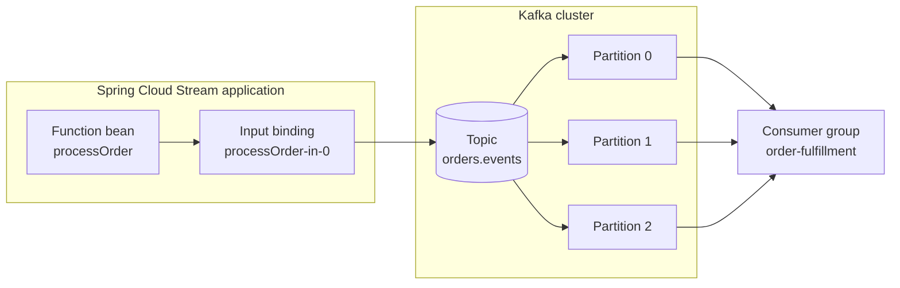
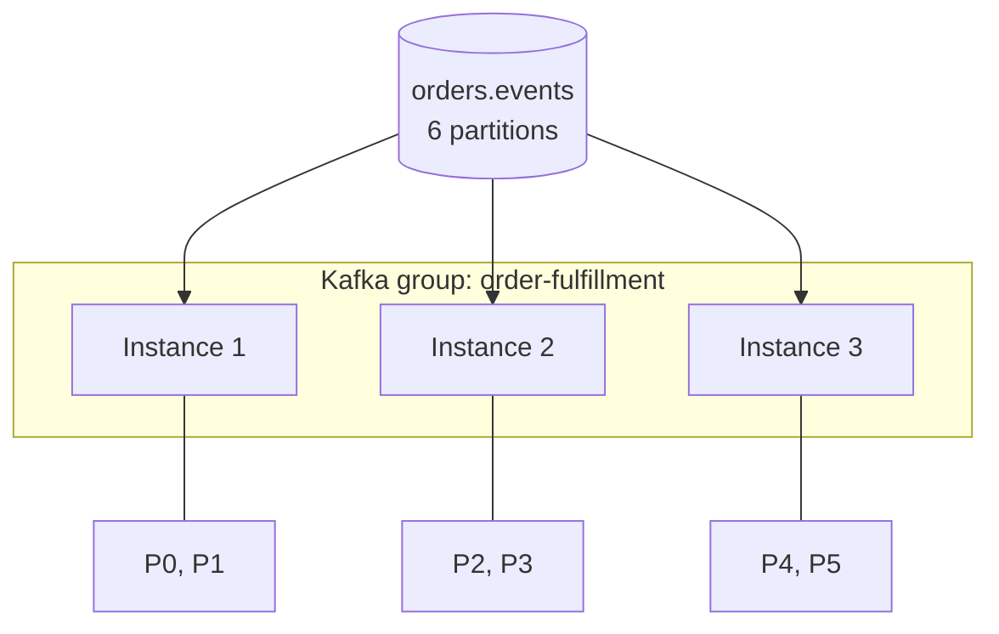
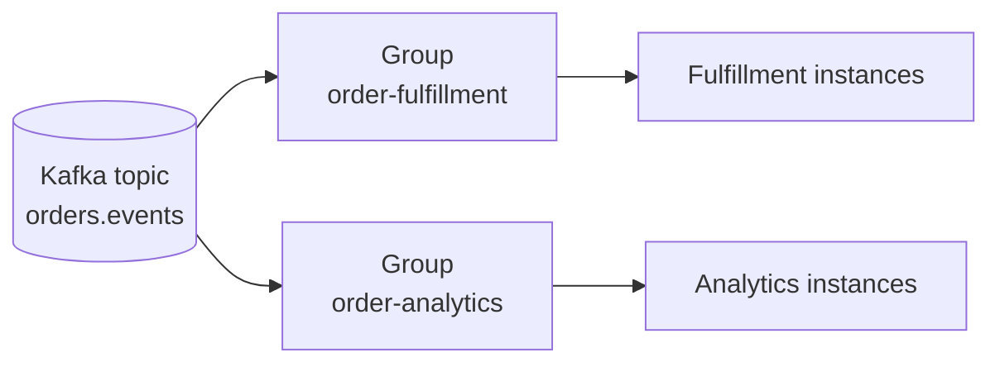
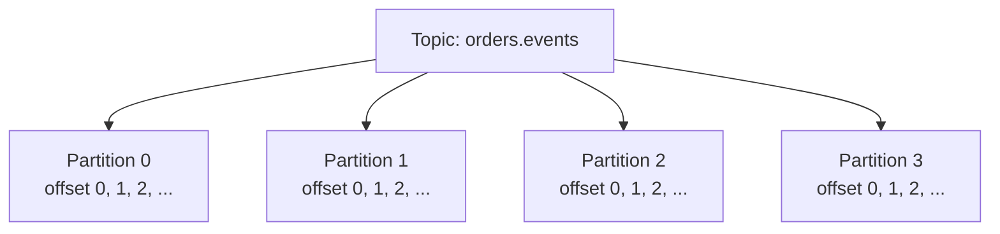

# Ánh xạ destination, group và partition sang mô hình Kafka

Spring Cloud Stream dùng binder để nối mô hình ứng dụng với message broker. Khi dùng Kafka binder, ba khái niệm cốt lõi được ánh xạ trực tiếp sang Kafka: **destination thành topic, consumer group thành Kafka consumer group, và partition thành topic partition**. Hiểu đúng ánh xạ này giúp bạn thiết kế producer, consumer, khả năng song song và thứ tự xử lý mà không nhầm binding name với topic hoặc nhầm group ứng dụng với số instance.

Bài học này tập trung vào mô hình function của Spring Cloud Stream và Kafka binder. Bạn sẽ lần theo một message từ function bean, qua binding, tới topic, key và partition; sau đó xem Kafka phân phối partition cho các consumer trong cùng group như thế nào. Các ví dụ cũng giải thích cách tạo topic, chọn group, cấu hình concurrency, đọc offset và xử lý những lỗi ánh xạ thường gặp.

## 1. Bản đồ ánh xạ giữa Spring Cloud Stream và Kafka

Kafka binder chuyển các khái niệm của Spring Cloud Stream sang tài nguyên Kafka:

| Spring Cloud Stream | Kafka | Vai trò |
|---|---|---|
| Binding destination | Topic | Nơi producer ghi và consumer đọc record |
| Binding group (input) | Consumer group ID | Danh tính nhóm consumer và namespace offset |
| Partition | Topic partition | Log có thứ tự, đơn vị Kafka phân phối cho consumer |
| Message key | Record key | Thường dùng để chọn partition và giữ thứ tự theo key |
| Consumer concurrency/instances | Consumer members trong group | Các thành viên cùng chia partition |
| Binding name | Tên cổng logic trong ứng dụng | Dùng để cấu hình binding, không nhất thiết là tên topic |

Sơ đồ tổng quát:



Binding là điểm nối giữa function và binder. Destination xác định topic mà binding sử dụng. Với input binding, group xác định nhóm consumer đọc topic. Topic có các partition; Kafka coordinator gán những partition đó cho các member trong từng group.

Một điều cần nhớ: binding name chỉ là tên logic bên trong ứng dụng. Topic là tài nguyên trên Kafka. Group là danh tính consumer trên Kafka. Partition là phần log được Kafka quản lý. Các tên có thể giống nhau trong ví dụ nhỏ, nhưng chúng không phải cùng một khái niệm.

## 2. Từ function bean đến binding name

Trong mô hình function, Spring Cloud Stream tạo tên binding dựa trên tên bean và chữ ký hàm.

Ví dụ:

```java
@Bean
Consumer<OrderCreated> processOrder(OrderService service) {
    return event -> service.handle(event);
}

@Bean
Supplier<OrderCreated> publishOrder(OrderSource source) {
    return source::next;
}
```

Các binding mặc định là:

- Input của `processOrder`: `processOrder-in-0`.
- Output của `publishOrder`: `publishOrder-out-0`.

Với function có nhiều input, các cổng được đánh số theo thứ tự tham số, ví dụ `enrichOrder-in-0` và `enrichOrder-in-1`. Output của function có một cổng output thường mang hậu tố `-out-0`.

Cấu hình có thể dùng binding name này:

```yaml
spring:
  cloud:
    function:
      definition: processOrder;publishOrder
    stream:
      bindings:
        processOrder-in-0:
          destination: orders.events
          group: order-fulfillment
        publishOrder-out-0:
          destination: orders.events
```

Trong ví dụ, `processOrder-in-0` và `publishOrder-out-0` là binding name. Cả hai cùng trỏ tới destination `orders.events`. Kafka binder sẽ dùng topic `orders.events` cho cả producer và consumer.

Nếu không khai báo `destination`, Spring Cloud Stream thường dùng binding name làm destination mặc định. Vì vậy, khi thấy một topic có tên giống `processOrder-in-0`, có thể đó là kết quả của việc bỏ trống destination; không có quy tắc bắt buộc binding name phải giống tên topic.

### Có thể đổi binding name không?

Spring Cloud Stream cho phép ánh xạ tên binding mặc định sang tên thân thiện hơn qua thuộc tính `spring.cloud.stream.function.bindings`. Ví dụ:

```yaml
spring:
  cloud:
    function:
      definition: processOrder
      bindings:
        processOrder-in-0: ordersInput
    stream:
      bindings:
        ordersInput:
          destination: orders.events
          group: order-fulfillment
```

Sau khi đổi tên binding, các thuộc tính cấu hình của binding cần tham chiếu tên mới. Đây là lớp tên bổ sung để tổ chức cấu hình; nó không đổi topic trên Kafka nếu destination vẫn giữ nguyên.

Với phần lớn ứng dụng, giữ binding name theo quy ước function giúp dễ truy vết từ bean sang cấu hình. Chỉ tạo alias khi có lợi ích rõ ràng cho việc đọc cấu hình hoặc khi tích hợp với convention của hệ thống.

## 3. Destination ánh xạ thành Kafka topic

Trong Kafka binder, destination của một binding được ánh xạ trực tiếp thành tên topic. Ví dụ:

```yaml
spring:
  cloud:
    stream:
      bindings:
        processOrder-in-0:
          destination: orders.events
          group: order-fulfillment
```

Input binding `processOrder-in-0` đọc topic `orders.events`. Producer binding có `destination: orders.events` sẽ ghi record vào cùng topic đó.

Một topic có thể có nhiều producer và nhiều consumer group. Spring Cloud Stream không tạo một topic riêng cho mỗi function nếu các binding được cấu hình cùng destination.

### Destination mặc định

Nếu không chỉ định destination, binding name được dùng làm tên destination. Ví dụ:

```yaml
spring:
  cloud:
    stream:
      bindings:
        processOrder-in-0:
          group: order-fulfillment
```

Trong trường hợp này, destination mặc định là `processOrder-in-0`. Nếu bạn muốn đọc topic đã tồn tại tên `orders.events`, phải khai báo destination rõ ràng.

### Một binding có thể đọc nhiều topic

Core binding properties hỗ trợ khai báo nhiều destination cho input binding bằng danh sách tên phân tách bằng dấu phẩy. Ví dụ:

```yaml
spring:
  cloud:
    stream:
      bindings:
        processOrder-in-0:
          destination: orders.created,orders.imported
          group: order-fulfillment
```

Cách dùng này cần cân nhắc kỹ vì hai topic có thể có schema, key, retention và tốc độ khác nhau. Nếu chúng cùng đi vào một function, code xử lý phải nhận biết loại event hoặc có hợp đồng payload tương thích. Với yêu cầu topic discovery theo pattern, Kafka binder có thuộc tính riêng để xem destination như regular expression; khi dùng pattern, binder không provision topic và một số chức năng như DLQ không khả dụng vì binder không biết trước toàn bộ topic cần xử lý.

### Chọn Kafka cluster

Destination chỉ xác định topic name. Kafka binder instance xác định cluster mà topic đó thuộc về. Cấu hình broker ở cấp binder:

```yaml
spring:
  cloud:
    stream:
      kafka:
        binder:
          brokers: kafka-1.internal:9092,kafka-2.internal:9092
```

`brokers` là danh sách broker mà binder kết nối. Nó không phải destination và không phải tên topic. Nếu ứng dụng kết nối nhiều Kafka cluster, cần cấu hình nhiều binder instance và gán binder phù hợp cho từng binding; cùng một tên destination ở hai cluster là hai topic độc lập.

## 4. Group ánh xạ thành Kafka consumer group ID

Thuộc tính `group` chỉ áp dụng cho input binding. Với Kafka binder, giá trị này được dùng làm Kafka consumer group ID. Ví dụ:

```yaml
spring:
  cloud:
    stream:
      bindings:
        processOrder-in-0:
          destination: orders.events
          group: order-fulfillment
```

Kafka ghi nhận tiến độ tiêu thụ bằng offset theo topic partition và consumer group. Vì vậy, group ID không chỉ là nhãn mô tả ứng dụng; nó xác định một bộ offset độc lập trên Kafka.

### Nhiều instance cùng group

Giả sử triển khai ba instance của service fulfillment với cùng cấu hình:

```yaml
spring:
  cloud:
    stream:
      bindings:
        processOrder-in-0:
          destination: orders.events
          group: order-fulfillment
```

Cả ba instance tham gia group `order-fulfillment`. Kafka phân phối partition của topic giữa các consumer member trong group. Mỗi partition tại một thời điểm chỉ được gán cho tối đa một member của group. Khi một record được đọc trong group, một member xử lý record đó; các member còn lại không nhận bản sao của cùng record trong group đó.

Sơ đồ:



Assignment thực tế do Kafka coordinator và partition assignor quyết định. Khi instance được thêm, dừng hoặc mất kết nối, Kafka có thể rebalance để gán lại partition.

### Nhiều group cùng đọc một topic

Giả sử topic `orders.events` có hai consumer logic độc lập:

- `order-fulfillment` cập nhật trạng thái giao hàng.
- `order-analytics` xây dựng dữ liệu phân tích.

Cấu hình:

```yaml
spring:
  cloud:
    function:
      definition: processOrder;updateAnalytics
    stream:
      bindings:
        processOrder-in-0:
          destination: orders.events
          group: order-fulfillment
        updateAnalytics-in-0:
          destination: orders.events
          group: order-analytics
```

Hai group có offset riêng và mỗi group đọc toàn bộ luồng topic theo tiến độ của chính nó. Trong mỗi group, các instance cạnh tranh chia partition; giữa hai group, mỗi group có một luồng tiêu thụ độc lập.



Đây là khác biệt giữa **scale-out trong cùng group** và **fan-out giữa nhiều group**:

| Cấu hình | Kết quả |
|---|---|
| Nhiều instance, cùng destination và cùng group | Chia partition để xử lý song song; mỗi record thuộc về một member trong group |
| Nhiều group khác nhau, cùng destination | Mỗi group có thể đọc toàn bộ topic độc lập |
| Cùng destination nhưng group khác nhau | Tạo hai luồng xử lý logic, không chia sẻ offset |
| Cùng group nhưng binding chạy nhiều instance | Các instance là member của một consumer group |

### Không khai báo group

Nếu bỏ `group`, Spring Cloud Stream dùng anonymous consumer group. Anonymous group độc lập với các group khác, nhưng không phải lựa chọn phù hợp nếu cần một danh tính tiêu thụ ổn định qua lần triển khai. Với Kafka binder, anonymous consumer thường bắt đầu ở offset mới nhất khi chưa có offset được commit; explicit group mặc định bắt đầu từ earliest cho group mới, trừ khi cấu hình start offset khác. Các offset đã commit vẫn được ưu tiên.

Trong ứng dụng production, hãy khai báo group rõ ràng để offset được gắn với một logical consumer ổn định. Đổi group name có thể tạo một consumer group mới và làm thay đổi vị trí bắt đầu đọc nếu group đó chưa có committed offset. Vì vậy, đổi group không phải thao tác đổi tên vô hại.

## 5. Partition ánh xạ thành Kafka topic partition

Kafka topic được chia thành một hoặc nhiều partition. Mỗi partition là một log có thứ tự riêng, gồm các record có offset tăng dần. Kafka bảo đảm thứ tự đọc trong một partition, không bảo đảm một thứ tự toàn cục giữa nhiều partition.

Ví dụ topic `orders.events` có bốn partition:



Partition là đơn vị Kafka dùng để phân phối cho consumer member trong một group. Nếu topic có bốn partition, một group không thể có hơn bốn consumer member đang thực sự nhận partition cùng lúc. Có thể chạy nhiều instance hơn, nhưng một số instance sẽ không được gán partition.

### Partition assignment thuộc về Kafka

Với Kafka, consumer không cần cấu hình thủ công từng partition trong trường hợp thông thường. Kafka coordinator thực hiện assignment dựa trên các member trong group. Binder tạo consumer và tham gia group; Kafka quản lý rebalance và phân công partition.

Điều này khác với partitioning abstraction chung của Spring Cloud Stream trên một số middleware khác, nơi framework có thể cần thông tin partition count và selector ở cả producer/consumer. Kafka có partition native nên binder tận dụng trực tiếp cơ chế đó.

### Concurrency và số partition

Có hai yếu tố quyết định số consumer member:

- Số instance của ứng dụng.
- Thuộc tính `consumer.concurrency`, tức số consumer thread/container cho một binding trong mỗi instance.

Ví dụ topic có 12 partition, triển khai 3 instance, mỗi instance có concurrency 2. Tổng số consumer member tiềm năng là 6. Kafka có thể gán khoảng hai partition cho mỗi member nếu assignment cân bằng.

Cấu hình:

```yaml
spring:
  cloud:
    stream:
      bindings:
        processOrder-in-0:
          destination: orders.events
          group: order-fulfillment
          consumer:
            concurrency: 2
```

Nếu chạy 8 instance với concurrency 2, tổng số member là 16 trong khi topic chỉ có 12 partition. Ít nhất 4 member không được gán partition. Thêm instance không tự tăng throughput khi partition đã là giới hạn.

| Partition count | Instance count | Concurrency | Consumer member tối đa theo cấu hình | Kết quả |
|---:|---:|---:|---:|---|
| 12 | 3 | 1 | 3 | Mỗi member có thể nhận khoảng 4 partition |
| 12 | 3 | 2 | 6 | Mỗi member có thể nhận khoảng 2 partition |
| 12 | 6 | 2 | 12 | Có thể sử dụng hết 12 partition |
| 12 | 8 | 2 | 16 | Một số member không có partition |
| 4 | 6 | 1 | 6 | Hai member không có partition |

Con số phân phối cụ thể phụ thuộc partition assignor và trạng thái group; bảng chỉ minh họa giới hạn song song.

## 6. Message key quyết định partition ở phía producer

Kafka producer có thể gửi record kèm key. Key thường dùng để định tuyến record tới partition và giữ các record cùng key trên cùng partition. Ví dụ, nếu mọi sự kiện của một đơn hàng dùng `orderId` làm key, các event của đơn hàng đó thường được ghi vào cùng partition theo cùng partitioner và partition count.

Trong Spring Cloud Stream Kafka binder, có thể đặt key bằng header `KafkaHeaders.MESSAGE_KEY` hoặc thuộc tính mở rộng `message-key-expression`.

Ví dụ producer:

```java
@Bean
Supplier<Message<OrderCreated>> publishOrder(OrderSource source) {
    return () -> {
        OrderCreated event = source.next();

        return MessageBuilder.withPayload(event)
                .setHeader(KafkaHeaders.MESSAGE_KEY, event.orderId())
                .build();
    };
}
```

Cách khác là khai báo biểu thức key theo binding:

```yaml
spring:
  cloud:
    function:
      definition: publishOrder
    stream:
      bindings:
        publishOrder-out-0:
          destination: orders.events
      kafka:
        bindings:
          publishOrder-out-0:
            producer:
              message-key-expression: payload.orderId
```

`message-key-expression` được đánh giá trên outgoing message để tạo Kafka record key. Khi key được đặt, Kafka producer partitioner quyết định partition đích theo cấu hình và thuật toán đang dùng.

### Cùng key không có nghĩa là cùng consumer instance mãi mãi

Cùng key thường được đưa vào cùng partition khi partition count và partitioner không đổi. Kafka sau đó gán partition đó cho một member của group. Khi group rebalance, partition có thể chuyển sang member khác, nhưng thứ tự record trong partition vẫn được giữ.

Key giúp giữ thứ tự theo entity trong partition; key không ghim partition vào một pod hoặc một instance cố định.

### Khi không có key

Nếu record không có key, Kafka producer dùng partitioner mặc định để chọn partition. Cách phân phối cụ thể phụ thuộc Kafka client version và partitioner được cấu hình. Không nên giả định message không key sẽ luôn round-robin hoặc sẽ giữ thứ tự theo entity.

Nếu nghiệp vụ yêu cầu thứ tự theo đơn hàng, tài khoản hoặc thiết bị, hãy đặt key ổn định phản ánh đúng aggregate đó. Nếu không cần thứ tự theo key, có thể để Kafka phân phối theo partitioner mặc định.

## 7. Native Kafka key và partitioning chung của Spring Cloud Stream

Spring Cloud Stream có thuộc tính partitioning chung như `partition-key-expression` và `partition-count`. Chúng hữu ích cho middleware cần framework tính partition. Kafka đã hỗ trợ partitioning native, vì vậy thường không cần dùng generic partitioning khi chỉ muốn định tuyến bằng Kafka record key.

Ví dụ generic partitioning:

```yaml
spring:
  cloud:
    stream:
      bindings:
        publishOrder-out-0:
          destination: orders.events
          producer:
            partition-key-expression: payload.orderId
            partition-count: 12
```

Cơ chế chung của Spring Cloud Stream có thể tính partition dựa trên hash key và partition count. Cách tính này không nhất thiết giống thuật toán partition mặc định của Kafka producer. Vì vậy, không nên trộn hai cơ chế mà không hiểu kết quả trên wire.

Với Kafka native partitioning, ưu tiên đặt Kafka record key bằng `KafkaHeaders.MESSAGE_KEY` hoặc `message-key-expression`. Khi đó Kafka producer sử dụng partitioner của nó. Nếu cần một selector đặc biệt, hãy cấu hình rõ và kiểm thử partition thực tế.

Một quy tắc dễ nhớ:

- Muốn đặt Kafka record key: dùng Kafka message key.
- Muốn dùng generic partitioning của Spring Cloud Stream: dùng partition key expression và partition count theo đúng semantics của binder.
- Muốn consumer đọc partition: để Kafka coordinator assignment thực hiện trong consumer group thông thường.

## 8. Provision topic và số partition

Kafka binder có thể provision topic khi binding được khởi tạo, tùy cấu hình và quyền broker. Các thuộc tính quan trọng gồm:

| Thuộc tính | Phạm vi | Ý nghĩa |
|---|---|---|
| `spring.cloud.stream.kafka.binder.auto-create-topics` | Binder | Cho phép binder tự tạo topic khi cần |
| `spring.cloud.stream.kafka.binder.auto-add-partitions` | Binder | Cho phép binder bổ sung partition cho topic hiện có khi cần |
| `spring.cloud.stream.kafka.binder.min-partition-count` | Binder | Số partition tối thiểu binder yêu cầu khi provision |
| `spring.cloud.stream.bindings.<binding>.producer.partition-count` | Producer binding | Gợi ý số partition cho topic được provision |
| `spring.cloud.stream.kafka.binder.replication-factor` | Binder | Replication factor mặc định cho topic được binder tạo |
| `spring.cloud.stream.kafka.bindings.<binding>.producer.topic.replication-factor` | Producer binding | Ghi đè replication factor cho topic tương ứng |

Ví dụ:

```yaml
spring:
  cloud:
    stream:
      kafka:
        binder:
          brokers: localhost:9092
          auto-create-topics: true
          auto-add-partitions: false
          min-partition-count: 6
          replication-factor: 1
      bindings:
        publishOrder-out-0:
          destination: orders.events
          producer:
            partition-count: 12
```

Khi binder provision topic, số partition yêu cầu có thể dựa trên giá trị lớn hơn giữa `min-partition-count` và `partition-count` của producer. Nếu topic đã tồn tại với số partition thấp hơn yêu cầu và `auto-add-partitions` đang tắt, binder có thể không khởi động được binding. Nếu bật auto-add, binder có thể bổ sung partition khi đủ quyền.

`min-partition-count` chỉ có hiệu lực khi `auto-create-topics` hoặc `auto-add-partitions` được bật. `replication-factor` chỉ có ý nghĩa khi binder tạo topic; nó không tự thay đổi replication factor của topic đã có.

### Khi hạ tầng tạo topic trước

Trong production, đội nền tảng có thể quản lý topic bằng Terraform, Ansible hoặc công cụ quản trị Kafka. Khi đó có thể tắt tự tạo topic:

```yaml
spring:
  cloud:
    stream:
      kafka:
        binder:
          auto-create-topics: false
          auto-add-partitions: false
```

Topic phải tồn tại trước khi ứng dụng khởi động, và số partition phải phù hợp với concurrency/throughput dự kiến. Cần cấp quyền describe, read, write hoặc create theo đúng vai trò; không cấp quyền tạo topic cho ứng dụng nếu quy trình hạ tầng không cho phép.

### Tăng partition có thể ảnh hưởng ordering

Khi tăng partition count, record cũ vẫn nằm trong partition cũ. Record mới cùng key có thể được ánh xạ sang partition khác do số partition đã thay đổi. Vì vậy, không nên coi tăng partition là thao tác chỉ tăng hiệu năng mà không ảnh hưởng thứ tự theo key.

Nếu thứ tự xuyên suốt theo aggregate là bắt buộc, cần lập kế hoạch migration: xác định thời điểm cutover, xử lý backlog cũ, kiểm tra mapping mới và tránh để các event của cùng aggregate được xử lý đồng thời ở hai partition.

## 9. Offset gắn với group và partition

Kafka lưu offset đã tiêu thụ theo cặp consumer group và topic partition. Ví dụ group `order-fulfillment` có thể đã commit offset 120 ở partition 0 và offset 87 ở partition 1. Group `order-analytics` có offset độc lập, có thể đang ở partition 0 offset 95 và partition 1 offset 40.

Điều đó cho phép các nhóm xử lý cùng topic với tốc độ khác nhau. Analytics có thể chậm hơn fulfillment mà không làm thay đổi offset của group fulfillment.

### Start offset cho group mới

Kafka binder cung cấp `start-offset` để chọn vị trí bắt đầu cho group mới chưa có committed offset:

- `earliest`: bắt đầu từ record cũ nhất còn trong log.
- `latest`: bắt đầu từ record mới nhất, tức chỉ nhận record mới được ghi sau thời điểm bắt đầu.

Theo mặc định của Kafka binder, binding có explicit group dùng `earliest` cho group mới; anonymous group dùng `latest`. Các committed offset đã có sẽ được ưu tiên. Thuộc tính này không phải lệnh reset offset mỗi lần ứng dụng restart.

Ví dụ:

```yaml
spring:
  cloud:
    stream:
      bindings:
        processOrder-in-0:
          destination: orders.events
          group: order-fulfillment
      kafka:
        bindings:
          processOrder-in-0:
            consumer:
              start-offset: earliest
```

Nếu muốn reset offset đã commit, Kafka binder có thuộc tính riêng `reset-offsets` và quy tắc sử dụng cụ thể. Đây là thao tác có thể khiến message được đọc lại hoặc bỏ qua; chỉ dùng khi đã hiểu tác động tới side effect và dữ liệu.

### Đổi group name có thể khiến đọc lại dữ liệu

Khi đổi group từ `order-fulfillment` sang `order-fulfillment-v2`, Kafka xem đây là một group ID khác. Group mới không tự kế thừa offset của group cũ. Nếu start offset của group mới là earliest, nó có thể đọc lại toàn bộ record còn trong retention.

Vì vậy, đổi group có thể là cách chủ động tạo consumer độc lập hoặc replay, nhưng không phải cách an toàn để chỉ đổi tên service. Hãy kiểm tra offset và retention trước khi thay group.

## 10. Kết hợp destination, group và partition trong một ứng dụng

Ví dụ dưới đây có một producer và hai consumer logic. Producer ghi event vào topic `orders.events`. Consumer fulfillment và analytics cùng đọc topic nhưng dùng group khác nhau.

Java functions:

```java
@Bean
Supplier<Message<OrderCreated>> publishOrder(OrderSource source) {
    return () -> {
        OrderCreated event = source.next();
        return MessageBuilder.withPayload(event)
                .setHeader(KafkaHeaders.MESSAGE_KEY, event.orderId())
                .build();
    };
}

@Bean
Consumer<OrderCreated> processOrder(OrderFulfillment service) {
    return service::handle;
}

@Bean
Consumer<OrderCreated> updateAnalytics(OrderAnalytics service) {
    return service::record;
}
```

Cấu hình:

```yaml
spring:
  cloud:
    function:
      definition: publishOrder;processOrder;updateAnalytics
    stream:
      bindings:
        publishOrder-out-0:
          destination: orders.events
        processOrder-in-0:
          destination: orders.events
          group: order-fulfillment
          consumer:
            concurrency: 3
        updateAnalytics-in-0:
          destination: orders.events
          group: order-analytics
          consumer:
            concurrency: 2
      kafka:
        binder:
          brokers: localhost:9092
          auto-create-topics: true
          min-partition-count: 6
```

Cách đọc cấu hình:

1. `publishOrder-out-0` là output binding, destination `orders.events` ánh xạ thành Kafka topic.
2. Producer đặt record key bằng `orderId`. Kafka partitioner dùng key để chọn partition.
3. `processOrder-in-0` đọc cùng topic trong group `order-fulfillment`.
4. `updateAnalytics-in-0` đọc cùng topic trong group `order-analytics`.
5. Mỗi group có partition assignment và committed offset riêng.
6. `concurrency` điều khiển số consumer thread trong từng input binding của mỗi application instance; tổng số member còn bị giới hạn bởi partition count.

Trong ví dụ Java, record key đã được đặt bằng header `KafkaHeaders.MESSAGE_KEY`, vì vậy không cần khai báo thêm `message-key-expression` cho cùng binding. Nếu chọn cấu hình key bằng biểu thức, hãy bỏ phần đặt header trong Java và dùng một cách duy nhất để tránh cấu hình dư thừa.

Nếu topic có 6 partition, group fulfillment có concurrency 3 trên một instance có thể dùng tối đa ba consumer member từ binding đó; group analytics có concurrency 2 có thể dùng tối đa hai. Khi tăng số instance, tổng member của từng group tăng theo số instance và concurrency. Hai group không chia sẻ partition assignment với nhau.

## 11. Nhiều input binding và nhiều topic

Một function có thể nhận nhiều input binding. Ví dụ function kết hợp dữ liệu order với account:

```java
@Bean
BiFunction<OrderCreated, AccountSnapshot, EnrichedOrder> enrichOrder() {
    return (order, account) -> EnrichedOrder.from(order, account);
}
```

Tên binding mặc định:

- `enrichOrder-in-0` cho input thứ nhất.
- `enrichOrder-in-1` cho input thứ hai.
- `enrichOrder-out-0` cho output.

Cấu hình:

```yaml
spring:
  cloud:
    function:
      definition: enrichOrder
    stream:
      bindings:
        enrichOrder-in-0:
          destination: orders.events
          group: order-enrichment
        enrichOrder-in-1:
          destination: accounts.snapshots
          group: account-enrichment
        enrichOrder-out-0:
          destination: orders.enriched
```

Mỗi input binding có destination và group riêng. Hai binding có thể trỏ tới hai topic và có consumer group riêng. Kafka binder sẽ tạo consumer tương ứng cho từng binding.

Không nên nhầm nhiều input binding với một consumer group đọc nhiều topic. Nếu function cần đồng bộ hoặc join dữ liệu từ nhiều topic, cần hiểu rõ semantics xử lý và thời gian chờ dữ liệu. Kafka Streams binder có mô hình KStream/KTable và stateful join riêng; bài này tập trung vào Kafka message binder thông thường.

## 12. Những nhầm lẫn thường gặp

### Nhầm binding name với topic name

`processOrder-in-0` là tên binding, còn `orders.events` là topic do destination chỉ định. Khi topic được tạo với tên binding, đó là do destination mặc định, không phải vì hai khái niệm đồng nhất.

### Nhầm group với số instance

Group là danh tính logical consumer trên Kafka. Instance là một tiến trình ứng dụng. Nhiều instance có cùng group ID sẽ chia partition; chúng không tạo ra nhiều group độc lập.

### Dùng group khác nhau khi muốn scale một service

Nếu mỗi instance tự dùng group ID khác nhau, mỗi instance sẽ đọc toàn bộ topic thay vì chia tải. Để scale một logical service, tất cả instance cần dùng cùng group ID.

### Dùng cùng group khi muốn hai ứng dụng đều nhận đủ event

Nếu fulfillment và analytics dùng cùng group ID, chúng sẽ cạnh tranh chia partition. Một record có thể được fulfillment nhận, record khác được analytics nhận; cả hai ứng dụng không nhận đủ toàn bộ topic. Muốn mỗi ứng dụng nhận bản sao đầy đủ, dùng group khác nhau.

### Tăng concurrency vượt partition count

Kafka không thể gán một partition cho nhiều consumer member trong cùng group tại cùng thời điểm. Nếu tổng concurrency và instance count vượt partition count, một số member sẽ idle. Hãy tăng partition khi cần song song hơn và khi broker/ordering model cho phép.

### Đặt partition-key-expression mà quên Kafka record key

Generic partitioning của Spring Cloud Stream và native Kafka key là hai cơ chế khác nhau. Nếu cần Kafka partitioner dùng record key, hãy đặt Kafka message key. Không giả định mọi cấu hình partition chung đều tự động trở thành Kafka record key.

### Cho rằng group mới luôn bắt đầu từ đầu topic

Group mới có thể dùng start offset mặc định hoặc cấu hình cụ thể. Group explicit của Kafka binder thường bắt đầu earliest, anonymous group latest, nhưng committed offset và cấu hình reset có thể thay đổi kết quả. Kiểm tra offset trước khi chạy production.

### Cho rằng tăng partition không ảnh hưởng thứ tự

Tăng partition có thể làm thay đổi partition mapping của key cho record mới. Message cũ không được chuyển sang partition mới. Nếu một entity có event ở hai partition, consumer có thể xử lý chúng song song và hoàn tất khác thứ tự.

## 13. Kiểm tra mapping và theo dõi vận hành

Khi ứng dụng chạy, hãy xác minh ba lớp ánh xạ riêng biệt.

### Kiểm tra topic

Dùng Kafka admin tool hoặc broker UI để xem:

- Topic name có đúng destination không.
- Partition count có đủ cho concurrency dự kiến không.
- Replication factor và ISR có đáp ứng chính sách hạ tầng không.
- Topic properties như retention và cleanup policy có đúng yêu cầu không.

### Kiểm tra consumer group

Xem consumer group ID, member count, partition assignment và committed offset. Nếu một group có member nhiều hơn partition, một số member sẽ không nhận partition. Nếu ứng dụng vô tình dùng group ID khác nhau, mỗi group có thể đọc toàn bộ topic và tăng lượng xử lý.

### Kiểm tra partition và key

Ghi nhận topic, partition, offset và record key của message mẫu. Có thể dùng các Kafka metadata headers mà binder đưa vào message để quan sát partition nhận được. Với Spring Kafka, các header thường dùng gồm received partition và received key; tên header cụ thể nên kiểm tra theo phiên bản dependency.

Metrics cần theo dõi:

- Consumer lag theo group và partition.
- Message rate/byte rate theo partition.
- Số member và số partition được gán.
- Rebalance count và thời gian rebalance.
- Processing latency và lỗi deserialize.
- Tỷ lệ record không có key hoặc key có phân phối lệch.

Không log toàn bộ payload nhạy cảm chỉ để quan sát key. Có thể ghi event ID, topic, partition, offset và key đã được che/mã hóa theo chính sách dữ liệu.

## 14. Quy trình thiết kế destination, group và partition

Khi tạo một binding Kafka mới, hãy trả lời theo thứ tự:

1. **Function nào đọc hoặc ghi?** Xác định bean name và binding name mặc định.
2. **Topic nào chứa dữ liệu?** Khai báo destination tường minh để tránh vô tình tạo topic theo binding name.
3. **Ai là logical consumer?** Chọn group ID ổn định cho mỗi ứng dụng hoặc pipeline độc lập.
4. **Có bao nhiêu partition?** Ước lượng throughput, số instance và concurrency cần thiết.
5. **Key nào giữ thứ tự?** Chọn record key theo aggregate cần xử lý tuần tự.
6. **Topic được provision ở đâu?** Chọn binder auto-create hay hạ tầng tạo trước; thống nhất partition count và replication factor.
7. **Offset bắt đầu ở đâu?** Xác định startOffset cho group mới và quy trình replay/reset.
8. **Scale như thế nào?** Bảo đảm tổng consumer member của mỗi group phù hợp với partition count.
9. **Quan sát bằng gì?** Theo dõi group ID, topic, partition, offset, lag và rebalance.

### Checklist trước khi deploy

- Destination trỏ đúng Kafka topic.
- Binding name được dùng đúng trong mọi thuộc tính core và Kafka extended properties.
- Group ID được khai báo rõ cho consumer production.
- Các instance của cùng logical service dùng chung group ID.
- Các ứng dụng cần nhận bản sao độc lập dùng group ID khác nhau.
- Topic có đủ partition cho concurrency và số instance dự kiến.
- Record key phản ánh đúng aggregate cần giữ thứ tự.
- Không trộn generic partitioning với native Kafka key nếu chưa kiểm thử.
- Auto-create/auto-add topic phù hợp với chính sách hạ tầng.
- Start offset và committed offsets đã được xem xét.
- Consumer lag và partition assignment có dashboard/cảnh báo.
- Kịch bản tăng partition đã đánh giá ảnh hưởng tới ordering.

Destination, group và partition là ba điểm ánh xạ chính giữa Spring Cloud Stream và Kafka. Destination chọn topic; group chọn namespace offset và quan hệ cạnh tranh của consumer; partition chia topic thành các log có thứ tự và giới hạn song song trong mỗi group. Record key nối dữ liệu nghiệp vụ với partition. Khi thiết kế theo đúng các ranh giới đó, bạn có thể mở rộng consumer, tạo nhiều pipeline độc lập và giữ thứ tự theo key mà không nhầm các tên logic của framework với tài nguyên thật trên Kafka.

## Tài liệu tham khảo

- [Spring Cloud Stream Kafka Binder Reference Guide](https://docs.spring.io/spring-cloud-stream/docs/current/reference/html/spring-cloud-stream-binder-kafka.html)
- [Spring Cloud Stream — Binding Properties](https://docs.spring.io/spring-cloud-stream/reference/spring-cloud-stream/binding-properties.html)
- [Spring Cloud Stream — Consumer Groups](https://docs.spring.io/spring-cloud-stream/reference/spring-cloud-stream/consumer-groups.html)
- [Apache Kafka — Documentation](https://kafka.apache.org/documentation/)

