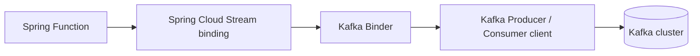

# Kết nối broker và phân cấp cấu hình Kafka Binder

Kafka Binder kết nối các binding của Spring Cloud Stream với Apache Kafka. Khi ứng dụng phát hoặc nhận message, binder quản lý producer, consumer, destination và việc ánh xạ cấu hình chung của Spring Cloud Stream sang thuộc tính riêng của Kafka. Để cấu hình ổn định, cần phân biệt cấu hình kết nối broker, cấu hình binding của ứng dụng, cấu hình mở rộng của Kafka Binder và cấu hình client Kafka.

Các lớp cấu hình này giải quyết những câu hỏi khác nhau: kết nối tới cluster nào, binding dùng topic và consumer group nào, consumer/producer cần hành vi Kafka nào, và Kafka client sử dụng bảo mật hoặc hiệu năng ra sao. Đặt đúng thuộc tính vào đúng lớp giúp tránh cấu hình bị bỏ qua, tránh hai binding vô tình dùng chung một group và giúp triển khai cùng ứng dụng qua local, staging và production.

## 1. Kafka Binder nằm ở đâu trong ứng dụng?

Ứng dụng Spring Cloud Stream thường khai báo function và binding. Function mô tả logic xử lý; binding mô tả đầu vào hoặc đầu ra; Kafka Binder kết nối binding với topic Kafka.

Ví dụ function nhận sự kiện đơn hàng:

```java
@Bean
Consumer<OrderCreated> recordOrder(OrderService service) {
    return service::record;
}
```

Spring Cloud Stream tạo binding đầu vào theo tên function là `recordOrder-in-0`. Kafka Binder kết nối binding đó với topic được khai báo trong cấu hình.

Sơ đồ khái quát:



Binder chịu trách nhiệm tích hợp message với Kafka. Mã nghiệp vụ không cần tự tạo `KafkaConsumer` hoặc `KafkaProducer` khi sử dụng mô hình function của Spring Cloud Stream.

Để dùng Kafka Binder, dự án thường thêm starter:

```xml
<dependency>
    <groupId>org.springframework.cloud</groupId>
    <artifactId>spring-cloud-starter-stream-kafka</artifactId>
</dependency>
```

Phiên bản starter cần được quản lý bằng Spring Cloud BOM tương thích với phiên bản Spring Boot của ứng dụng. Tránh tự ghép phiên bản Spring Cloud Stream, Kafka Binder và Spring Kafka từ các dòng phát hành không tương thích.

## 2. Bốn lớp cấu hình cần phân biệt

Kafka Binder có nhiều nhóm thuộc tính. Có thể tổ chức chúng theo trách nhiệm:

| Lớp | Prefix tiêu biểu | Trách nhiệm |
|---|---|---|
| Binder-level | `spring.cloud.stream.kafka.binder.*` | Broker, bảo mật, provisioning và thiết lập chung cho binder |
| Binding chung | `spring.cloud.stream.bindings.<bindingName>.*` | Destination, group, content type, concurrency và retry chung |
| Kafka extended binding | `spring.cloud.stream.kafka.bindings.<bindingName>.*` | Hành vi Kafka riêng cho consumer hoặc producer của binding |
| Kafka client properties | `configuration`, `consumer-properties`, `producer-properties` | Thuộc tính của Kafka client như security, compression hoặc fetch |

Không nên đặt tất cả thuộc tính dưới `spring.cloud.stream.kafka.binder`. Ví dụ, tên topic và consumer group thuộc cấu hình binding; `startOffset` là thuộc tính Kafka consumer mở rộng; `security.protocol` là thuộc tính Kafka client.

Tên binding phải khớp tên do Spring Cloud Function tạo ra. Với function `recordOrder`, đầu vào là `recordOrder-in-0`; nếu function có đầu ra thì binding tương ứng là `recordOrder-out-0`. Với nhiều input hoặc output, chỉ số cuối phản ánh vị trí của đầu vào/đầu ra trong chữ ký function.

## 3. Cấu hình kết nối tới Kafka broker

Thuộc tính binder-level `brokers` xác định địa chỉ bootstrap broker. Ví dụ chạy local:

```yaml
spring:
  cloud:
    stream:
      kafka:
        binder:
          brokers:
            - localhost:9092
```

Có thể khai báo một hoặc nhiều địa chỉ bootstrap. Client dùng danh sách này để tìm cluster; sau khi kết nối, Kafka cung cấp metadata về broker và partition liên quan.

Một cấu hình dạng chuỗi cũng thường được dùng:

```yaml
spring:
  cloud:
    stream:
      kafka:
        binder:
          brokers: localhost:9092,localhost:9093
```

Địa chỉ bootstrap không phải danh sách cố định mọi broker trong cluster. Chỉ cần cung cấp một số broker có thể truy cập để client lấy metadata; các địa chỉ được Kafka trả về sau đó cũng phải có thể truy cập từ môi trường chạy ứng dụng.

Trong container hoặc Kubernetes, `localhost` thường trỏ về chính container/pod, không phải máy host hoặc broker ở container khác. Dùng DNS/service name hoặc advertised listener phù hợp với mạng triển khai.

## 4. Cấu hình một consumer binding hoàn chỉnh

Ví dụ một consumer nhận sự kiện từ topic `orders.created`:

```yaml
spring:
  cloud:
    function:
      definition: recordOrder
    stream:
      bindings:
        recordOrder-in-0:
          destination: orders.created
          group: order-service
          content-type: application/json
          consumer:
            concurrency: 3
            max-attempts: 4
      kafka:
        binder:
          brokers:
            - kafka-1.internal:9092
            - kafka-2.internal:9092
```

Ý nghĩa:

- `definition` chọn function bean sẽ được kết nối.
- `destination` chỉ định topic Kafka.
- `group` định danh consumer group.
- `content-type` mô tả định dạng payload ở tầng Spring Cloud Stream.
- `concurrency` điều khiển số consumer instance/thread được binder tạo trong một ứng dụng theo khả năng cấu hình của binder.
- `max-attempts` thiết lập retry chung cho consumer binding.
- `brokers` xác định cluster Kafka.

Tên group cần ổn định qua các lần triển khai nếu ứng dụng muốn tiếp tục từ committed offset hiện có. Các instance cùng group chia partition theo cơ chế Kafka. Nếu hai dịch vụ độc lập đều cần nhận toàn bộ sự kiện, chúng cần group riêng.

Số consumer thực sự hoạt động song song còn phụ thuộc số partition được gán cho group. Tăng `concurrency` lớn hơn số partition không tự tạo thêm partition hoặc tăng số luồng xử lý record độc lập.

## 5. Cấu hình một producer binding

Producer binding khai báo destination và content type. Có thể thêm Kafka-specific property như record key hoặc compression:

```yaml
spring:
  cloud:
    function:
      definition: publishOrder
    stream:
      bindings:
        publishOrder-out-0:
          destination: orders.created
          content-type: application/json
      kafka:
        bindings:
          publishOrder-out-0:
            producer:
              message-key-expression: payload.customerId
```

Trong ví dụ, `message-key-expression` lấy `customerId` làm Kafka record key. Kafka producer dùng key theo partitioner đang cấu hình nếu binder không chỉ định partition tường minh. Record key cũng được lưu trong record để consumer hoặc cơ chế log compaction sử dụng.

Có thể cấu hình client producer như compression ở cấp binder hoặc binding tùy thuộc phạm vi mong muốn. Ví dụ cấu hình chung cho mọi producer client của binder:

```yaml
spring:
  cloud:
    stream:
      kafka:
        binder:
          producer-properties:
            compression.type: zstd
```

Khi chọn compression, cần kiểm tra phiên bản Kafka client, broker và yêu cầu tương thích. Nén giảm dung lượng truyền/lưu nhưng tiêu tốn CPU; benchmark bằng dữ liệu thực tế trước khi áp dụng rộng.

## 6. Binder-level provisioning: tạo topic và partition

Kafka Binder có thể hỗ trợ provision topic và bổ sung partition theo cấu hình. Một số thuộc tính thường gặp:

| Thuộc tính | Vai trò |
|---|---|
| `auto-create-topics` | Cho phép binder tự tạo topic khi destination chưa tồn tại, nếu broker cho phép |
| `auto-add-partitions` | Cho phép binder bổ sung partition khi số partition yêu cầu lớn hơn hiện có |
| `min-partition-count` | Số partition tối thiểu binder dùng khi provision |
| `replication-factor` | Replication factor dùng khi binder tạo topic |

Ví dụ:

```yaml
spring:
  cloud:
    stream:
      kafka:
        binder:
          auto-create-topics: false
          auto-add-partitions: false
          min-partition-count: 6
          replication-factor: 3
```

Cấu hình trên thể hiện cách ứng dụng yêu cầu topic được provision bên ngoài và đặt giá trị provisioning nếu binder thực hiện tạo topic. Khi tắt tự tạo topic và tự thêm partition, topic phải được tạo trước bằng công cụ quản trị hoặc pipeline hạ tầng.

Các mặc định của provisioning có thể thay đổi theo phiên bản binder và môi trường broker. Không dựa vào mặc định cho production. Hãy xác định rõ ai sở hữu vòng đời topic, số partition, replication factor, retention, cleanup policy và ACL. Nếu broker không cho phép ứng dụng tạo topic, quyền admin cần được tách khỏi quyền producer/consumer runtime.

## 7. Cấu hình Kafka client dùng chung

Kafka Binder cho phép truyền các thuộc tính client Kafka qua map `configuration`. Các thuộc tính này áp dụng ở phạm vi binder theo quy tắc của phiên bản đang dùng.

Ví dụ bật TLS/SASL:

```yaml
spring:
  cloud:
    stream:
      kafka:
        binder:
          brokers:
            - kafka-prod.internal:9093
          configuration:
            security.protocol: SASL_SSL
            sasl.mechanism: PLAIN
            sasl.jaas.config: ${KAFKA_SASL_JAAS_CONFIG}
```

`KAFKA_SASL_JAAS_CONFIG` là biến môi trường hoặc secret được cung cấp ở runtime. Không ghi username, password, JAAS string, truststore password hoặc private key trực tiếp vào file cấu hình được commit.

Một số thuộc tính bảo mật khác có thể gồm truststore/keystore location, endpoint identification algorithm hoặc cơ chế SASL cụ thể. Tên và yêu cầu của chúng phụ thuộc cấu hình Kafka cluster. Dùng đúng cơ chế do đội vận hành Kafka cung cấp và xác minh kết nối từ chính môi trường chạy ứng dụng.

Cấu hình `configuration` là map thuộc tính Kafka client, không phải nơi đặt `destination`, `group` hay `content-type`. Các giá trị binder-level có thể được dùng chung cho producer, consumer và các client liên quan; hãy dùng map chuyên biệt nếu chỉ muốn áp dụng thuộc tính cho một loại client.

## 8. Tách cấu hình producer và consumer client

Có trường hợp producer và consumer cần thiết lập khác nhau. Kafka Binder cung cấp các map `producer-properties` và `consumer-properties` ở cấp binder để cấu hình riêng từng loại client.

Ví dụ:

```yaml
spring:
  cloud:
    stream:
      kafka:
        binder:
          consumer-properties:
            max.poll.records: 200
            isolation.level: read_committed
          producer-properties:
            compression.type: lz4
            acks: all
```

Ví dụ này đặt giới hạn số record mỗi lần consumer poll, chọn chế độ đọc committed transaction và cấu hình compression/acknowledgement cho producer client. Các thuộc tính Kafka client phải đúng kiểu và được hỗ trợ bởi phiên bản Kafka client đi kèm binder.

Cần cân nhắc tác động:

- `max.poll.records` ảnh hưởng số record trả về trong một lần poll; giá trị lớn có thể tăng throughput nhưng làm tăng thời gian xử lý batch và nguy cơ vượt `max.poll.interval.ms`.
- `isolation.level=read_committed` chỉ đọc record thuộc transaction đã commit khi producer sử dụng Kafka transactions.
- `compression.type` ảnh hưởng CPU và dung lượng record batch.
- `acks=all` yêu cầu mức xác nhận mạnh hơn từ Kafka leader/ISR, nhưng vẫn cần cấu hình replication factor và `min.insync.replicas` phù hợp.

Không dùng một thuộc tính chỉ vì tên của nó quen thuộc từ Kafka client. Kiểm tra nó thuộc producer hay consumer và đặt trong map tương ứng.

## 9. Cấu hình mở rộng theo từng binding

Một binder có thể phục vụ nhiều binding nhưng mỗi binding cần hành vi Kafka khác nhau. Khi đó dùng prefix `spring.cloud.stream.kafka.bindings.<bindingName>`.

Ví dụ consumer binding cần đọc từ đầu khi group chưa có offset hợp lệ:

```yaml
spring:
  cloud:
    stream:
      bindings:
        auditEvents-in-0:
          destination: audit.events
          group: audit-reader
      kafka:
        bindings:
          auditEvents-in-0:
            consumer:
              start-offset: earliest
```

`start-offset` là thuộc tính mở rộng của Kafka consumer binding. Nó liên quan vị trí bắt đầu trong trường hợp không có committed offset phù hợp; không có nghĩa mỗi lần restart đều đọc lại từ đầu nếu group đã có offset hợp lệ.

Ví dụ producer binding dùng một biểu thức Kafka-specific để lấy record key:

```yaml
spring:
  cloud:
    stream:
      bindings:
        publishAudit-out-0:
          destination: audit.events
      kafka:
        bindings:
          publishAudit-out-0:
            producer:
              message-key-expression: payload.aggregateId
```

Các thuộc tính mở rộng khác có thể liên quan tới dead-letter topic, auto commit/acknowledgement, transaction, topic properties, header mapping hoặc consumer offset. Danh sách chính xác phụ thuộc phiên bản Kafka Binder. Đọc reference của đúng release train trước khi đưa property mới vào cấu hình production.

Không nhầm extended binding properties với thuộc tính Kafka client. Ví dụ `start-offset` là cách binder cấu hình vị trí bắt đầu; `max.poll.records` là thuộc tính consumer client. Cả hai đều có thể ảnh hưởng consumer nhưng được khai báo ở các nhóm khác nhau.

## 10. Nhiều Kafka Binder trong cùng một ứng dụng

Một ứng dụng có thể cần kết nối hai Kafka cluster, chẳng hạn cluster nghiệp vụ và cluster lưu trữ. Khi đó khai báo nhiều binder instance có tên, mỗi instance có environment riêng.

Ví dụ:

```yaml
spring:
  cloud:
    stream:
      binders:
        kafkaPrimary:
          type: kafka
          environment:
            spring:
              cloud:
                stream:
                  kafka:
                    binder:
                      brokers:
                        - kafka-primary.internal:9092
          default-candidate: false
        kafkaArchive:
          type: kafka
          environment:
            spring:
              cloud:
                stream:
                  kafka:
                    binder:
                      brokers:
                        - kafka-archive.internal:9092
          default-candidate: false
      bindings:
        publishOrders-out-0:
          destination: orders
          binder: kafkaPrimary
        archiveOrders-out-0:
          destination: orders.archive
          binder: kafkaArchive
```

Mỗi binder có cấu hình kết nối riêng. Thuộc tính `binder` của binding chọn binder instance tương ứng. `default-candidate: false` loại binder khỏi lựa chọn mặc định khi framework cần chọn binder tự động; cách chọn binder mặc định vẫn cần được cấu hình rõ nếu có nhiều loại binder trên classpath.

Khi nhiều binder cùng loại nhưng kết nối cluster khác nhau, không nên dùng một cấu hình broker toàn cục rồi kỳ vọng mỗi binding tự chọn cluster. Đặt broker trong environment của từng binder để tách biệt connection, credential và client properties.

Cần kiểm tra quyền truy cập của từng cluster, serializer tương thích, topic tồn tại và chính sách retry/DLQ riêng. Message phát thành công ở cluster chính không đồng nghĩa message đã được sao chép sang cluster archive; đó là hai lần publish độc lập và có thể có kết quả khác nhau.

## 11. Chọn binder mặc định và gán binder rõ ràng

Nếu ứng dụng chỉ có một binder, framework thường có thể tự chọn binder đó. Khi có nhiều binder, có thể khai báo binder mặc định:

```yaml
spring:
  cloud:
    stream:
      default-binder: kafkaPrimary
```

Binding có thể ghi đè lựa chọn mặc định bằng thuộc tính `binder` riêng. Cách làm này hữu ích khi hầu hết binding đi tới một cluster nhưng một số binding cần cluster khác.

Nên gán binder rõ ràng khi:

- Có nhiều Kafka cluster.
- Có Kafka Binder và một binder khác cùng trên classpath.
- Một số binding dùng broker khác nhau.
- Cần kiểm soát credential, network và provisioning theo cluster.

Tên binder là alias trong cấu hình ứng dụng, không phải tên topic hoặc group Kafka. Đặt tên có ý nghĩa theo vai trò như `kafkaPrimary`, `kafkaAnalytics`, `kafkaArchive`, tránh tên mơ hồ như `binder1`.

## 12. Externalize cấu hình theo môi trường

Cùng một artifact nên chạy được ở local, staging và production bằng cách thay đổi cấu hình ngoài. Ví dụ:

```yaml
spring:
  cloud:
    stream:
      kafka:
        binder:
          brokers: ${KAFKA_BOOTSTRAP_SERVERS:localhost:9092}
          configuration:
            security.protocol: ${KAFKA_SECURITY_PROTOCOL:PLAINTEXT}
```

Local có thể dùng giá trị mặc định không bảo mật trong môi trường phát triển riêng. Staging và production nên cấp biến môi trường/secret phù hợp với cluster thật. Không dùng cấu hình fallback `PLAINTEXT` trong production nếu môi trường yêu cầu TLS/SASL.

Có thể tách cấu hình theo Spring profile:

```yaml
# application-local.yml
spring:
  cloud:
    stream:
      kafka:
        binder:
          brokers: localhost:9092
```

```yaml
# application-prod.yml
spring:
  cloud:
    stream:
      kafka:
        binder:
          brokers: ${KAFKA_BOOTSTRAP_SERVERS}
          configuration:
            security.protocol: SASL_SSL
            sasl.mechanism: PLAIN
            sasl.jaas.config: ${KAFKA_SASL_JAAS_CONFIG}
```

Profile giúp tách cấu hình môi trường, còn secret nên được cấp qua secret manager hoặc cơ chế quản lý secret của nền tảng triển khai. Không commit file production chứa thông tin xác thực thật.

## 13. Phân biệt cấu hình Kafka Binder với spring.kafka

Spring Boot có nhóm thuộc tính `spring.kafka.*` cho các thành phần sử dụng Kafka auto-configuration của Spring Boot. Spring Cloud Stream Kafka Binder có nhóm thuộc tính riêng dưới `spring.cloud.stream.kafka.*`.

Không giả định một thuộc tính đặt dưới `spring.kafka.*` chắc chắn được mọi Kafka Binder client sử dụng. Binder tạo và quản lý các client phục vụ binding theo cấu hình của nó. Với thuộc tính kết nối, bảo mật hoặc client cần áp dụng cho binder, ưu tiên dùng các thuộc tính Kafka Binder được tài liệu hóa như `brokers`, `configuration`, `consumer-properties`, `producer-properties` hoặc cấu hình mở rộng theo binding.

Nếu ứng dụng đồng thời dùng `KafkaTemplate` trực tiếp và Kafka Binder, hai nhóm cấu hình có thể phục vụ hai đường client khác nhau. Hãy cấu hình và kiểm thử cả hai đường một cách tường minh; không dựa vào việc chúng tự động chia sẻ toàn bộ bootstrap server, serializer hoặc credential.

## 14. Thứ tự ưu tiên và xử lý xung đột

Cấu hình Spring được tổng hợp từ nhiều property source như file YAML, profile, biến môi trường, system property và command line. Nguồn có độ ưu tiên cao hơn có thể ghi đè giá trị ở nguồn thấp hơn. Ngoài ra, Kafka Binder có cấu hình ở cấp binder và cấp binding.

Một cách kiểm tra có hệ thống:

1. Xác định binding name thực tế từ tên function.
2. Kiểm tra common binding properties: destination, group, content type.
3. Kiểm tra Kafka extended properties của đúng binding.
4. Kiểm tra binder-level broker và client configuration.
5. Kiểm tra property source đang ghi đè qua profile, biến môi trường hoặc deployment manifest.
6. Xem log khởi động và cấu hình hiệu lực mà ứng dụng công khai an toàn qua Actuator/config diagnostics nếu được bật.

Không nên khẳng định một quy tắc ưu tiên chung cho mọi thuộc tính nếu tài liệu binder không quy định. Một số thuộc tính có cấu hình riêng ở nhiều cấp; cách merge hoặc override có thể khác nhau. Với property quan trọng như security, serializer, offset hoặc acknowledgement, hãy kiểm tra reference của phiên bản đang chạy và xác minh trong integration test.

Tránh khai báo cùng một giá trị ở nhiều cấp nếu không cần. Ví dụ, nếu `brokers` đã được cấu hình tại environment của một binder instance, không nên thêm một broker khác ở cấp toàn cục mà không chủ đích. Cấu hình trùng lặp làm khó xác định client thực tế đang kết nối tới cluster nào.

## 15. Kiểm tra cấu hình khi ứng dụng khởi động

Khi ứng dụng không kết nối được Kafka, nên kiểm tra theo thứ tự từ ngoài vào trong:

- DNS/hostname và port có thể truy cập từ container hoặc máy chạy ứng dụng.
- Kafka advertised listeners trả về địa chỉ mà ứng dụng truy cập được.
- TLS truststore/certificate và hostname verification phù hợp.
- SASL mechanism, username/password hoặc JAAS config đúng.
- ACL cho topic, group và transactional ID nếu dùng transaction.
- Destination topic đã tồn tại hoặc binder có quyền provision.
- Binding name và binder alias được khai báo đúng.
- Serializer/deserializer và content type tương thích payload.
- Consumer group có partition được gán và offset policy phù hợp.

Các lỗi thường gặp:

| Triệu chứng | Nguyên nhân có thể | Nơi kiểm tra |
|---|---|---|
| Connection timeout | Sai hostname/port, network policy hoặc advertised listener | `brokers`, network và Kafka listener |
| Authentication failed | SASL/SSL hoặc secret sai | `binder.configuration` |
| Topic authorization failed | ACL không cho đọc/ghi hoặc tạo topic | Topic ACL và group ACL |
| Topic không tồn tại | Provisioning tắt hoặc tên destination sai | Binding `destination`, `auto-create-topics` |
| Consumer không nhận message | Sai group, offset đã ở cuối, topic không có record hoặc partition chưa assign | Binding, offset và consumer group |
| Producer ghi sai partition | Record key, binder partitioning hoặc số partition khác dự kiến | Kafka extended producer properties |
| Property không có tác dụng | Đặt sai prefix hoặc dùng thuộc tính không được phiên bản binder hỗ trợ | Cấu hình hiệu lực và tài liệu đúng phiên bản |

Không log password, JAAS config, token hoặc private key khi bật debug. Nếu cần chia sẻ log, hãy che thông tin xác thực trước.

## 16. Kiểm thử cấu hình Binder

Nên xác minh ở nhiều tầng:

**Unit test** kiểm tra function và mapping dữ liệu. Unit test không cần khởi chạy broker nếu chỉ xác minh logic nghiệp vụ.

**Test Binder** kiểm tra function definition, binding name, payload conversion và luồng message trong bộ nhớ. Nó không xác minh bootstrap server, TLS, SASL, topic ACL, Kafka partitioner hoặc broker provisioning.

**Integration test với Kafka thật** kiểm tra những hành vi phụ thuộc Kafka: topic, group, offset, record key, partition, serializer, transaction, retry/DLT và security. Testcontainers có thể khởi tạo Kafka cô lập cho test; môi trường staging cần xác minh thêm TLS/SASL và ACL gần production.

Một checklist integration test:

1. Ứng dụng kết nối đúng bootstrap server.
2. Binding trỏ đúng topic và group.
3. Producer ghi payload đúng serializer/content type.
4. Consumer đọc được record và commit theo cấu hình.
5. Record key và partition khớp yêu cầu.
6. Topic provisioning hoặc cấu hình topic thủ công hoạt động.
7. Retry/DLT hoạt động khi handler thất bại.
8. Security/ACL được xác minh bằng principal runtime thực tế.

## 17. Checklist cấu hình production

- Dùng Spring Boot và Spring Cloud release train tương thích; quản lý phiên bản bằng BOM.
- Khai báo broker ở đúng binder instance.
- Dùng DNS/service name và advertised listener có thể truy cập từ môi trường chạy.
- Đặt destination và group ở common binding properties.
- Đặt Kafka-specific consumer/producer behavior dưới extended binding properties.
- Đặt Kafka client security và performance properties ở đúng map client.
- Quyết định rõ ai provision topic, partition, replication và retention.
- Externalize bootstrap server, credential, truststore và secret.
- Gán binder rõ ràng khi có nhiều cluster hoặc nhiều loại binder.
- Không giả định `spring.kafka.*` tự động cấu hình mọi client do binder quản lý.
- Kiểm tra property precedence và cấu hình hiệu lực theo đúng phiên bản.
- Kiểm thử bằng Kafka thật các hành vi offset, partition, serialization, security và DLQ.
- Không đưa secret hoặc thông tin nhạy cảm vào log.

## 18. Tài liệu tham khảo

- [Spring Cloud Stream Reference — Kafka Binder](https://docs.spring.io/spring-cloud-stream/reference/kafka/kafka-binder/index.html), tổng quan và binder configuration properties.
- [Spring Cloud Stream Reference — Binding Properties](https://docs.spring.io/spring-cloud-stream/reference/spring-cloud-stream/binding-properties.html), common binding và producer/consumer properties.
- [Spring Cloud Stream Reference — Multiple Binders](https://docs.spring.io/spring-cloud-stream/reference/spring-cloud-stream/multiple-binders.html), cấu hình nhiều binder instance và chọn binder cho binding.
- [Apache Kafka Documentation — Configuration](https://kafka.apache.org/documentation/#configuration), thuộc tính producer, consumer và broker.

Kafka Binder là lớp kết nối giữa binding của Spring Cloud Stream và Kafka client. Cấu hình broker, binding chung, thuộc tính Kafka mở rộng và thuộc tính client cần được đặt đúng phạm vi. Khi dùng binder alias rõ ràng, externalize thông tin môi trường, quản lý topic có chủ đích và kiểm thử với Kafka thật, ứng dụng sẽ dễ triển khai qua nhiều môi trường và ít gặp lỗi do cấu hình bị đặt sai cấp.

