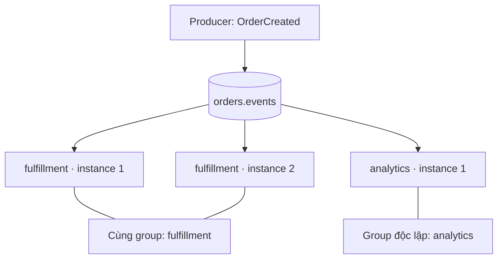
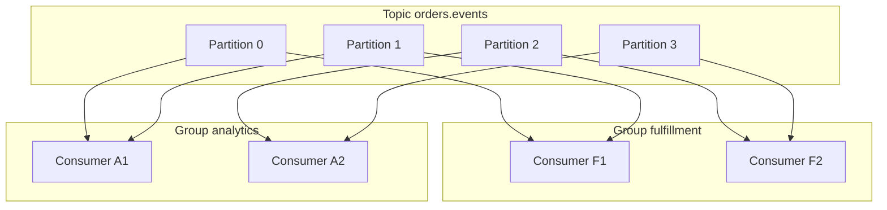

# Nhận cạnh tranh trong cùng nhóm và nhận độc lập giữa các nhóm

Trong một hệ thống hướng sự kiện, một sự kiện có thể cần được xử lý bởi nhiều bản sao của cùng một dịch vụ để tăng thông lượng, đồng thời cũng có thể cần được chuyển đến nhiều dịch vụ khác nhau để phục vụ các mục đích độc lập. Spring Cloud Stream biểu diễn hai nhu cầu này bằng thuộc tính **consumer group** (`group`) trên từng input binding.

Hãy hình dung producer phát sự kiện `OrderCreated` lên topic `orders.events`. Dịch vụ fulfillment cần chia tải việc chuẩn bị đơn hàng giữa nhiều instance. Dịch vụ analytics cũng cần nhận mọi sự kiện để cập nhật báo cáo. Các instance fulfillment phải cạnh tranh nhận việc trong cùng một nhóm; analytics phải có một nhóm riêng để nhận độc lập toàn bộ luồng sự kiện. Nếu cấu hình nhầm hai trường hợp này, hệ thống có thể bỏ sót nghiệp vụ hoặc xử lý lặp ngoài dự kiến.

Sau bài này, bạn có thể:

- Phân biệt nhận cạnh tranh trong cùng một consumer group với nhận độc lập giữa các group.
- Cấu hình `group` cho functional binding của Spring Cloud Stream.
- Giải thích cách Kafka, RabbitMQ và Pulsar hiện thực hóa group hoặc subscription.
- Dự đoán ảnh hưởng của partition, số consumer, retry, offset và trạng thái Kafka Streams.
- Thiết kế kiểm thử và vận hành để phát hiện việc chia tải hoặc phát sự kiện sai.

## 1. Hai nhu cầu giao nhận khác nhau

Giả sử producer phát một sự kiện `OrderCreated` duy nhất. Có hai cách tổ chức consumer:

**Nhận cạnh tranh trong cùng nhóm (competing consumers).** Nhiều instance cùng đăng ký một group. Broker phân phối công việc trong group để một thông điệp được một consumer member xử lý tại một thời điểm theo cơ chế thông thường của broker. Cách này dùng để mở rộng một năng lực xử lý: thêm instance để chia tải, tăng khả năng phục hồi khi một instance dừng.

**Nhận độc lập giữa các nhóm (independent subscriptions).** Mỗi nhóm có một subscription hoặc vị trí đọc riêng. Mỗi nhóm đều nhận toàn bộ luồng sự kiện, độc lập với tiến độ của nhóm khác. Cách này dùng khi nhiều năng lực nghiệp vụ cùng quan tâm một sự kiện: fulfillment tạo yêu cầu giao hàng, analytics cập nhật số liệu, notification gửi thông báo.

Sơ đồ dưới đây thể hiện hai trường hợp. Các instance A1 và A2 cùng group `fulfillment` chia nhau thông điệp. Group `analytics` nhận một bản giao nhận độc lập của từng thông điệp.



Với một sự kiện có mã `eventId=evt-100`, group `fulfillment` xử lý sự kiện đó một lần trong luồng xử lý bình thường của group, dù instance nào nhận. Group `analytics` cũng xử lý `evt-100` theo tiến độ riêng. Nếu có thêm group `notification`, group này cũng nhận sự kiện. Số group quyết định số luồng xử lý nghiệp vụ độc lập; số consumer trong một group quyết định cách chia tải trong luồng đó.

| Cấu hình | Kết quả mong đợi | Mục đích |
|---|---|---|
| Nhiều instance, cùng `group=fulfillment` | Chia tải giữa các instance trong group | Mở rộng một dịch vụ |
| Một hoặc nhiều instance, `group=fulfillment` và `group=analytics` | Mỗi group nhận toàn bộ sự kiện | Nhiều dịch vụ cùng xử lý một sự kiện |
| Mỗi instance có một group riêng | Mỗi instance có luồng nhận độc lập | Chỉ dùng khi thật sự muốn fan-out theo instance |
| Không khai báo `group` | Binder tạo nhóm ẩn danh theo quy tắc của broker | Thử nghiệm hoặc tác vụ tạm thời; cần hiểu rõ tính bền vững |

Consumer group không phải tên của một máy hay một pod. Nó là danh tính của một **luồng tiêu thụ logic**. Vì vậy, các bản sao của cùng một năng lực nghiệp vụ phải dùng chung một group ổn định. Các năng lực nghiệp vụ cần nhận độc lập phải dùng group khác nhau.

## 2. Khai báo group trong Spring Cloud Stream

Spring Cloud Stream xây dựng binding từ tên bean hàm. Với một bean `Consumer<OrderCreated>` có tên `fulfillOrder`, input binding mặc định là `fulfillOrder-in-0`. Thuộc tính `destination` xác định nơi nhận dữ liệu; `group` xác định nhóm consumer của binding.

Trong mô hình hàm của Spring Cloud Stream, `Consumer` chỉ có input; `Function` có input và output; `Supplier` tạo dữ liệu ở output. Vì vậy, `group` áp dụng cho input binding cần tiêu thụ message. Nó không phải thuộc tính chia tải của output binding do `Supplier` hoặc phần output của `Function` tạo ra.

Ví dụ, nếu `Function<OrderCreated, OrderEnriched>` tên `enrichOrder` đọc sự kiện rồi phát dữ liệu đã bổ sung, input binding `enrichOrder-in-0` có thể có `group: order-enrichment`, còn output binding `enrichOrder-out-0` chỉ cần destination đích. Nhiều instance của function dùng cùng group để chia tải đầu vào; mỗi kết quả được function tạo ra sẽ đi qua output binding.

Ví dụ một consumer:

```java
public record OrderCreated(
        String eventId,
        String orderId,
        Instant occurredAt
) {}

@Configuration
public class OrderConsumers {

    @Bean
    Consumer<OrderCreated> fulfillOrder(OrderService orderService) {
        return event -> orderService.fulfill(event);
    }
}
```

Cấu hình YAML:

```yaml
spring:
  cloud:
    function:
      definition: fulfillOrder
    stream:
      bindings:
        fulfillOrder-in-0:
          destination: orders.events
          group: fulfillment
          content-type: application/json
      kafka:
        binder:
          brokers: localhost:9092
```

Trong cấu hình này:

- `fulfillOrder` là tên bean hàm mà Spring Cloud Function chọn để tạo binding.
- `fulfillOrder-in-0` là tên input binding được tạo từ bean đó.
- `destination: orders.events` là topic Kafka mà binding đăng ký tiêu thụ.
- `group: fulfillment` là consumer group ổn định của năng lực fulfillment.

Khi chạy hai hoặc nhiều bản sao ứng dụng với cùng cấu hình, tất cả bản sao cùng tham gia group `fulfillment`. Broker chia việc giữa các member. Khi triển khai bản sao mới, broker có thể phân phối lại partition hoặc consumer assignment để đưa member mới vào group.

Để một ứng dụng có hai năng lực cần nhận độc lập cùng một topic, khai báo hai bean và hai group:

```java
@Configuration
public class OrderEventConsumers {

    @Bean
    Consumer<OrderCreated> fulfillOrder(OrderService orderService) {
        return event -> orderService.fulfill(event);
    }

    @Bean
    Consumer<OrderCreated> updateAnalytics(OrderAnalytics analytics) {
        return event -> analytics.recordCreatedOrder(event);
    }
}
```

```yaml
spring:
  cloud:
    function:
      definition: fulfillOrder;updateAnalytics
    stream:
      bindings:
        fulfillOrder-in-0:
          destination: orders.events
          group: fulfillment
          content-type: application/json
        updateAnalytics-in-0:
          destination: orders.events
          group: analytics
          content-type: application/json
      kafka:
        binder:
          brokers: localhost:9092
```

Hai binding cùng trỏ đến `orders.events`, nhưng có group khác nhau. Vì thế, analytics không lấy mất sự kiện của fulfillment. Mỗi binding có tiến độ tiêu thụ riêng. Nếu analytics tạm dừng hoặc bị tụt lại, fulfillment vẫn có thể tiếp tục xử lý theo tiến độ của group fulfillment.

Trong một hệ thống triển khai nhiều ứng dụng riêng, mỗi ứng dụng có thể khai báo một binding tới cùng destination và một group riêng. Kết quả giao nhận về mặt logic vẫn như ví dụ trên.

### Chọn tên group

Tên group nên mô tả năng lực hoặc mục đích tiêu thụ, chẳng hạn `fulfillment`, `billing`, `fraud-detection` hay `order-analytics`. Tên này cần ổn định qua các lần khởi động và triển khai.

Không ghép mã pod, hostname hoặc UUID khởi động vào group của một dịch vụ cần chia tải. Nếu mỗi pod có group riêng, broker hiểu rằng mỗi pod là một subscriber độc lập và gửi toàn bộ sự kiện đến từng pod. Hệ quả là một đơn hàng có thể bị nhiều pod cùng tạo yêu cầu giao hàng.

Ngược lại, không dùng chung một group cho hai năng lực cần xử lý độc lập. Nếu `fulfillment` và `analytics` cùng tham gia group `orders`, một sự kiện có thể được giao cho fulfillment hoặc analytics. Khi đó, một trong hai năng lực sẽ không nhận được sự kiện.

Khi bỏ trống `group`, Spring Cloud Stream tạo consumer group ẩn danh theo cơ chế binder. Nhóm ẩn danh thường không có tính bền vững và không phù hợp cho một consumer nghiệp vụ cần tiếp tục từ tiến độ đã lưu sau khi khởi động lại. Cách xử lý cụ thể phụ thuộc broker và binder. Với consumer chạy thật, hãy khai báo group có chủ đích.

## 3. Kafka: group chia partition và lưu offset độc lập

Trong Kafka, consumer group là tập các consumer cùng đọc một topic và phối hợp phân công partition. **Partition là đơn vị phân chia công việc và lưu thứ tự của Kafka.** Tại một thời điểm, một partition được gán cho tối đa một consumer member trong cùng group. Một consumer có thể nhận nhiều partition.

Giả sử topic `orders.events` có 4 partition:

- Group `fulfillment` có 2 consumer. Hai consumer có thể chia nhau 4 partition, mỗi consumer xử lý 2 partition.
- Khi group tăng lên 4 consumer, mỗi consumer có thể nhận một partition.
- Khi group tăng lên 6 consumer, ít nhất 2 consumer không có partition để đọc. Thêm consumer vượt số partition không làm tăng số luồng đọc song song của group.
- Group `analytics` có assignment riêng và đọc cả 4 partition, dù group `fulfillment` đang có 2 hay 4 consumer.



Sơ đồ minh họa assignment độc lập giữa hai group. Kafka không nhân bản một partition thành hai partition mới cho từng group; mỗi group duy trì vị trí đọc của riêng nó trên cùng log.

### Offset thuộc về group

Kafka ghi nhận offset đã tiêu thụ theo cặp topic-partition và consumer group. Vì thế:

- Consumer trong cùng group phối hợp trên cùng tiến độ đọc của group.
- Group khác có offset riêng. Group `analytics` có thể đọc chậm hơn `fulfillment` mà không làm thay đổi offset của fulfillment.
- Khi một member rời group hoặc có member mới tham gia, Kafka thực hiện rebalance để phân công lại partition. Offset đã commit vẫn gắn với group, không gắn với một pod cụ thể.

Offset là vị trí đọc, không phải bằng chứng rằng nghiệp vụ bên ngoài đã hoàn tất. Ví dụ consumer đọc sự kiện, ghi dữ liệu vào cơ sở dữ liệu rồi dừng trước khi offset được commit. Sau khi khởi động lại, sự kiện có thể được đọc lại và thao tác ghi có thể lặp. Vì vậy, consumer cần xử lý trùng lặp an toàn.

### Partition key và thứ tự xử lý

Kafka bảo đảm thứ tự trong một partition. Kafka không bảo đảm thứ tự toàn cục giữa nhiều partition. Nếu mọi sự kiện của cùng một đơn hàng cần được xử lý theo thứ tự, producer nên dùng `orderId` làm partition key để các sự kiện của đơn hàng đó đi vào cùng partition.

Ví dụ, `OrderCreated`, `OrderPaid` và `OrderShipped` của `order-42` cần đi theo một thứ tự nhất quán. Khi cùng key `order-42` được định tuyến ổn định đến một partition, một consumer member trong group sẽ đọc partition đó theo thứ tự offset. Nếu dùng key ngẫu nhiên hoặc phân phối ngẫu nhiên, các sự kiện của cùng đơn hàng có thể nằm ở nhiều partition và được xử lý song song.

Chọn partition key là quyết định cân bằng giữa thứ tự và tải. Một key có lưu lượng quá lớn có thể tạo partition nóng. Tăng số consumer không giải quyết được partition nóng nếu tất cả sự kiện của key đó vẫn vào cùng một partition.

### Số consumer và concurrency

Với Kafka, số consumer member thực tế của group có thể bao gồm nhiều instance ứng dụng và nhiều consumer thread trong mỗi instance, tùy cấu hình binder. Thuộc tính concurrency của binding có thể tạo nhiều consumer trong một instance. Khi tính năng lực, hãy tính tổng consumer member so với số partition, thay vì chỉ đếm số pod.

Tăng concurrency có thể giúp sử dụng partition tốt hơn, nhưng cũng làm tăng kết nối broker, bộ nhớ, thread và áp lực lên cơ sở dữ liệu downstream. Hãy đo thời gian xử lý và lag trước khi tăng. Nếu số consumer lớn hơn số partition, một số consumer sẽ nhàn rỗi.

Khi đổi số partition của topic, assignment và cách phân bố key có thể thay đổi. Với các hệ thống phụ thuộc thứ tự theo key, cần đánh giá ảnh hưởng của thay đổi partition count trước khi áp dụng.

## 4. RabbitMQ: group tương ứng với queue của subscriber

RabbitMQ tổ chức giao nhận qua exchange và queue. Exchange nhận thông điệp rồi định tuyến đến các queue theo loại exchange, routing key và binding. Trong Rabbit binder của Spring Cloud Stream, một consumer group có queue riêng gắn với destination. Các consumer cùng group cạnh tranh lấy thông điệp từ queue đó. Một group khác có queue riêng và được bind để nhận bản giao nhận độc lập.

Ví dụ destination là `orders.events`:

- Group `fulfillment` dùng một queue của fulfillment. Nhiều instance fulfillment cùng tiêu thụ queue đó.
- Group `analytics` dùng queue analytics riêng. Queue analytics cũng nhận các sự kiện được exchange định tuyến.
- Khi một thông điệp được exchange định tuyến đến cả hai queue, mỗi group có một bản giao nhận để xử lý độc lập.

Khác Kafka, RabbitMQ không dùng partition của topic làm đơn vị chia consumer theo cách tương tự. Nhiều consumer có thể cùng đọc một queue. Broker giao từng message cho một consumer đang sẵn sàng theo trạng thái consumer, prefetch và tải hiện tại. Khi consumer xác nhận (ack) message, broker có thể loại message khỏi queue. Nếu consumer mất kết nối trước ack, message có thể được giao lại.

Prefetch giới hạn số message chưa được xác nhận mà broker giao trước cho một consumer. Prefetch quá thấp có thể làm giảm thông lượng; quá cao có thể khiến một consumer giữ nhiều message trong khi consumer khác ít việc. Cần cân bằng prefetch với thời gian xử lý, kích thước message và khả năng downstream.

### Cấu hình và lưu ý

Binding của Spring Cloud Stream vẫn khai báo destination và group theo cùng mô hình:

```yaml
spring:
  cloud:
    function:
      definition: fulfillOrder
    stream:
      bindings:
        fulfillOrder-in-0:
          destination: orders.events
          group: fulfillment
          content-type: application/json
      rabbit:
        binder:
          # Các thuộc tính kết nối RabbitMQ được khai báo tại đây
```

Rabbit binder tạo và bind queue theo destination, group cùng các tùy chọn binder. Tên queue thực tế có thể chịu ảnh hưởng của prefix và cấu hình binder. Khi vận hành, hãy kiểm tra queue được tạo trên broker thay vì tự suy ra tên queue từ một chuỗi cấu hình.

Một queue có nhiều consumer là mô hình competing consumers. Một consumer xử lý chậm hoặc bị lỗi có thể ảnh hưởng lượng message đang chờ trong queue đó, nhưng queue riêng của group khác vẫn có tiến độ và backlog độc lập. Cần cấu hình durable queue, message persistence, acknowledgement, retry và dead-letter queue phù hợp với yêu cầu nghiệp vụ.

Khi có nhiều consumer cùng đọc một queue, thứ tự message được lấy ra và thứ tự nghiệp vụ hoàn tất có thể khác nhau. Ví dụ consumer A nhận `OrderPaid` trước, nhưng xử lý lâu; consumer B nhận `OrderShipped` sau và hoàn tất sớm hơn. Nếu thứ tự theo đơn hàng là bắt buộc, cần thiết kế routing, giới hạn concurrency hoặc cơ chế tuần tự hóa theo key phù hợp với RabbitMQ.

## 5. Pulsar: group là subscription, subscription type quyết định cách chia tải

Apache Pulsar theo dõi tiến độ tiêu thụ bằng subscription. Với Spring Cloud Stream Pulsar binder, `group` của binding đóng vai trò tên subscription. Nhiều consumer dùng cùng subscription tham gia cùng một luồng tiêu thụ; subscription khác có cursor và tiến độ riêng nên nhận độc lập các message.

Pulsar có nhiều subscription type, và kiểu này quyết định cách nhiều consumer trong cùng subscription phối hợp:

| Subscription type | Cách hoạt động | Khi phù hợp |
|---|---|---|
| `Exclusive` | Một consumer hoạt động trên subscription | Một consumer duy nhất |
| `Failover` | Một consumer hoạt động; consumer khác có thể tiếp quản khi consumer chính mất | Cần dự phòng và chuyển đổi khi lỗi |
| `Shared` | Nhiều consumer cùng nhận message từ subscription | Chia tải tổng quát |
| `Key_Shared` | Nhiều consumer cùng nhận; message có cùng key được gắn với cùng consumer theo cơ chế key-shared | Chia tải nhưng cần giữ affinity theo key |

Nếu muốn tăng số consumer song song trong cùng group, hãy chọn subscription type hỗ trợ nhiều consumer đồng thời, chẳng hạn `Shared` hoặc `Key_Shared`. `Exclusive` không phải cấu hình chia tải nhiều consumer. `Shared` có thể làm mất thứ tự toàn cục; `Key_Shared` hữu ích khi cần xử lý theo key, nhưng producer và consumer phải dùng key cùng cấu hình định tuyến phù hợp.

Ví dụ khái niệm với hai năng lực:

- Subscription `fulfillment` có nhiều consumer kiểu `Shared` để chia tải tạo yêu cầu giao hàng.
- Subscription `analytics` có tiến độ riêng và nhận luồng sự kiện độc lập.

Các thuộc tính subscription type, acknowledgement, retry và dead-letter được cấu hình theo khả năng của Pulsar binder và phiên bản đang dùng. Không nên sao chép nguyên cấu hình consumer Kafka hoặc Rabbit sang Pulsar vì tên thuộc tính và ngữ nghĩa broker khác nhau.

## 6. Chọn đúng mô hình cho từng yêu cầu nghiệp vụ

Một câu hỏi hữu ích khi thiết kế là: **nếu thêm một instance, tôi muốn chia sẻ công việc hay muốn tạo thêm một nơi nhận đầy đủ sự kiện?**

Nếu câu trả lời là chia sẻ công việc, các instance phải dùng cùng group. Ví dụ 5 instance của fulfillment cùng xử lý đơn hàng. Khi một instance dừng, các instance còn lại tiếp tục nhận phần công việc được broker phân công.

Nếu câu trả lời là thêm một nơi nhận đầy đủ sự kiện, hãy tạo group mới. Ví dụ khi bổ sung fraud detection, tạo group `fraud-detection` để dịch vụ này nhận toàn bộ `OrderCreated` và `OrderPaid`, trong khi fulfillment và analytics vẫn tiếp tục hoạt động.

| Tình huống | Thiết kế |
|---|---|
| Tăng thông lượng cho một consumer nghiệp vụ | Thêm instance cùng group |
| Thêm một dịch vụ downstream mới | Tạo group mới trên cùng destination |
| Chạy hai phiên bản ứng dụng trong rolling deployment | Giữ cùng group; bảo đảm hai phiên bản tương thích schema và xử lý |
| Muốn mỗi pod nhận tất cả sự kiện để tự cập nhật cache riêng | Group riêng cho từng pod chỉ khi fan-out theo pod là yêu cầu có chủ đích |
| Chạy một luồng thử nghiệm không cần lưu tiến độ | Có thể dùng group ẩn danh, sau khi hiểu hành vi của binder |
| Muốn chạy lại dữ liệu cho một projection độc lập | Dùng group hoặc application identity riêng và lập kế hoạch replay |

### Không nhầm group với partition

Group và partition giải quyết hai bài toán liên quan nhưng khác nhau:

- Group xác định **ai cùng chia sẻ một tiến độ tiêu thụ**.
- Partition xác định **dữ liệu được chia thành những đơn vị đọc song song nào** trong Kafka.

Một group có thể có một hoặc nhiều consumer. Một topic có thể có một hoặc nhiều partition. Số partition giới hạn mức song song của một Kafka consumer group; số group quyết định có bao nhiêu luồng tiêu thụ độc lập.

Ví dụ topic có 8 partition, group `fulfillment` có 4 consumer và group `analytics` có 2 consumer. Mỗi group có thể khai thác partition theo assignment riêng. Không cần tạo topic mới chỉ để analytics có offset độc lập.

### Không nhầm group với retry

Retry là cách xử lý một lần giao message thất bại; group là phạm vi tiêu thụ logic. Một lỗi ở consumer của group fulfillment không nên khiến analytics phải chờ retry của fulfillment. Hai group có tiến độ độc lập, nhưng vẫn cùng chịu ảnh hưởng của broker, schema, mạng và tài nguyên dùng chung.

Retry nhiều lần có thể giữ một partition hoặc queue bận với message lỗi, tùy broker và cấu hình binder. Hãy xác định lỗi nào có thể retry, số lần retry, backoff, thời hạn xử lý và cách chuyển message sang dead-letter queue/topic. DLQ nên cho phép truy vết message gốc, group/binding, lỗi, thời điểm và số lần thử.

## 7. Giao nhận, xử lý trùng lặp và tính bền vững

Consumer group giúp chia tải và lưu tiến độ theo cơ chế broker; nó không tự bảo đảm nghiệp vụ chỉ xảy ra đúng một lần. Một số tình huống có thể khiến message được giao lại:

1. Consumer nhận message và thực hiện side effect.
2. Consumer dừng trước khi broker ghi nhận acknowledgement hoặc offset commit.
3. Broker giao lại message sau khi consumer phục hồi hoặc kết nối lại.
4. Side effect có thể được thực hiện lần nữa nếu ứng dụng không nhận diện message trùng.

Vì thế, consumer nghiệp vụ nên có tính **idempotent**: xử lý cùng một sự kiện nhiều lần vẫn cho kết quả cuối cùng đúng. Một cách phổ biến là producer cấp `eventId` duy nhất; consumer ghi `eventId` vào bảng inbox có ràng buộc unique trong cùng transaction với thay đổi nghiệp vụ. Nếu event đã tồn tại, consumer bỏ qua side effect lặp và hoàn tất acknowledgement theo đúng luồng.

Ví dụ:

```java
@Transactional
public void fulfill(OrderCreated event) {
    boolean firstDelivery = inboxRepository.insertIfAbsent(
            event.eventId(),
            "fulfillment"
    );

    if (!firstDelivery) {
        return; // Sự kiện này đã được xử lý thành công trước đó
    }

    orderRepository.markReadyForFulfillment(event.orderId());
}
```

`insertIfAbsent` cần được triển khai bằng ràng buộc unique và thao tác cơ sở dữ liệu nguyên tử. Nếu ghi inbox và thay đổi đơn hàng nằm ở hai transaction độc lập, cơ chế chống trùng vẫn có thể gặp khe hở. Với side effect bên ngoài cơ sở dữ liệu, hãy thiết kế outbox, API idempotency key hoặc quy trình bù trừ phù hợp.

Kafka có thể cung cấp giao dịch và các cơ chế exactly-once trong phạm vi xử lý Kafka được cấu hình tương thích. Điều đó không tự biến một lời gọi HTTP hoặc một transaction cơ sở dữ liệu bên ngoài thành exactly-once. RabbitMQ và Pulsar cũng có acknowledgement, transaction hoặc cơ chế bảo đảm riêng; phải đọc đúng ngữ nghĩa binder và broker đang dùng. Không suy ra cam kết exactly-once chỉ từ việc đã khai báo `group`.

### Retry và DLQ theo từng consumer

Mỗi group có thể có năng lực downstream và chính sách lỗi khác nhau. Fulfillment có thể retry lỗi tạm thời khi gọi hệ thống kho; analytics có thể retry lỗi ghi projection. Khi cấu hình retry và DLQ, hãy xác định rõ binding nào áp dụng, message nào được retry, lỗi nào chuyển DLQ và cách phát lại.

Với Spring Cloud Stream, một số thuộc tính retry chung nằm trong `bindings.<binding>.consumer`, còn DLQ và dead-letter routing thường có thuộc tính riêng của binder. Ví dụ, Kafka binder có tùy chọn bật DLQ cho consumer binding; Rabbit binder có tùy chọn tự bind dead-letter queue. Tên và hành vi chi tiết phụ thuộc phiên bản. Hãy kiểm tra tài liệu binder tương ứng trước khi đưa cấu hình vào môi trường thật.

Không dùng một DLQ chung mà không lưu thông tin group/binding. Nếu cùng một event lỗi ở fulfillment và analytics, hai nhóm cần được điều tra và phát lại độc lập. Phát lại message lỗi cho analytics không nên vô tình kích hoạt lại thao tác tạo lệnh giao hàng của fulfillment.

## 8. Schema và rolling deployment

Một event có thể được nhiều group nhận ở các thời điểm khác nhau. Fulfillment có thể xử lý gần thời gian thực, trong khi analytics có thể đang tụt lại vài giờ. Khi producer thay đổi schema, cả consumer mới, consumer cũ đang chạy trong rolling deployment và consumer đang đọc backlog đều có thể gặp phiên bản payload khác nhau.

Hãy thiết kế schema tương thích:

- Thêm field mới theo cách consumer cũ có thể bỏ qua hoặc nhận giá trị mặc định.
- Tránh đổi nghĩa, đổi kiểu hoặc xóa field đang được consumer sử dụng mà không có kế hoạch chuyển đổi.
- Dùng version hoặc event type rõ ràng khi thay đổi cấu trúc có ý nghĩa.
- Giữ `eventId`, định danh aggregate, thời điểm xảy ra và dữ liệu cần thiết để consumer xử lý độc lập.
- Nếu dùng schema registry, áp dụng quy tắc compatibility phù hợp và kiểm tra schema trước khi phát hành producer.

Trong rolling deployment, các phiên bản cũ và mới thường cùng tham gia một group. Broker có thể giao message cho bất kỳ member nào đang hoạt động. Do đó, message mới phát ra trong lúc rollout vẫn có thể đến phiên bản cũ. Schema tương thích ngược là yêu cầu thực tế, không phải chi tiết tùy chọn.

Tạo group mới cho một phiên bản chỉ để tránh tương thích schema sẽ làm phiên bản đó nhận toàn bộ luồng độc lập. Điều này có thể tạo side effect trùng. Chỉ dùng group mới khi chủ đích là tạo một subscriber độc lập, chẳng hạn dựng lại projection hoặc chạy một quy trình song song đã có kiểm soát.

## 9. Trạng thái Kafka Streams và application.id

Với consumer thông thường của Kafka binder, `group` xác định consumer group. Với Kafka Streams binder, cần chú ý thêm danh tính ứng dụng Kafka Streams là `application.id`. Đây là định danh của topology xử lý, được Kafka Streams dùng để quản lý consumer group nội bộ, tiến độ xử lý và tài nguyên trạng thái liên quan.

Các instance của cùng một Kafka Streams application phải dùng cùng `application.id` để chia task của topology. Nếu mỗi instance đặt `application.id` khác nhau, mỗi instance trở thành một ứng dụng xử lý độc lập và có thể đọc toàn bộ input, tạo trạng thái riêng, phát output lặp.

Ngược lại, hai topology cần chạy độc lập phải có `application.id` khác nhau. Mỗi ứng dụng có tiến độ và state store riêng. Với state store có changelog, Kafka Streams có thể khôi phục trạng thái cục bộ từ changelog khi task được chuyển sang instance khác. Vì vậy, trạng thái cục bộ của một task không nên được xem như một file dùng chung giữa các pod.

Ví dụ cấu hình application identity:

```yaml
spring:
  cloud:
    stream:
      kafka:
        streams:
          binder:
            application-id: order-risk-projection
            brokers: localhost:9092
```

Ví dụ một topology stateful ở mức khái niệm:

```java
@Bean
Function<KStream<String, OrderCreated>,
         KStream<String, OrderCount>> countOrders() {
    return input -> input
            .groupByKey()
            .count()
            .toStream()
            .mapValues((orderId, count) ->
                    new OrderCount(orderId, count));
}
```

Topology trên gom dữ liệu theo key và duy trì phép đếm. Trong triển khai thực tế, cần chọn key đúng, tên state store phù hợp, cấu hình serdes cho key/value và xác định output binding. Khi chạy nhiều instance với cùng `application.id`, Kafka Streams phân phối task và state tương ứng. Khi chạy một ứng dụng projection thứ hai với `application.id` khác, ứng dụng thứ hai có trạng thái riêng và tiêu thụ input độc lập.

Quy tắc vận hành:

- Dùng cùng `application.id` cho các instance đang mở rộng cùng một topology.
- Dùng `application.id` riêng cho topology độc lập, môi trường độc lập hoặc một lần dựng lại projection có chủ đích.
- Không đổi `application.id` tùy tiện trong mỗi lần deploy; đổi ID có thể tạo một ứng dụng mới với tiến độ và state mới.
- Lập kế hoạch cho changelog, thời gian restore, dung lượng local state và thời gian rebalance khi scale hoặc thay đổi topology.
- Không nhầm `application.id` của Kafka Streams với `group` của một binding consumer thông thường.

## 10. Kiểm thử hành vi của group

Kiểm thử cần chứng minh cả hai tính chất: các consumer trong cùng group chia tải; các group khác nhau đều nhận được toàn bộ sự kiện. Chỉ kiểm tra một hàm `Consumer` được gọi thành công chưa chứng minh được broker đã phân phối đúng.

### Unit test cho logic nghiệp vụ

Kiểm thử hàm consumer hoặc service trực tiếp để xác minh event hợp lệ tạo ra thay đổi mong muốn, event đã xử lý không gây side effect lặp, và lỗi được phân loại đúng. Unit test nhanh và cô lập, nhưng không kiểm tra assignment, offset hoặc queue.

### Test binder cho binding

Spring Cloud Stream cung cấp test binder để gửi message vào input binding và kiểm tra output binding trong môi trường test. Test binder hữu ích để xác minh tên binding, chuyển đổi payload và logic function. Nó không mô phỏng đầy đủ rebalance, partition assignment, prefetch, subscription type hay acknowledgement của broker thật.

### Integration test với broker thật

Dùng Testcontainers hoặc môi trường broker kiểm thử để xác minh ngữ nghĩa group. Một kịch bản Kafka có thể thực hiện như sau:

1. Tạo topic thử nghiệm có ít nhất hai partition và dùng group ID duy nhất cho lần chạy test.
2. Khởi chạy hai consumer instance thuộc group `fulfillment-test`.
3. Khởi chạy một consumer thuộc group `analytics-test`.
4. Phát một tập message có `eventId` duy nhất.
5. Chờ đến khi group analytics nhận đủ toàn bộ event.
6. Gộp event mà hai instance fulfillment nhận được; kiểm tra mỗi event đã được group xử lý theo kỳ vọng một lần trong kịch bản không lỗi.
7. Dừng một instance fulfillment, phát thêm event và xác minh member còn lại tiếp tục xử lý sau khi assignment ổn định.

Khi viết assertion, nên dùng eventual assertion với thời hạn rõ ràng vì giao nhận là bất đồng bộ. Không dựa vào thứ tự hoàn tất giữa hai consumer. Nếu kiểm tra thứ tự, phải tạo key và partition phù hợp, đồng thời kiểm tra trong phạm vi một partition hoặc một key.

Với RabbitMQ, kiểm tra hai consumer cùng group đọc chung queue và một group khác có queue riêng nhận bản giao độc lập. Với Pulsar, kiểm tra đúng subscription name và subscription type. Các bài test này phát hiện những lỗi cấu hình mà test binder không thể phát hiện.

### Ma trận kiểm thử gợi ý

| Thay đổi | Điều cần xác minh |
|---|---|
| Thêm instance cùng group | Tổng số event của group vẫn đúng; tải được chia giữa các instance |
| Tạo group mới | Group mới nhận được toàn bộ event theo chính sách retention/subscription |
| Một consumer dừng đột ngột | Member còn lại tiếp tục; message chưa hoàn tất được xử lý theo cơ chế broker |
| Consumer xử lý lỗi | Retry, backoff và DLQ đúng binding |
| Phát lại cùng `eventId` | Không tạo side effect nghiệp vụ trùng |
| Rolling deployment | Cả phiên bản cũ và mới đọc được schema đang phát |
| Kafka Streams instance khởi động lại | Task được phân công lại và state được khôi phục đúng |

## 11. Theo dõi và vận hành

Group có tiến độ độc lập nên cần quan sát theo group, không chỉ theo topic. Một topic có thể không có vấn đề ở fulfillment nhưng analytics đã tụt lại đáng kể.

Với Kafka, theo dõi consumer group lag theo topic-partition, assignment, số member, tốc độ tiêu thụ, lỗi commit và rebalance. Lag tăng liên tục có thể do consumer xử lý chậm, downstream nghẽn, partition nóng hoặc số partition không đủ. Đừng chỉ tăng số pod khi partition đã là giới hạn song song.

Với RabbitMQ, theo dõi queue depth, tốc độ publish/ack, số message unacked, số consumer, redelivery và DLQ. Queue depth tăng trong khi consumer vẫn hoạt động có thể cho thấy prefetch, thời gian xử lý hoặc downstream đang giới hạn thông lượng.

Với Pulsar, theo dõi backlog theo subscription, tốc độ acknowledge, redelivery, consumer count và trạng thái subscription. Một subscription có backlog lớn không nhất thiết làm subscription khác dừng; cần xem số liệu theo từng subscription.

Các chỉ số nên gắn với tên binding và group để người trực vận hành trả lời được: nhóm nào đang chậm, nhóm nào đang retry, message nào vào DLQ và nhóm nào đã xử lý event đó. Log nên có `eventId`, `destination`, `group`, `consumer instance`, correlation ID và kết quả xử lý. Tránh ghi payload nhạy cảm đầy đủ vào log.

## 12. Các lỗi thiết kế thường gặp

**Dùng một group cho các dịch vụ độc lập.** Fulfillment và analytics cùng group khiến một event có thể chỉ đến một trong hai dịch vụ. Hãy tách group theo năng lực cần nhận độc lập.

**Tạo group riêng cho từng pod trong dịch vụ cần chia tải.** Mỗi pod nhận toàn bộ luồng và có thể lặp side effect. Hãy dùng một group ổn định chung cho các replica.

**Tăng consumer Kafka mà không xem số partition.** Consumer dư sẽ không có partition để đọc. Hãy đo lag và đánh giá partition count, key distribution trước khi scale.

**Giả định mọi broker có cùng semantics.** Kafka phân công partition và quản lý offset; RabbitMQ định tuyến qua exchange/queue và acknowledgement; Pulsar dùng subscription type. Cấu hình phải theo binder tương ứng.

**Coi acknowledgement hoặc offset commit là exactly-once.** Side effect có thể lặp khi consumer dừng ở thời điểm không thuận lợi. Hãy dùng event ID và idempotency ở ranh giới nghiệp vụ.

**Đổi group hoặc application.id mà không lập kế hoạch.** Broker có thể tạo luồng tiêu thụ mới, queue hoặc subscription mới, hoặc khởi tạo state độc lập. Hãy xác định rõ có cần replay, giữ backlog cũ hay chuyển đổi tiến độ.

**Không kiểm tra schema trong rolling deployment.** Message có thể đến phiên bản cũ còn đang chạy hoặc nằm trong backlog lâu ngày. Hãy kiểm tra compatibility trước khi phát hành producer.

## 13. Quy trình ra quyết định

Khi thêm một consumer binding, hãy lần lượt trả lời:

1. Consumer này có phải một năng lực nghiệp vụ độc lập cần nhận mọi event không? Nếu có, chọn group riêng.
2. Các replica của consumer có cần chia tải không? Nếu có, giữ cùng group cho mọi replica.
3. Broker dùng cơ chế song song nào? Kafka cần đủ partition; RabbitMQ cần queue và concurrency phù hợp; Pulsar cần subscription type phù hợp.
4. Có yêu cầu thứ tự theo aggregate/key không? Chọn partition key, routing hoặc subscription type để giữ đúng phạm vi thứ tự.
5. Khi xử lý lỗi, message được retry, chuyển DLQ và phát lại ra sao? Thiết kế idempotency để chịu được redelivery.
6. Group hoặc application identity có ổn định qua deploy không? Nếu thay đổi, xác định trước tác động đến offset, queue, subscription và state.
7. Kiểm thử nào chứng minh chia tải và fan-out? Dùng broker thật khi cần kiểm tra semantics của broker.

Điểm cốt lõi là chọn group theo **ranh giới xử lý nghiệp vụ**. Các bản sao cùng làm một việc dùng chung group để cạnh tranh nhận message. Các năng lực cần cùng quan sát một sự kiện dùng group độc lập để mỗi năng lực có tiến độ riêng. Sau đó, partition của Kafka, queue của RabbitMQ hoặc subscription type của Pulsar quyết định cách broker phân phối công việc bên trong từng group.

