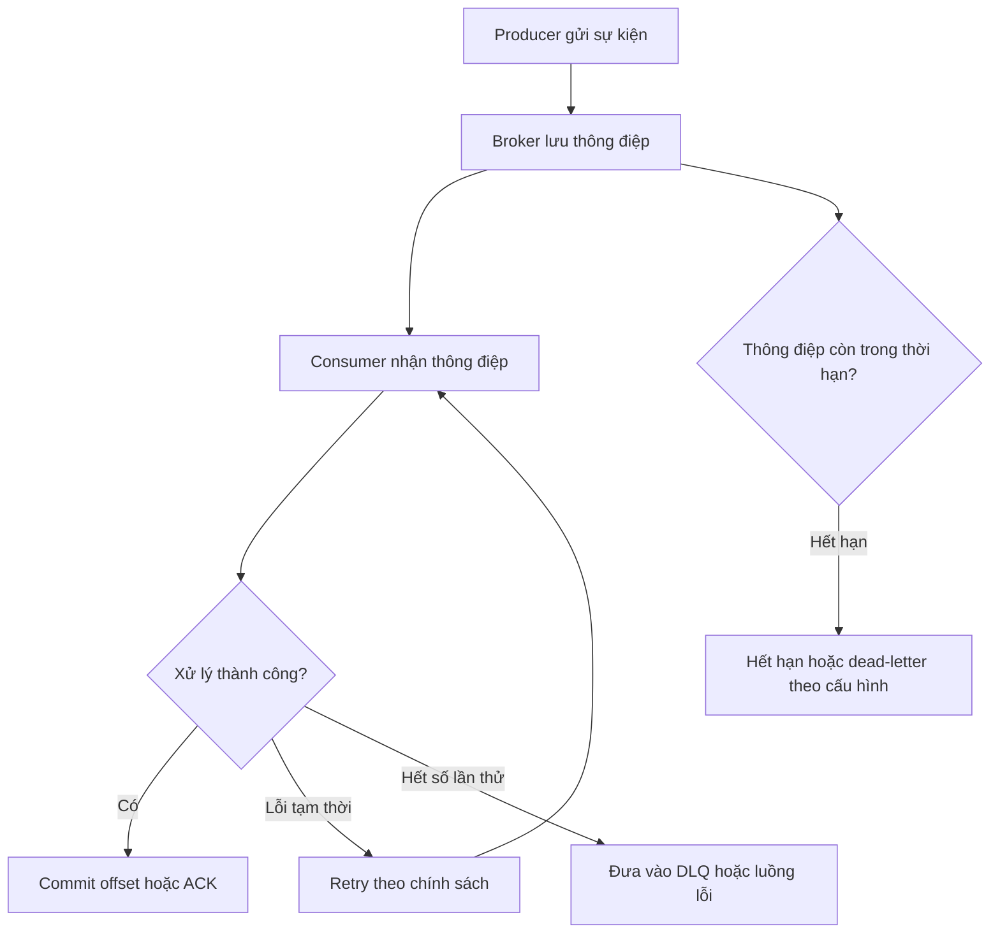

# Lưu giữ thông điệp, thuê bao bền vững và thời gian tồn tại

Trong một hệ thống xử lý sự kiện, gửi được thông điệp mới chỉ là bước đầu. Hệ thống còn phải xác định broker giữ thông điệp trong bao lâu, trạng thái tiêu thụ của từng nhóm nhận được lưu như thế nào, và một thông điệp hết hạn vào thời điểm nào. Những quyết định này ảnh hưởng trực tiếp đến khả năng phục hồi sau sự cố, phát lại dữ liệu, xử lý khi consumer tạm ngừng hoạt động và kiểm soát dung lượng lưu trữ.

Spring Cloud Stream cung cấp mô hình lập trình thống nhất cho Supplier, Function và Consumer, cùng các binding kết nối ứng dụng với Kafka, RabbitMQ hoặc Pulsar. Tuy nhiên, binding không làm cho ba broker có cùng một cơ chế lưu giữ. Ứng dụng cần hiểu ngữ nghĩa của broker đang sử dụng, cấu hình đúng danh tính nhóm tiêu thụ và kiểm thử hành vi thực tế trước khi triển khai.

## 1. Phân biệt lưu giữ, thuê bao bền vững và TTL

Ba khái niệm này liên quan đến vòng đời thông điệp nhưng giải quyết những vấn đề khác nhau.

| Khái niệm | Câu hỏi cần trả lời | Ví dụ |
|---|---|---|
| Lưu giữ thông điệp (retention) | Broker giữ dữ liệu đã nhận trong bao lâu hoặc đến khi đạt giới hạn nào? | Kafka giữ bản ghi theo thời gian hoặc dung lượng của topic. |
| Thuê bao bền vững (durable subscription) | Broker lưu trạng thái tiêu thụ ra sao khi consumer ngắt kết nối hoặc tiến trình khởi động lại? | Kafka lưu offset của consumer group; Pulsar lưu cursor của subscription; RabbitMQ giữ thông điệp trong queue bền vững khi chưa được xác nhận. |
| Thời gian tồn tại (TTL, time to live) | Thông điệp còn được phép tồn tại hoặc được xử lý trong bao lâu? | RabbitMQ có TTL cho queue hoặc từng thông điệp; Pulsar có chính sách TTL cho thông điệp chưa được xác nhận. |

Không nên xem ba khái niệm là một. Một queue bền vững không tự động có nghĩa mọi thông điệp sẽ được giữ vô thời hạn. Một subscription bền vững cũng không thể phát lại dữ liệu mà broker đã xóa. TTL có thể làm thông điệp hết hạn dù consumer vẫn đang hoạt động. Ngược lại, một thông điệp còn nằm trong vùng lưu giữ của Kafka không có nghĩa consumer đã xử lý nó.

Hãy tách vòng đời thành ba lớp:

1. **Dữ liệu:** broker lưu payload và metadata theo chính sách retention.
2. **Tiến độ:** broker lưu offset, cursor hoặc trạng thái xác nhận để biết consumer đã đi đến đâu.
3. **Hạn xử lý:** chính sách TTL hoặc trường thời hạn do ứng dụng định nghĩa cho biết thông điệp còn có giá trị nghiệp vụ hay không.

Khi thiết kế, hãy xác định riêng thời gian cần giữ dữ liệu, thời gian tối đa consumer có thể ngừng hoạt động và thời hạn nghiệp vụ của từng loại sự kiện.

## 2. Danh tính nhóm tiêu thụ quyết định khả năng tiếp tục

Một nhóm tiêu thụ thường đại diện cho một năng lực xử lý nghiệp vụ, chẳng hạn **billing-v1** nhận sự kiện đơn hàng để lập hóa đơn. Các bản sao của cùng một ứng dụng dùng chung danh tính nhóm để chia tải. Một nhóm khác, chẳng hạn **analytics-v1**, có thể nhận cùng sự kiện độc lập để xây dựng báo cáo.

Trong Spring Cloud Stream, thuộc tính **group** của binding thể hiện danh tính nhóm tiêu thụ. Ví dụ với một hàm xử lý sự kiện đơn hàng:

```java
@Bean
Consumer<OrderCreated> orderProcessor() {
    return event -> {
        // Kiểm tra và xử lý sự kiện đơn hàng.
        processOrder(event);
    };
}
```

```yaml
spring:
  cloud:
    function:
      definition: orderProcessor
    stream:
      bindings:
        orderProcessor-in-0:
          destination: orders
          group: billing-v1
```

Tên binding đầu vào của hàm là **orderProcessor-in-0**. **destination** xác định đích logic mà binding kết nối tới; **group** xác định nhóm nhận. Với consumer có nhóm ổn định, binder có thể tạo hoặc sử dụng tài nguyên tiêu thụ bền vững tương ứng theo quy tắc của broker.

Không tùy tiện đổi tên nhóm sau mỗi lần triển khai. Đối với Kafka, tên nhóm mới có offset riêng và thường bắt đầu theo chính sách khởi tạo offset đã cấu hình. Đối với RabbitMQ, nhóm mới có thể tương ứng với một queue riêng, khiến nhóm đó nhận một luồng bản sao độc lập. Đối với Pulsar, tên subscription xác định trạng thái tiêu thụ. Đổi danh tính nhóm có thể tạo ra một tiến độ mới và làm sự kiện được đọc lại hoặc không được đọc như dự kiến.

Các bản sao của cùng một nhóm cần dùng chung danh tính để chia tải. Nếu mỗi bản sao vô tình dùng một nhóm khác nhau, mỗi bản sao có thể nhận toàn bộ sự kiện thay vì cùng chia sẻ công việc. Ngược lại, nếu hai ứng dụng có mục đích nghiệp vụ độc lập dùng chung một nhóm, chúng có thể cạnh tranh thông điệp và một ứng dụng sẽ không nhận được mọi sự kiện.

## 3. Kafka: retention của log và offset của consumer group

Kafka lưu thông điệp trong log của topic. Consumer đọc log bằng offset; mỗi partition có dãy offset riêng. Kafka lưu tiến độ đã commit của từng consumer group, nhờ đó consumer có thể tiếp tục đọc sau khi khởi động lại.

Hai cơ chế này độc lập:

- **Retention của topic** quyết định các bản ghi còn được lưu trong log bao lâu hoặc đến giới hạn dung lượng nào.
- **Offset đã commit** cho biết một consumer group đã xử lý đến vị trí nào theo quan điểm của nó.

Ví dụ, topic **orders** có thể giữ dữ liệu trong bảy ngày. Nhóm **billing-v1** đã commit đến offset 1200, sau đó ngừng hoạt động hai ngày. Khi nhóm hoạt động lại, nó có thể tiếp tục từ offset đã commit nếu các bản ghi cần đọc vẫn còn trong log. Nếu retention đã xóa những bản ghi đó, offset cũ không thể khôi phục payload đã mất.

Các cấu hình retention thường được quản lý ở cấp topic hoặc qua chính sách của cluster. Hai thuộc tính thường gặp là:

- **retention.ms:** thời gian lưu giữ theo mili giây.
- **retention.bytes:** giới hạn dung lượng log theo partition.

Với **cleanup.policy=delete**, Kafka xóa các segment cũ theo chính sách thời gian hoặc dung lượng. Với **cleanup.policy=compact**, Kafka giữ lại bản ghi mới nhất theo key trong quá trình compact; tombstone có thể đánh dấu key cần xóa và bản thân tombstone cũng chỉ được giữ theo một khoảng thời gian cấu hình. Topic có thể dùng cả **compact** và **delete**.

Compaction không phải là bản thay thế tổng quát cho retention theo thời gian. Nó phù hợp với topic biểu diễn trạng thái mới nhất theo key, trong khi topic sự kiện thường cần giữ lịch sử để phát lại. Hãy chọn chính sách theo ý nghĩa dữ liệu:

| Loại dữ liệu | Chính sách thường phù hợp | Lý do |
|---|---|---|
| Sự kiện nghiệp vụ cần lịch sử | **delete** | Giữ các sự kiện trong cửa sổ thời gian hoặc dung lượng đã chọn. |
| Bản chụp trạng thái mới nhất theo khóa | **compact** | Giữ giá trị gần nhất của mỗi key. |
| Trạng thái cần cả cập nhật mới nhất và giới hạn tuổi dữ liệu | **compact,delete** | Kết hợp compaction với giới hạn lưu giữ. |

Khi phát lại, consumer có thể được đưa về một offset cũ nếu bản ghi vẫn còn trong topic và quyền vận hành cho phép. Đây là một thao tác có tác động: ứng dụng có thể xử lý lại sự kiện, gọi dịch vụ ngoài hoặc tạo tác động nghiệp vụ lần nữa. Hãy bảo đảm handler có tính idempotent, dùng khóa sự kiện hoặc ràng buộc duy nhất để tránh tạo hóa đơn, thanh toán hay thông báo trùng lặp.

Không nên đặt retention chỉ dựa trên dung lượng đĩa hiện có. Hãy tính đến thời gian ngừng hoạt động tối đa có thể chấp nhận, thời gian khắc phục sự cố, cửa sổ phát lại và yêu cầu kiểm toán. Cũng cần theo dõi consumer lag: lag tăng liên tục có thể khiến nhóm tiêu thụ tiến gần đến giới hạn retention.

## 4. RabbitMQ: queue bền vững, xác nhận và TTL

Trong RabbitMQ, thông điệp được định tuyến qua exchange đến một hoặc nhiều queue. Một queue được khai báo là durable có thể tồn tại qua lần khởi động lại của broker. Để dữ liệu thông điệp có thể được khôi phục, producer cũng cần gửi thông điệp có chế độ persistent và hệ thống cần cấu hình lưu trữ, sao chép queue phù hợp.

Durable queue và persistent message là hai thuộc tính riêng. Durable mô tả vòng đời của queue; persistent mô tả mức độ bền vững được yêu cầu cho thông điệp. Publisher confirm giúp producer biết broker đã xác nhận việc nhận thông điệp theo cơ chế xác nhận của broker. Consumer acknowledgement cho broker biết thông điệp đã được xử lý. Nếu consumer ngắt kết nối trước khi xác nhận, thông điệp chưa được xác nhận có thể được đưa trở lại hàng đợi để giao lại.

Khi consumer đã xác nhận thành công, RabbitMQ thường loại thông điệp khỏi queue. Vì vậy, queue bền vững không phải kho lưu trữ lịch sử để phát lại mọi thông điệp đã tiêu thụ. Nếu cần nhiều hệ thống nhận độc lập cùng một sự kiện, mỗi nhóm xử lý cần queue riêng được bind vào exchange phù hợp.

Trong Spring Cloud Stream Rabbit binder, binding có nhóm thường ánh xạ tới queue dành cho nhóm đó. Các bản sao cùng nhóm cạnh tranh nhận thông điệp từ queue. Binding không có nhóm thường sử dụng queue tạm thời hoặc định danh riêng theo cấu hình binder; loại queue này không phù hợp nếu cần giữ tiến độ qua lần khởi động lại.

### TTL của queue và thông điệp

RabbitMQ hỗ trợ TTL ở hai mức:

- TTL của queue áp dụng cho các thông điệp nằm trong queue đó.
- TTL của từng thông điệp được đặt khi producer gửi thông điệp.

Khi hết hạn, thông điệp không còn đủ điều kiện được giao cho consumer. Tùy cấu hình, thông điệp hết hạn có thể bị loại bỏ hoặc được định tuyến sang dead-letter exchange. Thời điểm loại bỏ thực tế có thể phụ thuộc vào vị trí thông điệp trong queue và hoạt động của broker; không nên dùng TTL như một bộ hẹn giờ chính xác đến từng mili giây.

Ví dụ, thông báo xác nhận mã đăng nhập chỉ có giá trị trong vài phút. Một đơn hàng cần được xử lý trong thời hạn dài hơn. Không nên áp dụng cùng một TTL cho cả hai loại sự kiện. Cũng không nên đặt TTL quá ngắn cho queue xử lý đơn hàng nếu hệ thống có thể tạm thời quá tải hoặc cần thời gian phục hồi.

Các tùy chọn TTL và dead-letter của Rabbit binder phụ thuộc phiên bản binder và cách khai báo queue. Hãy cấu hình chính sách ở nơi quản lý broker hoặc dùng đúng thuộc tính được phiên bản binder hỗ trợ; sau đó kiểm tra queue và policy thực tế trên RabbitMQ. Không suy luận rằng chỉ đặt **group** trong binding là đã có TTL hoặc dead-letter.

## 5. Pulsar: subscription, cursor và retention

Apache Pulsar tách khái niệm topic khỏi subscription. Producer ghi thông điệp vào topic; consumer nhận thông điệp thông qua một subscription có tên. Subscription duy trì cursor, thể hiện vị trí tiêu thụ và trạng thái xác nhận. Khi consumer kết nối lại với cùng subscription, nó có thể tiếp tục từ tiến độ đã lưu.

Tên subscription vì thế là một phần của danh tính xử lý. Các consumer dùng chung subscription có thể phối hợp theo loại subscription được chọn:

| Loại subscription | Cách phân phối khái quát | Trường hợp sử dụng |
|---|---|---|
| Exclusive | Một consumer hoạt động trên subscription tại một thời điểm. | Xử lý tuần tự đơn giản. |
| Failover | Một consumer hoạt động chính, consumer khác có thể tiếp quản khi cần. | Cần một consumer chính và khả năng dự phòng. |
| Shared | Nhiều consumer cùng nhận thông điệp từ subscription. | Chia tải giữa các consumer độc lập. |
| Key_Shared | Nhiều consumer chia tải nhưng các thông điệp cùng key được giữ cùng một consumer theo quy tắc phân phối. | Cần song song nhưng vẫn giữ thứ tự tương đối theo key. |

Thông điệp đã được xác nhận thường đủ điều kiện để broker xóa khi không còn subscription hoặc chính sách nào cần giữ nó. Pulsar có thể cấu hình retention ở cấp namespace để giữ thông điệp đã được tiêu thụ trong một khoảng thời gian hoặc dung lượng nhất định, cho phép tạo subscription mới hoặc phát lại dữ liệu trong cửa sổ lưu giữ. Đây là mục đích khác với việc giữ backlog chưa được xác nhận của subscription hiện tại.

Message TTL trong Pulsar thường được dùng để giới hạn thời gian tồn tại của thông điệp chưa được xác nhận. Khi TTL hết hạn, thông điệp có thể bị loại khỏi backlog theo chính sách broker. Hãy phân biệt TTL với retention: retention giữ dữ liệu đã tiêu thụ để có thể đọc lại, còn TTL giới hạn tuổi của thông điệp đang chờ xử lý. Tên và phạm vi cấu hình cụ thể có thể khác theo phiên bản Pulsar và chính sách namespace.

Spring Cloud Stream Pulsar binder ánh xạ binding và nhóm tiêu thụ sang tài nguyên topic, subscription theo cấu hình binder. Hãy giữ tên nhóm ổn định giữa các lần triển khai và kiểm tra subscription thực tế trên Pulsar. Khi cần thay đổi loại subscription, số consumer hoặc chính sách retention, cần đánh giá tác động tới thứ tự, backlog và khả năng phát lại.

## 6. TTL, retry và dead-letter giải quyết các vấn đề khác nhau

TTL không phải cơ chế retry. TTL trả lời thông điệp còn hợp lệ trong bao lâu; retry trả lời ứng dụng sẽ thử xử lý lại sau lỗi như thế nào; dead-letter queue (DLQ) lưu những thông điệp không thể xử lý theo luồng bình thường để điều tra hoặc xử lý riêng.

Một luồng xử lý có thể hoạt động như sau:



Không phải broker nào cũng có cùng cách biểu diễn retry và DLQ. Kafka thường cần ứng dụng hoặc cấu hình binder triển khai retry bằng cách thử lại, chuyển sang topic lỗi hoặc dùng cơ chế xử lý lỗi phù hợp. RabbitMQ có dead-letter exchange và queue TTL để hỗ trợ các luồng chuyển tiếp. Pulsar có cơ chế retry letter topic và dead letter topic tùy cách triển khai consumer. Cần kiểm tra hành vi cụ thể của binder đang dùng, bao gồm số lần thử, khoảng chờ, xác nhận và cách phục hồi sau khi gửi sang DLQ.

Đối với sự kiện đã hết hạn về mặt nghiệp vụ, việc retry có thể gây hại. Ví dụ, yêu cầu giữ chỗ chỉ hợp lệ trong năm phút không nên được thực thi sau một giờ chỉ vì consumer vừa hoạt động trở lại. Ứng dụng nên mang theo thời điểm phát sinh hoặc thời hạn nghiệp vụ, kiểm tra thời hạn trước khi thực hiện tác động không thể đảo ngược, rồi ghi nhận kết quả hết hạn theo quy tắc nghiệp vụ.

## 7. Thiết kế cửa sổ lưu giữ và khả năng phát lại

Chính sách lưu giữ nên xuất phát từ yêu cầu vận hành. Với mỗi loại sự kiện, hãy trả lời:

1. Consumer có thể ngừng hoạt động tối đa bao lâu mà không mất khả năng tiếp tục?
2. Đội vận hành cần bao nhiêu thời gian để phát hiện, sửa lỗi và khởi động lại consumer?
3. Có cần phát lại dữ liệu để sửa lỗi logic hoặc xây dựng lại read model không?
4. Dữ liệu có thời hạn nghiệp vụ, yêu cầu kiểm toán hoặc quy định xóa riêng không?
5. Dung lượng lưu trữ và hệ số sao chép của broker có đáp ứng cửa sổ đó không?

Một ước lượng ban đầu cho dung lượng lưu trữ là:

```text
dung_luong_tho ≈ toc_do_du_lieu_moi_giay
                 × so_giay_luu_giu
                 × he_so_sao_chep
```

Đây chỉ là ước lượng phần payload. Dung lượng thực tế còn có metadata, chỉ mục, segment, overhead của broker, định dạng nén, phân bố key và cơ chế lưu trữ. Hãy dùng số liệu tải thực tế để lập kế hoạch và giữ dư địa tăng trưởng.

Một số nguyên tắc giúp tránh lỗi vận hành:

- Dùng tên nhóm hoặc subscription ổn định cho cùng một năng lực nghiệp vụ.
- Chỉ tạo nhóm mới khi thực sự muốn một tiến độ tiêu thụ độc lập.
- Chọn retention đủ dài cho thời gian gián đoạn, khắc phục và phát lại dự kiến.
- Kiểm tra dữ liệu có còn trong broker trước khi reset offset hoặc tạo lại subscription.
- Thiết kế consumer idempotent vì giao nhận lại và phát lại có thể tạo xử lý lặp.
- Đưa mã sự kiện, thời điểm phát sinh, phiên bản schema và khóa nghiệp vụ vào envelope thông điệp khi phù hợp.
- Theo dõi consumer lag, tuổi thông điệp cũ nhất, số thông điệp chưa xác nhận, kích thước backlog, số lần retry và tốc độ DLQ.
- Có quy trình kiểm tra, phân loại và phát lại DLQ; không tự động đưa mọi thông điệp lỗi trở lại luồng chính vô hạn.

Nếu hệ thống cần xóa dữ liệu theo yêu cầu riêng của từng khách hàng hoặc theo quy định, hãy thiết kế định danh và quy trình xóa phù hợp ngay từ đầu. Retention theo topic hoặc namespace thường áp dụng theo phạm vi tài nguyên, không nhất thiết đáp ứng được yêu cầu xóa một bản ghi cụ thể.

## 8. Kiểm thử hành vi lưu giữ và thuê bao

Kiểm thử hàm Consumer bằng test binder hữu ích để xác nhận logic chuyển đổi và xử lý dữ liệu trong ứng dụng. Tuy nhiên, test binder không chứng minh được broker thật sẽ giữ queue, commit offset, hết hạn thông điệp hay phục hồi subscription đúng như mong muốn. Những hành vi đó cần integration test với đúng loại broker và cấu hình gần với môi trường triển khai.

Một bộ kiểm thử thực tế nên bao gồm:

| Tình huống | Cách kiểm tra | Kết quả mong đợi |
|---|---|---|
| Consumer dừng rồi khởi động lại | Gửi một số sự kiện, dừng consumer trước khi xử lý hết, sau đó khởi động lại cùng nhóm. | Consumer tiếp tục theo tiến độ đã lưu; thông điệp chưa xử lý vẫn có thể được nhận. |
| Hai bản sao cùng nhóm | Chạy hai instance với cùng **group** hoặc subscription. | Hai instance chia tải theo ngữ nghĩa broker, không tạo hai luồng nhận độc lập ngoài ý muốn. |
| Hai nhóm độc lập | Chạy hai nhóm có danh tính khác nhau trên cùng đích. | Mỗi nhóm nhận luồng sự kiện độc lập theo cấu hình. |
| Thông điệp hết hạn | Gửi thông điệp có TTL ngắn và giữ consumer ngừng hoạt động. | Thông điệp hết hạn theo chính sách broker; nếu có DLQ thì được định tuyến đúng. |
| Phát lại | Phát lại một đoạn dữ liệu còn trong retention. | Consumer đọc được dữ liệu cũ và không tạo tác động nghiệp vụ trùng lặp. |
| Lỗi xử lý liên tục | Cố ý làm một thông điệp thất bại. | Retry có giới hạn; thông điệp được ghi nhận hoặc chuyển tới luồng lỗi theo cấu hình. |
| Broker khởi động lại | Gửi thông điệp, xác nhận mức bền vững, khởi động lại broker trong môi trường kiểm thử. | Queue, dữ liệu và tiến độ được khôi phục theo mức bảo đảm đã cấu hình. |

Các kiểm thử TTL nên dùng khoảng thời gian đủ rộng để tránh phụ thuộc vào lịch chạy chính xác của broker. Khi kiểm thử phát lại, hãy dùng dữ liệu thử nghiệm có khóa nghiệp vụ riêng và xác nhận cả số lần nhận lẫn tác động cuối cùng trong cơ sở dữ liệu hoặc dịch vụ giả lập.

Trước khi phát hành, hãy xác minh các cấu hình broker thực tế. Cấu hình trong ứng dụng có thể bị ghi đè bởi policy của cluster, cấu hình namespace, giá trị mặc định của binder hoặc hạ tầng do nhóm vận hành quản lý.

## 9. Chọn cơ chế theo broker

| Nhu cầu | Kafka | RabbitMQ | Pulsar |
|---|---|---|---|
| Lưu lịch sử để phát lại | Retention của topic giữ log trong cửa sổ cấu hình. | Queue thường loại thông điệp sau ACK; cần thiết kế kho hoặc luồng lưu trữ khác nếu cần lịch sử. | Namespace retention có thể giữ thông điệp đã tiêu thụ để phát lại. |
| Lưu tiến độ consumer | Offset theo partition và consumer group. | Trạng thái thông điệp chưa ACK nằm trong queue; ACK hoàn tất việc giao nhận. | Cursor và trạng thái ACK theo subscription. |
| Chia tải trong một nhóm | Consumer group chia partition. | Nhiều consumer cạnh tranh nhận từ cùng queue. | Shared hoặc Key_Shared có thể phân phối cho nhiều consumer. |
| Giới hạn tuổi thông điệp | Retention thường áp dụng ở cấp topic; thời hạn nghiệp vụ riêng cần được ứng dụng kiểm tra. | TTL ở queue hoặc từng thông điệp. | Message TTL theo chính sách broker, thường áp dụng cho backlog chưa ACK. |
| Giữ dữ liệu đã tiêu thụ | Bản ghi còn trong retention dù nhóm đã đọc. | Không mặc định giữ sau ACK. | Cần cấu hình retention nếu muốn giữ dữ liệu đã ACK. |

Không có một giá trị **group**, retention hoặc TTL dùng chung hoàn hảo cho cả ba broker. Hãy chọn dựa trên yêu cầu của ứng dụng, sau đó kiểm tra cách binder ánh xạ cấu hình sang tài nguyên thực tế.

## 10. Checklist trước khi triển khai

- [ ] Mỗi binding tiêu thụ có **destination** và danh tính **group** rõ ràng.
- [ ] Các instance cùng một năng lực nghiệp vụ dùng chung nhóm; các năng lực độc lập dùng nhóm riêng.
- [ ] Retention đủ cho thời gian gián đoạn và cửa sổ phát lại đã cam kết.
- [ ] TTL phản ánh thời hạn nghiệp vụ và không vô tình loại bỏ thông điệp hợp lệ.
- [ ] Queue, message persistence, publisher confirm và acknowledgement được cấu hình phù hợp khi dùng RabbitMQ.
- [ ] Offset, cleanup policy và số partition được xem xét khi dùng Kafka.
- [ ] Subscription type, cursor, namespace retention và TTL được xem xét khi dùng Pulsar.
- [ ] Retry có giới hạn, DLQ có người hoặc quy trình chịu trách nhiệm xử lý.
- [ ] Consumer có tính idempotent và schema tương thích với các phiên bản producer.
- [ ] Có dashboard hoặc cảnh báo cho lag, backlog, thông điệp hết hạn và DLQ.
- [ ] Integration test đã xác nhận restart, giao lại, hết hạn và phát lại trên broker thật.

Khi các chính sách dữ liệu, tiến độ tiêu thụ và thời hạn nghiệp vụ được thiết kế riêng nhưng phối hợp nhất quán, Spring Cloud Stream có thể giúp ứng dụng xử lý sự kiện phục hồi tốt hơn trước sự cố và hỗ trợ phát lại có kiểm soát. Điều quan trọng là giữ danh tính nhóm ổn định, chọn cửa sổ lưu giữ theo nhu cầu thật và xác minh hành vi của binder cùng broker trong môi trường gần sản xuất.
