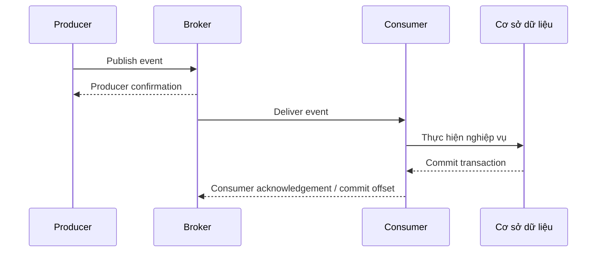

# Xác nhận gửi, xác nhận nhận và hoàn tất xử lý nghiệp vụ

Trong một hệ thống xử lý sự kiện, câu trả lời “đã gửi thành công” có thể chỉ nhiều việc khác nhau. Ứng dụng có thể đã chuyển thông điệp vào channel, broker có thể đã nhận và lưu thông điệp, consumer có thể đã xác nhận offset hoặc message, và nghiệp vụ có thể đã commit vào cơ sở dữ liệu. Đây là các mốc riêng biệt. Nếu gộp chúng thành một khái niệm, hệ thống dễ mất sự kiện hoặc xử lý trùng khi mạng lỗi, ứng dụng khởi động lại hay consumer bị rebalance.

Spring Cloud Stream cung cấp mô hình hàm `Supplier`, `Function`, `Consumer`, binding và binder để kết nối logic ứng dụng với Kafka, RabbitMQ hoặc Pulsar. Binder chuyển các thao tác gửi và nhận của ứng dụng thành cơ chế tương ứng của broker. Vì mỗi broker có cách xác nhận và lưu trữ riêng, cần hiểu rõ mốc nào đã hoàn tất trước khi quyết định retry, ghi nhận thành công hoặc trả lời cho hệ thống gọi.

## Bốn mốc cần phân biệt

Một luồng sự kiện thường có ít nhất bốn mốc:

| Mốc | Ý nghĩa | Điều mốc này chưa bảo đảm |
|---|---|---|
| Ứng dụng gửi vào binding | Thông điệp được chấp nhận qua channel/binding trong ứng dụng | Broker đã lưu bền vững thông điệp |
| Broker xác nhận producer | Broker đã xác nhận thao tác publish theo cấu hình của broker | Consumer đã nhận hoặc xử lý thông điệp |
| Consumer xác nhận message/offset | Broker hoặc hệ thống offset ghi nhận consumer đã đi qua thông điệp | Giao dịch nghiệp vụ bên ngoài đã commit, nếu consumer xác nhận quá sớm |
| Nghiệp vụ hoàn tất | Thay đổi dữ liệu và các hiệu ứng nghiệp vụ cần thiết đã commit | Các hệ thống bên ngoài khác cũng đã hoàn tất nếu chúng không nằm trong cùng giao dịch |

Luồng xử lý điển hình:



Thứ tự giữa commit nghiệp vụ và xác nhận consumer rất quan trọng. Với xử lý đồng bộ thông thường, ứng dụng nên để hàm consumer hoàn tất sau khi giao dịch nghiệp vụ commit; binder khi đó mới có thể áp dụng cơ chế xác nhận phù hợp với cấu hình. Nếu hàm trả về ngay sau khi đẩy công việc vào một executor hoặc gửi một tác vụ nền, binder có thể xem lần gọi hàm đã thành công trong khi công việc thực tế vẫn chưa xong.

## Xác nhận gửi từ producer

### Gửi qua binding của Spring Cloud Stream

Với `Supplier` hoặc `Function`, Spring Cloud Stream quản lý binding theo tên hàm. Khi cần gửi sự kiện từ một thành phần ứng dụng khác, có thể dùng `StreamBridge` để gửi vào output binding:

```java
@Service
public class OrderEventPublisher {
    private final StreamBridge streamBridge;

    public OrderEventPublisher(StreamBridge streamBridge) {
        this.streamBridge = streamBridge;
    }

    public void publish(OrderCreated event) {
        Message<OrderCreated> message = MessageBuilder
            .withPayload(event)
            .setHeader("eventId", event.eventId())
            .setHeader("schemaVersion", "1")
            .build();

        boolean accepted = streamBridge.send("orders-out-0", message);
        if (!accepted) {
            throw new IllegalStateException("Không thể gửi event vào output binding");
        }
    }
}
```

Giá trị boolean của `StreamBridge.send` cho biết kết quả gửi qua channel trong ứng dụng. Không nên diễn giải riêng giá trị này thành bằng chứng rằng broker đã lưu thông điệp bền vững. Để xác định kết quả publish ở phía broker, cần dùng cơ chế xác nhận của binder và broker, đồng thời xử lý lỗi bất đồng bộ nếu cấu hình gửi sử dụng callback hoặc future.

### Kafka

Kafka producer dùng cấu hình `acks` để xác định mức xác nhận cần chờ:

- `acks=0`: producer không chờ broker xác nhận; độ trễ thấp nhưng khó phát hiện việc broker không nhận được bản ghi.
- `acks=1`: leader xác nhận sau khi nhận bản ghi. Nếu leader gặp sự cố trước khi replica khác có bản ghi, vẫn có nguy cơ mất dữ liệu.
- `acks=all`: producer chờ các replica đang thuộc tập in-sync xác nhận. Mức bảo vệ thực tế còn phụ thuộc replication factor, `min.insync.replicas` và cấu hình idempotence.

Với sự kiện quan trọng, thường cần cân nhắc `acks=all`, bật idempotence và cấu hình số replica phù hợp. Idempotence giúp producer hạn chế bản ghi trùng do retry trong phạm vi mà Kafka hỗ trợ; nó không thay thế khóa idempotency ở tầng nghiệp vụ và không làm cho một giao dịch với cơ sở dữ liệu bên ngoài trở thành giao dịch nguyên tử.

### RabbitMQ

RabbitMQ có publisher confirms để producer nhận biết broker đã xác nhận publish. Cần phân biệt publisher confirm với publisher return: confirm phản ánh broker xử lý publish theo cơ chế xác nhận, còn return giúp phát hiện thông điệp không định tuyến được khi publish với chế độ phù hợp. Một publish được confirm vẫn có thể không đến queue mong muốn nếu routing key hoặc binding sai; vì vậy ứng dụng cần quan tâm cả xác nhận lẫn kết quả định tuyến.

Độ bền còn phụ thuộc cấu hình exchange, queue, loại queue, message persistence và chính sách replication. Với dữ liệu quan trọng, hãy kiểm tra toàn bộ đường đi từ exchange đến queue thay vì chỉ bật confirm rồi coi sự kiện đã được lưu ở đúng nơi.

### Pulsar

Pulsar trả về send receipt khi broker xác nhận việc publish. API gửi đồng bộ có thể chờ receipt; API gửi bất đồng bộ thường cung cấp callback hoặc future để nhận kết quả sau. Producer cần theo dõi lỗi của thao tác bất đồng bộ, vì việc tạo thành công future hoặc đưa tác vụ vào hàng đợi nội bộ của client chưa đồng nghĩa broker đã xác nhận.

Tính bền vững và khả năng phục hồi còn phụ thuộc cấu hình topic, subscription, lưu trữ và replication của cụm Pulsar. Khi dùng binder, cần kiểm tra tài liệu đúng phiên bản binder để biết cách cấu hình và quan sát send receipt.

## Xác nhận nhận từ consumer

Consumer acknowledgement cho broker biết consumer đã xử lý đến đâu. Spring Cloud Stream nhận message, gọi hàm ứng dụng và dùng binder để chuyển kết quả thành thao tác tương ứng của broker. Cơ chế cụ thể khác nhau giữa Kafka, RabbitMQ và Pulsar.

### Kafka: commit offset

Kafka không xóa từng message khi consumer xác nhận. Consumer thuộc một consumer group đọc các partition và commit offset để ghi nhận vị trí đã xử lý. Offset đã commit là điểm khôi phục khi consumer khởi động lại hoặc partition được giao cho consumer khác.

Một số điểm cần chú ý:

- Offset được commit theo partition. Khi một consumer xử lý nhiều bản ghi đồng thời, phải hiểu rõ thứ tự hoàn tất và cách binder/container commit offset để tránh commit vượt qua bản ghi chưa xử lý xong.
- Trong cùng consumer group, một partition tại một thời điểm được gán cho tối đa một consumer. Số partition vì thế giới hạn mức song song thực tế của group.
- Khi consumer chết sau khi nghiệp vụ commit nhưng trước khi offset được commit, bản ghi có thể được giao lại. Đây là tình huống bình thường cần được xử lý bằng idempotency.
- Chế độ commit tự động, commit theo batch, theo record hoặc manual có hành vi và chi phí khác nhau. Chỉ dùng manual acknowledgement khi ứng dụng thực sự cần tự kiểm soát thời điểm commit và đã hiểu cách binder cung cấp acknowledgement.

### RabbitMQ: ack, nack và reject

Với consumer do Spring quản lý, chế độ acknowledgement tự động của container thường xác nhận message sau khi listener xử lý thành công. Nếu listener ném exception, container và cấu hình retry quyết định message được thử lại, requeue hay chuyển sang dead-letter exchange. Trong chế độ manual, ứng dụng chủ động ack, nack hoặc reject message.

Không nên ack ngay khi vừa nhận message nếu nghiệp vụ còn đang chạy. Ack quá sớm có thể làm message biến mất khỏi queue trong khi cập nhật cơ sở dữ liệu thất bại. Ngược lại, nếu nghiệp vụ đã commit nhưng ack bị mất, RabbitMQ có thể giao lại message; consumer vẫn phải chịu được xử lý trùng.

### Pulsar: acknowledgement và redelivery

Pulsar ghi nhận acknowledgement theo subscription. Khi consumer xử lý thất bại, ứng dụng hoặc client có thể negative-acknowledge để yêu cầu giao lại; cấu hình acknowledgement timeout và redelivery policy cũng ảnh hưởng thời điểm giao lại. Hành vi acknowledgement tích lũy hay riêng lẻ còn phụ thuộc loại subscription và chế độ xử lý. Với xử lý song song, cần chọn chế độ phù hợp để xác nhận một message không vô tình đánh dấu các message trước đó là đã hoàn tất khi chúng vẫn đang được xử lý.

## Xác nhận consumer không thay thế commit nghiệp vụ

Giả sử consumer nhận `OrderCreated`, ghi đơn hàng vào cơ sở dữ liệu rồi xác nhận message. Có hai thứ tự phổ biến:

1. **Commit nghiệp vụ rồi mới ack:** nếu ứng dụng dừng sau commit nhưng trước ack, broker giao lại message. Consumer gặp lại sự kiện và phải nhận ra nghiệp vụ đã được thực hiện.
2. **Ack rồi mới commit nghiệp vụ:** nếu ứng dụng dừng sau ack nhưng trước commit, broker có thể không giao lại message trong khi nghiệp vụ chưa hoàn tất. Đây là nguy cơ mất xử lý.

Với consumer đồng bộ, hãy để lời gọi service hoàn tất giao dịch trước khi hàm consumer trả về:

```java
@Bean
Consumer<Message<OrderCreated>> updateOrder(OrderService orderService) {
    return message -> {
        OrderCreated event = message.getPayload();
        orderService.applyOnce(event.eventId(), event);
    };
}
```

`applyOnce` nên chạy trong transaction và ghi nhận `eventId` vào bảng inbox hoặc bảng xử lý sự kiện có unique constraint. Trong cùng transaction, service kiểm tra event đã được xử lý chưa, cập nhật dữ liệu nghiệp vụ và lưu dấu `eventId`. Nếu event đã tồn tại, service kết thúc như một lần xử lý lặp an toàn. Nhờ vậy, trường hợp commit xong nhưng chưa kịp ack có thể được xử lý lại mà không tạo hiệu ứng nghiệp vụ lần thứ hai.

Ví dụ trên giả định service thực hiện công việc đồng bộ và transaction đã commit khi lời gọi service trả về. Nếu chuyển công việc sang xử lý nền, cần thiết kế acknowledgement gắn với kết quả hoàn tất thực tế. Không nên gọi `submit`, `subscribe` hoặc khởi chạy tác vụ rồi trả về ngay nếu binder sẽ xem việc trả về đó là xử lý thành công.

## Retry, dead-letter queue và xử lý trùng

Retry phù hợp với lỗi tạm thời như timeout, mất kết nối ngắn hạn hoặc dịch vụ phụ thuộc chưa sẵn sàng. Nên giới hạn số lần thử, dùng backoff tăng dần và có khoảng chờ tối đa để tránh tạo tải lớn lên hệ thống đang lỗi. Lỗi dữ liệu không hợp lệ hoặc schema không tương thích thường không tự hết; nên chuyển nhanh sang luồng xử lý lỗi để điều tra.

Spring Cloud Stream có cấu hình retry chung ở consumer binding. Ví dụ sau minh họa một consumer Kafka có ba lần thử và bật DLQ theo cấu hình Kafka binder:

```yaml
spring:
  cloud:
    function:
      definition: updateOrder
    stream:
      bindings:
        updateOrder-in-0:
          destination: orders.created
          group: order-projection
          consumer:
            max-attempts: 3
            back-off-initial-interval: 1000
            back-off-max-interval: 10000
            back-off-multiplier: 2.0
      kafka:
        bindings:
          updateOrder-in-0:
            consumer:
              enable-dlq: true
```

Đây là cấu hình minh họa cho Kafka binder; tên thuộc tính mở rộng và khả năng DLQ khác nhau theo binder và phiên bản. Với RabbitMQ, DLQ thường được cấu hình qua dead-letter exchange/queue. Với Pulsar, cần cấu hình dead-letter policy của subscription. Hãy xác minh cấu hình theo phiên bản đang triển khai và bảo đảm group/subscription có định danh ổn định.

Một DLQ chỉ hữu ích khi có quy trình vận hành đi kèm. Cần lưu thông tin nguồn như topic/queue, partition hoặc message key, event ID, thời điểm lỗi và nguyên nhân; theo dõi số lượng message trong DLQ; quy định ai xử lý và cách phát lại sau khi sửa lỗi. Khi phát lại, vẫn phải giữ idempotency vì cùng một event có thể xuất hiện ở luồng chính, luồng retry và DLQ.

## Message schema và tương thích phiên bản

Producer và consumer cần thống nhất cách serialize, content type và cấu trúc event. Một event thường có envelope gồm `eventId`, `eventType`, `schemaVersion`, `occurredAt`, `aggregateId` hoặc message key, correlation ID và phần payload nghiệp vụ. Các trường định danh giúp truy vết và idempotency; phiên bản schema giúp consumer biết cách diễn giải payload. Có thể đặt metadata ở header hoặc trong payload, nhưng cần thống nhất quy ước giữa các dịch vụ và bảo đảm metadata cần thiết được giữ lại khi retry hoặc chuyển sang DLQ.

Khi thay đổi schema, ưu tiên thay đổi tương thích: thêm trường tùy chọn có giá trị mặc định, để consumer cũ bỏ qua trường chưa biết, và tránh đổi kiểu dữ liệu hoặc xóa trường bắt buộc khi vẫn còn producer/consumer phiên bản cũ. Triển khai theo thứ tự phù hợp để producer mới không phát dữ liệu mà consumer đang chạy chưa thể đọc. Nếu dùng schema registry, cần đặt compatibility policy và kiểm tra schema mới trước khi phát hành. Message không parse được hoặc vi phạm schema nên được phân loại rõ để đưa vào luồng lỗi, thay vì retry vô hạn.

## Consumer group, partition và thứ tự xử lý

Consumer group giúp mở rộng khả năng xử lý bằng cách chia partition cho nhiều instance. Trong Kafka, message có cùng key thường được đưa vào cùng partition, nhờ đó giữ thứ tự trong phạm vi partition. Nếu ứng dụng cần cập nhật một đơn hàng theo đúng thứ tự sự kiện, nên dùng khóa phân vùng ổn định như `orderId` và tránh xử lý song song không kiểm soát các sự kiện của cùng aggregate.

Tăng concurrency không tự động tăng thông lượng nếu số partition không đổi. Khi rebalance, partition được chuyển giữa các instance; consumer có thể phải xử lý lại những bản ghi chưa commit. Với RabbitMQ và Pulsar, cơ chế phân phối, thứ tự và mức song song phụ thuộc queue/subscription type và cấu hình consumer tương ứng. Không nên giả định các binder có cùng quy tắc phân phối chỉ vì chúng dùng chung abstraction của Spring Cloud Stream.

## Kafka Streams và trạng thái xử lý

Khi dùng Kafka Streams binder, ứng dụng có thể duy trì state store để tổng hợp hoặc cập nhật trạng thái theo luồng. Trạng thái cục bộ được phục hồi từ changelog topic khi instance khởi động lại hoặc chuyển task. Với chế độ xử lý exactly-once được cấu hình phù hợp, Kafka Streams có thể phối hợp commit offset, output record và thay đổi state store trong phạm vi giao dịch Kafka.

Phạm vi đó không tự động bao gồm một cơ sở dữ liệu SQL, lời gọi HTTP hay email bên ngoài. Nếu một processor vừa cập nhật state store vừa gọi dịch vụ bên ngoài, cần thiết kế idempotency hoặc outbox cho hiệu ứng bên ngoài. Cũng cần giám sát trạng thái task, consumer lag, thời gian xử lý và lỗi restore state để phát hiện consumer đã nhận dữ liệu nhưng không tiến triển.

## Đảm bảo giao nhận: chọn theo rủi ro nghiệp vụ

| Mô hình | Đặc điểm | Hệ quả cần xử lý |
|---|---|---|
| At-most-once | Xác nhận/commit trước khi xử lý hoặc chấp nhận bỏ qua khi lỗi | Có thể mất xử lý; chỉ phù hợp khi bỏ sót được chấp nhận |
| At-least-once | Chỉ xác nhận sau khi xử lý; lỗi ở khoảng giữa có thể dẫn đến giao lại | Có thể xử lý trùng; cần idempotency |
| Exactly-once trong phạm vi broker | Broker phối hợp đọc, ghi và commit trong một phạm vi giao dịch được hỗ trợ | Không tự bao gồm side effect ở hệ thống ngoài broker |
| Exactly-once ở cấp nghiệp vụ | Kết hợp giao dịch, inbox/outbox, khóa idempotency và quy trình phát lại | Cần thiết kế xuyên suốt các ranh giới hệ thống; không chỉ bật một cờ cấu hình |

Trong thực tế, at-least-once cùng consumer idempotent thường là lựa chọn dễ vận hành. Nếu producer ghi sự kiện sau khi cập nhật database, transactional outbox giúp tránh tình huống database commit nhưng publish thất bại: ứng dụng ghi thay đổi nghiệp vụ và bản ghi outbox trong cùng transaction, sau đó một publisher riêng gửi các bản ghi outbox lên broker. Publisher có thể gửi lặp nếu dừng sau khi broker xác nhận nhưng trước khi đánh dấu outbox đã gửi, vì vậy consumer vẫn cần idempotency.

## Kiểm thử và quan sát

Nên kiểm tra từng ranh giới xác nhận bằng các tình huống lỗi có thể tái hiện:

- Kiểm thử đơn vị `applyOnce` với cùng một `eventId` được gọi nhiều lần và xác nhận dữ liệu nghiệp vụ chỉ thay đổi một lần.
- Kiểm thử tích hợp producer khi broker từ chối publish, mất kết nối hoặc không định tuyến được message; xác minh ứng dụng quan sát được lỗi tương ứng.
- Dừng consumer sau khi database commit nhưng trước khi broker nhận ack/offset commit; khởi động lại và xác nhận message được giao lại mà không tạo tác dụng phụ trùng.
- Gửi message có schema sai hoặc gây lỗi không thể retry; xác minh message đi đến DLQ và có đủ metadata để điều tra.
- Kiểm thử rebalance, nhiều partition và xử lý đồng thời để xác nhận thứ tự theo key và hành vi commit offset.
- Với Kafka Streams, kiểm thử khôi phục state store và hành vi sau khi instance bị dừng giữa một đợt xử lý.

Test binder của Spring Cloud Stream hữu ích để kiểm tra hàm và binding trong phạm vi ứng dụng. Nó không thay thế kiểm thử với broker thật khi cần xác minh publisher confirms, Kafka offset commit, Pulsar redelivery, DLQ, durability hoặc hành vi rebalance. Hãy bổ sung integration test bằng broker phù hợp với môi trường triển khai.

Trong production, theo dõi producer send failures, số lần retry, consumer lag, tuổi của message chưa xử lý, thời gian xử lý, số lần redelivery, kích thước DLQ và tỷ lệ duplicate bị chặn bởi idempotency. Các chỉ số này giúp phân biệt lỗi publish, consumer bị chậm và nghiệp vụ bị kẹt. Log nên có `eventId`, correlation ID, message key và tên binding để lần theo một sự kiện qua nhiều dịch vụ.

## Quy tắc thực hành

1. Xác định rõ ứng dụng cần biết “đã vào channel”, “broker đã nhận” hay “nghiệp vụ đã commit”.
2. Chọn cấu hình producer confirmation và durability phù hợp với mức độ quan trọng của sự kiện.
3. Chỉ xác nhận consumer sau khi công việc mà consumer chịu trách nhiệm đã hoàn tất theo thiết kế.
4. Dùng event ID ổn định và xử lý idempotent để chịu được redelivery.
5. Giới hạn retry, phân loại lỗi và vận hành DLQ như một phần của sản phẩm.
6. Kiểm thử các cửa sổ lỗi giữa publish, commit nghiệp vụ và acknowledgement bằng đúng broker/binder đang dùng.

Khi các mốc gửi, nhận và commit nghiệp vụ được tách bạch, hệ thống Spring Cloud Stream có thể phục hồi có kiểm soát sau lỗi và cung cấp mức đảm bảo giao nhận phù hợp với yêu cầu của từng luồng sự kiện.
