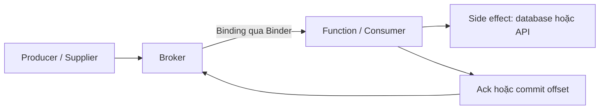

# Ngữ nghĩa giao nhận at-most-once, at-least-once và exactly-once

## Mục tiêu

Trong hệ thống xử lý sự kiện, một thông điệp có thể được gửi, lưu tại broker, chuyển đến consumer, xử lý bởi hàm ứng dụng rồi xác nhận đã hoàn tất. Sự cố có thể xảy ra ở bất kỳ thời điểm nào trong chuỗi đó: producer mất kết nối sau khi broker đã nhận dữ liệu, consumer dừng giữa lúc cập nhật cơ sở dữ liệu, hoặc xác nhận bị mất trên đường truyền. Vì vậy, một thông điệp có thể bị mất, được giao lại hoặc tạo ra tác động nghiệp vụ nhiều lần.

Ba thuật ngữ **at-most-once**, **at-least-once** và **exactly-once** mô tả cách hệ thống xử lý những tình huống này. Chúng là ngữ nghĩa giao nhận, không phải một thuộc tính tự động có được chỉ vì ứng dụng sử dụng Kafka, RabbitMQ, Pulsar hay Spring Cloud Stream.

Sau bài học, bạn có thể:

- Phân biệt khả năng mất thông điệp, giao trùng và xử lý trùng.
- Giải thích vai trò của acknowledgment, offset commit, retry và dead-letter queue (DLQ).
- Chọn mức bảo đảm phù hợp cho một luồng sự kiện Spring Cloud Stream.
- Thiết kế consumer có tính idempotent và nhận diện đúng phạm vi của exactly-once.

## 1. Ngữ nghĩa giao nhận nằm ở đâu trong luồng xử lý?

Một luồng sự kiện điển hình có các bước sau:

1. Producer tạo sự kiện và gửi đến destination.
2. Broker nhận, lưu hoặc định tuyến thông điệp.
3. Binder kết nối ứng dụng Spring Cloud Stream với broker.
4. Binding chuyển thông điệp đến hàm `Function` hoặc `Consumer`.
5. Hàm ứng dụng thực hiện xử lý, có thể cập nhật database hoặc phát ra sự kiện mới.
6. Consumer xác nhận đã xử lý; broker hoặc consumer group cập nhật trạng thái giao nhận tương ứng.



Điểm quan trọng là **xác nhận giao nhận và tác động nghiệp vụ có thể nằm ở hai hệ thống khác nhau**. Ví dụ, consumer ghi đơn hàng vào PostgreSQL rồi mới commit offset Kafka. Nếu ứng dụng dừng sau khi PostgreSQL commit nhưng trước khi Kafka nhận được offset commit, Kafka có thể giao lại sự kiện. Database khi đó đã có thay đổi từ lần xử lý trước.

Các broker biểu diễn trạng thái giao nhận theo cách khác nhau:

- **Kafka** theo dõi vị trí đã đọc của từng consumer group trên từng partition bằng offset. Commit offset có nghĩa là consumer group xác nhận tiến độ đến một vị trí; đây không phải một acknowledgment độc lập cho từng bản ghi như ở queue truyền thống.
- **RabbitMQ** dùng acknowledgment cho từng delivery. Consumer có thể ack khi xử lý xong, hoặc nack/reject để broker xử lý lại hay đưa thông điệp vào dead-letter exchange tùy cấu hình.
- **Pulsar** dùng acknowledgment trên subscription. Consumer có thể ack, negative-ack hoặc để hết thời gian acknowledgment để broker giao lại theo chính sách subscription.

Spring Cloud Stream cung cấp mô hình hàm và binding thống nhất, còn binder chuyển các thao tác đó thành cơ chế tương ứng của broker. Vì vậy, cần kiểm tra cấu hình và hành vi của binder đang dùng khi cần một bảo đảm cụ thể.

## 2. At-most-once: giao tối đa một lần

Với **at-most-once**, một thông điệp được giao hoặc xử lý tối đa một lần. Hệ thống tránh giao trùng bằng cách chấp nhận khả năng thông điệp không được xử lý lần nào.

Một tình huống có thể tạo ra ngữ nghĩa này là consumer xác nhận hoặc commit offset trước khi hoàn tất công việc nghiệp vụ:

1. Consumer nhận sự kiện `PaymentRequested`.
2. Consumer commit offset hoặc xác nhận delivery.
3. Tiến trình dừng trước khi ghi nhận thanh toán vào database.
4. Broker xem thông điệp đã được xác nhận và không giao lại.

Kết quả là sự kiện đã được xác nhận nhưng tác động nghiệp vụ chưa xảy ra. Không có lần giao lại để tạo bản sao, nhưng thông điệp có thể bị mất đối với ứng dụng.

At-most-once phù hợp khi mất một vài sự kiện có thể chấp nhận được, chẳng hạn một số mẫu telemetry hoặc số liệu thống kê có thể tái tạo. Không nên chọn nó cho giao dịch tài chính, đơn hàng hay lệnh điều khiển quan trọng nếu không có cơ chế bù hoặc đối soát khác.

**Cần nhớ:** “tối đa một lần” không có nghĩa là chắc chắn xử lý thành công một lần. Kết quả có thể là không lần nào.

## 3. At-least-once: giao ít nhất một lần

Với **at-least-once**, hệ thống tiếp tục giao lại khi chưa nhận được xác nhận thành công. Mục tiêu là tránh mất thông điệp trong phạm vi các điều kiện vận hành đã đặt ra. Đổi lại, cùng một thông điệp có thể đến consumer nhiều lần.

Một trình tự thường gặp:

1. Consumer nhận sự kiện `OrderCreated`.
2. Consumer ghi dữ liệu vào database thành công.
3. Ứng dụng dừng trước khi acknowledgment hoặc offset commit hoàn tất.
4. Broker giao lại `OrderCreated`.
5. Consumer chạy lại logic và có nguy cơ ghi nhận tác động lần thứ hai.

Đây là lý do **at-least-once cần đi cùng xử lý idempotent**. Một thao tác idempotent có thể được gọi nhiều lần với cùng đầu vào nhưng kết quả nghiệp vụ cuối cùng vẫn tương đương với một lần gọi.

Để đạt at-least-once trong một luồng cụ thể, cần phối hợp nhiều điều kiện:

- Producer biết việc gửi đã thành công, và có chính sách retry phù hợp khi kết quả gửi chưa rõ.
- Broker được cấu hình lưu trữ, replication và retention phù hợp với yêu cầu dữ liệu.
- Consumer chỉ xác nhận sau khi phần xử lý cần bảo đảm đã thành công.
- Lỗi tạm thời có chính sách retry; lỗi không thể khắc phục được chuyển đến DLQ hoặc một nơi lưu giữ có thể điều tra.
- Consumer có khả năng nhận lại cùng một `eventId` mà không tạo tác động trùng.

At-least-once vẫn có giới hạn. Nếu producer không gửi thành công, dữ liệu hết retention, queue bị xóa, hoặc hệ thống loại bỏ thông điệp sau khi retry hết số lần mà không lưu DLQ, ứng dụng không thể khẳng định đã xử lý thành công ít nhất một lần. Khi dùng DLQ, thông điệp được giữ lại để xử lý riêng; điều đó không đồng nghĩa nghiệp vụ ban đầu đã hoàn tất.

### Idempotency bằng event ID

Mỗi sự kiện nghiệp vụ nên có một định danh ổn định, chẳng hạn `eventId`. Consumer có thể lưu các ID đã xử lý trong một bảng inbox có ràng buộc duy nhất:

```java
public record OrderCreated(String eventId, String orderId) {}

@Bean
Consumer<OrderCreated> reserveInventory(InventoryService service) {
    return event -> service.reserve(event.eventId(), event.orderId());
}
```

Phần nghiệp vụ có thể triển khai theo ý tưởng sau:

```java
@Transactional
public void reserve(String eventId, String orderId) {
    // insertIfAbsent dùng UNIQUE(event_id) trong database.
    // Trả về false nếu eventId đã được ghi nhận trước đó.
    boolean firstDelivery = inboxRepository.insertIfAbsent(eventId);
    if (!firstDelivery) {
        return;
    }

    inventoryRepository.reserve(orderId);
}
```

Việc ghi inbox và cập nhật tồn kho phải nằm trong **cùng một transaction database**. Nếu cập nhật tồn kho thất bại, transaction rollback cả bản ghi inbox để lần giao lại có thể thử lại. Ràng buộc `UNIQUE(event_id)` bảo vệ trước hai lần giao đồng thời; chỉ kiểm tra `exists` rồi mới insert mà không có ràng buộc duy nhất sẽ có nguy cơ race condition.

Nếu nghiệp vụ gọi một API bên ngoài, hãy truyền `eventId` làm idempotency key nếu API hỗ trợ. Nếu API không hỗ trợ, cần thiết kế đối soát hoặc cơ chế bù phù hợp; acknowledgment của broker không thể làm cho một lời gọi HTTP trở nên idempotent.

## 4. Exactly-once: hiệu ứng đúng một lần trong một phạm vi xác định

**Exactly-once** hướng đến việc mỗi sự kiện tạo ra hiệu ứng được tính đúng một lần, kể cả khi có retry, giao lại hoặc khởi động lại. Cần phân biệt ba khái niệm:

- **Exactly-once delivery:** broker chỉ giao đúng một lần. Đây không phải bảo đảm phổ quát của các broker.
- **Exactly-once processing:** logic ứng dụng chỉ chạy một lần. Trong môi trường có retry và sự cố, rất khó bảo đảm theo nghĩa đen.
- **Exactly-once effect:** trạng thái nghiệp vụ quan sát được tương đương với việc sự kiện chỉ được áp dụng một lần. Đây thường là mục tiêu thực tế cần đạt.

Chỉ commit offset sau khi xử lý xong chưa tạo ra exactly-once. Nếu tác động nghiệp vụ hoàn tất nhưng commit thất bại, consumer vẫn có thể xử lý lại. Ngược lại, nếu commit trước tác động, sự kiện có thể bị mất. Muốn phối hợp nhiều bước, cần một cơ chế nguyên tử bao phủ đúng các bước đó hoặc một thiết kế idempotent ở nơi lưu trạng thái.

### Transaction Kafka cho luồng Kafka-to-Kafka

Kafka hỗ trợ transaction để ghi nhiều bản ghi và commit offset tiêu thụ trong cùng một transaction Kafka. Khi ứng dụng xử lý một bản ghi từ Kafka rồi phát kết quả sang topic Kafka khác trong transaction được hỗ trợ bởi Kafka binder, kết quả đầu ra và tiến độ tiêu thụ có thể được commit hoặc abort cùng nhau.

Ví dụ cấu hình transaction cho Kafka binder:

```yaml
spring:
  cloud:
    stream:
      kafka:
        binder:
          transaction:
            transactionIdPrefix: ${INSTANCE_ID}-tx-
```

`INSTANCE_ID` cần tạo ra prefix duy nhất giữa các instance đang chạy để tránh xung đột transactional producer. Consumer đọc topic có dữ liệu transactional nên dùng `read_committed` nếu cần chỉ nhìn thấy các transaction đã commit. Có thể cấu hình thuộc tính Kafka consumer ở binding tương ứng:

```yaml
spring:
  cloud:
    stream:
      kafka:
        bindings:
          process-in-0:
            consumer:
              configuration:
                isolation.level: read_committed
```

Tên binding phải khớp với binding đầu vào thực tế của hàm. Cấu hình transaction cụ thể phụ thuộc phiên bản Spring Cloud Stream Kafka binder và cách ứng dụng khai báo producer/consumer; cần xác minh bằng integration test trên đúng phiên bản đang triển khai.

Phạm vi transaction Kafka chỉ bao phủ các thao tác tham gia transaction Kafka. Nếu hàm còn cập nhật PostgreSQL, gọi REST API hoặc gửi email, các thao tác đó không tự động trở thành một phần của transaction Kafka. Ví dụ, database commit thành công nhưng Kafka transaction abort vẫn có thể để lại thay đổi database. Không nên tuyên bố toàn bộ quy trình là exactly-once chỉ dựa vào `transactionIdPrefix`.

### Khi có database hoặc hệ thống bên ngoài

Hai mẫu thiết kế thường dùng để đạt hiệu ứng nghiệp vụ một lần là:

- **Inbox/deduplication:** consumer ghi nhận `eventId` đã xử lý cùng transaction với cập nhật nghiệp vụ. Khi broker giao lại, consumer nhận ra sự kiện trùng và bỏ qua tác động lặp.
- **Transactional outbox:** ứng dụng ghi trạng thái nghiệp vụ và một bản ghi outbox trong cùng transaction database. Một tiến trình relay đọc outbox rồi gửi sự kiện đến broker. Relay có thể gửi trùng nếu gặp sự cố, vì vậy consumer phía nhận vẫn nên idempotent.

Các mẫu này không làm cho mạng hoặc broker chỉ giao đúng một lần. Chúng giúp hệ thống bảo đảm hiệu ứng nghiệp vụ không bị nhân đôi trong phạm vi transaction và định danh đã thiết kế.

## 5. So sánh ba ngữ nghĩa

| Tiêu chí | At-most-once | At-least-once | Exactly-once effect |
|---|---|---|---|
| Số lần giao/xử lý | 0 hoặc 1 | 1 hoặc nhiều lần trong điều kiện bảo đảm | Hiệu ứng quan sát được đúng một lần trong phạm vi đã xác định |
| Nguy cơ mất sự kiện | Có | Được giảm thiểu nếu producer, broker, retry và lưu giữ được cấu hình đúng | Được xử lý trong phạm vi transaction hoặc cơ chế lưu trạng thái |
| Nguy cơ trùng | Thấp theo ngữ nghĩa giao nhận | Có | Phải được ngăn bằng transaction hoặc idempotency |
| Cơ chế thường gặp | Xác nhận sớm, không retry | Xác nhận sau xử lý, retry, redelivery | Transaction nguyên tử, inbox, outbox, idempotency key |
| Trường hợp phù hợp | Dữ liệu có thể bỏ qua hoặc tái tạo | Sự kiện nghiệp vụ cần độ tin cậy và consumer chịu được bản sao | Luồng cần hiệu ứng duy nhất trong một ranh giới kỹ thuật rõ ràng |

Trong nhiều hệ thống thực tế, **at-least-once kết hợp idempotency** là lựa chọn cân bằng và dễ vận hành. Exactly-once nên được dùng khi xác định được ranh giới transaction và có thể kiểm chứng hành vi khi sự cố xảy ra.

## 6. Áp dụng trong Spring Cloud Stream

Spring Cloud Stream dùng mô hình hàm để mô tả vai trò của ứng dụng:

- `Supplier<T>` tạo thông điệp đầu ra.
- `Function<I, O>` nhận thông điệp, xử lý và tạo thông điệp đầu ra.
- `Consumer<T>` nhận và xử lý thông điệp mà không tạo đầu ra từ chữ ký hàm.

Binding ánh xạ đầu vào và đầu ra của hàm đến destination. Binder kết nối binding đó với Kafka, RabbitMQ hoặc Pulsar. Loại hàm không tự quyết định delivery guarantee; cách gửi, xác nhận, retry và transaction của binding/binder mới quyết định hành vi khi có lỗi.

Ví dụ một consumer nhận sự kiện tạo đơn hàng:

```java
@Bean
Consumer<OrderCreated> reserveInventory(InventoryService service) {
    return event -> service.reserve(event.eventId(), event.orderId());
}
```

Cấu hình binding và consumer group:

```yaml
spring:
  cloud:
    function:
      definition: reserveInventory
    stream:
      bindings:
        reserveInventory-in-0:
          destination: orders.created
          group: inventory-service
```

Tên `reserveInventory-in-0` là binding đầu vào được suy ra từ tên hàm và vị trí input. `destination` chỉ định nơi nhận sự kiện; `group` xác định nhóm consumer dùng chung tiến độ hoặc subscription theo quy tắc của binder. Khi nhiều instance cùng thuộc một group, broker phân phối công việc giữa chúng. Nếu không đặt group, hành vi subscription và khả năng nhận lại dữ liệu có thể khác đáng kể giữa các binder; hãy cấu hình group rõ ràng cho consumer nghiệp vụ cần subscription bền vững.

### Retry và DLQ

Với consumer imperative, có thể khai báo retry ở cấp binding. Ví dụ dưới đây cho phép tối đa ba lần thử tổng cộng, với backoff tăng dần:

```yaml
spring:
  cloud:
    stream:
      bindings:
        reserveInventory-in-0:
          consumer:
            max-attempts: 3
            back-off-initial-interval: 1000
            back-off-multiplier: 2.0
            back-off-max-interval: 10000
```

Retry trong ứng dụng và redelivery từ broker là hai cơ chế khác nhau. Retry có thể gọi lại handler trong cùng quá trình xử lý; redelivery thường xảy ra sau khi broker nhận được nack, không nhận được ack hoặc consumer khởi động lại với offset chưa commit. Cần kiểm tra thứ tự và số lần thử thực tế của binder để tránh vô tình nhân số lần retry.

Khi hết số lần thử, cấu hình DLQ theo binder để giữ thông điệp lỗi. Kafka binder, Rabbit binder và Pulsar binder có cấu hình DLQ riêng; tên queue/topic, điều kiện định tuyến, quyền truy cập và cách replay không giống nhau. DLQ cần có cảnh báo, người phụ trách và quy trình xử lý lại. Nếu replay mà không giữ `eventId` hoặc không có idempotency, tác động nghiệp vụ có thể bị lặp.

### Khác biệt cần lưu ý giữa các binder

| Broker | Cách theo dõi giao nhận | Failure mode cần kiểm tra | Hướng cấu hình/thiết kế |
|---|---|---|---|
| Kafka | Offset theo partition và consumer group | Consumer hoàn tất side effect nhưng offset chưa commit; rebalance khiến bản ghi được đọc lại | Chọn ack/commit phù hợp, quản lý group và partition, dùng idempotent consumer; dùng Kafka transaction cho luồng Kafka-to-Kafka khi đáp ứng điều kiện |
| RabbitMQ | Ack/nack theo delivery | Consumer chết trước ack khiến message được requeue; nack có thể tạo redelivery | Ack sau xử lý, đặt prefetch hợp lý, cấu hình durable queue và message persistence, dead-letter exchange và consumer idempotent |
| Pulsar | Ack/nack theo subscription | Ack timeout hoặc negative ack làm message được giao lại; hành vi phụ thuộc subscription type | Chọn subscription type phù hợp, cấu hình ack timeout/redelivery/DLQ và kiểm tra hành vi của binder đang dùng |

Không suy ra rằng cùng một thuộc tính Spring Cloud Stream sẽ tạo cùng ngữ nghĩa trên cả ba broker. Một cấu hình retry cấp binding có thể được thực hiện ở tầng framework, trong khi ack, offset, transaction và DLQ phụ thuộc binder. Đọc tài liệu đúng phiên bản binder và kiểm tra với broker thật trước khi cam kết SLA giao nhận.

## 7. Cách chọn ngữ nghĩa cho một luồng sự kiện

Trước khi chọn cấu hình, hãy trả lời các câu hỏi sau:

1. **Mất một sự kiện có chấp nhận được không?** Nếu không, tránh xác nhận trước khi xử lý và kiểm tra độ bền của producer/broker.
2. **Một sự kiện có thể được giao lại không?** Nếu có, mọi cập nhật nghiệp vụ cần idempotent hoặc có khóa chống trùng.
3. **Tác động nằm trong một hệ thống hay nhiều hệ thống?** Transaction của broker không tự bao phủ database và API bên ngoài.
4. **Khi xử lý lỗi vĩnh viễn, thông điệp đi đâu?** Xác định DLQ, cảnh báo, thời hạn lưu và cách replay.
5. **Thứ tự sự kiện có quan trọng không?** Kafka chỉ bảo đảm thứ tự trong một partition; retry và xử lý song song cũng có thể ảnh hưởng thứ tự quan sát ở tầng nghiệp vụ.
6. **Có thể kiểm chứng bằng cách tạo sự cố không?** Thử dừng consumer tại các điểm giữa side effect và ack/commit, sau đó quan sát kết quả.

Một số lựa chọn thường gặp:

- Sự kiện đo lường có thể tái tạo: at-most-once có thể phù hợp nếu ưu tiên giảm chi phí và chấp nhận mất mẫu.
- Đơn hàng, tồn kho hoặc thanh toán: thường chọn at-least-once, lưu `eventId`, dùng inbox/unique constraint và đối soát.
- Kafka đọc một topic, xử lý rồi ghi sang topic Kafka khác: cân nhắc transaction Kafka để phối hợp output với offset đầu vào.
- Database cập nhật cùng lúc với việc phát sự kiện: cân nhắc transactional outbox; consumer nhận sự kiện dùng inbox hoặc idempotency key.

## 8. Kiểm thử và vận hành

Unit test cho `Function` hoặc `Consumer` xác minh logic nghiệp vụ, nhưng chưa đủ để chứng minh delivery guarantee của broker. Cần integration test với đúng binder và broker để kiểm tra acknowledgment, offset, retry, redelivery, transaction và DLQ.

Các tình huống nên kiểm thử:

- Gửi cùng một `eventId` hai lần và xác minh hiệu ứng nghiệp vụ chỉ xuất hiện một lần.
- Làm consumer dừng sau khi database commit nhưng trước ack/offset commit; xác minh lần giao lại không tạo tác động trùng.
- Làm handler thất bại liên tiếp; xác minh số lần thử, backoff và nơi nhận thông điệp sau khi hết retry.
- Khởi động lại hoặc rebalance consumer group trong lúc đang xử lý; kiểm tra offset và khả năng xử lý lại.
- Với Kafka transaction, làm transaction abort và xác minh consumer `read_committed` không nhìn thấy bản ghi chưa commit.
- Replay một thông điệp từ DLQ và xác minh idempotency vẫn hoạt động.

Trong production, theo dõi số lượng retry, redelivery, DLQ, consumer lag, tuổi thông điệp lâu nhất và lỗi khi commit/ack. Cảnh báo khi DLQ tăng bất thường hoặc thông điệp tồn đọng quá thời hạn nghiệp vụ. Lưu `eventId`, correlation ID và thông tin partition/offset hoặc message ID trong log để có thể lần theo một sự kiện qua producer, broker và consumer.

## Kết luận

At-most-once ưu tiên tránh giao trùng và chấp nhận nguy cơ mất sự kiện. At-least-once ưu tiên giao lại khi chưa xác nhận thành công và yêu cầu consumer chịu được bản sao. Exactly-once chỉ có ý nghĩa khi nêu rõ hiệu ứng nào được bảo đảm và ranh giới transaction bao phủ những thành phần nào.

Khi xây dựng ứng dụng xử lý sự kiện bằng Spring Cloud Stream, hãy xem `Supplier`, `Function`, `Consumer`, binding và binder là các phần của cùng một luồng. Thiết kế ack/offset, retry, DLQ và idempotency dựa trên failure mode thực tế của Kafka, RabbitMQ hoặc Pulsar; sau đó kiểm chứng bằng integration test có chủ đích tạo sự cố.

