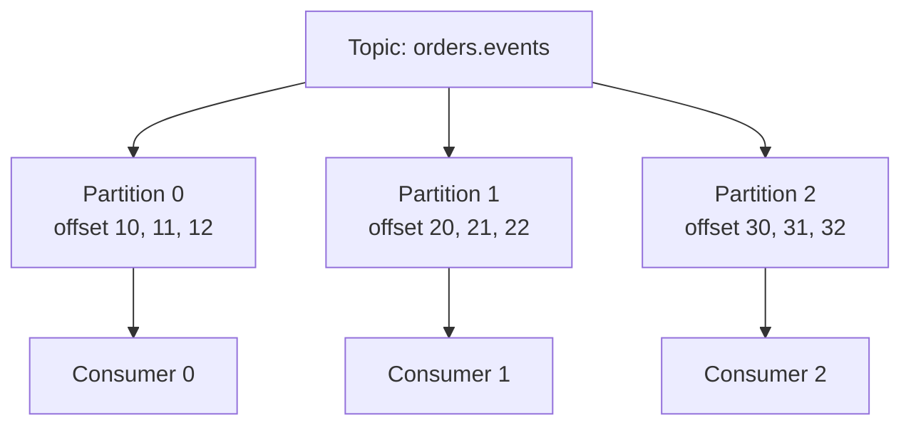
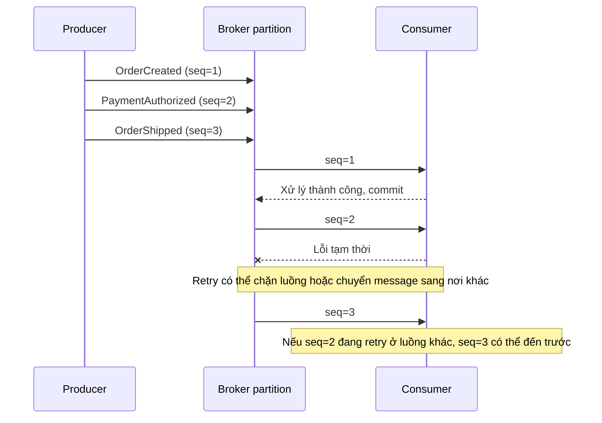

# Thứ tự thông điệp, xử lý song song và phạm vi bảo đảm

## 1. Vì sao thứ tự và xử lý song song phải được thiết kế cùng nhau

Trong một hệ thống xử lý sự kiện, nhiều message có thể liên quan đến cùng một đối tượng nghiệp vụ. Ví dụ, một đơn hàng lần lượt phát sinh `OrderCreated`, `PaymentAuthorized` và `OrderShipped`. Nếu consumer xử lý `OrderShipped` trước `OrderCreated`, trạng thái đơn hàng có thể trở nên không hợp lệ. Tuy nhiên, nếu toàn bộ hệ thống chỉ xử lý từng message một, năng lực xử lý sẽ thấp và một tác vụ chậm có thể làm nghẽn các tác vụ độc lập.

Thiết kế luồng message vì vậy cần trả lời hai câu hỏi:

- **Thứ tự cần giữ ở phạm vi nào?** Toàn hệ thống, một partition, một khóa, một đơn hàng hay một nhóm message cụ thể?
- **Có thể xử lý song song ở đâu?** Giữa các partition, giữa các khóa nghiệp vụ, giữa các consumer hay bên trong một consumer?

Không có một thứ tự toàn cục tự nhiên khi dữ liệu được chia thành nhiều luồng độc lập. Thông thường, hệ thống chỉ cần giữ thứ tự cho các sự kiện của cùng một thực thể, chẳng hạn cùng `orderId` hoặc `accountId`, trong khi cho phép các thực thể khác nhau được xử lý song song.

### Phân biệt các loại thứ tự

Khi nói một message được xử lý đúng thứ tự, cần làm rõ đang nói đến thứ tự nào:

1. **Thứ tự phát:** thứ tự producer tạo hoặc gửi các message.
2. **Thứ tự lưu/ghi:** thứ tự broker ghi nhận message vào một queue, log hoặc partition.
3. **Thứ tự nhận:** thứ tự consumer nhận message.
4. **Thứ tự hoàn tất:** thứ tự logic xử lý của consumer kết thúc.
5. **Thứ tự tác dụng phụ:** thứ tự các thay đổi được commit vào cơ sở dữ liệu hoặc hệ thống bên ngoài.

Các thứ tự này có thể khác nhau. Một consumer nhận message A trước B nhưng đưa cả hai vào hai luồng xử lý bất đồng bộ; B có thể cập nhật cơ sở dữ liệu trước A. Vì vậy, bảo đảm thứ tự nhận không đồng nghĩa với bảo đảm thứ tự hoàn tất hay thứ tự thay đổi nghiệp vụ.

## 2. Phạm vi thứ tự theo từng broker

### Apache Kafka: thứ tự trong một partition

Kafka lưu record theo thứ tự offset trong từng partition. Consumer đọc một partition theo thứ tự offset, và trong cùng một consumer group, tại một thời điểm một partition được gán cho tối đa một consumer. Nhiều partition cho phép nhiều consumer xử lý song song.



Kafka không cung cấp thứ tự toàn cục giữa các partition. Consumer của partition 0 có thể xử lý offset 12 trước khi consumer của partition 1 hoàn tất offset 20. Nếu cần các sự kiện của cùng một đơn hàng đi theo thứ tự, producer nên dùng `orderId` làm key để các record có cùng key được đưa vào cùng partition.

Thứ tự trong partition vẫn có thể bị phá vỡ ở tầng ứng dụng nếu consumer nhận record theo thứ tự nhưng giao chúng cho nhiều tác vụ bất đồng bộ rồi hoàn tất không theo thứ tự. Khi cần giữ thứ tự, hãy xử lý tuần tự trong partition hoặc tuần tự theo từng key trước khi ghi tác dụng phụ.

### RabbitMQ: thứ tự queue và ảnh hưởng của consumer

Một RabbitMQ queue thường chuyển message theo thứ tự chúng được đưa vào queue. Tuy nhiên, thứ tự consumer hoàn tất xử lý không được bảo đảm khi có nhiều consumer, prefetch lớn, xử lý bất đồng bộ, message có priority hoặc message bị reject và requeue. Consumer nhận message trước có thể xử lý lâu hơn, trong khi consumer khác đã hoàn tất message đến sau.

Nếu cần thứ tự nghiêm ngặt trong một queue, có thể giới hạn số consumer hoạt động đồng thời, kiểm soát prefetch và tránh đưa message sang các đường retry làm thay đổi thứ tự. RabbitMQ có cơ chế single active consumer để một consumer hoạt động tại một thời điểm và các consumer khác làm dự phòng. Cách này giảm khả năng xử lý song song trên queue đó, vì vậy chỉ nên dùng khi yêu cầu thứ tự quan trọng hơn thông lượng.

Publisher confirms và consumer acknowledgements giải quyết hai chặng khác nhau: xác nhận broker đã nhận publish và xác nhận consumer đã xử lý message. Không nên xem một loại xác nhận là bằng chứng cho loại còn lại.

### Apache Pulsar: thứ tự phụ thuộc subscription type

Pulsar cung cấp nhiều kiểu subscription với mức song song và thứ tự khác nhau:

| Subscription type | Cách phân phối khái quát | Đặc điểm về thứ tự và song song |
|---|---|---|
| Exclusive | Một consumer được gắn với subscription | Dễ tổ chức xử lý tuần tự; khả năng song song thấp trong subscription đó |
| Failover | Nhiều consumer có vai trò chính và dự phòng | Một consumer hoạt động chính tại một thời điểm theo phạm vi subscription/partition; consumer dự phòng tiếp quản khi cần |
| Shared | Message được phân phối cho nhiều consumer | Tăng song song; thứ tự hoàn tất không được bảo đảm |
| Key_Shared | Message được phân phối theo key cho các consumer | Cho phép xử lý song song giữa các key và giữ affinity/thứ tự theo key theo cấu hình phù hợp |

Với Key_Shared, producer và consumer phải thống nhất cách gán key. Cấu hình batching và cách sử dụng ordering key cũng cần tương thích với yêu cầu thứ tự của ứng dụng. Hãy kiểm tra tài liệu binder và phiên bản Pulsar đang dùng trước khi chọn subscription type.

### So sánh nhanh

| Broker | Đơn vị thứ tự chính | Nơi có thể song song | Nguyên nhân thường làm thay đổi thứ tự xử lý |
|---|---|---|---|
| Kafka | Một partition theo offset | Nhiều partition và nhiều consumer trong group | Xử lý bất đồng bộ trong consumer, retry tách luồng, thay đổi partition key |
| RabbitMQ | Thứ tự đưa vào queue | Nhiều consumer hoặc nhiều queue | Prefetch, thời gian xử lý khác nhau, requeue, priority |
| Pulsar | Phụ thuộc subscription và key | Shared/Key_Shared, nhiều partition | Subscription type, batching, redelivery và xử lý bất đồng bộ |

Các mô tả trên là nguyên tắc kiến trúc. Chi tiết giao nhận, xác nhận, retry và thứ tự còn phụ thuộc cấu hình broker, binder và phiên bản triển khai.

## 3. Xử lý song song trong Spring Cloud Stream

Spring Cloud Stream kết nối hàm ứng dụng với broker qua binding và binder. Mức song song thực tế được quyết định bởi nhiều tầng: số partition hoặc queue, số instance ứng dụng, số consumer trên mỗi instance, khả năng của subscription và cách code xử lý message.

### Consumer concurrency

Thuộc tính `consumer.concurrency` cấu hình số consumer/listener đồng thời cho một binding theo khả năng binder. Ví dụ:

```yaml
spring:
  cloud:
    function:
      definition: projectOrder
    stream:
      bindings:
        projectOrder-in-0:
          destination: orders.events
          group: order-projection
          consumer:
            concurrency: 3
```

Với Kafka binder, concurrency tạo nhiều consumer trong cùng group trên mỗi instance ứng dụng. Số consumer thực sự có partition để đọc bị giới hạn bởi số partition được gán cho group. Nếu tổng số consumer lớn hơn số partition, một số consumer sẽ không được gán partition và không giúp tăng thông lượng.

Với RabbitMQ binder, concurrency điều khiển số consumer/listener cho binding và có thể ảnh hưởng đến thứ tự hoàn tất khi nhiều consumer cùng đọc một queue. Với binder khác, cần xem tài liệu tương ứng để hiểu concurrency được ánh xạ ra sao.

### Số instance và partition

Giả sử một Kafka topic có 12 partition, ứng dụng chạy 3 instance và mỗi instance đặt concurrency bằng 2. Tổng cộng có tối đa 6 consumer trong group, nên có thể sử dụng 6 partition đồng thời. Nếu tăng concurrency lên 5 ở mỗi instance, có 15 consumer nhưng vẫn chỉ có 12 partition để phân công; một số consumer sẽ nhàn rỗi.

Ngược lại, nếu chỉ có 2 partition nhưng chạy 10 instance, tối đa 2 consumer trong group có thể đọc partition tại cùng thời điểm. Tăng instance vượt quá số partition không làm tăng khả năng đọc song song của group. Cần cân nhắc số partition ngay từ thiết kế topic, đồng thời dự phòng chi phí tài nguyên, metadata, rebalance và vận hành khi tạo quá nhiều partition.

### Phân vùng theo khóa nghiệp vụ

Trong mô hình partitioning của Spring Cloud Stream, producer có thể dùng `partition-key-expression` để lấy khóa từ payload hoặc header và `partition-count` để mô tả số partition dự kiến. Ví dụ:

```yaml
spring:
  cloud:
    stream:
      bindings:
        publishOrder-out-0:
          destination: orders.events
          producer:
            partition-key-expression: payload.orderId
            partition-count: 12
```

Các event của cùng một `orderId` được định tuyến theo cùng khóa, nhờ đó có thể được xử lý trong cùng partition theo chiến lược partitioning đã cấu hình. Topic thực tế trên broker phải có số partition tương thích. Nếu producer khác cũng ghi vào topic, producer đó phải dùng chiến lược key nhất quán.

Chọn khóa có phân bố tốt. Nếu một khóa chiếm phần lớn lưu lượng, partition tương ứng có thể trở thành điểm nóng trong khi partition khác ít việc. Không chọn khóa ngẫu nhiên nếu cần giữ thứ tự cho một thực thể nghiệp vụ.

### Ví dụ hàm xử lý theo khóa đơn hàng

Hàm sau nhận sự kiện đơn hàng và tạo bản ghi chiếu trạng thái. `sequence` là số thứ tự do miền nghiệp vụ cấp cho các thay đổi của một đơn hàng:

```java
import java.util.function.Function;
import org.springframework.context.annotation.Bean;
import org.springframework.context.annotation.Configuration;

record OrderEvent(String orderId, long sequence, String status) {}
record OrderView(String orderId, long sequence, String status) {}

@Configuration
class OrderProjectionFunctions {

    @Bean
    Function<OrderEvent, OrderView> projectOrder() {
        return event -> new OrderView(
            event.orderId(),
            event.sequence(),
            event.status()
        );
    }
}
```

Cấu hình binding có thể đặt concurrency cho đầu vào và partition key cho đầu ra:

```yaml
spring:
  cloud:
    function:
      definition: projectOrder
    stream:
      bindings:
        projectOrder-in-0:
          destination: orders.events
          group: order-projection
          consumer:
            concurrency: 3
        projectOrder-out-0:
          destination: orders.projections
          producer:
            partition-key-expression: payload.orderId
            partition-count: 12
      kafka:
        binder:
          brokers: localhost:9092
```

Trong ví dụ, producer của `orders.events` cũng phải phân vùng theo `orderId` nếu muốn các event của một đơn hàng đi vào cùng partition đầu vào. Cấu hình đầu ra giữ các bản ghi projection của cùng đơn hàng cùng khóa. Concurrency bằng 3 cho phép nhiều partition được xử lý song song trên mỗi instance, nhưng không tự bảo đảm thứ tự nếu code tiếp tục gửi tác vụ bất đồng bộ ra executor khác.

## 4. Chọn mức song song phù hợp

Không phải cứ tăng concurrency là hệ thống tốt hơn. Hãy xác định điểm nghẽn và phạm vi thứ tự trước khi điều chỉnh.

| Cách tăng song song | Lợi ích | Chi phí hoặc rủi ro |
|---|---|---|
| Tăng số partition | Tăng số đơn vị Kafka có thể được đọc song song | Tốn tài nguyên; thay đổi phân bố key và có thể ảnh hưởng giả định về thứ tự |
| Tăng số instance | Tăng năng lực xử lý và dự phòng | Cần đủ partition/queue; tăng kết nối và chi phí vận hành |
| Tăng consumer concurrency | Tận dụng nhiều luồng trên một instance | Có thể làm message cùng queue hoàn tất sai thứ tự; tăng tranh chấp tài nguyên |
| Xử lý bất đồng bộ bên trong hàm | Cho phép I/O hoặc tác vụ độc lập chạy đồng thời | Cần quản lý giới hạn hàng đợi, lỗi, backpressure và thứ tự commit |
| Chia destination theo loại công việc | Cô lập tải và chính sách xử lý | Tăng độ phức tạp định tuyến và vận hành |

Một thiết kế thường hiệu quả là song song giữa các aggregate key, nhưng tuần tự bên trong cùng một aggregate. Ví dụ, các đơn hàng khác nhau có thể được xử lý đồng thời, còn các thay đổi của cùng `orderId` được xử lý lần lượt.

### Backpressure và tải không đồng đều

Consumer có thể nhận message nhanh hơn tốc độ xử lý. Khi đó backlog tăng, độ trễ tăng và bộ nhớ có thể bị sử dụng quá mức nếu ứng dụng giữ nhiều message trong hàng đợi nội bộ. Cần điều chỉnh prefetch, số message mỗi lần poll, concurrency, giới hạn executor và thời gian xử lý sao cho phù hợp với năng lực của hệ thống phụ thuộc.

Theo dõi consumer lag hoặc queue depth, thời gian xử lý, tỷ lệ lỗi và mức sử dụng CPU/bộ nhớ. Nếu một partition luôn có lag cao, hãy kiểm tra phân bố key và thời gian xử lý trước khi tăng concurrency toàn ứng dụng. Một khóa nóng không được giải quyết chỉ bằng cách thêm consumer khi toàn bộ sự kiện của khóa đó vẫn phải đi qua cùng một luồng tuần tự.

## 5. Cách duy trì thứ tự nghiệp vụ

### Chọn đúng khóa

Chọn key đại diện cho phạm vi cần tuần tự hóa: `orderId` cho đơn hàng, `accountId` cho tài khoản hoặc `deviceId` cho thiết bị. Tất cả producer ghi cùng luồng cần dùng cùng quy tắc. Nếu các event liên quan bị chia sang các partition khác nhau, consumer không thể tự khôi phục thứ tự gốc một cách đáng tin cậy nếu không có thêm thông tin nghiệp vụ.

### Tuần tự hóa xử lý trong phạm vi khóa

Có thể xử lý lần lượt từng record trong một partition hoặc dùng hàng đợi/executor phân vùng theo key để các key khác nhau chạy song song. Không nên gửi tất cả message vào một thread pool không có cơ chế giữ thứ tự theo key nếu tác dụng phụ cần được tuần tự hóa.

### Dùng sequence hoặc version nghiệp vụ

Mỗi aggregate có thể phát một số phiên bản tăng dần. Consumer kiểm tra sequence trước khi áp dụng thay đổi:

- Nếu sequence bằng phiên bản hiện tại cộng một, có thể áp dụng.
- Nếu sequence nhỏ hơn hoặc bằng phiên bản đã xử lý, message có thể là bản lặp hoặc message đến muộn; xử lý theo chính sách idempotency.
- Nếu sequence lớn hơn phiên bản kế tiếp mong đợi, đang thiếu sự kiện ở giữa; có thể chờ, truy xuất lại hoặc đưa vào luồng xử lý ngoại lệ.

Không nên bỏ qua mọi message đến muộn một cách máy móc. Quy tắc cần phản ánh ý nghĩa nghiệp vụ, khả năng khôi phục và thời hạn chờ của hệ thống.

### Kiểm soát retry và redelivery

Retry có thể làm thay đổi thứ tự. Nếu consumer giữ partition và thử lại message lỗi theo cách chặn luồng, các message sau trong partition có thể phải chờ. Nếu message lỗi được chuyển sang retry topic hoặc một queue khác để xử lý sau, message đến sau có thể được xử lý trước message đang retry.

Dead-letter queue/topic giúp cô lập message không xử lý được sau chính sách thử lại. Nó không tự giải quyết thứ tự nghiệp vụ. Khi đưa message từ DLQ trở lại luồng chính, cần kiểm tra sequence, trạng thái hiện tại và khả năng xử lý lặp.

### Cẩn trọng khi thay đổi số partition

Với cách phân vùng dựa trên hash của key, tăng số partition có thể làm key được ánh xạ sang partition khác. Những event cũ của một key có thể còn ở partition cũ trong khi event mới đi vào partition mới. Nếu yêu cầu thứ tự xuyên suốt rất nghiêm ngặt, hãy lập kế hoạch chuyển đổi topic, drain luồng cũ hoặc dùng chiến lược định tuyến có phiên bản thay vì thay đổi số partition một cách tùy tiện.

## 6. Phạm vi bảo đảm giao nhận

Thứ tự và giao nhận là hai thuộc tính khác nhau. Một broker có thể giữ thứ tự trong partition nhưng vẫn giao lại một message sau khi consumer gặp lỗi. Ngược lại, một message có thể chỉ được giao một lần nhưng ứng dụng vẫn xử lý sai thứ tự vì chạy bất đồng bộ.

### At-most-once

Message được giao hoặc xử lý tối đa một lần. Nếu consumer xác nhận/commit trước khi hoàn tất tác dụng phụ và sau đó bị dừng, message có thể bị mất khỏi góc nhìn của ứng dụng. Mức này tránh xử lý lặp nhưng chấp nhận nguy cơ mất message trong một số tình huống lỗi.

### At-least-once

Message tiếp tục được giao lại cho đến khi được xác nhận theo cơ chế của broker. Nếu consumer hoàn tất tác dụng phụ nhưng lỗi trước khi acknowledgement hoặc offset commit có hiệu lực, message có thể được giao lại. Vì vậy, xử lý lặp là điều phải dự kiến.

Để hỗ trợ at-least-once, consumer nên idempotent. Có thể dùng event ID duy nhất, khóa nghiệp vụ, bảng inbox hoặc ràng buộc duy nhất trong cơ sở dữ liệu để nhận diện sự kiện đã áp dụng. Idempotency phải bao phủ tác dụng phụ cần bảo vệ; chỉ kiểm tra ID trong bộ nhớ không đủ khi ứng dụng khởi động lại hoặc chạy nhiều instance.

### Exactly-once và giới hạn phạm vi

Exactly-once thường chỉ đúng trong một phạm vi kỹ thuật cụ thể và khi các điều kiện giao dịch được đáp ứng. Ví dụ, Kafka hỗ trợ giao dịch để phối hợp ghi output record và commit offset input trong cùng một giao dịch Kafka khi ứng dụng/binder được cấu hình phù hợp. Điều này không tự động bao gồm cập nhật cơ sở dữ liệu quan hệ, gửi email hoặc gọi API của một hệ thống bên ngoài Kafka.

Producer idempotence của Kafka giúp giảm record trùng do một số lần gửi lại ở tầng producer. Nó không thay thế idempotency nghiệp vụ của consumer. Với RabbitMQ và Pulsar, publisher confirms, acknowledgement, redelivery và các tính năng deduplication cũng có phạm vi riêng; cần đánh giá theo cấu hình thực tế.

Nếu nghiệp vụ cần cập nhật database và phát event như một thay đổi thống nhất, có thể dùng transactional outbox để lưu thay đổi và sự kiện trong cùng giao dịch database, sau đó một tiến trình phát sự kiện ra broker. Consumer có thể dùng inbox hoặc bảng ghi nhận event ID cùng giao dịch cập nhật dữ liệu để tránh áp dụng trùng. Các mẫu này giúp xây dựng hiệu ứng nghiệp vụ gần exactly-once trong phạm vi được kiểm soát, nhưng vẫn cần chính sách phục hồi và giám sát.

### Acknowledgement và offset commit

Acknowledgement của RabbitMQ/Pulsar và offset commit của Kafka là tín hiệu tiến độ theo semantics riêng của broker. Nếu xác nhận quá sớm, lỗi sau xác nhận có thể khiến tác dụng phụ chưa hoàn tất nhưng message không được giao lại. Nếu xác nhận quá muộn, message có thể được giao lại sau khi tác dụng phụ đã xảy ra.

Hãy chọn thời điểm xác nhận dựa trên ranh giới xử lý nghiệp vụ. Khi consumer cần ghi dữ liệu, tốt nhất việc ghi dữ liệu và ghi nhận event đã xử lý phải được bảo vệ bởi cùng giao dịch hoặc cơ chế idempotency. Với xử lý bất đồng bộ, cần bảo đảm offset/ack không được xác nhận trước khi tác vụ thực sự hoàn tất.

## 7. Kết hợp retry, thứ tự và bảo đảm giao nhận

Xem xét tình huống một đơn hàng có ba sự kiện liên tiếp:



Nếu sequence 2 được retry trên một luồng riêng, consumer có thể nhận sequence 3 trước. Một số cách xử lý:

- Giữ message lỗi trong luồng và retry có giới hạn nếu yêu cầu thứ tự nghiêm ngặt cho phép chặn partition.
- Dùng sequence để phát hiện khoảng trống và tạm giữ sự kiện đến sau trong một khoảng thời gian có giới hạn.
- Đưa sự kiện lỗi vào DLQ, cảnh báo và yêu cầu quy trình phục hồi có kiểm soát trước khi tiếp tục aggregate đó.
- Thiết kế tác vụ độc lập có thể xử lý song song mà không cần thứ tự, giảm số luồng phải tuần tự hóa.

Không có lựa chọn nào phù hợp cho mọi hệ thống. Retry chặn luồng có thể làm tăng lag; retry tách luồng có thể làm đảo thứ tự; bỏ qua message lỗi có thể làm sai trạng thái nghiệp vụ. Quyết định cần dựa trên hậu quả khi sự kiện đến muộn và khả năng khôi phục.

## 8. Kiểm thử và quan sát

Kiểm thử không nên chỉ xác nhận rằng consumer nhận đủ message. Cần kiểm tra cả thứ tự và hành vi khi có lỗi:

1. Phát nhiều event cho cùng một key và xác nhận consumer áp dụng theo sequence mong đợi.
2. Phát event cho nhiều key và xác nhận chúng có thể được xử lý song song.
3. Tạo lỗi tạm thời ở một event, quan sát retry và kiểm tra event đến sau có vượt qua hay không.
4. Dừng consumer ở các thời điểm trước/sau tác dụng phụ và acknowledgement/offset commit để kiểm tra redelivery và idempotency.
5. Thay đổi số instance hoặc khởi động lại consumer để kiểm tra rebalance, phục hồi và khả năng xuất hiện bản giao lại.
6. Kiểm thử tích hợp với broker thật cho các hành vi đặc thù như partition assignment, prefetch, subscription type, transaction và DLQ.

Test binder của Spring Cloud Stream hữu ích để kiểm tra logic hàm và luồng binding trong kiểm thử đơn vị/tích hợp nhẹ. Nó không mô phỏng đầy đủ hành vi phân phối, rebalance, redelivery hoặc giao dịch của Kafka, RabbitMQ và Pulsar.

Trong vận hành, theo dõi consumer lag, queue depth, số message đang xử lý, thời gian xử lý p50/p95/p99, retry count, DLQ count, số lần redelivery và lỗi sequence. Ghi log event ID, aggregate key và sequence để truy vết. Khi lag tăng, xác định đó là tải tổng thể, partition nóng, consumer chậm hay một message lỗi đang chặn luồng.

## 9. Quy trình lựa chọn thiết kế

Trước khi đặt concurrency hoặc chọn subscription, hãy đi qua các bước sau:

1. Xác định thực thể nghiệp vụ cần giữ thứ tự và phạm vi thứ tự tối thiểu đủ cho nghiệp vụ.
2. Chọn key ổn định, ví dụ `orderId`, và bảo đảm mọi producer liên quan dùng cùng chiến lược.
3. Chọn partition, queue hoặc subscription model phù hợp với broker.
4. Ước lượng số partition, số instance và concurrency; tránh tạo consumer vượt quá khả năng phân phối hữu ích.
5. Xác định tác dụng phụ nào cần idempotency và thời điểm acknowledgement/offset commit.
6. Quy định retry, DLQ, sequence validation và quy trình phát lại message.
7. Kiểm thử lỗi, redelivery, rebalance và thứ tự hoàn tất bằng broker thực tế.
8. Theo dõi lag, phân bố key, thời gian xử lý và số message lỗi để điều chỉnh dựa trên dữ liệu vận hành.

Thiết kế tốt thường giữ thứ tự ở phạm vi nhỏ nhất có ý nghĩa nghiệp vụ, đồng thời khai thác song song giữa các phạm vi độc lập. Bảo đảm giao nhận cần được mô tả rõ theo từng ranh giới: producer đến broker, broker đến consumer, xử lý trong ứng dụng và tác dụng phụ bên ngoài. Khi những ranh giới này được thiết kế cùng nhau, Spring Cloud Stream có thể hỗ trợ một hệ thống xử lý sự kiện vừa có thông lượng tốt vừa duy trì được tính đúng đắn của nghiệp vụ.

