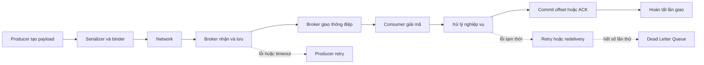

# Tính nhất quán cuối cùng và các điểm lỗi trên đường truyền

Spring Cloud Stream cung cấp mô hình lập trình thống nhất để ứng dụng gửi và nhận thông điệp qua binding, còn binder kết nối các binding với Kafka, RabbitMQ hoặc Pulsar. Sự trừu tượng này giúp mã nghiệp vụ ít phụ thuộc vào broker, nhưng không loại bỏ các vấn đề của hệ thống phân tán: mạng có thể ngắt, tiến trình có thể dừng, broker có thể từ chối ghi, consumer có thể xử lý xong nhưng chưa xác nhận, hoặc một thông điệp có thể được giao lại.

Khi thiết kế ứng dụng xử lý sự kiện, cần hiểu **tính nhất quán cuối cùng (eventual consistency)** và xác định rõ từng điểm có thể lỗi trên đường truyền. Mục tiêu thực tế thường là không làm mất thông điệp đã được chấp nhận, chấp nhận khả năng giao lặp, và bảo đảm tác dụng nghiệp vụ không bị thực hiện trùng nhờ idempotency, giao dịch và khả năng phục hồi.

## 1. Tính nhất quán cuối cùng là gì?

Trong kiến trúc hướng sự kiện, một thay đổi nghiệp vụ thường được công bố thành thông điệp. Các dịch vụ khác tiếp nhận thông điệp vào những thời điểm khác nhau rồi cập nhật dữ liệu của mình. Vì vậy, ngay sau khi một dịch vụ ghi nhận thay đổi, các bản chiếu dữ liệu (projection), chỉ mục tìm kiếm, bộ đếm hoặc dịch vụ phụ thuộc có thể chưa phản ánh thay đổi đó.

Hệ thống đạt **tính nhất quán cuối cùng** khi, nếu không còn lỗi mới và các thông điệp cần thiết được xử lý thành công, những thành phần liên quan sẽ hội tụ về trạng thái phù hợp. Trong khoảng thời gian hội tụ, mỗi thành phần có thể nhìn thấy một phiên bản trạng thái khác nhau.

Ví dụ, dịch vụ đơn hàng lưu đơn `order-9001` và phát sự kiện `OrderCreated`. Dịch vụ kho nhận sự kiện sau đó để giữ hàng; dịch vụ báo cáo nhận sự kiện ở một thời điểm khác để cập nhật số liệu. Trong một khoảng ngắn, trang chi tiết đơn hàng có thể hiển thị đơn đã tạo trong khi báo cáo chưa tăng số đơn và hệ thống kho chưa cập nhật lượng hàng giữ chỗ. Đây có thể là độ trễ bình thường của luồng bất đồng bộ, miễn là hệ thống có cơ chế giao nhận, thử lại và xử lý lỗi để các bản sao dữ liệu hội tụ.

Tính nhất quán cuối cùng không có nghĩa là mọi thông điệp chắc chắn sẽ tự đến nơi, cũng không có nghĩa là mọi thao tác luôn thành công. Nó là một thuộc tính của toàn bộ quy trình: dữ liệu được công bố bền vững, consumer có thể tiếp tục xử lý sau sự cố, thông điệp lỗi được quản lý và thao tác lặp không gây sai lệch.

## 2. Theo dõi đường đi của một thông điệp

Một luồng xử lý điển hình có các chặng sau:

1. **Ứng dụng phát (producer):** tạo payload, gắn metadata và chuyển đổi dữ liệu sang định dạng truyền tải.
2. **Mạng và binder:** chuyển dữ liệu từ ứng dụng tới broker theo cấu hình của binder.
3. **Broker:** xác thực yêu cầu, định tuyến tới topic, queue hoặc partition, lưu dữ liệu theo chính sách và trả kết quả xác nhận.
4. **Broker giao dữ liệu:** chọn consumer theo subscription hoặc consumer group, sau đó gửi bản ghi/thông điệp tới consumer.
5. **Ứng dụng nhận (consumer):** giải mã payload, kiểm tra schema và thực hiện nghiệp vụ.
6. **Xác nhận xử lý:** consumer hoặc binder xác nhận, commit offset hay ACK theo cơ chế của broker.



Mỗi mũi tên là một ranh giới có thể xảy ra lỗi. Chẳng hạn, producer có thể gửi thành công nhưng mất phản hồi ACK; broker có thể đã lưu dữ liệu trong khi producer tưởng rằng thao tác thất bại. Tương tự, consumer có thể cập nhật cơ sở dữ liệu xong rồi dừng trước khi ACK, khiến broker giao lại cùng thông điệp.

Điều quan trọng là phân biệt ba kết quả:

- **Đã gửi:** ứng dụng đã thực hiện thao tác gửi hoặc đã chuyển dữ liệu cho binder.
- **Đã được broker xác nhận:** broker đã chấp nhận theo mức bảo đảm được cấu hình.
- **Đã được nghiệp vụ xử lý:** consumer đã hoàn tất tác dụng nghiệp vụ và xác nhận theo cơ chế tương ứng.

Ba thời điểm này không đồng nghĩa. Một xác nhận từ broker không chứng minh consumer đã cập nhật cơ sở dữ liệu; một log “đã gửi” ở producer cũng không chứng minh broker đã lưu bền vững.

## 3. Các điểm lỗi ở phía producer

### 3.1. Lỗi tạo payload và chuyển đổi dữ liệu

Payload có thể không hợp lệ, thiếu trường bắt buộc hoặc không chuyển đổi được sang JSON, Avro, Protobuf hay định dạng đã chọn. Nếu lỗi xảy ra trước khi gửi, broker chưa nhận thông điệp. Ứng dụng cần ghi nhận lỗi ở phía phát và quyết định trả lỗi cho caller, lưu yêu cầu để thử lại hay đưa vào một quy trình xử lý khác.

Schema cũng là một phần của hợp đồng giao tiếp. Producer triển khai schema mới có thể làm consumer cũ không giải mã được dữ liệu. Nên quy định trường bắt buộc, giá trị mặc định, quy tắc tương thích và chiến lược nâng cấp consumer/producer. Với hệ thống dùng schema registry, cần kiểm tra chính sách compatibility trước khi phát hành schema.

### 3.2. Mất kết nối hoặc timeout khi gửi

Khi gửi thông điệp, producer có thể gặp timeout, mất kết nối, broker quá tải hoặc từ chối yêu cầu. Timeout tạo ra tình huống không chắc chắn: broker có thể chưa nhận dữ liệu, hoặc đã nhận và lưu nhưng phản hồi không tới được producer.

Nếu producer gửi lại sau timeout, thông điệp có thể xuất hiện hai lần. Nếu producer không gửi lại, thông điệp có thể bị mất khi broker chưa nhận. Vì vậy, retry ở producer thường cần kết hợp với định danh thông điệp ổn định hoặc khóa idempotency để xử lý trường hợp kết quả gửi không rõ ràng.

### 3.3. Broker xác nhận ở mức nào?

Không phải mọi phản hồi thành công đều mang cùng ý nghĩa. Cần xem xét cấu hình xác nhận của broker, số bản sao, chính sách lưu trữ và loại queue/subscription. Ví dụ:

- Với Kafka, producer có thể cấu hình `acks` để quyết định cần bao nhiêu xác nhận từ replica; `acks=all` yêu cầu các replica đang nằm trong tập ISR xác nhận theo cơ chế Kafka. Độ bền còn phụ thuộc replication factor, `min.insync.replicas` và cấu hình cluster.
- Với RabbitMQ, publisher confirm cho biết broker đã xử lý publish theo cơ chế xác nhận; độ bền còn liên quan tới durable queue, message persistence và loại queue. Publisher confirm không chứng minh consumer đã xử lý.
- Với Pulsar, producer nhận xác nhận sau khi broker ghi thông điệp theo cấu hình lưu trữ của topic và cluster. Chính sách replication và persistence của hệ thống vẫn ảnh hưởng tới độ bền.

Các thuộc tính này được cấu hình ở mức binder hoặc broker và không có một giá trị chung áp dụng cho cả Kafka, RabbitMQ và Pulsar. Cần kiểm tra tài liệu của đúng binder và phiên bản đang triển khai.

### 3.4. Gắn việc ghi dữ liệu nghiệp vụ với việc phát sự kiện

Một lỗi phổ biến là ứng dụng ghi cơ sở dữ liệu thành công nhưng không gửi được sự kiện, hoặc gửi sự kiện thành công rồi giao dịch cơ sở dữ liệu rollback. Đây là vấn đề dual write: hai hệ thống lưu trữ độc lập không tự động tham gia cùng một giao dịch nguyên tử.

**Transactional outbox** là mẫu thường dùng để giải quyết tình huống này:

1. Trong cùng một giao dịch cơ sở dữ liệu, ứng dụng cập nhật dữ liệu nghiệp vụ và thêm một bản ghi vào bảng outbox.
2. Một tiến trình relay hoặc CDC đọc các bản ghi outbox chưa phát và gửi chúng tới broker.
3. Sau khi xác nhận gửi, relay đánh dấu bản ghi đã phát hoặc lưu checkpoint theo thiết kế.
4. Nếu relay dừng sau khi gửi nhưng trước khi đánh dấu, nó có thể gửi lại; consumer vẫn cần xử lý idempotent.

Nhờ đó, dữ liệu nghiệp vụ và ý định phát sự kiện được lưu nguyên tử trong cùng cơ sở dữ liệu. Outbox không tự tạo ra exactly-once trên toàn hệ thống; nó giúp tránh mất sự kiện giữa bước commit dữ liệu và bước phát thông điệp.

## 4. Các điểm lỗi ở broker và đường truyền

### 4.1. Định tuyến, partition và thứ tự

Thông điệp có thể được định tuyến sai destination, queue hoặc topic do cấu hình binding không đúng. Một binding trong Spring Cloud Stream ánh xạ tới destination logic; binder và cấu hình broker quyết định cách destination đó được tạo và sử dụng.

Partition giúp mở rộng khả năng xử lý song song, nhưng thứ tự thường chỉ được bảo đảm trong phạm vi một partition hoặc một luồng định tuyến cụ thể. Với Kafka, các bản ghi có cùng key thường được đưa về cùng partition theo partitioner đang dùng; thứ tự trong một partition được duy trì theo offset. Không nên giả định có thứ tự toàn cục giữa nhiều partition.

RabbitMQ có thể phân phối message cho nhiều consumer cùng lúc. ACK, requeue, prefetch và số consumer ảnh hưởng tới thứ tự quan sát được ở phía ứng dụng. Pulsar có nhiều loại subscription với đặc tính phân phối và thứ tự khác nhau; lựa chọn Shared, Key_Shared, Failover hay Exclusive ảnh hưởng tới cách consumer nhận message.

Nếu nghiệp vụ yêu cầu xử lý theo thứ tự cho từng đơn hàng hoặc tài khoản, hãy chọn khóa phân vùng/định tuyến ổn định, giới hạn xử lý đồng thời phù hợp và xác định cách xử lý khi một thông điệp cũ được giao lại. Không dựa vào thứ tự toàn cục nếu cấu hình broker không cung cấp bảo đảm đó.

### 4.2. Broker ngừng hoạt động hoặc đầy dung lượng

Broker có thể khởi động lại, mất kết nối với replica, hết dung lượng hoặc từ chối publish do quota/chính sách. Ứng dụng cần có timeout, retry có giới hạn và backoff; broker cần có giám sát dung lượng, replication, tình trạng queue/topic và chính sách retention.

Retry liên tục không giới hạn có thể làm tăng tải lên một broker đang gặp sự cố. Backoff theo cấp số nhân và jitter giúp giảm hiện tượng nhiều producer cùng retry tại một thời điểm. Khi hết thời gian hoặc số lần thử, ứng dụng cần chuyển sang trạng thái có thể quan sát và phục hồi, thay vì âm thầm bỏ thông điệp.

### 4.3. Message hết hạn hoặc bị loại bỏ

TTL, retention, giới hạn kích thước, chính sách compact, queue overflow hoặc thao tác quản trị có thể khiến dữ liệu không còn khả dụng. Cần xác định thời gian lưu giữ đáp ứng thời gian gián đoạn tối đa dự kiến, tốc độ tiêu thụ và nhu cầu replay. Thông điệp chứa dữ liệu nhạy cảm cũng cần chính sách lưu trữ và truy cập phù hợp.

## 5. Các điểm lỗi ở phía consumer

### 5.1. Consumer dừng trước khi xử lý

Nếu consumer nhận message rồi dừng trước khi thực hiện nghiệp vụ, broker thường có thể giao lại message sau khi phát hiện consumer mất kết nối hoặc sau khi hết thời gian ACK. Cơ chế cụ thể khác nhau theo broker: Kafka quản lý vị trí đọc bằng offset; RabbitMQ dùng ACK/NACK; Pulsar dùng acknowledgement và trạng thái subscription.

### 5.2. Consumer xử lý xong nhưng chưa xác nhận

Đây là tình huống quan trọng nhất khi thiết kế at-least-once. Consumer có thể đã cập nhật cơ sở dữ liệu hoặc gọi dịch vụ ngoài, nhưng tiến trình dừng trước khi commit offset hoặc ACK. Broker không biết tác dụng nghiệp vụ đã hoàn tất nên giao lại message.

Nếu xử lý lại tạo thêm đơn hàng, gửi email lần nữa hoặc trừ tiền lần nữa, hệ thống phát sinh tác dụng phụ trùng lặp. Cần thiết kế consumer idempotent: cùng một thông điệp được xử lý một hay nhiều lần thì trạng thái nghiệp vụ cuối cùng vẫn đúng.

### 5.3. Xác nhận trước khi tác dụng nghiệp vụ bền vững

Nếu consumer ACK hoặc commit offset trước khi lưu tác dụng nghiệp vụ bền vững, một sự cố ở bước lưu dữ liệu có thể làm message bị xem là đã xử lý dù nghiệp vụ chưa hoàn tất. Đây là nguồn gây mất dữ liệu ở mức ứng dụng.

Với xử lý cần ghi cơ sở dữ liệu, hãy chọn thời điểm xác nhận sao cho kết quả nghiệp vụ đã commit. Spring Cloud Stream và binder quản lý một phần cơ chế ACK/offset, nhưng cấu hình acknowledgement, transaction và xử lý lỗi phải được hiểu theo binder cụ thể. Không nên tự suy ra rằng trả về khỏi hàm đồng nghĩa với cùng một thời điểm commit trong mọi broker và mọi cấu hình.

### 5.4. Lỗi dữ liệu không thể xử lý

Một message sai schema, thiếu trường bắt buộc hoặc vi phạm quy tắc nghiệp vụ có thể thất bại lặp đi lặp lại. Đây là poison message. Retry vô hạn sẽ chặn tiến độ, tiêu tốn tài nguyên và có thể làm các message khác bị trì hoãn.

Hãy phân loại lỗi:

- **Lỗi tạm thời:** database timeout, dịch vụ phụ thuộc tạm ngừng, lỗi mạng. Có thể retry với backoff.
- **Lỗi dữ liệu hoặc hợp đồng:** payload không giải mã được, schema không tương thích, trường bắt buộc không hợp lệ. Thường cần chuyển DLQ hoặc quy trình sửa dữ liệu.
- **Lỗi nghiệp vụ có chủ đích:** ví dụ đơn hàng đã hủy nên không thể xác nhận thanh toán. Cần biểu diễn kết quả nghiệp vụ rõ ràng; không nhất thiết retry như lỗi hạ tầng.

## 6. At-most-once, at-least-once và exactly-once

Các thuật ngữ này mô tả số lần một message hoặc một tác dụng xử lý có thể xảy ra trong một phạm vi xác định:

| Ngữ nghĩa | Đặc điểm | Đánh đổi |
|---|---|---|
| At-most-once | Một message được xử lý không quá một lần theo cơ chế đã chọn; có thể mất nếu lỗi xảy ra trước khi xử lý hoàn tất. | Tránh giao lặp nhưng có nguy cơ mất dữ liệu. |
| At-least-once | Hệ thống thử giao cho tới khi được xác nhận; message có thể được giao nhiều lần. | Tăng khả năng không mất message đã được broker nhận, nhưng consumer phải chịu được trùng lặp. |
| Exactly-once | Một hiệu ứng được bảo đảm đúng một lần trong phạm vi giao dịch/cơ chế cụ thể. | Phạm vi bảo đảm hẹp và cần cấu hình, giao dịch, điều kiện vận hành tương ứng. |

Trong nhiều ứng dụng Spring Cloud Stream, lựa chọn thực tế là at-least-once kết hợp consumer idempotent. Đây là cách tiếp cận dễ phục hồi: chấp nhận giao lại, nhưng làm cho lần xử lý lặp không tạo thêm tác dụng nghiệp vụ.

Không nên quảng bá “exactly-once” như một bảo đảm tự động cho toàn bộ chuỗi producer → broker → consumer → database → API ngoài. Ví dụ, Kafka hỗ trợ giao dịch producer và cơ chế exactly-once cho một số luồng đọc-xử lý-ghi trong phạm vi Kafka, bao gồm các luồng Kafka Streams khi được cấu hình phù hợp. Điều đó không tự động bao trùm việc gửi email, gọi API thanh toán hoặc ghi một cơ sở dữ liệu ngoài giao dịch Kafka.

RabbitMQ publisher confirms và consumer acknowledgements giúp theo dõi publish và hoàn tất giao nhận, nhưng không tự tạo giao dịch nguyên tử giữa message và tác dụng phụ trong database. Pulsar hỗ trợ các cơ chế acknowledgement, deduplication và transaction tùy cấu hình/phiên bản, nhưng tác dụng ngoài phạm vi transaction của Pulsar vẫn cần idempotency hoặc một mẫu tích hợp phù hợp.

Vì vậy, khi nói về exactly-once, luôn nêu rõ phạm vi: một lần ghi trong Kafka, một lần cập nhật trong database, hay một hiệu ứng nghiệp vụ xuyên nhiều hệ thống. Nếu không nêu phạm vi, thuật ngữ này dễ tạo kỳ vọng sai.

## 7. Thiết kế consumer idempotent

Idempotency nghĩa là thực hiện cùng một yêu cầu nhiều lần vẫn tạo ra kết quả nghiệp vụ tương đương với thực hiện một lần. Có thể dùng `eventId`, `messageId` hoặc khóa nghiệp vụ làm định danh xử lý.

Ví dụ, consumer cập nhật read model từ sự kiện `OrderCreated`. Bảng `processed_message` lưu định danh sự kiện đã xử lý và có unique constraint trên `event_id`. Trong cùng giao dịch database, ứng dụng thử ghi dấu nhận message; chỉ lần ghi đầu tiên mới cập nhật projection:

```java
import java.util.function.Consumer;

import org.springframework.context.annotation.Bean;
import org.springframework.context.annotation.Configuration;

@Configuration
class OrderProjectionConfiguration {

    @Bean
    Consumer<OrderCreated> updateOrderProjection(
            OrderProjectionService service) {
        return service::apply;
    }
}
```

Phần nghiệp vụ có thể được tổ chức như sau:

```java
import org.springframework.stereotype.Service;
import org.springframework.transaction.annotation.Transactional;

@Service
class OrderProjectionService {

    private final ProcessedMessageRepository processedMessages;
    private final OrderProjectionRepository projections;

    OrderProjectionService(
            ProcessedMessageRepository processedMessages,
            OrderProjectionRepository projections) {
        this.processedMessages = processedMessages;
        this.projections = projections;
    }

    @Transactional
    public void apply(OrderCreated event) {
        // INSERT có unique constraint trên event_id; trả false nếu đã tồn tại.
        boolean firstDelivery = processedMessages.insertIfAbsent(event.eventId());
        if (!firstDelivery) {
            return;
        }

        projections.markCreated(event.orderId(), event.occurredAt());
    }
}
```

`insertIfAbsent` đại diện cho thao tác database nguyên tử dựa trên unique constraint hoặc câu lệnh upsert phù hợp với hệ quản trị đang dùng. Việc ghi dấu và cập nhật projection phải nằm trong cùng một giao dịch. Nếu cập nhật projection thất bại, giao dịch rollback cả dấu đã xử lý để lần giao sau có thể thử lại. Nếu giao dịch commit nhưng ACK bị mất, lần giao tiếp theo thấy `eventId` đã tồn tại và không lặp tác dụng nghiệp vụ.

Nếu consumer gọi một API ngoài hoặc gửi email, giao dịch database cục bộ không thể rollback tác dụng đã xảy ra ở hệ thống ngoài. Khi đó cần idempotency key được hệ thống đích hỗ trợ, một outbox cho yêu cầu gọi ra, hoặc quy trình bù trừ/saga tùy yêu cầu nghiệp vụ.

## 8. Retry, backoff và Dead Letter Queue

Retry giúp xử lý lỗi tạm thời, nhưng cần giới hạn. Một chính sách thường gồm số lần thử tối đa, thời gian chờ ban đầu, hệ số tăng và thời gian chờ tối đa. Có thể thêm jitter để phân tán thời điểm thử lại.

Ví dụ cấu hình retry chung cho một binding consumer trong Spring Cloud Stream:

```yaml
spring:
  cloud:
    stream:
      bindings:
        updateOrderProjection-in-0:
          destination: orders.events
          group: order-projection
          consumer:
            max-attempts: 4
            back-off-initial-interval: 1000
            back-off-max-interval: 10000
            back-off-multiplier: 2.0
```

Các giá trị trên chỉ là ví dụ. Retry có thể diễn ra trong tiến trình ứng dụng hoặc thông qua cơ chế redelivery của broker; thời điểm ACK, thời gian chờ và cách đếm lần thử phụ thuộc binder, loại consumer và cấu hình. Tránh kết hợp nhiều tầng retry không kiểm soát vì tổng số lần thử có thể tăng rất lớn.

**Dead Letter Queue (DLQ)** là nơi chuyển message không thể xử lý sau chính sách retry. DLQ giúp message lỗi không chặn luồng chính và tạo cơ hội điều tra, sửa dữ liệu hoặc phát lại sau khi khắc phục. Cấu hình DLQ là đặc thù binder:

- Kafka binder có tùy chọn consumer để bật DLQ và cấu hình tên destination DLQ; cần cấu hình phù hợp với partition và quyền truy cập.
- RabbitMQ thường dùng dead-letter exchange và dead-letter queue, với routing key và chính sách TTL/queue được thiết lập ở broker hoặc qua binder.
- Pulsar có dead letter policy gắn với subscription, cùng tên topic DLQ và số lần giao tối đa theo cấu hình.

Không nên coi DLQ là nơi “ném lỗi rồi quên”. Một quy trình vận hành cần lưu nguyên nhân, số lần thử, thời điểm, định danh message và thông tin tương quan; có người hoặc quy trình tự động kiểm tra; đồng thời quy định cách sửa và phát lại. Trước khi replay, phải bảo đảm consumer có thể xử lý lặp an toàn.

## 9. Consumer group, partition và khả năng tiếp tục sau sự cố

Consumer group cho phép nhiều instance cùng chia sẻ công việc. Khi instance dừng, broker hoặc cơ chế điều phối sẽ phân phối lại partition, queue hay message cho instance còn hoạt động. Quá trình này có thể gây tạm dừng, giao lại message hoặc thay đổi thứ tự quan sát được.

Với Kafka, offset cho biết vị trí đọc của consumer group trong mỗi partition. Commit offset quá sớm có thể bỏ qua message chưa xử lý; commit quá muộn có thể làm message được đọc lại sau khi restart. Với RabbitMQ, consumer ACK/NACK quyết định message đã được xử lý hay cần requeue/reject. Với Pulsar, acknowledgement và subscription cursor ảnh hưởng tới việc broker xem message đã được xác nhận hay còn phải giao lại.

Các nguyên tắc vận hành:

- Dùng group/subscription có tên ổn định cho một loại xử lý logic; tránh tạo group mới ngoài ý muốn mỗi lần khởi động.
- Chọn số partition, queue consumer và mức concurrency phù hợp với khả năng xử lý thực tế.
- Đặt timeout và giới hạn thời gian xử lý để phát hiện consumer bị treo.
- Theo dõi consumer lag, số message chưa ACK, redelivery và tình trạng rebalance.
- Kiểm thử khi một instance dừng đột ngột trong lúc xử lý, khi broker restart và khi tăng/giảm số instance.
- Nếu cần thứ tự theo khóa nghiệp vụ, bảo đảm các message của cùng khóa được định tuyến nhất quán và không xử lý song song gây đảo thứ tự.

## 10. Kiểm thử các tình huống lỗi

Một bài kiểm thử chỉ xác minh hàm nhận đúng payload là chưa đủ để đánh giá bảo đảm giao nhận. Cần kiểm thử các ranh giới lỗi có thể làm message mất, giao lại hoặc bị mắc kẹt.

| Tình huống | Điều cần xác minh |
|---|---|
| Producer timeout sau khi broker có thể đã nhận | Retry không làm phát sinh tác dụng nghiệp vụ trùng. |
| Broker tạm ngừng hoặc từ chối publish | Lỗi được quan sát; ứng dụng retry/backoff hoặc lưu lại ý định phát. |
| Consumer dừng trước khi xử lý | Message có thể được giao lại sau khi consumer phục hồi. |
| Consumer dừng sau khi ghi DB nhưng trước ACK | Lần giao lại không cập nhật nghiệp vụ lần thứ hai. |
| Payload sai schema hoặc không giải mã được | Message được phân loại và chuyển tới DLQ/quy trình xử lý phù hợp. |
| Retry hết số lần | Message không biến mất âm thầm; DLQ có đủ thông tin điều tra. |
| Consumer group rebalance | Không bỏ sót dữ liệu do commit offset/ACK sai thời điểm. |
| Replay message từ DLQ | Có thể phát lại có kiểm soát và vẫn idempotent. |

Spring Cloud Stream Test Binder hữu ích để kiểm thử hàm và luồng binding trong phạm vi ứng dụng. Tuy nhiên, nó không mô phỏng đầy đủ hành vi replication, publisher confirm, offset, requeue, transaction hay dead-letter của broker thật. Với các bảo đảm phụ thuộc broker, nên có kiểm thử tích hợp dùng đúng binder và một broker tương ứng, có thể chạy trong môi trường kiểm thử tự động.

Khi kiểm thử, hãy tạo điểm dừng có chủ đích: cho consumer ném lỗi trước và sau thao tác database; làm broker ngắt kết nối; gửi cùng `eventId` nhiều lần; gửi payload sai schema; rồi xác minh trạng thái database, số lần xử lý, ACK/offset và nội dung DLQ.

## 11. Quan sát và vận hành tính nhất quán cuối cùng

Để biết hệ thống có đang hội tụ hay không, cần theo dõi cả phía phát, broker và phía nhận. Một số chỉ số hữu ích:

- Số lượng publish thành công/thất bại, timeout và retry ở producer.
- Độ trễ từ lúc sự kiện xảy ra tới lúc consumer xử lý xong.
- Consumer lag hoặc số message đang chờ trong queue/subscription.
- Số lần redelivery, retry và message chuyển vào DLQ.
- Tỷ lệ lỗi giải mã/schema và lỗi nghiệp vụ.
- Thời gian xử lý, thời gian ACK/commit và số lần consumer restart/rebalance.

Gắn `eventId` hoặc `messageId` cùng `correlationId` vào log/trace để nối các bước giữa nhiều dịch vụ. Tránh ghi toàn bộ payload nhạy cảm vào log. Cảnh báo nên dựa trên xu hướng và ngưỡng có ý nghĩa, ví dụ DLQ tăng liên tục, consumer lag vượt thời gian chấp nhận hoặc tỷ lệ publish thất bại tăng đột ngột.

Một hệ thống có tính nhất quán cuối cùng cần cả cơ chế kỹ thuật và quy trình vận hành: biết message đang ở đâu, biết vì sao xử lý thất bại, có thể phục hồi consumer, sửa dữ liệu lỗi và replay có kiểm soát.

## 12. Quy trình thiết kế bảo đảm giao nhận

Khi thiết kế một binding trong Spring Cloud Stream, hãy đi lần lượt qua các câu hỏi sau:

1. **Điều gì được bảo đảm ở producer?** Ứng dụng có kiểm tra lỗi serialize, timeout, xác nhận từ broker và retry có giới hạn không?
2. **Khi nào message được xem là bền vững?** Cấu hình broker về replication, persistence, retention và xác nhận có đáp ứng yêu cầu không?
3. **Consumer xác nhận lúc nào?** ACK hoặc offset commit có diễn ra sau khi tác dụng nghiệp vụ đã bền vững không?
4. **Nếu message được giao lại thì sao?** Có định danh ổn định, unique constraint hoặc idempotency key không?
5. **Lỗi nào được retry?** Lỗi tạm thời có backoff; lỗi dữ liệu có đường đi tới DLQ hoặc quy trình sửa chữa không?
6. **Có thể phục hồi và replay không?** Thời gian lưu trữ, quyền truy cập và quy trình vận hành có hỗ trợ việc này không?
7. **Làm sao biết hệ thống đã hội tụ?** Có metric, log, trace và cảnh báo cho producer, broker, consumer và DLQ không?

Hãy ghi rõ ngữ nghĩa giao nhận mong muốn cho từng luồng, chẳng hạn “at-least-once tới consumer, cập nhật projection idempotent theo `eventId`, lỗi tạm thời retry tối đa bốn lần, sau đó chuyển DLQ”. Mô tả cụ thể như vậy giúp nhóm phát triển và vận hành kiểm chứng được bảo đảm, thay vì chỉ ghi chung chung rằng hệ thống “đảm bảo exactly-once”.
